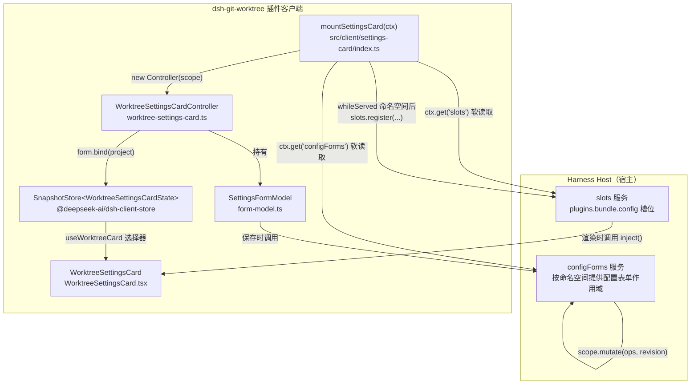
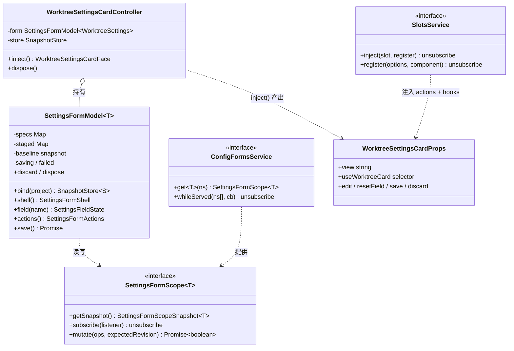
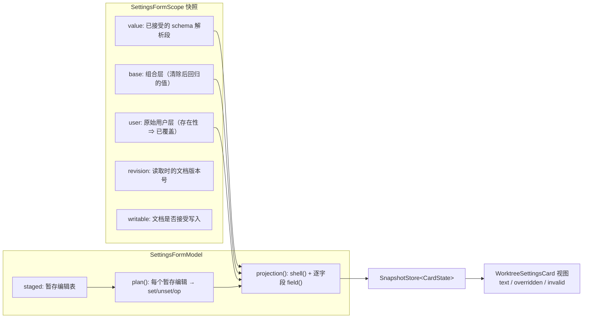
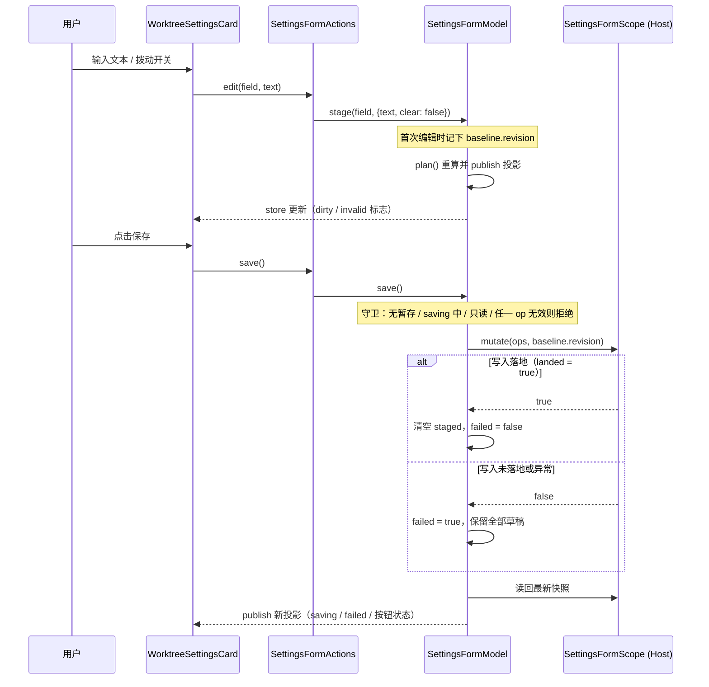
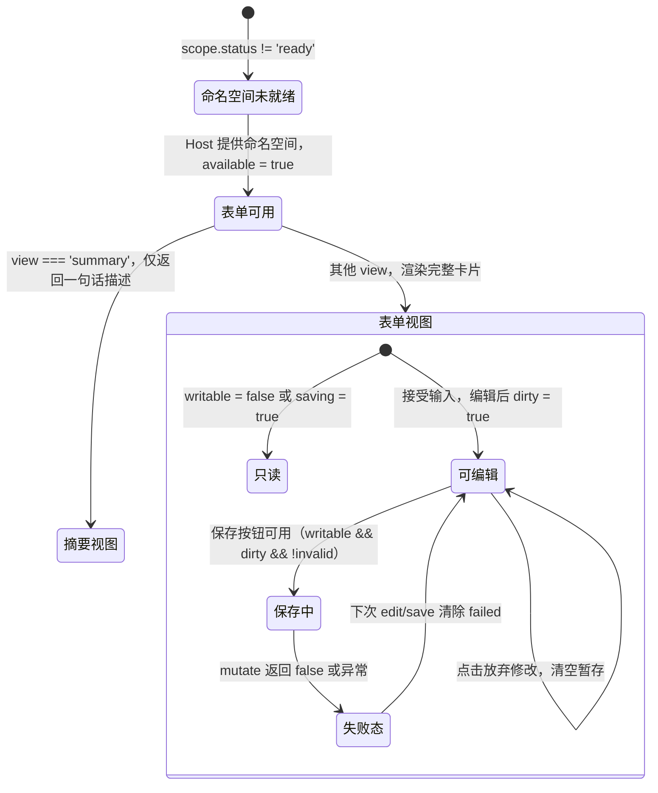

# 设置卡片模块（settings-card）

!!! info "Generated documentation"
    This page was written by CodeWiki from the source code at commit [`4c472668`](https://github.com/wloops/dsh-git-worktree/commit/4c472668067fdf9c6675bca31a97cef07c5b23aa) on 2026-11-07 with `doubao-seed-2.1-lite`. Check the code before relying on details.

## 简介

`root_3_settings_card` 是 Worktree 插件的**设置页模块**：它把插件的设置表单挂载进 Harness Host 的 Plugins 页面，编辑 `dsh-git-worktree` 配置命名空间下的五项设置——自动交付开关（`autoDeliver`）、自动推送开关（`autoPush`）、Worktree 根目录（`worktreesRoot`）、单条 Git 命令超时（`gitTimeoutMs`）与 `worktree add` 超时（`worktreeAddTimeoutMs`）。

模块的三个关键设计决策：

1. **暂存式表单（staged form）**：用户输入只先在本地暂存，点击"保存"时才一次性写入。因为每次设置写入都是带版本围栏（revision-fenced）的持久文档变更，"输入即写"会把一次用户从未请求的写入落到文档上，且无法预览。
2. **自包含渲染**：插件安装的 `client-ui-primitives` 版本早于共享 `SettingsForm` 模块，卡片因此用内联样式（inline styles）自行绘制行、开关与输入框，不依赖外部样式表。
3. **故障软着陆（fail-soft）挂载**：当 Host 不提供 `configForms` 或 `slots` 服务时，`mountSettingsCard` 直接 no-op，插件其余功能不受影响；设置页只是不存在。

---

## 文件与组件总览

| 文件 | 核心组件 | 职责 |
| --- | --- | --- |
| `src/client/settings-card/index.ts` | `ConfigFormsService`、`SlotsService`、`mountSettingsCard` | 挂载入口：探测 Host 服务、创建控制器、把卡片注册进 `plugins.bundle.config` 槽位 |
| `src/client/settings-card/worktree-settings-card.ts` | `WORKTREE_SETTINGS_NS`、`WorktreeSettings`、`WorktreeSettingsCardController`、`WorktreeSettingsCardFace`、`WorktreeSettingsCardState` | 控制器：把五项字段规格装配到暂存表单模型上，产出卡片快照与注入面 |
| `src/client/settings-card/form-model.ts` | `SettingsFormModel`、`SettingsFormScope`、`SettingsFieldSpec`、`settingsBooleanField` / `settingsNumberField` / `settingsTextField` | 通用暂存表单模型：暂存编辑、规划写入、版本围栏保存、快照发布 |
| `src/client/settings-card/WorktreeSettingsCard.tsx` | `WorktreeSettingsCard`、`WorktreeSettingsCardProps` | React 视图：一行一字段地渲染开关/输入框、覆盖徽标、重置与保存/放弃操作 |
| `src/client/styles.ts` | `WORKTREE_STYLES` | 插件全局 CSS 字符串（侧边栏装饰、验收卡等）；本模块的设置卡片刻意不用它，保持内联样式自包含 |

---

## 架构总览

模块在 Cordis 插件体系中的位置是"客户端 UI 装配层"：宿主服务（`configForms`、`slots`）从 Host 注入，控制器在插件 fiber 内创建，视图通过槽位（slot）被 Host 的 Plugins 页面渲染。

**关键装配细节**（见 `mountSettingsCard`）：

- 使用 `ctx.get('configForms')` 而非属性 getter 读取服务——Cordis 在未声明注入时会抛 "cannot get property without inject"，`ctx.get()` 是与 [host-compat 模块](../root_5.md) 一致的可选服务软读取模式。
- 控制器的生命周期由 `ctx.effect(..., 'dsh-git-worktree: settings form subscription')` 管理：effect 创建控制器，清理回调调用 `controller.dispose()` 退订。
- 槽位选择 `plugins.bundle.config`（按 bundle 包名键控，渲染在 bundle 自身 Plugins 页的描述与行之间）；`plugins.item` 是官方插件列表槽位，不会显示第三方 bundle 的卡片。
- 槽位注册只在 `configForms.whileServed([WORKTREE_SETTINGS_NS], ...)` 回调内进行——即 Host 真正向本客户端提供该命名空间时才注入，命名空间不可用时卡片整体不渲染。

---

## 组件关系

**注入面（Face）的转换约定**：`WorktreeSettingsCardController.inject()` 返回 `{ hooks: { worktreeCard: store }, ...form.actions() }`。渲染器会把保留的 `hooks.worktreeCard` 源转成组件的 `useWorktreeCard` 选择器 hook，所以组件 props 中从不出现 `hooks`，只看到 `view`、`useWorktreeCard` 与 `edit/resetField/save/discard` 四个动作。

---

## 数据流：从 Host 文档到表单视图

表单采用三层值解析：**用户层（user）覆盖组合层（base），组合层再覆盖 schema 默认值**。字段是否"被覆盖"由其在用户层的**存在性**判定，而非值比较——与组合层默认值相同的用户层条目仍是一次覆盖（还原按钮会把它清掉，让字段重新继承）。

**投影重建时机**：`SettingsFormModel` 同时订阅 scope 变化（构造时 `scope.subscribe(() => publish())`）与本地暂存变化（每次 `stage()` 后 `publish()`）；所有订阅的 store 都用最新的 `project()` 闭包重算，保证界面上看到的内容与保存后将写入的内容严格一致。

---

## 保存流程：暂存、围栏与失败保留

**设计要点**：

- **版本围栏**：保存以暂存开始时的 `baseline.revision` 作为 `expectedRevision`，与 Host 的并发写入冲突时由 `mutate` 返回 `false`，而不是静默覆盖。
- **Host 是唯一裁决者**：值是否被接受不由模型预测——Host 的校验器拥有 schema 无法表达的约束，因此保存后从段落读回真实状态再投影。保存未生效时**保留所有草稿**，用户可直接修正而不是重新输入。
- **无效草稿不丢弃**：`plan()` 中解析不出合法写入的条目只让 `invalid = true` 并禁用保存按钮，既不删除草稿也不偷偷提交。
- **放弃（discard）**：清空暂存表、重置 baseline 与 failed 标志，视图回到 Host 当前生效值。

---

## 字段规格与编辑语义

控制器在构造时声明五项字段规格：

| 设置 | 规格工厂 | 草稿→写入语义 | 对应运行时消费 |
| --- | --- | --- | --- |
| `autoDeliver` | `settingsBooleanField` | 草稿 `'true'`/`'false'` 写布尔；空草稿 = 清除；其他文本无效 | agent 实现完成后自动交付 |
| `autoPush` | `settingsBooleanField` | 同上 | 每次交付后尽力推送 Local 分支（绝不强推） |
| `worktreesRoot` | `settingsTextField` | 去空白后写字符串；空草稿 = 清除（回归默认位置） | 仅影响之后创建的受管 Worktree |
| `gitTimeoutMs` | `settingsNumberField` | 须为安全整数；空草稿 = 清除 | 对应 [Git 超时选项](../root.md) 的 `GitTimeoutOptions.gitTimeoutMs`（单条 Git 命令最长等待） |
| `worktreeAddTimeoutMs` | `settingsNumberField` | 同上 | 对应 `GitTimeoutOptions.worktreeAddTimeoutMs`（创建 Worktree 的最长等待） |

布尔字段的视图约定：开关把 `fieldState.text === 'true'` 作为 checked 状态；点击切换在 `'true'`/`'false'` 草稿之间翻转。所有文案（`settings.autoDeliver`、`settings.worktreesRoot.hint`、`settings.failed` 等）经 `useClientTranslator()` 取自客户端消息目录，见 [i18n 模块](../root_6.md)。

---

## 视图状态机

按钮的可用性是显式推导的：保存要求 `writable && dirty && !invalid && !saving`；放弃要求 `dirty || failed`；单个字段的重置按钮只在 `overridden`（用户层存在该字段）时出现，旁边带"已覆盖"徽标。

---

## 与其他模块的关系

- **宿主与兄弟模块**：本模块是 [root_3 客户端控制台模块](../root_3.md) 的一部分；同一目录下的验收控制台（[评审控制台（review-console）](root_3_review_console.md)）与目标控制台（[目标控制台（target-console）模块](root_3_target_console.md)）消费本模块编辑出的设置（超时、根目录、自动交付行为），但不依赖本模块的表单实现。
- **样式**：`src/client/styles.ts` 导出的 `WORKTREE_STYLES` 是插件其余客户端 UI（侧边栏徽章、验收卡、目标控制台弹窗）的全局样式字符串，并拼接了 review-console 的样式；设置卡片刻意走内联样式路线，避免对版本不匹配的共享样式表产生耦合。
- **运行时消费方**：`gitTimeoutMs` / `worktreeAddTimeoutMs` 最终汇入 [root 模块](../root.md) 适配器层的 `GitTimeoutOptions`，被各 Git 命令端口读取；`autoDeliver` / `autoPush` 由交付流程（见 [root_4 的 console-contract](../root_4.md) 与 [root_5 的 console-host 服务](../root_5.md)）解释执行。
- **打包声明**：插件客户端注入 `@deepseek-ai/dsh-client-locale`（翻译）与 `@deepseek-ai/dsh-client-store`（快照存储）；设置页本身是可选增强——按 `package.json` 的 `dsh.client.inject` 声明，Host 缺少设置服务时插件照常加载运行。

## 测试与构建备注

- 构建与检查链路见 `package.json` 脚本区：`build`（`clean-lib.mjs && tsc && tsdown`）、`typecheck`（`tsc --noEmit`）、`test`（`vitest run`）。
- 客户端 bundle 必须保持自包含——表单模型是从 harness 的 `@deepseek-ai/dsh-client-ui-primitives`（0.1.7-rc.2）设置表单模型裁剪而来的（去掉了只写密钥控件），因此升级共享 UI 原语版本时需要复核裁剪差异，而不是直接替换。

??? abstract "Documented components (17)"
    - [`WorktreeSettingsCardProps`](https://github.com/wloops/dsh-git-worktree/blob/4c472668067fdf9c6675bca31a97cef07c5b23aa/src%5Cclient%5Csettings-card%5CWorktreeSettingsCard.tsx) — `src\client\settings-card\WorktreeSettingsCard.tsx`
    - [`PlannedWrite`](https://github.com/wloops/dsh-git-worktree/blob/4c472668067fdf9c6675bca31a97cef07c5b23aa/src%5Cclient%5Csettings-card%5Cform-model.ts) — `src\client\settings-card\form-model.ts`
    - [`SettingsFieldSpec`](https://github.com/wloops/dsh-git-worktree/blob/4c472668067fdf9c6675bca31a97cef07c5b23aa/src%5Cclient%5Csettings-card%5Cform-model.ts) — `src\client\settings-card\form-model.ts`
    - [`SettingsFieldState`](https://github.com/wloops/dsh-git-worktree/blob/4c472668067fdf9c6675bca31a97cef07c5b23aa/src%5Cclient%5Csettings-card%5Cform-model.ts) — `src\client\settings-card\form-model.ts`
    - [`SettingsFormActions`](https://github.com/wloops/dsh-git-worktree/blob/4c472668067fdf9c6675bca31a97cef07c5b23aa/src%5Cclient%5Csettings-card%5Cform-model.ts) — `src\client\settings-card\form-model.ts`
    - [`SettingsFormModel`](https://github.com/wloops/dsh-git-worktree/blob/4c472668067fdf9c6675bca31a97cef07c5b23aa/src%5Cclient%5Csettings-card%5Cform-model.ts) — `src\client\settings-card\form-model.ts`
    - [`SettingsFormScope`](https://github.com/wloops/dsh-git-worktree/blob/4c472668067fdf9c6675bca31a97cef07c5b23aa/src%5Cclient%5Csettings-card%5Cform-model.ts) — `src\client\settings-card\form-model.ts`
    - [`SettingsFormScopeSnapshot`](https://github.com/wloops/dsh-git-worktree/blob/4c472668067fdf9c6675bca31a97cef07c5b23aa/src%5Cclient%5Csettings-card%5Cform-model.ts) — `src\client\settings-card\form-model.ts`
    - [`SettingsFormShell`](https://github.com/wloops/dsh-git-worktree/blob/4c472668067fdf9c6675bca31a97cef07c5b23aa/src%5Cclient%5Csettings-card%5Cform-model.ts) — `src\client\settings-card\form-model.ts`
    - [`StagedEdit`](https://github.com/wloops/dsh-git-worktree/blob/4c472668067fdf9c6675bca31a97cef07c5b23aa/src%5Cclient%5Csettings-card%5Cform-model.ts) — `src\client\settings-card\form-model.ts`
    - [`ConfigFormsService`](https://github.com/wloops/dsh-git-worktree/blob/4c472668067fdf9c6675bca31a97cef07c5b23aa/src%5Cclient%5Csettings-card%5Cindex.ts) — `src\client\settings-card\index.ts`
    - [`SlotsService`](https://github.com/wloops/dsh-git-worktree/blob/4c472668067fdf9c6675bca31a97cef07c5b23aa/src%5Cclient%5Csettings-card%5Cindex.ts) — `src\client\settings-card\index.ts`
    - [`WorktreeSettings`](https://github.com/wloops/dsh-git-worktree/blob/4c472668067fdf9c6675bca31a97cef07c5b23aa/src%5Cclient%5Csettings-card%5Cworktree-settings-card.ts) — `src\client\settings-card\worktree-settings-card.ts`
    - [`WorktreeSettingsCardController`](https://github.com/wloops/dsh-git-worktree/blob/4c472668067fdf9c6675bca31a97cef07c5b23aa/src%5Cclient%5Csettings-card%5Cworktree-settings-card.ts) — `src\client\settings-card\worktree-settings-card.ts`
    - [`WorktreeSettingsCardFace`](https://github.com/wloops/dsh-git-worktree/blob/4c472668067fdf9c6675bca31a97cef07c5b23aa/src%5Cclient%5Csettings-card%5Cworktree-settings-card.ts) — `src\client\settings-card\worktree-settings-card.ts`
    - [`WorktreeSettingsCardState`](https://github.com/wloops/dsh-git-worktree/blob/4c472668067fdf9c6675bca31a97cef07c5b23aa/src%5Cclient%5Csettings-card%5Cworktree-settings-card.ts) — `src\client\settings-card\worktree-settings-card.ts`
    - [`__file__`](https://github.com/wloops/dsh-git-worktree/blob/4c472668067fdf9c6675bca31a97cef07c5b23aa/src%5Cclient%5Cstyles.ts) — `src\client\styles.ts`

