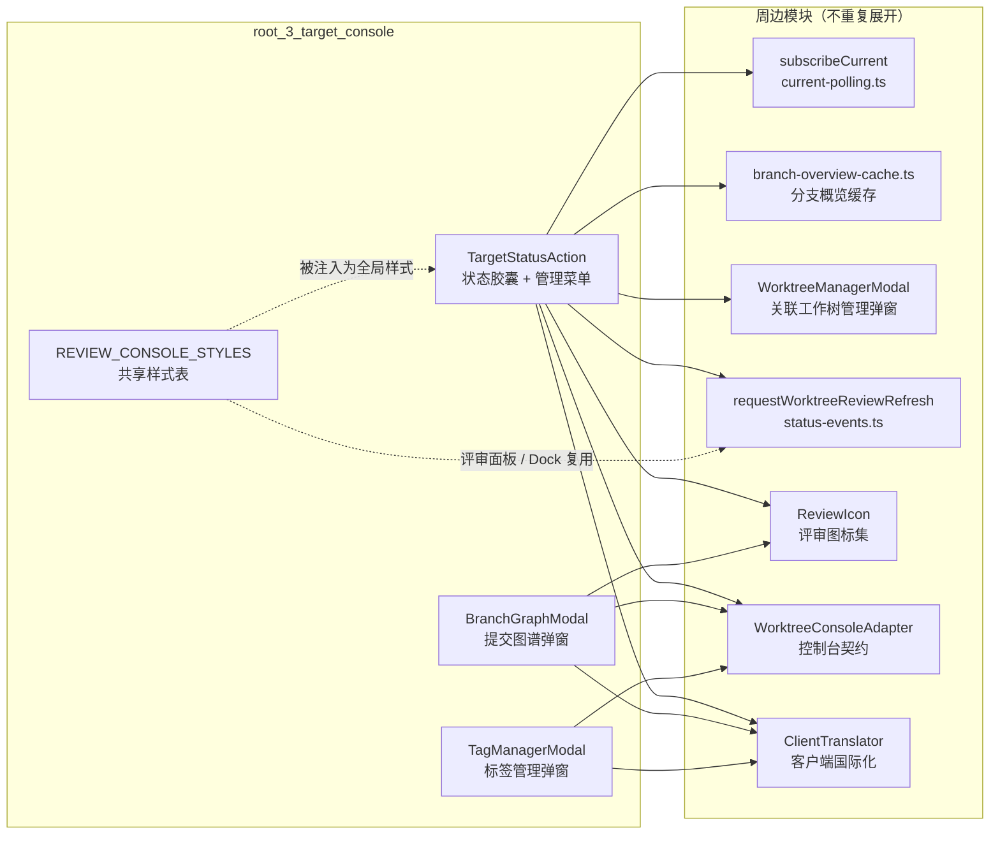
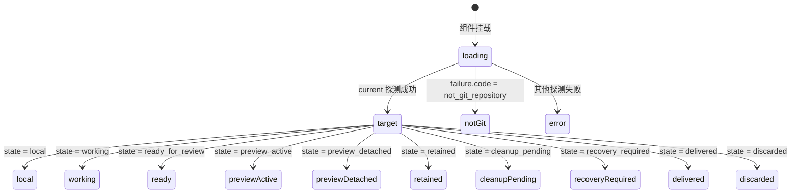
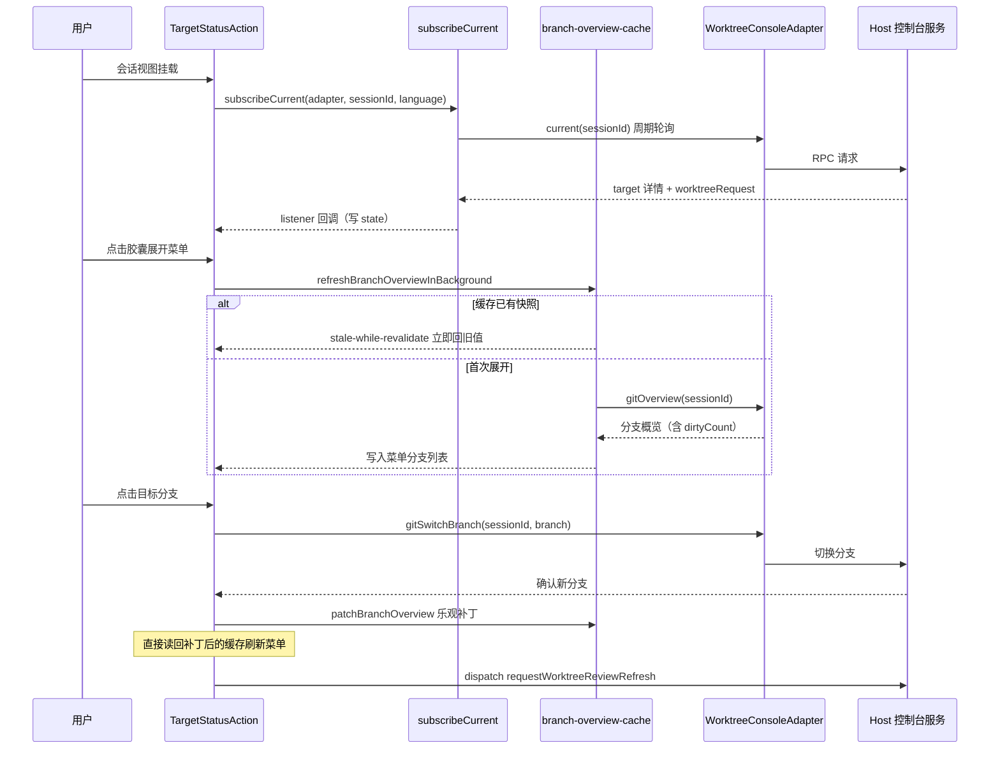
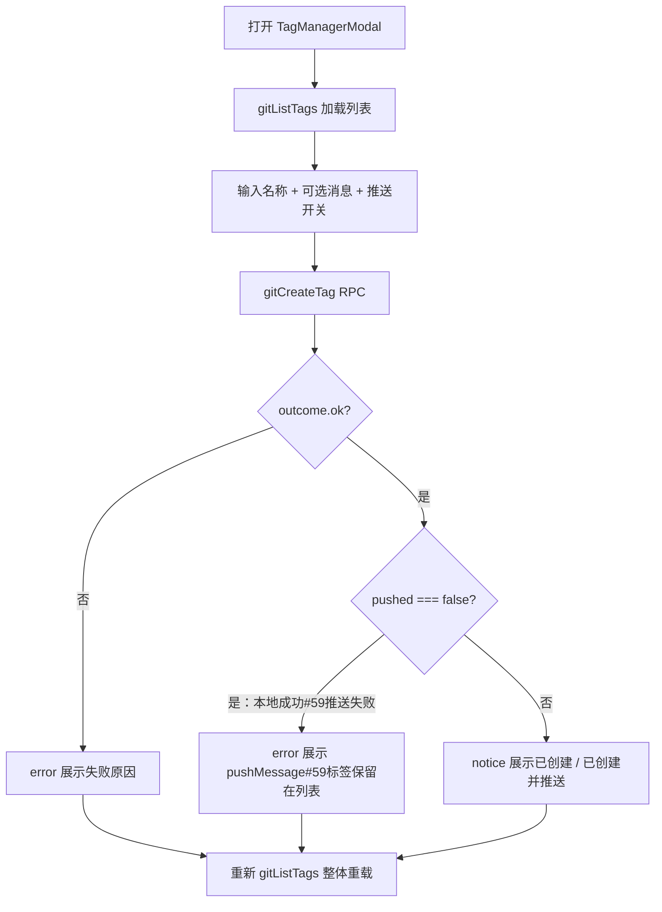

# 目标控制台（target-console）模块

!!! info "Generated documentation"
    This page was written by CodeWiki from the source code at commit [`36d78408`](https://github.com/wloops/dsh-git-worktree/commit/36d784083cde39e99b6017025ce0d6c21dd439fe) on 2026-11-07 with `doubao-seed-2.1-lite`. Check the code before relying on details.

## 概述

本模块是工作树（Worktree）管理客户端 UI 的**目标控制台交互层**：它把「当前会话绑定在哪个分支 / 哪个工作树目标」这件事渲染成一个可交互的状态胶囊（chip），并围绕它提供分支管理、提交图谱浏览、标签管理等 Git 操作入口。整个模块由四个文件组成：

| 文件 | 核心导出 | 职责 |
| --- | --- | --- |
| `src/client/target-console/TargetStatusAction.tsx` | `TargetStatusAction`（`TargetStatusActionProps`） | 会话目标状态胶囊 + 分支/工作树管理菜单的主体组件 |
| `src/client/target-console/BranchGraphModal.tsx` | `BranchGraphModal`（`BranchGraphModalProps`）、`GraphEdge`、`GraphRowLanes`、`GraphRefBadge` | 仓库级提交图谱弹窗（GitHub 风格 SVG 车道渲染） |
| `src/client/target-console/TagManagerModal.tsx` | `TagManagerModal`（`TagManagerModalProps`） | 本地标签的创建 / 删除 / 推送管理弹窗 |
| `src/client/review-console/review-console.styles.ts` | `REVIEW_CONSOLE_STYLES` | 工作树客户端共享样式表（评审面板、Dock、详情弹窗） |

该模块位于客户端 UI 栈的中上层：向下通过 `WorktreeConsoleAdapter`（见 [console-contract 文档](../root_4.md)）调用 Host 侧的控制台服务，向上被会话视图（`WorktreeConsoleView` 等，同样位于 [root_4：Worktree 控制台客户端与宿主命令面](../root_4.md) 的 target-console 家族）嵌入渲染。

## 架构总览

## 核心组件详解

### 1. TargetStatusAction — 会话目标状态胶囊

`TargetStatusAction` 是本模块最复杂的组件。它渲染一个 `<button>` 形态的胶囊触发器（`.dsh-wtc-target-chip`），点击后弹出 `Menu` 管理菜单，并在菜单内部按需挂载其余弹窗。

**Props（`TargetStatusActionProps`）**

| 字段 | 类型 | 说明 |
| --- | --- | --- |
| `sessionId` | `string` | 当前会话标识，所有 RPC 与轮询的作用域键 |
| `adapter` | `WorktreeConsoleAdapter` | 与 Host 控制台服务通信的契约端口 |
| `services` | `WorktreeClientServices` | 客户端服务集合（工作区导航、已有会话打开等） |

#### 状态胶囊的标签决策

胶囊主标签遵循「Git 图谱风格」：**优先显示分支名**，仅在加载中 / 探测失败 / 无分支信息时才退回工作树状态文案。工作树状态集合（`STATE_LABELS`）覆盖整个生命周期：

关键设计决策：

- **非 Git 项目目录是一种「正常答案」**：普通文件夹会话探测时返回 `not_git_repository` 错误码，组件将其识别为独立状态而不是笼统的「unavailable」，并在菜单中提供「初始化 Git 仓库」（`initializeProject`）转换入口。
- **失败可诊断**：探测失败时胶囊退化为「unavailable」，但 `failure.code` 与 `failure.message` 会写入触发器的 `title` / `aria-label`，用户悬停即可看到真正原因。
- **保留期展示**：`state = retained` 且存在 `expiresAt` 时，胶囊旁展示到期日期，并进入无障碍标签。

#### 菜单结构（按能力门控动态生成）

菜单项并非全量渲染，而是根据 `target.capabilities.*` 与当前状态逐层裁剪：

| 菜单分组 | 条目 | 出现条件 |
| --- | --- | --- |
| 摘要区 | 分支名 / 项目名 / source oid / current oid / 迭代号 / 保留期 | 始终（disabled） |
| 分支列表 | 按「当前分支优先」排序的分支行 + upstream 徽标 | `overview` 已加载 |
| 分支搜索框 | 过滤输入框（Enter 直接切换到第一个匹配） | 分支数 > 12（`MAX_BRANCH_ITEMS`） |
| 分支操作 | 新建分支、请求工作树（仅 `local` 状态）、清理已合并分支、管理标签、提交图谱 | 始终 / 状态相关 |
| 定位操作 | 在文件管理器打开工作树根目录（`reveal`）、回到源会话（`source`） | `capabilities.open` / `sourceSessionId !== sessionId` |
| 迭代操作 | 开始下一轮迭代（`begin_next_iteration`）、回到本地检出（`return_to_local`） | 对应 capability 为真 |
| 底部（footer） | 重试环境清理（`retry_cleanup`）或丢弃任务并清理工作树（`discard`，危险项） | 对应 capability 为真 |

「请求工作树」（`setWorktreeRequest`）的语义值得专门说明：它只是**排队一个标记**——真正的工作树创建发生在 Host 侧该会话下一次 step 之前；基点取当前分支（无分支时由 Host 用 HEAD），再次点击同一菜单项即撤回。这样「勾了但没发送」不会留下无人使用的 checkout。

### 2. BranchGraphModal — 提交图谱弹窗

`BranchGraphModal` 展示全仓库提交拓扑（数据源为 `adapter.gitGraph`，对应 `git log --topo-order`），并以纯 SVG 车道（lane）方式绘制。

**Props（`BranchGraphModalProps`）**：`open`、`onClose`、`adapter`、`sessionId`、`t`、`currentBranch`、`onTagCommit?(oid)`、`onManageTags?()`。

#### 内部数据结构

- `GraphEdge { x1, y1, x2, y2, color }`：一段绘制线段；`x` 以车道列为单位，`y` 以行高分数表示（0 顶部、0.5 节点中心、1 底部），相邻行借此自然连接。
- `GraphRowLanes { nodeColumn, laneCount, edges }`：每一行的节点列、全图最大车道数（保证所有行 SVG 等宽）与该边集合。
- `GraphRefBadge { label, full, tag }`：引用徽标，`label` 是剥掉 `origin/` 前缀后的短名，`full` 是折叠后的原始引用合集，`tag` 区分标签引用。

#### 两个纯函数算法

**`mergeRefs(refs)` — 引用折叠**：把本地分支 `foo` 与远端 `origin/foo` 折叠成一个徽标（`full` 字段用 `·` 连接全部原始引用用于 tooltip）。`tag:` 前缀的引用（由 Git 适配器标记）**永不与同名分支合并**——标签与分支是不同对象。

**`computeGraphLanes(rows)` — 车道拓扑**：移植自 `@linxin666/dsh-client-ui-git-graph` 的 `computeLanes`，规则为：

1. 第一父提交保留当前车道，其余父提交向右开新车道；
2. 所有子提交渲染完毕的车道进入「静默」状态；
3. ** convergent 分支收敛产生重复 pending 时，保留最左副本并把其余槽位视为可复用空洞**——兄弟分支共享一条车道，而不是各自把图向右撑宽；
4. 因此车道总数跟踪的是**并发分支数**，而不是历史累计分支数。

渲染常量：`LANE_WIDTH = 14`、`ROW_HEIGHT = 36`、`NODE_RADIUS = 4`、六条循环使用的 `LANE_COLORS`。

#### 加载与分页

- 打开时重置状态并以 `INITIAL_LIMIT = 200` 条提交发起请求；
- 「加载更多」按钮以 `PAGE_STEP = 100` 递增 `limit` 重新拉取；
- `requestSeq` 序号守卫：仅当本次请求是最新请求时才写回 `commits` / `lanes`，弹窗关闭时使在途响应失效。

弹窗同时承担**到标签管理器的导航**：每个提交行提供「打标签」入口（`onTagCommit(oid)`），页脚提供「管理标签」入口（`onManageTags()`），两者都会切换打开 `TagManagerModal`。

### 3. TagManagerModal — 标签管理弹窗

`TagManagerModal` 是本地标签的轻量管理弹窗，职责单一但错误语义细致。

**Props（`TagManagerModalProps`）**：`open`、`onClose`、`adapter`、`sessionId`、`t`、`target?`（下一个创建的标签指向的提交 / 引用；缺省为 HEAD）。

| 操作 | RPC | 成功后的反馈 |
| --- | --- | --- |
| 创建标签（可选附注消息、可选创建即推送） | `gitCreateTag` | 全成功 → `notice`；**本地成功但推送失败** → `error` 通道展示 `pushMessage`，且标签仍保留在列表中 |
| 删除标签（可选同步删远端） | `gitDeleteTag` | 同上，远端删除失败时用 `error` 报告 |
| 推送标签 | `gitPushTag` | 被拒的推送是「可报告结果」而非失败的变更：走 `error` 展示拒绝原因 |

**列表刷新策略**：每次变更（创建 / 删除 / 推送）完成后都重新调用 `gitListTags` 整体重载。注释中明确给出理由：Git 派生进程成本低、标签列表很小，这样弹窗永远不会在变更后展示陈旧列表。另一个细节是 `load()` **刻意不清空既有 `error`**——本地创建成功但推送失败所写的错误消息，会紧随一次重载之后仍然可见，避免用户来不及读。

弹窗在 `busy !== null`（任一变更在途）时禁止关闭与重复提交；行内通过 `data-tag-pushed` / `data-tag-push-unknown` 属性区分「已推送 / 推送状态未知」两种远端状态。

### 4. review-console.styles.ts — 共享样式表

`REVIEW_CONSOLE_STYLES` 是一段导出为字符串的 CSS（`String.raw`），物理上位于 `src/client/review-console/` 目录下，按模块树归入本模块。它为整个工作树客户端提供主题自适应样式：

- **主题适配变量**：`--wt-ink` / `--wt-muted` / `--wt-line` / `--wt-panel` 全部用 `color-mix(in srgb, currentColor …)` 从宿主页面的 `currentColor` 派生，无需关心明暗主题；语义色 `--wt-green`（通过）、`--wt-amber`（警告 / 部分通过）、`--wt-red`（危险）固定。
- **覆盖的结构**：`.dsh-wt-review-panel`（评审面板）、`.dsh-wt-review-dock`（输入框上方的评审 Dock，宽度跟随 `--dsh-composer-card-max-width` 等宿主变量）、`.dsh-wt-details-modal`（评审详情弹窗）、preflight 事实表、delivery proof（交付凭证）、冲突恢复区块、危险按钮与提交对话框。
- **响应式**：两处 `@media (max-width: 620px)` 断点，窄屏下 Dock 换行、详情弹窗内边距收紧。
- 该样式表同时被 [评审控制台模块](root_3_review_console.md) 的面板与 Dock 组件复用，详见该模块文档。

## 关键交互流程

### 流程一：胶囊轮询 → 展开菜单 → 切换分支

### 流程二：标签创建（含推送失败分支）

## 设计要点汇总

1. **异步写回的三重守卫**：`requestSeq.current`（弹窗内）、`actionScope.current`（胶囊内，`sessionId` 变化时自增）与 `mounted.current` 共同保证——任何延迟到达的 RPC 响应在弹窗关闭、会话切换或组件卸载后都不会写入 state。
2. **Stale-while-revalidate**：菜单展开时优先用 `branch-overview-cache` 的旧快照立即渲染，再后台刷新；组件挂载时**故意不预取** `gitOverview`（每次挂载要花 3 次 Git 派生，用户未必问）。
3. **乐观补丁替代失效重取**：`gitSwitchBranch` 成功后直接 `patchBranchOverview` 写缓存并读回，省掉「失效 + 重取（4 个 Git 派生 + 旧值闪烁）」一轮往返。
4. **能力门控（capability gating）**：所有会改变工作树生命周期的操作（`discard`、`retryCleanup`、`beginNextIteration`、`returnToLocal`、`open`）都以 `target.capabilities.*` 为出现前提，且统一携带 `expectedRevision: target.revision` 做乐观并发校验；收到 `stale_target` 错误码时触发一次全量刷新。
5. **状态事件总线**：所有变更完成后派发 `requestWorktreeReviewRefresh(sessionId)`（`window` 上的 `CustomEvent`），让评审 Dock、侧边栏徽标等同源订阅方同步失效——详见 [评审控制台模块](root_3_review_console.md)。

## 相关模块

- [评审控制台模块](root_3_review_console.md) — 复用本模块样式表的评审面板、Dock 与恢复延续组件。
- [设置卡片模块](root_3_settings_card.md) — 同属 root_3 的设置表单 UI 家族。
- [root_4：target-console 其余部分](../root_4.md) — `WorktreeConsoleView`、`WorktreeManagerModal`、`current-polling.ts`（`subscribeCurrent` / `Poll`）、`branch-overview-cache.ts`、`console-contract.ts`（`WorktreeConsoleAdapter`、`WorktreeConsoleTargetDetails` 等全部请求 / 响应类型）。
- [root_2：客户端服务层](../root_2.md) — `actions.ts` 的 `WorktreeClientServices` / `openExistingSession`、`i18n.tsx` 的 `ClientTranslator`。
- [root_5：控制台 Host 侧](../root_5.md) — 本模块所有 RPC 最终落地的 `WorktreeConsoleService` 与远程描述实现。

??? abstract "Documented components (7)"
    - [`__file__`](https://github.com/wloops/dsh-git-worktree/blob/36d784083cde39e99b6017025ce0d6c21dd439fe/src%5Cclient%5Creview-console%5Creview-console.styles.ts) — `src\client\review-console\review-console.styles.ts`
    - [`BranchGraphModalProps`](https://github.com/wloops/dsh-git-worktree/blob/36d784083cde39e99b6017025ce0d6c21dd439fe/src%5Cclient%5Ctarget-console%5CBranchGraphModal.tsx) — `src\client\target-console\BranchGraphModal.tsx`
    - [`GraphEdge`](https://github.com/wloops/dsh-git-worktree/blob/36d784083cde39e99b6017025ce0d6c21dd439fe/src%5Cclient%5Ctarget-console%5CBranchGraphModal.tsx) — `src\client\target-console\BranchGraphModal.tsx`
    - [`GraphRefBadge`](https://github.com/wloops/dsh-git-worktree/blob/36d784083cde39e99b6017025ce0d6c21dd439fe/src%5Cclient%5Ctarget-console%5CBranchGraphModal.tsx) — `src\client\target-console\BranchGraphModal.tsx`
    - [`GraphRowLanes`](https://github.com/wloops/dsh-git-worktree/blob/36d784083cde39e99b6017025ce0d6c21dd439fe/src%5Cclient%5Ctarget-console%5CBranchGraphModal.tsx) — `src\client\target-console\BranchGraphModal.tsx`
    - [`TagManagerModalProps`](https://github.com/wloops/dsh-git-worktree/blob/36d784083cde39e99b6017025ce0d6c21dd439fe/src%5Cclient%5Ctarget-console%5CTagManagerModal.tsx) — `src\client\target-console\TagManagerModal.tsx`
    - [`TargetStatusActionProps`](https://github.com/wloops/dsh-git-worktree/blob/36d784083cde39e99b6017025ce0d6c21dd439fe/src%5Cclient%5Ctarget-console%5CTargetStatusAction.tsx) — `src\client\target-console\TargetStatusAction.tsx`

