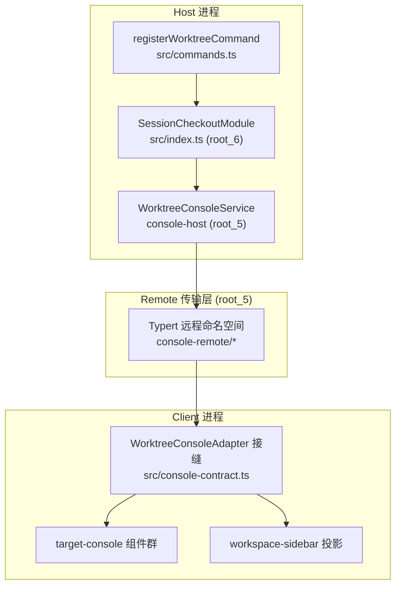
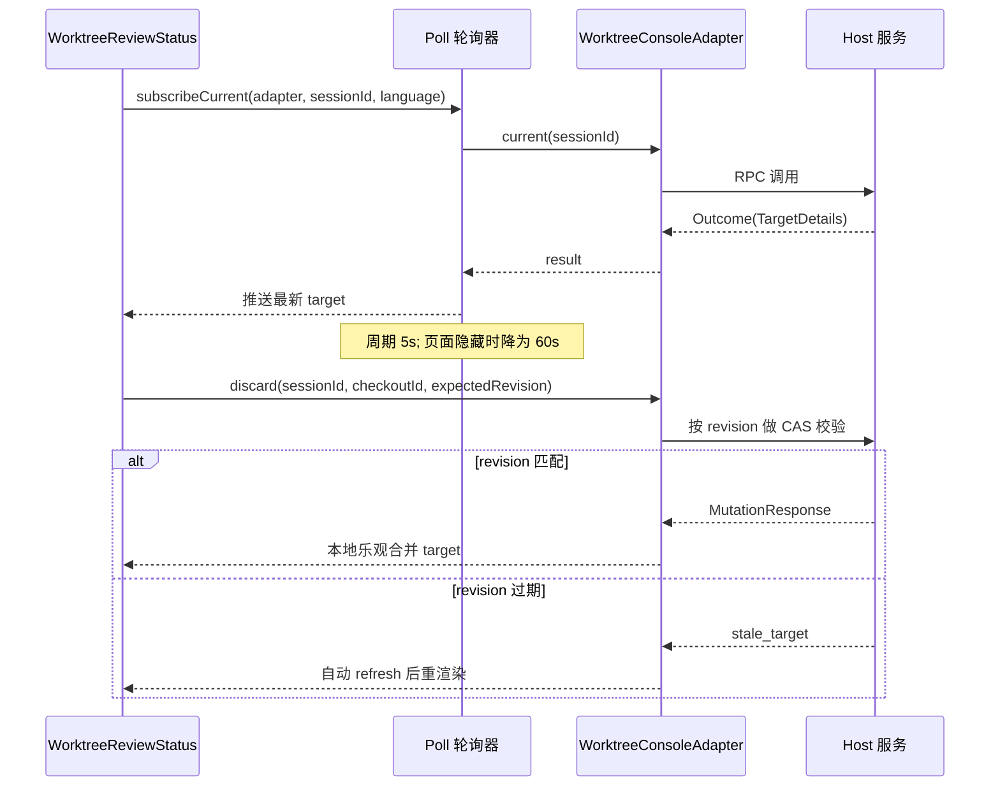

# root_4：Worktree 控制台客户端与宿主命令面

!!! info "Generated documentation"
    This page was written by CodeWiki from the source code at commit [`987ec76d`](https://github.com/wloops/dsh-git-worktree/commit/987ec76d79a175159f4ec899c0064deb84cec783) on 2026-11-07 with `doubao-seed-2.1-lite`. Check the code before relying on details.

## 模块定位

`root_4` 是 dsh-git-worktree 插件中「面向用户的交互层」与「跨进程契约层」。它把托管工作树（Managed Worktree）的状态与操作接入 Harness 的原生 UI，并在 Host 进程侧提供 `/worktree` 斜杠命令。本模块**不直接操作 Git 或文件系统**——所有实际工作都通过 `WorktreeConsoleAdapter` 委派给 Host 侧服务（实现见 [Worktree Console 宿主与远程协议层（root_5）](root_5.md)）。

主要职责：

1. **Harness 目标控制台 UI**（`src/client/target-console/`）：会话头部的目标胶囊、输入框上方的评审状态条、空白会话的 Hero 芯片（portral 进 hero workspace 行），以及完整的「已关联工作树」管理面板（当前目标、工作树列表、已放弃快照恢复）。
2. **Workspace 侧边栏集成**（`src/client/workspace-sidebar/`）：把托管工作树拓扑投影进官方工作区浏览器，为托管会话挂上状态徽章，并用两道守卫阻止官方 UI 对托管工作区执行 start / fork / reparent 等不安全操作。
3. **跨进程 JSON 契约**（`src/console-contract.ts`）：Host 与 Client 共享的全部 DTO、目标状态机推导函数、错误元数据表与 `WorktreeConsoleAdapter` 接口；刻意不含 Cordis、React、Remote 或文件系统实现。
4. **`/worktree` 斜杠命令**（`src/commands.ts`、`src/commit-message.ts`）：人类显式操作面——`status` / `list` / `continue` / `next` / `finalize` / `finish` / `discard` / `remove`——并负责把会话 cwd 安全地进出隔离工作树。

## 架构总览

要点：

- `commands.ts` 运行在 Host 进程，直接调用 `SessionCheckoutModule`（见 [组合根、领域端口与国际化（root_6）](root_6.md)），不经过 Remote。
- Client 侧所有组件（目标胶囊、状态条、管理面板、侧边栏）只依赖 `WorktreeConsoleAdapter` 这一个接口；Remote 传输细节被封在适配器实现后面。
- 组件群同时消费 review-console 子模块的成果（`ReviewActions`、`ReviewDetailsModal`、`preflight-cache`、`recovery-continuation` 等，见 [root_3/root_3_review_console.md](root_3/root_3_review_console.md)）与 client actions 服务（`openAuthorizedWorktreeTarget` 等，见 [root_2：持久化适配器与浏览器客户端桥接层](root_2.md)）。

## 核心设计约定

### 纯 JSON 契约与 Outcome 模式

`console-contract.ts` 是 Host 与 Client 之间唯一的共享语言。所有响应使用 `WorktreeConsoleOutcome<T>`（`{ ok: true, value } | { ok: false, error }`），错误统一携带 `code`、`message` 与结构化 `continuation`（冲突恢复、预览恢复交接等）。`worktreeConsoleErrorMeta(code)` 为每个错误码给出 `category`、`recovery` 提示与 `retryable` 标记，客户端据此把机器错误码渲染成用户可读的「错误类别 + 恢复建议」。

### 乐观锁（CAS）贯穿所有 mutation

除少数只读接口外，每个写操作请求（`discard` / `finalize` / `setRetention` / `setPermanent` / `retryCleanup` …）都携带 `expectedRevision`。Host 执行前比对当前台账 revision；不匹配即返回 `stale_target` / `stale_local` / `stale_isolated`。客户端收到 stale 类错误时自动静默 `refresh()`，因此冲突永远先表现为「刷新后状态变了」，而不是一次破坏性写穿。

### 显示轮询与授权分离

`current-polling.ts` 中的 `Poll` 是**纯显示性**观察通道：周期 5s（页面 `hidden` 时降为 60s，避免对宿主 checkout 空烧 `git status` + 两次 `git rev-parse`），通过 `WORKTREE_REVIEW_REFRESH_EVENT` 自定义事件与 `visibilitychange` 做即时失效。注释明确写明：它**绝不用于授权任何 mutation 或 Git 清理**——授权永远以 Host 对 `sessionId` + `checkoutId` + `revision` 的服务端校验为准。

### 缓存的纪元防护（epoch guard）

`branch-overview-cache.ts` 用 60s TTL 的模块级缓存加速分支概览（展开胶囊弹层不必等 git spawn）。每次乐观补丁或失效都会 `bumpEpoch(sessionId)` 自增纪元；起飞于补丁之前的飞行请求落地时只在「纪元未变」时回写缓存，从而不会踩掉 switch / create 后写入的乐观快照并重赋 TTL。

### 侧边栏的两种接管模式

- **Takeover 模式**（`registerManagedWorkspaceSidebar`）：用 Proxy 包装官方 `Context`，重放官方 Workspace Client 的 apply，但把其中的 Browser 组件替换为 `ManagedOfficialWorkspaceBrowser`——保留其声明树、locale、picker 与目录流授权，只替换数据投影与「不安全 mutation」的守卫。
- **Decorated 模式**（`registerDecoratedWorkspaceSidebar`）：官方 Workspace Client 已在 Host 上激活（takeover 被禁用）时，改为向官方已声明的子插槽（`sidebar.session.row.hover`、`sidebar.workspaces.session.menu.item`）注入装饰条目，复用官方 entry 的 `renderSlot` 授权，避免 shadow 整个 `sidebar.workspaces` 导致子渲染越权崩溃。

## 典型交互流程

## 目标控制台 UI（`src/client/target-console/`）

这是把托管工作树状态接入 Harness 原生会话界面的组件群，按挂载位置分为四个插槽贡献：

### `WorktreeConsoleView` —— 已关联工作树管理面板

完整的会话级管理表面（`src/client/target-console/WorktreeConsoleView.tsx`），可独立嵌入式渲染，也可被 `WorktreeManagerModal` 包在 Modal 中。核心行为：

- **三路并行加载**：`refresh()` 并发请求 `adapter.current()`（当前目标详情）、`adapter.list()`（项目下全部工作树，支持 `needsAttention` / `includeDelivered` 过滤）与可选的 `adapter.listAbandoned()`（已放弃快照恢复条）。恢复条是增强功能——其失败只置空隐藏，不打断主面板。
- **请求代际防护**：`sessionGeneration`（会话切换时自增）与 `request`（每次刷新自增）双令牌确保过期响应不会回写状态；`mounted` ref 保证卸载后不 setState。
- **行动排序**：`ATTENTION_RANK` 把 `recovery_required` → `preview_detached` → `cleanup_pending` 等需要人介入的状态排在列表最前，再按迭代号倒序，`focusCheckoutId` 指定行永远置顶。
- **受控 mutation**：`discard` / `retryCleanup` / `setPermanent` / `setRetention` / `restoreAbandoned` 全部携带 `expectedRevision` 走 CAS；成功后用 `applyMutation` 乐观合并回本地快照（当前目标行与列表行同时更新），stale 类错误自动 `refresh()`。
- **交付后改动保护**：清理若因 `cleanupReason === 'modified_after_finalize'` 停下，不自动重试，而是弹出确认对话框询问「放弃交付后出现的改动再清理」，把保护语义从 UI 显式化。
- **危险操作二次确认**：对脏工作树 `discard` 弹 `alertdialog` 确认（按 source / preview_active / owner 三种身份分支文案），支持 `Escape` 关闭并把焦点还给确认按钮。

### `WorktreeManagerModal` —— 会话级入口弹窗

`src/client/target-console/WorktreeManagerModal.tsx`：薄壳——用 `@deepseek-ai/dsh-client-ui-primitives` 的 `Modal` 包裹 `WorktreeConsoleView`（`embedded` 模式，隐藏大标题、只显示刷新按钮），标题为「已关联工作树」。

### `WorktreeReviewStatus` —— 输入框上方的紧凑评审状态条

`src/client/target-console/WorktreeReviewStatus.tsx`：Domis 风格胶囊，常驻 Harness composer 上方。

- 通过 `subscribeCurrent` 订阅轮询推送，在 `ready_for_review` / `preview_active` / `preview_detached` / `recovery_required` / `cleanup_pending` / `retained` 等状态下渲染：评审摘要、改动文件数、校验状态徽章，以及 `ReviewActions`（预览 / 回滚 / 完成）操作组。
- **独立恢复态**：当存在持久化恢复请求（冲突恢复或评审再生成）且 target 已回到 `working` 时，整个状态条切换为「恢复续行」视图，展示 queued / sending / sent / cancelled / failed 各阶段文案，失败可一键重发。
- **终态可关闭**：`cleanup_pending` / `retained` 终态条带关闭按钮，按 `checkoutId + reviewId` 作用域记忆——新一轮评审会自动重新打开。
- 详情弹窗、preflight 缓存与恢复续行均复用 review-console 子模块（见 [root_3/root_3_review_console.md](root_3/root_3_review_console.md)）。

### `WorktreeHeroChip` —— 空白会话 Hero 行芯片

`src/client/target-console/WorktreeHeroChip.tsx`：只在空白会话（`session.blank === true`）挂载。

- 用「dock 锚点结构遍历」零延迟定位官方 `heroWorkspaceRow`（dock outlet 的 previous sibling，沿最多 4 层包装 span 上溯），再退到 `composerStack` 内查询、最后的 document 级查询；`MutationObserver` 订阅附近子树变化，500ms 间隔的轮询最多 8 次（4s）作为兜底。
- 通过惰性解析的 `react-dom.createPortal`（模块加载期注入的 `require`）把 `TargetStatusAction` 胶囊 portal 进 hero 行；react-dom 不可用时优雅降级为「没有芯片」，而不是整个插件 bundle 加载失败。

### `index.ts` —— 插槽注册入口 `registerTargetConsole`

`src/client/target-console/index.ts`（`TargetConsoleContextLike` 描述 slots 注册面）：

| 插槽 | 组件 | priority/order |
| --- | --- | --- |
| `conversation.session.header.actions` | `TargetStatusAction`（目标胶囊） | order 30 |
| `conversation.input.dock` | `WorktreeReviewStatus` | order 10 |
| `conversation.input.dock` | `WorktreeHeroChip` | order 20 |
| `conversation.hero.options` | `HiddenForgeWorktreeOption`（渲染 `null`） | priority -1 |

最后一条是关键设计：用更低 priority 的空占位 shadow 掉官方 forge 面板的「分支按钮 + 新建工作树复选框」cell，把功能收进本插件的目标胶囊菜单；用 shadow 而非停用官方插件，是因为变更请求、diff、review 都在同一包内，停用会连带砍掉真正功能。

### 轮询与缓存基础设施

- **`current-polling.ts`（`Poll` 类）**：按「adapter 身份 + sessionId + 语言」建立共享轮询循环；首个订阅者启动 5s 周期，末个订阅者退出并释放。`visibilitychange` 回前台立即失效刷新，页面隐藏时降为 60s 间隔（避免对宿主 checkout 空烧 git spawn）。注释明确：纯显示观察，绝不授权 mutation。
- **`branch-overview-cache.ts`（`bumpEpoch`）**：60s TTL 模块级分支概览缓存 + flight 去重 + 补丁纪元保护。`ensureBranchOverview`（TTL 内立即返回）与 `refreshBranchOverviewInBackground`（stale-while-revalidate）两种读模式；mutate 成功后 `patchBranchOverview` 本地乐观改缓存并自增纪元，在途飞行请求落地时只在纪元未变时回写，防止踩掉乐观补丁。
- **`target-console.styles.ts`**：`.dsh-wtc-*` 全套样式——目标胶囊按状态变色（`data-target-state` 驱动 `--wtc-state`）、管理面板栅格、行内 facts 区、确认对话框、分支图与标签弹窗样式。

## Workspace 侧边栏集成（`src/client/workspace-sidebar/`）

### 拓扑投影算法 `projectManagedWorkspaceSidebar`（`model.ts`）

输入：官方工作区列表 + 会话摘要表 + Host 下发的 `WorktreeSidebarTopologyResponse`。输出 `ManagedWorkspaceSidebarProjection`：

- **`sidebarBadgeTasks`**：按 ownerSessionId 聚合拓扑任务（同 owner 取迭代/revision 最新者），生成 `ProjectedManagedTask`（附 `stateLabel` 与含分支名的 `label`）。
- **归属搬移**：owner 会话必须并入其项目对应的 Local 工作区；若它还挂在别的（源）工作区，则从源区摘除、迁入本地区；源区清空（只剩归档/空白会话时）则整个隐藏，其中非归档会话进入 `suppressedSessionIds`。
- **目录成员保护**：拓扑带 `memberships`（Host 实证）时，按 workspace/session 索赔计数——唯一索赔才允许搬移，歧义归属一律 fail-open 保留官方原行，绝不「偷」普通手工工作区。
- **保护集合**：`protectedSessionIds` / `protectedWorkspaceIds` / `relocatedSessionIds` 供 Browser 包装层拦截 start / fork / insertBefore。

### 两种注册模式（`index.tsx`）

- **`registerManagedWorkspaceSidebar`（takeover）**：用两层 Proxy 包装官方 `Context`——`slots.register` 拦截 `sidebar.workspaces` 声明，把官方 Browser 换成 `ManagedOfficialWorkspaceBrowser`（套入 `ClientI18nProvider`，改写 `useWorkspaces` / `useSessions` selector 喂投影后的状态，拦截 `startSession` / `forkSession` / `insertSessionBefore`）；同时拦截非安全的会话菜单项（只放行 `pin` / `rename` / `archive`）包成守卫组件。`ctx.remote.directoryPicker` 用延迟 Proxy 门面化，picker 服务激活前读取永不失败。
- **`registerDecoratedWorkspaceSidebar`（Mode B）**：官方 Workspace Client 已激活时不重放 apply（避免重复 provide `uiWorkspace` 撞车），改为向官方已声明的子插槽注入装饰条目——`sidebar.session.row.hover` 挂 `WorktreeStatusBadgeEntry`（分支 glyph + 状态徽章），`sidebar.workspaces.session.menu.item` 挂「清除侧边栏徽章」菜单项。注释解释了为什么不能 shadow `sidebar.workspaces` 本尊：shadow entry 无法重新声明官方子节点，`renderSlot` 授权也只属于声明方。
- **共享拓扑**：`sharedTopology` + `useSyncExternalStore` 让插槽注册的菜单条目（在 Browser React 树之外）也能读到最新拓扑。
- **`ManagedWorktreeSessionDecoration`**：挂在会话摘要上的呈现元数据（`kind: 'managed-worktree'`、state、label、originalTitle），官方 derivative 把它渲染成截断标题前的固定徽章，canonical 标题保持原样。

## 跨进程契约（`src/console-contract.ts`）

该文件刻意不含 Cordis / React / Remote / 文件系统实现，是 Host 与 Client 共享的唯一 DTO 语言。关键构件：

- **目标状态机**：`WORKTREE_CONSOLE_TARGET_STATES`（local / creating / working / ready_for_review / preview_active / preview_detached / retained / cleanup_pending / recovery_required / delivered / discarded）与推导函数 `consoleStateFromDomain()`——domain phase 与 deliveryState 冲突时按固定优先级裁决（recovery_required > creating > delivered > discarded > retained > cleanup_pending > preview_* > ready_for_review > working）；`worktreeReachedDelivery()` 判定任务已送达、绝不投影为 abandoned。
- **`WorktreeConsoleCapabilities`**：按目标逐项声明可用操作（create / open / inspect / discard / preflight / preview / checkpoint / resumeRevision / rollbackPreview / finalize / finalizePreview / setRetention / setPermanent / retryCleanup / beginNextIteration / returnToLocal），UI 据此渲染或隐藏按钮。
- **`WorktreeConsoleTargetSummary` / `WorktreeConsoleTargetDetails`**：行级投影——summary 无路径信息（安全用于列表与头部芯片）；details 在调用方「身份校验通过」后才附带 `managedRoot` / `sourceRoot` / `currentBranch` / `recoveryContinuation`。
- **恢复 Proof 联合类型**：`WorktreeRecoveryProof` = 冲突恢复 / 评审再生成 / 预览恢复分析 / 预览恢复交接四种 kind，Host 产出、Client 单飞重试，携带稳定 `requestId`。
- **错误元数据表**：`ERROR_META` 为每个 `WorktreeConsoleErrorCode`（含 SESSION_CHECKOUT_ERROR_CODES 全集 + transport_unavailable / malformed_response / timeout）标注 category（permission / stale / confirmation / recovery / conflict / unavailable / invalid / internal）、recovery 提示与 retryable。
- **`WorktreeConsoleAdapter`**：约 35 个方法的归一化 Client 接缝——只读类（current / list / inspect / reviewDiff / preflight / sidebarTopology / gitOverview / gitGraph / gitListTags / listAbandoned）、mutation 类（preview / checkpoint / resumeRevision / rollbackPreview / discard / finalize / finalizePreview / setRetention / setPermanent / retryCleanup / beginNextIteration / returnToLocal / clearSidebarBadge / restoreAbandoned）、Git 辅助类（createBranch / switchBranch / pruneMergedBranches / createTag / deleteTag / pushTag）与待办请求（setWorktreeRequest）。Remote 传输细节全部藏在这一接口后面。

## `/worktree` 斜杠命令面（`src/commands.ts`、`src/commit-message.ts`）

`registerWorktreeCommand(ctx, module)` 在 Host 进程注册命令，handler 按动词分派：

| 动词 | 行为 |
| --- | --- |
| `status`（默认） | `module.inspect()` 输出当前 checkout 的 phase、dirty、当前分支/OID 与 delivery 状态 |
| `list` | 列出该会话可见的全部托管工作树（checkoutId / 项目 / 迭代 / 状态 / dirty） |
| `continue` | 对 `ready_for_review` 的未同步交付执行 `resumeRevision`，不碰 Local |
| `next` | `beginNextIteration` 重建 checkout 后，把会话 cwd 重新 enter 进新树（对齐官方 workingDirectory 语义） |
| `finalize [reviewId revision] [retention]` | 带 CAS 校验的交付：先 `leaveCheckout`（失败则中止，绝不让会话留在已删目录）→ `finish` 操作 → 失败时再 `enterCheckout` 把会话放回存活的树里 |
| `finish <message>` | 用显式提交消息交付（消息必填） |
| `discard` | 放弃当前目标（脏文件需确认，preview_active 连带回滚） |
| `remove <checkoutId>` | 按 id 移除该会话可见的某个托管工作树 |

**cwd 进出管理是命令面的核心安全职责**：交付与放弃会删除 checkout，命令必须先把会话 cwd 撤出（`workingDirectory.leave`），leave 失败直接报错中止；任何后续操作失败、checkout 仍然存活时，必须把会话重新 enter 回去，否则相对路径写盘会落到 Local 原仓库。

`finishedText()` 组装 `finish` 成功文案（改动文件数、提交 OID、清理结果、自动 push 成败）。`isValidCommitMessage()` 校验提交消息：非空字符串且不含 `\0`（body 走 Git stdin，这不是 Git 限制而是防注入边界）。

## 与其他模块的关系

- [root_2：持久化适配器与浏览器客户端桥接层](root_2.md)：`ClientSessions` / `ClientWorkspaces` / `SnapshotStore` 等 client actions 服务，以及 `openAuthorizedWorktreeTarget` / `openIsolatedTarget`——管理面板「打开目标」按钮的执行体。
- [root_3/root_3_review_console.md](root_3/root_3_review_console.md)：评审面板复用的 `ReviewActions`、`ReviewDetailsModal`、`preflight-cache`、`recovery-continuation` 与 `status-events`（`WORKTREE_REVIEW_REFRESH_EVENT` 事件同时被本模块轮询器与侧边栏订阅）。
- [root_3/root_3_target_console.md](root_3/root_3_target_console.md)：`TargetStatusAction` 目标胶囊及其弹层（分支图、标签管理、目标状态操作），本模块的 `WorktreeHeroChip` 正是把该胶囊 portal 进空白会话行。
- [Worktree Console 宿主与远程协议层（root_5）](root_5.md)：`WorktreeConsoleService` 与 console-remote 命名空间——`WorktreeConsoleAdapter` 的 Host 端实现，CAS 校验、权限解析与 Git 操作都发生在这里。
- [组合根、领域端口与国际化（root_6）](root_6.md)：`SessionCheckoutModule`（`commands.ts` 的直接依赖）、i18n 消息表（host/client 双语）与托管路径工具。
- [root_7：dsh-git-worktree 插件出口层](root_7.md)：`types.ts` 中的领域视图类型（`SessionTargetView`、`WorktreeRetentionMode`、`WorktreeCleanupReason`、各种 Proof 视图），是契约 DTO 的类型来源。

??? abstract "Documented components (87)"
    - [`WorktreeConsoleViewProps`](https://github.com/wloops/dsh-git-worktree/blob/987ec76d79a175159f4ec899c0064deb84cec783/src%5Cclient%5Ctarget-console%5CWorktreeConsoleView.tsx) — `src\client\target-console\WorktreeConsoleView.tsx`
    - [`WorktreeHeroChipProps`](https://github.com/wloops/dsh-git-worktree/blob/987ec76d79a175159f4ec899c0064deb84cec783/src%5Cclient%5Ctarget-console%5CWorktreeHeroChip.tsx) — `src\client\target-console\WorktreeHeroChip.tsx`
    - [`WorktreeManagerModalProps`](https://github.com/wloops/dsh-git-worktree/blob/987ec76d79a175159f4ec899c0064deb84cec783/src%5Cclient%5Ctarget-console%5CWorktreeManagerModal.tsx) — `src\client\target-console\WorktreeManagerModal.tsx`
    - [`WorktreeReviewStatusProps`](https://github.com/wloops/dsh-git-worktree/blob/987ec76d79a175159f4ec899c0064deb84cec783/src%5Cclient%5Ctarget-console%5CWorktreeReviewStatus.tsx) — `src\client\target-console\WorktreeReviewStatus.tsx`
    - [`bumpEpoch`](https://github.com/wloops/dsh-git-worktree/blob/987ec76d79a175159f4ec899c0064deb84cec783/src%5Cclient%5Ctarget-console%5Cbranch-overview-cache.ts) — `src\client\target-console\branch-overview-cache.ts`
    - [`Poll`](https://github.com/wloops/dsh-git-worktree/blob/987ec76d79a175159f4ec899c0064deb84cec783/src%5Cclient%5Ctarget-console%5Ccurrent-polling.ts) — `src\client\target-console\current-polling.ts`
    - [`TargetConsoleContextLike`](https://github.com/wloops/dsh-git-worktree/blob/987ec76d79a175159f4ec899c0064deb84cec783/src%5Cclient%5Ctarget-console%5Cindex.ts) — `src\client\target-console\index.ts`
    - [`__file__`](https://github.com/wloops/dsh-git-worktree/blob/987ec76d79a175159f4ec899c0064deb84cec783/src%5Cclient%5Ctarget-console%5Ctarget-console.styles.ts) — `src\client\target-console\target-console.styles.ts`
    - [`ManagedWorktreeSessionDecoration`](https://github.com/wloops/dsh-git-worktree/blob/987ec76d79a175159f4ec899c0064deb84cec783/src%5Cclient%5Cworkspace-sidebar%5Cindex.tsx) — `src\client\workspace-sidebar\index.tsx`
    - [`ManagedWorkspaceSidebarProjection`](https://github.com/wloops/dsh-git-worktree/blob/987ec76d79a175159f4ec899c0064deb84cec783/src%5Cclient%5Cworkspace-sidebar%5Cmodel.ts) — `src\client\workspace-sidebar\model.ts`
    - [`ProjectedManagedTask`](https://github.com/wloops/dsh-git-worktree/blob/987ec76d79a175159f4ec899c0064deb84cec783/src%5Cclient%5Cworkspace-sidebar%5Cmodel.ts) — `src\client\workspace-sidebar\model.ts`
    - [`SidebarSessionSummary`](https://github.com/wloops/dsh-git-worktree/blob/987ec76d79a175159f4ec899c0064deb84cec783/src%5Cclient%5Cworkspace-sidebar%5Cmodel.ts) — `src\client\workspace-sidebar\model.ts`
    - [`SidebarWorkspaceView`](https://github.com/wloops/dsh-git-worktree/blob/987ec76d79a175159f4ec899c0064deb84cec783/src%5Cclient%5Cworkspace-sidebar%5Cmodel.ts) — `src\client\workspace-sidebar\model.ts`
    - [`finishedText`](https://github.com/wloops/dsh-git-worktree/blob/987ec76d79a175159f4ec899c0064deb84cec783/src%5Ccommands.ts) — `src\commands.ts`
    - [`isValidCommitMessage`](https://github.com/wloops/dsh-git-worktree/blob/987ec76d79a175159f4ec899c0064deb84cec783/src%5Ccommit-message.ts) — `src\commit-message.ts`
    - [`WorktreeApplyConflictContinuation`](https://github.com/wloops/dsh-git-worktree/blob/987ec76d79a175159f4ec899c0064deb84cec783/src%5Cconsole-contract.ts) — `src\console-contract.ts`
    - [`WorktreeApplyConflictRecoveryProof`](https://github.com/wloops/dsh-git-worktree/blob/987ec76d79a175159f4ec899c0064deb84cec783/src%5Cconsole-contract.ts) — `src\console-contract.ts`
    - [`WorktreeClientBootReport`](https://github.com/wloops/dsh-git-worktree/blob/987ec76d79a175159f4ec899c0064deb84cec783/src%5Cconsole-contract.ts) — `src\console-contract.ts`
    - [`WorktreeConsoleAbandonedListRequest`](https://github.com/wloops/dsh-git-worktree/blob/987ec76d79a175159f4ec899c0064deb84cec783/src%5Cconsole-contract.ts) — `src\console-contract.ts`
    - [`WorktreeConsoleAbandonedListResponse`](https://github.com/wloops/dsh-git-worktree/blob/987ec76d79a175159f4ec899c0064deb84cec783/src%5Cconsole-contract.ts) — `src\console-contract.ts`
    - [`WorktreeConsoleAbandonedSnapshot`](https://github.com/wloops/dsh-git-worktree/blob/987ec76d79a175159f4ec899c0064deb84cec783/src%5Cconsole-contract.ts) — `src\console-contract.ts`
    - [`WorktreeConsoleAdapter`](https://github.com/wloops/dsh-git-worktree/blob/987ec76d79a175159f4ec899c0064deb84cec783/src%5Cconsole-contract.ts) — `src\console-contract.ts`
    - [`WorktreeConsoleBeginNextIterationRequest`](https://github.com/wloops/dsh-git-worktree/blob/987ec76d79a175159f4ec899c0064deb84cec783/src%5Cconsole-contract.ts) — `src\console-contract.ts`
    - [`WorktreeConsoleCapabilities`](https://github.com/wloops/dsh-git-worktree/blob/987ec76d79a175159f4ec899c0064deb84cec783/src%5Cconsole-contract.ts) — `src\console-contract.ts`
    - [`WorktreeConsoleCheckpointRequest`](https://github.com/wloops/dsh-git-worktree/blob/987ec76d79a175159f4ec899c0064deb84cec783/src%5Cconsole-contract.ts) — `src\console-contract.ts`
    - [`WorktreeConsoleClearSidebarBadgeRequest`](https://github.com/wloops/dsh-git-worktree/blob/987ec76d79a175159f4ec899c0064deb84cec783/src%5Cconsole-contract.ts) — `src\console-contract.ts`
    - [`WorktreeConsoleCreatePreviewRecoveryHandoffRequest`](https://github.com/wloops/dsh-git-worktree/blob/987ec76d79a175159f4ec899c0064deb84cec783/src%5Cconsole-contract.ts) — `src\console-contract.ts`
    - [`WorktreeConsoleCreatePreviewRecoveryHandoffResponse`](https://github.com/wloops/dsh-git-worktree/blob/987ec76d79a175159f4ec899c0064deb84cec783/src%5Cconsole-contract.ts) — `src\console-contract.ts`
    - [`WorktreeConsoleCreateResponse`](https://github.com/wloops/dsh-git-worktree/blob/987ec76d79a175159f4ec899c0064deb84cec783/src%5Cconsole-contract.ts) — `src\console-contract.ts`
    - [`WorktreeConsoleCurrentRequest`](https://github.com/wloops/dsh-git-worktree/blob/987ec76d79a175159f4ec899c0064deb84cec783/src%5Cconsole-contract.ts) — `src\console-contract.ts`
    - [`WorktreeConsoleCurrentResponse`](https://github.com/wloops/dsh-git-worktree/blob/987ec76d79a175159f4ec899c0064deb84cec783/src%5Cconsole-contract.ts) — `src\console-contract.ts`
    - [`WorktreeConsoleDiffFile`](https://github.com/wloops/dsh-git-worktree/blob/987ec76d79a175159f4ec899c0064deb84cec783/src%5Cconsole-contract.ts) — `src\console-contract.ts`
    - [`WorktreeConsoleDiscardRequest`](https://github.com/wloops/dsh-git-worktree/blob/987ec76d79a175159f4ec899c0064deb84cec783/src%5Cconsole-contract.ts) — `src\console-contract.ts`
    - [`WorktreeConsoleError`](https://github.com/wloops/dsh-git-worktree/blob/987ec76d79a175159f4ec899c0064deb84cec783/src%5Cconsole-contract.ts) — `src\console-contract.ts`
    - [`WorktreeConsoleErrorMeta`](https://github.com/wloops/dsh-git-worktree/blob/987ec76d79a175159f4ec899c0064deb84cec783/src%5Cconsole-contract.ts) — `src\console-contract.ts`
    - [`WorktreeConsoleFinalizePreviewRequest`](https://github.com/wloops/dsh-git-worktree/blob/987ec76d79a175159f4ec899c0064deb84cec783/src%5Cconsole-contract.ts) — `src\console-contract.ts`
    - [`WorktreeConsoleFinalizeRequest`](https://github.com/wloops/dsh-git-worktree/blob/987ec76d79a175159f4ec899c0064deb84cec783/src%5Cconsole-contract.ts) — `src\console-contract.ts`
    - [`WorktreeConsoleGitBranch`](https://github.com/wloops/dsh-git-worktree/blob/987ec76d79a175159f4ec899c0064deb84cec783/src%5Cconsole-contract.ts) — `src\console-contract.ts`
    - [`WorktreeConsoleGitCreateTagRequest`](https://github.com/wloops/dsh-git-worktree/blob/987ec76d79a175159f4ec899c0064deb84cec783/src%5Cconsole-contract.ts) — `src\console-contract.ts`
    - [`WorktreeConsoleGitDeleteTagRequest`](https://github.com/wloops/dsh-git-worktree/blob/987ec76d79a175159f4ec899c0064deb84cec783/src%5Cconsole-contract.ts) — `src\console-contract.ts`
    - [`WorktreeConsoleGitGraphCommit`](https://github.com/wloops/dsh-git-worktree/blob/987ec76d79a175159f4ec899c0064deb84cec783/src%5Cconsole-contract.ts) — `src\console-contract.ts`
    - [`WorktreeConsoleGitGraphResponse`](https://github.com/wloops/dsh-git-worktree/blob/987ec76d79a175159f4ec899c0064deb84cec783/src%5Cconsole-contract.ts) — `src\console-contract.ts`
    - [`WorktreeConsoleGitMutationResponse`](https://github.com/wloops/dsh-git-worktree/blob/987ec76d79a175159f4ec899c0064deb84cec783/src%5Cconsole-contract.ts) — `src\console-contract.ts`
    - [`WorktreeConsoleGitOverviewResponse`](https://github.com/wloops/dsh-git-worktree/blob/987ec76d79a175159f4ec899c0064deb84cec783/src%5Cconsole-contract.ts) — `src\console-contract.ts`
    - [`WorktreeConsoleGitPruneEntry`](https://github.com/wloops/dsh-git-worktree/blob/987ec76d79a175159f4ec899c0064deb84cec783/src%5Cconsole-contract.ts) — `src\console-contract.ts`
    - [`WorktreeConsoleGitPruneResponse`](https://github.com/wloops/dsh-git-worktree/blob/987ec76d79a175159f4ec899c0064deb84cec783/src%5Cconsole-contract.ts) — `src\console-contract.ts`
    - [`WorktreeConsoleGitPushTagRequest`](https://github.com/wloops/dsh-git-worktree/blob/987ec76d79a175159f4ec899c0064deb84cec783/src%5Cconsole-contract.ts) — `src\console-contract.ts`
    - [`WorktreeConsoleGitTag`](https://github.com/wloops/dsh-git-worktree/blob/987ec76d79a175159f4ec899c0064deb84cec783/src%5Cconsole-contract.ts) — `src\console-contract.ts`
    - [`WorktreeConsoleGitTagListResponse`](https://github.com/wloops/dsh-git-worktree/blob/987ec76d79a175159f4ec899c0064deb84cec783/src%5Cconsole-contract.ts) — `src\console-contract.ts`
    - [`WorktreeConsoleGitTagMutationResponse`](https://github.com/wloops/dsh-git-worktree/blob/987ec76d79a175159f4ec899c0064deb84cec783/src%5Cconsole-contract.ts) — `src\console-contract.ts`
    - … and 37 more

