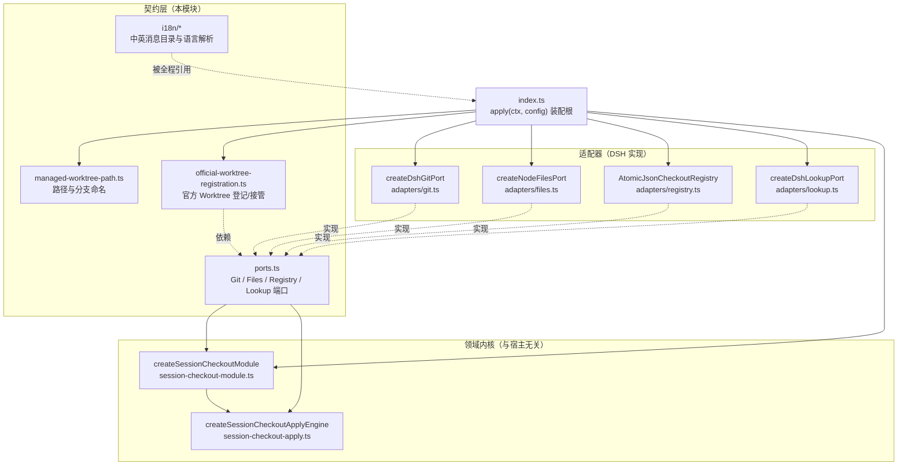
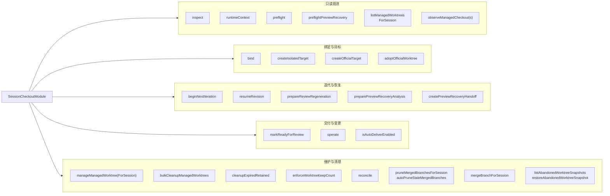
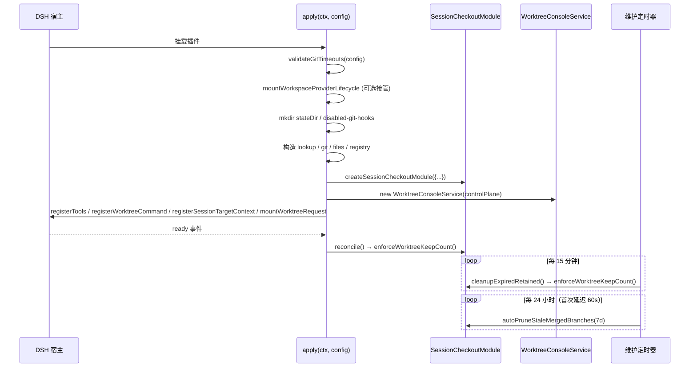
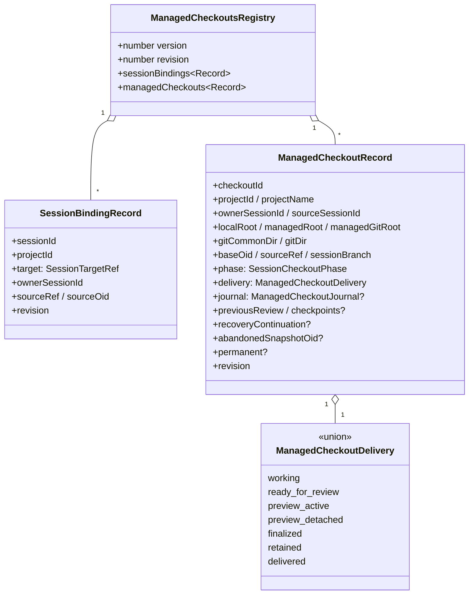
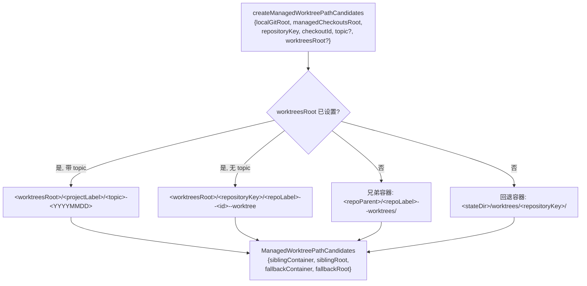
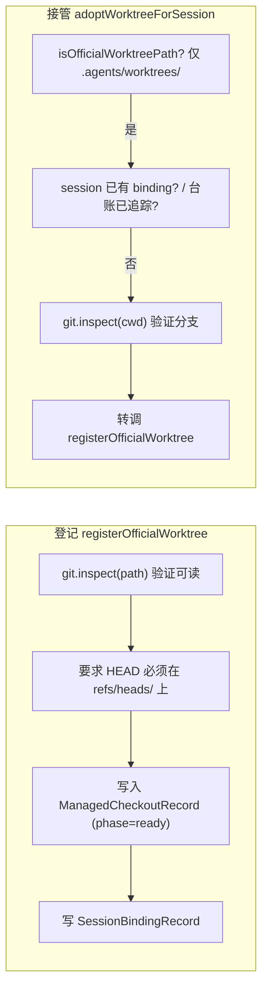
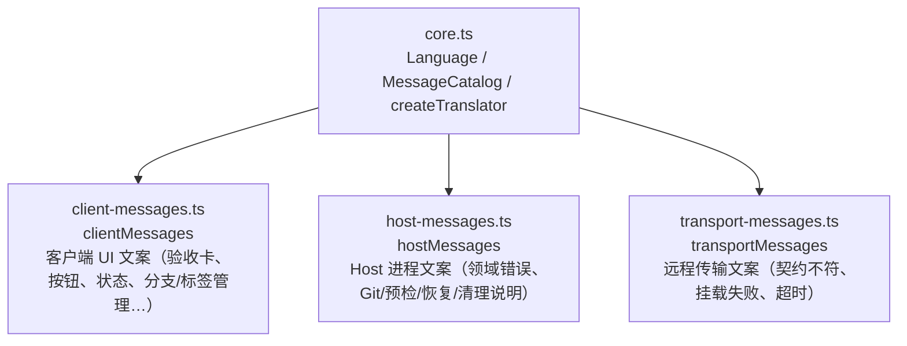
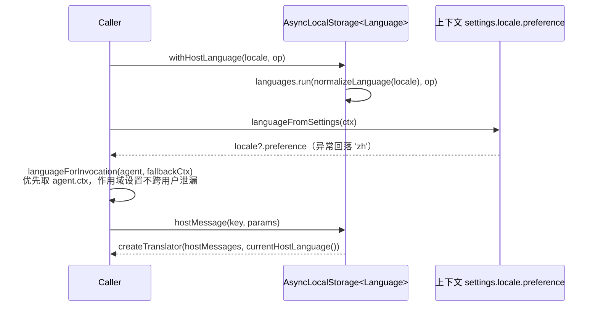

# 组合根、领域端口与国际化（root_6）

!!! info "Generated documentation"
    This page was written by CodeWiki from the source code at commit [`36d78408`](https://github.com/wloops/dsh-git-worktree/commit/36d784083cde39e99b6017025ce0d6c21dd439fe) on 2026-11-07 with `doubao-seed-2.1-lite`. Check the code before relying on details.

本模块是 **`dsh-git-worktree` 插件的装配中枢**：它把「与宿主无关的 session-checkout 领域」绑定到具体的 DSH 适配器上，对外公布领域错误类型与模块契约，并内置一套贯穿客户端、Host 与远程传输的中英文案体系。它同时定义了受管 Worktree 的路径命名规则与官方 Worktree 的登记/接管逻辑。

> 包名见 [`package.json`](../repo/package.json)：`dsh-git-worktree`（`lib/index.js` 为入口）。本模块的核心出口是 `src/index.ts`，类型契约出口为 `src/ports.ts`。

---

## 1. 模块定位

按依赖方向划分，整个插件呈「领域内核 → 适配器 → 装配」的层次。本模块处在最顶端的**装配层 + 契约层**：

- **领域内核**（被装配）：状态机工厂 [会话检出状态机模块（session-checkout-module）](src_session-checkout-module.ts.md)、应用引擎 [session-checkout-apply 应用引擎](src_session-checkout-apply.ts.md)。
- **适配器**（本模块注入）：Git 端口、文件端口、注册表、查找端口——实现细节见 [host_adapters](root_2/root_2_host_adapters.md)。
- **装配层**（本模块）：`src/index.ts` 读取配置、构造端口、挂载模块与服务、注册工具/命令、启动维护定时器。
- **契约层**（本模块）：`src/ports.ts` 是领域与适配器之间的全部接口边界；`src/i18n/*` 是跨层文案与语言解析。

---

## 2. 插件入口与装配（`src/index.ts`）

`src/index.ts` 是 DSH 插件的 `apply(ctx, config)` 面。文件首行注释即点明职责：**session-checkout 领域（状态机、应用引擎、端口）是 Domi 移植且与宿主无关；本文件才是 DSH 插件面**。

### 2.1 导出的契约类型

| 导出 | 职责 |
| --- | --- |
| `SessionCheckoutError` | 领域稳定失败类型：携带 `code: SessionCheckoutErrorCode` 与面向用户的 `message`，由工具层原样抛出。 |
| `SessionCheckoutModule` | 业务调用方拿到的完整核心接口（见下表）。 |
| `SessionCheckoutReconcileSummary` | 启动对账结果汇总：需恢复/孤立/脏孤立/陈旧根的 checkout id 列表与保留计数。 |
| `ManageManagedWorktreeInput` | 受管 Worktree 管理动作输入（清理、重试清理、设保留期、常驻、清徽章、放弃）。 |
| `ListManagedWorktreesInput` | 列表查询过滤条件（项目、是否只看需关注、按 checkoutId、是否含诊断）。 |
| `PruneMergedBranchesInput` | 分支剪枝输入：`dryRun` 预览与 `olderThanDays` 年龄过滤。 |
| `MergeBranchForSessionInput` | 会话分支合并输入：`sourceBranch`、`dryRun`、`direction: forward/reverse`。 |
| `MarkReadyForReviewInput` | 验收卡输入：摘要、详情、验证状态/摘要、测试项、建议提交信息。 |
| `IsolatedTargetLaunch` | 客户端创建权威隔离 Workspace/Session 所需的移交数据。 |
| `LocalAdaptationConfig` | 本地适配配置（`autoDeliver`/`autoPush`/`worktreesRoot`/`worktreeKeepCount` 等）。 |

### 2.2 `SessionCheckoutModule` 能力面

`SessionCheckoutModule` 是领域状态机对业务层暴露的全部操作，按用途可分组：

要点：

- **所有写操作共享同一把排他锁**：`runExclusiveSessionMutation` 把 bind / apply / discard / cleanup 串到同一临界区，杜绝并发改写台账。
- **预检一律只读**：`preflight` 与 `preflightPreviewRecovery` 明确「不修改 Local、worktree、台账、验收状态或 Git refs」，是安全交付的前置闸门。
- **自动交付开关**：`isAutoDeliverEnabled()` 供工具层判断——关闭时模型不得自行交付，只能调 `worktree_ready_for_review` 由人工验收。

### 2.3 `apply()` 装配流程

配置面（`Config`，schemastery 定义）中带 `volatile` 的字段会被投影到设置页、改后免重挂，以 `LiveValue` 实时到达（见 §3.3）。关键默认值：`gitTimeoutMs`、`worktreeAddTimeoutMs`、`autoDeliver=true`、`autoPush=true`、`inheritLocalChanges=true`、`worktreeKeepCount=15`、`autoPruneMergedBranches=false`、`enableWorkspaceProvider=false`。状态目录默认 `$DSH_HOME/plugins/dsh-git-worktree`（`DSH_HOME` 缺省为 `~/.dsh`）。

---

## 3. 领域端口契约（`src/ports.ts`）

`ports.ts` 是领域与适配器的唯一边界注释中写明：**领域逻辑只依赖这些端口；DSH 适配器（子进程 Git、插件自有台账存储、session/workspace 查找）藏在端口之后，使状态机与应用引擎保持宿主无关、可用替身测试**。

### 3.1 端口总览

| 端口 | 角色 | 关键能力 |
| --- | --- | --- |
| `SessionCheckoutLookupPort` | 只读导航证据 | `getSession` / `getProject` / `getSessionCwd`（实时 cwd）/ `listLiveSessions` / `listProjects` / `getSidebarMemberships` |
| `SessionCheckoutGitPort` | Git 操作（大量可选） | `inspect` / `status` / `createDetachedWorktree` / `attachWorktreeBranch` / `removeWorktree` / `retain*` / `isAncestor` / `pushBranch` / `mergeLocalBranch` / 分支/标签/提交图/放弃快照等 |
| `SessionCheckoutFilesPort` | 文件系统安全操作 | `exists` / `canonicalize` / `inspectDirectoryIdentity` / `quarantineDirectoryTree` / `removeDirectoryTree` / `measureDirectoryBytes` |
| `SessionCheckoutRegistryPort` | 台账读写 | `read` / `write` / **`update`（同锁内读-改-写）** |
| `OfficialWorktreesPort` | 宿主官方 `worktrees` 服务 | 仅 `create(agent, request, signal, onPhase)`——宿主负责真正的 Git 操作，插件只登记结果 |
| `SessionCheckoutDependencies` | 装配依赖包 | 聚合上述端口 + `applyEngine` + `managedCheckoutsRoot` + 若干 LiveValue 配置 |

> 设计上 `getSessionCwd` 与 `getSession` 刻意分离：导航记录不承载授权证据；owner Session 的实时 cwd 即其不可变 worktree 根，而 `getProject().root` 永远是 Local 检出——只按项目根授权会把 owner 调用全部误判为 `project_mismatch`。

### 3.2 核心持久化记录（`ManagedCheckoutsRegistry`）

台账 `version: 2` 是整个插件的事实源：

`ManagedCheckoutDelivery` 的判别联合正是交付生命周期的状态机：`working → ready_for_review → preview_active → (finalized | retained | delivered)`，异常分支为 `preview_detached`（漂移进恢复态）。`revision` 充当乐观并发（CAS）令牌，`journal` 记录中断现场以便 crash 恢复。

附属关键记录：

- `ManagedWorktreeReviewRecord` / `ManagedWorktreeCheckpointRecord` / `ManagedWorktreePreviousReviewRecord`：验收卡、私有阶段（checkpoint）、被作废后保留的有限上下文。
- `ManagedPreviewReceipt`：Local Preview 的指纹快照（基线、有效基线、前后指纹、工作树/index/tree OID），是可撤回性证明。
- `ManagedDeliveryProof` / `WorktreeCreationEvidence`：交付证据与创建证据（目录身份指纹）。
- `ManagedRecoveryContinuation`（四类）：冲突恢复、只读验收再生成、detached 恢复分析、detached 恢复移交——均为 Host 权威的一次性续跑凭证。

### 3.3 `LiveValue` 与实时配置

`LiveValue<T>` 是「易失 Cordis 配置字段」的抽象：`{ get(): T }`。`liveConfigValue(value)` 同时兼容纯值与实时引用，使设置页改动能在不重挂插件的情况下被每次读取时取到最新值。

---

## 4. 受管 Worktree 路径与分支命名（`src/managed-worktree-path.ts`）

本模块纯函数化生成**不触碰文件系统**的路径候选，由调用方逐个探测 8/12/全长身份并选第一个不存在的路径。

### 4.1 命名卫生

- `sanitizeManagedWorktreeLabel`：仓库 basename → 安全路径段（去 Windows 非法字符/保留名、折叠连字符、截断到 40 码位）。
- `sanitizeBranchSegment`：会话标识/主题 → 安全 git 分支片段。
- `createManagedWorktreeRepositoryKey`：对 canonical Git 根做 SHA-256 取前 12 位，区分同名仓库。

### 4.2 目录与分支候选

- `createSessionBranchCandidates`：会话专属分支名 `feat/sess-<会话>[--<主题>]`，重名时追加 `-2`、`-3`… 供调用方逐个尝试创建。
- `createTopicManagedWorktreeDirectoryName` / `createTopicDateStamp`：主题化人类可读命名 `<topic>-<YYYYMMDD>`，同天同主题碰撞时追加短身份后缀。

---

## 5. 官方 Worktree 登记与接管（`src/official-worktree-registration.ts`）

宿主自有 `worktrees` 服务会把树建在 `<repositoryRoot>/.agents/worktrees/<branch>`。本模块负责把这些树收编进同一份台账，使列表/交付/验收/清理对「官方建的树」与「自建树」一视同仁。

设计要点（见源码注释）：

- **只认 `.agents/worktrees/` 前缀是有意的**：用户手工 `git worktree add` 的目录不属于本插件，纳管等于凭空接管别人的目录。
- **`working-directory/change` 是唯一可靠信号**：官方 `worktrees.create` 的最后一步是 `workingDirectory.set`，因此「树建好了且有人站在里面」以它为准，比轮询 `git worktree list` 及时。
- **防重复登记**：session 已有 binding 或台账已按 `managedRoot`/`managedGitRoot` 追踪时直接跳过，避免同一目录出现两条记录。
- `isTracked` 跨平台归一化路径（Windows 小写）后比对，`phase === 'discarded'` 的记录不计入。

---

## 6. 国际化子系统（`src/i18n/*`）

### 6.1 共享原语（`core.ts`）

- `Language = 'zh' | 'en'`；`normalizeLanguage(value)`：以 `/^en(?:-|$)/i` 判定英文，其余一律回落中文。
- `MessageCatalog`：`Record<string, { zh, en }>`；`Translator<C>` 为带占位符类型的翻译函数。
- `createTranslator(catalog, language)`：按语言取模板，用 `{name}` 正则插值 `params`（缺省占位符保留原文本，不报错）。

> 约束：`core.ts` 注释强调**绝不 import 浏览器或 Host 专属模块**——它是三层共享的纯函数层。

### 6.2 三份消息目录

| 目录 | 规模与用途 |
| --- | --- |
| `clientMessages` | 体量最大：覆盖验收详情、交付状态、预览/恢复提示、设置页、分支/标签/提交图、Worktree 管理弹窗等全部 UI 字符串。注释注明「Plugin-owned Client copy；参数为不透明的用户/Host 数据」。 |
| `hostMessages` | Host 进程文案：初始化、验收/checkpoint/Apply/Preview/Finalize/Finish/Discard/Recover/清理等状态机错误，以及工具（`worktree_deliver` 等）的描述与参数说明。 |
| `transportMessages` | 仅 4 条：远端 payload 不符契约、namespace 挂载失败、无法识别 Host Workspace 形态、远端调用超时。 |

### 6.3 Host 语言解析（`host.ts`）

- `currentHostLanguage()`：每次调用一个不可变语言快照，跨 async 续 isolated；缺省 `'zh'`。
- `withHostLanguage` / `languageFromSettings` / `languageForInvocation`：从「公共的、上下文自有的 DSH 设置缝」读取，**绝不持久化浏览器偏好**。
- `hostMessage`：Host 侧的默认翻译函数，每次调用按当前 AsyncLocalStorage 语言现取 translator。

### 6.4 持久化清理文案（`host-messages.ts` 的特殊化）

`cleanup*` 系列文案会被**持久化**到台账作为清理恢复判别量。因此：

- `persistedCleanupKeys`（`cleanupIdentityChanged`、`cleanupResidue`、`cleanupIncompleteDelivery`…共 10 个）构成有限白名单。
- `hostPersistedCleanupMessage(message, translate, key?)`：新记录带 `key` 直接按当前语言翻译；历史记录只有一段定死中文，则用中文字面串反查兜底。**绝不解释或改写第三方错误文本**。
- `hostRegistrationMessage(key)`：注册元数据跨 session 共享，因此同时暴露中英双语（`zh + ' / ' + en`）。

---

## 7. 与其它模块的关系

| 相邻模块 | 关系 |
| --- | --- |
| [host_adapters](root_2/root_2_host_adapters.md) | 本模块 `apply()` 注入的 Git/文件/注册表/查找端口即由这些适配器实现（`createDshGitPort`、`AtomicJsonCheckoutRegistry` 等）。 |
| [console_host 模块](root_5.md) | 本模块 `new WorktreeConsoleService(controlPlane)` 装配的服务端；`src/index.ts` 透传导出了 `console-contract.js`。 |
| [session-checkout-apply 应用引擎](src_session-checkout-apply.ts.md) | 被 `createSessionCheckoutApplyEngine({ projectSkills })` 构造并传入模块的应用引擎。 |
| [会话检出状态机模块（session-checkout-module）](src_session-checkout-module.ts.md) | 被 `createSessionCheckoutModule({...})` 构造的状态机工厂——本模块把端口接到它上面。 |
| [root_7 模块](root_7.md) | 工具注册（`registerTools`）、`/worktree` 命令（`registerWorktreeCommand`）、Session Target 运行时上下文、视图类型集中在此。 |
| [root_3 模块](root_3/root_3_review_console.md) / [root_2 模块](root_2/root_2_client_core.md) | 客户端 UI 消费 `clientMessages`；远程层消费 `transportMessages`。 |

---

## 8. 关键设计小结

1. **领域与宿主彻底解耦**：状态机/应用引擎只认识 `ports.ts` 的端口；DSH 适配全部藏在 `index.ts` 的装配里，可整体替换为测试替身。
2. **写操作串行化**：`runExclusiveSessionMutation` + `registry.update`（同锁读-改-写）+ 每条记录的 `revision` CAS，三层防并发/过期写入。
3. **安全优先的交付**：所有预检只读；Preview 可撤回性由 `ManagedPreviewReceipt` 指纹证明；无法证明安全时保留现场而非猜测成功。
4. **文案与代码分离**：三份目录 + AsyncLocalStorage 语言快照；持久化文案走白名单 key，历史文本靠字面串反查，避免本地化破坏判别逻辑。
5. **配置实时化**：`volatile` 字段以 `LiveValue` 到达，设置页改动免重挂即生效。

??? abstract "Documented components (51)"
    - [`__file__`](https://github.com/wloops/dsh-git-worktree/blob/36d784083cde39e99b6017025ce0d6c21dd439fe/src%5Ci18n%5Cclient-messages.ts) — `src\i18n\client-messages.ts`
    - [`Language`](https://github.com/wloops/dsh-git-worktree/blob/36d784083cde39e99b6017025ce0d6c21dd439fe/src%5Ci18n%5Ccore.ts) — `src\i18n\core.ts`
    - [`PersistedCleanupKey`](https://github.com/wloops/dsh-git-worktree/blob/36d784083cde39e99b6017025ce0d6c21dd439fe/src%5Ci18n%5Chost-messages.ts) — `src\i18n\host-messages.ts`
    - [`currentHostLanguage`](https://github.com/wloops/dsh-git-worktree/blob/36d784083cde39e99b6017025ce0d6c21dd439fe/src%5Ci18n%5Chost.ts) — `src\i18n\host.ts`
    - [`__file__`](https://github.com/wloops/dsh-git-worktree/blob/36d784083cde39e99b6017025ce0d6c21dd439fe/src%5Ci18n%5Ctransport-messages.ts) — `src\i18n\transport-messages.ts`
    - [`IsolatedTargetLaunch`](https://github.com/wloops/dsh-git-worktree/blob/36d784083cde39e99b6017025ce0d6c21dd439fe/src%5Cindex.ts) — `src\index.ts`
    - [`ListManagedWorktreesInput`](https://github.com/wloops/dsh-git-worktree/blob/36d784083cde39e99b6017025ce0d6c21dd439fe/src%5Cindex.ts) — `src\index.ts`
    - [`LocalAdaptationConfig`](https://github.com/wloops/dsh-git-worktree/blob/36d784083cde39e99b6017025ce0d6c21dd439fe/src%5Cindex.ts) — `src\index.ts`
    - [`ManageManagedWorktreeInput`](https://github.com/wloops/dsh-git-worktree/blob/36d784083cde39e99b6017025ce0d6c21dd439fe/src%5Cindex.ts) — `src\index.ts`
    - [`MarkReadyForReviewInput`](https://github.com/wloops/dsh-git-worktree/blob/36d784083cde39e99b6017025ce0d6c21dd439fe/src%5Cindex.ts) — `src\index.ts`
    - [`MergeBranchForSessionInput`](https://github.com/wloops/dsh-git-worktree/blob/36d784083cde39e99b6017025ce0d6c21dd439fe/src%5Cindex.ts) — `src\index.ts`
    - [`PruneMergedBranchesInput`](https://github.com/wloops/dsh-git-worktree/blob/36d784083cde39e99b6017025ce0d6c21dd439fe/src%5Cindex.ts) — `src\index.ts`
    - [`SessionCheckoutError`](https://github.com/wloops/dsh-git-worktree/blob/36d784083cde39e99b6017025ce0d6c21dd439fe/src%5Cindex.ts) — `src\index.ts`
    - [`SessionCheckoutModule`](https://github.com/wloops/dsh-git-worktree/blob/36d784083cde39e99b6017025ce0d6c21dd439fe/src%5Cindex.ts) — `src\index.ts`
    - [`SessionCheckoutReconcileSummary`](https://github.com/wloops/dsh-git-worktree/blob/36d784083cde39e99b6017025ce0d6c21dd439fe/src%5Cindex.ts) — `src\index.ts`
    - [`ManagedWorktreePathCandidates`](https://github.com/wloops/dsh-git-worktree/blob/36d784083cde39e99b6017025ce0d6c21dd439fe/src%5Cmanaged-worktree-path.ts) — `src\managed-worktree-path.ts`
    - [`OfficialWorktreeRegistration`](https://github.com/wloops/dsh-git-worktree/blob/36d784083cde39e99b6017025ce0d6c21dd439fe/src%5Cofficial-worktree-registration.ts) — `src\official-worktree-registration.ts`
    - [`OfficialWorktreeRegistrationDependencies`](https://github.com/wloops/dsh-git-worktree/blob/36d784083cde39e99b6017025ce0d6c21dd439fe/src%5Cofficial-worktree-registration.ts) — `src\official-worktree-registration.ts`
    - [`BranchOverviewEntry`](https://github.com/wloops/dsh-git-worktree/blob/36d784083cde39e99b6017025ce0d6c21dd439fe/src%5Cports.ts) — `src\ports.ts`
    - [`DirectoryIdentity`](https://github.com/wloops/dsh-git-worktree/blob/36d784083cde39e99b6017025ce0d6c21dd439fe/src%5Cports.ts) — `src\ports.ts`
    - [`GitCheckoutSnapshot`](https://github.com/wloops/dsh-git-worktree/blob/36d784083cde39e99b6017025ce0d6c21dd439fe/src%5Cports.ts) — `src\ports.ts`
    - [`GraphLogCommit`](https://github.com/wloops/dsh-git-worktree/blob/36d784083cde39e99b6017025ce0d6c21dd439fe/src%5Cports.ts) — `src\ports.ts`
    - [`InitialCommitPreflight`](https://github.com/wloops/dsh-git-worktree/blob/36d784083cde39e99b6017025ce0d6c21dd439fe/src%5Cports.ts) — `src\ports.ts`
    - [`LiveValue`](https://github.com/wloops/dsh-git-worktree/blob/36d784083cde39e99b6017025ce0d6c21dd439fe/src%5Cports.ts) — `src\ports.ts`
    - [`ManagedApplyConflictRecoveryContinuation`](https://github.com/wloops/dsh-git-worktree/blob/36d784083cde39e99b6017025ce0d6c21dd439fe/src%5Cports.ts) — `src\ports.ts`
    - [`ManagedCheckoutCreateJournal`](https://github.com/wloops/dsh-git-worktree/blob/36d784083cde39e99b6017025ce0d6c21dd439fe/src%5Cports.ts) — `src\ports.ts`
    - [`ManagedCheckoutJournalBase`](https://github.com/wloops/dsh-git-worktree/blob/36d784083cde39e99b6017025ce0d6c21dd439fe/src%5Cports.ts) — `src\ports.ts`
    - [`ManagedCheckoutMutationJournal`](https://github.com/wloops/dsh-git-worktree/blob/36d784083cde39e99b6017025ce0d6c21dd439fe/src%5Cports.ts) — `src\ports.ts`
    - [`ManagedCheckoutRecord`](https://github.com/wloops/dsh-git-worktree/blob/36d784083cde39e99b6017025ce0d6c21dd439fe/src%5Cports.ts) — `src\ports.ts`
    - [`ManagedCheckoutsRegistry`](https://github.com/wloops/dsh-git-worktree/blob/36d784083cde39e99b6017025ce0d6c21dd439fe/src%5Cports.ts) — `src\ports.ts`
    - [`ManagedDeliveryProof`](https://github.com/wloops/dsh-git-worktree/blob/36d784083cde39e99b6017025ce0d6c21dd439fe/src%5Cports.ts) — `src\ports.ts`
    - [`ManagedPreviewReceipt`](https://github.com/wloops/dsh-git-worktree/blob/36d784083cde39e99b6017025ce0d6c21dd439fe/src%5Cports.ts) — `src\ports.ts`
    - [`ManagedPreviewRecoveryAnalysisContinuation`](https://github.com/wloops/dsh-git-worktree/blob/36d784083cde39e99b6017025ce0d6c21dd439fe/src%5Cports.ts) — `src\ports.ts`
    - [`ManagedPreviewRecoveryHandoffContinuation`](https://github.com/wloops/dsh-git-worktree/blob/36d784083cde39e99b6017025ce0d6c21dd439fe/src%5Cports.ts) — `src\ports.ts`
    - [`ManagedReviewRegenerationContinuation`](https://github.com/wloops/dsh-git-worktree/blob/36d784083cde39e99b6017025ce0d6c21dd439fe/src%5Cports.ts) — `src\ports.ts`
    - [`ManagedWorktreeCheckpointRecord`](https://github.com/wloops/dsh-git-worktree/blob/36d784083cde39e99b6017025ce0d6c21dd439fe/src%5Cports.ts) — `src\ports.ts`
    - [`ManagedWorktreePreviousReviewRecord`](https://github.com/wloops/dsh-git-worktree/blob/36d784083cde39e99b6017025ce0d6c21dd439fe/src%5Cports.ts) — `src\ports.ts`
    - [`ManagedWorktreeReviewRecord`](https://github.com/wloops/dsh-git-worktree/blob/36d784083cde39e99b6017025ce0d6c21dd439fe/src%5Cports.ts) — `src\ports.ts`
    - [`OfficialWorktreesPort`](https://github.com/wloops/dsh-git-worktree/blob/36d784083cde39e99b6017025ce0d6c21dd439fe/src%5Cports.ts) — `src\ports.ts`
    - [`SessionBindingRecord`](https://github.com/wloops/dsh-git-worktree/blob/36d784083cde39e99b6017025ce0d6c21dd439fe/src%5Cports.ts) — `src\ports.ts`
    - [`SessionCheckoutDependencies`](https://github.com/wloops/dsh-git-worktree/blob/36d784083cde39e99b6017025ce0d6c21dd439fe/src%5Cports.ts) — `src\ports.ts`
    - [`SessionCheckoutFilesPort`](https://github.com/wloops/dsh-git-worktree/blob/36d784083cde39e99b6017025ce0d6c21dd439fe/src%5Cports.ts) — `src\ports.ts`
    - [`SessionCheckoutGitPort`](https://github.com/wloops/dsh-git-worktree/blob/36d784083cde39e99b6017025ce0d6c21dd439fe/src%5Cports.ts) — `src\ports.ts`
    - [`SessionCheckoutLookupPort`](https://github.com/wloops/dsh-git-worktree/blob/36d784083cde39e99b6017025ce0d6c21dd439fe/src%5Cports.ts) — `src\ports.ts`
    - [`SessionCheckoutProjectRecord`](https://github.com/wloops/dsh-git-worktree/blob/36d784083cde39e99b6017025ce0d6c21dd439fe/src%5Cports.ts) — `src\ports.ts`
    - [`SessionCheckoutRegistryPort`](https://github.com/wloops/dsh-git-worktree/blob/36d784083cde39e99b6017025ce0d6c21dd439fe/src%5Cports.ts) — `src\ports.ts`
    - [`SessionCheckoutSessionRecord`](https://github.com/wloops/dsh-git-worktree/blob/36d784083cde39e99b6017025ce0d6c21dd439fe/src%5Cports.ts) — `src\ports.ts`
    - [`SidebarDirectoryMembership`](https://github.com/wloops/dsh-git-worktree/blob/36d784083cde39e99b6017025ce0d6c21dd439fe/src%5Cports.ts) — `src\ports.ts`
    - [`TagOverviewEntry`](https://github.com/wloops/dsh-git-worktree/blob/36d784083cde39e99b6017025ce0d6c21dd439fe/src%5Cports.ts) — `src\ports.ts`
    - [`WorktreeCreationEvidence`](https://github.com/wloops/dsh-git-worktree/blob/36d784083cde39e99b6017025ce0d6c21dd439fe/src%5Cports.ts) — `src\ports.ts`
    - … and 1 more

