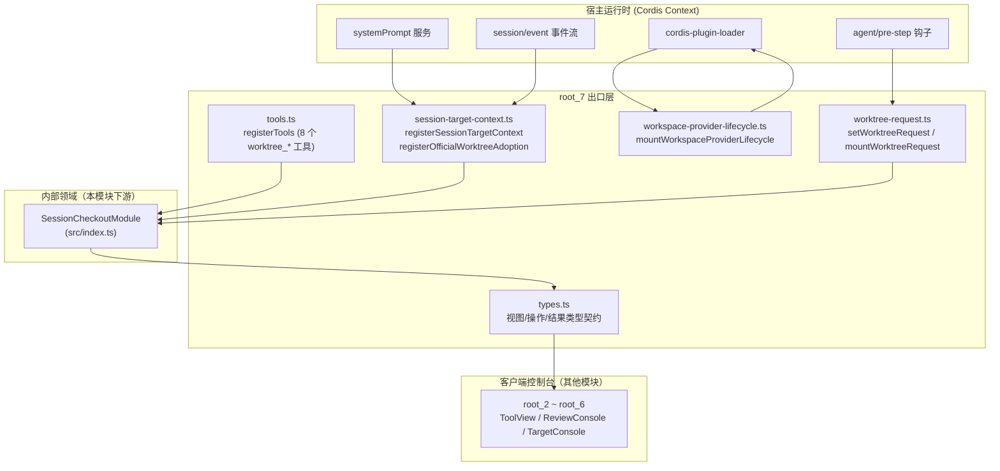
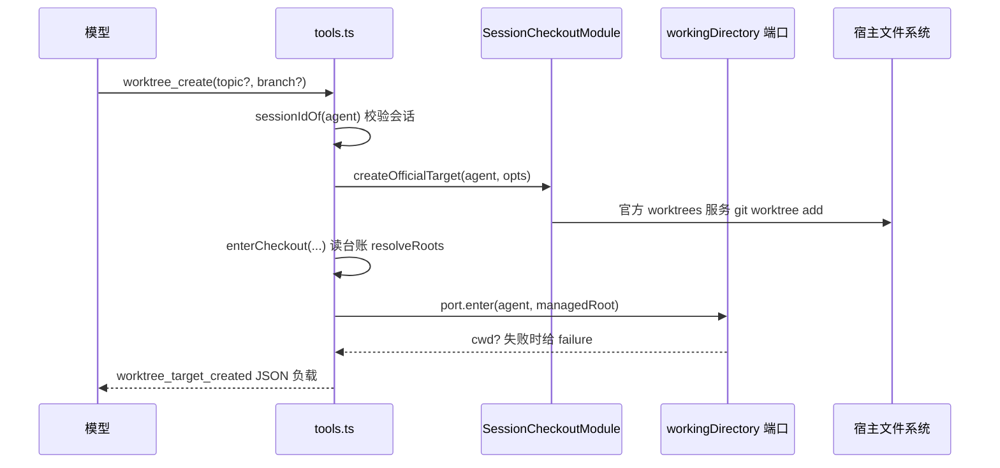
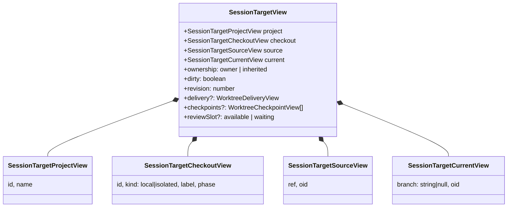
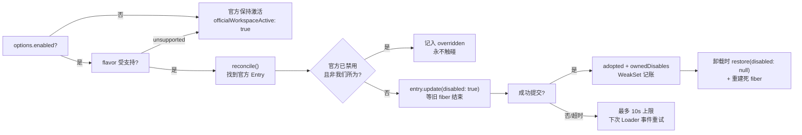
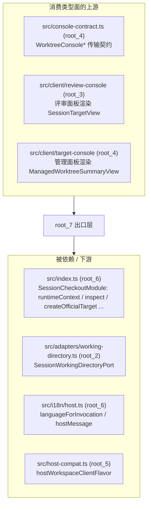

# root_7：dsh-git-worktree 插件出口层

!!! info "Generated documentation"
    This page was written by CodeWiki from the source code at commit [`36d78408`](https://github.com/wloops/dsh-git-worktree/commit/36d784083cde39e99b6017025ce0d6c21dd439fe) on 2026-11-07 with `doubao-seed-2.1-lite`. Check the code before relying on details.

## 引言与用途

本模块是 **dsh-git-worktree** 插件（DeepSeek Harness 的 Git worktree 会话目标插件，`package.json` 中版本 `0.14.0`）面向宿主（Host）与模型（Model）的**出口层**：它把内部领域能力（会话检出、隔离评审、交付、恢复）包装成 Cordis 生命周期挂载点、模型可调用的工具集、稳定的视图类型面，以及与官方宿主的兼容桥接。

它负责四件事：

1. **模型工具注册** —— 通过 `registerTools` 向 Cordis `ctx.tools` 注册 8 个 `worktree_*` 工具，让模型能创建、列出、迭代、评审、交付、清理、修剪、合并隔离 Worktree；
2. **宿主上下文挂载** —— 通过 `registerSessionTargetContext` 向系统提示注入「当前会话目标」的动态快照，通过 `registerOfficialWorktreeAdoption` 在会话走进官方树时把它收进插件台账；
3. **类型面** —— `src/types.ts` 是整个插件（含客户端控制台）共享的、与宿主无关的视图/操作/结果类型契约（从 Domi 的 `@proma/shared` 移植并裁剪）；
4. **宿主兼容桥** —— `workspace-provider-lifecycle.ts` 用 Loader 操作在 `uiWorkspace` 提供者之间做唯一选举；`worktree-request.ts` 把「勾了但还没发消息」的建树意图持久化到 session log，并在 turn 第一步兑现。

## 架构概览

关键数据流（以一次 `worktree_create` 为例）：

## 核心组件职责

### 1. `src/session-target-context.ts` —— 会话目标上下文与官方树收养

| 导出 | 职责 |
| --- | --- |
| `ContextAgent` | 最小结构类型 `{ session?: { id?: unknown } }`，从 Cordis 上下文 agent 读取会话 id。 |
| `registerSessionTargetContext(ctx, module)` | 向 `systemPrompt` 注入名为 `git-worktree:session-target`（order 118）的动态上下文块；文本在模型调用时实时生成：取会话 id + 当前工作目录，调用 `module.runtimeContext(sessionId, cwd)` 得到「本会话当前站在树里还是 Local」的快照，全程不做 Git/文件 I/O（快照侧效应在模块内部）。 |
| `registerOfficialWorktreeAdoption(ctx, module)` | 监听 `session/event`，当事件类型为 `working-directory/change` 时（官方 `worktrees.create` 的最后一步必然 `workingDirectory.set`），fire-and-forget 调用 `module.adoptOfficialWorktree(sessionId, cwd)` 把官方树接进台账；rejection 被捕获并 `console.warn`，绝不逃出事件 feed。 |

设计要点：**不轮询 `git worktree list`**——官方创建与 forge 面板都走同一条 cwd 变更信号，比轮询及时，也不必为每个项目起子进程。

### 2. `src/tools.ts` —— 模型工具面（`enterCheckout` 为核心辅助）

`registerTools(ctx, module)` 注册的 8 个工具及其语义：

| 工具名 | 作用 | 关键约束 |
| --- | --- | --- |
| `worktree_create` | 保留一个隔离目标会话并进入新建树 | 走宿主官方 `worktrees.create`（目录固定 `<repo>/.agents/worktrees/<branch>`），随后 `enterCheckout` 切 cwd；宿主无 workingDirectory 服务时优雅降级。 |
| `worktree_list` | 列出当前会话可见的受管 Worktree | 经 `module.listManagedWorktreesForSession` 聚合；commitOid 缺省时省略键而非发空值。 |
| `worktree_resume_revision` | 把已 `ready_for_review` 但未同步的评审退回 working | 前置校验当前 delivery 状态。 |
| `worktree_begin_next_iteration` | 交付后开同一会话的下一轮迭代 | 重新 `enterCheckout` 进入重建后的树；失败显式报错而非静默留在 Local 边界。 |
| `worktree_ready_for_review` | 标记评审就绪（summary/details/validationStatus/tests/suggestedCommitMessage） | 交付前的人类验收栏。 |
| `worktree_deliver` | 提交 + push + 清理 | 仅当 `module.isAutoDeliverEnabled()` 开启；先 `leaveCheckoutBeforeRemoval` 把会话移出将被删除的树，移动失败则中止移除；交付失败则把会话移回幸存的树。 |
| `worktree_cleanup` | 清理指定 checkout（需 checkoutId + expectedRevision） | 同样先移出 cwd。 |
| `worktree_prune_branches` / `worktree_merge` | 修剪已合并分支（支持 dryRun/olderThanDays）；合并会话分支到 Local（forward，或 Local→树 reverse） | 合并失败抛结构化 reason。 |

内部辅助：

- **`enterCheckout(port, module, agent, checkoutId)`**：优先从台账 `module.resolveRoots(checkoutId).managedRoot` 读根（`resolveManagedRoot` 带全局锁的完整 Git 校验只作兜底，避免恢复中途/瞬时 Git 错误把会话晾在树外）；返回 `{ cwd }` 或 `{ failure }`——`cwd: undefined` 是「宿主未挂载服务」的合法降级，与真实失败严格区分。
- **`leaveCheckoutBeforeRemoval(...)`**：删除检出前的 cwd 回迁，失败即中止移除。
- **`sessionIdOf(agent)`**：工具只能在 DSH 会话内调用，否则抛 i18n 错误。
- 所有工具的描述与标题走 `hostRegistrationMessage(...)` / `hostMessage(...)`，经 `withHostLanguage` + `languageForInvocation` 按调用语言渲染。

### 3. `src/types.ts` —— 宿主无关的类型契约

这是全插件的**共享类型面**（移植自 Domi session-checkout 领域，省略协作者与 Electron-only 表面）。分四族：

**(a) 目标视图族（`SessionTargetView` 及其部件）**

- `SessionTargetRef`：持久层的稳定引用（`unselected | local | isolated{checkoutId}`）——**路径与分支不是检出身份**。
- `SessionCheckoutPhase`：`preparing | ready | applying(已废弃) | mutating | recovery_required | finalized | retained | discarded`。
- `WorktreeDeliveryView` 是可辨识联合：`working → ready_for_review → preview_active → preview_detached(stale_local|preview_modified) → finalized | retained | delivered`，每态携带对应 `WorktreeReviewView` / `WorktreeDeliveryProofView`。

**(b) 操作族（`SessionCheckoutOperation`）**：所有操作共享 `SessionCheckoutOperationBase { sessionId, expectedRevision }`（乐观并发），具体为 `apply / finish / preview / checkpoint / rollback_preview / finalize_preview / retry_cleanup / discard / recover` 九种联合成员。

**(c) 结果族（`SessionCheckoutOperationResult`）**：对应九种状态的可辨识联合（`applied / previewed / checkpointed / preview_rolled_back / preview_detached / finished / conflict / discarded / recovered / error`），错误侧由 `SESSION_CHECKOUT_ERROR_CODES`（29 个码，如 `stale_target`、`apply_conflict`、`project_acceptance_busy`、`recovery_unsafe`）穷举。

**(d) 管理面与证明族**：

- `ManagedWorktreeSummaryView` / `ManagedWorktreeCleanupView` / `BulkCleanup*`：给管理面板的**无路径**投影（路径不外露，防泄漏）。
- `WorktreePreviewRecoveryProof`：宿主签发的只读恢复上下文（含 `receiptFingerprint` SHA-256、local/index/working 三棵树的 oid、rollback/finalize 两动作的安全或阻塞结论），重算时在宿主锁内比对。
- `WorktreeDeliveryProofView`：交付时复制自授权评审的校验证据 + Local HEAD 前后快照。
- 常量：`DEFAULT_WORKTREE_RETENTION = 'retain_manual'`（无计时器偷偷删树）、`CONFLICT_DETAIL_FILE_LIMIT = 6` / `CONFLICT_DETAIL_DIFF_LIMIT = 4096`（冲突详情防撑爆模型上下文）。

### 4. `src/workspace-provider-lifecycle.ts` —— uiWorkspace 提供者唯一选举

`mountWorkspaceProviderLifecycle(ctx, flavor, options)` 解决「本插件与官方 `@deepseek-ai/dsh-client-ui-workspace` 注册同一个 `uiWorkspace` 服务」的冲突。

关键设计决策：

- **用 Loader 操作而不是客户端 `!!js` 表达式**：旧实现两次不同步求值（Host apply 时插件 fiber 仍 LOADING 读不到服务，Web 渲染层审计时又 ACTIVE），曾导致 0.2.x Web 启动崩溃。
- **所有权记账**：`ownedDisables = WeakSet<Entry>` 记录「我们自己写入的 disable」——跨代重启时，自己写的 `disabled: true` 被旧代卸载的 restore 落地后，新代能认出这不是用户/市场决策，必要时重新选举。
- **永不阻塞激活**：每个 Loader 操作与 `DEFAULT_OPERATION_TIMEOUT_MS = 10_000` 的 ceiling 赛跑；楔住的操作只告警一次，该 Entry 保持守卫，下次 `internal/status` / `internal/plugin` 事件重试。
- **失败声明诚实**：返回 `{ officialWorkspaceActive }`，只在每个被持有 Entry 的 disable 确实落定（确定性布尔）时才宣称接管，否则回退到 decorate 共存，避免 Web 重放官方 apply 触发 `service "uiWorkspace" has been registered`。
- 兼容双 Cordis 版本识别存活 fiber（4.0.5 存本体、4.1.0 存 `Object.create(fiber)` 包装）。

### 5. `src/worktree-request.ts` —— 「发首条消息时建树」的待办请求

把官方 forge 面板拆在两处的语义（面板写意图、客户端 pre-step 兑现）收进 Host 侧，因为建树必须走本插件的 `createOfficialTarget`（负责 `feat/sess-*` 命名、`.worktreeinclude`、本地未提交修改继承）。

| 导出 | 职责 |
| --- | --- |
| `WORKTREE_REQUEST_RECORD = 'plugin:dsh-git-worktree/worktree-request'` | session log 中的 plugin record 类型；经 `declare module '@deepseek-ai/dsh-session/types'` 增补 `PluginRecordMap`。 |
| `WorktreeRequest { from: string\|null }` | 待建请求（基点分支；null = 当前 HEAD）。 |
| `pendingWorktreeRequest(session)` | 折叠 session log 事件流，取最近一条有效 record（`request` 置位、`cancel` 清空）；非法数据跳过。 |
| `setWorktreeRequest(ctx, sessionId, from?)` | Host 写入口：`from` 为 `undefined` 时撤回；会话不活抛错。 |
| `liveWorktreeRequest(ctx, sessionId)` | 读活会话待办，供 `current` 回给胶囊（inbox 指示器）。 |
| `mountWorktreeRequest(ctx, module)` | 监听 `agent/pre-step`：仅在 `step === 1` 且有待办时兑现；会话已不是 Local 则只清标记不建第二棵树；建树失败把 `messages` **倒序放回 `agent.inbox`**（消息不丢）并 `reject`；成功则 `workingDirectory.enter` 进树。 |

持久化在 session log（plugin record）而非内存：刷新页面、重启 Host 后「勾了但还没发消息」依然成立。

## 构建、打包与工程配置

- **`tsconfig.json`**：`ES2022 + NodeNext`，DOM + React JSX，strict + `noUncheckedIndexedAccess`，`rootDir: src` 输出 `lib/`（`package.json` 的 `main: lib/index.js`）。
- **`tsdown.config.ts`**：仅打包**客户端入口** `src/client/console-remote/index.ts` 为 CJS（`lib/client.js`），用 `outputOptions.banner/footer` 包装成 `window.__ModuleLoader__.load({ id: 'dsh-git-worktree', factory })` 的宿主插件格式；`react`、`@deepseek-ai/cordis` 等设为 external，`zod`、`lucide-react` 打进来；内置插件把 4 个官方 Workspace 虚拟模块 id（official / next / rc5 / alpha）重定向到 `scripts/workspace-sidebar-upstream*.mjs` 的物化产物（对应 `package.json` devDependencies 里钉死的 4 个 `@deepseek-ai/dsh-client-ui-workspace` 版本轨道）。
- **`vitest.config.ts`**：`tests/**` 下运行；Windows 上关闭文件并行（重型 Git fixture 争进程/句柄），超时 60s；把 `dsh-client-ui-primitives` 与 4 个虚拟 workspace 模块别名到 `tests/support` 与 `tests/official-workspace-client*.mock.ts`。

## 与其他模块的关系

- 本模块**调用** [组合根、领域端口与国际化（root_6）](root_6.md)（`src/index.ts` 的 `SessionCheckoutModule` 全部方法、`i18n/host`）、[Worktree Console 宿主与远程协议层（root_5）](root_5.md)（`host-compat.ts` 的 flavor 诊断）、[root_2：持久化适配器与浏览器客户端桥接层](root_2.md)（`adapters/working-directory.ts` 的端口）。
- 本模块的 `types.ts` 被 [root_4：Worktree 控制台客户端与宿主命令面](root_4.md)（控制台传输契约）与 [root_3：Worktree 客户端控制台 UI（评审、设置与目标胶囊）](root_3.md)（评审/设置/目标客户端）直接消费——视图类型是「Host 状态 → 客户端渲染」的唯一桥梁，因此保持**无路径、可持久化、可 i18n**。
- 深度操作引擎（apply/preview/recover 的真实 Git 语义）在 [src_session-checkout-apply.ts](src_session-checkout-apply.ts)，本模块的操作类型只是其输入输出契约。

??? abstract "Documented components (55)"
    - [`ContextAgent`](https://github.com/wloops/dsh-git-worktree/blob/36d784083cde39e99b6017025ce0d6c21dd439fe/src%5Csession-target-context.ts) — `src\session-target-context.ts`
    - [`enterCheckout`](https://github.com/wloops/dsh-git-worktree/blob/36d784083cde39e99b6017025ce0d6c21dd439fe/src%5Ctools.ts) — `src\tools.ts`
    - [`AbandonedWorktreeSnapshotView`](https://github.com/wloops/dsh-git-worktree/blob/36d784083cde39e99b6017025ce0d6c21dd439fe/src%5Ctypes.ts) — `src\types.ts`
    - [`ApplyConflictDetail`](https://github.com/wloops/dsh-git-worktree/blob/36d784083cde39e99b6017025ce0d6c21dd439fe/src%5Ctypes.ts) — `src\types.ts`
    - [`BulkCleanupManagedWorktreeCandidate`](https://github.com/wloops/dsh-git-worktree/blob/36d784083cde39e99b6017025ce0d6c21dd439fe/src%5Ctypes.ts) — `src\types.ts`
    - [`BulkCleanupManagedWorktreesResult`](https://github.com/wloops/dsh-git-worktree/blob/36d784083cde39e99b6017025ce0d6c21dd439fe/src%5Ctypes.ts) — `src\types.ts`
    - [`ManagedWorktreeCleanupView`](https://github.com/wloops/dsh-git-worktree/blob/36d784083cde39e99b6017025ce0d6c21dd439fe/src%5Ctypes.ts) — `src\types.ts`
    - [`ManagedWorktreeSummaryView`](https://github.com/wloops/dsh-git-worktree/blob/36d784083cde39e99b6017025ce0d6c21dd439fe/src%5Ctypes.ts) — `src\types.ts`
    - [`MergeBranchForSessionView`](https://github.com/wloops/dsh-git-worktree/blob/36d784083cde39e99b6017025ce0d6c21dd439fe/src%5Ctypes.ts) — `src\types.ts`
    - [`MergeLocalBranchResult`](https://github.com/wloops/dsh-git-worktree/blob/36d784083cde39e99b6017025ce0d6c21dd439fe/src%5Ctypes.ts) — `src\types.ts`
    - [`PruneMergedBranchEntry`](https://github.com/wloops/dsh-git-worktree/blob/36d784083cde39e99b6017025ce0d6c21dd439fe/src%5Ctypes.ts) — `src\types.ts`
    - [`PruneMergedBranchesView`](https://github.com/wloops/dsh-git-worktree/blob/36d784083cde39e99b6017025ce0d6c21dd439fe/src%5Ctypes.ts) — `src\types.ts`
    - [`SessionCheckoutAppliedResult`](https://github.com/wloops/dsh-git-worktree/blob/36d784083cde39e99b6017025ce0d6c21dd439fe/src%5Ctypes.ts) — `src\types.ts`
    - [`SessionCheckoutApplyOperation`](https://github.com/wloops/dsh-git-worktree/blob/36d784083cde39e99b6017025ce0d6c21dd439fe/src%5Ctypes.ts) — `src\types.ts`
    - [`SessionCheckoutCheckpointOperation`](https://github.com/wloops/dsh-git-worktree/blob/36d784083cde39e99b6017025ce0d6c21dd439fe/src%5Ctypes.ts) — `src\types.ts`
    - [`SessionCheckoutCheckpointedResult`](https://github.com/wloops/dsh-git-worktree/blob/36d784083cde39e99b6017025ce0d6c21dd439fe/src%5Ctypes.ts) — `src\types.ts`
    - [`SessionCheckoutConflictResult`](https://github.com/wloops/dsh-git-worktree/blob/36d784083cde39e99b6017025ce0d6c21dd439fe/src%5Ctypes.ts) — `src\types.ts`
    - [`SessionCheckoutDiscardOperation`](https://github.com/wloops/dsh-git-worktree/blob/36d784083cde39e99b6017025ce0d6c21dd439fe/src%5Ctypes.ts) — `src\types.ts`
    - [`SessionCheckoutDiscardedResult`](https://github.com/wloops/dsh-git-worktree/blob/36d784083cde39e99b6017025ce0d6c21dd439fe/src%5Ctypes.ts) — `src\types.ts`
    - [`SessionCheckoutFailure`](https://github.com/wloops/dsh-git-worktree/blob/36d784083cde39e99b6017025ce0d6c21dd439fe/src%5Ctypes.ts) — `src\types.ts`
    - [`SessionCheckoutFinalizePreviewOperation`](https://github.com/wloops/dsh-git-worktree/blob/36d784083cde39e99b6017025ce0d6c21dd439fe/src%5Ctypes.ts) — `src\types.ts`
    - [`SessionCheckoutFinishOperation`](https://github.com/wloops/dsh-git-worktree/blob/36d784083cde39e99b6017025ce0d6c21dd439fe/src%5Ctypes.ts) — `src\types.ts`
    - [`SessionCheckoutFinishedResult`](https://github.com/wloops/dsh-git-worktree/blob/36d784083cde39e99b6017025ce0d6c21dd439fe/src%5Ctypes.ts) — `src\types.ts`
    - [`SessionCheckoutOperationBase`](https://github.com/wloops/dsh-git-worktree/blob/36d784083cde39e99b6017025ce0d6c21dd439fe/src%5Ctypes.ts) — `src\types.ts`
    - [`SessionCheckoutOperationErrorResult`](https://github.com/wloops/dsh-git-worktree/blob/36d784083cde39e99b6017025ce0d6c21dd439fe/src%5Ctypes.ts) — `src\types.ts`
    - [`SessionCheckoutPreviewDetachedResult`](https://github.com/wloops/dsh-git-worktree/blob/36d784083cde39e99b6017025ce0d6c21dd439fe/src%5Ctypes.ts) — `src\types.ts`
    - [`SessionCheckoutPreviewOperation`](https://github.com/wloops/dsh-git-worktree/blob/36d784083cde39e99b6017025ce0d6c21dd439fe/src%5Ctypes.ts) — `src\types.ts`
    - [`SessionCheckoutPreviewRolledBackResult`](https://github.com/wloops/dsh-git-worktree/blob/36d784083cde39e99b6017025ce0d6c21dd439fe/src%5Ctypes.ts) — `src\types.ts`
    - [`SessionCheckoutPreviewedResult`](https://github.com/wloops/dsh-git-worktree/blob/36d784083cde39e99b6017025ce0d6c21dd439fe/src%5Ctypes.ts) — `src\types.ts`
    - [`SessionCheckoutRecoverOperation`](https://github.com/wloops/dsh-git-worktree/blob/36d784083cde39e99b6017025ce0d6c21dd439fe/src%5Ctypes.ts) — `src\types.ts`
    - [`SessionCheckoutRecoveredResult`](https://github.com/wloops/dsh-git-worktree/blob/36d784083cde39e99b6017025ce0d6c21dd439fe/src%5Ctypes.ts) — `src\types.ts`
    - [`SessionCheckoutRetryCleanupOperation`](https://github.com/wloops/dsh-git-worktree/blob/36d784083cde39e99b6017025ce0d6c21dd439fe/src%5Ctypes.ts) — `src\types.ts`
    - [`SessionCheckoutRollbackPreviewOperation`](https://github.com/wloops/dsh-git-worktree/blob/36d784083cde39e99b6017025ce0d6c21dd439fe/src%5Ctypes.ts) — `src\types.ts`
    - [`SessionTargetCheckoutView`](https://github.com/wloops/dsh-git-worktree/blob/36d784083cde39e99b6017025ce0d6c21dd439fe/src%5Ctypes.ts) — `src\types.ts`
    - [`SessionTargetCurrentView`](https://github.com/wloops/dsh-git-worktree/blob/36d784083cde39e99b6017025ce0d6c21dd439fe/src%5Ctypes.ts) — `src\types.ts`
    - [`SessionTargetProjectView`](https://github.com/wloops/dsh-git-worktree/blob/36d784083cde39e99b6017025ce0d6c21dd439fe/src%5Ctypes.ts) — `src\types.ts`
    - [`SessionTargetSourceView`](https://github.com/wloops/dsh-git-worktree/blob/36d784083cde39e99b6017025ce0d6c21dd439fe/src%5Ctypes.ts) — `src\types.ts`
    - [`SessionTargetView`](https://github.com/wloops/dsh-git-worktree/blob/36d784083cde39e99b6017025ce0d6c21dd439fe/src%5Ctypes.ts) — `src\types.ts`
    - [`WorktreeAcceptanceBlockerView`](https://github.com/wloops/dsh-git-worktree/blob/36d784083cde39e99b6017025ce0d6c21dd439fe/src%5Ctypes.ts) — `src\types.ts`
    - [`WorktreeApplyPreflightFacts`](https://github.com/wloops/dsh-git-worktree/blob/36d784083cde39e99b6017025ce0d6c21dd439fe/src%5Ctypes.ts) — `src\types.ts`
    - [`WorktreeCheckpointView`](https://github.com/wloops/dsh-git-worktree/blob/36d784083cde39e99b6017025ce0d6c21dd439fe/src%5Ctypes.ts) — `src\types.ts`
    - [`WorktreeDeliveryProofView`](https://github.com/wloops/dsh-git-worktree/blob/36d784083cde39e99b6017025ce0d6c21dd439fe/src%5Ctypes.ts) — `src\types.ts`
    - [`WorktreePreviewRecoveryProof`](https://github.com/wloops/dsh-git-worktree/blob/36d784083cde39e99b6017025ce0d6c21dd439fe/src%5Ctypes.ts) — `src\types.ts`
    - [`WorktreePushOutcome`](https://github.com/wloops/dsh-git-worktree/blob/36d784083cde39e99b6017025ce0d6c21dd439fe/src%5Ctypes.ts) — `src\types.ts`
    - [`WorktreeReviewView`](https://github.com/wloops/dsh-git-worktree/blob/36d784083cde39e99b6017025ce0d6c21dd439fe/src%5Ctypes.ts) — `src\types.ts`
    - [`WorktreeValidationItem`](https://github.com/wloops/dsh-git-worktree/blob/36d784083cde39e99b6017025ce0d6c21dd439fe/src%5Ctypes.ts) — `src\types.ts`
    - [`Context`](https://github.com/wloops/dsh-git-worktree/blob/36d784083cde39e99b6017025ce0d6c21dd439fe/src%5Cworkspace-provider-lifecycle.ts) — `src\workspace-provider-lifecycle.ts`
    - [`WorkspaceProviderLifecycleOptions`](https://github.com/wloops/dsh-git-worktree/blob/36d784083cde39e99b6017025ce0d6c21dd439fe/src%5Cworkspace-provider-lifecycle.ts) — `src\workspace-provider-lifecycle.ts`
    - [`WorkspaceProviderLifecycleResult`](https://github.com/wloops/dsh-git-worktree/blob/36d784083cde39e99b6017025ce0d6c21dd439fe/src%5Cworkspace-provider-lifecycle.ts) — `src\workspace-provider-lifecycle.ts`
    - [`PluginRecordMap`](https://github.com/wloops/dsh-git-worktree/blob/36d784083cde39e99b6017025ce0d6c21dd439fe/src%5Cworktree-request.ts) — `src\worktree-request.ts`
    - … and 5 more

