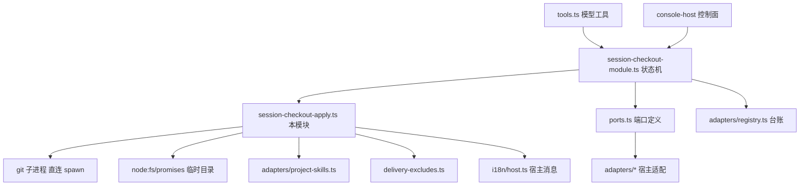
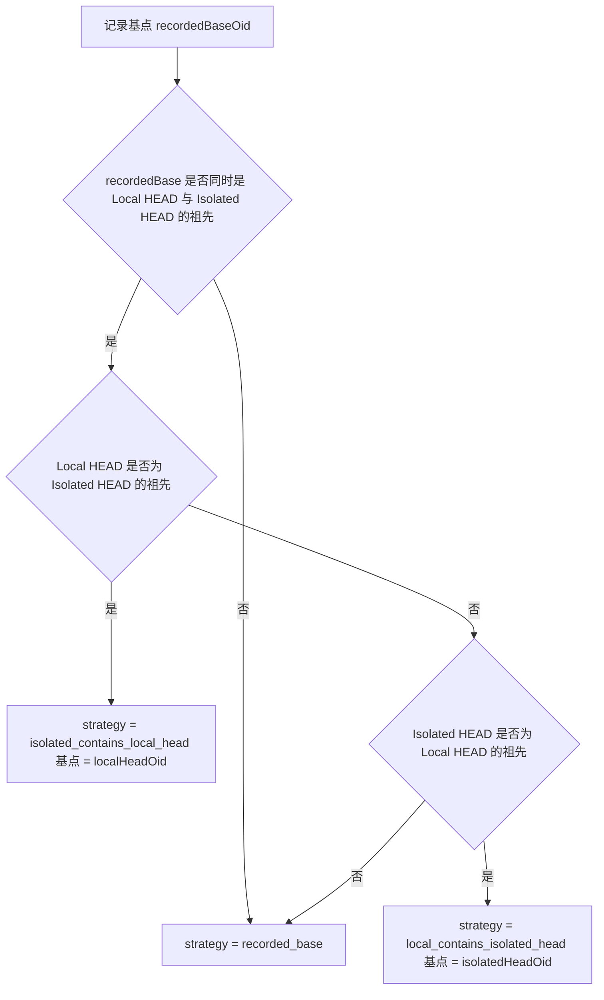
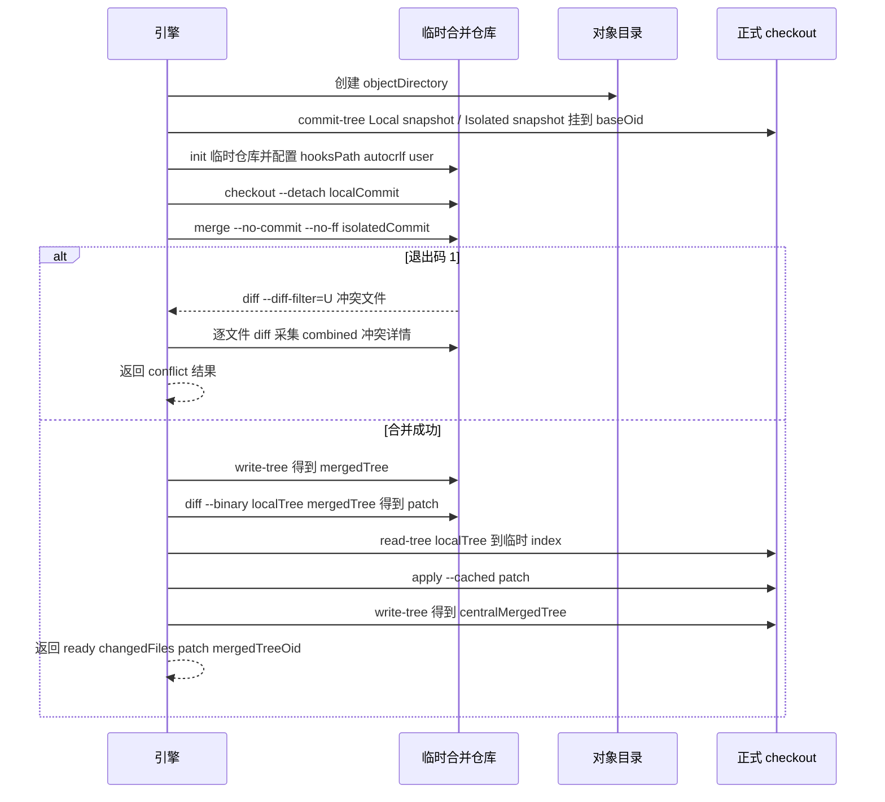
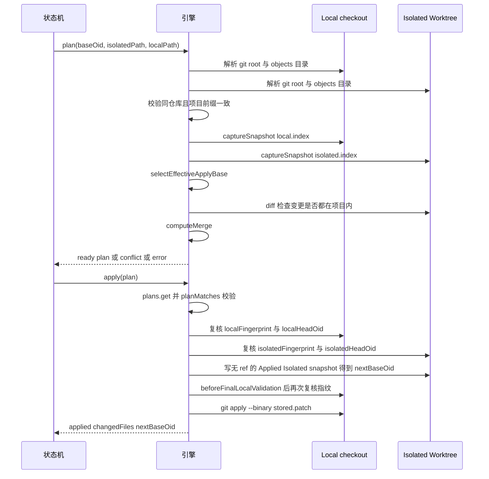
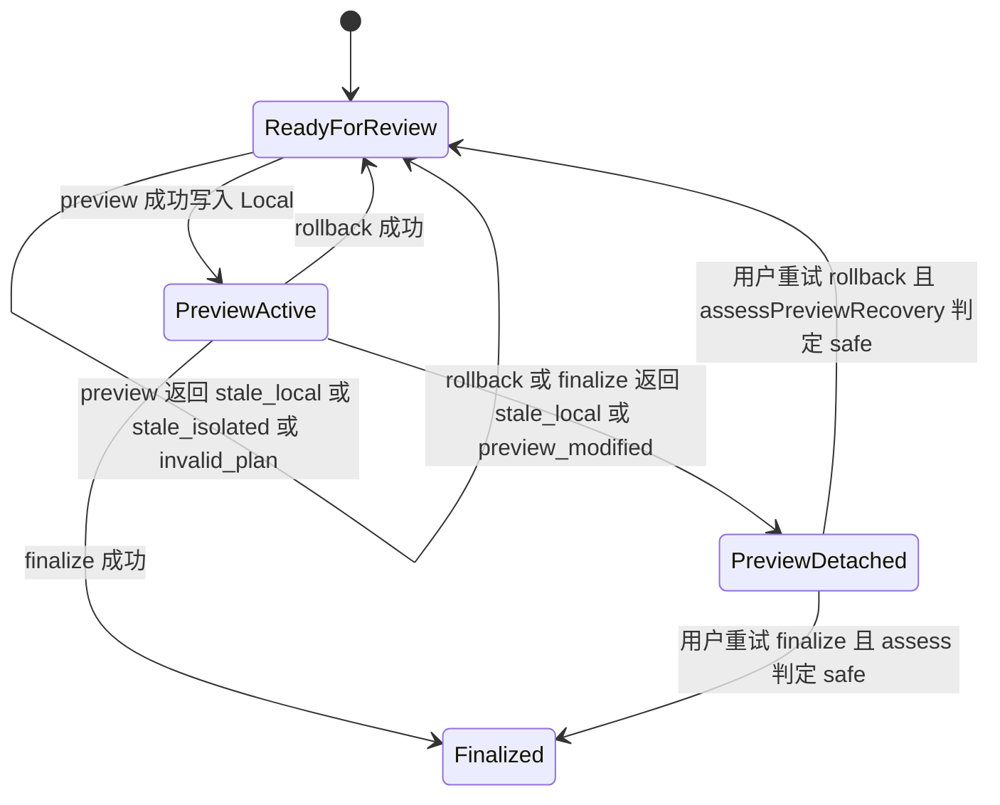
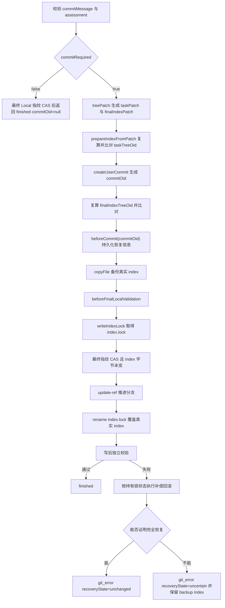
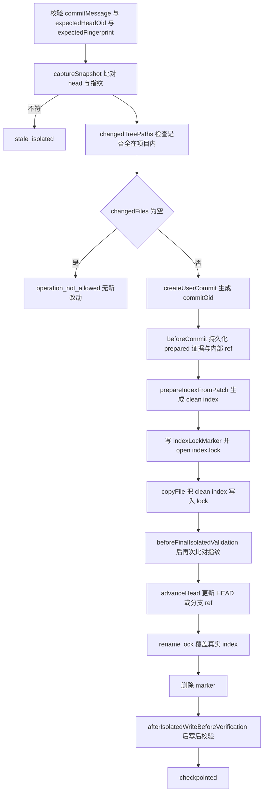

# session_checkout_apply_engine

!!! info "Generated documentation"
    This page was written by CodeWiki from the source code at commit [`d4be4817`](https://github.com/wloops/dsh-git-worktree/commit/d4be481772d07eb031209411011ac79e64f06138) on 2026-11-10 with `mimo-v2.6-flash`. Check the code before relying on details.

`session_checkout_apply_engine` 是 `Worktree_and_Session_Checkout_Domain` 中唯一直接操作 Git 对象库与工作区的一层：它把「隔离 Worktree 的改动」翻译成可复核、可回滚、可恢复的 Git 事务，向上只暴露一个与宿主无关的 `SessionCheckoutApplyEngine` 接口。

实现集中在 `src/session-checkout-apply.ts`，入口工厂为 `createSessionCheckoutApplyEngine(options)`，默认实现是 `DefaultSessionCheckoutApplyEngine`。它不依赖 Cordis、不依赖 registry、不读写持久化台账——台账、锁、审阅记录、清理都由上层 [session_checkout_engine 模块概览](session_checkout_engine.md) 的集成层负责。

## 1. 模块定位

职责边界非常明确：

- **做**：采集 checkout 快照与指纹、计算三方合并、生成/校验 Apply 计划、把补丁写进 Local、生成并校验 Preview receipt、回滚 Preview、把任务增量从 Local 未提交改动中剥离后提交、给 Worktree 打 checkpoint、在崩溃后恢复 checkpoint。
- **不做**：不做授权判断（`not_owner`）、不持久化 journal/receipt、不管理 retention 与清理目录、不决定「当前处于哪个交付状态」。这些属于状态机层。

这种切分让引擎可以用临时目录 + 临时 index 完整复现一次合并，而把「是否允许」留给上层。

## 2. 在系统中的位置



关键点：引擎虽然被声明在 `SessionCheckoutDependencies.applyEngine` 端口位置（见 [核心端口与类型契约（core_ports_and_types）](core_ports_and_types.md)），但它**不使用** `SessionCheckoutGitPort`，而是自己 `spawn('git', ...)`。这样 apply 路径的 Git 行为（ambient env 清洗、hooks 禁用、超时）可以独立于宿主 git 适配器演进。

## 3. 核心抽象与不变量

### 3.1 快照（CheckoutSnapshot）与指纹（fingerprint）

`captureSnapshot` 用一个**临时 index**（`GIT_INDEX_FILE`）重建 checkout 的完整状态，不触碰真实 index：

| 字段 | 含义 |
| --- | --- |
| `headOid` | `HEAD` 指向的提交 |
| `headRef` | `symbolic-ref HEAD`，`null` 表示 detached |
| `headTreeOid` | `HEAD^{tree}` |
| `indexTreeOid` | 真实 index 的 staged 语义对应的 tree |
| `treeOid` | index + 工作区叠加后的最终 tree |
| `indexEntries` | `ls-files --stage -z` 原始字节 |
| `fingerprint` | `sha256(headOid, headRef, indexEntries, treeOid)`，若携带 Project Skills 再叠加其指纹 |

采集步骤（`captureSnapshot`）：

1. `read-tree HEAD` 重置临时 index，再把 `diff --cached --binary` 的 staged 补丁 `apply --cached` 回去，得到 `indexTreeOid`。
2. `add -A -- . <excludes>` 把工作区叠加进来，得到 `treeOid`。
3. 若 `projectSkills.paths()` 命中，把随会话携带的 Skill 文件从临时 index 中 `update-index --force-remove` 剔除，并把 `CarriedSkillState.fingerprint` 混入最终指纹。

指纹是全部 CAS 的基础：`ApplyPlan`、`PreviewReceipt`、`CheckpointInput`、清理阶段的复核都靠它判断「期间有没有人动过」。

### 3.2 有效基点（Effective Apply Base）

`selectEffectiveApplyBase` 在三个策略间选择（`ApplyBaseStrategy`）：



注释里写明了取舍：上一次 Apply 生成的内部 snapshot 提交通常不在任何分支历史里，因此第二次 Apply 会保守地退回 `recorded_base`。`effectiveBaseOid` 与 `baseStrategy` 都会写进 `ApplyPlan` 和 `PreviewReceipt`，供上层展示与审计。

### 3.3 计划（ApplyPlan）与内存计划表

`plan()` 与 `preflight()` 共享 `calculatePlan`，差别只有一个布尔值 `persistPlan`：

- `preflight` 只算不存，供「只读预检」使用，绝不产生可执行句柄。
- `plan` 会把 `{ input, patch, plan, scope }` 存进私有 `Map<string, StoredPlan>`，键为 `revision`（`randomUUID()`）。

同一 `isolatedPath` 只会保留一份计划：新计划写入前会删除同路径旧计划，因此 `plans` 不会随重复计算无限增长。

`apply/finish/preview` 用 `planMatches` 逐字段比对调用方回传的 plan 与内存中的 plan（revision、两个指纹、effectiveBaseOid、baseStrategy、localHeadOid、localHeadRef、isolatedHeadOid、changedFiles 全序列），任一不符即 `invalid_plan`。这让 plan 成为一种「一次性能力令牌」：不可伪造、不可复用、不可篡改。

### 3.4 排除项与 Project Skills

`captureSnapshot` 默认使用 `deliveryExcludePathspecs()`（见 [核心工作树领域（core_worktree_domain）](core_worktree_domain.md)）排除宿主运行期产物：`.dsh-ops`、`desktop-runtime.json`、`.dsh-runtime.json`，并为每个路径生成四条 pathspec（自身、子树、任意层级的 `**/path`、其子树）。含义是「评审看到的」严格等于「交付出去的」：面板多写几行日志不会把一次合法交付判成 `stale_isolated`。

`reviewIsolated` 与 `commitIsolated` 允许调用方传入 `excludePaths` 覆盖默认值。

## 4. 公共接口

`SessionCheckoutApplyEngine` 的方法分四组。

| 方法 | 作用 | 是否写 Local | 是否写 Worktree |
| --- | --- | --- | --- |
| `inspectReview(input)` | 只读评审快照：校验 Local/Isolated 同仓库同项目前缀，返回 Isolated 指纹与变更文件 | 否 | 否（临时 index） |
| `reviewIsolated(input)` | 只读 Worktree 快照，**完全不解析 Local** | 否 | 否 |
| `preflight(input)` | 复用真实合并计算，但不持久化 plan | 否 | 否 |
| `plan(input)` | 计算并持久化可执行 plan | 否 | 否 |
| `apply(plan)` | 把已审核补丁写进 Local 工作区，并生成内部 snapshot 作为下一次基线 | 是 | 仅创建无 ref 的 commit |
| `finish(plan, {commitMessage})` | 把任务增量从 Local 快照剥离成提交并推进分支，同时保留用户原有 staged 状态 | 是 | 仅创建 snapshot commit |
| `preview(plan, opts)` | 先落 receipt artifacts，再把补丁写进 Local，产出 `PreviewReceipt` | 是 | 仅创建 snapshot commit |
| `assessPreviewRecovery({localPath, receipt})` | 严格只读地评估 rollback 与 finalize 是否安全 | 否 | 否 |
| `rollback({localPath, receipt, beforeWrite})` | 按 receipt 把 Local 恢复到 preview 之前 | 是 | 否 |
| `finalize({localPath, receipt, commitMessage, beforeCommit})` | 把 preview 中的任务改动分离成提交 | 是 | 否 |
| `checkpoint(input)` | 在 Worktree 上把当前工作区保存成一个提交（推进分支或 HEAD） | 否 | 是 |
| `recoverCheckpoint(input)` | checkpoint 中断后修复 index 与锁 | 否 | 是 |
| `commitIsolated(input)` | 会话分支交付：把 Worktree 工作区提交到它检出的分支，完全不读写 Local | 否 | 是 |

`commitIsolated` 与 `reviewIsolated` 在接口上是可选的（`?`），因为端口允许第三方实现；上层 `operateFinish` 会显式检查两者是否存在，缺失时返回 `operation_not_allowed`（"this version cannot deliver to a session branch"）。

### 构造选项

`SessionCheckoutApplyEngineOptions` 只有 `projectSkills` 与四个测试/宿主 seam：

| seam | 触发位置 |
| --- | --- |
| `beforeFinalLocalValidation` | 权威 Local 指纹校验之前（apply / preview / rollback / finalize / finish） |
| `afterLocalWriteBeforeVerification` | Local 写入完成、独立写后校验之前（rollback / finalize） |
| `beforeFinalIsolatedValidation` | 权威 Worktree checkpoint CAS 之前 |
| `afterIsolatedWriteBeforeVerification` | checkpoint 的 HEAD/index 写入之后、独立校验之前 |

这些 seam 是并发测试与故障注入的唯一入口，生产路径不传。

## 5. 关键数据契约

### ApplyPlan

```ts
interface ApplyPlan {
  revision: string
  localFingerprint: string
  isolatedFingerprint: string
  effectiveBaseOid: string
  baseStrategy: ApplyBaseStrategy
  localHeadOid: string
  localHeadRef: string | null   // null = detached，Apply 允许，Finish 拒绝自动提交
  isolatedHeadOid: string
  changedFiles: string[]
}
```

### 结果联合

- `ApplyPlanResult = ApplyReadyPlanResult | ApplyConflictPlanResult | ApplyPlanErrorResult`
- `ApplyResult = ApplySuccessResult | ApplyErrorResult`
- `FinishResult = FinishSuccessResult | ApplyErrorResult`
- `PreviewResult = PreviewSuccessResult | ApplyErrorResult`
- `RollbackResult = RollbackSuccessResult | ApplyErrorResult`
- `CheckpointResult = CheckpointSuccessResult | ApplyErrorResult`
- `CheckpointRecoveryResult = CheckpointRecoverySuccessResult | ApplyErrorResult`

成功结果里有两个字段值得注意：

- `nextBaseOid`：本次整合的 Isolated 快照 commit。它不创建任何 ref，只作为后续 Apply 的内部基线，避免同一份改动被重复应用。
- `ApplyErrorResult.committedOid`：交付提交**已经写进分支 ref 之后**才失败的证据。带它时上层不能把记录当成「什么都没发生」。

### 冲突明细

`ApplyConflictPlanResult.conflictDetails` 是逐文件的 combined 冲突 diff，受 `CONFLICT_DETAIL_FILE_LIMIT = 6` 与 `CONFLICT_DETAIL_DIFF_LIMIT = 4096`（见 [核心端口与类型契约（core_ports_and_types）](core_ports_and_types.md)）约束，超出部分用 i18n 文案标注截断与剩余文件数，防止 payload 撑爆模型上下文。

### PreviewReceipt

`PreviewReceipt` 是 preview 的持久化凭证，也是 rollback/finalize 的唯一输入。除身份字段（`previewId`、`reviewId`、`iteration`）与基点字段外，它记录了**六个 tree/oid 证据**：`localWorkingTreeOid`、`localIndexTreeOid`、`previewWorkingTreeOid`、`isolatedHeadOid`、`isolatedSnapshotOid`，以及写入前后的两个 Local 指纹（`localFingerprintBefore`、`localFingerprintPreview`）。

### PreviewRecoveryAssessment

`assessPreviewRecovery` 返回只读结论：

```ts
interface PreviewRecoveryAssessment {
  localFingerprint, localHeadOid, localHeadRef, localHeadTreeOid, localIndexTreeOid, localWorkingTreeOid
  rollback: PreviewRecoverySafeRollback | PreviewRecoveryBlockedAction
  finalize: PreviewRecoverySafeFinalize | PreviewRecoveryBlockedAction
}
```

两个动作各自独立评估，都可能是 `{ status: 'blocked', code, message, conflictingFiles? }`，阻塞码为 `stale_local`、`preview_modified`、`commit_isolation_conflict`、`operation_not_allowed`。上层把它包成 `WorktreePreviewRecoveryProof`（含 generation 哈希）再交给用户确认。

## 6. 内部流程

### 6.1 Git 子进程执行（`runGit`）

所有 Git 调用都走同一个封装，集中处理四类风险：

1. **ambient env 清洗**：`AMBIENT_GIT_ENV_PATTERN` 抹掉 `GIT_DIR`、`GIT_WORK_TREE`、`GIT_INDEX_FILE`、`GIT_OBJECT_DIRECTORY`、`GIT_ALTERNATE_OBJECT_DIRECTORIES`、`GIT_CONFIG_*` 等，保证仓库路由只来自被授权的 `cwd`。`options.env` 是唯一的显式注入通道（临时 index、alternate objects），且优先级最高。
2. **hooks 禁用**：`-c core.hooksPath=<惰性创建的临时空目录>`，避免用户 hook 在 apply 路径上执行任意副作用。
3. **路径与输出稳定**：Windows 追加 `-c core.longpaths=true`，统一 `-c core.quotePath=false`、`-c core.fsmonitor=false`、`--no-optional-locks`、`GIT_OPTIONAL_LOCKS=0`、`GIT_TERMINAL_PROMPT=0`、`LC_ALL=C`。
4. **超时**：默认 `GIT_TIMEOUT_MS = 30_000`（apply 路径命令都短，宿主 git 端口默认 120s），超时 `SIGTERM` 并以 `gitCommandTimedOut` 报错。

非 `allowedExitCodes` 的退出码统一抛 `GitCommandFailure(args, result)`，`errorMessage()` 再翻译成 `gitOperationFailed` 宿主消息。

### 6.2 合并计算（`computeMerge` / `computeTreeMerge`）

两个函数都遵循「临时仓库做合并，正式仓库只写 tree」的模式：



`computeTreeMerge` 是同一思路的纯 tree 版本，用于 rollback/finalize/finish 里的「差分再合并」：`C = H + (M - L)` 剥离任务增量、`S' = C + (S - H)` 恢复用户 staged 状态。

冲突文件会按 `projectPrefix` 过滤并转成项目相对路径再排序，保证 Worktree 项目是仓库子目录时也只报告项目内路径。

### 6.3 plan / apply 时序



`apply` 成功后从 `plans` 中删除该 revision，因此同一 plan 无法被应用两次。

### 6.4 preview / rollback / finalize 生命周期



`preview` 的关键顺序（receipt-first）：

1. 校验 plan 身份与 preview 身份（`previewId`、`reviewId`、`iteration >= 1` 且为安全整数）。
2. 复核 Local（含 `headRef`）与 Isolated 指纹；再做一次「持久快照」复核，确保用于生成 receipt 的 tree 与已审核的完全一致。
3. 用 `prepareIndexFromPatch` 算出 `previewWorkingTreeOid`，用 `createSnapshotCommit` 算出 `isolatedSnapshotOid`。
4. `beforeFinalLocalValidation` 后第三次复核 Local 指纹。
5. `options.beforeWrite(preparedReceipt)` —— 上层在这里持久化 artifacts 与 journal，**在此之前不得触碰 Local**。
6. `git apply --binary` 写入 Local。
7. 写后快照必须等于 `previewWorkingTreeOid`，否则 `git_error`。

`rollback` 先用 `prepareRollbackAssessment` 求目标 tree，再 `beforeWrite()`（持久化 journal）→ 最后一次指纹 CAS → `git apply` → 写后独立校验（含期望指纹 `snapshotFingerprint(headOid, headRef, indexEntries, targetTreeOid)`）。注意 `beforeWrite` 必须发生在最终 CAS 之前，因为 registry I/O 可能 await。

`prepareRollbackAssessment` 覆盖了「Local 在 preview 之后又前进」的复杂情形：先判断 `headRef` 未变、`receipt.localHeadOid` 是当前 HEAD 的祖先；再用两次 `computeTreeMerge` 推导「新提交上的基线」与「preview 是否已被新提交吸收」，任一冲突或吸收即 `preview_modified` 阻塞。

`prepareFinalizeAssessment` 做同样强度的分离证明：要求 Local 在正常分支上（`refs/heads/`），要求 `previewWorkingTreeOid` 能干净地剥离出任务 tree，要求任务 tree 与 index 能合并成最终 index tree，并在「任务改动已经在 HEAD 里」时判定 `preview_modified`。

`finalize` 的写入段是整模块最谨慎的部分：



`writeIndexLock` 使用 Git 官方 `index.lock` 协议（`open(lockPath, 'wx')` + `writeFile` + `sync`），持锁期间并发 `git add/reset` 无法改写真实 index，因此「校验 → 打补丁 → update-ref → 换 index」在同一把锁内完成。`isIndexLockContention` 把 `EEXIST` 翻译成 `stale_local`（"another git operation is updating the local index, retry"）。

补偿回滚分三种情形，且都是 CAS：

- ref 已动、index 未替换：仍持有 lock，直接 `update-ref` 回退并删除 lock。
- ref 已动、index 已替换：重新取 lock，先确认真实 index 仍等于本次写入的字节，再回退 ref 并恢复 backup；若 index 已被第三方改动则拒绝覆盖（保留用户 index 与 backup 两份证据）。
- ref 已动但缺少可验证的 index 补偿证据：直接报告 partial rollback。

### 6.5 checkpoint 与 recoverCheckpoint

`checkpoint` 把 Worktree 当前工作区保存成一个提交，同时保证分支不被 detach：



`advanceHead` 的注释点出了关键约束：分支上的 Worktree 必须推进分支 ref，**不能**用 `--no-deref` 覆盖符号 HEAD，否则会把会话分支 detach 掉，交付提交就无处可落。只有 `headRef === null`（detached）时才 `update-ref --no-deref HEAD`。

失败路径同样有序：HEAD 已推进但 index 替换失败时先尝试回退 HEAD；回退成功报 `recoveryState: 'unchanged'`，回退失败则 `preserveRecoveryEvidence = true`，保留 marker 与相邻 index 作为恢复证据并报 `uncertain`。

`recoverCheckpoint` 是对应的恢复入口，通过 `index.lock` 内容是否等于 `commitOid` 的 marker 文件证明锁的归属：

- `HEAD === parentOid`：只清理属于自己的 lock/marker，返回 `checkpoint_aborted`。
- `HEAD === commitOid` 且工作区干净、index 树符合预期：重建 clean index，用同样的 lock 协议原子替换，返回 `checkpoint_recovered`。
- 其他情形一律 `stale_isolated`，绝不在无法证明归属时删除别人的锁。

### 6.6 commitIsolated / reviewIsolated / inspectReview

`commitIsolated` 是「会话分支交付」的核心，与 `finish` 的根本差别是**完全不碰 Local**：

1. 校验 `baseOid` 与 commitMessage，解析 Worktree git root 与项目前缀。
2. 读取 HEAD、HEAD tree、`symbolic-ref`；若调用方给了 `branchRef` 而 HEAD 不在该分支上，返回 `operation_not_allowed`（防止提交落到 detached HEAD 而丢线）。
3. 用与评审快照同一条构造路径（临时 index + excludes）算出 `pending.treeOid`，因此宿主运行期产物与携带的 Project Skills 不会被带进交付提交。
4. **先**校验变更集全在项目内，再动 ref——提交一旦写进分支就不可撤回，任何能提前判死的检查都不该排在它后面。
5. 有变化时 `createUserCommit` + `update-ref HEAD`（默认 deref，分支一起前进），随后立即把 `committedOid` 记下；之后任何失败都会带上它。再 `reset --quiet` 让 index 归位。
6. 提交后采集干净快照作为清理阶段的 CAS 指纹，并报告 `changedFiles`、`branch`、`created`。

若 Git 报 `empty ident` 一类身份缺失错误，会被翻译成 `invalid_input` + `initialIdentityMissing`，而不是让模型猜。

`reviewIsolated` 连 Local 的 git root 都不解析，只读 Worktree，用于「评审之后 Worktree 是否又改了」的判据。`inspectReview` 则必须两侧同仓库、同项目前缀，并在 Local 侧 `cat-file -e` 验证 base commit 存在。

### 6.7 清理辅助函数

`cleanup(path)` 用 `rm -rf` 清理临时目录，失败只 `console.warn`——清理失败不能掩盖主结果。`removeBestEffort` 用于 lock/marker 的尽力清理。`inspectIndexFileTree` 判断 `index.lock` 是否存在以及其中的 tree，`checkpointLockMarkerOwned` 校验 marker 内容。

## 7. 错误模型与恢复语义

`ApplyError` 是 8 个具名错误的联合：

| code | 触发场景 | 是否证明未触碰 Local/Worktree |
| --- | --- | --- |
| `invalid_input` | OID 格式、commit message、preview 身份、项目前缀不匹配、仓库不同源 | 是 |
| `invalid_plan` | plan 缺失/被使用/被篡改、仓库身份变化、持久快照与已审核不一致 | 是 |
| `stale_local` | Local 指纹或 HEAD 在任一 CAS 点变化、index lock 竞争 | 是 |
| `stale_isolated` | Isolated 指纹或 HEAD 变化、checkpoint 期间工作区变动、lock 归属不可证 | 是 |
| `git_error` | Git 命令失败、写后校验不通过 | 取决于 `recoveryState` |
| `commit_isolation_conflict` | 任务增量无法从 Local 未提交改动中可靠剥离 | 是 |
| `operation_not_allowed` | detached Local、无新改动可保存、非正常分支 | 是 |
| `preview_modified` | preview 区域出现了额外改动，安全回滚/分离不成立 | 是 |

`GitApplyError.recoveryState` 是上层的分流依据：

- `'unchanged'`：引擎已证明 Local（或 Worktree）被完整还原，上层可以清掉 planning journal 并回到 `ready`。
- `'uncertain'`：无法证明成功或完整回滚，上层必须进入 `recovery_required` 并保留证据（`finalize` 会保留 `index.domi-backup-<uuid>`）。

上层 `operatePreview` / `operateRollbackPreview` / `operateFinalizePreview` / `operateCheckpoint` 正是按「错误码 + journal step + recoveryState」三要素决定回退到 `ready` 还是升级到 `recovery_required`（见 [session_checkout_engine 模块概览](session_checkout_engine.md)）。

## 8. 一致性与并发控制

引擎不持有跨进程锁，它靠三层机制保证一致性：

1. **指纹 CAS**：每个写入前都有一次权威快照复核；写入后有一次独立写后校验。
2. **Git 原生锁**：`index.lock`（checkpoint、finalize、finish）与 `update-ref` 的 expected-old-value 参数（`update-ref <ref> <new> <old>`）共同构成原子事务。
3. **一次性 plan**：`plans` Map 是进程内状态，`planMatches` 保证只有原始 plan 才能被执行，执行后立即删除。

需要注意的边界：`plans` 是实例状态，跨进程不共享；因此 plan 只在同一引擎实例生命周期内有效，宿主重启后必须重新 `plan`。这也是 `apply` 会重新校验指纹而不仅依赖 plan 的原因。

## 9. 构建、测试与配置

- 构建：`package.json` 的 `build` 脚本为 `node scripts/clean-lib.mjs && tsc && tsdown`；`typecheck` 为 `tsc --noEmit`。`tsconfig.json` 启用 `strict`、`noUncheckedIndexedAccess`、`noImplicitAny`，模块解析为 `NodeNext`——这也是源码里所有相对导入都带 `.js` 后缀的原因。
- 测试：`pnpm test` 走 `vitest run`。`vitest.config.ts` 在 Windows 上关闭 `fileParallelism`，因为重型 Git fixture 会争抢进程与文件句柄；`testTimeout`/`hookTimeout` 均为 60s。四个 seam（`beforeFinalLocalValidation` 等）就是为这类并发/故障注入测试准备的。
- CI：`.github/workflows/ci.yml` 的 `check` job 依次执行 `pnpm run typecheck`、`pnpm run build`、`pnpm run check:publish:release`、`pnpm run test`（Node 22、pnpm 10）。注意 `package.json` 的 `engines` 要求 Node `>=24.9.0`，CI 用 22 跑构建与测试，属于已知偏差。
- 运行时配置：引擎本身无配置项，只有构造选项。宿主 `stateDir`、`gitTimeoutMs` 等由 `src/index.ts` 的 `Config` 管理，但 apply 路径固定使用自己的 30s 超时与惰性临时 hooks 目录。

## 10. 相关模块

- [session_checkout_engine 模块概览](session_checkout_engine.md)：上层状态机，负责 journal、receipt 持久化、retention、清理与授权。
- [session_checkout_engine_integration 模块概览](session_checkout_engine_integration.md)：`session-checkout-module.ts` 与工具注册的集成细节。
- [Session Checkout 集成核心（session_checkout_integration_core）](session_checkout_integration_core.md)：状态机对引擎方法的调用点。
- [session_checkout_tools 模型工具层](session_checkout_tools.md)：模型侧 `worktree_*` 工具如何触发这些调用。
- [核心工作树领域（core_worktree_domain）](core_worktree_domain.md)：`deliveryExcludePathspecs`、`isValidCommitMessage` 等共享纯函数。
- [核心端口与类型契约（core_ports_and_types）](core_ports_and_types.md)：`ApplyBaseStrategy`、`ApplyConflictDetail`、`ManagedPreviewReceipt`、`SessionCheckoutDependencies.applyEngine` 的类型来源。
- [Project Skills 适配器：跨 Worktree 携带与 Claude Skill 提供者](adapters_infrastructure_project_skills.md)：`ProjectSkillStore.state/paths` 与 `trackedSkillPaths` 的语义。
- [i18n：中英双语文案与语言解析基础设施](i18n.md)：`hostMessage` 的宿主语言解析与所有错误文案来源。

??? abstract "Documented components (42)"
    - [`ApplyConflictPlanResult`](https://github.com/wloops/dsh-git-worktree/blob/d4be481772d07eb031209411011ac79e64f06138/src%5Csession-checkout-apply.ts) — `src\session-checkout-apply.ts`
    - [`ApplyErrorResult`](https://github.com/wloops/dsh-git-worktree/blob/d4be481772d07eb031209411011ac79e64f06138/src%5Csession-checkout-apply.ts) — `src\session-checkout-apply.ts`
    - [`ApplyPlan`](https://github.com/wloops/dsh-git-worktree/blob/d4be481772d07eb031209411011ac79e64f06138/src%5Csession-checkout-apply.ts) — `src\session-checkout-apply.ts`
    - [`ApplyPlanErrorResult`](https://github.com/wloops/dsh-git-worktree/blob/d4be481772d07eb031209411011ac79e64f06138/src%5Csession-checkout-apply.ts) — `src\session-checkout-apply.ts`
    - [`ApplyPlanInput`](https://github.com/wloops/dsh-git-worktree/blob/d4be481772d07eb031209411011ac79e64f06138/src%5Csession-checkout-apply.ts) — `src\session-checkout-apply.ts`
    - [`ApplyReadyPlanResult`](https://github.com/wloops/dsh-git-worktree/blob/d4be481772d07eb031209411011ac79e64f06138/src%5Csession-checkout-apply.ts) — `src\session-checkout-apply.ts`
    - [`ApplyScope`](https://github.com/wloops/dsh-git-worktree/blob/d4be481772d07eb031209411011ac79e64f06138/src%5Csession-checkout-apply.ts) — `src\session-checkout-apply.ts`
    - [`ApplySuccessResult`](https://github.com/wloops/dsh-git-worktree/blob/d4be481772d07eb031209411011ac79e64f06138/src%5Csession-checkout-apply.ts) — `src\session-checkout-apply.ts`
    - [`CheckoutSnapshot`](https://github.com/wloops/dsh-git-worktree/blob/d4be481772d07eb031209411011ac79e64f06138/src%5Csession-checkout-apply.ts) — `src\session-checkout-apply.ts`
    - [`CheckpointInput`](https://github.com/wloops/dsh-git-worktree/blob/d4be481772d07eb031209411011ac79e64f06138/src%5Csession-checkout-apply.ts) — `src\session-checkout-apply.ts`
    - [`CheckpointRecoverySuccessResult`](https://github.com/wloops/dsh-git-worktree/blob/d4be481772d07eb031209411011ac79e64f06138/src%5Csession-checkout-apply.ts) — `src\session-checkout-apply.ts`
    - [`CheckpointSuccessResult`](https://github.com/wloops/dsh-git-worktree/blob/d4be481772d07eb031209411011ac79e64f06138/src%5Csession-checkout-apply.ts) — `src\session-checkout-apply.ts`
    - [`CommitIsolatedInput`](https://github.com/wloops/dsh-git-worktree/blob/d4be481772d07eb031209411011ac79e64f06138/src%5Csession-checkout-apply.ts) — `src\session-checkout-apply.ts`
    - [`CommitIsolatedSuccess`](https://github.com/wloops/dsh-git-worktree/blob/d4be481772d07eb031209411011ac79e64f06138/src%5Csession-checkout-apply.ts) — `src\session-checkout-apply.ts`
    - [`CommitIsolationApplyError`](https://github.com/wloops/dsh-git-worktree/blob/d4be481772d07eb031209411011ac79e64f06138/src%5Csession-checkout-apply.ts) — `src\session-checkout-apply.ts`
    - [`DefaultSessionCheckoutApplyEngine`](https://github.com/wloops/dsh-git-worktree/blob/d4be481772d07eb031209411011ac79e64f06138/src%5Csession-checkout-apply.ts) — `src\session-checkout-apply.ts`
    - [`EffectiveApplyBase`](https://github.com/wloops/dsh-git-worktree/blob/d4be481772d07eb031209411011ac79e64f06138/src%5Csession-checkout-apply.ts) — `src\session-checkout-apply.ts`
    - [`FinishSuccessResult`](https://github.com/wloops/dsh-git-worktree/blob/d4be481772d07eb031209411011ac79e64f06138/src%5Csession-checkout-apply.ts) — `src\session-checkout-apply.ts`
    - [`GitApplyError`](https://github.com/wloops/dsh-git-worktree/blob/d4be481772d07eb031209411011ac79e64f06138/src%5Csession-checkout-apply.ts) — `src\session-checkout-apply.ts`
    - [`GitCommandFailure`](https://github.com/wloops/dsh-git-worktree/blob/d4be481772d07eb031209411011ac79e64f06138/src%5Csession-checkout-apply.ts) — `src\session-checkout-apply.ts`
    - [`GitResult`](https://github.com/wloops/dsh-git-worktree/blob/d4be481772d07eb031209411011ac79e64f06138/src%5Csession-checkout-apply.ts) — `src\session-checkout-apply.ts`
    - [`InvalidInputApplyError`](https://github.com/wloops/dsh-git-worktree/blob/d4be481772d07eb031209411011ac79e64f06138/src%5Csession-checkout-apply.ts) — `src\session-checkout-apply.ts`
    - [`InvalidPlanApplyError`](https://github.com/wloops/dsh-git-worktree/blob/d4be481772d07eb031209411011ac79e64f06138/src%5Csession-checkout-apply.ts) — `src\session-checkout-apply.ts`
    - [`MergeConflictResult`](https://github.com/wloops/dsh-git-worktree/blob/d4be481772d07eb031209411011ac79e64f06138/src%5Csession-checkout-apply.ts) — `src\session-checkout-apply.ts`
    - [`MergeReadyResult`](https://github.com/wloops/dsh-git-worktree/blob/d4be481772d07eb031209411011ac79e64f06138/src%5Csession-checkout-apply.ts) — `src\session-checkout-apply.ts`
    - [`OperationNotAllowedApplyError`](https://github.com/wloops/dsh-git-worktree/blob/d4be481772d07eb031209411011ac79e64f06138/src%5Csession-checkout-apply.ts) — `src\session-checkout-apply.ts`
    - [`PreviewModifiedApplyError`](https://github.com/wloops/dsh-git-worktree/blob/d4be481772d07eb031209411011ac79e64f06138/src%5Csession-checkout-apply.ts) — `src\session-checkout-apply.ts`
    - [`PreviewReceipt`](https://github.com/wloops/dsh-git-worktree/blob/d4be481772d07eb031209411011ac79e64f06138/src%5Csession-checkout-apply.ts) — `src\session-checkout-apply.ts`
    - [`PreviewRecoveryAssessment`](https://github.com/wloops/dsh-git-worktree/blob/d4be481772d07eb031209411011ac79e64f06138/src%5Csession-checkout-apply.ts) — `src\session-checkout-apply.ts`
    - [`PreviewRecoveryBlockedAction`](https://github.com/wloops/dsh-git-worktree/blob/d4be481772d07eb031209411011ac79e64f06138/src%5Csession-checkout-apply.ts) — `src\session-checkout-apply.ts`
    - [`PreviewRecoverySafeFinalize`](https://github.com/wloops/dsh-git-worktree/blob/d4be481772d07eb031209411011ac79e64f06138/src%5Csession-checkout-apply.ts) — `src\session-checkout-apply.ts`
    - [`PreviewRecoverySafeRollback`](https://github.com/wloops/dsh-git-worktree/blob/d4be481772d07eb031209411011ac79e64f06138/src%5Csession-checkout-apply.ts) — `src\session-checkout-apply.ts`
    - [`PreviewSuccessResult`](https://github.com/wloops/dsh-git-worktree/blob/d4be481772d07eb031209411011ac79e64f06138/src%5Csession-checkout-apply.ts) — `src\session-checkout-apply.ts`
    - [`ReviewIsolatedInput`](https://github.com/wloops/dsh-git-worktree/blob/d4be481772d07eb031209411011ac79e64f06138/src%5Csession-checkout-apply.ts) — `src\session-checkout-apply.ts`
    - [`ReviewSnapshotResult`](https://github.com/wloops/dsh-git-worktree/blob/d4be481772d07eb031209411011ac79e64f06138/src%5Csession-checkout-apply.ts) — `src\session-checkout-apply.ts`
    - [`RollbackSuccessResult`](https://github.com/wloops/dsh-git-worktree/blob/d4be481772d07eb031209411011ac79e64f06138/src%5Csession-checkout-apply.ts) — `src\session-checkout-apply.ts`
    - [`SessionCheckoutApplyEngine`](https://github.com/wloops/dsh-git-worktree/blob/d4be481772d07eb031209411011ac79e64f06138/src%5Csession-checkout-apply.ts) — `src\session-checkout-apply.ts`
    - [`SessionCheckoutApplyEngineOptions`](https://github.com/wloops/dsh-git-worktree/blob/d4be481772d07eb031209411011ac79e64f06138/src%5Csession-checkout-apply.ts) — `src\session-checkout-apply.ts`
    - [`StaleIsolatedApplyError`](https://github.com/wloops/dsh-git-worktree/blob/d4be481772d07eb031209411011ac79e64f06138/src%5Csession-checkout-apply.ts) — `src\session-checkout-apply.ts`
    - [`StaleLocalApplyError`](https://github.com/wloops/dsh-git-worktree/blob/d4be481772d07eb031209411011ac79e64f06138/src%5Csession-checkout-apply.ts) — `src\session-checkout-apply.ts`
    - [`StoredPlan`](https://github.com/wloops/dsh-git-worktree/blob/d4be481772d07eb031209411011ac79e64f06138/src%5Csession-checkout-apply.ts) — `src\session-checkout-apply.ts`
    - [`TreeMergeReadyResult`](https://github.com/wloops/dsh-git-worktree/blob/d4be481772d07eb031209411011ac79e64f06138/src%5Csession-checkout-apply.ts) — `src\session-checkout-apply.ts`

