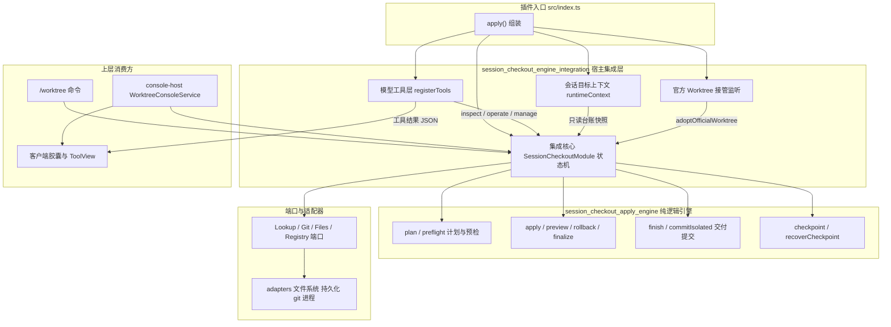
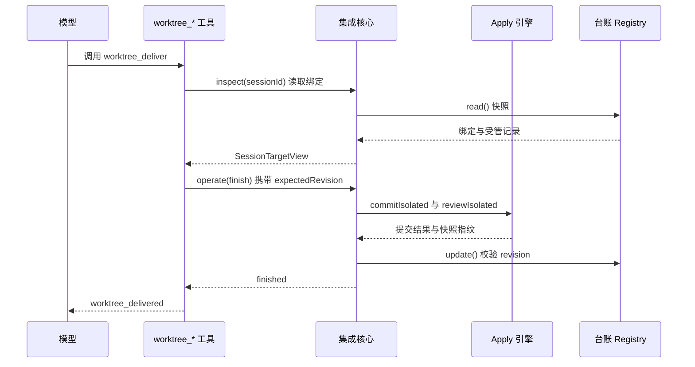
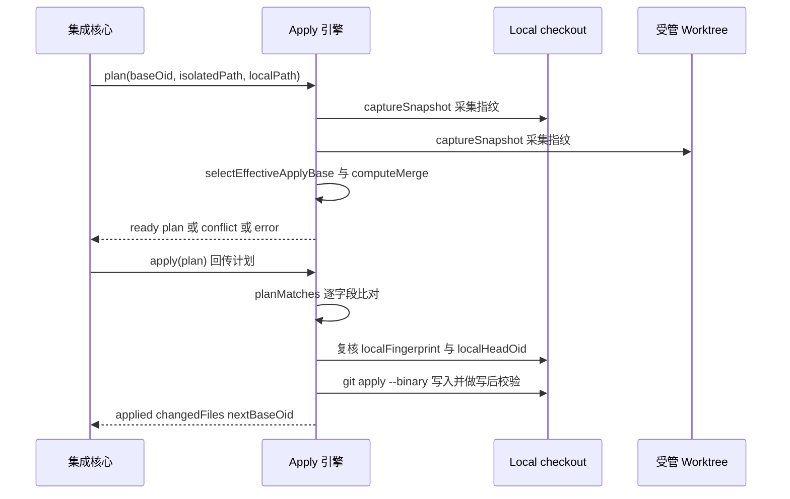

# session_checkout_engine 模块概览

!!! info "Generated documentation"
    This page was written by CodeWiki from the source code at commit [`ec6cb48d`](https://github.com/wloops/dsh-git-worktree/commit/ec6cb48deddbaf95f32fc1c50532cd0dd1cd81d3) on 2026-11-11 with `mimo-v2.6-flash`. Check the code before relying on details.

`session_checkout_engine` 是 `Worktree_and_Session_Checkout_Domain` 的核心模块，负责把「会话、项目与受管 Worktree」之间的绑定关系变成一套**可持久化、可并发、可崩溃恢复**的交付机制。它由两层构成：一层是直接操作 Git 对象库的纯逻辑事务引擎，另一层是把该引擎接入 DSH 宿主的集成状态机与模型工具层。两层的职责切分是本模块最重要的设计决策。

## 模块目的

- **隔离交付**：让模型在受管 Worktree 中写代码，再把结果以「可复核、可回滚、可恢复」的 Git 事务形式整合回目标分支，避免把任务代码直接写进用户本地仓库（Local）。
- **权威绑定**：维护会话 ↔ 项目 ↔ 受管 Worktree 的唯一事实来源，所有状态变更经版本化台账（`ManagedCheckoutsRegistry`）与 `revision` 乐观锁落盘。
- **受控能力暴露**：通过 `worktree_*` 模型工具、`/worktree` 命令、`systemPrompt` 动态上下文与官方 Worktree 接管事件，把 Worktree 生命周期暴露给模型与用户，同时把破坏性动作保留在用户侧。
- **一致性保障**：以指纹 CAS、Git 原生锁（`index.lock`、`update-ref` 的 expected-old-value）和一次性 Apply 计划构成三层并发控制，并在中断后通过 checkpoint 恢复与台账收敛回到可判定状态。

## 架构

模块采用「纯引擎 + 宿主集成」的分层：引擎不依赖 Cordis、不读台账，只做 Git 事务；集成层持有状态机、journal、receipt 持久化、retention、清理与授权判断。

三条边界决定了所有安全约束：

| 边界 | 含义 | 约束 |
| --- | --- | --- |
| Local 边界 | 用户本地仓库 `record.localRoot` | 交付流程永不写入；遗留 apply/preview 路径在存在会话分支时被拒绝 |
| 受管边界 | 受管 Worktree `record.managedRoot` / `record.managedGitRoot` | 会话的权威 cwd，也是唯一允许写任务代码的地方 |
| 台账边界 | `ManagedCheckoutsRegistry` | 唯一事实来源，含 `revision`、`sessionBindings`、`managedCheckouts` |

以 `worktree_deliver` 为例，工具层不直接执行 Git 操作，而是先读权威视图，再委托集成核心完成状态校验与提交：

引擎侧的事务时序则体现「先算计划、再取能力令牌、写入前后各校验一次」的模式：

## 核心组件

| 组件 | 职责 | 文档 |
| --- | --- | --- |
| Apply 引擎 | 采集 checkout 快照与指纹、三方合并计算、生成并校验 Apply 计划、preview/rollback/finalize、checkpoint 与崩溃恢复、会话分支交付提交；只依赖 Git 子进程与临时目录，不读写台账 | [session_checkout_apply_engine](session_checkout_apply_engine.md) |
| 宿主集成层 | `SessionCheckoutModule` 状态机与台账门面、`revision` CAS 与全局互斥、崩溃收敛、交付与清理生命周期、`runtimeContext` 上下文注入、官方 Worktree 自动接管，以及 7 个 `worktree_*` 模型工具的注册与门禁 | [session_checkout_engine_integration 模块概览](session_checkout_engine_integration.md) |

集成层内部再分为两部分：集成核心（`session-checkout-module.ts`、`session-target-context.ts`）与模型工具层（`src/tools.ts` 的 `registerTools`），详见上述集成文档中的 `session_checkout_integration_core` 与 `session_checkout_tools` 小节。

## 关键设计约束

- **`runtimeContext` 必须同步且无 I/O**：它在每次 `systemPrompt` 求值时调用，只读台账快照，保证上下文可重放稳定。
- **单记录更新必须走 `registry.update()`**：避免 `read()` + `write()` 之间的跨进程写入被后写者抹掉；`revision` 不匹配时返回 `stale_target`，不做盲目重试。
- **Apply 计划是一次性能力令牌**：计划存于引擎实例内存，执行前逐字段比对，执行后立即删除；宿主重启后必须重新 `plan`。
- **receipt-first 写入顺序**：preview 在触碰 Local 之前先持久化 receipt artifacts 与 journal，`beforeWrite` 必须先于最终指纹 CAS。
- **错误码 + `recoveryState` 决定上层分流**：`unchanged` 可回到 `ready`，`uncertain` 必须进入 `recovery_required` 并保留恢复证据。
- **工具结果 schema 是客户端契约**：`worktree_create` 等输出字段与客户端 ToolView 解析严格对应，改动会破坏界面回放。

## 相关文档

- [session_checkout_apply_engine](session_checkout_apply_engine.md)：Git 事务引擎，含快照指纹、有效基点选择、合并计算、preview 生命周期与错误模型。
- [session_checkout_engine_integration 模块概览](session_checkout_engine_integration.md)：宿主集成层，含状态机、台账持久化、并发控制、交付与清理、工具注册。
- `core_worktree_domain`：`deliveryExcludePathspecs`、`isValidCommitMessage` 等共享纯函数。
- `core_ports_and_types`：`ApplyBaseStrategy`、`ApplyConflictDetail`、`ManagedPreviewReceipt`、`SessionCheckoutDependencies` 等类型来源。
- `console_host`：`WorktreeConsoleService` 等控制面消费方。

??? abstract "Documented components (45)"
    - [`ApplyConflictPlanResult`](https://github.com/wloops/dsh-git-worktree/blob/ec6cb48deddbaf95f32fc1c50532cd0dd1cd81d3/src%5Csession-checkout-apply.ts) — `src\session-checkout-apply.ts`
    - [`ApplyErrorResult`](https://github.com/wloops/dsh-git-worktree/blob/ec6cb48deddbaf95f32fc1c50532cd0dd1cd81d3/src%5Csession-checkout-apply.ts) — `src\session-checkout-apply.ts`
    - [`ApplyPlan`](https://github.com/wloops/dsh-git-worktree/blob/ec6cb48deddbaf95f32fc1c50532cd0dd1cd81d3/src%5Csession-checkout-apply.ts) — `src\session-checkout-apply.ts`
    - [`ApplyPlanErrorResult`](https://github.com/wloops/dsh-git-worktree/blob/ec6cb48deddbaf95f32fc1c50532cd0dd1cd81d3/src%5Csession-checkout-apply.ts) — `src\session-checkout-apply.ts`
    - [`ApplyPlanInput`](https://github.com/wloops/dsh-git-worktree/blob/ec6cb48deddbaf95f32fc1c50532cd0dd1cd81d3/src%5Csession-checkout-apply.ts) — `src\session-checkout-apply.ts`
    - [`ApplyReadyPlanResult`](https://github.com/wloops/dsh-git-worktree/blob/ec6cb48deddbaf95f32fc1c50532cd0dd1cd81d3/src%5Csession-checkout-apply.ts) — `src\session-checkout-apply.ts`
    - [`ApplyScope`](https://github.com/wloops/dsh-git-worktree/blob/ec6cb48deddbaf95f32fc1c50532cd0dd1cd81d3/src%5Csession-checkout-apply.ts) — `src\session-checkout-apply.ts`
    - [`ApplySuccessResult`](https://github.com/wloops/dsh-git-worktree/blob/ec6cb48deddbaf95f32fc1c50532cd0dd1cd81d3/src%5Csession-checkout-apply.ts) — `src\session-checkout-apply.ts`
    - [`CheckoutSnapshot`](https://github.com/wloops/dsh-git-worktree/blob/ec6cb48deddbaf95f32fc1c50532cd0dd1cd81d3/src%5Csession-checkout-apply.ts) — `src\session-checkout-apply.ts`
    - [`CheckpointInput`](https://github.com/wloops/dsh-git-worktree/blob/ec6cb48deddbaf95f32fc1c50532cd0dd1cd81d3/src%5Csession-checkout-apply.ts) — `src\session-checkout-apply.ts`
    - [`CheckpointRecoverySuccessResult`](https://github.com/wloops/dsh-git-worktree/blob/ec6cb48deddbaf95f32fc1c50532cd0dd1cd81d3/src%5Csession-checkout-apply.ts) — `src\session-checkout-apply.ts`
    - [`CheckpointSuccessResult`](https://github.com/wloops/dsh-git-worktree/blob/ec6cb48deddbaf95f32fc1c50532cd0dd1cd81d3/src%5Csession-checkout-apply.ts) — `src\session-checkout-apply.ts`
    - [`CommitIsolatedInput`](https://github.com/wloops/dsh-git-worktree/blob/ec6cb48deddbaf95f32fc1c50532cd0dd1cd81d3/src%5Csession-checkout-apply.ts) — `src\session-checkout-apply.ts`
    - [`CommitIsolatedSuccess`](https://github.com/wloops/dsh-git-worktree/blob/ec6cb48deddbaf95f32fc1c50532cd0dd1cd81d3/src%5Csession-checkout-apply.ts) — `src\session-checkout-apply.ts`
    - [`CommitIsolationApplyError`](https://github.com/wloops/dsh-git-worktree/blob/ec6cb48deddbaf95f32fc1c50532cd0dd1cd81d3/src%5Csession-checkout-apply.ts) — `src\session-checkout-apply.ts`
    - [`DefaultSessionCheckoutApplyEngine`](https://github.com/wloops/dsh-git-worktree/blob/ec6cb48deddbaf95f32fc1c50532cd0dd1cd81d3/src%5Csession-checkout-apply.ts) — `src\session-checkout-apply.ts`
    - [`EffectiveApplyBase`](https://github.com/wloops/dsh-git-worktree/blob/ec6cb48deddbaf95f32fc1c50532cd0dd1cd81d3/src%5Csession-checkout-apply.ts) — `src\session-checkout-apply.ts`
    - [`FinishSuccessResult`](https://github.com/wloops/dsh-git-worktree/blob/ec6cb48deddbaf95f32fc1c50532cd0dd1cd81d3/src%5Csession-checkout-apply.ts) — `src\session-checkout-apply.ts`
    - [`GitApplyError`](https://github.com/wloops/dsh-git-worktree/blob/ec6cb48deddbaf95f32fc1c50532cd0dd1cd81d3/src%5Csession-checkout-apply.ts) — `src\session-checkout-apply.ts`
    - [`GitCommandFailure`](https://github.com/wloops/dsh-git-worktree/blob/ec6cb48deddbaf95f32fc1c50532cd0dd1cd81d3/src%5Csession-checkout-apply.ts) — `src\session-checkout-apply.ts`
    - [`GitResult`](https://github.com/wloops/dsh-git-worktree/blob/ec6cb48deddbaf95f32fc1c50532cd0dd1cd81d3/src%5Csession-checkout-apply.ts) — `src\session-checkout-apply.ts`
    - [`InvalidInputApplyError`](https://github.com/wloops/dsh-git-worktree/blob/ec6cb48deddbaf95f32fc1c50532cd0dd1cd81d3/src%5Csession-checkout-apply.ts) — `src\session-checkout-apply.ts`
    - [`InvalidPlanApplyError`](https://github.com/wloops/dsh-git-worktree/blob/ec6cb48deddbaf95f32fc1c50532cd0dd1cd81d3/src%5Csession-checkout-apply.ts) — `src\session-checkout-apply.ts`
    - [`MergeConflictResult`](https://github.com/wloops/dsh-git-worktree/blob/ec6cb48deddbaf95f32fc1c50532cd0dd1cd81d3/src%5Csession-checkout-apply.ts) — `src\session-checkout-apply.ts`
    - [`MergeReadyResult`](https://github.com/wloops/dsh-git-worktree/blob/ec6cb48deddbaf95f32fc1c50532cd0dd1cd81d3/src%5Csession-checkout-apply.ts) — `src\session-checkout-apply.ts`
    - [`OperationNotAllowedApplyError`](https://github.com/wloops/dsh-git-worktree/blob/ec6cb48deddbaf95f32fc1c50532cd0dd1cd81d3/src%5Csession-checkout-apply.ts) — `src\session-checkout-apply.ts`
    - [`PreviewModifiedApplyError`](https://github.com/wloops/dsh-git-worktree/blob/ec6cb48deddbaf95f32fc1c50532cd0dd1cd81d3/src%5Csession-checkout-apply.ts) — `src\session-checkout-apply.ts`
    - [`PreviewReceipt`](https://github.com/wloops/dsh-git-worktree/blob/ec6cb48deddbaf95f32fc1c50532cd0dd1cd81d3/src%5Csession-checkout-apply.ts) — `src\session-checkout-apply.ts`
    - [`PreviewRecoveryAssessment`](https://github.com/wloops/dsh-git-worktree/blob/ec6cb48deddbaf95f32fc1c50532cd0dd1cd81d3/src%5Csession-checkout-apply.ts) — `src\session-checkout-apply.ts`
    - [`PreviewRecoveryBlockedAction`](https://github.com/wloops/dsh-git-worktree/blob/ec6cb48deddbaf95f32fc1c50532cd0dd1cd81d3/src%5Csession-checkout-apply.ts) — `src\session-checkout-apply.ts`
    - [`PreviewRecoverySafeFinalize`](https://github.com/wloops/dsh-git-worktree/blob/ec6cb48deddbaf95f32fc1c50532cd0dd1cd81d3/src%5Csession-checkout-apply.ts) — `src\session-checkout-apply.ts`
    - [`PreviewRecoverySafeRollback`](https://github.com/wloops/dsh-git-worktree/blob/ec6cb48deddbaf95f32fc1c50532cd0dd1cd81d3/src%5Csession-checkout-apply.ts) — `src\session-checkout-apply.ts`
    - [`PreviewSuccessResult`](https://github.com/wloops/dsh-git-worktree/blob/ec6cb48deddbaf95f32fc1c50532cd0dd1cd81d3/src%5Csession-checkout-apply.ts) — `src\session-checkout-apply.ts`
    - [`ReviewIsolatedInput`](https://github.com/wloops/dsh-git-worktree/blob/ec6cb48deddbaf95f32fc1c50532cd0dd1cd81d3/src%5Csession-checkout-apply.ts) — `src\session-checkout-apply.ts`
    - [`ReviewSnapshotResult`](https://github.com/wloops/dsh-git-worktree/blob/ec6cb48deddbaf95f32fc1c50532cd0dd1cd81d3/src%5Csession-checkout-apply.ts) — `src\session-checkout-apply.ts`
    - [`RollbackSuccessResult`](https://github.com/wloops/dsh-git-worktree/blob/ec6cb48deddbaf95f32fc1c50532cd0dd1cd81d3/src%5Csession-checkout-apply.ts) — `src\session-checkout-apply.ts`
    - [`SessionCheckoutApplyEngine`](https://github.com/wloops/dsh-git-worktree/blob/ec6cb48deddbaf95f32fc1c50532cd0dd1cd81d3/src%5Csession-checkout-apply.ts) — `src\session-checkout-apply.ts`
    - [`SessionCheckoutApplyEngineOptions`](https://github.com/wloops/dsh-git-worktree/blob/ec6cb48deddbaf95f32fc1c50532cd0dd1cd81d3/src%5Csession-checkout-apply.ts) — `src\session-checkout-apply.ts`
    - [`StaleIsolatedApplyError`](https://github.com/wloops/dsh-git-worktree/blob/ec6cb48deddbaf95f32fc1c50532cd0dd1cd81d3/src%5Csession-checkout-apply.ts) — `src\session-checkout-apply.ts`
    - [`StaleLocalApplyError`](https://github.com/wloops/dsh-git-worktree/blob/ec6cb48deddbaf95f32fc1c50532cd0dd1cd81d3/src%5Csession-checkout-apply.ts) — `src\session-checkout-apply.ts`
    - [`StoredPlan`](https://github.com/wloops/dsh-git-worktree/blob/ec6cb48deddbaf95f32fc1c50532cd0dd1cd81d3/src%5Csession-checkout-apply.ts) — `src\session-checkout-apply.ts`
    - [`TreeMergeReadyResult`](https://github.com/wloops/dsh-git-worktree/blob/ec6cb48deddbaf95f32fc1c50532cd0dd1cd81d3/src%5Csession-checkout-apply.ts) — `src\session-checkout-apply.ts`
    - [`ResolvedSessionProject`](https://github.com/wloops/dsh-git-worktree/blob/ec6cb48deddbaf95f32fc1c50532cd0dd1cd81d3/src%5Csession-checkout-module.ts) — `src\session-checkout-module.ts`
    - [`ContextAgent`](https://github.com/wloops/dsh-git-worktree/blob/ec6cb48deddbaf95f32fc1c50532cd0dd1cd81d3/src%5Csession-target-context.ts) — `src\session-target-context.ts`
    - [`enterCheckout`](https://github.com/wloops/dsh-git-worktree/blob/ec6cb48deddbaf95f32fc1c50532cd0dd1cd81d3/src%5Ctools.ts) — `src\tools.ts`

