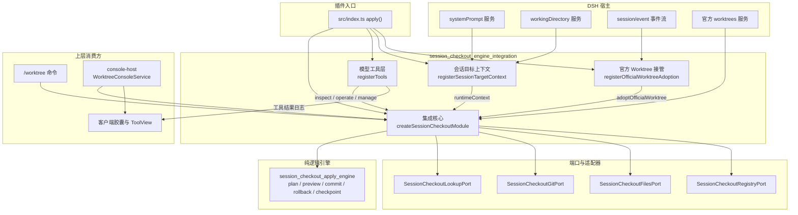
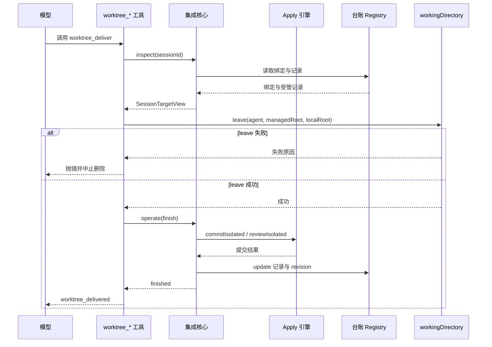

# session_checkout_engine_integration 模块概览

!!! info "Generated documentation"
    This page was written by CodeWiki from the source code at commit [`e9e7bc56`](https://github.com/wloops/dsh-git-worktree/commit/e9e7bc56245c0a0ed26f0eadb11608dad69324ba) on 2026-11-09 with `deepseek-v4.1-flash`. Check the code before relying on details.

`session_checkout_engine_integration` 是 session-checkout 领域的**宿主集成层**。它把纯逻辑的 Apply 引擎与 DSH 宿主连接起来，负责会话、项目与受管 Worktree 之间的绑定状态机、台账持久化与 revision CAS、全局互斥与维护旁路、崩溃收敛、交付与清理生命周期，并通过 `worktree_*` 模型工具、系统提示上下文和官方 Worktree 接管事件，把能力暴露给模型与用户。

模块由两个核心部分组成：

- **集成核心**：`session-checkout-module.ts` 与 `session-target-context.ts`，实现 `SessionCheckoutModule` 状态机、台账门面、运行时上下文注入与官方 Worktree 自动登记。
- **模型工具层**：`src/tools.ts` 中的 `registerTools(ctx, module)`，向模型暴露 7 个受控的 `worktree_*` 工具。

插件入口 `src/index.ts` 的 `apply()` 负责组装：先创建 `SessionCheckoutModule`，再依次注册工具、`/worktree` 命令、会话目标上下文与官方 Worktree 接管监听。

---

## 模块目的

- 维护「会话 ↔ 项目 ↔ 受管 Worktree」的权威绑定关系，并把状态持久化到版本化台账。
- 在 Local 边界、受管 Worktree 边界与台账边界之间执行严格的安全约束，避免把任务代码写回用户本地仓库。
- 为模型提供受控的 Worktree 生命周期工具：创建、列出、下一轮、交付、清理、剪枝与合并。
- 向 `systemPrompt` 注入动态会话目标上下文，使模型始终知道自己当前站在 Local 还是某个受管 Worktree 中。
- 在会话进入官方 Worktree 时自动接管并登记，保证官方工具与插件台账一致。
- 通过 revision 乐观锁、全局互斥、维护旁路与崩溃收敛，保证并发与异常场景下记录不被破坏。

---

## 架构

架构上最重要的三条边界是：

| 边界 | 含义 | 约束 |
| --- | --- | --- |
| Local 边界 | 用户本地仓库 `record.localRoot` | 交付流程永不写入；遗留 apply/preview 路径在存在会话分支时被 `refuseLegacyLocalWrite()` 拒绝 |
| 受管边界 | 受管 Worktree `record.managedRoot` / `record.managedGitRoot` | 会话的权威 cwd，也是唯一允许写任务代码的地方 |
| 台账边界 | `ManagedCheckoutsRegistry` | 唯一事实来源，含 `revision`、`sessionBindings`、`managedCheckouts` |

---

## 典型请求流

以 `worktree_deliver` 为例，模型工具层不会直接执行 Git 操作，而是先读取权威视图，再委托集成核心完成状态校验、cwd 切换与提交：

该流程体现了模块的两条关键不变式：**删除目录前必须先离开 checkout**，以及**交付失败时必须把 cwd 移回仍然存在的 Worktree**，否则后续相对路径写入会落到 Local 仓库。

---

## 核心组件文档

| 组件 | 职责 | 文档 |
| --- | --- | --- |
| 集成核心 | `SessionCheckoutModule` 状态机、绑定生命周期、`inspect` / `operate`、台账与 revision CAS、并发控制、`reconcile` 崩溃收敛、交付与清理、`runtimeContext` 上下文注入、官方 Worktree 自动接管 | [Session Checkout 集成核心（session_checkout_integration_core）](session_checkout_integration_core.md) |
| 模型工具层 | 注册 7 个 `worktree_*` 工具，执行状态门禁、所有权校验、cwd 进入/离开、结果 JSON 化与国际化错误文案 | [session_checkout_tools 模型工具层](session_checkout_tools.md) |

模型工具层包含以下工具：

- `worktree_create`
- `worktree_list`
- `worktree_begin_next_iteration`
- `worktree_deliver`
- `worktree_cleanup`
- `worktree_prune_branches`
- `worktree_merge`

> Discard、Remove 等破坏性动作不属于模型工具，由 `/worktree` 命令和客户端胶囊菜单发起；模型工具只到「交付」为止。

---

## 关键设计约束

- **`runtimeContext` 必须保持同步且无 I/O**：它在每次 `systemPrompt` 求值时被调用，只读 registry 快照，保证上下文可重放稳定。
- **所有写台账的单记录更新必须走 `registry.update()`**：避免 `read()` + `write()` 之间的跨进程写入被后写者抹掉。
- **revision 是乐观锁**：所有 mutation 都要比对 `expectedRevision`，不匹配返回 `stale_target`，而不是盲目重试。
- **清理失败原因决定是否自动重试**：`directory_busy`、`quarantine_busy` 可退避重试；`identity_changed`、`modified_after_finalize` 必须人工介入。
- **工具结果 schema 是客户端契约**：例如 `worktree_create` 的 `checkoutId / targetSessionId / managedRoot / phase / currentOid / sourceSessionId / cwdSelected` 与客户端 ToolView 的 `parseCreateTool` 严格对应，修改输出字段会破坏界面回放。
- **`autoDeliver` 是硬门禁**：关闭时模型不能 commit/push/cleanup，交付改由用户通过胶囊菜单触发。

---

## 相关文档

- 集成核心：[Session Checkout 集成核心（session_checkout_integration_core）](session_checkout_integration_core.md)
- 模型工具层：[session_checkout_tools 模型工具层](session_checkout_tools.md)
- Apply 引擎：[session_checkout_apply_engine](session_checkout_apply_engine.md)
- session-checkout 引擎总览：[session_checkout_engine 模块概览](session_checkout_engine.md)
- 领域总览：[Worktree 与会话检出领域（Worktree_and_Session_Checkout_Domain）](Worktree_and_Session_Checkout_Domain.md)

??? abstract "Documented components (3)"
    - [`ResolvedSessionProject`](https://github.com/wloops/dsh-git-worktree/blob/e9e7bc56245c0a0ed26f0eadb11608dad69324ba/src%5Csession-checkout-module.ts) — `src\session-checkout-module.ts`
    - [`ContextAgent`](https://github.com/wloops/dsh-git-worktree/blob/e9e7bc56245c0a0ed26f0eadb11608dad69324ba/src%5Csession-target-context.ts) — `src\session-target-context.ts`
    - [`enterCheckout`](https://github.com/wloops/dsh-git-worktree/blob/e9e7bc56245c0a0ed26f0eadb11608dad69324ba/src%5Ctools.ts) — `src\tools.ts`

