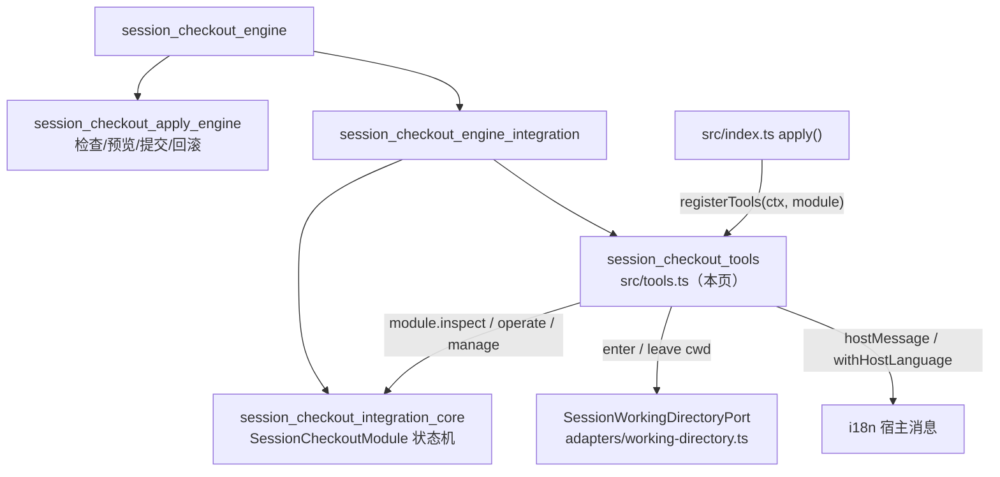
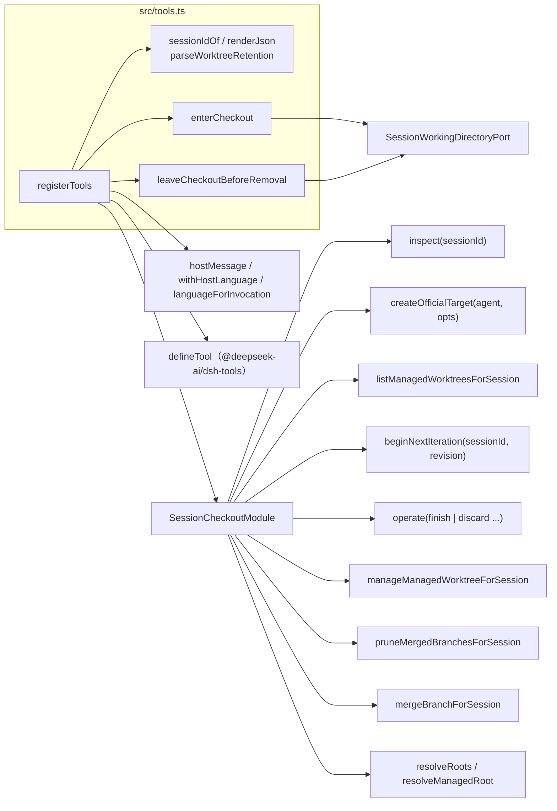
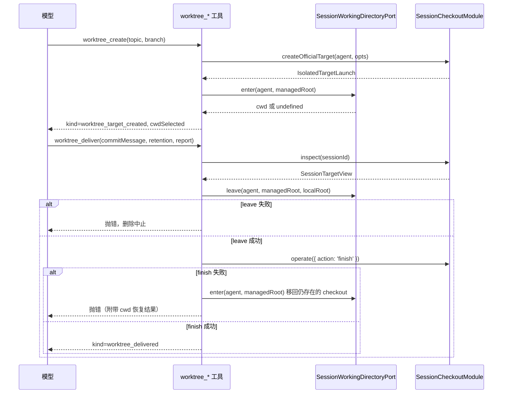
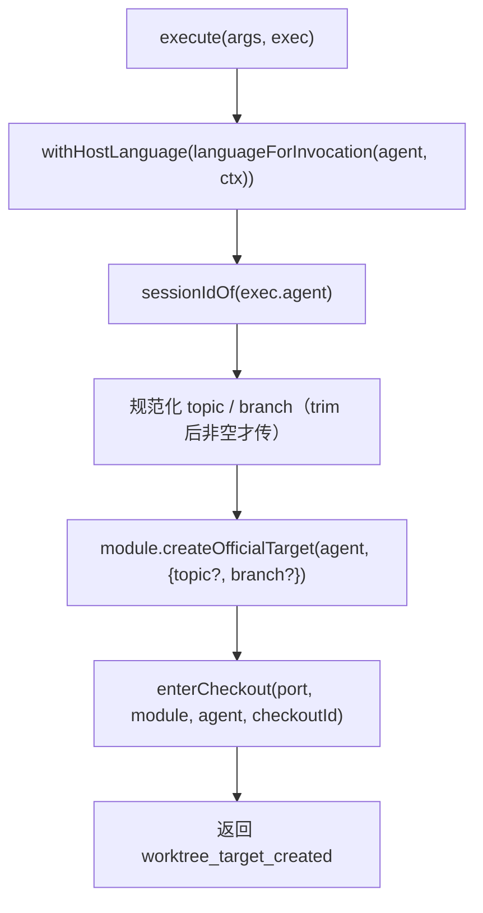
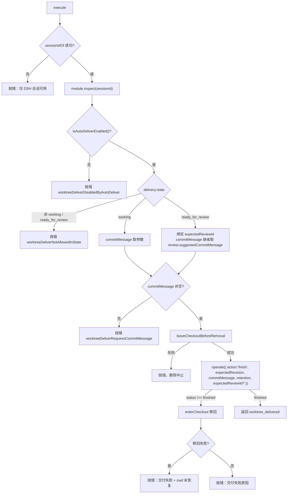

# session_checkout_tools 模型工具层

!!! info "Generated documentation"
    This page was written by CodeWiki from the source code at commit [`5b95f640`](https://github.com/wloops/dsh-git-worktree/commit/5b95f640c1b489cd3e1c7dd85445c51573405e3f) on 2026-11-11 with `mimo-v2.6-flash`. Check the code before relying on details.

`session_checkout_tools` 是 session-checkout 领域向**模型**暴露的唯一入口，实现在 `src/tools.ts` 的 `registerTools(ctx, module)` 中。它把 `SessionCheckoutModule`（领域状态机）与 `SessionWorkingDirectoryPort`（会话 cwd 适配器）组合成 7 个受控的 `worktree_*` 工具，并保证三件事：

1. **只做领域允许的动作**：每个工具在执行前用 `module.inspect()` 读取权威视图，再按状态/所有权/配置做门禁，不做任何绕过状态机的 Git 操作。
2. **cwd 永远指向仍然存在的目录**：进入 checkout、删除 checkout 之前必须先离开、删除失败后必须移回，全部有显式失败上报。
3. **日志载荷可回放**：所有结果都通过 `renderJson` 序列化成单个 `text` 块，客户端 ToolView 只依赖这段日志即可重建界面。

本页只描述模型工具层。领域状态机本身见 [Session Checkout 集成核心（session_checkout_integration_core）](session_checkout_integration_core.md)，apply/commit 引擎见 [session_checkout_apply_engine](session_checkout_apply_engine.md)。

---

## 1. 在模块树中的位置



`registerTools` 在 `src/index.ts` 的 `apply()` 中于 `registerWorktreeCommand`、`registerSessionTargetContext`、`registerOfficialWorktreeAdoption` 之前被调用，是插件挂载流程的一环：

```ts
// src/index.ts（节选）
registerTools(ctx, module)
registerWorktreeCommand(ctx, module)
registerSessionTargetContext(ctx, module)
registerOfficialWorktreeAdoption(ctx, module)
```

---

## 2. 工具清单

| 工具名 | 作用 | 关键参数 | 结果 `kind` | 主要门禁 |
| --- | --- | --- | --- | --- |
| `worktree_create` | 通过宿主官方 `worktrees` 服务建树，把结果记入台账，并把本会话 cwd 切入新 checkout | `topic?`、`branch?` | `worktree_target_created` | 需要 live Agent 会话（`sessionIdOf`） |
| `worktree_list` | 列出**本会话可见**的托管 Worktree | 无 | `worktree_list` | 结果由 `listManagedWorktreesForSession` 按会话作用域裁剪 |
| `worktree_begin_next_iteration` | 已交付并清理完成后，在同一 immutable cwd 安全开始下一轮 | 无 | `worktree_next_iteration_started` | 目标必须进入 `working`，否则抛错 |
| `worktree_deliver` | 把 Worktree 改动提交到**本会话自己的分支**，再按保留策略清理 | `commitMessage?`、`retention?`、`report?` | `worktree_delivered` | `isAutoDeliverEnabled()`；状态须为 `working` / `ready_for_review` |
| `worktree_cleanup` | 清理一个已交付/保留终态的托管 Worktree | `checkoutId`、`expectedRevision` | `worktree_cleanup` | 参数必填 + CAS；脏树由领域层拒绝 |
| `worktree_prune_branches` | 安全剪枝已完全合并的本地分支（`git branch -d` 语义，绝不 force） | `dryRun?`、`olderThanDays?` | `worktree_prune_branches` | `olderThanDays` 必须 > 0 才透传 |
| `worktree_merge` | 把本会话 worktree 分支合进 Local（`forward`）或反向同步（`reverse`） | `sourceBranch`、`dryRun?`、`direction?` | `worktree_merge` | `sourceBranch` 必填；`type: 'failed'` 直接抛错 |

所有工具都声明 `presentCall: () => ({ card: 'generic', title: hostRegistrationMessage(...), kind: 'other', rawInput: {} })`，标题走 `hostRegistrationMessage`（中英双语并列），因为注册元数据会在会话之间共享。

> **人类通道与本通道的分工**：Discard / Remove 这类破坏性动作**不**属于模型工具，它们由 `/worktree` 命令（`src/commands.ts`，见 [核心工作树领域（core_worktree_domain）](core_worktree_domain.md) 与 [Client_Presentation_and_Interaction 模块概览](Client_Presentation_and_Interaction.md)）和客户端胶囊菜单发起。模型工具只到「交付」为止。

---

## 3. 组件依赖



| 依赖 | 用途 | 文档 |
| --- | --- | --- |
| `SessionCheckoutModule` | 权威状态机接口（`src/index.ts`） | [public_api 模块：插件公共入口与契约面](public_api.md) |
| `SessionWorkingDirectoryPort` | 读写会话 cwd（`adapters/working-directory.ts`） | [主机服务适配器（Host Services Adapters）](adapters_infrastructure_host_services.md) |
| `hostMessage` / `withHostLanguage` / `languageForInvocation` | 按调用语言输出文案 | [i18n：中英双语文案与语言解析基础设施](i18n.md) |
| `defineTool` / `ctx.tools` | 宿主工具注册协议 | — |

---

## 4. 内部辅助函数

### 4.1 `sessionIdOf(agent)`

从 `exec.agent.session.id` 取会话 id。非 DSH Agent 会话（无 `session.id`）直接抛 `worktreeToolsCanOnlyBeCalledInADSH`。这是所有工具的第一道门禁，也是「工具只能在真实会话中调用」的强约束。

### 4.2 `renderJson(value)`

```ts
return [{ type: 'text', text: JSON.stringify(value) }]
```

把结构化结果压成单个 `text` 块，既给模型读，也给客户端 ToolView 回放。客户端 `src/client/model.ts` 的 `parseCreateTool` 依赖 `kind: 'worktree_target_created'` 与 `checkoutId / targetSessionId / managedRoot / phase / currentOid / sourceSessionId` 六个必填字段——**修改 `worktree_create` 的 output schema 会破坏 ToolView**，两边必须同步。

### 4.3 `parseWorktreeRetention(value)`

`undefined` → `DEFAULT_WORKTREE_RETENTION`（`types.ts` 中为 `'retain_manual'`）；合法值直接返回；其余抛 `worktreeDeliverInvalidRetention`。非法值不会被静默降级。

### 4.4 `leaveCheckoutBeforeRemoval(port, module, agent, checkoutId)`

删除 checkout **之前**必须调用。逻辑：

1. `module.resolveRoots?.(checkoutId)` 从台账读两个边界（`managedRoot` / `localRoot`），**不做 Git I/O**。
2. 台账查不到 → 直接返回 `undefined`（无需搬动）。
3. 调 `port.leave(agent, managedRoot, localRoot)` 把 cwd 退回 Local 边界。
4. 任何异常 → 返回原因字符串，调用方**必须中止删除**。

注释里写得很直白：失败却继续删除，会把会话留在一个即将消失的目录里。

### 4.5 `enterCheckout(port, module, agent, checkoutId)`

进入 checkout，返回 `{ cwd?, failure? }`，两种「没进去」被严格区分：

| 返回值 | 含义 | 调用方行为 |
| --- | --- | --- |
| `{ cwd }` | 已进入，`cwd` 是规范化后的目录 | 正常返回 |
| `{}` | 宿主未挂载 `workingDirectory` 服务（**合法降级**） | 报 `cwdSelected: false`，让模型改用绝对路径 |
| `{ failure }` | 真实错误（Git 校验失败、cwd 写入失败等） | 上报错误，**不得**声称 cwd 已切换 |

根目录解析顺序刻意是「台账优先，Git 校验兜底」：`resolveManagedRoot` 会在全局锁下跑完整 Git 校验，恢复中的 checkout 或瞬时 Git 错误会让会话被困在 Worktree 之外，因此只在台账无法回答时才走它。

---

## 5. cwd 生命周期与安全不变式

这是本模块最容易被忽略、也最容易引发「相对路径写进原仓库」事故的部分。



不变式总结：

- **进入**：`worktree_create` 与 `worktree_begin_next_iteration` 成功后主动进入 checkout（对齐官方 `ctx.workingDirectory.set`）。
- **离开先于删除**：`worktree_deliver`、`worktree_cleanup` 在可能删除目录前调用 `leaveCheckoutBeforeRemoval`；失败即中止。
- **失败要移回**：交付失败时 checkout 仍在，会话必须回到其中，否则后续所有相对路径写入都会落到 Local 仓库。此时若移回也失败，错误信息会同时包含**交付失败原因**与**cwd 移回失败原因**（`worktreeCwdCouldNotBeRestoredAfterFailedDelivery`），而不是只报一个。
- **降级不等于失败**：宿主没有 `workingDirectory` 服务时，工具仍成功，只是把 `cwdSelected` / `cwd` 字段留空，并在 `runtimeContext` 里告知模型改用绝对路径（见 [Session Checkout 集成核心（session_checkout_integration_core）](session_checkout_integration_core.md)）。

---

## 6. 各工具详解

### 6.1 `worktree_create`



要点：

- 建树只走宿主的 `worktrees` 服务（`createOfficialTarget`），**本插件不自己跑 `git worktree add`**：目录固定在 `<repo>/.agents/worktrees/<branch>`，插件随后接管台账、交付、评审与清理。因此 `worktree_create` 与官方 `create_worktree` 建出的树在台账上等价。
- `topic` 同时影响目录命名（`<topic>-<YYYYMMDD>`，需宿主配置 `worktreesRoot`）与会话分支名（`feat/sess-<session>--<topic>`）。
- `branch` 让新树以某个本地分支的当前 tip 为起点，缺省则从 HEAD 开始。
- 输出里 `branch` 是**可选**字段：创建即挂好会话分支后才有值；`currentOid`、`phase`、`managedRoot` 恒有。
- `cwdSelected` 为 `boolean` 且必填——它是客户端 `WorktreeCreateRow` 决定「显示『打开隔离会话』按钮」还是「本会话已在新目录中工作」的唯一依据。

### 6.2 `worktree_list`

只读。调 `module.listManagedWorktreesForSession(sessionId)`，把结果裁剪成 `checkoutId / projectName / ownerSessionId / iteration / revision / state / phase / dirty / commitOid?`。

`commitOid` 采用**省略而非空值**的写法：

```ts
...(summary.commitOid ? { commitOid: summary.commitOid } : {}),
```

原因写在注释里：宿主把 `undefined` 判为「非无损 JSON」并拒绝，而 `null` / `''` 又不携带提交信息。

### 6.3 `worktree_begin_next_iteration`

交付并清理完成（`phase === 'discarded' && delivery.state === 'delivered'`）后，会话已回到 Local 边界。此工具调 `module.beginNextIteration(sessionId, current.revision)` 在同一 immutable cwd 重建下一轮，然后重新 `enterCheckout`。

- 返回后校验 `target.delivery?.state === 'working'`，否则抛 `theNextWorktreeIterationDidNotEnterWorkingState`。
- 输出**没有** `cwdSelected`，只有可选的 `cwd` 与 `cwdError`：语义是「必须进入，进不去就报错」。
- `retained` / `cleanup_pending` 状态不能调用（由领域层拒绝）。

### 6.4 `worktree_deliver`

这是「实现与验证完成后的最后一个模型动作」。



关键设计：

- **autoDeliver 开关是硬门禁**：关闭时模型不能 commit/push/cleanup，交付改由用户点击胶囊菜单（`worktreeConsole` 的 `deliver`）完成。这与 `runtimeContext` 里注入的指引文案严格一致。
- **`expectedReviewId` 只在 `ready_for_review` 时绑定**：确保交付提交与「人类已看过的那份 Review」一一对应，Review 之后 Worktree 又被修改会被判为 `stale_isolated`。
- **`retention` 缺省走 `DEFAULT_WORKTREE_RETENTION`**（`retain_manual`），而不是立即删除：交付默认保留冻结环境，便于事后检视；`cleanup` 才当场删。
- **`report` 不写进提交**：它是返回给用户的 Markdown 报告，随结果一起回传；提交信息只由 `commitMessage` 决定。
- 返回值里的 `branch` 是**会话分支名**，交付提交落在该分支上（Local 未被写入），后续合并走 `worktree_merge`。

### 6.5 `worktree_cleanup`

参数校验严格：`checkoutId` 去空白后非空、`expectedRevision` 必须是有限数字（`Math.floor` 后使用）。随后同样先 `leaveCheckoutBeforeRemoval`，再调 `module.manageManagedWorktreeForSession(sessionId, { action: 'cleanup_retained' })`。

- `expectedRevision` 是乐观并发校验（CAS），防止清理过期目标。
- 脏工作树由领域层拒绝并返回 `cleanupMessage` / `cleanupReason`，工具原样透出。
- 描述里明确要求「拿不准时先调 `worktree_list` 查看可清理项」。

### 6.6 `worktree_prune_branches`

```ts
dryRun: args?.dryRun === true,
...(typeof olderThanDays === 'number' && Number.isFinite(olderThanDays) && olderThanDays > 0
  ? { olderThanDays: Math.floor(olderThanDays) }
  : {}),
```

- 只透传**正有限数**的 `olderThanDays`；`0`、负数、`NaN`、非数字一律视为「不做时间过滤」，而不是报错。
- 结果把 `pruned` 与 `skipped` 分成两个数组，`skipped` 每条可带 `reason`（当前分支、`main`/`master`、未合并、仍被 live checkout 占用、无法验证合并状态等）。
- 与 `autoPruneMergedBranches` 自动清扫的区别：后者是插件级定时任务（`src/index.ts`，默认关闭，7 天 cutoff），本工具是模型显式调用、可 `dryRun` 预览。

### 6.7 `worktree_merge`

- `sourceBranch` 必填且非空，否则抛 `worktreeMergeSourceBranchRequired`。
- `direction` 只接受 `'forward'` / `'reverse'`，其他值按缺省（`undefined`）处理，由领域层决定默认方向。
- `dryRun === true` 时在临时 worktree 里试合并，零改动。
- 结果 `type` 为 `merged` / `up_to_date` / `conflict` / `failed`。**只有 `failed` 抛错**；`conflict` 作为正常结果返回，并携带 `conflictingFiles` 与逐文件 `conflictDetails`（`file` + `diff`），由模型就地解决后重试。
- 所有权由领域层校验：只能合并本会话自己的 worktree 分支，越权会返回带原因的错误。

---

## 7. 国际化与错误文案

所有工具的 `execute` 都被包在：

```ts
withHostLanguage(languageForInvocation(exec.agent, ctx), async () => { /* ... */ })
```

- `languageForInvocation(agent, fallbackContext)` **优先读 Agent 自己的 ctx**（`agent.ctx`），避免作用域设置在不同用户/会话之间串味；读不到时退回插件 ctx，最终 `normalizeLanguage` 归一到 `'zh'` / `'en'`。
- `withHostLanguage` 用 `AsyncLocalStorage` 保存语言快照，所以**领域层内部**（`session-checkout-module.ts`、apply 引擎）抛出的 `hostMessage(...)` 文案也会自动跟随本次调用的语言，无需逐层透传参数。
- 参数一律通过 `{p0}`、`{p1}` 占位符插值，用户数据永远只作为值传入，不做字符串拼接。

工具抛的是普通 `Error`（而非 `SessionCheckoutError`），因为宿主会把 message 直接呈现给模型；`SessionCheckoutError.code` 的稳定错误码在领域层内部用于分支判断（`SESSION_CHECKOUT_ERROR_CODES`，见 [核心端口与类型契约（core_ports_and_types）](core_ports_and_types.md)）。

---

## 8. 失败模式速查

| 场景 | 表现 | 文案 key |
| --- | --- | --- |
| 非 DSH Agent 会话调用 | 抛错 | `worktreeToolsCanOnlyBeCalledInADSH` |
| `retention` 非法 | 抛错，不降级 | `worktreeDeliverInvalidRetention` |
| autoDeliver 关闭时交付 | 抛错，指引用户走胶囊菜单 | `worktreeDeliverDisabledByAutoDeliver` |
| 状态不允许交付 | 抛错并带上当前状态 | `worktreeDeliverNotAllowedInState` |
| 缺提交信息且无 `suggestedCommitMessage` | 抛错 | `worktreeDeliverRequiresCommitMessage` |
| 删除前 cwd 移不出去 | 抛错，**删除中止** | `worktreeCwdCouldNotBeRestoredBeforeRemoval` |
| 交付失败且 cwd 移不回 | 抛错，同时报告两件事 | `worktreeCwdCouldNotBeRestoredAfterFailedDelivery` |
| 交付返回非预期结果 | 抛错并附细节 | `worktreeDeliverUnexpectedResult` |
| 下一轮未进入 `working` | 抛错 | `theNextWorktreeIterationDidNotEnterWorkingState` |
| `worktree_cleanup` 缺参 | 抛错 | `worktreeCleanupRequiresCheckoutId` / `worktreeCleanupRequiresExpectedRevision` |
| `worktree_merge` 缺 `sourceBranch` | 抛错 | `worktreeMergeSourceBranchRequired` |
| `worktree_merge` 合并失败 | 抛错 | `gitOperationFailedGit` |

---

## 9. 与其他模块的契约

| 对端 | 契约点 | 文档 |
| --- | --- | --- |
| 客户端 ToolView | `worktree_create` 结果 schema 与 `parseCreateTool` 的必填字段一一对应；`cwdSelected` 决定按钮与文案 | [client_core 模块](client_core.md) |
| 客户端胶囊 / 控制面 | 人类交付、保留、清理、下一轮走 `worktreeConsole` RPC，与模型工具共享同一 `SessionCheckoutModule` | [Worktree Console 控制面（Host 业务编排层）](console_host_control_plane.md)、[console_contract 模块（Worktree Console 共享契约）](console_contract.md) |
| 宿主 `workingDirectory` 服务 | `enter` / `leave` 的结构化适配，服务缺失时合法降级 | [主机服务适配器（Host Services Adapters）](adapters_infrastructure_host_services.md) |
| `/worktree` 人类命令 | 同一套 `leaveCheckoutBeforeRemoval` / `enterCheckout` 语义（`src/commands.ts` 内有平行实现） | [核心工作树领域（core_worktree_domain）](core_worktree_domain.md) |
| 系统提示注入 | `runtimeContext` 根据 `cwd` 是否在 checkout 内决定是否要求「绝对路径写入」，与工具的 `cwdSelected` 呼应 | [Session Checkout 集成核心（session_checkout_integration_core）](session_checkout_integration_core.md) |

---

## 10. 构建与验证

- 工具层随包一起编译：`package.json` 的 `build` 脚本为 `node scripts/clean-lib.mjs && tsc && tsdown`，`typecheck` 为 `tsc --noEmit`。
- 测试入口为 `vitest run`；`vitest.config.ts` 中 `include: ['tests/**/*.test.{ts,tsx}']`，并对 `@deepseek-ai/dsh-client-ui-primitives` 等提供别名桩。注意 Windows 上 `fileParallelism` 被关闭（Git fixture 争用文件句柄）。
- 工具注册依赖宿主注入 `tools`（`export const inject = { tools: {}, commands: {}, subprocess: {}, loader: { await: false } }`）。修改 `inject` 会直接影响 `ctx.tools.register` 是否可用。

??? abstract "Documented components (1)"
    - [`enterCheckout`](https://github.com/wloops/dsh-git-worktree/blob/5b95f640c1b489cd3e1c7dd85445c51573405e3f/src%5Ctools.ts) — `src\tools.ts`

