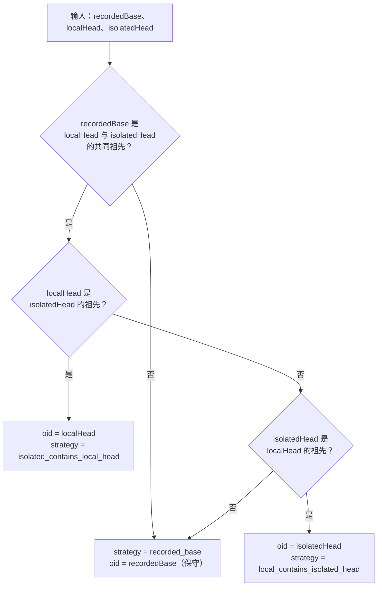
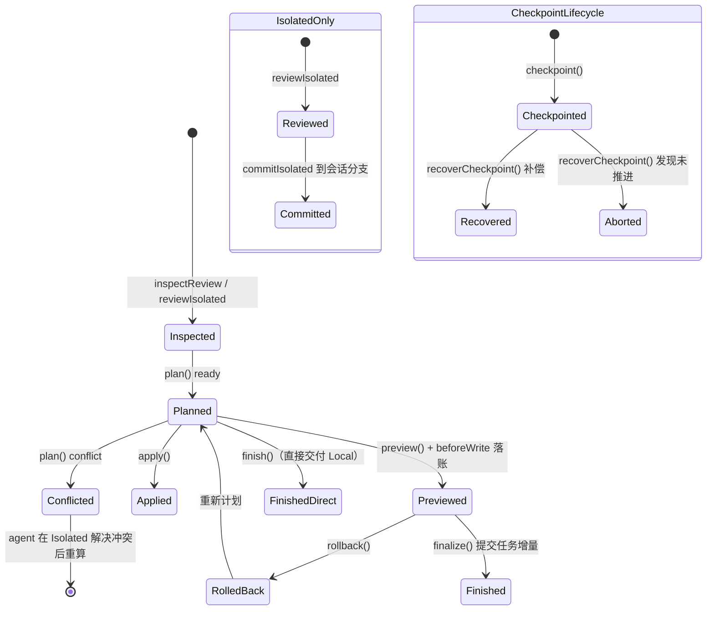
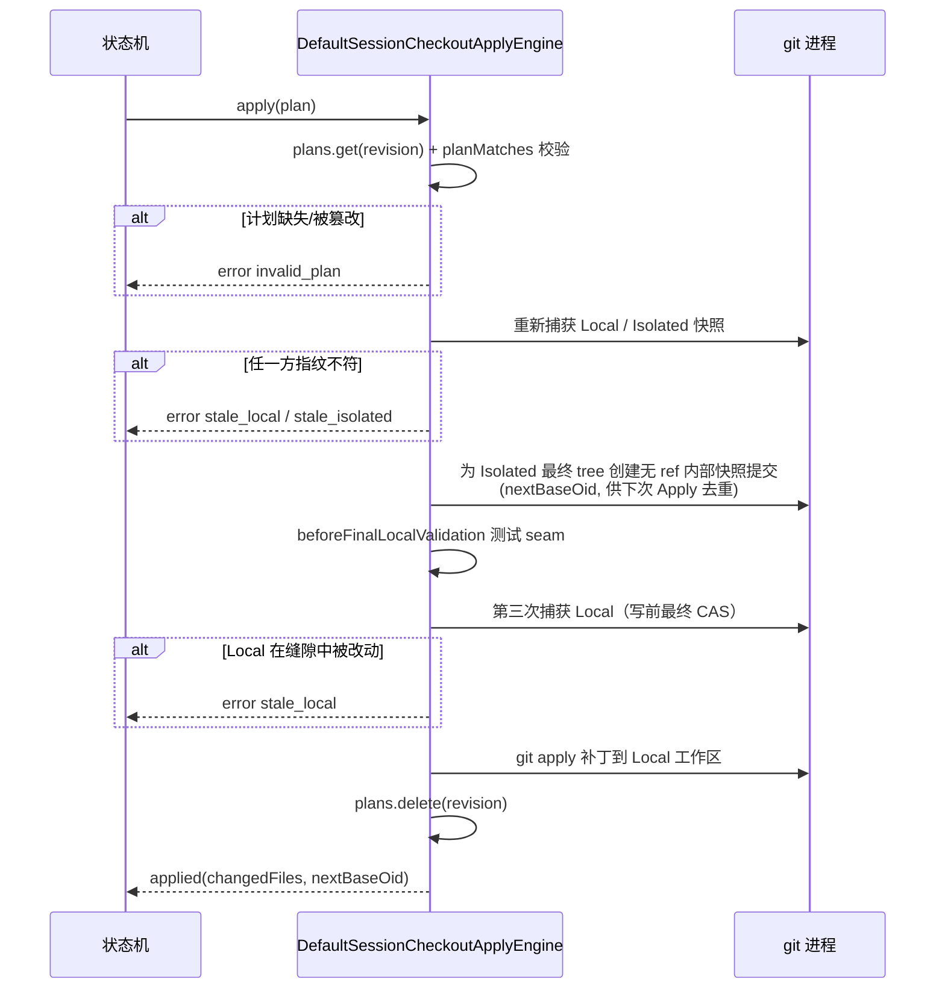
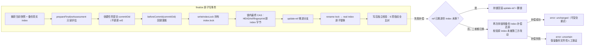
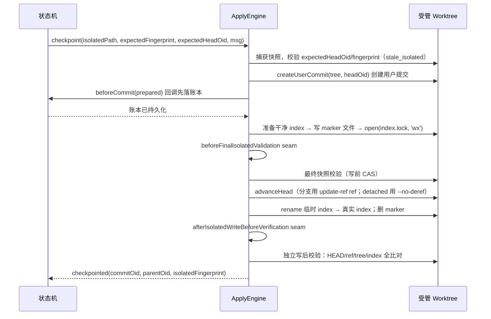
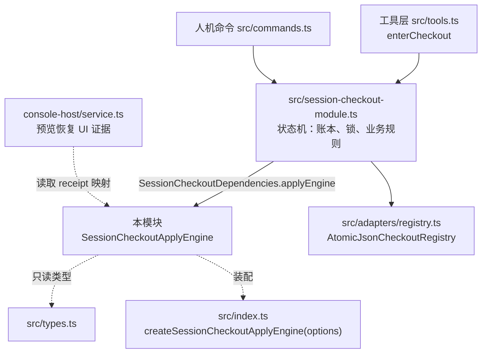

# session-checkout-apply 应用引擎

!!! info "Generated documentation"
    This page was written by CodeWiki from the source code at commit [`a31b4396`](https://github.com/wloops/dsh-git-worktree/commit/a31b439621dc58eaf810ac3b10e09abe2c2d3de6) on 2026-11-07 with `doubao-seed-2.1-lite`. Check the code before relying on details.

## 简介

`src/session-checkout-apply.ts` 是 dsh-git-worktree 插件的**应用层 Git 引擎**，负责把「受管隔离 Worktree 里完成的工作」以安全、可验证、可恢复的方式与「本地项目工作区」协调。它是会话检出状态机（[会话检出状态机模块（session-checkout-module）](src_session-checkout-module.ts.md)）下方的核心执行组件：状态机负责持久化账本、并发锁与业务规则，本模块负责全部 Git 层面的三方合并计算、快照指纹 CAS、补丁写入与崩溃恢复。

核心职责：

1. **快照捕获（Capture Snapshot）**：把 Local 与 Isolated 两个 checkout 的「HEAD + 索引 + 工作区」完整状态固化为临时 index 下的 tree OID 与 SHA-256 指纹，作为一切后续运算的身份基线。
2. **计划与预检（Plan / Preflight）**：用真实的 `git merge --no-commit --no-ff` 在临时仓库里计算两边快照的合并结果，产出可执行补丁或冲突清单，绝不触碰任一方 checkout。
3. **预览 / 回滚 / 定稿（Preview / Rollback / Finalize）**：把任务变更先应用到用户工作区供人眼验收；随时可回滚（恢复到预览前）或定稿（把任务增量剥离成一次干净的用户提交）。
4. **隔离分支交付（commitIsolated / reviewIsolated）**：把 Worktree 自身工作区提交到它检出的会话分支上，完全不读写 Local。
5. **检查点（Checkpoint / recoverCheckpoint）**：在受管 Worktree 里保存「私有进度快照」，支持断电中断后的 index.lock 恢复。

整个引擎**不依赖任何宿主服务**：它直接通过 `node:child_process` 生成 `git` 进程，靠临时对象目录、临时 index 与 Git 自带的 `index.lock` 协议实现原子写入与独立写后校验。

## 架构总览

```mermaid
flowchart TB
    subgraph Host["宿主层（插件装配）"]
        IndexTS["src/index.ts<br/>createSessionCheckoutApplyEngine"]
        Module["src/session-checkout-module.ts<br/>状态机与账本"]
    end

    subgraph Engine["session-checkout-apply.ts"]
        Iface["SessionCheckoutApplyEngine 接口<br/>inspectReview / plan / apply / finish<br/>preview / rollback / finalize / checkpoint"]
        Impl["DefaultSessionCheckoutApplyEngine<br/>plans: Map<revision, StoredPlan>"]
    end

    subgraph GitOps["Git 原语层（模块内私有）"]
        RunGit["runGit()<br/>spawn git、环境 scrub、30s 超时"]
        Snap["captureSnapshot()<br/>HEAD/ref/indexEntries/tree + 指纹"]
        Merge["computeMerge() / computeTreeMerge()<br/>临时仓库真实三方合并"]
        Patch["prepareIndexFromPatch() / treePatch()"]
    end

    subgraph External["外部依赖"]
        Types["src/types.ts<br/>ApplyBaseStrategy / ApplyConflictDetail"]
        Cm["src/commit-message.ts<br/>isValidCommitMessage"]
        Skills["src/adapters/project-skills.ts<br/>ProjectSkillStore / trackedSkillPaths"]
        Excl["src/delivery-excludes.ts<br/>deliveryExcludePathspecs"]
        I18N["src/i18n/host.ts<br/>hostMessage"]
    end

    IndexTS -->|"装配时注入 options"| Impl
    Module -->|"依赖注入 applyEngine"| Iface
    Iface <|.. Impl
    Impl --> RunGit
    Impl --> Snap
    Impl --> Merge
    Impl --> Patch
    RunGit --> Types
    Snap --> Skills
    Snap --> Excl
    RunGit --> I18N
    Impl --> Cm
```

## 核心概念

### 快照与指纹（CheckoutSnapshot / 指纹 CAS）

`captureSnapshot()` 在**临时 index** 上重建 checkout 的完整状态，避免污染真实索引：

| 字段 | 含义 |
| --- | --- |
| `fingerprint` | SHA-256(headOid + headRef + indexEntries + treeOid)；若有随会话携带的 Project Skills 再叠加其指纹 |
| `headOid` / `headRef` | 当前 HEAD 提交与符号引用（detached 时为 `null`） |
| `headTreeOid` | HEAD 提交对应的 tree |
| `indexTreeOid` | 临时 index 重建出的 staged 状态 tree |
| `treeOid` | 工作区 + 排除宿主运行期产物后的最终 tree |
| `indexEntries` | 原始 `ls-files --stage -z` 输出，用于回滚后精确还原索引 |

指纹是**乐观并发控制（CAS）的核心**：plan 时记录、apply/preview/finish 前重新捕获并比对，任何一方在「计划已批准」之后被外部改动，立即返回 `stale_local` / `stale_isolated`，要求重新计划。

### 有效基线（EffectiveApplyBase）

`selectEffectiveApplyBase()` 在三方合并前动态选择合并基准：



设计意图：上次 Apply 产生的内部快照提交通常**不在任一分支历史中**，因此第二次 Apply 会保守退回 `recorded_base`，避免把未审查的中间状态当作合并基准。

### 计划存储（StoredPlan）

`plan()` 成功后把补丁与作用域以 `revision: randomUUID()` 为键存进实例内存 Map。约束：

- 同一 `isolatedPath` 只保留**一份**计划——重新计算会淘汰旧计划，防止 Map 无限增长。
- `apply()` / `preview()` / `finish()` 必须用 `planMatches()` 逐字段（revision、双指纹、OID、变更集）校验调用方回传的 `ApplyPlan`，任何篡改或复用即返回 `invalid_plan`。
- 计划消费成功后立即从 Map 删除，保证一次性。

## 操作族与状态流转



### 1. 评审快照族：inspectReview / reviewIsolated

| 方法 | 读取范围 | 用途 |
| --- | --- | --- |
| `inspectReview(input)` | 同时解析 Local 与 Isolated 的 git root，校验同库、同项目子目录前缀 | 普通 Apply 流程：「评审之后 Isolated 是否变了」 |
| `reviewIsolated(input)` | **完全不碰 Local** | 会话分支交付：提交前判断 Worktree 是否在评审后又被修改 |

两者都会拒绝「变更集越出项目根」的工作区（`isolatedContainsChangesOutsideTheProjectRoot`），确保交付物边界清晰。

### 2. 计划族：preflight / plan

`preflight()` 与 `plan()` 共用 `calculatePlan(input, persistPlan)`：

- **preflight**：复用完整合并计算，但不持久化补丁、不修改任何 checkout —— 供 UI 预检与工具层只读探测。
- **plan**：把补丁 + 作用域写入 `plans` Map，返回带 `revision` 的 `ApplyPlan`。

合并计算在临时目录完成：`createSnapshotCommit` 把双方 tree 挂到 `baseOid` 下形成两个「影子提交」→ 在临时仓库 `git merge --no-commit --no-ff` → 成功则导出二进制补丁与合并后 tree；冲突则收集逐文件 combined diff（上限 6 文件 / 每个 4KB，防止撑爆模型上下文）。

### 3. 应用族：apply



关键细节：apply 只写工作区（`git apply`），**不创建提交、不动 HEAD**；任务交付的提交责任在 `finish` / `finalize`。

### 4. 预览族：preview / assessPreviewRecovery / rollback / finalize

这是本模块最复杂的部分，实现了 Domi 的「receipt-first 预览」语义：

- **preview**：先在 Local 写入前通过 `beforeWrite(receipt)` 回调把 `PreviewReceipt` 持久化进宿主账本；随后才允许任何 Local 写入。receipt 记录预览前后双指纹、三方 tree OID、孤立快照提交等全部恢复证据。
- **assessPreviewRecovery**：严格只读，基于 receipt 与当前快照，并行评估 `rollback` 与 `finalize` 两条路径各自是否安全（`computeTreeMerge` 尝试多种三方组合），返回 `safe` 或带阻塞码的 `blocked`。
- **rollback**：按评估出的 `targetTreeOid` 生成反向补丁；`beforeWrite()` 回调必须在「最终 Local CAS 之后、git apply 之前」完成账本持久化。写后再次捕获快照，逐字段比对（含 indexEntries 指纹）。
- **finalize**：把任务增量从「预览后的完整 Local」里剥离出来（`taskTree = merge(local.tree, headTree, mergedTree)`），在旧 HEAD 上创建干净的用户提交；用 **Git 原生 index.lock 协议**（`open(lock, 'wx')`）保证「校验 → 打补丁 → update-ref → 原子换 index」期间并发 `git add/reset` 无法插入。



### 5. 隔离交付族：commitIsolated / reviewIsolated

与 `finish` 的根本差别：**完全不碰 Local**。

- 提交树取自与 `captureSnapshot` 同一条构造路径（临时 index），自动排除宿主运行期产物（`.dsh-ops`、`desktop-runtime.json` 等，见 [delivery-excludes](#外部依赖)）与随会话携带的 Project Skills；直接对真实 index 做 `add -A` 会把这些非交付物一起提交。
- 若给定 `branchRef`，先校验 Worktree HEAD 确在该会话分支上，拒绝落到 detached HEAD 丢线。
- 「变更集越出项目根」的检查排在**动 ref 之前**——提交一旦进分支就不可撤回。
- 分支 ref 推进（`update-ref HEAD commitOid headOid`，符号引用语义下自动推进分支）之后的任何失败，错误结果都会带上 `committedOid`，调用方据此知道「磁盘上已经多了一个提交」，不能当成交付未发生回滚账本。

### 6. 检查点族：checkpoint / recoverCheckpoint

检查点是受管 Worktree 内的**私有保存点**（不上 Local）：



中断恢复 `recoverCheckpoint()` 三种结局：

| 观察 | 结局 |
| --- | --- |
| HEAD 仍在 parentOid（提交没推进） | 清理残留 lock/marker → `checkpoint_aborted` |
| HEAD 已到 commitOid 但 index 未归位 | 持锁重做 index 归位 → `checkpoint_recovered` |
| HEAD/index 与期望不一致 | `stale_isolated`，拒绝猜测 |

锁归属由 marker 文件（`index.lock.dsh-<commitOid>`）证明：残留 lock 必须能证明属于本次 checkpoint，否则以 `uncertain` 拒绝触碰。

## 错误模型

`ApplyError` 是可辨识的联合类型，供状态机映射为稳定的 `SessionCheckoutErrorCode`：

| code | 触发场景 | 宿主应对 |
| --- | --- | --- |
| `invalid_input` | OID 格式非法、提交消息为空/含 NUL、项目目录不在仓库内 | 直接拒绝，修正输入 |
| `invalid_plan` | revision 缺失、计划被篡改、计划已被消费 | 重新走 plan |
| `stale_local` | Local 在计划批准后被外部改动 | 重算计划或进入 preview_detached |
| `stale_isolated` | Worktree 在评审/准备后被改动 | 重新评审 |
| `git_error` | git 进程非零退出、超时、IO 失败 | 附 `recoveryState: unchanged \| uncertain` 决定账本回滚粒度 |
| `commit_isolation_conflict` | 任务增量无法从已有 Local 状态可靠剥离 | 人工介入/换基线 |
| `operation_not_allowed` | detached HEAD 上要求自动提交、Worktree 不在指定会话分支 | 引导用户先挂分支 |
| `preview_modified` | 预览区域被手工改动，回滚/定稿不安全 | 进入 preview_detached 走恢复分析 |

## 并发与安全机制清单

| 机制 | 位置 | 作用 |
| --- | --- | --- |
| 环境 scrub | `scrubbedAmbientGitEnv()` | 抹掉 `GIT_DIR`/`GIT_WORK_TREE` 等环境变量，仓库路由只认授权 cwd |
| 禁用 hooks | `core.hooksPath=<临时空目录>` | apply 路径不执行任何用户 hook |
| 无提示/无锁 | `GIT_TERMINAL_PROMPT=0`、`--no-optional-locks`、`GIT_OPTIONAL_LOCKS=0` | 永不卡等待、不抢用户仓库锁 |
| 30s 超时 | `GIT_TIMEOUT_MS` | apply 路径都是短命令；超时 SIGTERM |
| 临时对象目录 | `mkdtemp(tempRoot/objects)` + `GIT_ALTERNATE_OBJECT_DIRECTORIES` | 合并计算不污染真实对象库 |
| 写前 CAS | 每次写入前第三次捕获快照比对 | 堵住「校验—写入」之间的竞态 |
| Git index.lock 协议 | `writeIndexLock(realIndexPath, …)` | finalize/finish/checkpoint 用 `open(..., 'wx')` 互斥，`EEXIST` 转为 `stale_local` 让调用方重试 |
| 独立写后校验 | 写入完成后重新捕获快照逐字段比对 | 「写成功但结果不对」的兜底 |
| 补偿事务 | finalize/finish 的 ref 回滚、补丁逆向应用 | 失败时尽量回到已证明的原状 |
| 测试 seam | `beforeFinalLocalValidation` / `afterLocalWriteBeforeVerification` / `beforeFinalIsolatedValidation` / `afterIsolatedWriteBeforeVerification` | 在确定性测试里注入竞态 |

## 外部依赖

| 依赖 | 用途 | 关联文档 |
| --- | --- | --- |
| `src/types.ts` | `ApplyBaseStrategy`、`ApplyConflictDetail` 与冲突截断常量 | 根类型面见模块树 [root_7：dsh-git-worktree 插件出口层](root_7.md) |
| `src/commit-message.ts` | `isValidCommitMessage`：非空、无 NUL | — |
| `src/adapters/project-skills.ts` | `ProjectSkillStore.state()` 识别随会话携带的 Skills，从快照 tree 中剔除并叠加指纹 | [主机适配层（Host Adapters）](root_2/root_2_host_adapters.md) |
| `src/delivery-excludes.ts` | 宿主运行期产物 pathspec 排除（`.dsh-ops` 等），保证「评审所见 = 交付所得」 | — |
| `src/i18n/host.ts` | `hostMessage(key, params)` 全部用户可见文案按 AsyncLocalStorage 语言解析 | [组合根、领域端口与国际化（root_6）](root_6.md) |

## 在系统中的位置



- 装配入口在 `src/index.ts`：`createSessionCheckoutApplyEngine({ projectSkills, ...seams })` 被注入 `SessionCheckoutDependencies.applyEngine`（定义于 [src/ports.ts](root_6.md)）。
- 状态机模块文档见 [会话检出状态机模块（session-checkout-module）](src_session-checkout-module.ts.md)，其中 `ManagedPreviewReceipt`（账本持久化形态）与本模块的 `PreviewReceipt` 字段一一对应，由 `beforeWrite` / `beforeCommit` 回调完成磁盘落账。
- 控制台主机层（[Worktree Console 宿主与远程协议层（root_5）](root_5.md)）把引擎产出的 `PreviewRecoveryAssessment` 投影成 `WorktreePreviewRecoveryProof` 供客户端恢复 UI 使用。

## 构建与测试

- 构建：`package.json` 中 `pnpm build`（`tsc && tsdown`），类型检查 `pnpm typecheck`，测试 `pnpm test`（vitest，见 `vitest.config.ts`）。
- 引擎的测试 seam（四个 `before/after*` 回调）专用于在 CI 中确定性注入「校验—写入」竞态，验证 CAS 与补偿分支。
- 运行环境要求 Node.js ≥ 24.9.0（`package.json` engines）。

??? abstract "Documented components (42)"
    - [`ApplyConflictPlanResult`](https://github.com/wloops/dsh-git-worktree/blob/a31b439621dc58eaf810ac3b10e09abe2c2d3de6/src%5Csession-checkout-apply.ts) — `src\session-checkout-apply.ts`
    - [`ApplyErrorResult`](https://github.com/wloops/dsh-git-worktree/blob/a31b439621dc58eaf810ac3b10e09abe2c2d3de6/src%5Csession-checkout-apply.ts) — `src\session-checkout-apply.ts`
    - [`ApplyPlan`](https://github.com/wloops/dsh-git-worktree/blob/a31b439621dc58eaf810ac3b10e09abe2c2d3de6/src%5Csession-checkout-apply.ts) — `src\session-checkout-apply.ts`
    - [`ApplyPlanErrorResult`](https://github.com/wloops/dsh-git-worktree/blob/a31b439621dc58eaf810ac3b10e09abe2c2d3de6/src%5Csession-checkout-apply.ts) — `src\session-checkout-apply.ts`
    - [`ApplyPlanInput`](https://github.com/wloops/dsh-git-worktree/blob/a31b439621dc58eaf810ac3b10e09abe2c2d3de6/src%5Csession-checkout-apply.ts) — `src\session-checkout-apply.ts`
    - [`ApplyReadyPlanResult`](https://github.com/wloops/dsh-git-worktree/blob/a31b439621dc58eaf810ac3b10e09abe2c2d3de6/src%5Csession-checkout-apply.ts) — `src\session-checkout-apply.ts`
    - [`ApplyScope`](https://github.com/wloops/dsh-git-worktree/blob/a31b439621dc58eaf810ac3b10e09abe2c2d3de6/src%5Csession-checkout-apply.ts) — `src\session-checkout-apply.ts`
    - [`ApplySuccessResult`](https://github.com/wloops/dsh-git-worktree/blob/a31b439621dc58eaf810ac3b10e09abe2c2d3de6/src%5Csession-checkout-apply.ts) — `src\session-checkout-apply.ts`
    - [`CheckoutSnapshot`](https://github.com/wloops/dsh-git-worktree/blob/a31b439621dc58eaf810ac3b10e09abe2c2d3de6/src%5Csession-checkout-apply.ts) — `src\session-checkout-apply.ts`
    - [`CheckpointInput`](https://github.com/wloops/dsh-git-worktree/blob/a31b439621dc58eaf810ac3b10e09abe2c2d3de6/src%5Csession-checkout-apply.ts) — `src\session-checkout-apply.ts`
    - [`CheckpointRecoverySuccessResult`](https://github.com/wloops/dsh-git-worktree/blob/a31b439621dc58eaf810ac3b10e09abe2c2d3de6/src%5Csession-checkout-apply.ts) — `src\session-checkout-apply.ts`
    - [`CheckpointSuccessResult`](https://github.com/wloops/dsh-git-worktree/blob/a31b439621dc58eaf810ac3b10e09abe2c2d3de6/src%5Csession-checkout-apply.ts) — `src\session-checkout-apply.ts`
    - [`CommitIsolatedInput`](https://github.com/wloops/dsh-git-worktree/blob/a31b439621dc58eaf810ac3b10e09abe2c2d3de6/src%5Csession-checkout-apply.ts) — `src\session-checkout-apply.ts`
    - [`CommitIsolatedSuccess`](https://github.com/wloops/dsh-git-worktree/blob/a31b439621dc58eaf810ac3b10e09abe2c2d3de6/src%5Csession-checkout-apply.ts) — `src\session-checkout-apply.ts`
    - [`CommitIsolationApplyError`](https://github.com/wloops/dsh-git-worktree/blob/a31b439621dc58eaf810ac3b10e09abe2c2d3de6/src%5Csession-checkout-apply.ts) — `src\session-checkout-apply.ts`
    - [`DefaultSessionCheckoutApplyEngine`](https://github.com/wloops/dsh-git-worktree/blob/a31b439621dc58eaf810ac3b10e09abe2c2d3de6/src%5Csession-checkout-apply.ts) — `src\session-checkout-apply.ts`
    - [`EffectiveApplyBase`](https://github.com/wloops/dsh-git-worktree/blob/a31b439621dc58eaf810ac3b10e09abe2c2d3de6/src%5Csession-checkout-apply.ts) — `src\session-checkout-apply.ts`
    - [`FinishSuccessResult`](https://github.com/wloops/dsh-git-worktree/blob/a31b439621dc58eaf810ac3b10e09abe2c2d3de6/src%5Csession-checkout-apply.ts) — `src\session-checkout-apply.ts`
    - [`GitApplyError`](https://github.com/wloops/dsh-git-worktree/blob/a31b439621dc58eaf810ac3b10e09abe2c2d3de6/src%5Csession-checkout-apply.ts) — `src\session-checkout-apply.ts`
    - [`GitCommandFailure`](https://github.com/wloops/dsh-git-worktree/blob/a31b439621dc58eaf810ac3b10e09abe2c2d3de6/src%5Csession-checkout-apply.ts) — `src\session-checkout-apply.ts`
    - [`GitResult`](https://github.com/wloops/dsh-git-worktree/blob/a31b439621dc58eaf810ac3b10e09abe2c2d3de6/src%5Csession-checkout-apply.ts) — `src\session-checkout-apply.ts`
    - [`InvalidInputApplyError`](https://github.com/wloops/dsh-git-worktree/blob/a31b439621dc58eaf810ac3b10e09abe2c2d3de6/src%5Csession-checkout-apply.ts) — `src\session-checkout-apply.ts`
    - [`InvalidPlanApplyError`](https://github.com/wloops/dsh-git-worktree/blob/a31b439621dc58eaf810ac3b10e09abe2c2d3de6/src%5Csession-checkout-apply.ts) — `src\session-checkout-apply.ts`
    - [`MergeConflictResult`](https://github.com/wloops/dsh-git-worktree/blob/a31b439621dc58eaf810ac3b10e09abe2c2d3de6/src%5Csession-checkout-apply.ts) — `src\session-checkout-apply.ts`
    - [`MergeReadyResult`](https://github.com/wloops/dsh-git-worktree/blob/a31b439621dc58eaf810ac3b10e09abe2c2d3de6/src%5Csession-checkout-apply.ts) — `src\session-checkout-apply.ts`
    - [`OperationNotAllowedApplyError`](https://github.com/wloops/dsh-git-worktree/blob/a31b439621dc58eaf810ac3b10e09abe2c2d3de6/src%5Csession-checkout-apply.ts) — `src\session-checkout-apply.ts`
    - [`PreviewModifiedApplyError`](https://github.com/wloops/dsh-git-worktree/blob/a31b439621dc58eaf810ac3b10e09abe2c2d3de6/src%5Csession-checkout-apply.ts) — `src\session-checkout-apply.ts`
    - [`PreviewReceipt`](https://github.com/wloops/dsh-git-worktree/blob/a31b439621dc58eaf810ac3b10e09abe2c2d3de6/src%5Csession-checkout-apply.ts) — `src\session-checkout-apply.ts`
    - [`PreviewRecoveryAssessment`](https://github.com/wloops/dsh-git-worktree/blob/a31b439621dc58eaf810ac3b10e09abe2c2d3de6/src%5Csession-checkout-apply.ts) — `src\session-checkout-apply.ts`
    - [`PreviewRecoveryBlockedAction`](https://github.com/wloops/dsh-git-worktree/blob/a31b439621dc58eaf810ac3b10e09abe2c2d3de6/src%5Csession-checkout-apply.ts) — `src\session-checkout-apply.ts`
    - [`PreviewRecoverySafeFinalize`](https://github.com/wloops/dsh-git-worktree/blob/a31b439621dc58eaf810ac3b10e09abe2c2d3de6/src%5Csession-checkout-apply.ts) — `src\session-checkout-apply.ts`
    - [`PreviewRecoverySafeRollback`](https://github.com/wloops/dsh-git-worktree/blob/a31b439621dc58eaf810ac3b10e09abe2c2d3de6/src%5Csession-checkout-apply.ts) — `src\session-checkout-apply.ts`
    - [`PreviewSuccessResult`](https://github.com/wloops/dsh-git-worktree/blob/a31b439621dc58eaf810ac3b10e09abe2c2d3de6/src%5Csession-checkout-apply.ts) — `src\session-checkout-apply.ts`
    - [`ReviewIsolatedInput`](https://github.com/wloops/dsh-git-worktree/blob/a31b439621dc58eaf810ac3b10e09abe2c2d3de6/src%5Csession-checkout-apply.ts) — `src\session-checkout-apply.ts`
    - [`ReviewSnapshotResult`](https://github.com/wloops/dsh-git-worktree/blob/a31b439621dc58eaf810ac3b10e09abe2c2d3de6/src%5Csession-checkout-apply.ts) — `src\session-checkout-apply.ts`
    - [`RollbackSuccessResult`](https://github.com/wloops/dsh-git-worktree/blob/a31b439621dc58eaf810ac3b10e09abe2c2d3de6/src%5Csession-checkout-apply.ts) — `src\session-checkout-apply.ts`
    - [`SessionCheckoutApplyEngine`](https://github.com/wloops/dsh-git-worktree/blob/a31b439621dc58eaf810ac3b10e09abe2c2d3de6/src%5Csession-checkout-apply.ts) — `src\session-checkout-apply.ts`
    - [`SessionCheckoutApplyEngineOptions`](https://github.com/wloops/dsh-git-worktree/blob/a31b439621dc58eaf810ac3b10e09abe2c2d3de6/src%5Csession-checkout-apply.ts) — `src\session-checkout-apply.ts`
    - [`StaleIsolatedApplyError`](https://github.com/wloops/dsh-git-worktree/blob/a31b439621dc58eaf810ac3b10e09abe2c2d3de6/src%5Csession-checkout-apply.ts) — `src\session-checkout-apply.ts`
    - [`StaleLocalApplyError`](https://github.com/wloops/dsh-git-worktree/blob/a31b439621dc58eaf810ac3b10e09abe2c2d3de6/src%5Csession-checkout-apply.ts) — `src\session-checkout-apply.ts`
    - [`StoredPlan`](https://github.com/wloops/dsh-git-worktree/blob/a31b439621dc58eaf810ac3b10e09abe2c2d3de6/src%5Csession-checkout-apply.ts) — `src\session-checkout-apply.ts`
    - [`TreeMergeReadyResult`](https://github.com/wloops/dsh-git-worktree/blob/a31b439621dc58eaf810ac3b10e09abe2c2d3de6/src%5Csession-checkout-apply.ts) — `src\session-checkout-apply.ts`

