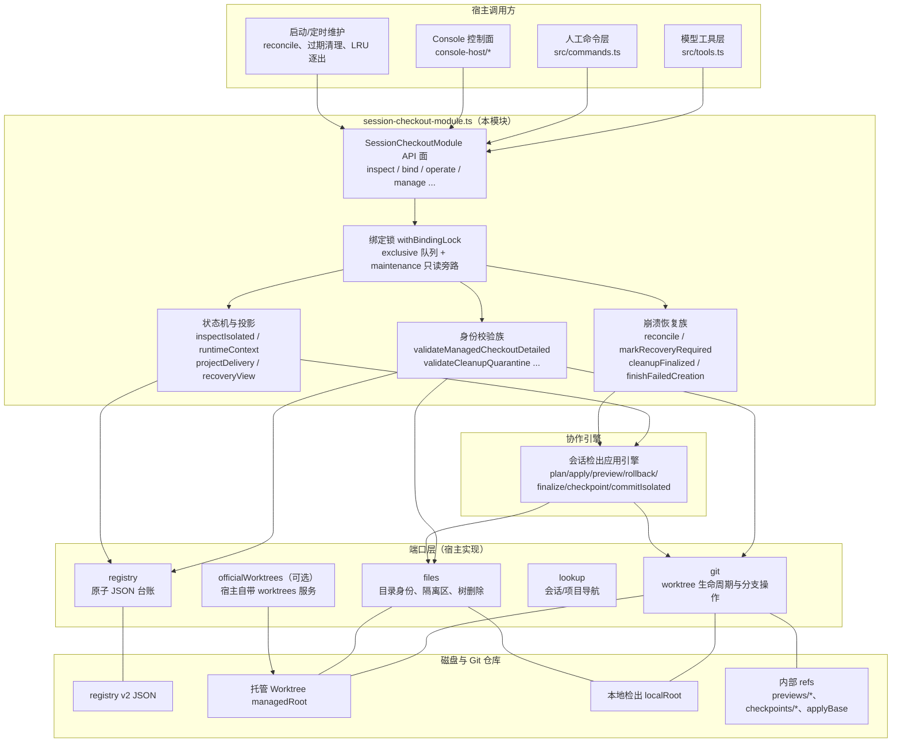
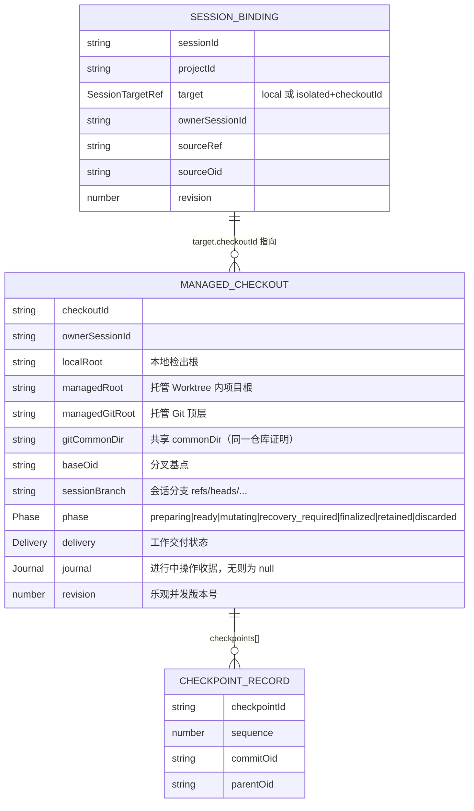
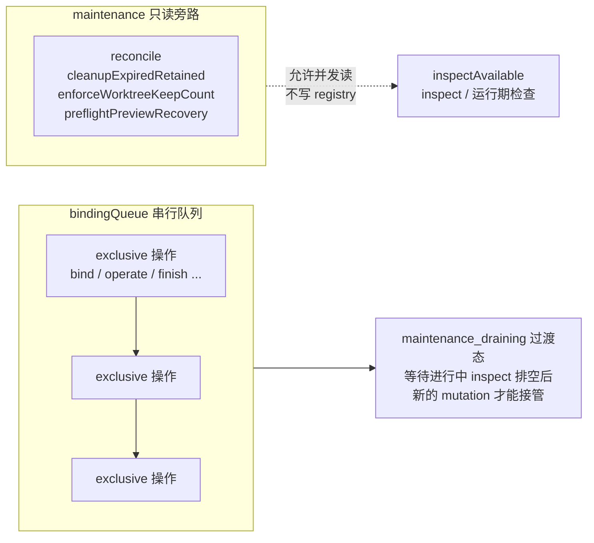
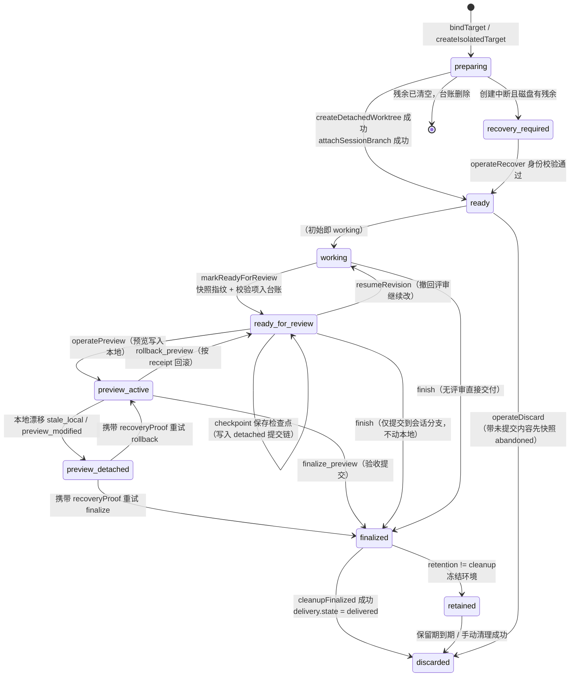
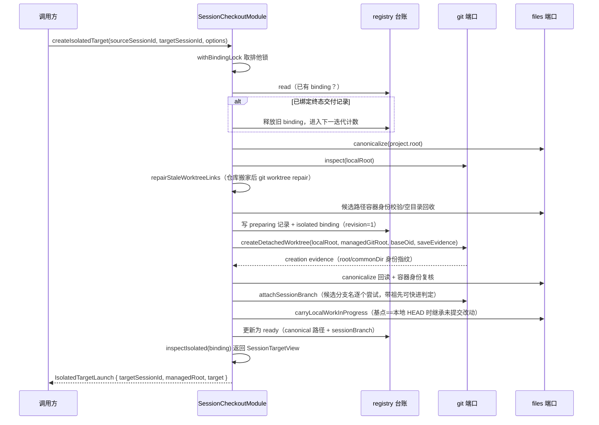
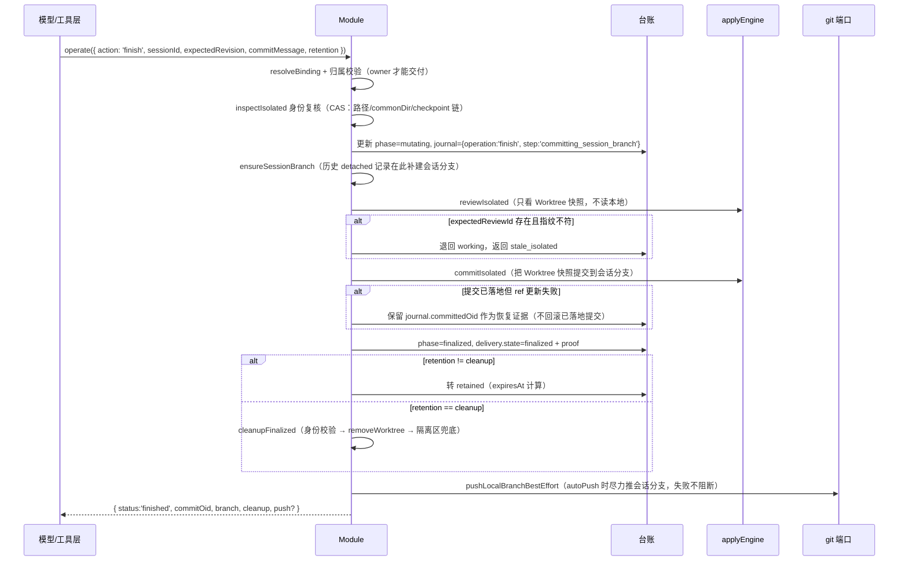
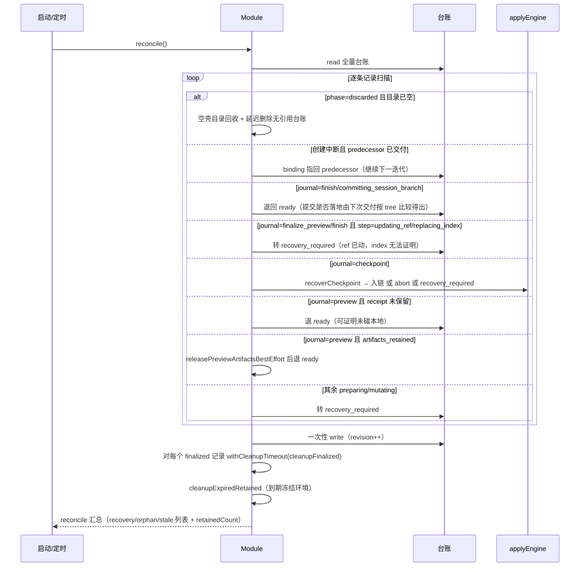

# 会话检出状态机模块（session-checkout-module）

!!! info "Generated documentation"
    This page was written by CodeWiki from the source code at commit [`46e0c382`](https://github.com/wloops/dsh-git-worktree/commit/46e0c382490ad42db423bf5c77b7b61d01910892) on 2026-11-07 with `doubao-seed-2.1-lite`. Check the code before relying on details.

## 简介

`src/session-checkout-module.ts` 是 dsh-git-worktree 插件的**核心编排层**：它导出工厂函数 `createSessionCheckoutModule(dependencies)`，组装出一个完整的 `SessionCheckoutModule`（接口定义见 [组合根、领域端口与国际化（root_6）](root_6.md)）。该模块由 Domi 的 session-checkout 状态机移植而来，负责：

- 把 Session 绑定到「本地检出（local）」或「隔离 Worktree（isolated）」两种工作目标；
- 管理托管 Worktree 的**创建、交付（finish）、评审（review）、预览（preview）、检查点（checkpoint）、清理（cleanup）、回收（discard）、恢复（recover）** 全生命周期；
- 以台账（registry）为唯一权威，用 `phase` + `delivery.state` + `journal` 三元组记录任何可能被中断的写操作，使进程崩溃后可以通过 `reconcile()` 确定性收敛；
- 通过注入端口（lookup / git / files / registry）保持宿主无关，磁盘、Git、宿主会话全部经端口访问。

模块内唯一显式导出的组件除工厂外，只有类型 `ResolvedSessionProject`（`{ session, project }`），其余全部实现为工厂闭包内的私有函数——这意味着该模块没有对外的子模块页面，所有行为都通过 `SessionCheckoutModule` 接口暴露。

---

## 架构总览

**分层要点**：

1. 本模块是唯一同时持有「台账读写 + 端口调用 + 状态机判定」的层；它不直接 spawn Git 子进程，也不直接操作文件系统，全部经端口完成（可测试、可换宿主）。
2. `applyEngine`（见 [session-checkout-apply 应用引擎](src_session-checkout-apply.ts.md)）负责一切「真实改变磁盘或 refs」的原子操作；本模块负责**在调用前后写 journal、比较指纹、判定冲突归属**。
3. 台账 `ManagedCheckoutsRegistry`（`sessionBindings` + `managedCheckouts`）是崩溃恢复的唯一权威来源；磁盘上的 Worktree 目录只是被校验的对象。

---

## 依赖注入（SessionCheckoutDependencies）

工厂接收的依赖结构（类型见 [组合根、领域端口与国际化（root_6）](root_6.md) 的 `ports.ts` 部分）：

| 依赖 | 角色 | 本模块中的典型用法 |
| --- | --- | --- |
| `lookup` | 会话/项目只读导航 | `requireSession` / `resolveSessionProject` / 归属校验 |
| `git` | Git 端口（见 [组合根、领域端口与国际化（root_6）](root_6.md)） | `inspect`、`status`、`createDetachedWorktree`、`attachWorktreeBranch`、`removeWorktree`、`isAncestor`、内部 refs 保留/释放、分支 prune/merge |
| `files` | 文件端口 | `canonicalize`、`inspectDirectoryIdentity`、`quarantineDirectoryTree`、`removeDirectoryTree`、空目录树回收 |
| `registry` | 原子 JSON 台账 | `read` / `write` / `update`（单条记录读-改-写必须走 `update`） |
| `applyEngine` | 应用引擎 | `plan`、`apply`、`preview`、`rollback`、`finalize`、`checkpoint`、`recoverCheckpoint`、`commitIsolated`、`reviewIsolated`、`assessPreviewRecovery`、`preflight`、`inspectReview` |
| `managedCheckoutsRoot` | 状态目录默认容器 | 未配置 `worktreesRoot` 时的托管根 |
| `createCheckoutId()` | 标识生成 | 生成 `checkoutId` / `operationId` / `reviewId` / `previewId` |
| `officialWorktrees?` | 宿主自带 worktrees 服务懒加载 | `createOfficialTarget` 走官方创建路径 |
| `autoPush` / `autoDeliver` | 实时配置（可 `LiveValue`） | finish 后尽力推送；工具层据 `isAutoDeliverEnabled()` 拒绝模型自行交付 |
| `worktreesRoot` | 自定义托管根 | 按 `<worktreesRoot>/<项目>/<主题>-<日期>` 布局落盘 |
| `inheritLocalChanges` | 新建时继承本地未提交改动 | `carryLocalWorkInProgress`（补丁 + 未跟踪文件复制） |
| `worktreeKeepCount` | LRU 保留数量 | `enforceWorktreeKeepCount` 逐出已交付 Worktree |

---

## 核心数据模型

### 两类台账记录

- **SessionBindingRecord**：「这个会话现在面向哪个目标」。`target.kind = 'local'` 表示在本地检出直接工作；`'isolated'` 表示面向某个托管 Worktree。
- **ManagedCheckoutRecord**：托管 Worktree 的权威台账。`localRoot` 永远是用户本地检出边界，`managedRoot` 是隔离环境内的项目根；两者 `commonDir` 相同证明同属一个仓库。
- **revision** 是每个调用方必须回传的乐观锁：任何写操作不匹配 `expectedRevision` 立即返回 `stale_target`。

### 双维度状态：phase × delivery.state

| 维度 | 取值 | 语义 |
| --- | --- | --- |
| `phase`（执行生命周期） | `preparing` / `ready` / `mutating` / `recovery_required` / `finalized` / `retained` / `discarded` | 当前记录是否处于可服务、正在变、需要人工介入 |
| `delivery.state`（交付进度） | `working` / `ready_for_review` / `preview_active` / `preview_detached` / `finalized` / `retained` / `delivered` | 工作成果走到了哪一步 |

两者组合才能表达完整状态，例如 `phase=ready + delivery.state=preview_active` 表示「预览已写入本地、等待用户验收」。

---

## 并发与锁模型

模块内有两套互斥原语，必须区分清楚：

- **`withBindingLock(operation)`**：所有交互性 mutation（bind、operate、finish、manage…）串行化；同一时刻只有一个在飞。
- **`withBindingLock(..., { allowConcurrentInspect: true })`**：维护类操作（启动 `reconcile`、到期清理、LRU 逐出、detached preview 评估）以 maintenance 身份取锁——它们可以与同一时期发起的只读 `inspectDuringMaintenance` 并发，避免「一个 Windows 上被占用的历史 Worktree 卡住所有会话刷新」。
- **`inspectAvailable`**：读路径会根据当前锁状态动态决定——处于 maintenance 时走只读旁路（`persistRecovery=false`，不写台账），处于 draining 时先排空再排队取锁。
- **`cleanupInFlight` 超时表**：`withCleanupTimeout(checkoutId, op)` 给单个 checkout 的清理加上 120 秒收敛超时；同一 checkout 若已有在跑（含已超时仍在后台跑）的清理会复用同一个 Promise，防止两个读-改-写周期在台账上交错丢更新。超时不可取消端口操作（端口无 AbortSignal），后台仍继续跑完并写台账。

---

## 交付状态机

关键语义：

- **现代交付只写会话分支**（`finish` / `commitIsolated`）：Worktree 的工作区、索引、HEAD 与本地完全隔离，本地检出永不被写。只有旧路径 `apply` / `preview` / `finalize_preview`（往本地写 diff）仍存在，但只要记录上已有 `sessionBranch`，`refuseLegacyLocalWrite` 会直接拒绝并提示改用 `worktree_merge` 合并。
- **`retained` 是冻结检查窗口**：默认 `retain_manual`（无到期时间），用户可设 `retain_24h` / `retain_3d`；到期与 LRU 逐出都走同一条 `cleanupFinalized` 安全链。
- **`delivered` 是交付事实**：cleanup 成功后 phase 变 `discarded` 而 delivery 停在 `delivered`；「commit 已在会话分支」优先于「目录还在不在」，所以后续 `committedFollowupView` 不会把已交付会话误判为 recovery_required。

---

## 关键流程

### 1. 创建隔离目标（bindTarget / createIsolatedTarget）

失败路径（`finishFailedCreation`）：只有 `WorktreeCreationFailure(rolledBack=false)` 或磁盘存在残余目录时才进入 `recovery_required`；若残余为空壳，`removeEmptyDirectoryTree` 回收后直接删除台账并把 binding 退回创建前状态，还会在 sibling 容器不可信时自动 `createAttempt+1` 换 fallback 容器重试一次。

### 2. 交付（finish）

### 3. 预览生命周期（preview / rollback / finalize）

- `operatePreview`：先 `applyEngine.plan` 计算 diff，校验 `isolatedFingerprint` 与评审快照一致；写 `journal={operation:'preview', step:'writing_local'}` 后，在 `beforeWrite` 回调里把 4 个 receipt OID（local-working / local-index / preview-working / isolated-snapshot）**保留为内部 refs**，再真正写本地。任何「可证明未碰本地」的错误（`stale_local` / `stale_isolated` / `invalid_plan`）直接退 ready；已写到 `artifacts_retained` 的失败则释放 preview refs 后再退 ready。
- `operateRollbackPreview`：按 receipt 把本地恢复到写入前快照；遇到 `stale_local` / `preview_modified` 时不硬闯，而是 `detachPreviewAfterLocalDrift` 进入 `preview_detached`，把 receipt 证据冻结在台账里等待人工恢复。
- `operateFinalizePreview`：用户验收后把预览快照在本地提交；detached 状态重试必须携带 `WorktreePreviewRecoveryProof`（SHA-256 over 全部 receipt 事实），模块内重新跑 `assessPreviewRecovery` 并比对 `recoveryGeneration`——proof 只是待复核的上下文，不是免验令牌。

### 4. 检查点（checkpoint）

检查点是评审期间保存在 Worktree 内部历史中的线性阶段（不发布到本地）：

- 入参必须带 `requestId`（幂等键）、`expectedReviewId`、`expectedGeneration`（由 [root_2/root_2_host_adapters.md](root_2/root_2_host_adapters.md) 的 `checkpointGenerationForRecord` 对 review 事实做 SHA-256 得出）。
- journal 完整记录 `commitOid / parentOid / checkpointIndexTreeOid / changedFiles`；`beforeCommit` 回调先把内部 ref 保留进仓库，再允许 detached HEAD/index 变更。
- 中途崩溃后由 `reconcile` 调用 `applyEngine.recoverCheckpoint` 决策：`checkpoint_aborted` 清理内部 ref 退 ready；`checkpoint_recovered` 把检查点正式入台账、delivery 退回 working。
- `checkpointHeadInvariantHolds` 在每次 inspect 时校验整条链（sequence 连续、parent 祖先关系、内部 ref 与 commitOid 一致、最后一个检查点是当前 HEAD 祖先）。

### 5. 启动 reconcile（崩溃收敛）

设计取向：**能按 journal 收据证明「没写过」就安全回退；证明不了本地或索引状态的，一律停在 `recovery_required` 等人来，绝不猜**。

### 6. 清理（cleanupFinalized）

清理是数据保护最严格的一条链：

1. **阻塞分类**：`modified_after_finalize`（交付后又有新改动，默认保留）、`identity_changed`（目录身份 device/inode/birthtime 与台账不符）、`detached_residue`、`quarantine_busy`、`directory_busy`（瞬时占用，参与自动重试）。原因优先取结构化字段 `cleanupReason`，旧记录才回退到中英文关键词匹配。
2. **删除前取证**：`removeWorktree` 前先把 `managedDirectoryIdentity`（device/inode/birthtime）写进 journal，作为「移除收据」。
3. **残留隔离兜底**：git 删完若 `managedGitRoot` 仍在（Windows 文件占用常见），走 `validateDetachedCleanupResidue` 复核身份后 `quarantineDirectoryTree` 到 `.dsh-wt-cleanup--<id>--<opId>` 目录，`retryTransientCleanup`（100/300/800ms 三档）后删除。
4. **清理后收尾**：释放 applyBase 与全部内部 refs；空容器（无人引用的 worktreesRoot 子目录）经 `removeEmptyDirectoryTree` 回收；台账置 `discarded + delivered`。
5. **超时保护**：每个 checkout 的清理最多 120 秒前台等待；`permanent` 标记、`retain_manual`、未到期 retained 不参与自动清理。

---

## API 面分组（SessionCheckoutModule 实现要点）

完整接口签名见 [组合根、领域端口与国际化（root_6）](root_6.md)，这里只列实现侧的分组语义：

| 分组 | 方法 | 说明 |
| --- | --- | --- |
| 读取 | `inspect`、`runtimeContext`、`listManagedWorktrees`、`listManagedWorktreesForSession`、`inspectManagedWorktreeCleanup` | `runtimeContext` 直接面向模型输出多段英文指导文本（当前边界、delivery 状态、该调哪个工具）；`inspect` 动态决定是否旁路 maintenance 锁 |
| 目标绑定 | `bind`、`createIsolatedTarget`、`createOfficialTarget`、`adoptOfficialWorktree` | 官方树（`.agents/worktrees/`）由 [组合根、领域端口与国际化（root_6）](root_6.md) 中 `official-worktree-registration.ts` 的函数登记入台账 |
| 演进 | `beginNextIteration`、`resumeRevision` | 已交付清理后在下一轮以「上一轮会话分支 tip」为基点重建 Worktree；迭代链不丢上一轮成果 |
| 评审/交付 | `markReadyForReview`、`operate`、`preflight`、`isAutoDeliverEnabled` | `operate` 是 9 种写操作（apply/finish/preview/checkpoint/rollback_preview/finalize_preview/retry_cleanup/discard/recover）的统一入口，先 `resolveBinding` 再分发 |
| 恢复授权 | `prepareReviewRegeneration`、`preparePreviewRecoveryAnalysis`、`createPreviewRecoveryHandoff` | 把 Host 权威的只读上下文（continuation）先持久化进台账，客户端提示模型前再回来复核 |
| 分支/合并 | `mergeBranchForSession`、`pruneMergedBranchesForSession`、`autoPruneStaleMergedBranches` | 合并来源必须是本会话分支（`git branch -d` 语义、当前分支/主干/活跃会话分支永不删） |
| 放弃快照 | `listAbandonedWorktreeSnapshots`、`restoreAbandonedWorktreeSnapshot` | 带未提交内容放弃前先把内容固化为 `refs/dsh-worktree/abandoned/<checkoutId>` |
| 管理 | `manageManagedWorktree`、`manageManagedWorktreeForSession`、`bulkCleanupManagedWorktrees`、`resolveManagedRoot(s)`、`observeManagedCheckout(s)` | 后台 console 只读观察接口 |
| 维护 | `reconcile`、`cleanupExpiredRetained`、`enforceWorktreeKeepCount` | 启动收敛与配额收口 |

---

## 设计上的关键不变量（排障速查）

1. **路径不是身份**：一切校验以 `device + inode + birthtime`（`DirectoryIdentity`）和 git `commonDir` 为准；canonicalize 后的字符串比较只防 Junction/软链冒充。
2. **revision CAS**：交互操作一律双检（取操作前检一次、`inspectIsolated` 通过后再读台账检一次），防止「Host 锁拿到之前状态已被改」。
3. **可证明未写 = 安全回退**：凡是错误码能证明本地/索引未被触碰的（`stale_local`、`stale_isolated`、`invalid_plan` 等），journal 直接清空退 ready；其余停 `recovery_required`。
4. **已落地提交永不回滚**：`commitIsolated` 失败但 `committedOid` 已存在时，保留证据而非撤销用户历史。
5. **项目验收槽互斥**：同一 `localRoot` 上任何处于 preview/finalize/finish 中段的记录都占用项目验收槽（`findProjectAcceptanceHolder`），其他任务的 apply/preview/merge 一律返回 `project_acceptance_busy`。
6. **模型指导文本与真实边界一致**：`runtimeContext` 用 `pathIsWithin(cwd, managedRoot)` 判定会话是否真站在 Worktree 内；交付已清理后如实告知「边界回到本地」，避免把写守门规则自相矛盾地套在已完成任务上。

---

## 相关模块链接

- 应用引擎（plan/apply/preview/rollback/checkpoint/commitIsolated 的真实磁盘操作）：[session-checkout-apply 应用引擎](src_session-checkout-apply.ts.md)
- 端口、台账、注册、路径与创建登记类型：[组合根、领域端口与国际化（root_6）](root_6.md)（`ports.ts`、`managed-worktree-path.ts`、`official-worktree-registration.ts`、`index.ts`）
- 视图类型、错误码、操作联合类型：[root_7：dsh-git-worktree 插件出口层](root_7.md)（`types.ts`）
- 检查点 CAS 指纹、台账原子注册表：[root_2/root_2_host_adapters.md](root_2/root_2_host_adapters.md)（`checkpoint.ts`、`adapters/registry.ts`）
- 控制台投影判定（`worktreeReachedDelivery`）：[root_4：Worktree 控制台客户端与宿主命令面](root_4.md)（`console-contract.ts`）
- 创建失败异常类型：[Worktree Console 宿主与远程协议层（root_5）](root_5.md)（`creation-failure.ts`）
- 提交信息校验、面向模型的工具封装：[root_4：Worktree 控制台客户端与宿主命令面](root_4.md)（`commit-message.ts`）与 [root_7：dsh-git-worktree 插件出口层](root_7.md)（`tools.ts`）

??? abstract "Documented components (1)"
    - [`ResolvedSessionProject`](https://github.com/wloops/dsh-git-worktree/blob/46e0c382490ad42db423bf5c77b7b61d01910892/src%5Csession-checkout-module.ts) — `src\session-checkout-module.ts`

