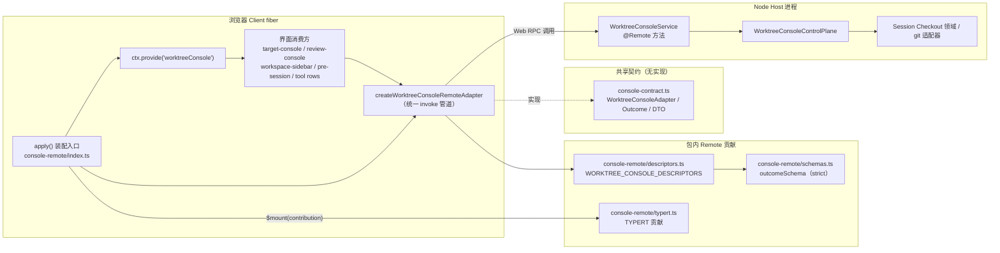
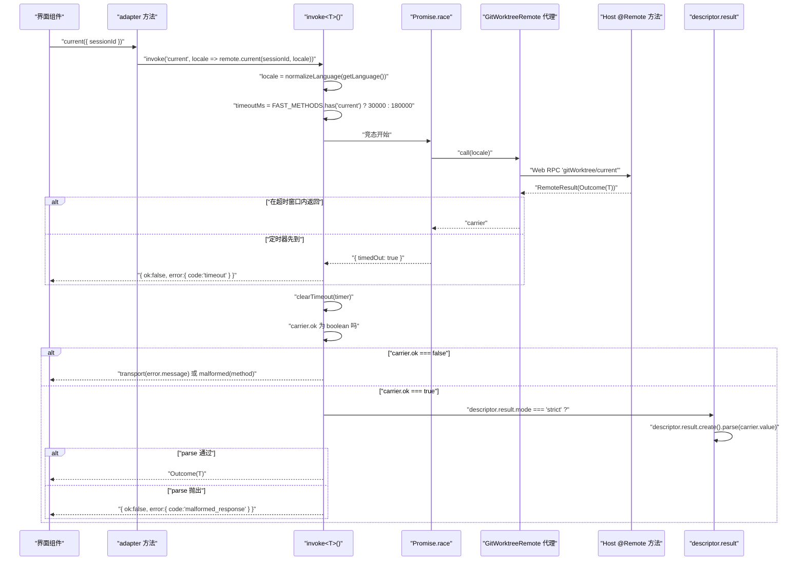
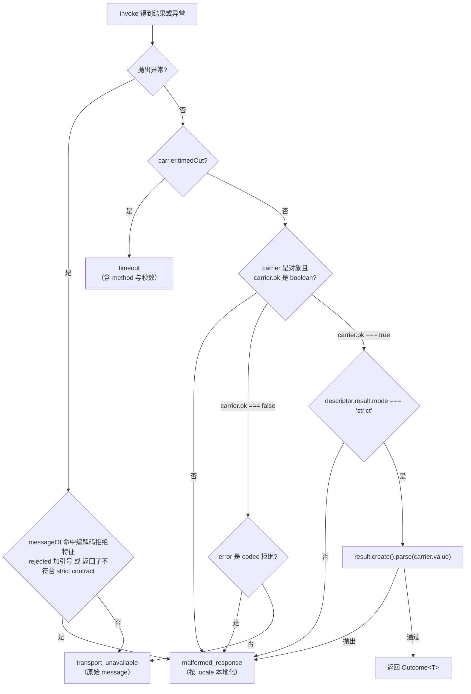
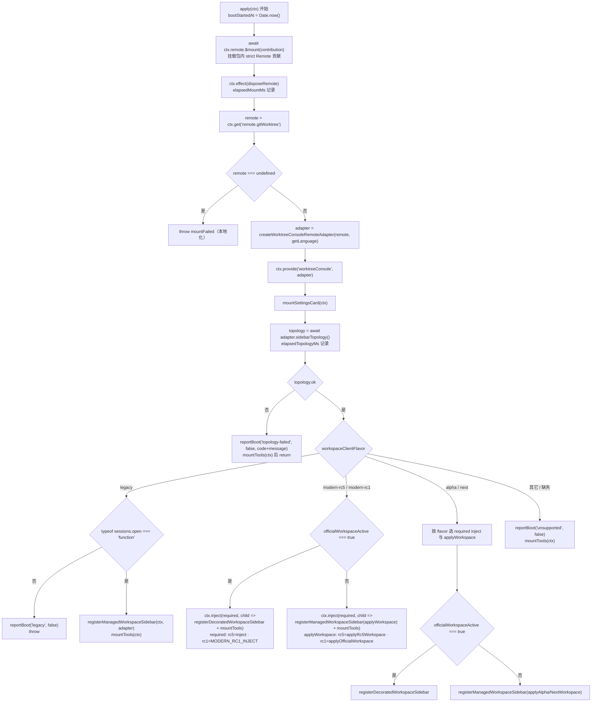
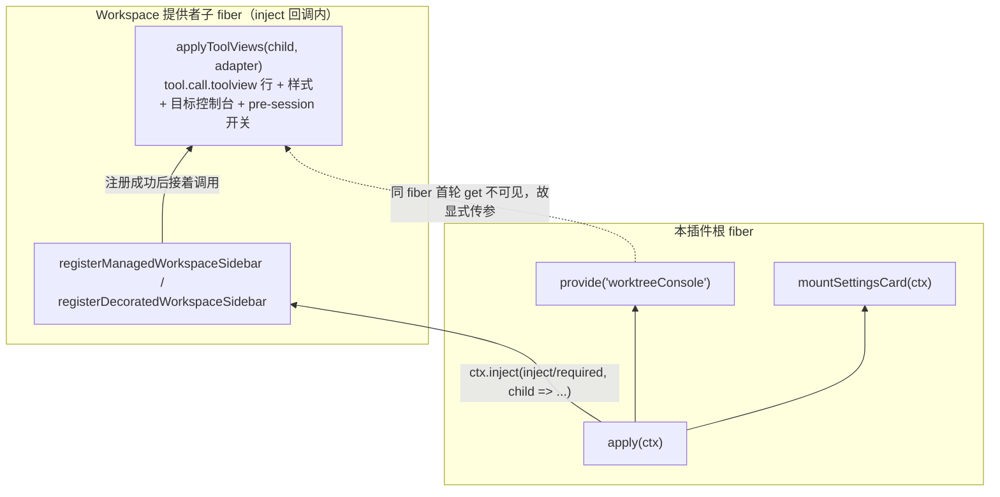
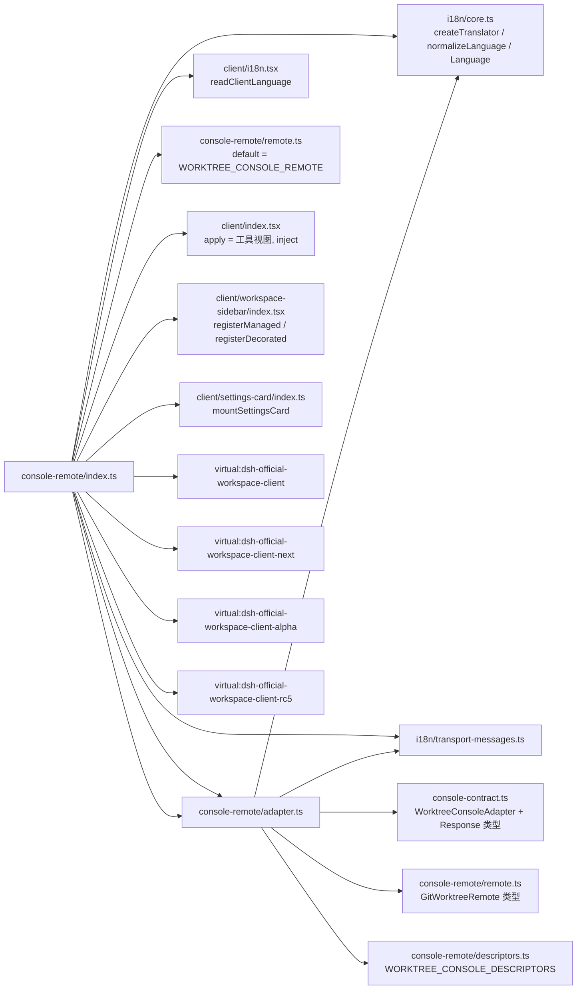

# 客户端控制台 Remote 适配层（client_console_remote）

!!! info "Generated documentation"
    This page was written by CodeWiki from the source code at commit [`55374a27`](https://github.com/wloops/dsh-git-worktree/commit/55374a27f4099ec8dcd0d6163f5544d60b4f3874) on 2026-11-06 with `doubao-seed-2.1-lite`. Check the code before relying on details.

`src/client/console-remote/` 是 **浏览器端的装配入口（boot entry）与 Remote 传输适配层**。它做两件、也只有两件事：

1. **adapter.ts** —— 把 Host 侧通过 Typert RPC 暴露的 `gitWorktree` 方法命名空间，包装成客户端 UI 消费的 `WorktreeConsoleAdapter` 接缝（seam），并在这一层统一负责**超时、错误归一化与严格（strict）payload 校验**。
2. **index.ts** —— 作为整个 `dsh-git-worktree` 浏览器 bundle 的 Cordis `apply()` 入口：挂载 Remote 贡献、把 adapter 作为 `worktreeConsole` 服务提供出去，然后依据 Host 上报的 Workspace 世代（flavor）与接管选举结果，选择 **接管（takeover）** 或 **装饰（decorate）** 方式装配侧栏，并挂载工具视图、设置卡片与目标控制台。

这一层是「协议/Host 世界」与「React 界面世界」之间唯一的桥梁：所有子界面（`target-console`、`review-console`、`workspace-sidebar`、`pre-session`、工具行）都只依赖 `WorktreeConsoleAdapter` 抽象，从不直接接触 RPC 对象。

---

## 1. 在整体系统中的位置

| 层次 | 模块 | 关系 |
| --- | --- | --- |
| 契约 | [Worktree Console 共享契约（`src/console-contract.ts`）](../worktree_console_protocol_and_host_service/worktree_console_contract.md) | 提供 `WorktreeConsoleAdapter` / `WorktreeConsoleOutcome` / 各 Request、Response DTO |
| Host 协议实现 | [Worktree Console Remote 协议层（`src/console-remote/`）](../worktree_console_protocol_and_host_service/worktree_console_remote.md)、[Worktree Console 宿主服务（`src/console-host/`）](../worktree_console_protocol_and_host_service/worktree_console_host.md) | 提供 `GitWorktreeRemote` 类型、`WORKTREE_CONSOLE_DESCRIPTORS`、`WorktreeConsoleService` 服务端 |
| **本模块** | `client_console_remote`（当前页） | 客户端装配入口 + 传输适配器 |
| 界面消费方 | [client_target_console：会话目标控制台（浏览器端）](client_target_console.md)、[client_review_console：受管 Worktree 验收控制台（浏览器端）](client_review_console.md)、[工作区侧边栏（client_workspace_sidebar）](client_workspace_sidebar.md)、[client_pre_session：空白会话「在 Worktree 中开始」开关](client_pre_session.md)、[Worktree 设置卡（client_settings_card）](client_settings_card.md)、[client_core：Worktree 浏览器端入口与会话编排核心](client_core.md) | 通过 `worktreeConsole` 服务或直接传入的 adapter 实例访问 Host |
| 领域层 | [会话检出领域模块（session_checkout_domain）](../core_worktree_domain_and_infrastructure/session_checkout_domain.md) | 由 `WorktreeConsoleControlPlane` 调用，本模块不直接接触 |



---

## 2. 组件清单

| 导出 | 文件 | 职责 |
| --- | --- | --- |
| `createWorktreeConsoleRemoteAdapter(remote, getLanguage?)` | `src/client/console-remote/adapter.ts` | 将 `GitWorktreeRemote` 命名空间代理转换为 `WorktreeConsoleAdapter`（约 40 个方法） |
| `apply(ctx: ConsoleClientContext)` | `src/client/console-remote/index.ts` | 客户端 bundle 入口：挂载 Remote、提供 `worktreeConsole`、按 flavor 分支装配侧栏与工具 |
| `inject` | `src/client/console-remote/index.ts` | 该 fiber 声明依赖的服务名集合（过滤掉会导致死锁的 `remote.directoryPicker`、`remoteAccess`，以及只存在于 0.2.2-rc.1 起的 `contextMenus`）；modern-rc1 分支另用 `MODERN_RC1_INJECT`（= `inject` + `contextMenus`） |
| `ConsoleClientContext`（接口） | `src/client/console-remote/index.ts` | `Context` + `remote: ClientRemote & { gitWorktree: GitWorktreeRemote }` |
| `declare module '@deepseek-ai/cordis'` | `src/client/console-remote/index.ts` | 为 `Context` 增加 `worktreeConsole: WorktreeConsoleAdapter` 类型面 |

内部辅助函数（`adapter.ts`，未导出）：`transport<T>()`、`malformed<T>()`、`messageOf()`、`isCodecRejection()`、`timeoutOutcome<T>()`、以及泛型管道 `invoke<T>()`。

---

## 3. 传输适配器：统一 `invoke` 管道

`createWorktreeConsoleRemoteAdapter` 先把 `WORKTREE_CONSOLE_DESCRIPTORS` 建立成 `method -> descriptor` 的 Map，随后每个 adapter 方法都走同一条私有管道 `invoke<T>(method, call)`：



### 3.1 关键设计决策

- **客户端超时是必需的，而非可选的。** Web RPC 载体本身没有超时：一旦服务端 handler 卡住（binding-lock 队列、挂死的 git 子进程），请求会永远 pending，调用它的 UI 就冻结在 pending 态。因此客户端主动失败；服务端工作继续运行，**且因为领域层使用 CAS + journal，可变调用仍然可以安全重试**（见 [会话检出交付引擎（session_checkout_apply_engine）](../core_worktree_domain_and_infrastructure/session_checkout_domain/session_checkout_apply_engine.md)）。
- **两档超时。** `FAST_TIMEOUT_MS = 30_000`，`SLOW_TIMEOUT_MS = 180_000`。`list` / `preflight` / `preflightCreate` 会做全量重算（记录多时可达 20+ 次 git spawn），可能逼近 30s，因此留在 SLOW 档；`FAST_METHODS` 集合只包含真正快路径的读方法。

| 档位 | 方法 |
| --- | --- |
| FAST（30s） | `sidebarTopology`、`current`、`inspect`、`previewRecoveryPreflight`、`gitOverview`、`gitGraph`、`listAbandoned` |
| SLOW（180s） | 其余全部方法，包含所有写操作（`create`、`preview`、`checkpoint`、`finalize`、`discard`、`git*` 变更等） |

- **三类传输级错误码**（都定义在 [Worktree Console 共享契约（`src/console-contract.ts`）](../worktree_console_protocol_and_host_service/worktree_console_contract.md) 的 `WORKTREE_CONSOLE_ERROR_CODES` 尾部）：



- **strict 结果再校验。** 即使 RPC 层已经做过编解码，适配器仍会用 descriptor 的 `result.create().parse()` 再解析一次。这保证了「旧 Host 返回了新 Client 不认识的 payload」永远表现为一次干净的 `malformed_response`，而不是把 `undefined` 字段泄漏进 React 渲染。配合 `schemas.ts` 里新增能力位使用 `.default(false)` 的策略，纯增量字段不会否决整个响应。
- **参数展开是位置化的。** 每个 adapter 方法把契约里的 Request 对象拆成 Host 方法的位置参数，并且**始终**把 `locale` 作为最后一个参数传入（即使是 `undefined`）：`descriptors.ts` 中每个 descriptor 都自动追加了 `json('locale', optionalLanguageSchema, ..., acceptsUndefined: true)`，而 Remote 代理按位置强制校验参数元数（arity）。
- **语言在调用时解析。** `getLanguage()` 默认 `() => 'zh'`；入口注入的是 `() => readClientLanguage(ctx.get('locale'))`，即每次调用都重新读取宿主 locale 快照，而不是在模块加载时固定（这样宿主切换语言后错误文案立刻跟随）。文案来自 `src/i18n/transport-messages.ts` 的 `malformed` / `mountFailed` / `workspaceGenerationUnknown` / `invokeTimeout` 四条（见 [项目基础与本地化模块概览](../project_foundation_and_localization.md)）。

### 3.2 方法映射表

| Adapter 方法 | Remote 方法名 | 备注 |
| --- | --- | --- |
| `sidebarTopology()` | `sidebarTopology` | 无 agent 参数；返回 flavor 与接管选举结果 |
| `current` / `inspect` / `list` / `preflight` / `reviewDiff` | 同名 | 读路径，携带 `expectedRevision` / `expectedReviewId` CAS 标识 |
| `preflightCreate` / `createWithInitialCommit` / `create` / `initProject` | `preflightCreate` / `createWithInitialCommit` / `create` / `initProject` | 创建路径，`initializeProject` 对应 `initProject` |
| `previewRecoveryPreflight` / `preparePreviewRecoveryAnalysis` / `createPreviewRecoveryHandoff` | 同名 | 携带 `recoveryProof`（Host 颁发的一次性恢复凭据） |
| `preview` / `checkpoint` / `resumeRevision` / `prepareReviewRegeneration` / `rollbackPreview` / `discard` / `finalize` / `finalizePreview` / `setRetention` / `setPermanent` / `retryCleanup` / `beginNextIteration` / `returnToLocal` / `clearSidebarBadge` | 同名 | 写路径 |
| `gitOverview` / `gitGraph` / `gitCreateBranch` / `gitSwitchBranch` / `gitPruneMergedBranches` / `gitListTags` / `gitCreateTag` / `gitDeleteTag` / `gitPushTag` | 同名 | 分支总览 / 图 / tag 管理 |
| `listAbandoned` / `restoreAbandoned` | 同名 | 已放弃快照的列出与恢复 |

`resumeRevision` 是映射中唯一带分支的一条：`request.conflictContinuation` 存在时传入该 continuation，否则显式传 `undefined`，以保持位置元数一致。

---

## 4. 装配入口 `apply()`

`apply(ctx)` 是 `tsdown` 打包出的 `lib/client.js` 的导出面（`package.json` 的 `exports["./client"]` 指向它），由宿主 Cordis Plugin Loader 在 web boot 中执行。



### 4.1 `inject` 声明：三处必须过滤的服务

```typescript
export const inject = [...new Set([
  ...officialWorkspaceInject.filter(service =>
    service !== 'remote.directoryPicker' && service !== 'remoteAccess' && service !== 'contextMenus'),
  'slots',
  'configForms',
])]
// contextMenus 只存在于 0.2.2-rc.1 及之后：入口若静态声明，0.2.1 宿主会永远等待
// 一个该世代从不提供的服务；因此只在 modern-rc1 分支的子 fiber 上追加。
const MODERN_RC1_INJECT = [...inject, 'contextMenus']
```

| 服务名 | 处理 | 原因 |
| --- | --- | --- |
| `remote.directoryPicker` | 静态声明中**移除**，运行时通过 `officialContextProxy` / `deferredRemoteDirectoryPicker` 懒解析 | 现代（0.2.x）官方 Browser 的 picker provider 自身等待 `uiWorkspace`；本入口要提供 `uiWorkspace`，静态声明会形成环形等待，直接把 web boot 卡死 |
| `remoteAccess` | 静态声明中**移除**，由代理在 `ctx.get('remoteAccess')` 时回退成 `{ source: () => ({}) }` 桩 | 桌面 profile 通过 junction 加载刚构建的产物；0.2.0-rc.2 宿主没有该服务，静态声明会让整个 web boot 永久 pending（"waiting for service: remoteAccess" → "14 entries did not activate"） |
| `contextMenus` | 入口 `inject` 中**移除**，仅 modern-rc1 分支经 `MODERN_RC1_INJECT` 在其自身子 fiber 追加 | 该服务只存在于 0.2.2-rc.1 及之后；入口静态声明会让 0.2.1 宿主永远等待一个它从不提供的服务。rc.1 分片经此服务注册内置 Session 动作并渲染额外行 |
| `slots`、`configForms` | **显式追加** | cordis 只允许读取本 fiber 已声明的名字；不声明则 `ctx.get('slots')` 恒为 `undefined`，Plugins 页设置卡片静默不挂载。代价是宿主早于设置栈版本时整条客户端会等待这两个名字——因为宿主生态里所有 slot 消费者都以同样方式声明，这个取舍被接受 |

### 4.2 flavor × 接管选举 → 装配模式

`sidebarTopology` 的响应里带有两个由 Host 计算出的字段（详见 [Worktree Console 宿主服务（`src/console-host/`）](../worktree_console_protocol_and_host_service/worktree_console_host.md)）：`workspaceClientFlavor`（服务端按宿主包版本钉定的世代）与 `officialWorkspaceActive`（`workspace-provider-lifecycle` 选举结果，见 [工作区提供者生命周期与会话目标上下文](../core_worktree_domain_and_infrastructure/session_checkout_domain/session_checkout_runtime/workspace_provider_lifecycle.md)）。

| flavor | `officialWorkspaceActive` | 采用的注册函数 | 使用的官方 Workspace apply | 说明 |
| --- | --- | --- | --- | --- |
| `legacy` | — | `registerManagedWorkspaceSidebar` | 未显式传入，走默认 `applyOfficialWorkspace` | 前提是先校验 `sessions.open()` 可用，否则 `reportBoot('legacy', false, 'sessions.open() unavailable')` 并抛错 |
| `modern-rc5` / `modern-rc1` | `true` | `registerDecoratedWorkspaceSidebar` | 不重放（官方保持存活） | 只装饰运行中的注册，重放会重复 provide `uiWorkspace` 而崩溃；子 fiber `required`：rc5 = `inject`，rc1 = `MODERN_RC1_INJECT`（= `inject` + `contextMenus`） |
| `modern-rc5` | `false`/缺失 | `registerManagedWorkspaceSidebar` | `applyRc5Workspace`（`virtual:dsh-official-workspace-client-rc5`） | 接管：内联 rc.5 派生 apply 并替换其 Browser 组件 |
| `modern-rc1` | `false`/缺失 | `registerManagedWorkspaceSidebar` | `applyOfficialWorkspace`（`virtual:dsh-official-workspace-client`） | 接管：内联 rc.1 派生 apply；单一装饰无法跨 rc 代，因按构建期钉定的官方 Client 编译 |
| `alpha` | `true` | `registerDecoratedWorkspaceSidebar` | 不重放 | 同 modern 装饰路径 |
| `alpha` | `false`/缺失 | `registerManagedWorkspaceSidebar` | `applyAlphaWorkspace` | |
| `next` | `true` | `registerDecoratedWorkspaceSidebar` | 不重放 | |
| `next` | `false`/缺失 | `registerManagedWorkspaceSidebar` | `applyNextWorkspace` | |
| 其它 | — | 无侧栏 | — | `reportBoot('unsupported', false)`，只挂工具 |

选择依据是 **Host 解析出的包版本，而不是 Client 服务的启动时序**：三代官方 Browser 都声明同一个顶层 Slot `sidebar.workspaces`，但 `shortcuts` 在 alpha 中不存在、在 rc.2 中又启动很晚，按时序判定会不稳定。

### 4.3 子 fiber 与工具视图



会话相关的视图（工具行、目标控制台、pre-session 开关）被刻意放到 **其 UI Workspace 提供者的子 fiber** 里，且在侧栏注册成功后才接着挂载：兄弟 fiber 无法安全假设导航服务（`uiWorkspace`）已经存在，而 `uiConversation` → `uiWorkspace` 的 boot 依赖边必须由 Workspace 服务来断开。注意 `adapter` 是**显式作为参数**传给 `applyToolViews` 的：同一 fiber 内 `provide` 的服务要等 provider effect 落定才能被 `ctx.get` 看见，直接依赖读取会在首轮为 `undefined`（`client/index.tsx` 的 `apply` 因此接受 `adapterOverride`）。

### 4.4 拓扑失败时的降级

`sidebarTopology` 读不出来（最常见原因是 registry 损坏）时**不允许整条挂载失败**——那会让工具视图和控制台一起消失，而用户恰恰需要它们去修复 registry。因此该分支只上报 `topology-failed` 诊断、在根 fiber 上挂工具并 `return`，侧栏不装配。

### 4.5 启动诊断 `clientBootReport`

每个分支在做出决定前都会调用 `reportBoot(branch, registered, detail?)`，把面包屑写回 Host：

```typescript
void remote.clientBootReport({
  flavor: topology.ok ? String(topology.value.workspaceClientFlavor ?? 'missing') : 'unknown',
  branch, registered, ...(detail === undefined ? {} : { detail }),
  elapsedMountMs, elapsedTopologyMs,
}, undefined)
```

- 尾部的 `undefined` 是 **locale 位置参数**，必须显式传递（Remote 代理按位置校验元数）。
- 整个调用是 best-effort：`.then/.catch` 只打 `console.info` / `console.error`，外层再包 `try/catch`，**诊断永远不能打断 boot 路径**。
- `registered: false` 携带 `detail: 'decorate-pending' | 'inject-pending'`，用于区分「决定走了装饰分支但 inject 回调尚未执行」与「回调执行成功/抛错」。
- Host 侧 `WorktreeConsoleService.clientBootReport` 把它作为一行 ndjson 写入诊断文件（带 size 轮转），与 `kind: 'host'` / `kind: 'current'` 记录并列，从而能回答「客户端到底走了哪条分支、慢在哪一步」。
- `reportBoot` 的定义出现在 `topology` / `elapsedTopologyMs` 声明之前，但它只在两者被赋值之后才被调用，因此闭包捕获是安全的。

---

## 5. 跨模块依赖



被引用的类型/服务面：

- `RemoteResult`（`@deepseek-ai/dsh-typert-protocol`）—— RPC 外层信封，`carrier.ok` 判定的是这一层，与业务 `Outcome.ok` 是两回事。
- `Context`（`@deepseek-ai/cordis`）、`ClientRemote`（`@deepseek-ai/dsh-api-gateway/client`）—— 宿主 DI 与 Remote 挂载面。
- 四个 `virtual:dsh-official-workspace-client*` 模块（official / next / alpha / rc5）由 `tsdown.config.ts` 中的插件在构建期从官方包源码派生，并在版本 + SHA-256 双门禁下才允许内联（`scripts/check-workspace-sidebar-version.mjs`，由 `pnpm check:sidebar-version` / `prepublishOnly` 执行）。

---

## 6. 数据流：一次用户操作的完整往返

```mermaid
flowchart LR
  UIE["用户点击 Finalize"] --> REQ["构造 WorktreeConsoleFinalizeRequest<br/>sessionId / checkoutId / expectedRevision /<br/>expectedReviewId / commitMessage / retention"]
  REQ --> MAP["adapter.finalize<br/>展开成位置参数 + locale"]
  MAP --> TMO["Promise.race<br/>SLOW 180s"]
  TMO --> RPC["remote.finalize(...)"]
  RPC --> SVC["WorktreeConsoleService.finalize<br/>agent 解析 + withHostLanguage"]
  SVC --> PL["WorktreeConsoleControlPlane.finalize"]
  PL --> DOM["SessionCheckoutApplyEngine<br/>CAS + journal + git"]
  DOM --> OUT["WorktreeConsoleOutcome&lt;WorktreeConsoleMutationResponse&gt;"]
  OUT --> VAL["descriptor.result.create().parse"]
  VAL -->|通过| SUM["target: WorktreeConsoleTargetSummary"]
  VAL -->|失败| ERR1["malformed_response"]
  TMO -->|超时| ERR2["timeout"]
  RPC -->|连接失败| ERR3["transport_unavailable"]
  SUM --> EV["requestWorktreeReviewRefresh<br/>WORKTREE_REVIEW_REFRESH_EVENT"]
  ERR1 --> UX["按 worktreeConsoleErrorMeta 呈现<br/>category / recovery / retryable"]
  ERR2 --> UX
  ERR3 --> UX
  EV --> POLL["Poll(current) 立即 invalidate<br/>顶部胶囊刷新"]
```



上层界面用 `worktreeConsoleErrorMeta(code)` 得到 `category` / `recovery` / `retryable`，再决定是提示「刷新」「确认脏改动」「打开恢复面板」还是静默重试；本层只负责保证 **任何失败都带上一个契约内合法的错误码**，从不让异常逃出到 React 树。

---

## 7. 使用本层的界面模块

| 消费点 | 使用方式 | 详情 |
| --- | --- | --- |
| 顶部状态胶囊 / 控制台视图 | `adapter.current`（`Poll` 5s 轮询 + `visibilitychange`）、`list`、`inspect` | [client_target_console：会话目标控制台（浏览器端）](client_target_console.md) |
| 评审面板 | `reviewDiff`、`preflight`、`preview`、`checkpoint`、`finalize`、`previewRecoveryPreflight`、恢复凭据系列 | [client_review_console：受管 Worktree 验收控制台（浏览器端）](client_review_console.md) |
| Workspace 侧栏 | `sidebarTopology`、`clearSidebarBadge` | [工作区侧边栏（client_workspace_sidebar）](client_workspace_sidebar.md) |
| 空白会话开关 | `preflightCreate`、`createWithInitialCommit`、`create`、`initProject` | [client_pre_session：空白会话「在 Worktree 中开始」开关](client_pre_session.md) |
| 工具行 | `inspect` / `returnToLocal` 等 | [client_core：Worktree 浏览器端入口与会话编排核心](client_core.md) |
| 设置卡片 | 不走 adapter，直接读宿主 `configForms` / `slots` | [Worktree 设置卡（client_settings_card）](client_settings_card.md) |

---

## 8. 构建与打包约束

- `tsdown.config.ts` 的入口就是本模块：`entry: { client: 'src/client/console-remote/index.ts' }`，`format: 'cjs'`、`platform: 'neutral'`、`target: 'es2022'`，并用 `window.__ModuleLoader__.load({ id: 'dsh-git-worktree', ... })` 包裹输出，因此本模块的 `apply` / `inject` 是宿主 ModuleLoader 看到的唯一面。
- `external` 保留 `react`、`@deepseek-ai/cordis`、`@deepseek-ai/dsh-client-store`、`@deepseek-ai/dsh-client-ui-primitives`（宿主提供），而 `zod`、`lucide-react` 被 `noExternal` 打进 bundle —— 这正是 strict codec 能在浏览器侧独立再校验的原因。
- `package.json` 的 `exports["./client"]` 运行时指向 `./lib/client.js`，类型指向 `./lib/client/console-remote/index.d.ts`；`exports["./typert"]` 与 `exports["./remote"]` 暴露同一批 descriptor 给 Host 侧，保证两端的 strict 契约同源。
- 单测通过 `vitest.config.ts` 把四个 `virtual:dsh-*` 模块 alias 成 mock，因此本模块的分支逻辑（flavor × 接管选举）可以在 jsdom 里被完整驱动，而无需真实宿主。

---

## 9. 维护须知

1. **新增一个 RPC 方法要改四处且必须完全一致**：`console-contract.ts` 的 `WorktreeConsoleAdapter` 声明、`console-remote/schemas.ts` 的 strict schema、`console-remote/descriptors.ts` 的 descriptor（以及 `remote.ts` 的 `TypertRemoteMap` 类型面），最后才是本模块 `adapter.ts` 的映射行。任一遗漏都会在 strict 校验下表现为 `malformed_response`，而不是编译错误——descriptor 与 adapter 之间没有静态对应关系。
2. **不要把可变方法放进 `FAST_METHODS`。** 30s 档只给无 git 重算的读路径；写路径必须留在 180s，否则慢盘/大仓库下的正常执行会被误判为超时，用户看到「可重试」而实际写操作已经完成。
3. **绝不在本层引入 React 或 DOM 依赖。** 入口只做装配与错误归一化，界面状态一律留在子模块。
4. **`ctx.get()` 而不是属性访问。** cordis 在未声明服务上属性读取会抛 "cannot get property without inject"，`ctx.get()` 才是 fail-soft 读法；新增服务读取请沿用该模式（与 `mountSettingsCard`、`readClientLanguage` 一致）。
5. **任何 boot 关键路径的诊断必须是 best-effort。** `clientBootReport` 的调用已被 `void` + `then/catch` + `try/catch` 三层包裹，新增上报请保持同样形状。
6. **调整 `inject` 声明前务必确认死锁面。** 历史两次桌面崩溃都源于把 `remote.directoryPicker` / `remoteAccess` 静态声明进来（参见 `cordis.patch.yml` 顶部说明：接管选举已改由 Host 侧生命周期驱动，不再依赖 client 侧表达式求值）。

??? abstract "Documented components (3)"
    - [`createWorktreeConsoleRemoteAdapter`](https://github.com/wloops/dsh-git-worktree/blob/55374a27f4099ec8dcd0d6163f5544d60b4f3874/src%5Cclient%5Cconsole-remote%5Cadapter.ts) — `src\client\console-remote\adapter.ts`
    - [`ConsoleClientContext`](https://github.com/wloops/dsh-git-worktree/blob/55374a27f4099ec8dcd0d6163f5544d60b4f3874/src%5Cclient%5Cconsole-remote%5Cindex.ts) — `src\client\console-remote\index.ts`
    - [`Context`](https://github.com/wloops/dsh-git-worktree/blob/55374a27f4099ec8dcd0d6163f5544d60b4f3874/src%5Cclient%5Cconsole-remote%5Cindex.ts) — `src\client\console-remote\index.ts`

