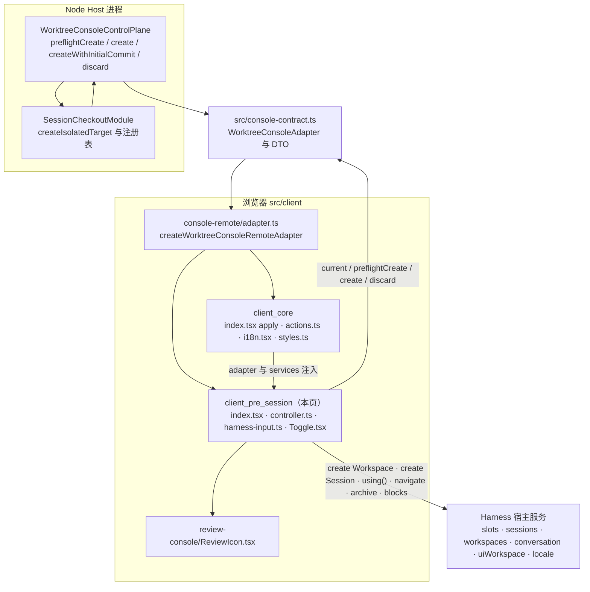
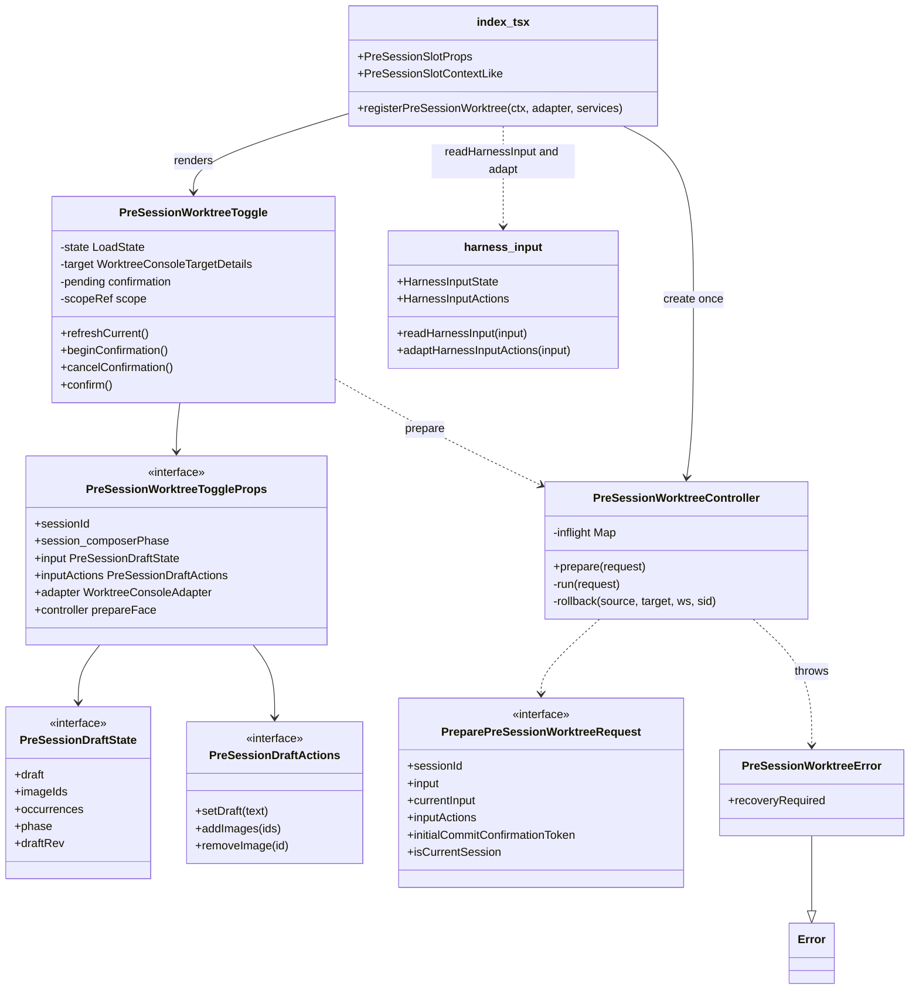
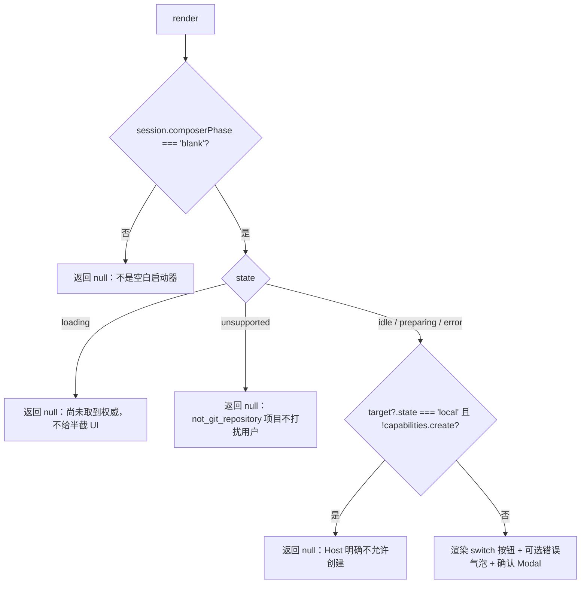
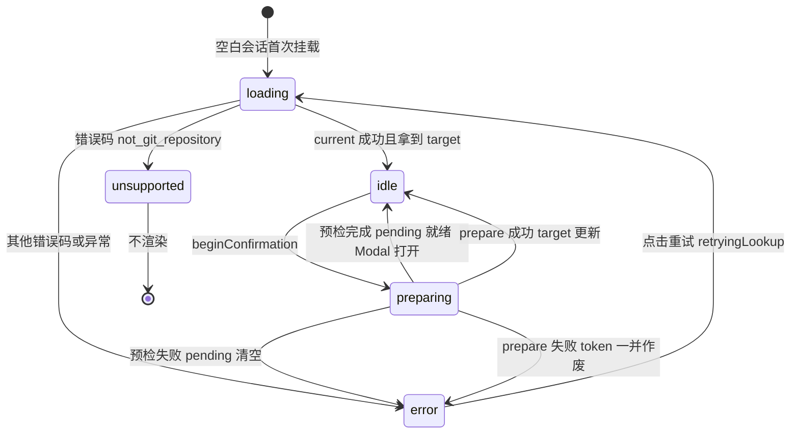
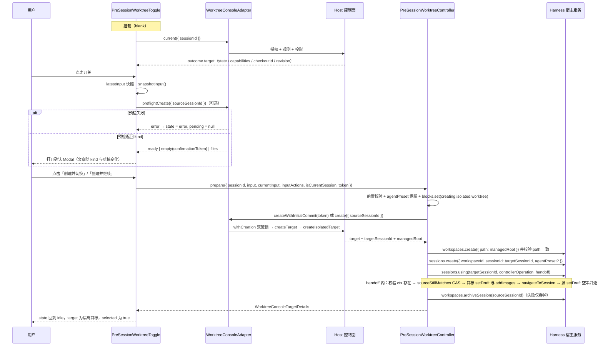
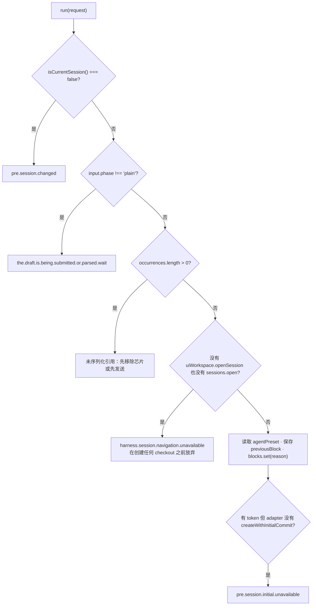
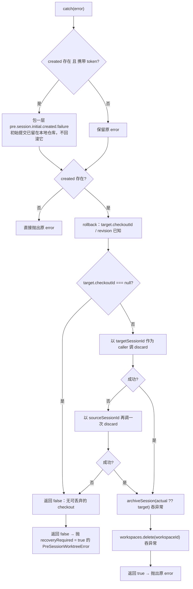
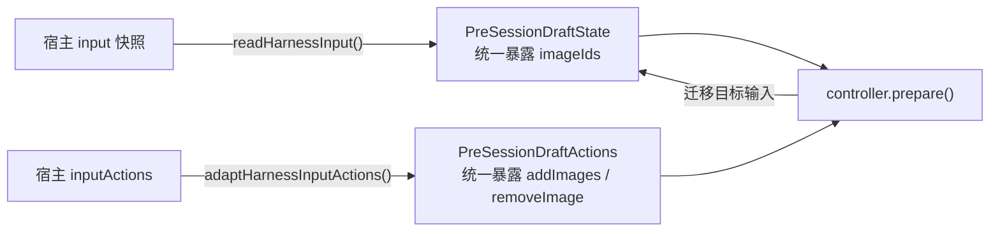

# client_pre_session：空白会话「在 Worktree 中开始」开关

!!! info "Generated documentation"
    This page was written by CodeWiki from the source code at commit [`8206c2a1`](https://github.com/wloops/dsh-git-worktree/commit/8206c2a19ed446899a5910eda03f5c0685bc27c2) on 2026-11-06 with `doubao-seed-2.1-lite`. Check the code before relying on details.

`src/client/pre-session/` 是浏览器端**唯一一个「会话创建之前」就能开隔离工作目录**的入口。它把一枚开关挂进 Harness 公共 composer 工具行（`conversation.input.left` 槽位），让用户在一个全新、空白的 Local 会话里输入需求后直接勾选「Worktree」，由插件把**草稿文本 + 附件**整体迁移到一个新的隔离 Session，并让原来的空白会话退化为一个已被归档的启动器。

本模块的四条硬性设计约定：

1. **永不发送 prompt**。控制器只搬运草稿，不调用 `prompt()` / `command()` / 任何提交路径；切换后由常驻 composer 的原生发送按钮完成提交。
2. **作用域失效优先于异步返回**。会话切换（`sessionId` / `adapter` / `blank` 任一变化）时**在 render 阶段立即**把旧 scope 标记为 `alive = false`，任何晚到的 continuation 都不允许导航或清空「新会话」的草稿。
3. **确认之后到清空源之前是一段无 await 的原子区**。一旦把附件写入目标 Session，就绝不能回滚出「目标已持有、源仍引用同一批浏览器字节」的双重所有权。
4. **任何失败都要么自动回滚干净，要么显式声明需要人工恢复**（`PreSessionWorktreeError.recoveryRequired`）。

> 本模块只覆盖 `src/client/pre-session/`。宿主服务装配、`WorktreeConsoleAdapter` 的取得方式、导航与 `conversation.blocks` 等服务契约见 [client_core：Worktree 浏览器端入口与会话编排核心](client_core.md)；传输适配见 [客户端控制台 Remote 适配层（client_console_remote）](client_console_remote.md)；`ReviewIcon` 与状态色体系见 [client_review_console：受管 Worktree 验收控制台（浏览器端）](client_review_console.md) 与 `src/client/styles.ts`。Host 侧的创建族（互斥锁、一次性确认令牌）见 [Worktree Console 控制面（`src/console-host/control-plane.ts`）](../worktree_console_protocol_and_host_service/worktree_console_host/worktree_console_host_control_plane.md)。

---

## 1. 在界面层中的位置



| 依赖方向 | 具体接缝 | 说明 |
| --- | --- | --- |
| 消费 | `WorktreeConsoleAdapter` | 本模块只用到 5 个方法：必需的 `current`、`create`、`discard`，以及随 Host 版本可选的 `preflightCreate`、`createWithInitialCommit` |
| 消费 | `PreSessionWorktreeServices` | 定义在 `src/client/actions.ts`，见 [client_core：Worktree 浏览器端入口与会话编排核心](client_core.md) §7；比通用 `WorktreeClientServices` 多了 `workspaces.archiveSession` / `workspaces.delete` 与 `conversation.blocks` |
| 消费 | `navigateToSession()` | `uiWorkspace.openSession` → `sessions.open` → 抛「会话导航不可用」 |
| 消费 | `useClientTranslator()` / `translatorForServices()` | UI 层用 hook，控制器命令式报错用 services 解析，语言只在调用时确定 |
| 消费 | `ReviewIcon` | `confirm` / `refresh` / `create` 三枚图标，来自 [client_review_console：受管 Worktree 验收控制台（浏览器端）](client_review_console.md) |
| 被消费 | `registerPreSessionWorktree()` | 由 `src/client/index.tsx` 的 `apply()` 在 adapter 存在时调用，见 [client_core：Worktree 浏览器端入口与会话编排核心](client_core.md) §3 |

---

## 2. 组件构成



| 文件 | 职责 | 对外暴露 |
| --- | --- | --- |
| `src/client/pre-session/index.tsx` | 槽位注册、会话阶段推导、组件适配 | `registerPreSessionWorktree()`、`PreSessionSlotProps`、`PreSessionSlotContextLike`，并转出控制器与开关 |
| `src/client/pre-session/PreSessionWorktreeToggle.tsx` | 开关 UI、scope 失效守卫、预检与确认流、错误气泡 | `PreSessionWorktreeToggle`、`PreSessionWorktreeToggleProps` |
| `src/client/pre-session/controller.ts` | 创建 → 注册 → 交接 → 源清场 → 失败回滚的编排 | `PreSessionWorktreeController`、`createPreSessionWorktreeController()`、`PreSessionWorktreeError`、两个契约接口 |
| `src/client/pre-session/harness-input.ts` | Harness 图片 API 改名前后的兼容读写面 | `HarnessInputState`、`HarnessInputActions`、`readHarnessInput()`、`adaptHarnessInputActions()` |

---

## 3. 注册与可见性推导（`index.tsx`）

`rc.1` 版本的 `conversation.input.left` 槽位不会把 owner 快照作为 props 传入，因此本模块改为**接收标准 hook**，在组件内部自选切片：

```typescript
const Entry = ({ sessionId, useSession, useConversation, useInput, inputActions }: PreSessionSlotProps) => {
  const sessionPhase = useSession(session => (!session.blank && !session.awaitingFirstTurn) || session.running
    ? 'active' : session.promptAttempted ? 'engaging' : 'blank')
  const hasActiveTarget = useConversation(conversation => conversation.activeTargets.size > 0)
  ...
  session={{ composerPhase: hasActiveTarget ? 'active' : sessionPhase }}
}
```

两条判定各自修补一个真实漏洞：

- `awaitingFirstTurn`：一个「已经写好但还没发出第一轮」的会话仍然看起来是空的，但它已经不是启动器，不能再来一次目录交接。
- `activeTargets.size > 0`：只要 Conversation 里存在活动目标，就说明这是既有会话，开关必须消失。

注册描述符固定为 `{ name: 'conversation.input.left', id: 'worktree-pre-session', order: 40 }`，`order: 40` 让这枚开关落在工具行的稳定位置；`controller` 在 `registerPreSessionWorktree()` 里**只创建一次**，因此单飞表在整个 DSH Client 实例内共享。

### 3.1 开关自身的渲染闸门

`PreSessionWorktreeToggle` 的短路顺序即「可见性合同」：



按钮可用性的布尔式（`disabled`）同样有讲究：

| 变量 | 表达式 | 含义 |
| --- | --- | --- |
| `selected` | `target !== null && target.state !== 'local'` | 本会话已经在工作树里，开关显示为「已选中」且不可再点 |
| `canCreate` | `target?.state === 'local' && target.capabilities.create` | 唯一真正的可点路径 |
| `retryingLookup` | `state === 'error' && target === null` | 权威读取失败、连 target 都没有 → 按钮变成「重试读取」 |
| `disabled` | `busy \|\| selected \|\| (!canCreate && !retryingLookup) \|\| input.phase !== 'plain'` | 草稿正在提交/解析时禁止开新目录 |

无障碍语义：按钮是 `role="switch"` + `aria-checked={selected}`，错误提示块带 `role="alert"` 且通过 `aria-describedby` 与开关关联，`id` 里带 `sessionId` 以避免多实例串号。

---

## 4. 开关状态机



状态迁移的三个约束：

- **`scope.busy` 是所有异步入口的互斥位**。`refreshCurrent` / `beginConfirmation` / `confirm` 三者共享同一个 `busy` 标志，且都在 `finally` 中释放，杜绝「点击两次 → 两份 pending」。
- **每次进入新 scope 都重置**。`useEffect` 依赖 `scope` 对象本身；scope 因 render 期失效判定而换新对象时，effect 先 `alive = false`（旧的清理），新 scope 立即 `alive = true`、清空 `target` 与 `pending`，并在 `blank` 时重新 `refreshCurrent()`。
- **`unsupported` 与 `loading` 都不渲染**，因此 `not_git_repository` 的项目里这枚开关完全隐形——初始化 Git 仓库由 [client_target_console：会话目标控制台（浏览器端）](client_target_console.md) 的预检面板负责，不在此处打扰。

### 4.1 scope 失效守卫（最微妙的一段）

```typescript
const scopeRef = useRef({ sessionId, adapter, blank, alive: true, busy: false })
if (scopeRef.current.sessionId !== sessionId || scopeRef.current.adapter !== adapter || scopeRef.current.blank !== blank) {
  scopeRef.current.alive = false
  scopeRef.current = { sessionId, adapter, blank, alive: true, busy: false }
}
const scope = scopeRef.current
const isCurrent = () => scope.alive && scopeRef.current === scope
```

放在 **render 阶段**而不是 effect cleanup，是因为 cleanup 只在提交后才跑：用户切换会话后，前一个会话的 `await` 结果可能先落地。`isCurrent()` 同时校验「活着」与「仍是同一个 scope 对象」，因此：

- `refreshCurrent()` 晚到 → 不 `setTarget`，避免用旧会话的权威覆盖新会话；
- `beginConfirmation()` 晚到 → 不 `setPending`，Modal 不会在别的会话上弹开；
- `controller.prepare()` 的 `isCurrentSession` 回调 → 在交接前和写目标前各查一次，**旧 continuation 永远不会导航、也永远不会清空新会话的草稿**。

---

## 5. 一次完整交互：预检 → 确认 → 交接



### 5.1 预检三种 `kind` 的 UI 分支

`WorktreeConsoleCreatePreflightResponse` 与 Host 的 `InitialCommitPreflight`（见 [会话检出领域契约（session_checkout_domain_contracts）](../core_worktree_domain_and_infrastructure/session_checkout_domain/session_checkout_domain_contracts.md)）同构：

| `kind` | Modal 标题 | 主按钮 | 交互含义 |
| --- | --- | --- | --- |
| `ready` | `start.in.a.worktree`（在 Worktree 中开始？） | `create.and.switch`（创建并切换） | 正常路径；描述由 `confirmationDescription()` 按草稿/附件组合生成 |
| `empty` | `pre.session.initial.title`（需要创建初始版本） | `pre.session.initial.confirm`（创建并继续） | 空仓库：Host 会先建一个**空的初始提交**；携带一次性 `confirmationToken`，正文额外追加一段 `pre-session-note` |
| `files` | `start.in.a.worktree` | **无主按钮**（只有取消） | 有未跟踪/未提交文件，不会被带入隔离目录；提示先提交或改用本地目录 |

`adapter.preflightCreate` 缺席（旧 Host）时直接退化为 `kind = 'ready'`，不携带 token。`files` 分支之所以禁用主按钮，是因为 `confirm()` 里有显式守卫 `pending.kind === 'files'` 直接返回。

### 5.2 确认文案的四种组合

`confirmationDescription(input, t)` 只依据 `draft.trim()` 与 `imageIds.length` 两个事实：

| 有文本 | 有附件 | 词条 | 中文渲染 |
| --- | --- | --- | --- |
| ✓ | ✓ | `the.current.input.and.will.move.to.the` (p0=附件计数) | 当前输入内容和 {n} 个附件将移动到新的 Worktree 会话。 |
| ✗ | ✓ | `will.move.to.the.new.worktree.session` (p0=附件计数) | {n} 个附件将移动到新的 Worktree 会话。 |
| ✓ | ✗ | `the.current.input.will.move.to.the.new` | 当前输入内容将移动到新的 Worktree 会话。 |
| ✗ | ✗ | `a.new.worktree.session.will.be.created.the` | 将创建新的 Worktree 会话；当前 Local 会话不会收到消息。 |

附件计数复用 `1.attachment` / `attachments` 两个词条，保证单复数在中英文都自然。所有 `kind !== 'files'` 的 Modal 底部都会追加一条 `the.local.session.will.not.receive.this.message`，明确告知「切换后请用原生发送按钮」。

---

## 6. 控制器 `prepare()`：单飞、前置校验与原子交接

### 6.1 单飞与错误类型

`inflight: Map<sessionId, Promise>` 使同一源会话的并发 `prepare` 复用同一次尝试；`finally` 里用**身份比较**（`get(...) === attempt`）删除条目，避免被后到的重试误删。

`PreSessionWorktreeError` 携带 `recoveryRequired`，这是给上层（未来 UI 或日志）唯一的机器可读信号：只有「Worktree 已持久化但自动回滚失败」这一种情况为 `true`，此时消息以 `the.worktree.was.persisted.but.automatic.rollback.failed` 起头，提示从 Worktree Console 打开 owner Session 继续恢复。

### 6.2 前置校验链



`E1`–`E5` 都被 `finally` 中的 `blocks.set(request.sessionId, previousBlock)` 保护——阻塞块**一定会被还原**，绝不会把源会话永久卡在「正在创建隔离 Worktree…」。

两个值得单独说明的决策：

- **`occurrences` 非空即拒绝**。引用芯片尚未序列化时搬运草稿会产生「文本在、引用丢」的残缺输入；控制器宁可直接失败也不做部分迁移（`snapshotInput` 会复制 `occurrences` 数组，但只用于长度比较）。
- **导航能力在创建之前检查**。没有 UI 能承载目标时，创建出来的 checkout 只会变成一个孤立的受管目录，回滚成本远高于提前放弃。

### 6.3 Agent 预设保留

空白会话可以带一个显式选定的 agent preset。控制器从 `sessions.list` 快照的 `byId[sessionId].projectionValues.agentPreset` 读取；**存在且是字符串才透传**，否则整字段省略，让 Host 用自己的默认值——避免把「未选择」误写成「选择了默认」。

### 6.4 三次身份对齐

| 步骤 | 校验 | 失败词条 |
| --- | --- | --- |
| `workspaces.create({ path: created.managedRoot })` | `workspace.path === created.managedRoot` | `harness.registered.the.managed.root.at.a.different` |
| `sessions.create({ workspaceId, sessionId: created.targetSessionId, agentPreset? })` | `actualSessionId === created.targetSessionId` | `harness.created.unexpected.session.expected.2` |
| `handoff(binding)` | `binding?.ctx !== undefined`（能拿到目标输入面） | `the.target.session.was.created.but.harness.has` |

`using()` 与 `binding()` 的分工：新版 Session Controller 会先「编目」目标 Session 身份，需要通过 `sessions.using(targetSessionId, { source: 'controllerOperation' }, ...)` 持有一个正式引用，直到导航把 `mainView` 所有权接过去；旧版没有 `using`，直接取 `binding()`。

### 6.5 CAS 与「无 await 原子区」

```typescript
if (!sourceStillMatches(request)) throw new PreSessionWorktreeError(t("the.local.draft.or.attachments.changed.after.confirmation"))
targetInput.setDraft(request.input.draft)
if (!targetInput.addImages(request.input.imageIds)) throw new PreSessionWorktreeError(t("the.target.session.is.temporarily.refusing.draft.attachments"))
navigateToSession(this.services, targetSessionId)
request.inputActions.setDraft('')
for (const imageId of request.input.imageIds) request.inputActions.removeImage(imageId)
```

`sourceStillMatches()` 是比较函数，逐项核对：`isCurrentSession()`、`phase === 'plain'`、`draft` 文本全等、`imageIds` 逐项全等（`sameStrings`）、`occurrences` 长度一致，以及 `draftRev`（若源提供单调修订号则必须相等）。这是「确认时刻」与「写入时刻」之间的最后一道防线：用户如果在 Modal 打开后改了输入，迁移会被取消，而不是覆盖更新后的输入。

CAS 通过后到清空源为止**没有任何 `await`**。原因写在源码注释里：目标 Session 若已经接受了图片字节，而交接中途失败，就会「释放浏览器仍被源引用的字节」——双重所有权比失败更糟。`adaptHarnessInputActions` 在这里同样关键：目标输入面可能是 class 实例，因此适配时用箭头函数**透传原接收者**（`text => input.setDraft(text)`），不能解构后裸调。

### 6.6 源会话的退役

`workspaces.archiveSession(request.sessionId)` 放在最后且 `catch {}` 吞掉异常：归档失败**绝不回滚**已经安全的交接。理由很直接——源此刻已不再拥有任何草稿/附件状态，目标才是这个任务唯一的可写会话；如果不归档，Harness 的「新建会话复用」机制可能把一个并发任务路由回这个已被占用的源。

---

## 7. 失败路径与自动回滚



回滚的三个设计点：

1. **两次 `discard` 的 caller 顺序是 `targetSessionId` → `sourceSessionId`**。目标 Session 是 owner，源 Session 是 source；Host 控制面接受其中任一身份，但 owner 优先能命中更直接的授权路径。两次都带 `expectedRevision: target.revision` 与 `confirmDirty: false`——**刚创建的隔离目录若有未提交内容，宁可回滚失败也不能静默丢弃**，这符合 Host 的 dirty 确认闸门。
2. **归档无条件尝试**。`create` 响应可能在 Host 已发布 Session 之后才在传输中丢失；「没有 binding」不能证明「没有 Session」，所以丢弃成功后总要试一次幂等的 `archiveSession`。
3. **Workspace 删除失败时保持可见**。`workspaces.delete` 抛错被吞掉，留下一个用户能看见的陈旧 Workspace——隐藏一个可能仍有内容的目录，比多一个可见条目更危险。

初始提交失败的特殊处理：Host 已经执行了 `initializeEmptyRepository`，这是**真实且不可撤销的本地变更**。控制器不尝试删除该提交，只把原始错误包进 `pre.session.initial.created.failure`，明确告知「初始提交已创建并保留在本地仓库，但独立会话准备失败」。

一次性 token 的作废规则同样重要：`confirm()` 的 `catch` 里**无论失败发生在 Host 还是仅发生在客户端交接**，都会 `setPending(null)`——token 是一次性的（Host 侧 300 s TTL、500 条上限，见 [Worktree Console 控制面（`src/console-host/control-plane.ts`）](../worktree_console_protocol_and_host_service/worktree_console_host/worktree_console_host_control_plane.md) §8），客户端必须假定它已经消费。重试会走 `beginConfirmation()` 重新预检取新 token。

---

## 8. Harness 输入 API 兼容层（`harness-input.ts`）

Harness 在引入「通用附件」时把图片专用的 composer API 改了名。本模块用一组联合类型 + 两个纯函数把差异收在一处：



| 导出 | 处理 |
| --- | --- |
| `HarnessInputState` | `PreSessionDraftState` 与 `attachmentIds` 变体的联合 |
| `HarnessInputActions` | `{addImages, removeImage}` 与 `{addAttachments, removeAttachment}` 的联合 |
| `readHarnessInput()` | `'attachmentIds' in input ? input.attachmentIds : input.imageIds`，浅拷贝后归一；其余字段原样保留 |
| `adaptHarnessInputActions()` | 命中 `addAttachments` 时构造转发对象（箭头函数保留 `this` 接收者）；否则**原对象返回**，零开销 |

这个兼容层的存在使得 `client_core` 的 `PreSessionInput`（`src/client/actions.ts` 中同名联合）与本模块的 `PreSessionDraftActions` 可以各自演化：前者服务于「手工草稿预填」，后者服务于「会话前交接」。

---

## 9. Host 契约依赖

| 方法 | 必需性 | 用途 | 失败时的 UI 表现 |
| --- | --- | --- | --- |
| `current({ sessionId })` | 必需 | 取得 `WorktreeConsoleTargetDetails`：`state`、`capabilities.create`、`checkoutId`、`revision` | `not_git_repository` → `unsupported`（不渲染）；其他 → `error` + 重试按钮 |
| `preflightCreate({ sourceSessionId })` | 可选 | 判定 `ready` / `empty` / `files`，必要时取一次性 token | 抛错 → `state = error`，`pending = null` |
| `create({ sourceSessionId })` | 必需 | 正常创建隔离目标 | `!ok` → `code: message` 形式抛出，交由控制器回滚 |
| `createWithInitialCommit({ sourceSessionId, confirmationToken })` | 可选 | 空仓库路径 | 缺失能力 → `pre.session.initial.unavailable`（不消费 token 之外的资源） |
| `discard({ sessionId, checkoutId, expectedRevision, confirmDirty })` | 必需 | 回滚已持久化的 checkout | 两次 caller 都失败 → `recoveryRequired = true` |

`WorktreeConsoleTargetDetails` 本模块只读四个字段（`state`、`capabilities`、`checkoutId`、`revision`），其余投影细节见 [Worktree Console 共享契约（`src/console-contract.ts`）](../worktree_console_protocol_and_host_service/worktree_console_contract.md)；`state === 'local'` 与隔离态的区分是开关选中态的唯一依据。

---

## 10. 样式与本地化

| 类名 | 归属 | 说明 |
| --- | --- | --- |
| `.dsh-wt-pre-session` | 外层 `<span>`，带 `data-state={state}` | `position: relative`，为错误气泡提供定位锚 |
| `.dsh-wt-pre-session-toggle` | 开关按钮 | 外观对齐 Harness `PermissionSelect` 工具行触发器（28px 高、24px 圆角、透明底），但保留 `role="switch"` 语义；`aria-checked="true"` 时提升到 primary 色 |
| `.dsh-wt-pre-session-check` | 14×14 勾选框 | 选中时内嵌 `ReviewIcon name="confirm"` |
| `.dsh-wt-pre-session-error` | 错误气泡 | 绝对定位在开关**上方**（`bottom: calc(100% + 7px)`），`z-index: 20`，宽度 `min(360px, 75vw)`，内置重试按钮 |
| `.dsh-wt-pre-session-note` | Modal 内的补充说明 | 用于 `empty` 分支的描述与「Local 不会收到这条消息」 |
| `.dsh-wt-create-dialog` | 传给 `Modal` 的 className | 与 `client_core` 中 `.dsh-wt-pre-session .dsh-wt-button, .dsh-wt-create-dialog .dsh-wt-button` 一起把按钮统一为 34px 高、图标 16px |

样式全部来自单张作用域表 `WORKTREE_STYLES`（`src/client/styles.ts`），由入口 `apply()` 注入 `<head>` 并打上 `data-plugin` 三重标记；本模块**不携带自己的样式文件**。词条目录定义在 `src/i18n/client-messages.ts`，语言解析见 [src_i18n 国际化与消息目录模块](../project_foundation_and_localization/src_i18n.md)；本模块用到的关键词条包括 `worktree`、`start.in.a.worktree`、`create.and.switch`、`creating`、`retry`、`cancel`、`close`、`pre.session.*`、以及 §6 列出的全部错误语。

---

## 11. 构建与测试要点

| 关注点 | 事实 | 出处 |
| --- | --- | --- |
| 客户端 bundle 入口 | `./client` 导出指向 `lib/client.js`（由 `src/client/console-remote/index.ts` 打包而来），本模块通过它被间接加载 | `package.json` 的 `exports` 字段 |
| 宿主注入面 | `dsh.client.inject` 声明了 `@deepseek-ai/dsh-api-session-controller`（`SessionSnapshot` 类型）、`@deepseek-ai/dsh-client-ui-conversation`、`@deepseek-ai/dsh-client-ui-primitives`（`Modal`）等 | `package.json` 的 `dsh.client` |
| 平台标记 | `dsh.client.platform: "web"`——本模块只能在浏览器纤程运行，不进入 Host 侧 | `package.json` |
| UI 原语替身 | 测试里 `@deepseek-ai/dsh-client-ui-primitives` 被 alias 到 `tests/support/ui-primitives.tsx`，因此 `Modal` 在无 DOM 宿主时也可断言 | `vitest.config.ts` 的 `resolve.alias` |
| Store hook 类型 | `SnapshotSelectorHook` 来自 `@deepseek-ai/dsh-client-store`，与 `useSyncExternalStore` 契约一致 | `src/client/pre-session/index.tsx` 的 import |
| 类型检查 | `pnpm typecheck`（`tsc --noEmit`）覆盖本模块的严格空值与联合收窄；`pnpm test`（`vitest run`）跑 `tests/**/*.test.{ts,tsx}` | `package.json` scripts |
| Windows 并发 | `fileParallelism: process.platform !== 'win32'`：重 Git fixture 在 Windows 上会争用进程/文件句柄，间接影响依赖真实仓库的 pre-session 冒烟 | `vitest.config.ts` 注释 |

---

## 12. 不变量清单

| # | 不变量 | 保障机制 |
| --- | --- | --- |
| 1 | 本模块从不提交 prompt | 控制器只调用 `setDraft` / `addImages`；`binding.session.prompt` 在本模块完全没有被引用 |
| 2 | 旧 continuation 不得影响新会话 | render 期 scope 失效 + `isCurrent()` 双重条件 + 每次异步返回前检查 |
| 3 | 同一源会话不并发准备 | `inflight` 单飞表 + `scope.busy` 互斥位 |
| 4 | 源输入变化后不迁移 | `sourceStillMatches()` CAS（文本、附件、引用数、`draftRev`、`phase`、会话身份） |
| 5 | 目标写入与源清空之间无 await | `handoff()` 同步闭包；所有可能失败的检查都排在其之前 |
| 6 | 阻塞块必然还原 | `finally { blocks.set(sessionId, previousBlock) }` |
| 7 | 一次性 token 不因失败复用 | `catch` 中一律 `setPending(null)` |
| 8 | 有未提交内容时不静默丢弃 | 回滚调用 `discard` 固定 `confirmDirty: false` |
| 9 | 回滚失败必须显式声明 | `PreSessionWorktreeError(message, true)` → `recoveryRequired` |
| 10 | 非 Git 项目零打扰 | `unsupported` 状态返回 `null` |

---

## 13. 相关模块

- 界面层总览（本模块的父页）：[worktree_client_interface_layer：Worktree 浏览器端客户端界面层总览](../worktree_client_interface_layer.md)
- 宿主装配与服务契约：[client_core：Worktree 浏览器端入口与会话编排核心](client_core.md)（`apply()`、`PreSessionWorktreeServices`、`navigateToSession`、`i18n`、`styles`）
- adapter 的来源与超时/错误归一化：[客户端控制台 Remote 适配层（client_console_remote）](client_console_remote.md)
- 切换后可用性的权威面板与初始化 Git 仓库：[client_target_console：会话目标控制台（浏览器端）](client_target_console.md)
- 交接后目标会话里的验收与交付：[client_review_console：受管 Worktree 验收控制台（浏览器端）](client_review_console.md)
- 目标 Session 在侧栏的呈现：[工作区侧边栏（client_workspace_sidebar）](client_workspace_sidebar.md)
- Host 侧创建族（互斥锁、确认令牌 TTL、`withCreation`）：[Worktree Console 控制面（`src/console-host/control-plane.ts`）](../worktree_console_protocol_and_host_service/worktree_console_host/worktree_console_host_control_plane.md)
- 隔离目标的领域状态机与类型：[会话检出领域契约（session_checkout_domain_contracts）](../core_worktree_domain_and_infrastructure/session_checkout_domain/session_checkout_domain_contracts.md)
- 词条目录与语言类型：[src_i18n 国际化与消息目录模块](../project_foundation_and_localization/src_i18n.md)

??? abstract "Documented components (9)"
    - [`PreSessionWorktreeToggleProps`](https://github.com/wloops/dsh-git-worktree/blob/8206c2a19ed446899a5910eda03f5c0685bc27c2/src%5Cclient%5Cpre-session%5CPreSessionWorktreeToggle.tsx) — `src\client\pre-session\PreSessionWorktreeToggle.tsx`
    - [`PreSessionDraftActions`](https://github.com/wloops/dsh-git-worktree/blob/8206c2a19ed446899a5910eda03f5c0685bc27c2/src%5Cclient%5Cpre-session%5Ccontroller.ts) — `src\client\pre-session\controller.ts`
    - [`PreSessionDraftState`](https://github.com/wloops/dsh-git-worktree/blob/8206c2a19ed446899a5910eda03f5c0685bc27c2/src%5Cclient%5Cpre-session%5Ccontroller.ts) — `src\client\pre-session\controller.ts`
    - [`PreSessionWorktreeController`](https://github.com/wloops/dsh-git-worktree/blob/8206c2a19ed446899a5910eda03f5c0685bc27c2/src%5Cclient%5Cpre-session%5Ccontroller.ts) — `src\client\pre-session\controller.ts`
    - [`PreSessionWorktreeError`](https://github.com/wloops/dsh-git-worktree/blob/8206c2a19ed446899a5910eda03f5c0685bc27c2/src%5Cclient%5Cpre-session%5Ccontroller.ts) — `src\client\pre-session\controller.ts`
    - [`PreparePreSessionWorktreeRequest`](https://github.com/wloops/dsh-git-worktree/blob/8206c2a19ed446899a5910eda03f5c0685bc27c2/src%5Cclient%5Cpre-session%5Ccontroller.ts) — `src\client\pre-session\controller.ts`
    - [`HarnessInputActions`](https://github.com/wloops/dsh-git-worktree/blob/8206c2a19ed446899a5910eda03f5c0685bc27c2/src%5Cclient%5Cpre-session%5Charness-input.ts) — `src\client\pre-session\harness-input.ts`
    - [`PreSessionSlotContextLike`](https://github.com/wloops/dsh-git-worktree/blob/8206c2a19ed446899a5910eda03f5c0685bc27c2/src%5Cclient%5Cpre-session%5Cindex.tsx) — `src\client\pre-session\index.tsx`
    - [`PreSessionSlotProps`](https://github.com/wloops/dsh-git-worktree/blob/8206c2a19ed446899a5910eda03f5c0685bc27c2/src%5Cclient%5Cpre-session%5Cindex.tsx) — `src\client\pre-session\index.tsx`

