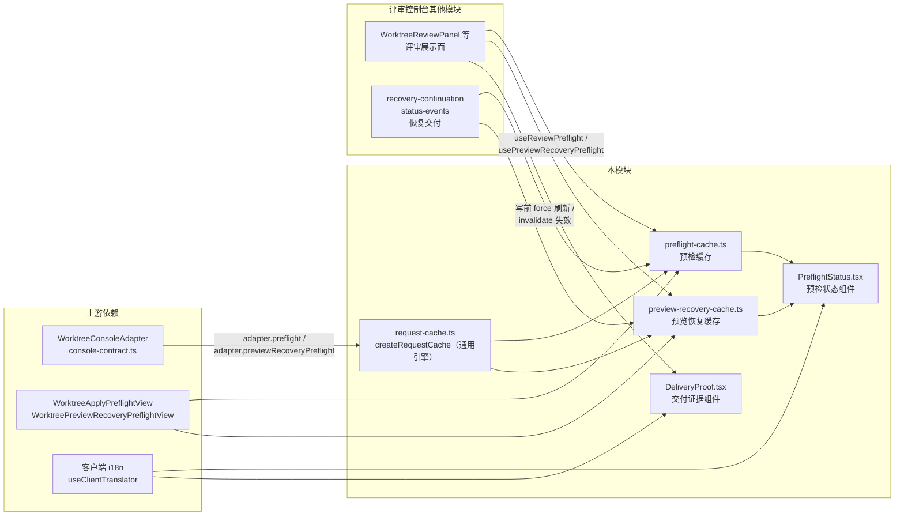
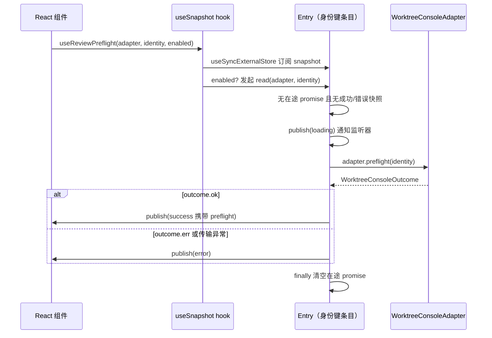
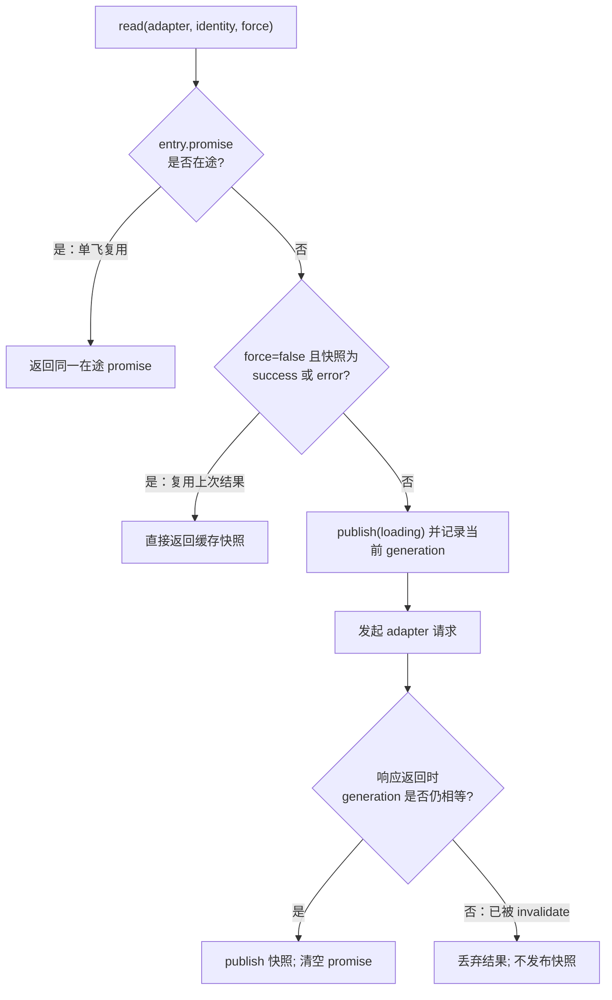
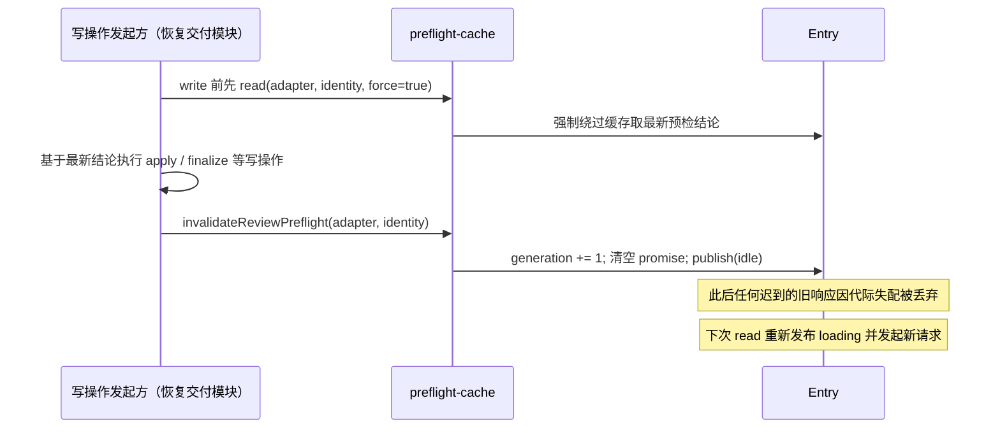

# 评审控制台读缓存与只读展示

!!! info "Generated documentation"
    This page was written by CodeWiki from the source code at commit [`55374a27`](https://github.com/wloops/dsh-git-worktree/commit/55374a27f4099ec8dcd0d6163f5544d60b4f3874) on 2026-11-06 with `doubao-seed-2.1-lite`. Check the code before relying on details.

本模块是评审控制台（review-console）的**只读数据底座**：它为"合并前预检（preflight）"与"预览恢复预检（preview-recovery preflight）"两类只读控制台请求提供统一的、按身份键控（identity-keyed）的单飞缓存（single-flight cache），并把缓存快照渲染为 `PreflightStatus` 与 `DeliveryProof` 两个纯展示组件。

## 1. 模块定位

在 [评审控制台](../client_review_console.md) 的整体划分中，本模块承担"读"的一侧：

- **写操作**（apply / finalize / rollback / 恢复冲突等）由 [评审操作与恢复交付](client_review_console_recovery_delivery.md) 模块负责，但写操作**之前必须强制刷新**这些读缓存，以保证读到的预检结论不是过期数据。
- **写后的交互面**（`WorktreeReviewPanel`、`ReviewDetailsModal` 等）由 [评审展示面](client_review_console_review_surfaces.md) 负责，它们通过 `useReviewPreflight` 等 hook 订阅本模块发布的快照。

## 2. 核心组件

### 2.1 `request-cache.ts`：通用请求缓存引擎

这是整个模块（也是所有身份键控控制台读请求）背后唯一的缓存形状，代码注释中称之为 "ponytail"。

**导出类型**

| 名称 | 说明 |
| --- | --- |
| `RequestSnapshot<TPreflight>` | 缓存发布给 React 的四态快照：`idle`（未发起）、`loading`（请求在途）、`success`（携带 `preflight` 视图）、`error`（携带 `WorktreeConsoleError`）。 |
| `Entry<TPreflight>` | 单个身份键的内部条目：当前 `snapshot`、React 监听器集合 `listeners`、在途 `promise`、代际计数器 `generation`。 |
| `RequestCache<TIdentity, TPreflight>` | 缓存公共接口：`read` / `invalidate` / `useSnapshot`。 |
| `createRequestCache(options)` | 工厂函数。`options.key` 由身份对象派生稳定字符串；`options.request` 包装一次 `WorktreeConsoleAdapter` 调用（返回 `WorktreeConsoleOutcome<{ preflight }>`）。 |

**关键设计决策**

- **按适配器隔离**：条目存放于 `WeakMap<WorktreeConsoleAdapter, Map<string, Entry>>`。客户端重新挂载（adapter 更换）后，新 adapter 绝不可能读到旧 adapter 留下的数据。
- **单飞（single-flight）**：若 `entry.promise` 已在途，并发的 `read` 调用直接复用同一 promise，而不是重复发请求。
- **结果复用 + `force` 强制刷新**：未带 `force` 时，上次成功或失败的快照会被直接复用；`force = true`（或写操作前）才绕过缓存重新请求，并先发布 `loading`。
- **代际防过期（generation）**：每次 `read` 捕获当前 `generation`；响应落地时仅当代际未变才发布快照并清空在途 promise。这样在请求进行中执行 `invalidate`（代际 +1、清空 promise、发布 `idle`）后，迟到的旧响应不会把过期快照重新写回，也不会抹掉更新的 promise。
- **React 订阅**：`useSnapshot` 通过 `useSyncExternalStore` 把外部 store 桥接为 React 状态；在 `enabled` 时自动发起首次 `read`，并返回一个 `refresh`（即 `force` 读）供组件手动刷新。
- **传输兜底**：adapter 抛异常（网络层不可用）时，被归一化为 `{ code: 'transport_unavailable', message }` 的 error 快照，而不是让未捕获的 promise 拒绝冒泡。

### 2.2 `preflight-cache.ts`：合并预检缓存

- 导出 `PreflightSnapshot = RequestSnapshot<WorktreeApplyPreflightView>`。
- 身份键由 `sessionId \u0000 checkoutId \u0000 expectedRevision \u0000 expectedReviewId` 拼接，保证"同一评审修订版本"共享一个条目。
- 包装的 adapter 调用是 `adapter.preflight(identity)`（对应控制台协议的预检请求）。
- 对外暴露三个绑定好的函数：
  - `readReviewPreflight` — 共享只读请求；注释明确"写操作之前必须用 `force` 绕过缓存"。
  - `invalidateReviewPreflight` — 使某一身份的结果作废；在途读仍只会发布到已作废的条目上。
  - `useReviewPreflight` — 供 React 组件订阅快照。

### 2.3 `preview-recovery-cache.ts`：预览恢复预检缓存

- 导出 `PreviewRecoverySnapshot = RequestSnapshot<WorktreePreviewRecoveryPreflightView>`。
- 结构与预检缓存完全对称，区别仅在于身份键多拼接一个 `expectedPreviewId`，以及包装的 adapter 调用是 `adapter.previewRecoveryPreflight(identity)`。
- 暴露 `readPreviewRecoveryPreflight` / `invalidatePreviewRecoveryPreflight` / `usePreviewRecoveryPreflight`。注释强调：这是"按身份键控的单飞只读恢复评估，写操作必须强制刷新"。

> 两类缓存共享同一引擎，因此除"身份键字段集合"与"底层 adapter 方法"外行为完全一致。视图类型 `WorktreeApplyPreflightView` 与 `WorktreePreviewRecoveryPreflightView` 的字段语义见 [会话签出域契约](../../core_worktree_domain_and_infrastructure/session_checkout_domain/session_checkout_domain_contracts.md)，适配器接口本身见 [控制台协议](../../worktree_console_protocol_and_host_service/worktree_console_contract.md)。

### 2.4 `PreflightStatus.tsx`：预检状态组件

`PreflightStatus` 是纯展示组件，接收 `snapshot: PreflightSnapshot`、可选的 `target`、回调 `onRefresh` / `onRecovery` / `onOpenHolder` 与 `busy` 标志，按快照状态渲染：

| 快照状态 | 渲染行为 |
| --- | --- |
| `idle` | 不渲染任何内容。 |
| `loading` | 渲染"正在执行只读同步预检（本地不会被改动）"提示。 |
| `error` | 渲染失败原因，并提供"重新检查"按钮（`onRefresh`）。 |
| 预检结论 `conflict` | 冲突区块：列出冲突文件数；提供"重新检查"与"请 Agent 解决冲突"（`onRecovery(preflight)`）按钮，后者受 `target.capabilities.resumeRevision` 能力位控制。 |
| 预检结论 `ready` / `local_advanced` / `already_in_local` | 状态行；非 compact 模式下额外展示本地分支/HEAD、工作区 HEAD、有效基线 OID、变更文件数四元事实列表。 |
| 预检结论 `blocked` | 按 `reason` 细分：`stale_isolated` 且 `reviewId` 非空时提供"重新生成评审"（`onRecovery`）按钮；`project_acceptance_busy` 时展示持有任务（review slot holder）的 checkoutId / ownerSessionId / 状态，并提供"打开持有任务"（`onOpenHolder`）按钮。 |

组件全部文案经 `useClientTranslator()` 国际化（见 [客户端核心层](../client_core.md)），OID 统一截断为 8 位显示。

### 2.5 `DeliveryProof.tsx`：交付证据组件

读取 `target.deliveryProof`（无证据时渲染 `null`），按目标生命周期状态（`delivered` / `retained` / `cleanup_pending` / 其他）生成生命周期说明行；`compact` 模式渲染单行摘要（提交 OID、本地分支/HEAD 前后、变更文件数、生命周期），完整模式渲染定义列表（提交、本地前后 OID、文件数、验证状态与摘要、提交是否仍在本地历史）。验证状态（`passed` / `failed` / `partial` / `not_run`）同样走 i18n。

## 3. 运行时数据流

### 3.1 首次读取（组件挂载）

### 3.2 复用、并发与写前强制刷新

### 3.3 失效与写操作的配合

## 4. 与其他模块的关系

- **上游协议**：缓存包装的 `adapter.preflight` 与 `adapter.previewRecoveryPreflight` 均来自 `WorktreeConsoleAdapter`，请求/响应类型（`WorktreeConsolePreflightRequest`、`WorktreeConsolePreviewRecoveryPreflightRequest` 等）定义于 [控制台协议](../../worktree_console_protocol_and_host_service/worktree_console_contract.md)。
- **视图模型**：`WorktreeApplyPreflightView` / `WorktreePreviewRecoveryPreflightView` 是核心域向控制台投影的只读视图，定义于 [会话签出域契约](../../core_worktree_domain_and_infrastructure/session_checkout_domain/session_checkout_domain_contracts.md)。
- **语言环境**：两个展示组件使用 `useClientTranslator` / `useClientLanguage`，来自 [客户端核心层](../client_core.md) 的 i18n 设施。
- **下游消费方**：[评审展示面](client_review_console_review_surfaces.md) 中的 `WorktreeReviewPanel` 通过 hook 订阅快照并嵌入 `PreflightStatus`、`DeliveryProof`；[恢复交付](client_review_console_recovery_delivery.md) 模块在写操作前后调用强制刷新与失效函数；[评审操作](client_review_console_review_actions.md) 中的按钮回调最终汇聚到这些缓存提供的 `refresh` 能力上。

## 5. 维护要点

1. **新增只读控制台请求**时，应复用 `createRequestCache` 新建一个绑定缓存（参照 preflight-cache 的 20 行模板），而不是手写新的缓存形态——单飞、代际、adapter 隔离与 React 订阅都由引擎保证。
2. **任何写操作之前**必须以 `force = true` 读取相关预检，写之后调用对应的 `invalidate`；否则会出现"旧结论驱动新写操作"或"写后界面停留在旧快照"的问题。
3. 身份键字段（`expectedRevision` / `expectedReviewId` / `expectedPreviewId` 等）必须随协议版本同步增减：少键会导致不同修订版本错误共享缓存条目。
4. `DeliveryProof` / `PreflightStatus` 保持纯展示：所有数据获取与失效逻辑留在缓存层，组件只消费快照与回调。

??? abstract "Documented components (6)"
    - [`__file__`](https://github.com/wloops/dsh-git-worktree/blob/55374a27f4099ec8dcd0d6163f5544d60b4f3874/src%5Cclient%5Creview-console%5CDeliveryProof.tsx) — `src\client\review-console\DeliveryProof.tsx`
    - [`PreflightStatus`](https://github.com/wloops/dsh-git-worktree/blob/55374a27f4099ec8dcd0d6163f5544d60b4f3874/src%5Cclient%5Creview-console%5CPreflightStatus.tsx) — `src\client\review-console\PreflightStatus.tsx`
    - [`PreflightSnapshot`](https://github.com/wloops/dsh-git-worktree/blob/55374a27f4099ec8dcd0d6163f5544d60b4f3874/src%5Cclient%5Creview-console%5Cpreflight-cache.ts) — `src\client\review-console\preflight-cache.ts`
    - [`PreviewRecoverySnapshot`](https://github.com/wloops/dsh-git-worktree/blob/55374a27f4099ec8dcd0d6163f5544d60b4f3874/src%5Cclient%5Creview-console%5Cpreview-recovery-cache.ts) — `src\client\review-console\preview-recovery-cache.ts`
    - [`Entry`](https://github.com/wloops/dsh-git-worktree/blob/55374a27f4099ec8dcd0d6163f5544d60b4f3874/src%5Cclient%5Creview-console%5Crequest-cache.ts) — `src\client\review-console\request-cache.ts`
    - [`RequestCache`](https://github.com/wloops/dsh-git-worktree/blob/55374a27f4099ec8dcd0d6163f5544d60b4f3874/src%5Cclient%5Creview-console%5Crequest-cache.ts) — `src\client\review-console\request-cache.ts`

