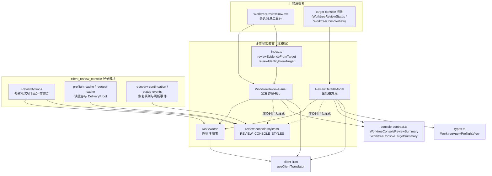
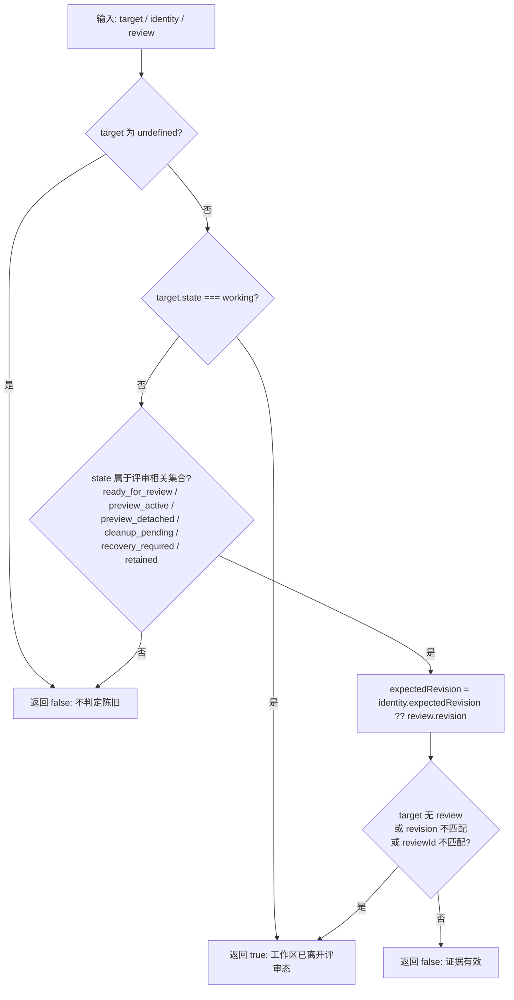
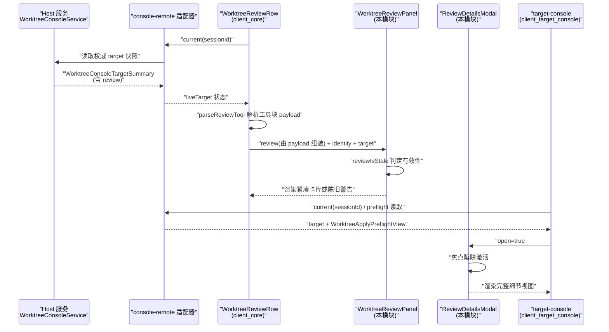

# 评审控制台展示表面（client_review_console_review_surfaces）

!!! info "Generated documentation"
    This page was written by CodeWiki from the source code at commit [`e50f4121`](https://github.com/wloops/dsh-git-worktree/commit/e50f4121be2569531679e4f64bfc288bc20f70a3) on 2026-11-06 with `doubao-seed-2.1-lite`. Check the code before relying on details.

## 简介

本模块是 [评审控制台（client_review_console）](../client_review_console.md) 下的**纯展示型 UI 表面层**。它把"一次已就绪的隔离工作区评审"（review）以两种形态呈现在用户面前：会话消息流中的**紧凑证据卡片**（`WorktreeReviewPanel`），以及承载全部细节的**全屏评审详情对话框**（`ReviewDetailsModal`）。

本模块**不直接发起任何写操作**——所有评审后的动作（预览、提交、回滚、丢弃、冲突恢复）都由兄弟模块 [评审操作（client_review_console_review_actions）](client_review_console_review_actions.md) 承担；本模块只负责渲染证据、状态徽标、校验清单，并保证这些表面在多种宿主布局（会话卡片、底部 dock、模态框）下外观一致。

核心文件与职责：

| 文件 | 导出物 | 职责 |
| --- | --- | --- |
| `src/client/review-console/WorktreeReviewPanel.tsx` | `WorktreeReviewPanel`、`WorktreeReviewEvidence`、`WorktreeReviewIdentity`、`reviewIsStale` | 紧凑评审证据卡片：标题、摘要、校验状态徽标、可展开的测试清单、陈旧（stale）证据警告 |
| `src/client/review-console/ReviewDetailsModal.tsx` | `ReviewDetailsModal`、`validationIcon`、`validationText` | 全屏详情对话框：迭代、文件清单、逐项校验、版本元数据；自带焦点陷阱 |
| `src/client/review-console/ReviewIcon.tsx` | `ReviewIcon`、`ReviewIconName` | 基于 `lucide-react` 的统一图标注册表，全评审控制台共用 |
| `src/client/review-console/index.ts` | `reviewEvidenceFromTarget`、`reviewIdentityFromTarget`（并重导出面板类型） | 把 Host 侧 target 投影为卡片证据 / CAS 身份的纯函数 |
| `src/client/review-console/review-console.styles.ts` | `REVIEW_CONSOLE_STYLES` | 本模块及兄弟模块共享的 CSS 字符串（设计令牌、面板、模态、dock 布局） |

## 架构定位

下图展示本模块在客户端界面层中的位置：数据来自 Host 权威 target 投影，经过上层组装后流入本模块的展示组件；写操作与缓存读取分别由兄弟模块处理。

## 组件详解

### WorktreeReviewPanel：紧凑证据卡片

`WorktreeReviewPanel` 是评审证据的"常驻"形态。它同时被**会话消息流**（`WorktreeReviewRow`，来自 [client_core：Worktree 浏览器端入口与会话编排核心](../client_core.md)）和**底部 dock** 复用——样式表中 `.dsh-wt-review-dock` 节点对卡片做了紧凑化覆盖。

组件形态由三组类型参数决定：

- `review: WorktreeReviewEvidence` —— 在契约类型 `WorktreeConsoleReviewSummary`（见 [评审控制台契约](../../worktree_console_protocol_and_host_service/worktree_console_contract.md)）之上增加可选的 `detailsMarkdown` 字段，供展开详情或模态框使用。
- `target?: WorktreeConsoleTargetSummary` —— Host 返回的权威 target 快照，用于判定证据是否仍然有效。
- `identity?: WorktreeReviewIdentity` —— 精确 CAS 身份（`sessionId` / `checkoutId` / `expectedRevision` / `expectedReviewId`），与兄弟操作模块发起写操作时使用的身份完全一致。

**陈旧判定逻辑**（`reviewIsStale`）：

判定为陈旧时，卡片在底部渲染 `review.is.stale.please.refresh` 提示（`.dsh-wt-review-evidence-status`），提示用户触发刷新；刷新通道来自兄弟模块的 [status-events](client_review_console_recovery_delivery.md)（`requestWorktreeReviewRefresh`）。

面板内部状态：`detailsExpanded` 控制校验详情区块折叠/展开，且每当 `reviewId` 或 `revision` 变化时自动复位为折叠，避免把上一轮评审的测试清单错挂到新证据上。

### ReviewDetailsModal：全屏详情对话框

`ReviewDetailsModal` 在紧凑卡片之外提供"完整证据视图"。它接收 `target` 与可选的 `preflight`（`WorktreeApplyPreflightView`，来自 [会话检出域契约](../../core_worktree_domain_and_infrastructure/session_checkout_domain/session_checkout_domain_contracts.md)），据此推导当前应展示的**状态徽标**与**提示文案**：

| 条件 | 徽标（i18n key） | 提示文案来源 |
| --- | --- | --- |
| `target.state` 为 `preview_detached` 或 `recovery_required` | `detail.recovery`（warning 色调） | `detail.recoveryNote` |
| `preflight.status === 'conflict'` | `detail.blocked`（warning 色调） | `detail.conflictNote` |
| `preflight.status === 'blocked'` | `detail.blocked`（warning 色调） | `preflight.message`（Host 原文） |
| `target.state === 'preview_active'` | `detail.preview` | `detail.previewNote` |
| `target.state` 为 `retained` / `delivered` / `cleanup_pending` | `detail.saved` | `target.cleanupMessage` |
| 其他（默认就绪态） | `detail.ready` | 无 |

对话框内容分区：

1. **头部**：评审摘要（`review.summary`）+ 状态徽标 + 迭代次数；
2. **元信息行**：变更文件数、校验总状态（图标 + 文案）；
3. **提示条**：恢复 / 冲突 / 阻塞说明；
4. **冲突文件区**：仅当 `preflight.status === 'conflict'` 时出现，与总文件清单做交集标注；
5. **校验区**：`review.validationSummary` + 逐项测试命令与状态；
6. **版本区**（`
` 折叠）：`reviewId`、`revision`、`currentOid`。

**列表折叠策略**：文件与测试清单超过 `COLLAPSED_LIST_LIMIT = 5` 条时，默认仅渲染前 5 条，通过带 `aria-expanded` / `aria-controls` 的按钮展开完整列表。各列表以 `${checkoutId}:${review.reviewId}:${revision}:${open}` 为 key 的一部分，保证换评审轮次或开闭模态时 React 正确重置列表状态。

**焦点陷阱**：模态打开时记录此前聚焦元素、把焦点移入对话框第一个可聚焦元素，并拦截 `Tab` / `Shift+Tab` 做循环焦点管理；关闭时还原焦点——保证键盘用户不会"逃出"模态。

### ReviewIcon：统一图标注册表

`ReviewIcon` 是一个从 `lucide-react` 收敛出的 28 个图标的小型注册表（`file` / `branch` / `check` / `warning` / `minus` / `close` / `chevron` / `pin` …）。所有图标统一以 `size=18`、`strokeWidth=1.75`、`aria-hidden="true"` 渲染，并附加 `.dsh-wt-icon` 类，确保评审控制台各表面（卡片、模态、操作菜单、dock）视觉一致。

两个跨组件共享的纯函数：

- `validationIcon(status)`：`passed → check`，`failed | partial → warning`，其他 → `minus`；
- `validationText(status, t)`：把状态码翻译为 `detail.passed` / `detail.failed` / `detail.partial` / `detail.notRun` 文案。

### index.ts：target → 展示模型的投影

本文件是展示层与上层装配之间的**适配层**：

- `reviewEvidenceFromTarget(target, detailsMarkdown?)`：当 `target.review` 存在时，把它展开为 `WorktreeReviewEvidence`（附带可选 markdown 详情）；否则返回 `null`——让调用方区分"没有评审"与"评审存在但不可用"。
- `reviewIdentityFromTarget(sessionId, target)`：组装写操作 / 高级读所需的精确 CAS 身份（`expectedRevision = target.revision`、`expectedReviewId = target.review.reviewId`），供 [评审操作](client_review_console_review_actions.md) 与 [读缓存](client_review_console_read_caches.md) 复用。

### review-console.styles.ts：共享样式表

`REVIEW_CONSOLE_STYLES` 是一段以 `String.raw` 声明的 CSS 字符串，注入宿主页面。它定义了：

- **设计令牌**：`--wt-ink` / `--wt-muted` / `--wt-line` / `--wt-panel` 以及绿/琥珀/红三语义色（`--wt-green` / `--wt-amber` / `--wt-red`）；
- **卡片布局**：`.dsh-wt-review-panel` 的网格结构、校验状态着色（`[data-validation]`）、测试清单排版；
- **dock 紧凑覆盖**：`.dsh-wt-review-dock` 系列选择器复用同一 DOM 结构但压缩为底部工具条形态，并隐藏 preflight 事实表等冗余信息；
- **模态布局**：`.dsh-wt-details-modal` / `.dsh-wt-details-body` 的宽度、滚动与盒模型；
- **响应式**：`@media (max-width: 620px)` 断点下重排卡片与 dock。

## 数据流：评审证据如何到达展示表面

关键设计点：**面板渲染的证据（payload）与 Host 权威 target（liveTarget）是两份独立来源**——卡片主体来自已落盘的工具调用记录（离线可回放），而陈旧警告通过实时拉取的 target 交叉校验得出。这保证了即使 Host 暂时不可用（`unavailableMessage`），历史评审证据依然可读。

## 与其他模块的关系

- 上层装配：[client_core：Worktree 浏览器端入口与会话编排核心](../client_core.md) 中的 `WorktreeReviewRow` 把工具调用块解析为 `WorktreeReviewEvidence` 并传入 `WorktreeReviewPanel`；[client_target_console：会话目标控制台（浏览器端）](../client_target_console.md) 的状态组件持有 `ReviewDetailsModal` 的开闭状态。
- 兄弟模块：[评审操作](client_review_console_review_actions.md) 复用 `ReviewIcon` 与 `REVIEW_CONSOLE_STYLES`；[读缓存](client_review_console_read_caches.md)（preflight / delivery 展示）与 [恢复与刷新事件](client_review_console_recovery_delivery.md)（`status-events`）共享同一套 CSS 节点。
- 契约来源：展示数据类型定义于 [评审控制台契约](../../worktree_console_protocol_and_host_service/worktree_console_contract.md)，preflight 视图类型定义于 [会话检出域契约](../../core_worktree_domain_and_infrastructure/session_checkout_domain/session_checkout_domain_contracts.md)。
- 国际化：全部文案经 `useClientTranslator()` 翻译，消息表与语言基础见 [src_i18n 国际化与消息目录模块](../../project_foundation_and_localization/src_i18n.md)；本模块不直接持有任何文案字符串。

## 可访问性要点

- 所有图标渲染为 `aria-hidden`，不占用屏幕阅读器焦点；
- 折叠按钮使用 `aria-expanded` + `aria-controls` 与对应列表/区块关联；
- 模态框实现完整焦点陷阱，关闭后还原此前聚焦元素；
- 状态语义同时通过颜色（`data-validation`）与文本（校验文案、徽标）双通道表达，不依赖单一视觉通道。

??? abstract "Documented components (7)"
    - [`validationIcon`](https://github.com/wloops/dsh-git-worktree/blob/e50f4121be2569531679e4f64bfc288bc20f70a3/src%5Cclient%5Creview-console%5CReviewDetailsModal.tsx) — `src\client\review-console\ReviewDetailsModal.tsx`
    - [`ReviewIcon`](https://github.com/wloops/dsh-git-worktree/blob/e50f4121be2569531679e4f64bfc288bc20f70a3/src%5Cclient%5Creview-console%5CReviewIcon.tsx) — `src\client\review-console\ReviewIcon.tsx`
    - [`WorktreeReviewEvidence`](https://github.com/wloops/dsh-git-worktree/blob/e50f4121be2569531679e4f64bfc288bc20f70a3/src%5Cclient%5Creview-console%5CWorktreeReviewPanel.tsx) — `src\client\review-console\WorktreeReviewPanel.tsx`
    - [`WorktreeReviewIdentity`](https://github.com/wloops/dsh-git-worktree/blob/e50f4121be2569531679e4f64bfc288bc20f70a3/src%5Cclient%5Creview-console%5CWorktreeReviewPanel.tsx) — `src\client\review-console\WorktreeReviewPanel.tsx`
    - [`WorktreeReviewPanelProps`](https://github.com/wloops/dsh-git-worktree/blob/e50f4121be2569531679e4f64bfc288bc20f70a3/src%5Cclient%5Creview-console%5CWorktreeReviewPanel.tsx) — `src\client\review-console\WorktreeReviewPanel.tsx`
    - [`reviewEvidenceFromTarget`](https://github.com/wloops/dsh-git-worktree/blob/e50f4121be2569531679e4f64bfc288bc20f70a3/src%5Cclient%5Creview-console%5Cindex.ts) — `src\client\review-console\index.ts`
    - [`__file__`](https://github.com/wloops/dsh-git-worktree/blob/e50f4121be2569531679e4f64bfc288bc20f70a3/src%5Cclient%5Creview-console%5Creview-console.styles.ts) — `src\client\review-console\review-console.styles.ts`

