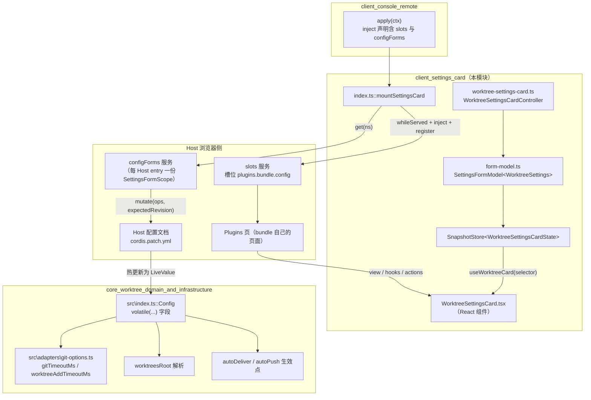
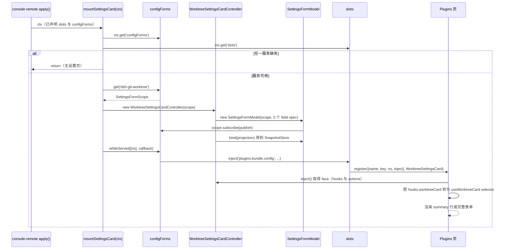
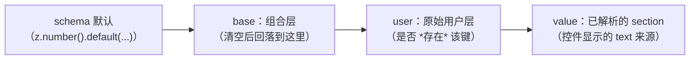
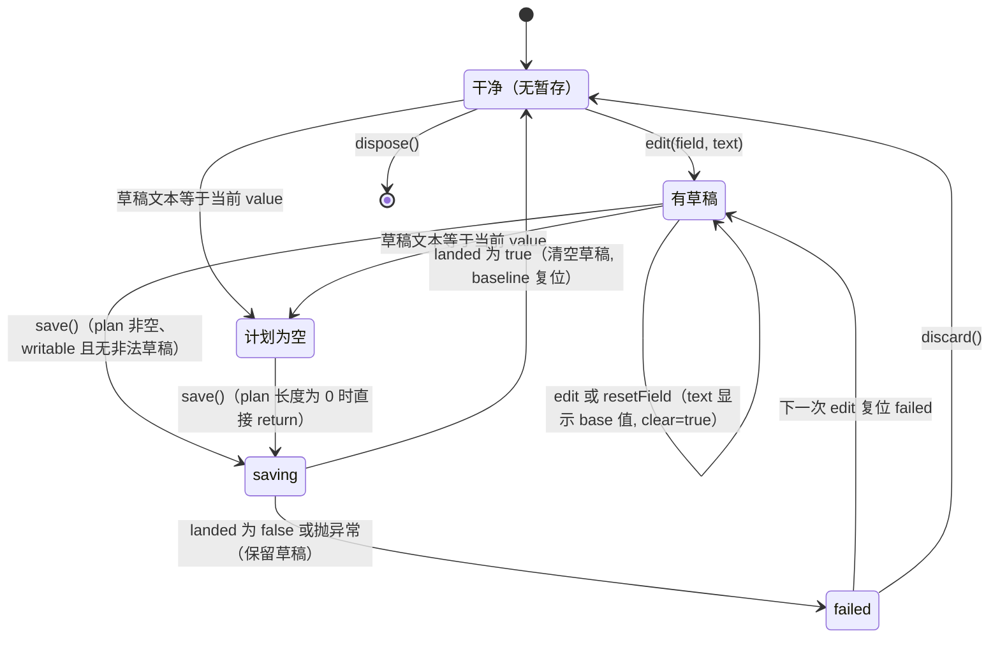
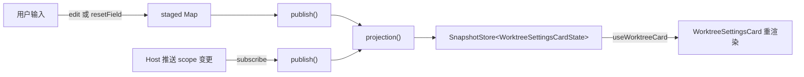
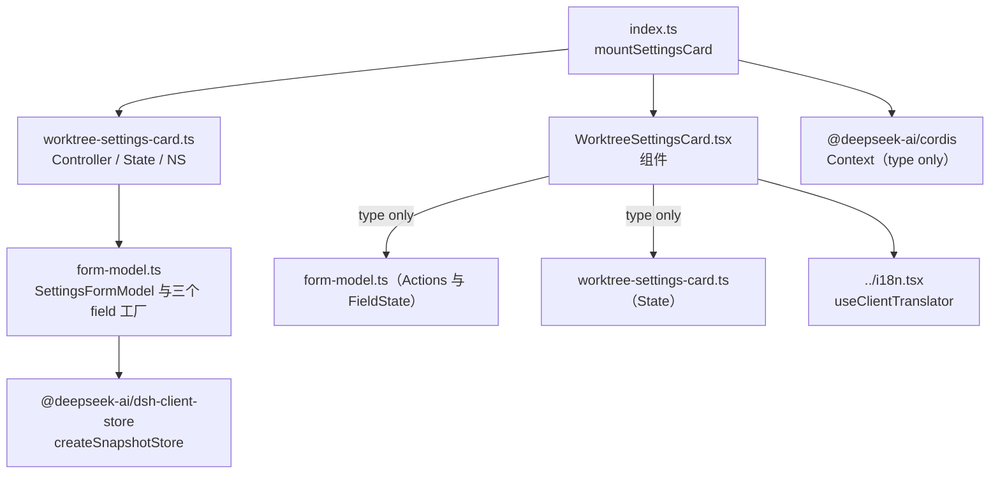

# Worktree 设置卡（client_settings_card）

!!! info "Generated documentation"
    This page was written by CodeWiki from the source code at commit [`55374a27`](https://github.com/wloops/dsh-git-worktree/commit/55374a27f4099ec8dcd0d6163f5544d60b4f3874) on 2026-11-06 with `doubao-seed-2.1-lite`. Check the code before relying on details.

本模块是 `dsh-git-worktree` 插件在浏览器端提供的**设置页面**：它把插件 Config 命名空间 `dsh-git-worktree` 中「可热更新（volatile）」的五个字段——自动交付、自动推送 Local 分支、Worktree 根目录、Git 命令超时、`worktree add` 超时——以**暂存表单**（staged form）的形式渲染到 Host 的 Plugins 页上，并保证「屏幕上看到的内容」与「一次保存会写入的内容」严格一致。

模块由四个文件构成，职责清晰分层：

| 文件 | 角色 | 关键导出 |
| --- | --- | --- |
| `src\client\settings-card\index.ts` | 挂载入口：探测 Host 服务、创建控制器、注册槽位 | `mountSettingsCard`、`ConfigFormsService`、`SlotsService` |
| `src\client\settings-card\worktree-settings-card.ts` | 领域定义：命名空间、被编辑的 section 形状、控制器与投影 | `WORKTREE_SETTINGS_NS`、`WorktreeSettings`、`WorktreeSettingsCardController`、`WorktreeSettingsCardFace`、`WorktreeSettingsCardState` |
| `src\client\settings-card\form-model.ts` | 通用表单内核：暂存、计划（plan）、写入、shell 状态 | `SettingsFormModel`、`SettingsFieldSpec`、`SettingsFormScope`、`SettingsFormShell`、`SettingsFormActions`、`PlannedWrite`、`StagedEdit` |
| `src\client\settings-card\WorktreeSettingsCard.tsx` | 表现层：纯内联样式的 React 组件 | `WorktreeSettingsCard`、`WorktreeSettingsCardProps` |

> 之所以在本模块内**重写**一份表单内核，而不是复用 `@deepseek-ai/dsh-client-ui-primitives` 的 `SettingsForm`：随本插件安装的 primitives 版本早于该共享模块，客户端 bundle 必须保持自包含（见 `form-model.ts` 顶部注释与 [构建、CI 与打包（build_ci_and_packaging）](../project_foundation_and_localization/build_ci_and_packaging.md) 中记录的 `package.json` 依赖清单）。裁剪掉的只有「写入即隐藏的密钥类控件」，本卡片只编辑可见字段。

---

## 1. 在系统中的位置

设置卡是插件 Client fiber 的一条**旁支**：它不参与 Worktree 生命周期协议（`WorktreeConsoleAdapter` / Remote），也不消费验收视图；它唯一的对端是 Host 的**共享配置表单服务** `configForms` 与 **Plugins 页槽位** `slots`。



要点：

- **写路径**穿过 Host：`SettingsFormScope.mutate` 把 `set`/`unset` 的路径操作提交为一次「带 revision 围栏的文档变更」，由 Host 的校验器裁决是否接受。
- **读路径**回到插件自身：被接受的字段以 `LiveValue` 形式回流到 [核心 Worktree 领域与基础设施模块](../core_worktree_domain_and_infrastructure.md) 中的 Git 适配器与 Worktree 路径解析，**无需重新挂载插件**即可对下一条 Git 命令生效（见 `src\adapters\git-options.ts::gitTimeoutMs` 的每次调用读取）。
- 设置卡与 [Worktree Console 远程适配器](client_console_remote.md)、[目标控制台](client_target_console.md)、[验收面板](client_review_console.md)、[会话前开关](client_pre_session.md)、[工作区侧栏](client_workspace_sidebar.md) 是并列的 Client 表面，彼此不共享状态。

---

## 2. 挂载流程（index.ts）

`mountSettingsCard(ctx)` 是**全程 fail-soft** 的：Host 若不暴露 `configForms` 或 `slots`，它直接返回，用户只是看不到设置页，其余 UI 不受影响。

```typescript
// src\client\settings-card\index.ts（节选）
const configForms = ctx.get('configForms') as ConfigFormsService | undefined
const slots = ctx.get('slots') as SlotsService | undefined
if (configForms === undefined || slots === undefined) return
```

这里刻意使用 `ctx.get()` 而不是属性访问：cordis 对**未声明**的服务用属性 getter 读取会抛出 `cannot get property without inject`，而 `ctx.get()` 是软读取。同时，这两个服务名必须出现在入口 fiber 的 `inject` 列表里——[客户端控制台 Remote 适配层（client_console_remote）](client_console_remote.md) 的 `src\client\console-remote\index.ts` 正是为此额外追加了 `'slots'` 与 `'configForms'`；缺少声明时 `ctx.get('slots')` 恒为 `undefined`，设置页会**静默不挂载**。



三个关键细节：

1. **命名空间即键**：`WORKTREE_SETTINGS_NS = 'dsh-git-worktree'`，与插件 loader 条目 id 一致，Host 以此为配置表单的分组键。
2. **槽位选择**：注册进 `plugins.bundle.config`（渲染在 bundle 自己的 Plugins 页，位于描述与其条目行之间，以 bundle 包名索引）。**不是** `plugins.item`——那是官方插件列表槽位，永远不会显示第三方 bundle 的卡片。
3. **可见性受服务状态驱动**：`configForms.whileServed([NS], ...)` 只有当 Host 真正向该客户端提供此命名空间时才注入槽位；`ctx.effect` 负责卸载时 `controller.dispose()`（解订阅）与槽位回收。

---

## 3. 控制器与投影（worktree-settings-card.ts）

`WorktreeSettingsCardController` 是本模块唯一的装配类：它把「命名空间 + 五个字段规格」交给通用内核，并声明卡片状态的完整形状。

```typescript
this.form = new SettingsFormModel(scope, [
  settingsBooleanField('autoDeliver'),
  settingsBooleanField('autoPush'),
  settingsTextField('worktreesRoot'),
  settingsNumberField('gitTimeoutMs'),
  settingsNumberField('worktreeAddTimeoutMs'),
])
this.store = this.form.bind(() => this.projection())
```

- `projection()` 每次重建：`SettingsFormShell`（表单级状态）展开后叠加五个 `SettingsFieldState`。这就是导出的 `WorktreeSettingsCardState`——组件读取的快照类型。
- `inject(): WorktreeSettingsCardFace` 返回 `{ hooks: { worktreeCard: store }, ...form.actions() }`。槽位渲染器把保留键 `hooks.worktreeCard`（一个 `SnapshotStore`）转换成组件的 `useWorktreeCard` 选择器钩子，因此组件**从不见 `hooks` prop**。
- `dispose()` 释放 `scope.subscribe` 并清空监听集合。

| 类型 | 含义 |
| --- | --- |
| `WorktreeSettings` | 本卡片编辑的 Config 易失 section 形状（五个可选字段） |
| `WorktreeSettingsCardState` | `SettingsFormShell` 加每字段 `SettingsFieldState` |
| `WorktreeSettingsCardFace` | 注入给组件的「面」：`hooks` 与 `SettingsFormActions` |
| `WORKTREE_SETTINGS_NS` | 命名空间常量 `'dsh-git-worktree'` |

---

## 4. 暂存表单内核（form-model.ts）

### 4.1 三层取值与「已覆盖」判定

一个字段显示的**有效值** = 用户层 → 组合层（base）→ schema 默认。`SettingsFormScopeSnapshot` 把三层一起交付：



**覆盖判定基于「存在性」而非「值比较」**：`stored(field)` 检查 `user` 对象是否 `Object.hasOwn(user, field)`。即使覆盖值恰好等于组合层默认，它仍然是覆盖，仍会显示「已覆盖」徽章与「还原」按钮。

### 4.2 字段规格：`SettingsFieldSpec`

| 工厂 | `format` | `parse` |
| --- | --- | --- |
| `settingsBooleanField` | 布尔转 `'true'`/`'false'`，否则空串 | 空串→`clear`；`'true'`/`'false'`→`set`；其他→`undefined`（**阻塞保存**） |
| `settingsNumberField` | 数字转字符串，否则空串（section 未携带该字段时渲染为空，而非渲染一个「没人选过」的值） | 空串→`clear`；`Number.isSafeInteger` 通过→`set`；其他→`undefined` |
| `settingsTextField` | 字符串原样，否则空串 | 空串→`clear`；否则 `set`（自动 trim）——**清空并保存等价于「还原」** |

### 4.3 为什么要暂存

每次配置写入都是一次**持久的、带 revision 围栏的文档变更**。若控件「一落定就写」，用户的一次输入会变成一次他既没要求、也无法预览的写入。暂存草稿文本使得：屏幕内容 == 保存将存储的内容。



`plan()` 是保存的唯一依据，规则如下：

- 暂存且 `clear`：仅当该字段**当前确实存在于用户层**（`stored`）才生成 `{op:'unset', path:[field]}`。
- 暂存文本与当前 `value` 的 `format` 相等：跳过（无变化）。
- 草稿非法（`parse` 返回 `undefined`）：生成一条 `op` 为空的 `PlannedWrite` —— 表单仍是 dirty，但 `invalid` 为真，**保存被拒绝而不是丢弃用户的编辑**。

`save()` 的守卫：`plan` 为空、正在保存、不可写、存在非法草稿，任一命中即直接返回。成功后清空草稿；**结果不靠本地预测**：Host 是唯一权威（其校验器负责 schema 表达不了的约束），是否落地由 `mutate` 的布尔返回值决定，失败时草稿被完整保留，用户改一处即可重试。

### 4.4 revision 围栏

首次编辑时 `baseline ??= scope.getSnapshot()` 记下当时的 `revision`；`save` 用它作为 `mutate(ops, expectedRevision)` 的围栏，随后无论成败都 `baseline = undefined`，下一次编辑重新捕获。这样「用户基于哪一版起草」就被固定下来，避免把别人的变更覆盖掉。

### 4.5 发布通道

`SettingsFormModel` 同时受**外部**（scope 变更）与**内部**（草稿变更）驱动，因此所有投影都通过 `publish()` 广播给 `bind()` 注册的监听器，由 `createSnapshotStore`（来自 `@deepseek-ai/dsh-client-store`）承载，供槽位组件以 selector 方式订阅。



---

## 5. 表现层（WorktreeSettingsCard.tsx）

组件是**自包含**的：所有样式来自文件内的 `CSSProperties` 常量（`ACCENT #2563eb`、`MUTED #6b7280`、`DANGER #dc2626`、`BORDER #e5e7eb`），不引用 `client_core` 的 `WORKTREE_STYLES`，也不引用 `target-console.styles`。这样做的原因是：Plugins 页未必与主会话界面同屏，卡片必须能独立渲染。

| 行为 | 实现 |
| --- | --- |
| 摘要视图 | `props.view === 'summary'` 时只渲染 `t('settings.description')` 一行，供 Plugins 页列表使用 |
| 不可用 | `!state.available`（scope 非 `ready`）时返回 `null` |
| 整体禁用 | `disabled = !state.writable || state.saving` 传给所有控件 |
| 开关 | `role="switch"` 加 `aria-checked` 的按钮，`checked` 由 `fieldState.text === 'true'` 判定；点击时切换 `'true'`/`'false'` 草稿 |
| 输入框 | `type="text"`，数值字段加 `inputMode="numeric"`；`onChange` 直接调用 `props.edit(...)` |
| 字段行 | `fieldRow()`：左标签加提示，右控件；非法时追加 `t('settings.invalid.value')`；覆盖时追加「已覆盖」徽章与「还原」按钮（`props.resetField(field)`） |
| 页脚 | 状态文案优先级 `failed > saving > !writable > 空`；「放弃修改」受 `!dirty || saving` 禁用；「保存」受 `!writable || !dirty || invalid || saving` 禁用 |

无障碍：开关与输入框均以字段标签作为 `aria-label`，滑块圆点标记 `aria-hidden="true"`。

---

## 6. 文案与本地化

卡片通过 `useClientTranslator()`（见 [client_core：Worktree 浏览器端入口与会话编排核心](client_core.md) 的 `src\client\i18n.tsx`）取翻译器，词条来自 [src_i18n 国际化与消息目录模块](../project_foundation_and_localization/src_i18n.md) 的 `clientMessages`：

| 键 | 用途 |
| --- | --- |
| `settings.description` | 摘要视图与卡片描述 |
| `settings.autoDeliver` / `.hint` | 自动交付开关及其说明 |
| `settings.autoPush` / `.hint` | 自动推送 Local 分支开关及其说明 |
| `settings.worktreesRoot` / `.hint` | Worktree 根目录（留空使用默认位置，仅影响之后创建的 Worktree） |
| `settings.gitTimeoutMs` / `.hint` | 单条 Git 命令超时 |
| `settings.worktreeAddTimeoutMs` / `.hint` | 创建 Worktree 超时 |
| `settings.overridden` / `settings.reset` | 覆盖徽章与还原按钮 |
| `settings.invalid.value` | 非法草稿提示 |
| `settings.saving` / `settings.failed` / `settings.readonly` | 页脚状态 |
| `settings.save` / `settings.discard` | 页脚动作 |

> 注意：本卡片经由 `ctx.get('slots')` 的**裸注册路径**进入 Plugins 页，而不是 [client_core：Worktree 浏览器端入口与会话编排核心](client_core.md) 中用 `ClientI18nProvider` 包裹过的 `localizedSlots` 代理，因此 `useClientLanguage()` 会落到 `ClientLanguageContext` 的默认值 `zh`。`settings.title` 目前也未被本模块代码直接引用。

---

## 7. 与 Host 配置模型的对应关系

Host 侧的 `Config`（`src\index.ts`，见 [会话检出运行时入口模块](../core_worktree_domain_and_infrastructure/session_checkout_domain/session_checkout_runtime/session_checkout_runtime_entry.md)）用 `volatile()` 把字段标记为「可热更新」：设置页写入落到 `cordis.patch.yml`（该清单文件的构建与打包说明见 [构建、CI 与打包（build_ci_and_packaging）](../project_foundation_and_localization/build_ci_and_packaging.md)），值以 `LiveValue` 回传，读取处每次调用取最新值。

| 卡片字段 | Config 声明 | 约束 | 生效点 |
| --- | --- | --- | --- |
| `autoDeliver` | `volatile(z.boolean().default(true))` | 布尔 | Agent 自主交付；`SessionCheckoutModule.isAutoDeliverEnabled()` 关闭时工具层拒绝模型驱动交付 |
| `autoPush` | `volatile(z.boolean().default(true))` | 布尔 | Finish 成功且有新提交后尽力 `git push` Local 分支（绝不强推） |
| `worktreesRoot` | `volatile(z.string())` | 字符串，应指向任何 Git checkout 之外 | `resolveWorktreesRootValue` → `<root>/<project>/<topic>-<YYYYMMDD>` |
| `gitTimeoutMs` | `volatile(z.number().min(1000).max(3600000).default(120000))` | 安全整数 | `src\adapters\git-options.ts::gitTimeoutMs` 逐次读取 |
| `worktreeAddTimeoutMs` | `volatile(z.number().min(1000).max(3600000).default(300000))` | 安全整数 | `worktree add` 的超时 |

未被本卡片暴露的 volatile 字段：`inheritLocalChanges`、`worktreeKeepCount`、`autoPruneMergedBranches`、`branchRaceGuard`、`branchRaceWindowMs`；非 volatile 的 `stateDir` 与 `enableWorkspaceProvider` 需要重新挂载才生效，故刻意不放进表单。

**双层校验**：表单内核只做「类型与整数」级别校验并阻塞保存；范围（≥1000ms、≤60min）由 Host 的 schemastery 校验器裁决，若被拒绝则 `mutate` 返回 `false`，卡片显示 `settings.failed` 并保留草稿。

---

## 8. 内部依赖关系



`form-model.ts` 与 `worktree-settings-card.ts` 不含任何 React 依赖，可被 Node 侧测试直接驱动（测试基础设施 `vitest.config.ts` 见 [构建、CI 与打包（build_ci_and_packaging）](../project_foundation_and_localization/build_ci_and_packaging.md)）；只有 `WorktreeSettingsCard.tsx` 触达 React，且仅以 `type` 方式依赖内核类型。

---

## 9. 设计约束与注意事项

- **不要在本卡片引入外部样式表**：Plugins 页的样式归属由客户端模块系统按 `data-plugin` 认领，卡片用内联样式规避了跨模块样式被回收的问题（对照 [client_core：Worktree 浏览器端入口与会话编排核心](client_core.md) 中 `src\client\index.tsx` 的 `styles` effect）。
- **新增字段需要多处同步**：`WorktreeSettings` 接口、`WorktreeSettingsCardState` 成员、`projection()` 的字段条目、控制器的 field spec 列表与组件的 `fieldRow` 调用；`SettingsFormModel.spec()` 会在缺失规格时抛出 `plugin card has no field X`，把接线错误显式暴露，而非退化成静默失效的控件。
- **`resetField` 的显示语义**：它暂存 `clear: true`，同时把文本设为 `base` 值——控件因此展示「清空后将回落到的组合层取值」，而不是空白。
- **保存的原子性**：所有暂存编辑在一次 `mutate(ops, expectedRevision)` 中提交，不存在「半张表单已写、半张失败」的中间态。
- **降级即无痕**：Host 缺少 settings 栈、或命名空间未被 serve 时，插件其余界面照常工作，只是没有设置页。

---

## 10. 相关文档

- [worktree_client_interface_layer：Worktree 浏览器端客户端界面层总览](../worktree_client_interface_layer.md) — Client 层总览
- [client_core：Worktree 浏览器端入口与会话编排核心](client_core.md) — 客户端上下文、i18n 提供者与样式挂载
- [客户端控制台 Remote 适配层（client_console_remote）](client_console_remote.md) — 调用 `mountSettingsCard` 的入口 fiber 与 `inject` 声明
- [client_target_console：会话目标控制台（浏览器端）](client_target_console.md) — 同一 Client 层的 Worktree 控制台表面
- [client_review_console：受管 Worktree 验收控制台（浏览器端）](client_review_console.md) — 验收面板（与设置页共享词条目录但无状态耦合）
- [核心 Worktree 领域与基础设施模块](../core_worktree_domain_and_infrastructure.md) — `Config` schema、`LiveValue` 与 Git 超时适配器
- [会话检出运行时入口模块](../core_worktree_domain_and_infrastructure/session_checkout_domain/session_checkout_runtime/session_checkout_runtime_entry.md) — `src\index.ts` 的 volatile 字段声明
- [Worktree Console 共享契约（`src/console-contract.ts`）](../worktree_console_protocol_and_host_service/worktree_console_contract.md) — 与设置页无关但同属插件的 Host 与 Client 协议
- [项目基础与本地化模块概览](../project_foundation_and_localization.md) — 词条目录与语言归一化

??? abstract "Documented components (16)"
    - [`WorktreeSettingsCardProps`](https://github.com/wloops/dsh-git-worktree/blob/55374a27f4099ec8dcd0d6163f5544d60b4f3874/src%5Cclient%5Csettings-card%5CWorktreeSettingsCard.tsx) — `src\client\settings-card\WorktreeSettingsCard.tsx`
    - [`PlannedWrite`](https://github.com/wloops/dsh-git-worktree/blob/55374a27f4099ec8dcd0d6163f5544d60b4f3874/src%5Cclient%5Csettings-card%5Cform-model.ts) — `src\client\settings-card\form-model.ts`
    - [`SettingsFieldSpec`](https://github.com/wloops/dsh-git-worktree/blob/55374a27f4099ec8dcd0d6163f5544d60b4f3874/src%5Cclient%5Csettings-card%5Cform-model.ts) — `src\client\settings-card\form-model.ts`
    - [`SettingsFieldState`](https://github.com/wloops/dsh-git-worktree/blob/55374a27f4099ec8dcd0d6163f5544d60b4f3874/src%5Cclient%5Csettings-card%5Cform-model.ts) — `src\client\settings-card\form-model.ts`
    - [`SettingsFormActions`](https://github.com/wloops/dsh-git-worktree/blob/55374a27f4099ec8dcd0d6163f5544d60b4f3874/src%5Cclient%5Csettings-card%5Cform-model.ts) — `src\client\settings-card\form-model.ts`
    - [`SettingsFormModel`](https://github.com/wloops/dsh-git-worktree/blob/55374a27f4099ec8dcd0d6163f5544d60b4f3874/src%5Cclient%5Csettings-card%5Cform-model.ts) — `src\client\settings-card\form-model.ts`
    - [`SettingsFormScope`](https://github.com/wloops/dsh-git-worktree/blob/55374a27f4099ec8dcd0d6163f5544d60b4f3874/src%5Cclient%5Csettings-card%5Cform-model.ts) — `src\client\settings-card\form-model.ts`
    - [`SettingsFormScopeSnapshot`](https://github.com/wloops/dsh-git-worktree/blob/55374a27f4099ec8dcd0d6163f5544d60b4f3874/src%5Cclient%5Csettings-card%5Cform-model.ts) — `src\client\settings-card\form-model.ts`
    - [`SettingsFormShell`](https://github.com/wloops/dsh-git-worktree/blob/55374a27f4099ec8dcd0d6163f5544d60b4f3874/src%5Cclient%5Csettings-card%5Cform-model.ts) — `src\client\settings-card\form-model.ts`
    - [`StagedEdit`](https://github.com/wloops/dsh-git-worktree/blob/55374a27f4099ec8dcd0d6163f5544d60b4f3874/src%5Cclient%5Csettings-card%5Cform-model.ts) — `src\client\settings-card\form-model.ts`
    - [`ConfigFormsService`](https://github.com/wloops/dsh-git-worktree/blob/55374a27f4099ec8dcd0d6163f5544d60b4f3874/src%5Cclient%5Csettings-card%5Cindex.ts) — `src\client\settings-card\index.ts`
    - [`SlotsService`](https://github.com/wloops/dsh-git-worktree/blob/55374a27f4099ec8dcd0d6163f5544d60b4f3874/src%5Cclient%5Csettings-card%5Cindex.ts) — `src\client\settings-card\index.ts`
    - [`WorktreeSettings`](https://github.com/wloops/dsh-git-worktree/blob/55374a27f4099ec8dcd0d6163f5544d60b4f3874/src%5Cclient%5Csettings-card%5Cworktree-settings-card.ts) — `src\client\settings-card\worktree-settings-card.ts`
    - [`WorktreeSettingsCardController`](https://github.com/wloops/dsh-git-worktree/blob/55374a27f4099ec8dcd0d6163f5544d60b4f3874/src%5Cclient%5Csettings-card%5Cworktree-settings-card.ts) — `src\client\settings-card\worktree-settings-card.ts`
    - [`WorktreeSettingsCardFace`](https://github.com/wloops/dsh-git-worktree/blob/55374a27f4099ec8dcd0d6163f5544d60b4f3874/src%5Cclient%5Csettings-card%5Cworktree-settings-card.ts) — `src\client\settings-card\worktree-settings-card.ts`
    - [`WorktreeSettingsCardState`](https://github.com/wloops/dsh-git-worktree/blob/55374a27f4099ec8dcd0d6163f5544d60b4f3874/src%5Cclient%5Csettings-card%5Cworktree-settings-card.ts) — `src\client\settings-card\worktree-settings-card.ts`

