# client_target_console：会话目标控制台（浏览器端）

!!! info "Generated documentation"
    This page was written by CodeWiki from the source code at commit [`f93ba818`](https://github.com/wloops/dsh-git-worktree/commit/f93ba8188971886c09b4c40e12c746a23853c229) on 2026-11-06 with `doubao-seed-2.1-lite`. Check the code before relying on details.

`client_target_console` 位于 `src/client/target-console/`，是 dsh-git-worktree 插件在**浏览器侧的「会话目标（Session Target）」界面层**。它把 Host 投影出来的 `WorktreeConsoleTargetDetails` / `WorktreeConsoleTargetSummary` 渲染成三类常驻入口，并把用户的每一次 Git 与生命周期操作转成携带 CAS 身份的 Remote 调用：

1. **目标胶囊（chip）**：`TargetStatusAction.tsx` —— 会话头部与空白会话 hero 行上的分支胶囊，展开后是分支选择、建分支、清理已合并分支、标签管理、提交图、打开工作树、回到源会话、下一轮迭代、回 Local、重试清理、放弃等一整套操作。
2. **验收 dock**：`WorktreeReviewStatus.tsx` —— 挂在原生 composer 上方的紧凑交付状态条，复用 review-console 的 `ReviewActions`（compact 凭证）与详情弹窗。
3. **管理面板**：`WorktreeManagerModal.tsx` + `WorktreeConsoleView.tsx` —— 源工作树与所有关联工作树的列表式管理面（创建、打开、放弃、常驻、保留期、重试清理、放弃快照恢复）。
4. **Git 视图**：`BranchGraphModal.tsx`（仓库级提交图 + svg 泳道拓扑）与 `TagManagerModal.tsx`（本地标签增删推）。
5. **观测基础设施**：`current-polling.ts`（多订阅者共享的目标轮询器）与 `branch-overview-cache.ts`（分支总览的 stale-while-revalidate 缓存）。

> 与界面层其它模块一样，本模块**不做任何 Git 判定与状态机推进**：所有权限、冲突计算、revision 校验都在 Host 侧完成（见 [核心 Worktree 领域与基础设施模块](../core_worktree_domain_and_infrastructure.md)）。本模块的职责是「投影 + 编排 + 保守拒绝 + 抖动抑制」。

---

## 1. 在系统中的位置

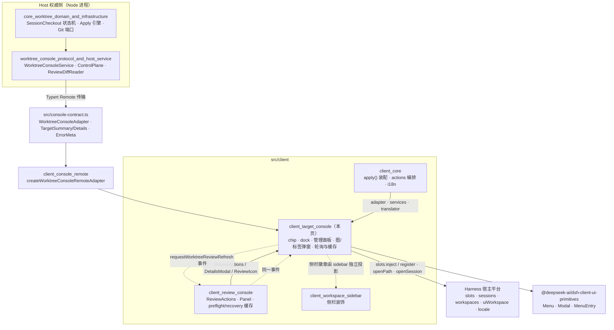

| 边界 | 提供者 | 本模块的使用方式 |
| --- | --- | --- |
| `WorktreeConsoleAdapter` | [Worktree Console 共享契约（`src/console-contract.ts`）](../worktree_console_protocol_and_host_service/worktree_console_contract.md)，实例由 [客户端控制台 Remote 适配层（client_console_remote）](client_console_remote.md) 创建 | 唯一读写通道；返回 `WorktreeConsoleOutcome<T>`，业务失败**从不抛异常**，只有传输/编码异常才走 `catch` |
| `WorktreeConsoleTargetDetails` / `...TargetSummary` / `...Capabilities` | 同上 | chip、dock、管理面板、弹窗的全部渲染输入 |
| `WorktreeConsoleGitOverviewResponse` / `...GitGraphResponse` / `...GitTag` | 同上（Host 侧只读 Git 视图） | 分支列表、提交图、标签列表 |
| `worktreeConsoleErrorMeta()` | 同上 | `WorktreeConsoleView.errorText()` 把错误码翻译成「类别 + 恢复建议 + 原文」 |
| `ReviewActions` / `ReviewDetailsModal` / `useReviewPreflight` / `useWorktreeRecoverySnapshot` | [client_review_console：受管 Worktree 验收控制台（浏览器端）](client_review_console.md) | dock 的验收按钮、详情、预检快照与恢复续作投递状态 |
| `openIsolatedTarget` / `openAuthorizedWorktreeTarget` / `openExistingSession` / `WorktreeClientServices` | [client_core：Worktree 浏览器端入口与会话编排核心](client_core.md)（`src/client/actions.ts`） | 创建工作树后交接、从列表打开他人工作树、回到源会话 |
| `requestWorktreeReviewRefresh` / `WORKTREE_REVIEW_REFRESH_EVENT` | [client_review_console：受管 Worktree 验收控制台（浏览器端）](client_review_console.md)（`status-events.ts`） | 跨 surface 的「重读 Host 权威」广播，也是轮询器的立即失效信号 |
| `branchNameSchema` | [Worktree Console Remote 协议层（`src/console-remote/`）](../worktree_console_protocol_and_host_service/worktree_console_remote.md)（`src/console-remote/schemas.ts`） | 客户端预校验新建分支名，避免一次注定失败的 RPC |
| `Menu` / `Modal` / `MenuEntry` | `@deepseek-ai/dsh-client-ui-primitives`（声明于 `src/client/harness-platform.d.ts`，见 [client_core：Worktree 浏览器端入口与会话编排核心](client_core.md)） | 所有弹出层与菜单行 |
| `useClientTranslator` / `useClientLanguage` | [client_core：Worktree 浏览器端入口与会话编排核心](client_core.md)（`src/client/i18n.tsx`）；词条见 [src_i18n 国际化与消息目录模块](../project_foundation_and_localization/src_i18n.md) | 所有文案与 `en-US` / `zh-CN` 日期格式 |

---

## 2. 文件地图与组件关系

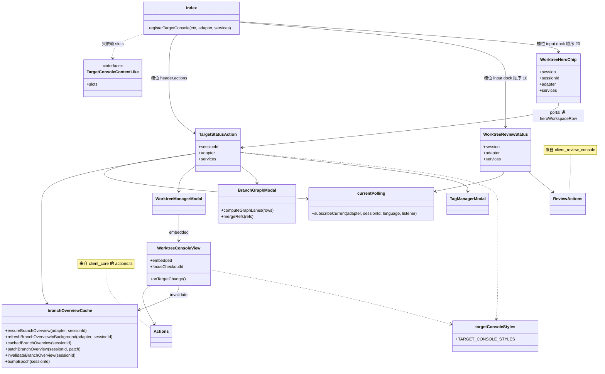

| 文件 | 核心导出 | 一句话职责 |
| --- | --- | --- |
| `index.ts` | `registerTargetConsole()`、`TargetConsoleContextLike` | 把三个组件挂到 Harness 槽位，并 re-export 全部公共组件 |
| `TargetStatusAction.tsx` | `TargetStatusAction`、`TargetStatusActionProps` | 目标胶囊 + 分支/标签/图/清理/生命周期菜单 |
| `WorktreeHeroChip.tsx` | `WorktreeHeroChip`、`WorktreeHeroChipProps` | 空白会话时在 hero 工作区行 portal 出同一枚胶囊 |
| `WorktreeReviewStatus.tsx` | `WorktreeReviewStatus`、`WorktreeReviewStatusProps` | composer 上方的紧凑交付 dock（含恢复续作横幅） |
| `WorktreeConsoleView.tsx` | `WorktreeConsoleView`、`WorktreeConsoleViewProps` | 源关联工作树管理面（列表 + 变更 + 快照恢复） |
| `WorktreeManagerModal.tsx` | `WorktreeManagerModal` | 管理面的会话内 Modal 外壳 |
| `BranchGraphModal.tsx` | `BranchGraphModal`、`computeGraphLanes`、`mergeRefs`、`GraphEdge`/`GraphRowLanes`/`GraphRefBadge` | `git log --topo-order` 的 svg 泳道图 |
| `TagManagerModal.tsx` | `TagManagerModal` | 本地标签的列 / 建 / 推 / 删 |
| `current-polling.ts` | `subscribeCurrent()` | 按 (adapter, sessionId, language) 共享的目标轮询 |
| `branch-overview-cache.ts` | `ensureBranchOverview()` 等 5 个函数 + `bumpEpoch()` | 分支总览缓存与乐观补丁 |
| `target-console.styles.ts` | `TARGET_CONSOLE_STYLES` | `.dsh-wtc-*` 样式表 |

---

## 3. 注册与挂载

`registerTargetConsole()` 是本模块唯一的装配入口，由 [client_core：Worktree 浏览器端入口与会话编排核心](client_core.md) 中的 `apply()` 在 **adapter 存在**时调用（没有 adapter 时只注册两张历史工具卡片，本模块整体缺席）。

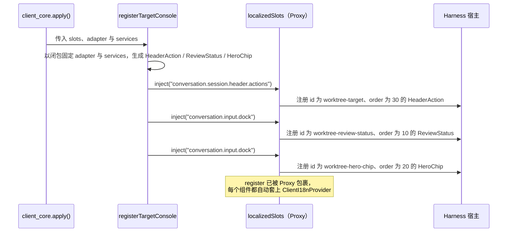

设计要点：

- **依赖以闭包注入**，而不是 Context：`HeaderAction` / `ReviewStatus` / `HeroChip` 只是把宿主给的 `sessionId` / `session` props 与固定的 `adapter`、`services` 组合，因此同一 Client 纤程内的多个会话实例天然隔离。
- **槽位顺序有含义**：dock 里 `worktree-review-status`（order 10）排在 `worktree-hero-chip`（order 20）之前——状态条紧贴 composer 上沿，胶囊则让位于 hero 行。
- `TargetConsoleContextLike` 只声明 `slots`，比 `ClientContextLike` 更窄，方便单测与独立复用（见 [client_core：Worktree 浏览器端入口与会话编排核心](client_core.md)）。

---

## 4. 目标观测：`subscribeCurrent()` 共享轮询

chip、dock 两个 surface 都需要「当前目标的权威状态」，但一次 `adapter.current()` 在 Host 侧等于一次 `git status` 加两次 `git rev-parse`。`current-polling.ts` 因此把轮询做成**引用计数共享**的单飞循环。

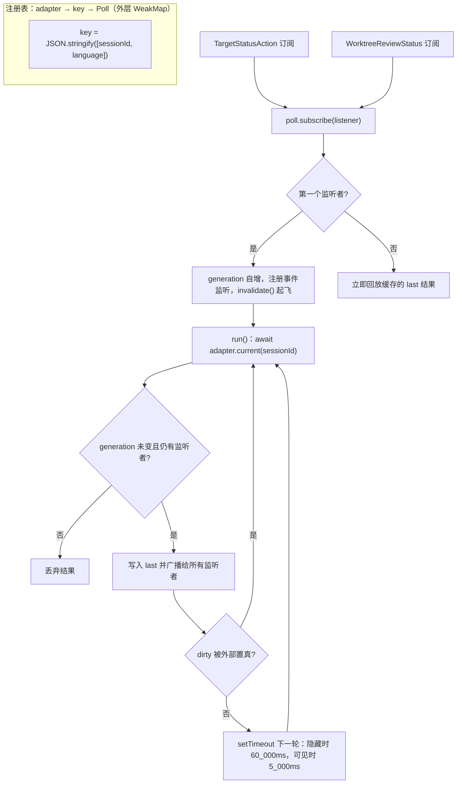

关键行为：

| 机制 | 实现 | 为什么 |
| --- | --- | --- |
| adapter 身份隔离 | 外层用 `WeakMap` 以 adapter 为键 | 多个 Client 实例（多个插件 fiber）不得共用轮询 |
| 语言隔离 | key 里含 `language` | 结果里带 Host 侧本地化文案，切换语言必须重取而非复用缓存 |
| 事件驱动失效 | 监听 `WORKTREE_REVIEW_REFRESH_EVENT`，比对 `detail.sessionId` | 任意 surface 完成一次变更后，所有 surface 立刻回到权威态，而不是等 5 秒 |
| 可见性节流 | `document.visibilityState === 'hidden'` 时退避到 60s；恢复可见时立刻 `invalidate()` | 隐藏窗口既看不到胶囊，也不该替宿主白烧 CPU 和磁盘；回到前台恰恰是最需要正确时刻 |
| 卸载安全 | 监听者清空时 `last = undefined`、`clearTimeout`、摘除监听，并在非运行态调用 `release()` 从 Map 删除 | 允许在途请求自然落地，但**不允许**为一个新挂载播种旧数据 |
| 显示专用 | 类注释明确「Never used to authorize a mutation or Git cleanup」 | 轮询结果只能用于展示；任何写操作必须走各自 RPC 的 Host 侧重校验 |

两个消费端各自再加一层单调性守卫：

- `WorktreeReviewStatus`：`current.checkoutId === next.checkoutId && current.revision > next.revision` 时**保留旧值**，防止并发响应乱序把 dock 退回旧 revision。
- `TargetStatusAction`：不做 revision 守卫，但保留 `failure = {code, message}`，让探针失败时胶囊 tooltip 能说明**为什么**不可用（否则只剩一个 "unavailable"）。

`not_git_repository` 被特判为第三种视觉态：一个普通文件夹不是 Git 仓库属于**正常答案**，因此 chip 用 `not_git_repository` 状态（中性灰、无告警色）、独立文案，并在菜单里只给出「初始化 Git 仓库」这一条真实可行的动作（其余分支/标签/图行会点了就失败，故整块不出现）。

---

## 5. 分支总览缓存：stale-while-revalidate + 乐观补丁

`branch-overview-cache.ts` 解决的是「展开胶囊不得等 git spawn」。`adapter.gitOverview()` 在 Host 侧要起 3 个 git 进程，因此模块级维护三张表：`cache`（值 + `fetchedAt`，TTL 60s）、`flights`（在途 Promise，天然 single-flight）、`patchEpochs`（补丁/失效纪元）。

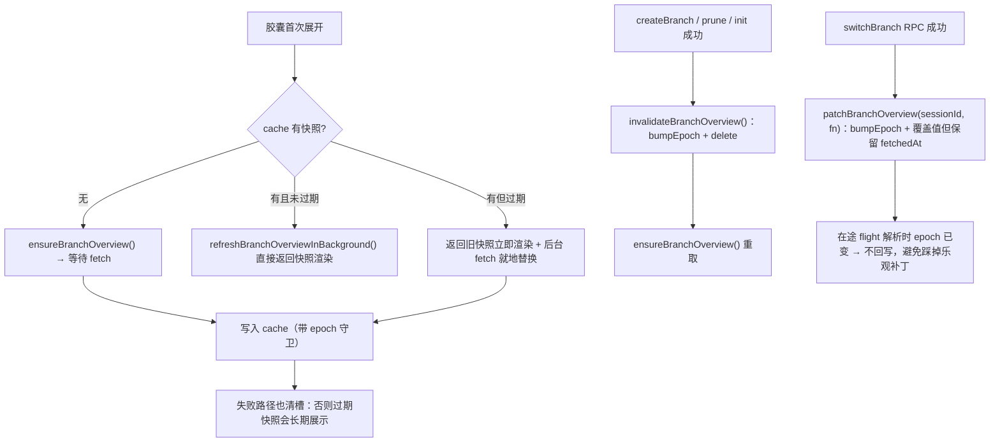

- **纪元守卫的必要性**：起飞于补丁或失效之前的 flight 解析时若直接回写，会把刚确认的乐观补丁连同旧 TTL 一起复活。因此每次 `patch` / `invalidate` 都 `bumpEpoch`，flight 只在纪元未变时写缓存（成功与失败两条路径都受同一守卫约束）。
- **switch 不重取**：`gitSwitchBranch` 的 RPC 已经确认了分支，代码直接读回 `cachedBranchOverview()` 的补丁结果作为最终态，省掉一次 `invalidate + ensure`（4 个 git spawn 与一次 UI 闪回旧值）。
- **不预取**：`TargetStatusAction` 挂载时**故意不**拉分支总览——该胶囊会为每个会话挂载，而 `gitOverview` 的 3 个 git 进程是用户没要求的花费；首次展开才取。

---

## 6. `TargetStatusAction`：胶囊与菜单

### 6.1 标签与可达性

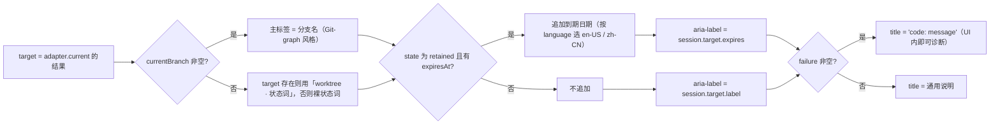

`STATE_LABELS` 覆盖 `WorktreeConsoleTargetState` 的全部 11 个取值（`local` / `creating` / `working` / `ready_for_review` / `preview_active` / `preview_detached` / `retained` / `cleanup_pending` / `recovery_required` / `delivered` / `discarded`），与 `WorktreeConsoleView` 中的同名表保持一致；chip 的 `data-target-state` 驱动 `TARGET_CONSOLE_STYLES` 里的状态色（`working` 蓝、`ready_for_review` 绿、`retained` 紫、`creating`/`cleanup_pending` 橙、`recovery_required`/`error` 红、`delivered`/`discarded` 降透明度）。

### 6.2 菜单装配（能力驱动）

菜单行完全由 `capabilities` 与观测事实推导，未授予能力的动作**不出现**（而非出现后被禁用）：

| 行 | 出现条件 | 动作 |
| --- | --- | --- |
| `summary`（禁用） | 恒有 | 分支 / 项目 / `sourceOid → currentOid` / 迭代号 / 到期日 / 错误 |
| 分支列表 + `branches-title` | `overview !== null && branches.length > 0` | 当前分支与会话分支置顶；`dirtyCount` 渲染脏提示（`< 0` 表示 status 读不出来，不能谎称干净） |
| `branch-search` 输入框 | 分支数 > `MAX_BRANCH_ITEMS`(12) | Enter 选中第一个非当前分支；Enter/方向键/Tab 被 `stopPropagation`，使输入框与菜单卡片共享焦点而不互相抢键盘 |
| `create_branch` / `prune_branches` / `manage_tags` / `graph` | 恒有（非 Git 项目除外） | 打开各自的 Modal |
| `reveal` | `target.managedRoot && capabilities.open` | `services.workspaces.openPath(managedRoot)` |
| `source` | `target.sourceSessionId !== sessionId` | `openExistingSession(services, sourceSessionId, sourceRoot)`，cwd 对不上就报错而不是丢选择 |
| `begin_next_iteration` | `capabilities.beginNextIteration` | `adapter.beginNextIteration({sessionId, checkoutId, expectedRevision})` |
| `return_to_local` | `capabilities.returnToLocal` | `adapter.returnToLocal({sessionId, checkoutId})` |
| `manager` | `target !== null` | 打开 `WorktreeManagerModal`（带 `focusCheckoutId`） |
| footer `retry_cleanup` / `discard` | 对应 capability | 重试清理 / 打开放弃确认框 |

### 6.3 一次生命周期变更的统一骨架

`switchBranch` / `createBranch` / `initializeRepository` / `openPrunePreview` / `confirmPrune` / `retryCleanup` / `beginNextIteration` / `returnToLocal` / `discard` 共享同一套「作用域 + 单飞 + 失效刷新」骨架：

```mermaid
sequenceDiagram
    participant U as 用户
    participant CHIP as TargetStatusAction
    participant AD as WorktreeConsoleAdapter
    participant CACHE as branch-overview-cache
    participant EV as status-events

    U->>CHIP: 点击菜单行
    CHIP->>CHIP: pendingAction !== null ? 直接 return（全局单飞）
    CHIP->>CHIP: scope = actionScope.current ; active() = mounted && scope 未变
    CHIP->>AD: adapter.discard({sessionId, checkoutId, expectedRevision, confirmDirty, rollbackPreview?})
    AD-->>CHIP: 返回 WorktreeConsoleOutcome（MutationResponse）
    alt !active()（会话已切换或组件已卸载）
        CHIP-->>CHIP: 丢弃结果，不回写任何 state
    else outcome.ok
        CHIP->>CHIP: setTarget(合并 target 补丁；phase === 'discarded' 时 managedRoot 置 null)
        CHIP->>EV: requestWorktreeReviewRefresh(sessionId)
    else 失败
        CHIP->>CHIP: setError(error.message)
        opt code === 'stale_target'
            CHIP->>AD: refresh() → 立即重读权威
        end
    end
```

几个刻意的细节：

- **`actionScope` 随 `sessionId` 变化自增**：胶囊可能在同一挂载实例上被换成另一个会话（hero 行复用），作用域计数器让旧会话的在途响应彻底作废。
- **discard 自动附带 `rollbackPreview`**：当状态为 `preview_active` 或授予 `rollbackPreview` 能力时，请求里带上该标志，Host 会先安全回滚本地预览再清理；确认框文案也随之切换（见 `host.will.safely.roll.back.local.preview.first`）。
- **discarded 即抹掉路径**：响应 `phase === 'discarded'` 时把 `managedRoot` 置 `null`，`reveal` 行随即消失，避免点击一个已不存在的目录。
- **switch 的可见反馈**：成功后 chip 上停留 900ms 的绿色 `switchNotice`，防止用户快速关闭菜单把成功当成无操作。
- **prune 两段式**：先 `gitPruneMergedBranches(sessionId, true)` 出 dry-run 预览（`pruned` / `skipped` + 原因），确认后才跑 `false`；预览为空时确认按钮禁用。
- **建分支前先本地校验**：`branchNameSchema.safeParse(name)` 命中即本地报错，不浪费一次注定失败的 RPC（服务端还有第二道 strict 校验）。

---

## 7. `WorktreeHeroChip`：把同一枚胶囊搬到空白会话

空白会话没有会话头部动作区，但恰恰是「选一个工作树开始」的时刻。Harness 的 hero 工作区行只在会话为空白时存在，因此本组件采用 **portal 搬运**而非重复渲染。

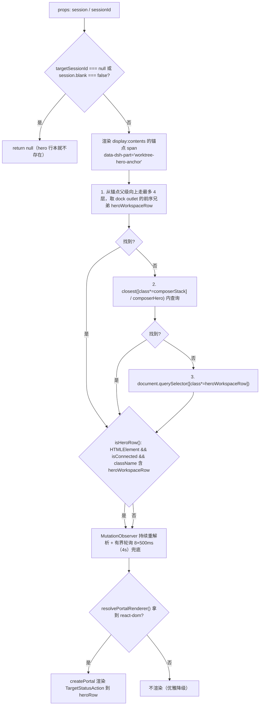

- **require 接缝**：`react-dom` 通过模块加载器注入的 `require` 惰性解析（`typeof require === 'function'` 守卫 + `try/catch`），结果缓存在 `cachedPortalRenderer`。没有 `react-dom` 的外壳只丢 hero 胶囊，**不会**让整包在加载期崩掉。
- **结构优先、轮询兜底**：先按 DOM 结构解析（git-graph 分支胶囊已验证的搬运模式），`MutationObserver` 观察锚点父节点，另有 4 秒有界轮询覆盖「hero 行挂在另一个 portal 根」的外壳；一旦解析成功立即停轮询，后续交给 observer。
- **`display: contents`** 保证锚点不引入额外盒模型，胶囊视觉位置由宿主 hero 行自己决定。

---

## 8. `WorktreeReviewStatus`：composer 上方的交付 dock

dock 是本模块与 [client_review_console：受管 Worktree 验收控制台（浏览器端）](client_review_console.md) 的接缝：它负责**决定何时显示、显示哪条**，而所有验收动作交给 `ReviewActions`（`proofVariant="compact"`）。

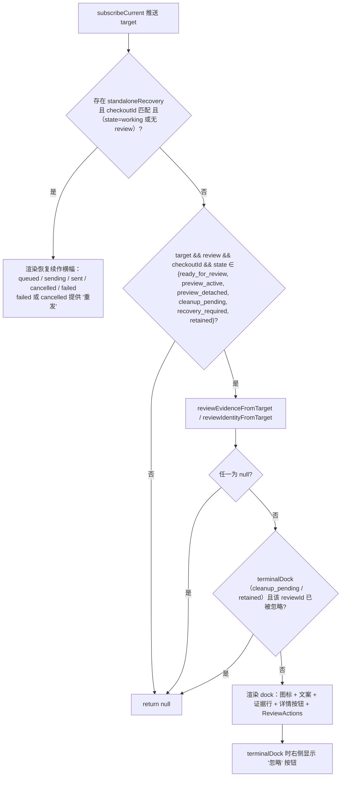

要点：

- **恢复续作的独立显示**：`useWorktreeRecoverySnapshot(sessionId)` 与 `restoreWorktreeRecovery({sessionId, adapter, services})`（挂载即重放持久化队列）都来自 review-console。当冲突恢复 / 评审重生成的续作正被投递、而目标本身已经回到 `working` 或没有 review 时，dock **只**显示续作状态（含 5 种状态文案与「重发」按钮），避免同一区域出现两套互相矛盾的进度。
- **忽略的粒度**：终态 dock 的忽略状态记为 `{checkoutId, reviewId}`——新一轮评审（新 `reviewId`）会重新打开，符合「忽略这一次交付提醒，而不是永久闭嘴」的直觉。
- **operation 感知的标题**：`ReviewActions.renderStatus(operation)` 根据在途动作（`preview` / `rollback` / `finish` / `finalize_preview` / 其它）切换主文案，空闲时才回到状态文案或评审摘要；证据行始终显示「N 个文件 · 校验状态」。
- **详情预检惰性化**：`useReviewPreflight(adapter, identity, false)` 的 `false` 表示不强制刷新，只有打开详情弹窗时才需要 `status === 'success'` 的 `preflight` 传入 `ReviewDetailsModal`。
- **动作作用域**：`isActive()` 同时校验 `mounted`、`currentSessionId` 与 `sessionGeneration`，`onStale` 统一走 `requestWorktreeReviewRefresh()`，`onTargetChange` 用第 4 节的 revision 单调守卫合并。
- `sessionId` 或 `review.reviewId` 变化时强制收起详情弹窗，防止弹窗停留在过期身份上。

---

## 9. `WorktreeConsoleView`：源关联工作树管理面

该视图只依赖 `WorktreeConsoleAdapter`，可独立成页（`embedded = false`，带 `<h2>`）或嵌入 `WorktreeManagerModal`（`embedded`，仅保留刷新按钮行）。

### 9.1 读取与并发守卫

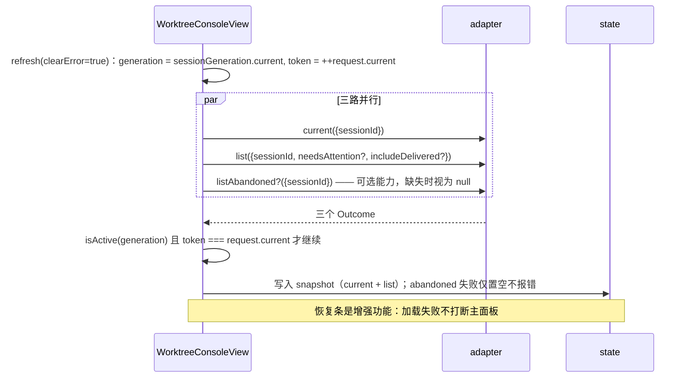

- **会话切换即重置**：`useLayoutEffect` 监听 `sessionId`，`sessionGeneration++` 与 `request++` 后清空全部本地状态并回到 `loading`。`isActive()` 是所有回写的唯一闸门。
- **轻量刷新**：`refreshAbandoned()` 用独立的 `abandonedRequest` 计数只重取恢复条，不重跑 `current + list`——清理/放弃之后可能新增可恢复快照，而主面板无需重新观测。
- **过滤即请求参数**：`needsAttentionOnly` / `includeDelivered` 直接编进 `list` 请求（Host 侧过滤），而不是取全量在前端筛。

### 9.2 变更应用与陈旧处理

`applyMutation()` 把 `WorktreeConsoleMutationResponse.target` 精确合并进快照：`current` 只在 `checkoutId` 相同时合并，列表行按 `checkoutId` 原位替换，随后回调 `onTargetChange()`（chip 用它广播刷新事件）。`mutationError()` 对 `stale_target` / `stale_local` / `stale_isolated` 三类码额外触发一次 `refresh(false)`（保留旧错误可见，同时重新对齐权威）。

### 9.3 创建目标：五重身份自证

`createTarget()` 是宿主端最容易被绕过的路径，因此对 Host 返回值做穷举校验后才允许交接：

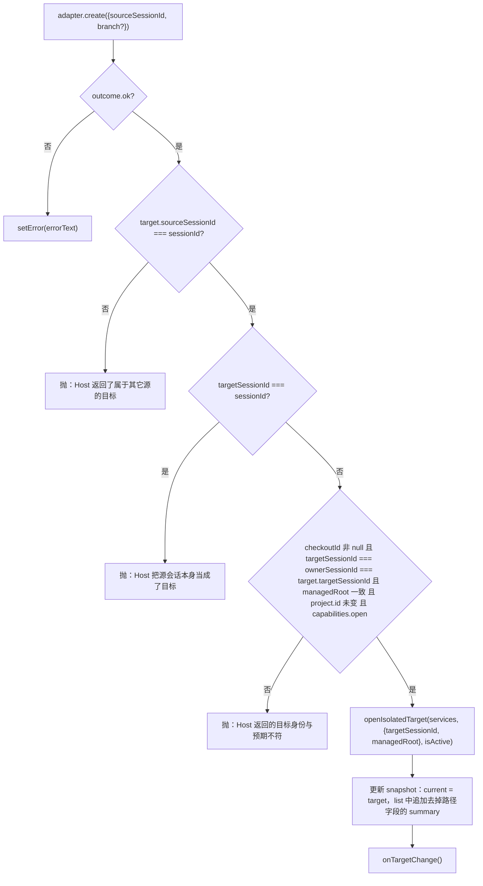

列表行存的是**无路径**的 `WorktreeConsoleTargetSummary`（`managedRoot` / `sourceRoot` / `sourceOid` / `currentBranch` 被解构丢弃），这与契约里「Path-free row safe for project lists」的约束一致：路径只在 `current` / `inspect` 这类身份已验证的详情里出现。

### 9.4 其它动作

| 动作 | 请求 | 特殊语义 |
| --- | --- | --- |
| `openListedTarget` | `openAuthorizedWorktreeTarget(adapter, services, sessionId, {checkoutId, ownerSessionId})` | 先 `inspect` 拿无路径授权，再校验三重身份与 `managedRoot`，最后走 cwd 校验导航（见 [client_core：Worktree 浏览器端入口与会话编排核心](client_core.md)） |
| `discardTarget` | `discard({..., confirmDirty, rollbackPreview?})` | 脏行先弹确认框（三种文案：源会话视角 / 预览回滚视角 / 默认），确认后 `confirmDirty = true`；成功后 `void refresh()` 全量对齐 |
| `retryCleanup` | `retryCleanup({..., discardPostDeliveryChanges?})` | 响应带 `cleanupReason === 'modified_after_finalize'` 时**不报错也不静默**：先 `applyMutation` 落到新台账，再弹出「交付后出现改动，确认放弃再清理」的 `alertdialog`；用户确认后带 `discardPostDeliveryChanges: true` 重发一次 |
| `setPermanentFlag` | `setPermanent({..., permanent})` | 常驻标记豁免自动清理 |
| `setRetentionMode` | `setRetention({..., retention})` | 仅在 `capabilities.setRetention` 且有 `checkoutId` 时才渲染为下拉，否则退化成只读文本 |
| `restoreAbandonedSnapshot` | `restoreAbandoned({sessionId, checkoutId})` | 成功后从恢复条移除该行、`invalidateBranchOverview(sessionId)`、`refresh(false)`，并显示落到哪个分支 |
| 分支下拉（创建前） | `preflightCreate({sourceSessionId})` | 首次 focus 才拉（懒取）；`kind === 'ready'` 时取 `branches`，否则空数组；默认项是「当前 source 分支」或 HEAD |

### 9.5 排序与注意力

```
ATTENTION_RANK: recovery_required 0 < preview_detached 1 < cleanup_pending 2 < ready_for_review 3
                < preview_active 4 < retained 5 < working 6 < creating 7 < delivered 8
                < local 9 < discarded 10
排序键 = focusCheckoutId 置顶 → ATTENTION_RANK 升序 → iteration 降序
```

「需要人处理」的排在最前，交付完成与已放弃的沉底；行内徽标 `当前` / `源` / `关联任务` 由 `sessionId` 与 `sourceSessionId` / `ownerSessionId` 的关系推出，`checkoutId === null` 的行用 `local:<sourceSessionId>` 作 key（本地目标没有工作树身份）。

---

## 10. `BranchGraphModal`：仓库级提交图

拓扑计算被抽成两个**纯函数**（`mergeRefs`、`computeGraphLanes`），可独立测试；渲染层只负责把几何量映射成 svg。

### 10.1 泳道算法（`computeGraphLanes`）

移植自 `@linxin666/dsh-client-ui-git-graph` 的 `computeLanes`，但输出**边几何**而不是逐行字形，这样相邻行才能连成连续的线。

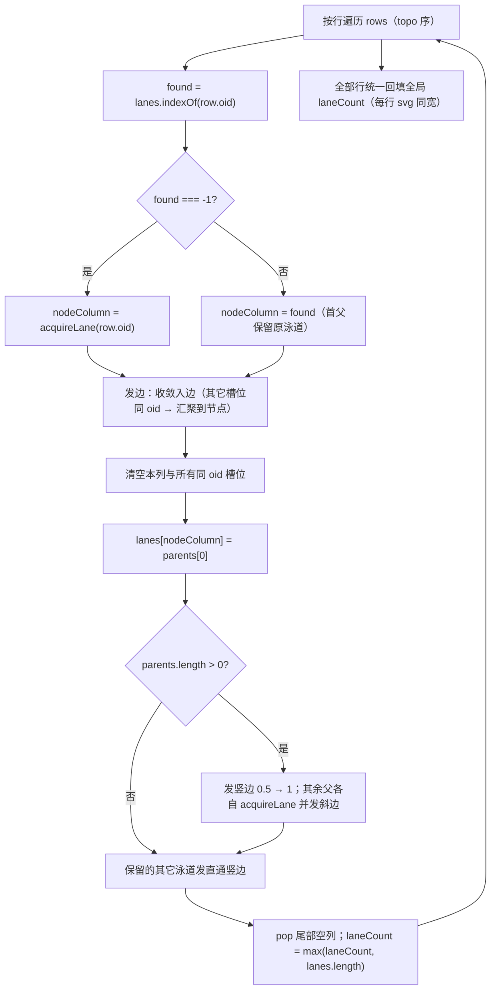

- `acquireLane` 先找同 oid 已占列（复用），否则扫描：**同 oid 的重复挂位只保留最左一份，其余当作空洞回收**——这是收敛分支（merge 后同一父被停在多个槽位）不会把图一路撑宽的关键。
- 泳道数跟踪的是**并发分支数**，不是历史分支总数；`laneCount` 最终对每行取全图最大值，保证逐行 svg 宽度一致、线能对齐。
- 坐标约定：x 以「列」为单位（`laneX(column) = column * 14 + 7`），y 用行高分数（`0` 顶、`0.5` 节点中心、`1` 底），`ROW_HEIGHT = 36`，`NODE_RADIUS = 4`。同列用直线 `L`，跨列用中点贝塞尔 `C`；颜色按列取 `LANE_COLORS`（6 色循环）。

### 10.2 引用徽标合并（`mergeRefs`）

本地与远端短名相同者折叠成一枚徽标（`foo` + `origin/foo` → `foo`，`full` 以 ` · ` 连接供 tooltip 展示）；标签 ref 由 git 适配层带 `tag:` 前缀标记，**永不**与同名分支折叠（标签与分支是两个对象）。当前分支判定同时兼容折叠后的 `full` 列表（`origin/main` 也算命中 `main`）。

### 10.3 分页与竞态

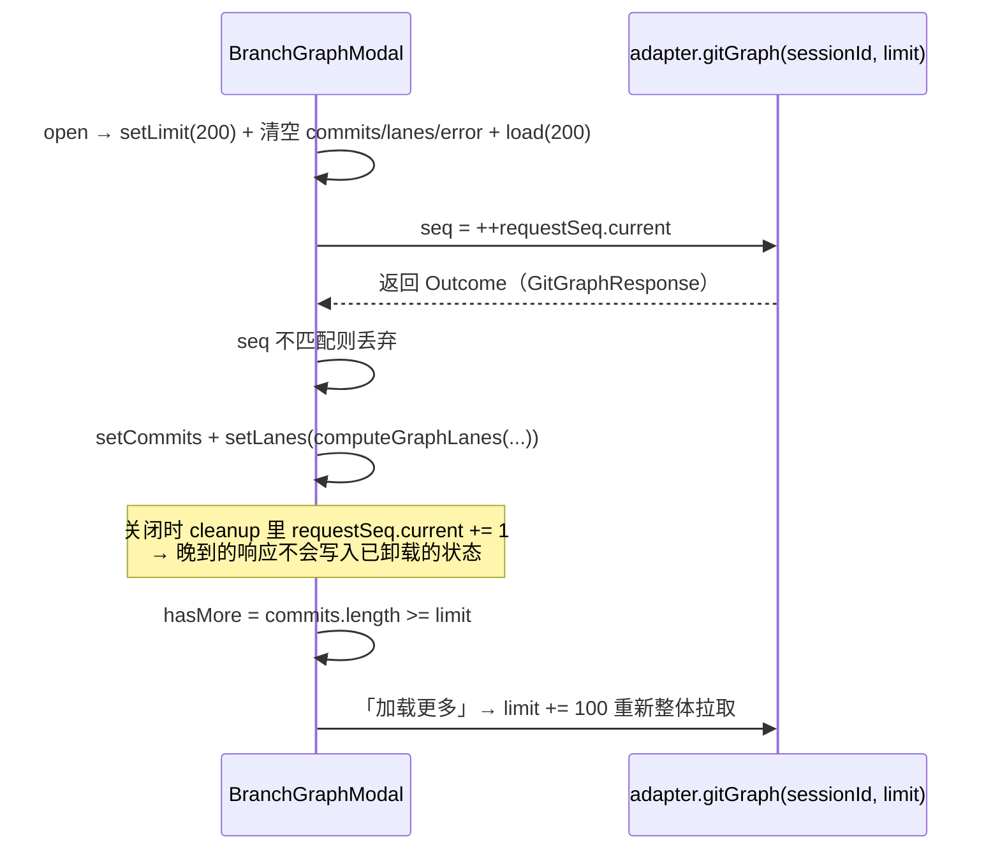

分页采用**累积上限重取**（`limit + PAGE_STEP`，初值 200、步长 100），而不是游标续取：提交图必须保持完整的拓扑前缀才能算出连续泳道。行内 hover 才显形的标签按钮（`tag.graph.action`）把 `oid` 交给上层，从而「给某个提交打标签」经 `onTagCommit` 关掉图、打开标签弹窗。

---

## 11. `TagManagerModal`：本地标签管理

列表是一次 RPC；**每次变更后都重读列表**，因此建 / 删 / 推之后弹窗不会停在过期快照（git 进程很便宜，列表也小）。

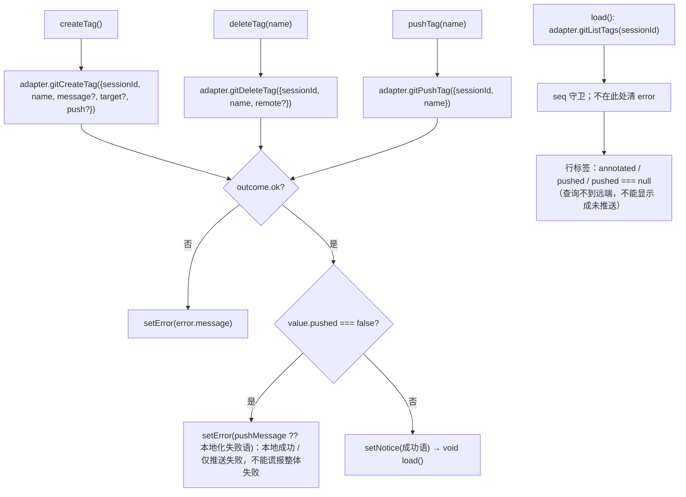

一致性细节：

- **`load()` 不清 `error`**：本地建标成功但推送失败时错误只出现在 `error` 上，紧随其后的重读若清掉它就等于把失败消息抹在用户读不到之前。
- **`busy` 门闩**：`'create' | 'delete' | 'push' | null` 串行化所有变更，`busy !== null` 时连 Modal 的关闭都被拒绝（避免在途写被 UI 关闭吞掉）。
- **`requestSeq` 守卫**：关闭弹窗会 bump `requestSeq`，因此晚到的建 / 删 / 推响应不得再写 state。
- **Enter 提交**：`!event.nativeEvent.isComposing` 才触发创建，兼容中文输入法组字期间回车。
- 三个操作都把「拒绝的推送」当成**可报告的结果**而非失败的变更（`outcome.ok === true` 且 `pushed === false`）。

---

## 12. 样式

`TARGET_CONSOLE_STYLES`（`target-console.styles.ts`）由 [client_core：Worktree 浏览器端入口与会话编排核心](client_core.md) 的 `apply()` 与 `WORKTREE_STYLES` 拼接成**唯一一张**带 `data-plugin` 标记的 `<style>` 注入 `document.head`，因此本模块不自行操作 DOM 样式。类名前缀 `.dsh-wtc-*`（worktree console），关键约定：

| 选择器族 | 归属组件 | 要点 |
| --- | --- | --- |
| `.dsh-wtc-target-chip` + `[data-target-state]` | `TargetStatusAction` | 用 CSS 变量 `--wtc-state` 驱动边框/底色/圆点，状态只在属性上切换 |
| `.dsh-wtc-console` / `-current` / `-list-section` / `-row` | `WorktreeConsoleView` | 容器变量 `--wtc-ink/muted/line/panel/blue/red`；620px 以下卡片改纵向 |
| `.dsh-wtc-confirm` | 管理面板内确认层 | `role="alertdialog"` + `inset: 12px`，`position: absolute` 浮在面板之上 |
| `.dsh-wtc-branch-*` / `-create-branch*` | 分支菜单与建分支弹窗 | 分支名用等宽字体，当前分支加粗，会话分支带徽标 |
| `.dsh-wtc-graph-*` | `BranchGraphModal` | 行高 36px 与 `ROW_HEIGHT` 常量必须一致；`data-gitgraph-ref-current` / `-tag` 决定徽标配色，`::before` 用 `⌗` 标标签 |
| `.dsh-wtc-tag-*` | `TagManagerModal` | `data-tag-pushed` 给已推送标签染蓝，`data-tag-push-unknown` 保留中性 |
| `.dsh-wt-review-dock`（复用 review-console） | `WorktreeReviewStatus` | dock 的样式属于 [client_review_console：受管 Worktree 验收控制台（浏览器端）](client_review_console.md)，本模块只提供 `data-review-state` / `data-recovery-status` |

---

## 13. 竞态与降级矩阵

界面层没有事务，只有**在途响应的取舍规则**。下表汇总本模块各处出现的守卫：

| 场景 | 守卫 | 触发点 |
| --- | --- | --- |
| 会话被替换 / 组件卸载 | `mounted` ref + `sessionGeneration` / `actionScope` / `requestSeq` 计数器 | 全部组件 |
| 在途响应晚于乐观补丁 | `branch-overview-cache` 的 `patchEpochs` | `switchBranch` / `invalidate` |
| 并发响应乱序回退旧 revision | `WorktreeReviewStatus` 的 `checkoutId` 相同且 `revision` 更大时保留旧值 | `subscribeCurrent` 回调 |
| 变更在途时重复点击 | `pendingAction !== null` 单飞门闩（含 Enter 键路径） | chip / 管理面板 / 标签弹窗 |
| Host 侧已被别人抢先 | `stale_target` / `stale_local` / `stale_isolated` → 立即重读权威 | `mutationError` / 各动作 |
| 本地成功但远端失败 | `outcome.ok === true` 且 `pushed === false` → 报推送失败而非操作失败 | `TagManagerModal` |
| 后台窗口空烧 git | 隐藏时轮询退避至 60s，恢复可见立刻失效重取 | `current-polling.ts` |
| 非 Git 项目 | 独立状态 + 仅暴露 `initializeProject` 一条动作 | `TargetStatusAction` |
| 恢复条读取失败 | 置空隐藏，不打断主面板 | `WorktreeConsoleView` |
| 宿主没有 `react-dom` | portal 解析失败 → hero 胶囊缺席，其余 surface 正常 | `WorktreeHeroChip` |

---

## 14. 端到端示例：从胶囊创建并交接一个新工作树

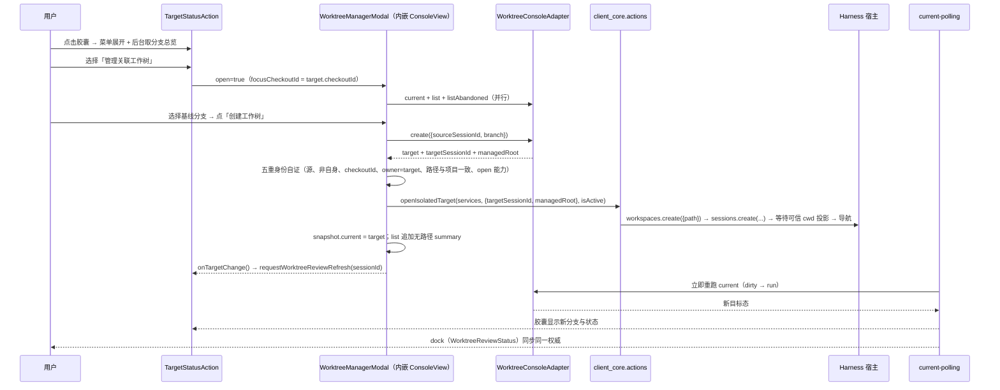

---

## 15. 关联模块

- 界面层装配、宿主服务编排与本地化基座：[client_core：Worktree 浏览器端入口与会话编排核心](client_core.md)
- 验收动作、预检/恢复缓存与 dock 复用组件：[client_review_console：受管 Worktree 验收控制台（浏览器端）](client_review_console.md)
- 空白会话「在 worktree 中开始」开关（与 hero 胶囊互补）：[client_pre_session：空白会话「在 Worktree 中开始」开关](client_pre_session.md)
- Adapter 实例的来源与传输细节（超时、strict 编码、locale 传递）：[客户端控制台 Remote 适配层（client_console_remote）](client_console_remote.md)
- 侧栏徽章与拓扑投影（独立于本模块的只读视图）：[工作区侧边栏（client_workspace_sidebar）](client_workspace_sidebar.md)
- 界面层总览：[worktree_client_interface_layer：Worktree 浏览器端客户端界面层总览](../worktree_client_interface_layer.md)
- DTO 与错误码/恢复元数据契约：[Worktree Console 共享契约（`src/console-contract.ts`）](../worktree_console_protocol_and_host_service/worktree_console_contract.md)
- Host 侧 Git 只读视图与状态投影：[Worktree Console 宿主服务（`src/console-host/`）](../worktree_console_protocol_and_host_service/worktree_console_host.md)
- 状态机与生命周期语义（`beginNextIteration` / `returnToLocal` / `modified_after_finalize` 等）：[会话检出领域模块（session_checkout_domain）](../core_worktree_domain_and_infrastructure/session_checkout_domain.md)
- 词条目录与语言解析：[src_i18n 国际化与消息目录模块](../project_foundation_and_localization/src_i18n.md)

??? abstract "Documented components (14)"
    - [`BranchGraphModalProps`](https://github.com/wloops/dsh-git-worktree/blob/f93ba8188971886c09b4c40e12c746a23853c229/src%5Cclient%5Ctarget-console%5CBranchGraphModal.tsx) — `src\client\target-console\BranchGraphModal.tsx`
    - [`GraphEdge`](https://github.com/wloops/dsh-git-worktree/blob/f93ba8188971886c09b4c40e12c746a23853c229/src%5Cclient%5Ctarget-console%5CBranchGraphModal.tsx) — `src\client\target-console\BranchGraphModal.tsx`
    - [`GraphRefBadge`](https://github.com/wloops/dsh-git-worktree/blob/f93ba8188971886c09b4c40e12c746a23853c229/src%5Cclient%5Ctarget-console%5CBranchGraphModal.tsx) — `src\client\target-console\BranchGraphModal.tsx`
    - [`GraphRowLanes`](https://github.com/wloops/dsh-git-worktree/blob/f93ba8188971886c09b4c40e12c746a23853c229/src%5Cclient%5Ctarget-console%5CBranchGraphModal.tsx) — `src\client\target-console\BranchGraphModal.tsx`
    - [`TagManagerModalProps`](https://github.com/wloops/dsh-git-worktree/blob/f93ba8188971886c09b4c40e12c746a23853c229/src%5Cclient%5Ctarget-console%5CTagManagerModal.tsx) — `src\client\target-console\TagManagerModal.tsx`
    - [`TargetStatusActionProps`](https://github.com/wloops/dsh-git-worktree/blob/f93ba8188971886c09b4c40e12c746a23853c229/src%5Cclient%5Ctarget-console%5CTargetStatusAction.tsx) — `src\client\target-console\TargetStatusAction.tsx`
    - [`WorktreeConsoleViewProps`](https://github.com/wloops/dsh-git-worktree/blob/f93ba8188971886c09b4c40e12c746a23853c229/src%5Cclient%5Ctarget-console%5CWorktreeConsoleView.tsx) — `src\client\target-console\WorktreeConsoleView.tsx`
    - [`WorktreeHeroChipProps`](https://github.com/wloops/dsh-git-worktree/blob/f93ba8188971886c09b4c40e12c746a23853c229/src%5Cclient%5Ctarget-console%5CWorktreeHeroChip.tsx) — `src\client\target-console\WorktreeHeroChip.tsx`
    - [`WorktreeManagerModalProps`](https://github.com/wloops/dsh-git-worktree/blob/f93ba8188971886c09b4c40e12c746a23853c229/src%5Cclient%5Ctarget-console%5CWorktreeManagerModal.tsx) — `src\client\target-console\WorktreeManagerModal.tsx`
    - [`WorktreeReviewStatusProps`](https://github.com/wloops/dsh-git-worktree/blob/f93ba8188971886c09b4c40e12c746a23853c229/src%5Cclient%5Ctarget-console%5CWorktreeReviewStatus.tsx) — `src\client\target-console\WorktreeReviewStatus.tsx`
    - [`bumpEpoch`](https://github.com/wloops/dsh-git-worktree/blob/f93ba8188971886c09b4c40e12c746a23853c229/src%5Cclient%5Ctarget-console%5Cbranch-overview-cache.ts) — `src\client\target-console\branch-overview-cache.ts`
    - [`Poll`](https://github.com/wloops/dsh-git-worktree/blob/f93ba8188971886c09b4c40e12c746a23853c229/src%5Cclient%5Ctarget-console%5Ccurrent-polling.ts) — `src\client\target-console\current-polling.ts`
    - [`TargetConsoleContextLike`](https://github.com/wloops/dsh-git-worktree/blob/f93ba8188971886c09b4c40e12c746a23853c229/src%5Cclient%5Ctarget-console%5Cindex.ts) — `src\client\target-console\index.ts`
    - [`__file__`](https://github.com/wloops/dsh-git-worktree/blob/f93ba8188971886c09b4c40e12c746a23853c229/src%5Cclient%5Ctarget-console%5Ctarget-console.styles.ts) — `src\client\target-console\target-console.styles.ts`

