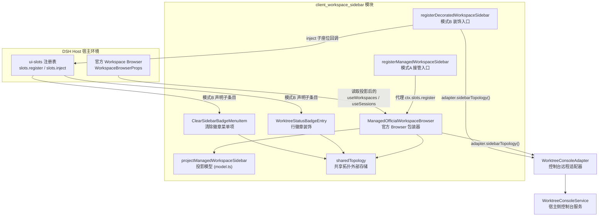
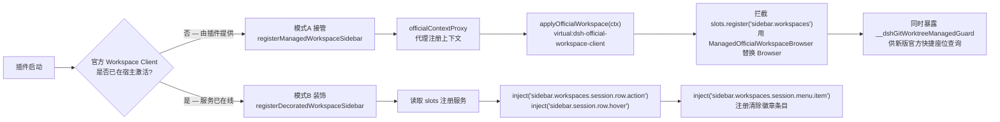
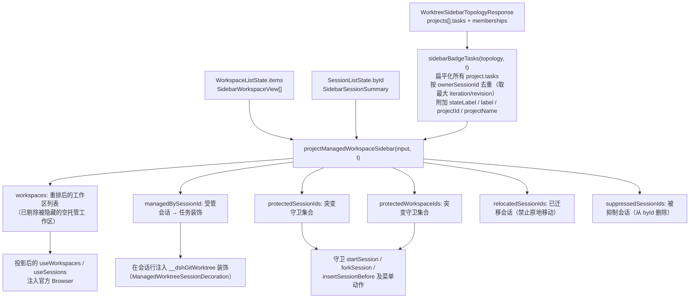
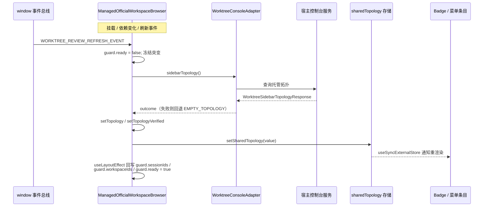
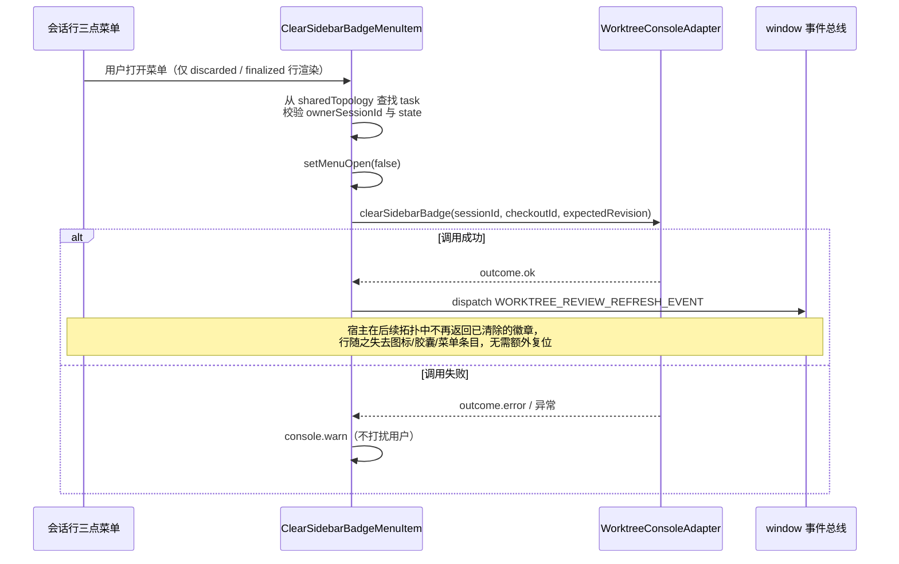
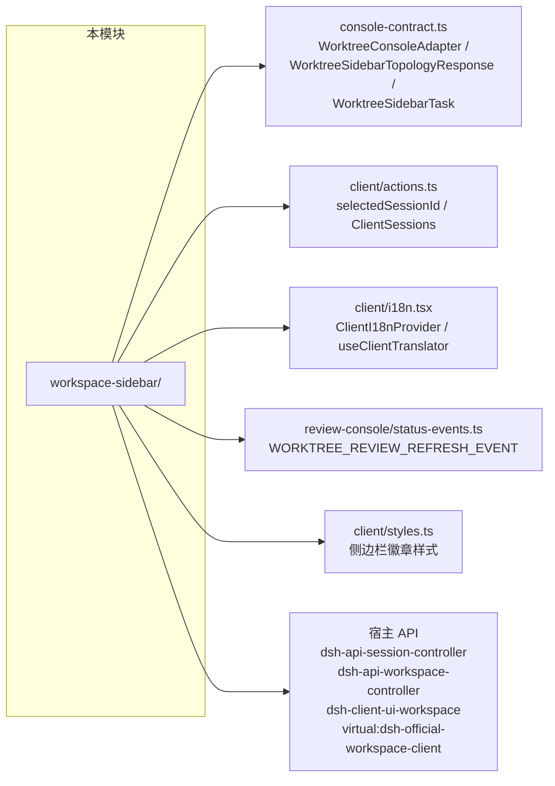

# 工作区侧边栏（client_workspace_sidebar）

!!! info "Generated documentation"
    This page was written by CodeWiki from the source code at commit [`f93ba818`](https://github.com/wloops/dsh-git-worktree/commit/f93ba8188971886c09b4c40e12c746a23853c229) on 2026-11-06 with `doubao-seed-2.1-lite`. Check the code before relying on details.

## 简介

`client_workspace_sidebar` 是客户端界面层中负责 **会话/工作区侧边栏视觉集成** 的模块。它将托管 worktree（Managed Worktree）的实时状态——例如“进行中”“待评审”“预览中”“已完成”“已丢弃”——以分支图标加状态胶囊的形式，直接呈现在宿主（DSH Host）原生的 Workspace Browser 会话行上；同时通过一组 **突变守卫**，阻止对“受托管会话/工作区”执行分叉、移动、新建会话等会破坏一对一托管所有权的操作。

该模块的特殊之处在于它需要在两种宿主环境下工作：

- **模式 A（接管，Takeover）**：宿主未激活官方 Workspace Client，由本插件自己通过版本/哈希门控的 `virtual:dsh-official-workspace-client` 应用官方实现，仅替换其中的 Browser 组件。
- **模式 B（装饰，Decorate）**：宿主已自带在线的官方 Workspace Client，此时不能重复 apply（否则会重复提供 `uiWorkspace` 服务而冲突），只能通过 ui-slots 注册表的子座位注入装饰条目。

模块由两个文件构成：`src/client/workspace-sidebar/index.tsx`（挂载、包装与装饰组件）与 `src/client/workspace-sidebar/model.ts`（纯函数数据投影）。

---

## 架构总览

**关键设计要点：**

1. **数据来源单一**：所有托管状态都来自 `adapter.sidebarTopology()` 返回的 `WorktreeSidebarTopologyResponse`（见 [控制台协议契约](../worktree_console_protocol_and_host_service/worktree_console_contract.md)），客户端本身不维护第二份真相。
2. **渲染时投影而非改写**：包装器不修改官方 Browser 的内部实现，而是把官方 store 的 `useWorkspaces` / `useSessions` 替换为“投影后的选择器”，让官方组件在无感知的情况下看到重排、补充装饰标记的列表。
3. **守卫先行**：拓扑未加载完成前（`guard.ready === false`），所有受管会话的突变入口（含新版快捷菜单座位）一律拦截，避免在拓扑尚未核实所有权时发生越界操作。

---

## 两种挂载模式

插件启动时根据宿主环境选择挂载策略。这一决策依据来自拓扑响应中的 `officialWorkspaceActive` / `workspaceClientFlavor` 字段以及宿主是否已注册 `uiWorkspace` 服务。

### 模式 A：接管（Takeover）

`registerManagedWorkspaceSidebar(ctx, adapter, applyWorkspace = applyOfficialWorkspace)` 做了三件事：

- **上下文代理**（`officialContextProxy`）：
  - 拦截 `ctx.slots.register`：对 `sidebar.workspaces.session.menu.item` / `sidebar.workspaces.session.row.action` 类条目，将非 `OWNER_SAFE_SESSION_ACTIONS`（`pin`、`rename`、`archive`、`session-id`）的动作用 `GuardedAction` 包裹——当 `guard.blockSession(sessionId)` 为真时渲染为 `null`。
  - 拦截 `ctx.get`：注入 `__dshGitWorktreeManagedGuard` 服务句柄，并为 `remote.directoryPicker` 返回 **延迟解析的 Proxy**（现代宿主的选择器服务要等 `uiWorkspace` 启动后才可用，每次调用时才重新 `ctx.get('remote.directoryPicker')`，避免启动期读空）；`remoteAccess` 在宿主未提供时回退为无害桩 `{ source: () => ({}) }`。
- **Browser 替换**：遇到 `sidebar.workspaces` 声明时，把官方 Browser 包进 `ClientI18nProvider` + `ManagedOfficialWorkspaceBrowser` 再注册，其余声明（locale、picker、stores）原样保留。
- **徽章菜单挂载**：在 Browser 组件的 `useEffect` 中通过 `registerSessionMenuEntry`（裸 `slots.register`）声明 `clear-sidebar-badge` 条目，保证官方席位先于注入条目注册。

### 模式 B：装饰（Decorate）

`registerDecoratedWorkspaceSidebar(ctx, adapter)` 适用于官方 Browser 已经渲染的场景。源码注释明确指出 **shadow `sidebar.workspaces` 本身是死路**：一个槽位只允许一个声明者，shadow 条目无法重新声明官方子节点，且 `renderSlot` 只授权声明条目，衍生 Browser 渲染第一个子节点时就会崩溃。因此改为：

- 直接 `slots.inject` 进宿主从 `sidebar.workspaces` 条目声明的两个行座位：
  - `sidebar.workspaces.session.row.action` —— 官方行把这个座位渲染在行尾 `span.rowActions` 之内的 `span.rowQuickActions` 中（与溢出按钮同处一个行尾容器）；「图标 + 胶囊」注入其中，再由 `src/client/styles.ts` 的 `order: -1` 把整个容器前置到行首（详见下方「状态徽章与视觉规范」）；
  - `sidebar.session.row.hover` —— 悬浮卡片弹层内容。
- DSH 0.2.x **不存在** `sidebar.session.row.trailing` 座位——注入该名称会永远等待一个不会到来的声明，回调永不执行、徽章永不挂载；早期也曾用过 `sidebar.session.row.leading`，但该座位在 Session 运行时会被官方行替换成状态点，同样不可靠。因此最终只注册 `row.action` 与 `row.hover` 两个真实座位。
- 由于模式 B 中 `ManagedOfficialWorkspaceBrowser` 不会挂载，`sharedTopology` 由本函数内的 `refresh()` 独立喂给，并在 `ctx.effect` 收集清理函数。

---

## 数据投影管线（model.ts）

`model.ts` 是纯函数模块，不依赖 React，负责把“官方列表状态 + 托管拓扑”合并为一份供包装器消费的投影结果。

**投影算法要点：**

1. **归属合并**：对每个托管 task，先尝试把 `ownerSessionId` 合并进其原始本地项目工作区（`task.projectId`）。若该会话当前属于 **零个** 或 **恰好一个** 工作区且与本地项目不一致，则依据注册表证明的归属 **迁移** 会话：从托管工作区移除、追加进本地项目。成员关系不唯一（多个工作区同时声称拥有该会话）时 **fail open**——保持官方行可见，绝不隐藏无法证明安全的会话。
2. **宿主证明的 memberships**：当拓扑 project 携带 `memberships: { workspaceIds, sessionIds }` 时（宿主从注册表根与不可变会话头解析出的目录归属），以声明式方式批量重排：多源声称（`workspaceClaims` / `sessionClaims` 计数 > 1）的会话一律不动，保留无关或歧义的人工账户。
3. **空工作区隐藏**：托管工作区被掏空后，若剩余成员全部是归档会话或 `blank === true` 的空会话（且不包含当前选中会话），则整个工作区从投影中移除、其非归档会话进入 `suppressedSessionIds`。注释特别强调：**绝不能** 因缺少 summary 或隐藏一个正在被选中的启动器而推断为空。
4. **守卫集合**：`protectedSessionIds` 来自全部 task 的 `ownerSessionId`；`protectedWorkspaceIds` 来自“托管工作区 ≠ 本地项目”的迁移源。二者共同决定包装器中哪些官方突变入口被静默拦截。

---

## 拓扑刷新流程

- 刷新由 `useEffect` 触发，依赖 `adapter`、`guard`、以及由工作区/会话列表派生出的 `sessionKey` / `workspaceKey`，列表结构变化时自动重拉。
- 除主动拉取外，还监听 window 上的 `WORKTREE_REVIEW_REFRESH_EVENT`（定义于 [review-console 的状态事件模块](client_review_console/client_review_console_recovery_delivery.md)），评审/恢复操作完成后可触发侧边栏同步刷新。
- 拓扑拉取失败时回退到 `EMPTY_TOPOLOGY` 并 `guard.ready = false`：此时 **所有** 突变入口被守卫拦截（`blockSession`/`blockWorkspace` 在 `!ready` 时恒真），保证“宁可不操作，不可误操作”。

---

## 清除徽章菜单（终态行）

该条目通过 `registerClearSidebarBadgeEntry` 以 `id: 'clear-sidebar-badge'`、`order: 500` 注册到 `sidebar.workspaces.session.menu.item` 座位；带期望 revision 的请求形式（`expectedRevision: task.revision`）保证幂等与防陈旧覆盖。

---

## 组件明细

| 组件 | 位置 | 职责 |
|---|---|---|
| `registerManagedWorkspaceSidebar` | `index.tsx` | 模式 A 入口：代理注册上下文并 apply 官方 Workspace Client |
| `registerDecoratedWorkspaceSidebar` | `index.tsx` | 模式 B 入口：官方已在线时经子座位注入装饰，并独立喂养 sharedTopology |
| `ManagedOfficialWorkspaceBrowser` | `index.tsx` | 官方 Browser 包装器：拉取拓扑、生成投影、替换选择器与突变入口、挂载清除徽章菜单 |
| `ManagedWorktreeSessionDecoration` | `index.tsx` | 会话行装饰元数据接口（`kind: 'managed-worktree'`、`state`、`label`、`originalTitle`），挂在官方会话 summary 的 `__dshGitWorktree` 字段上 |
| `ManagedWorkspaceGuard` | `index.tsx` | 突变守卫（`ready` / `sessionIds` / `workspaceIds` / `blockSession` / `blockWorkspace`），同时暴露给新版官方快捷菜单座位 |
| `WorktreeIdentity` / `WorktreeStatusBadgeEntry` | `index.tsx` | 行内渲染“分支图标 + 状态胶囊”，仅对匹配到 task 的会话行渲染 |
| `ClearSidebarBadgeMenuItem` | `index.tsx` | 终态行的“清除侧边栏徽章”菜单项 |
| `projectManagedWorkspaceSidebar` | `model.ts` | 核心投影函数：合并归属、迁移会话、计算隐藏/抑制/受保护集合 |
| `sidebarBadgeTasks` | `model.ts` | 拓扑扁平化 + 按 owner 去重（最大 iteration/revision）+ 附加 i18n 标签 |
| `ManagedWorkspaceSidebarProjection` | `model.ts` | 投影结果接口（workspaces / managedBySessionId / 四个保护集合） |
| `ProjectedManagedTask` | `model.ts` | `WorktreeSidebarTask` 扩展：`projectId`、`projectName`、`stateLabel`（胶囊文案）、`label`（含来源分支的 tooltip/aria 文案） |
| `SidebarWorkspaceView` / `SidebarSessionSummary` | `model.ts` | 官方列表状态的只读结构化视图 |

---

## 状态徽章与视觉规范

徽章的状态色板由 `src/client/styles.ts` 中的 `.dsh-git-worktree-sidebar-icon` / `.dsh-git-worktree-sidebar-badge` 规则驱动，通过 `data-worktree-state` 属性切换 CSS 变量 `--dsh-wt-sidebar-accent`：

| `state` | i18n 文案键 | 视觉语义 |
|---|---|---|
| `working` | `in.progress` | 主色（蓝），进行中 |
| `ready_for_review` | `ready.for.review` | 警告色（琥珀），待评审 |
| `preview_active` | `previewing` | 主色与错误色的混合，预览中 |
| `preview_detached` | `awaiting.recovery` | 错误色（红），预览已脱离 |
| `recovery_required` | `recovery.required` | 错误色（红），需要恢复 |
| `finalized` | `completed` | 成功色（绿），已完成 |
| `discarded` | `discarded` | 次要色（灰），已丢弃 |

关键样式约束（见 `src/client/styles.ts`）：官方行的 leading 座位是固定 16px 盒子（`._slot{width:16px;flex:none}`），且 Session 运行时会被状态点替换，不能作为标记的常驻容器。因此「图标 + 胶囊」改注入 `row.action`——官方行把这个座位渲染在行尾 `span.rowActions` 之内的 `span.rowQuickActions` 中，我们的标记 span 比行尾最后一个子 span 深了一层。样式表用结构化选择器 `[role="treeitem"] > span:last-child:has(.dsh-git-worktree-sidebar-icon)`（`:has()` 用后代匹配而非子匹配）把该容器 `display: inline-flex` 并以 `order: -1` 整体前置到 leading 座位与标题之前——无需重排整行，也不依赖带哈希的 CSS-module 类名。配套地，容器内的溢出按钮默认 `display: none`、行 hover 或菜单展开（`aria-expanded="true"`）时才恢复 `display: inline-flex`，避免被前置的隐藏盒子留下空洞；图标与胶囊在容器内固定 `flex: 0 0 auto`，不随标题伸缩。

---

## 依赖关系

- **协议层**：`sidebarTopology()`、`clearSidebarBadge()` 与全部 `WorktreeSidebar*` 类型的定义见 [控制台协议契约](../worktree_console_protocol_and_host_service/worktree_console_contract.md)；适配器的远程实现见 [客户端控制台远程层](client_console_remote.md)。
- **共享基建**：`selectedSessionId` 等会话选择逻辑、`ClientI18nProvider`、行卡片样式注册见 [客户端核心](client_core.md)。
- **刷新事件**：`WORKTREE_REVIEW_REFRESH_EVENT` 的产生方（评审面板、恢复延续）见 [评审控制台](client_review_console.md) 及其 [恢复与投递子模块](client_review_console/client_review_console_recovery_delivery.md)。
- **上层关系**：本模块是 [客户端界面层](../worktree_client_interface_layer.md)（`worktree_client_interface_layer`）的六个客户端子模块之一，与 [目标控制台](client_target_console.md)、[评审控制台](client_review_console.md)、[设置卡片](client_settings_card.md) 并列，共同构成托管 worktree 在客户端的全部可见面。

??? abstract "Documented components (5)"
    - [`ManagedWorktreeSessionDecoration`](https://github.com/wloops/dsh-git-worktree/blob/f93ba8188971886c09b4c40e12c746a23853c229/src%5Cclient%5Cworkspace-sidebar%5Cindex.tsx) — `src\client\workspace-sidebar\index.tsx`
    - [`ManagedWorkspaceSidebarProjection`](https://github.com/wloops/dsh-git-worktree/blob/f93ba8188971886c09b4c40e12c746a23853c229/src%5Cclient%5Cworkspace-sidebar%5Cmodel.ts) — `src\client\workspace-sidebar\model.ts`
    - [`ProjectedManagedTask`](https://github.com/wloops/dsh-git-worktree/blob/f93ba8188971886c09b4c40e12c746a23853c229/src%5Cclient%5Cworkspace-sidebar%5Cmodel.ts) — `src\client\workspace-sidebar\model.ts`
    - [`SidebarSessionSummary`](https://github.com/wloops/dsh-git-worktree/blob/f93ba8188971886c09b4c40e12c746a23853c229/src%5Cclient%5Cworkspace-sidebar%5Cmodel.ts) — `src\client\workspace-sidebar\model.ts`
    - [`SidebarWorkspaceView`](https://github.com/wloops/dsh-git-worktree/blob/f93ba8188971886c09b4c40e12c746a23853c229/src%5Cclient%5Cworkspace-sidebar%5Cmodel.ts) — `src\client\workspace-sidebar\model.ts`

