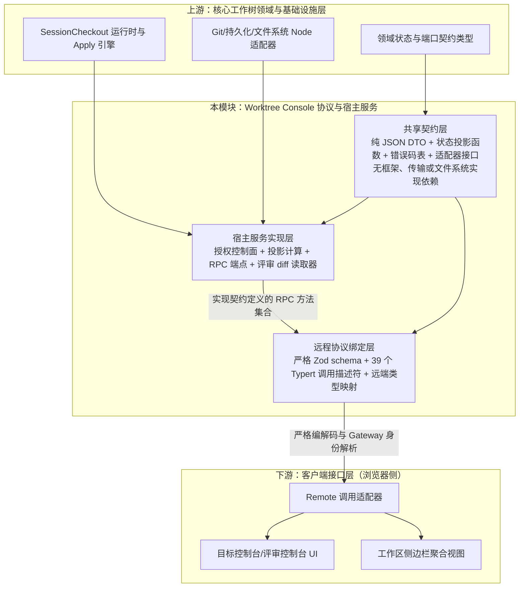

# Worktree Console 协议与宿主服务总览

!!! info "Generated documentation"
    This page was written by CodeWiki from the source code at commit [`bccd87a6`](https://github.com/wloops/dsh-git-worktree/commit/bccd87a6d5270c62ed752e21426f9b3062418333) on 2026-11-06 with `doubao-seed-2.1-lite`. Check the code before relying on details.

本模块是连接核心工作树领域层与浏览器侧客户端 UI 的桥接层，为 Worktree Console 提供完整的跨边界命令面。它的核心目标是把运行在 Node 宿主进程内的会话检出、Git 操作、持久化管理能力，安全、类型安全地暴露给浏览器端控制台，同时严格执行全模块的核心权威规则：**每一次跨边界调用都必须先在 Host 侧解析出确切的调用方 Session，并在执行时重新校验项目归属、工作目录、revision 与评审身份，客户端永远无法自证身份或绕过服务端授权直接变更状态**。

模块内部刻意拆分为三个职责完全分离的子层，分别承担类型契约、线上协议、服务实现的职责，避免实现细节污染共享类型，也避免协议层混入业务逻辑。

## 模块架构
下图展示了本模块在系统中的位置，以及三个内部子层与上下游模块的依赖关系：

## 核心组件文档参考
本模块的三个核心子组件分别有独立的详细文档，覆盖实现细节、设计决策与操作流程：

1. **[Worktree Console 共享契约](worktree_console_protocol_and_host_service/worktree_console_contract.md)**
   作为 Host 与 Client 两条轨道共享的纯净类型层，定义了目标状态机、分层投影 DTO、16 个能力位模型、请求/响应载荷结构、错误码元数据与统一适配器接口。该层刻意不含任何运行时实现，确保同一份类型可以同时在 Node 与浏览器环境中编译运行，杜绝两侧对领域状态的解释漂移。

2. **[Worktree Console 宿主服务](worktree_console_protocol_and_host_service/worktree_console_host.md)**
   运行在 Node 宿主进程内的服务端实现，负责完成调用方身份授权、持久化记录到投影 DTO 的转换、能力位的权威计算、Typert RPC 端点暴露，以及带字节预算限制的评审 diff 取证。该层是所有跨边界操作的唯一授权执行者，所有异常都会被折叠为结构化的结果信封，绝不允许异常跨越 Host/Client 边界。

3. **[Worktree Console Remote 绑定](worktree_console_protocol_and_host_service/worktree_console_remote.md)**
   零业务逻辑的线上协议层，把共享契约定义的类型翻译为严格 Zod 线格式 schema 与冻结的 Typert 调用描述符集合。该层通过身份消毒、载荷大小限制、双向严格 schema 校验，保证跨版本部署的 Host 与 Client 之间不会出现静默接口漂移，所有协议变更都会在发布门禁环节被机器校验拦截。

整体设计上，本模块遵循"权威在服务端"的原则：客户端只负责渲染 Host 计算好的状态、能力位与投影结果，所有授权、状态变更、身份校验都在 Host 侧完成，确保跨浏览器的工作树操作不会出现越权、状态不一致或协议漂移问题。

??? abstract "Documented components (86)"
    - [`WorktreeApplyConflictContinuation`](https://github.com/wloops/dsh-git-worktree/blob/bccd87a6d5270c62ed752e21426f9b3062418333/src%5Cconsole-contract.ts) — `src\console-contract.ts`
    - [`WorktreeApplyConflictRecoveryProof`](https://github.com/wloops/dsh-git-worktree/blob/bccd87a6d5270c62ed752e21426f9b3062418333/src%5Cconsole-contract.ts) — `src\console-contract.ts`
    - [`WorktreeClientBootReport`](https://github.com/wloops/dsh-git-worktree/blob/bccd87a6d5270c62ed752e21426f9b3062418333/src%5Cconsole-contract.ts) — `src\console-contract.ts`
    - [`WorktreeConsoleAbandonedListRequest`](https://github.com/wloops/dsh-git-worktree/blob/bccd87a6d5270c62ed752e21426f9b3062418333/src%5Cconsole-contract.ts) — `src\console-contract.ts`
    - [`WorktreeConsoleAbandonedListResponse`](https://github.com/wloops/dsh-git-worktree/blob/bccd87a6d5270c62ed752e21426f9b3062418333/src%5Cconsole-contract.ts) — `src\console-contract.ts`
    - [`WorktreeConsoleAbandonedSnapshot`](https://github.com/wloops/dsh-git-worktree/blob/bccd87a6d5270c62ed752e21426f9b3062418333/src%5Cconsole-contract.ts) — `src\console-contract.ts`
    - [`WorktreeConsoleAdapter`](https://github.com/wloops/dsh-git-worktree/blob/bccd87a6d5270c62ed752e21426f9b3062418333/src%5Cconsole-contract.ts) — `src\console-contract.ts`
    - [`WorktreeConsoleBeginNextIterationRequest`](https://github.com/wloops/dsh-git-worktree/blob/bccd87a6d5270c62ed752e21426f9b3062418333/src%5Cconsole-contract.ts) — `src\console-contract.ts`
    - [`WorktreeConsoleCapabilities`](https://github.com/wloops/dsh-git-worktree/blob/bccd87a6d5270c62ed752e21426f9b3062418333/src%5Cconsole-contract.ts) — `src\console-contract.ts`
    - [`WorktreeConsoleCheckpointRequest`](https://github.com/wloops/dsh-git-worktree/blob/bccd87a6d5270c62ed752e21426f9b3062418333/src%5Cconsole-contract.ts) — `src\console-contract.ts`
    - [`WorktreeConsoleClearSidebarBadgeRequest`](https://github.com/wloops/dsh-git-worktree/blob/bccd87a6d5270c62ed752e21426f9b3062418333/src%5Cconsole-contract.ts) — `src\console-contract.ts`
    - [`WorktreeConsoleCreatePreviewRecoveryHandoffRequest`](https://github.com/wloops/dsh-git-worktree/blob/bccd87a6d5270c62ed752e21426f9b3062418333/src%5Cconsole-contract.ts) — `src\console-contract.ts`
    - [`WorktreeConsoleCreatePreviewRecoveryHandoffResponse`](https://github.com/wloops/dsh-git-worktree/blob/bccd87a6d5270c62ed752e21426f9b3062418333/src%5Cconsole-contract.ts) — `src\console-contract.ts`
    - [`WorktreeConsoleCreateRequest`](https://github.com/wloops/dsh-git-worktree/blob/bccd87a6d5270c62ed752e21426f9b3062418333/src%5Cconsole-contract.ts) — `src\console-contract.ts`
    - [`WorktreeConsoleCreateResponse`](https://github.com/wloops/dsh-git-worktree/blob/bccd87a6d5270c62ed752e21426f9b3062418333/src%5Cconsole-contract.ts) — `src\console-contract.ts`
    - [`WorktreeConsoleCurrentRequest`](https://github.com/wloops/dsh-git-worktree/blob/bccd87a6d5270c62ed752e21426f9b3062418333/src%5Cconsole-contract.ts) — `src\console-contract.ts`
    - [`WorktreeConsoleCurrentResponse`](https://github.com/wloops/dsh-git-worktree/blob/bccd87a6d5270c62ed752e21426f9b3062418333/src%5Cconsole-contract.ts) — `src\console-contract.ts`
    - [`WorktreeConsoleDiffFile`](https://github.com/wloops/dsh-git-worktree/blob/bccd87a6d5270c62ed752e21426f9b3062418333/src%5Cconsole-contract.ts) — `src\console-contract.ts`
    - [`WorktreeConsoleDiscardRequest`](https://github.com/wloops/dsh-git-worktree/blob/bccd87a6d5270c62ed752e21426f9b3062418333/src%5Cconsole-contract.ts) — `src\console-contract.ts`
    - [`WorktreeConsoleError`](https://github.com/wloops/dsh-git-worktree/blob/bccd87a6d5270c62ed752e21426f9b3062418333/src%5Cconsole-contract.ts) — `src\console-contract.ts`
    - [`WorktreeConsoleErrorMeta`](https://github.com/wloops/dsh-git-worktree/blob/bccd87a6d5270c62ed752e21426f9b3062418333/src%5Cconsole-contract.ts) — `src\console-contract.ts`
    - [`WorktreeConsoleFinalizePreviewRequest`](https://github.com/wloops/dsh-git-worktree/blob/bccd87a6d5270c62ed752e21426f9b3062418333/src%5Cconsole-contract.ts) — `src\console-contract.ts`
    - [`WorktreeConsoleFinalizeRequest`](https://github.com/wloops/dsh-git-worktree/blob/bccd87a6d5270c62ed752e21426f9b3062418333/src%5Cconsole-contract.ts) — `src\console-contract.ts`
    - [`WorktreeConsoleGitBranch`](https://github.com/wloops/dsh-git-worktree/blob/bccd87a6d5270c62ed752e21426f9b3062418333/src%5Cconsole-contract.ts) — `src\console-contract.ts`
    - [`WorktreeConsoleGitCreateTagRequest`](https://github.com/wloops/dsh-git-worktree/blob/bccd87a6d5270c62ed752e21426f9b3062418333/src%5Cconsole-contract.ts) — `src\console-contract.ts`
    - [`WorktreeConsoleGitDeleteTagRequest`](https://github.com/wloops/dsh-git-worktree/blob/bccd87a6d5270c62ed752e21426f9b3062418333/src%5Cconsole-contract.ts) — `src\console-contract.ts`
    - [`WorktreeConsoleGitGraphCommit`](https://github.com/wloops/dsh-git-worktree/blob/bccd87a6d5270c62ed752e21426f9b3062418333/src%5Cconsole-contract.ts) — `src\console-contract.ts`
    - [`WorktreeConsoleGitGraphResponse`](https://github.com/wloops/dsh-git-worktree/blob/bccd87a6d5270c62ed752e21426f9b3062418333/src%5Cconsole-contract.ts) — `src\console-contract.ts`
    - [`WorktreeConsoleGitMutationResponse`](https://github.com/wloops/dsh-git-worktree/blob/bccd87a6d5270c62ed752e21426f9b3062418333/src%5Cconsole-contract.ts) — `src\console-contract.ts`
    - [`WorktreeConsoleGitOverviewResponse`](https://github.com/wloops/dsh-git-worktree/blob/bccd87a6d5270c62ed752e21426f9b3062418333/src%5Cconsole-contract.ts) — `src\console-contract.ts`
    - [`WorktreeConsoleGitPruneEntry`](https://github.com/wloops/dsh-git-worktree/blob/bccd87a6d5270c62ed752e21426f9b3062418333/src%5Cconsole-contract.ts) — `src\console-contract.ts`
    - [`WorktreeConsoleGitPruneResponse`](https://github.com/wloops/dsh-git-worktree/blob/bccd87a6d5270c62ed752e21426f9b3062418333/src%5Cconsole-contract.ts) — `src\console-contract.ts`
    - [`WorktreeConsoleGitPushTagRequest`](https://github.com/wloops/dsh-git-worktree/blob/bccd87a6d5270c62ed752e21426f9b3062418333/src%5Cconsole-contract.ts) — `src\console-contract.ts`
    - [`WorktreeConsoleGitTag`](https://github.com/wloops/dsh-git-worktree/blob/bccd87a6d5270c62ed752e21426f9b3062418333/src%5Cconsole-contract.ts) — `src\console-contract.ts`
    - [`WorktreeConsoleGitTagListResponse`](https://github.com/wloops/dsh-git-worktree/blob/bccd87a6d5270c62ed752e21426f9b3062418333/src%5Cconsole-contract.ts) — `src\console-contract.ts`
    - [`WorktreeConsoleGitTagMutationResponse`](https://github.com/wloops/dsh-git-worktree/blob/bccd87a6d5270c62ed752e21426f9b3062418333/src%5Cconsole-contract.ts) — `src\console-contract.ts`
    - [`WorktreeConsoleInspectRequest`](https://github.com/wloops/dsh-git-worktree/blob/bccd87a6d5270c62ed752e21426f9b3062418333/src%5Cconsole-contract.ts) — `src\console-contract.ts`
    - [`WorktreeConsoleInspectResponse`](https://github.com/wloops/dsh-git-worktree/blob/bccd87a6d5270c62ed752e21426f9b3062418333/src%5Cconsole-contract.ts) — `src\console-contract.ts`
    - [`WorktreeConsoleListRequest`](https://github.com/wloops/dsh-git-worktree/blob/bccd87a6d5270c62ed752e21426f9b3062418333/src%5Cconsole-contract.ts) — `src\console-contract.ts`
    - [`WorktreeConsoleListResponse`](https://github.com/wloops/dsh-git-worktree/blob/bccd87a6d5270c62ed752e21426f9b3062418333/src%5Cconsole-contract.ts) — `src\console-contract.ts`
    - [`WorktreeConsoleMutationResponse`](https://github.com/wloops/dsh-git-worktree/blob/bccd87a6d5270c62ed752e21426f9b3062418333/src%5Cconsole-contract.ts) — `src\console-contract.ts`
    - [`WorktreeConsolePreflightRequest`](https://github.com/wloops/dsh-git-worktree/blob/bccd87a6d5270c62ed752e21426f9b3062418333/src%5Cconsole-contract.ts) — `src\console-contract.ts`
    - [`WorktreeConsolePreflightResponse`](https://github.com/wloops/dsh-git-worktree/blob/bccd87a6d5270c62ed752e21426f9b3062418333/src%5Cconsole-contract.ts) — `src\console-contract.ts`
    - [`WorktreeConsolePreparePreviewRecoveryAnalysisRequest`](https://github.com/wloops/dsh-git-worktree/blob/bccd87a6d5270c62ed752e21426f9b3062418333/src%5Cconsole-contract.ts) — `src\console-contract.ts`
    - [`WorktreeConsolePrepareRegenerationRequest`](https://github.com/wloops/dsh-git-worktree/blob/bccd87a6d5270c62ed752e21426f9b3062418333/src%5Cconsole-contract.ts) — `src\console-contract.ts`
    - [`WorktreeConsolePreviewRecovery`](https://github.com/wloops/dsh-git-worktree/blob/bccd87a6d5270c62ed752e21426f9b3062418333/src%5Cconsole-contract.ts) — `src\console-contract.ts`
    - [`WorktreeConsolePreviewRecoveryPreflightRequest`](https://github.com/wloops/dsh-git-worktree/blob/bccd87a6d5270c62ed752e21426f9b3062418333/src%5Cconsole-contract.ts) — `src\console-contract.ts`
    - [`WorktreeConsolePreviewRecoveryPreflightResponse`](https://github.com/wloops/dsh-git-worktree/blob/bccd87a6d5270c62ed752e21426f9b3062418333/src%5Cconsole-contract.ts) — `src\console-contract.ts`
    - [`WorktreeConsolePreviewRequest`](https://github.com/wloops/dsh-git-worktree/blob/bccd87a6d5270c62ed752e21426f9b3062418333/src%5Cconsole-contract.ts) — `src\console-contract.ts`
    - [`WorktreeConsoleProject`](https://github.com/wloops/dsh-git-worktree/blob/bccd87a6d5270c62ed752e21426f9b3062418333/src%5Cconsole-contract.ts) — `src\console-contract.ts`
    - … and 36 more

