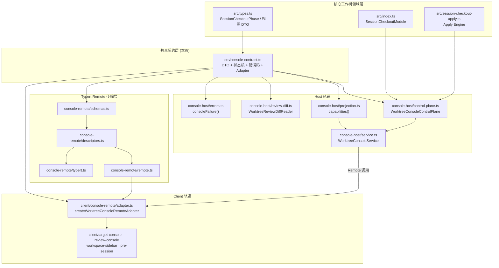
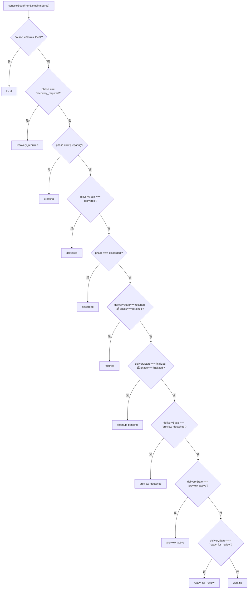
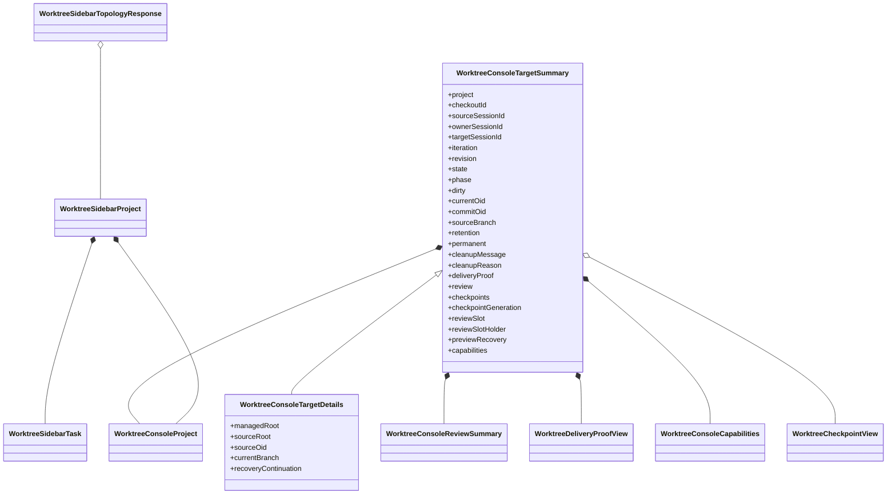
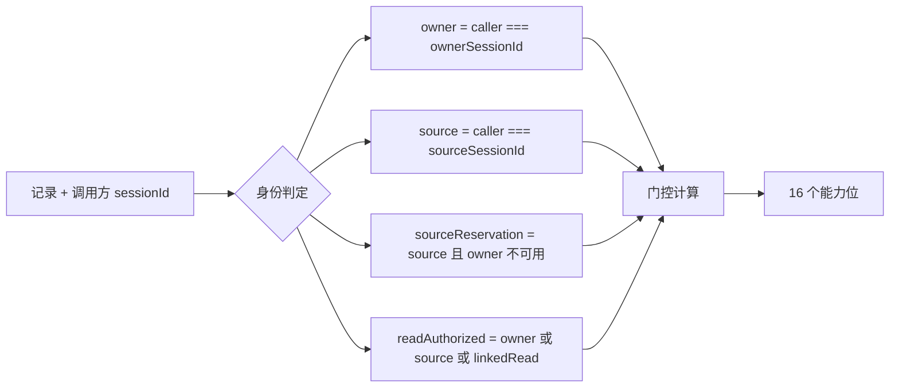
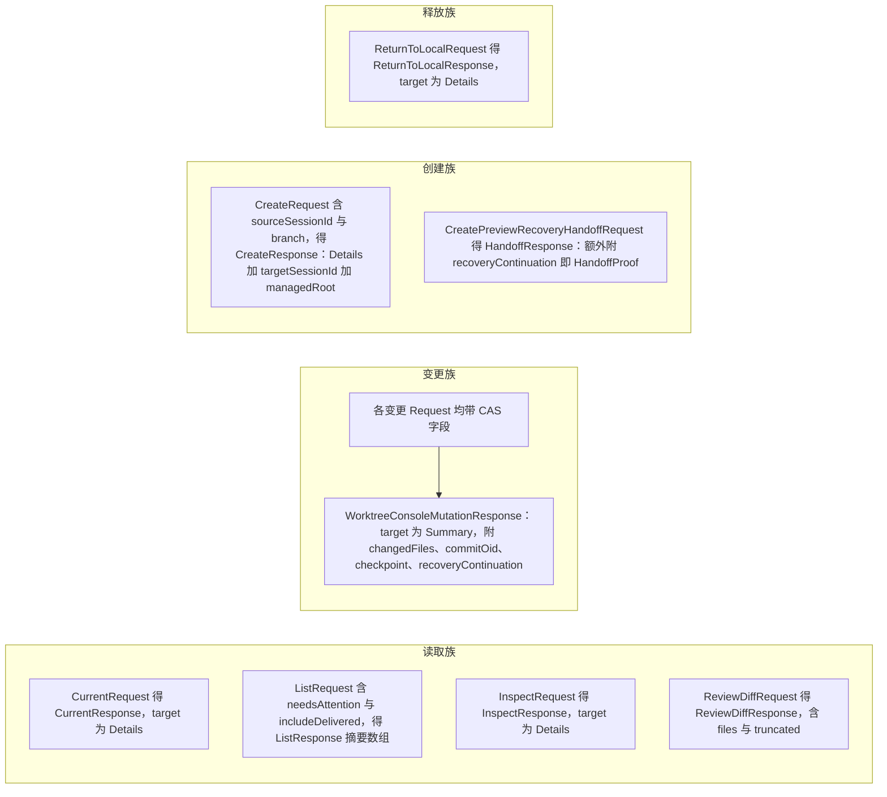
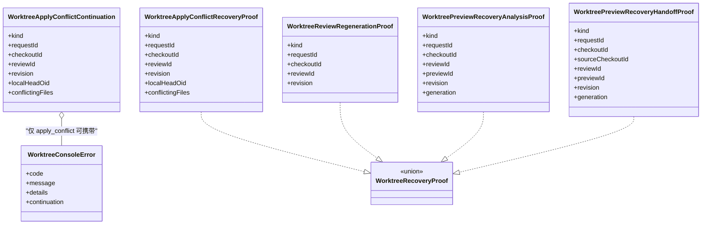
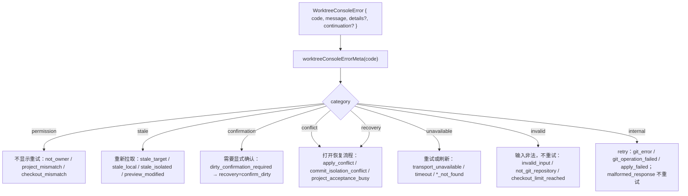
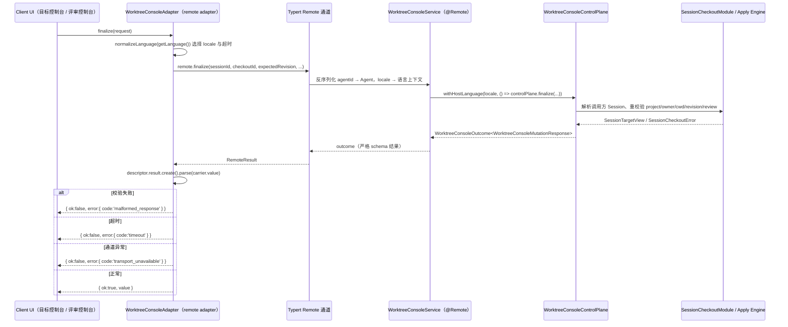

# Worktree Console 共享契约（`src/console-contract.ts`）

!!! info "Generated documentation"
    This page was written by CodeWiki from the source code at commit [`bccd87a6`](https://github.com/wloops/dsh-git-worktree/commit/bccd87a6d5270c62ed752e21426f9b3062418333) on 2026-11-06 with `doubao-seed-2.1-lite`. Check the code before relying on details.

本页文档化 `dsh-git-worktree` 插件中 **Worktree Console 的 JSON-only 共享契约层**。该层由 Host（Node 侧服务）与 Client（浏览器侧 UI）两条轨道共同引用，定义了目标状态机、投影 DTO、能力位、请求/响应载荷、错误码表以及适配器接口。

它本身**不含任何 Cordis、React、Remote 或文件系统实现**——正如下方源码注释所声明的，这是一个刻意保持"纯净"的契约模块：

> *JSON-only shared contract for the future Harness-native Worktree Console. This module deliberately contains no Cordis, React, Remote or filesystem implementation. Host and Client tracks share these DTOs while preserving one authority rule: every Host operation resolves an exact caller Session and re-validates project, owner, cwd, revision and review identity at execution.*

权威规则（authority rule）是整个契约的设计轴心：**任何一次 Host 操作都必须先解析出确切的调用方 Session，并在执行时重新校验项目、归属者、工作目录、revision 与 review 身份**。契约中的每一个字段都服务于这条规则——要么是不可伪造的身份标识，要么是 Host 计算出的、供 Client 直接渲染的授权结果。

模块标识：`@module dsh-git-worktree/console-contract`，构建产物入口见 `package.json` 的 `exports["./console-contract"]`（`lib/console-contract.js` / `lib/console-contract.d.ts`）。

---

## 1. 在系统中的位置

契约层是「协议」与「宿主服务」之间的唯一共享面。上层的 Host 实现与 Client 实现都向下依赖它，而同级的 Remote 描述符层则把它的数据类型翻译成可上线传输的 Zod schema。



相关页面：
- 上层总览：[Worktree Console 协议与宿主服务](../worktree_console_protocol_and_host_service.md)
- Host 实现：[Worktree Console Host 服务](worktree_console_host.md)
- 传输层：[Worktree Console Remote 绑定](worktree_console_remote.md)
- 领域类型来源：[会话检出域契约](../core_worktree_domain_and_infrastructure/session_checkout_domain/session_checkout_domain_contracts.md)
- Client 消费方：[客户端目标控制台](../worktree_client_interface_layer/client_target_console.md)、[客户端评审控制台](../worktree_client_interface_layer/client_review_console.md)

---

## 2. 契约的对外形状：一条命令面（face）

契约以 `WorktreeConsoleAdapter` 接口定义 Client 可见的全部 seam。Host 侧的 `WorktreeConsoleService`（`@Remote` 方法集合）、`WorktreeConsoleControlPlane`（接口）与 Client 侧的 `createWorktreeConsoleRemoteAdapter` 三者的方法名**完全一一对应**，形成一次三方的"形状对齐"检查。

按用途可分为六组：

| 分组 | 方法 | 语义要点 |
| --- | --- | --- |
| 拓扑与遥测 | `sidebarTopology`、`clientBootReport`（可选实现于 Host） | 侧栏聚合只读拓扑；Client 上报实际运行的 flavor 分支 |
| 读取投影 | `current`、`list`、`inspect`、`reviewDiff` | 身份校验后的摘要 / 详情 / 只读 diff |
| 创建 | `preflightCreate?`、`createWithInitialCommit?`、`initializeProject?`、`create` | `targetSessionId` 一律由 Host 分配，浏览器从不选择归属身份 |
| 评审 → 交付 | `preflight`、`preview`、`checkpoint`、`resumeRevision`、`prepareReviewRegeneration`、`rollbackPreview`、`discard`、`finalize`、`finalizePreview` | 全部携带 `expectedRevision` / `expectedReviewId` 的 CAS 语义 |
| 恢复 | `previewRecoveryPreflight`、`preparePreviewRecoveryAnalysis`、`createPreviewRecoveryHandoff` | 以 `recoveryProof` 为一次性授权凭证 |
| 保留与清理 | `setRetention`、`setPermanent`、`retryCleanup`、`beginNextIteration`、`returnToLocal`、`clearSidebarBadge`、`listAbandoned?`、`restoreAbandoned?` | 冻结目录本身的生命周期 |
| Git 概览 | `gitOverview`、`gitGraph`、`gitCreateBranch`、`gitSwitchBranch`、`gitPruneMergedBranches`、`gitListTags`、`gitCreateTag`、`gitDeleteTag`、`gitPushTag` | 只读浏览 + `git branch -d` 与 tag 的安全变更 |

带 `?` 的方法为**可选成员**：`preflightCreate`、`createWithInitialCommit`、`initializeProject`、`listAbandoned`、`restoreAbandoned`。这让旧 Host 能在不破坏 Client 编译的前提下逐步获得新面。

---

## 3. 状态模型：领域事实 → UI 状态

### 3.1 目标状态枚举

`WORKTREE_CONSOLE_TARGET_STATES` 是 UI 面向的稳定状态集合：

```
local · creating · working · ready_for_review · preview_active
preview_detached · retained · cleanup_pending · recovery_required
delivered · discarded
```

对应的 `WorktreeConsoleTargetState` 类型由该常量派生。另有 `WorktreeConsoleDeliveryState`（`working | ready_for_review | preview_active | preview_detached | finalized | retained | delivered`）描述交付子状态。

### 3.2 投影函数

契约自带两个**纯投影函数**，Host 与 Client 因此不可能对同一记录产生不同的状态解释：

- `worktreeReachedDelivery(phase, deliveryState)`：判断任务是否已"抵达交付"。当 `deliveryState` 为 `delivered / finalized / retained`，或 `phase` 为 `finalized / retained` 时为真。关键设计点：**交付标签优先于 phase**，因为一次成功的清理会把 phase 推进到 `discarded`，而任务其实已经完成，绝不能被投影成"已放弃"。
- `consoleStateFromDomain(source)`：把 `WorktreeConsoleProjectionSource`（`kind` + `phase` + 可选 `deliveryState`）折叠成一个稳定的 UI 状态。



注意 `phase === 'discarded'` 必须排在 `retained`/`finalized` 判定之前：被放弃的记录会保留其放弃前所到达的交付标签，若顺序颠倒，一次「放弃」就会被错误地渲染成「已保留」。唯一例外是 `delivered`——它先于 `discarded` 判定，因为交付的成果已经落在 Local。

### 3.3 侧栏任务状态

`WorktreeSidebarTaskState`（`working · ready_for_review · preview_active · preview_detached · recovery_required · finalized · discarded`）是**只用于 Workspace 侧栏聚合**的独立小状态集，与目标状态刻意不同：侧栏需要区分 `finalized`（清理待办）与 `discarded`（终态徽章），但不关心 `local`/`creating`/`retained`。

---

## 4. DTO 分层：摘要、详情与侧栏身份

契约按"暴露面"严格分级——路径与恢复凭证只出现在身份校验通过的详情里。



其中 `WorktreeConsoleDeliveryProof` 只是 `WorktreeDeliveryProofView` 的别名（`export type WorktreeConsoleDeliveryProof = WorktreeDeliveryProofView`），`checkpoints` 数组元素是 `WorktreeCheckpointView`——两者都直接复用领域层的视图类型，契约不重新定义它们。

| DTO | 用途 | 是否含路径 | 授权前提 |
| --- | --- | --- | --- |
| `WorktreeConsoleTargetSummary` | 项目列表、头部状态胶囊 | 否（path-free） | 任何可读调用方 |
| `WorktreeConsoleTargetDetails` | 仅当调用方被允许打开该目标时 | 是（`managedRoot` / `sourceRoot`） | Host 身份校验通过后 |
| `WorktreeSidebarTask` | 只读任务身份，用于侧栏聚合 | 否 | 无变更权限 |
| `WorktreeSidebarProject` | 项目分组 + Host 证明的目录归属（`memberships`） | 否 | 无路径、无变更权 |
| `WorktreeSidebarTopologyResponse` | 全部项目 + `workspaceClientFlavor` + `officialWorkspaceActive` | 否 | 服务端钉定的包代次 |
| `WorktreeConsoleReviewSummary` | 评审摘要（`reviewId`/`revision`/`iteration`/测试/建议提交信息） | 否 | — |
| `WorktreeConsoleDiffFile` + `WorktreeConsoleFileStatus` | 评审 diff 行（`added/modified/deleted/renamed/binary`），带 `truncated` | 相对路径 | 绑定评审身份 |
| `WorktreeClientBootReport` | Client 面包屑上报（flavor、branch、是否注册、耗时） | 否 | — |

几个值得注意的字段语义：

- `sourceBranch`：该目标所工作的分支——记录里有自己的 Session 分支时用它，否则回落到记录的 source ref（fork 点）；Local 侧处于 detached 或无版本状态时为 `null`。
- `currentBranch`（仅详情）：对话气泡显示的分支名，即 Git 此刻对该 worktree 的报告，无法观测时回落至记录的 session 分支。
- `permanent`：codex 对齐的常驻标记，被标记的 worktree 豁免自动清理。
- `cleanupReason`（`WorktreeCleanupReason`：`directory_busy · modified_after_finalize · identity_changed · detached_residue · quarantine_busy`）：结构化的清理阻塞原因。客户端据此在「交付后出现新改动」时给出显式的"放弃改动再清理"确认，而不是让人对着一句说明反复点重试。
- `dirtyCount`（Git 概览）：未提交条目数，或在 `git status` 读取失败时为 `-1`。仓库中的未跟踪文件可能多到一次 status 读取装不下——报告 `0` 会对未知状态谎称"干净"。
- `pushed`（`WorktreeConsoleGitTag`）：`origin` 是否已有同名标签；无法查询远端（离线 / 无 `origin`）时为 `null`，绝不能被当作"未推送"。

---

## 5. 能力位（`WorktreeConsoleCapabilities`）

Client 从不自行推断"这个按钮该不该出现"——`capabilities` 由 Host 依据记录状态与调用方身份计算并下发，Client 只做渲染。`console-host/projection.ts` 中的 `capabilities(record, callerSessionId, ownerSessionAvailable, linkedRead)` 是唯一权威实现：



| 能力位 | 门控条件（Host 计算） | 说明 |
| --- | --- | --- |
| `create` | 恒为 `false` | 投影层从不授予创建；创建走 `preflightCreate`/`create` |
| `open` | `readAuthorized && active && (!linkedRead 或 owner 可用)` | 是否可打开详情 |
| `inspect` | `readAuthorized` | 只读详情 |
| `discard` | `(owner 或 sourceReservation) && active && !cleanup && !previewDetached` | 放弃 |
| `preflight` | `owner && ready`（`phase==='ready'` 且 `delivery.state==='ready_for_review'`） | 应用前检查 |
| `preview` | `owner && ready` | 在 Local 预览 |
| `checkpoint` | `owner && (ready 或 previewActive)` | 把确切评审快照保存为托管专用 stage 并继续编辑 |
| `resumeRevision` | `owner && ready` | 作废未同步的评审、恢复同一迭代，不动 Local |
| `rollbackPreview` | `owner && (previewActive 或 previewDetached 或 previewRecovery)` | 回滚预览 |
| `finalize` | `owner && ready` | Ready → Commit 直连路径，跳过 Local 预览 |
| `finalizePreview` | `owner && (previewActive 或 previewDetached)` | 从预览状态直接落地 |
| `setRetention` | `owner && delivery.state === 'retained'` | 保留期只作用于冻结目录，故绝不开放给 Local 源会话 |
| `setPermanent` | `owner && active` | 常驻标记 |
| `retryCleanup` | `owner && cleanup`（finalized 或 retained） | 重试清理 |
| `beginNextIteration` | `owner && delivered`（`phase==='discarded'` 且 `delivery.state==='delivered'`） | 为已被清理的交付所有者重建 iteration + 1 的不可变 cwd |
| `returnToLocal` | `owner && worktreeReachedDelivery(phase, delivery.state)` | 把已交付的隔离会话释放回 Local 边界；Host 保持幂等 |

共 **16 个能力位**，与 `schemas.ts` 的 `capabilitiesSchema` 字段一一对应。注意 `clearSidebarBadge` 与 `prepareReviewRegeneration` 等动作**没有**独立能力位——它们只受 CAS 校验与请求合法性约束，由 Host 在执行时裁决。

其中 `previewRecovery` 这一中间变量代表一个非常具体的窄态：`phase==='recovery_required'` 且 `delivery.state==='preview_active'` 且 `journal.operation === 'rollback_preview'`——只有这种组合才允许再次尝试回滚。

**跨版本兼容规则**：新增能力位在传输 schema 中必须容忍缺失。`schemas.ts` 里 `returnToLocal: z.boolean().default(false)` 而不是 `.optional()`——Client 与 Host 是两份独立部署的产物，宿主重启前跑的是旧 Host，它根本不认识这个键；写成必填会让整条 `current` 的 payload 校验失败、胶囊直接塌成「不可用」。用 `default(false)` 使输入可缺省、输出仍是确定的 `boolean`，契约类型因此不必跟着变宽。

---

## 6. 请求 / 响应载荷

所有载荷都是扁平的 JSON 结构，且遵循两条硬约束：

1. **CAS 三件套**：任何变更请求都携带 `sessionId`（调用方）+ `checkoutId` + `expectedRevision`（评审相关操作再加 `expectedReviewId`）。
2. **Host 分配身份**：`targetSessionId`、`managedRoot` 等只出现在响应里；请求侧不接受客户端提供的归属标识。



`WorktreeConsoleCreatePreflightResponse` 是一个判别联合，覆盖三种项目初始状态：

| `kind` | 含义 | 后续动作 |
| --- | --- | --- |
| `ready` | 项目可用（`branches?` 为可选起点分支列表） | 直接 `create` |
| `empty` | 仓库尚无提交，返回 `confirmationToken`（UUID） | 调 `createWithInitialCommit` |
| `files` | 存在未纳入版本控制的文件 | 提示用户，或经 `initializeProject` 处理 |

其它专用响应：`WorktreeConsolePreflightResponse`（承载 `WorktreeApplyPreflightView`）、`WorktreeConsolePreviewRecoveryPreflightResponse`（承载 `WorktreePreviewRecoveryPreflightView`）、`WorktreeConsoleAbandonedListResponse` / `WorktreeConsoleRestoreAbandonedResponse`（放弃快照的列表与恢复——`discarded` 记录没有活目标，故单列一套 DTO）、以及 Git 概览族的 `WorktreeConsoleGitOverviewResponse` / `GitGraphResponse` / `GitPruneResponse` / `GitTagListResponse` / `GitTagMutationResponse` / `GitMutationResponse`。

关于恢复流程中的几个请求：
- `WorktreeConsoleRollbackPreviewRequest` 带 `resumeRevision?` 与 `recoveryProof?`：从 detached 预览回滚时可以顺带恢复同一迭代。
- `WorktreeConsoleFinalizePreviewRequest` 与 `WorktreeConsoleFinalizeRequest` 参数几乎一致（`commitMessage` + `retention`），前者多一个可选 `recoveryProof`。提交信息是"用户显式确认的值"，Host 会重新校验其边界（见 `src/commit-message.ts::isValidCommitMessage`）。
- `WorktreeConsoleSetRetentionRequest` 的 `retention` 类型是 `Exclude<WorktreeRetentionMode, 'cleanup'>`——设置保留期时不接受 `cleanup`，清理由独立动作表达。
- `WorktreeConsoleCheckpointRequest` 除 CAS 外还要求 `expectedGeneration` 与 `requestId`，用于幂等的 stage 提交。

---

## 7. 恢复凭证与续作（proofs / continuations）

托管 Worktree 的恢复类操作不能由 Client 单方面发起：Host 先签发一个**一次性、身份绑定的凭证**，Client 在后续调用中把它带回来，Host 再据此 CAS 重放。契约用带 `kind` 字面量的判别联合表达这一族类型：



- **`WorktreeApplyConflictContinuation`** 由 `apply_conflict` 错误的 `error.continuation` 携带，用于 Client 单飞（single-flight）与本渲染周期内的重试；其中 `reviewId` 表示"该评审保持 Ready，直到用户显式恢复以解决冲突"，`revision` 是失败的实时写入退回 Ready 后的权威 revision。
- **四种 `WorktreeRecoveryProof`** 出现在 `WorktreeConsoleTargetDetails.recoveryContinuation` 与 `WorktreeConsoleMutationResponse.recoveryContinuation` 上，代表 Host 为某一次显式授权的恢复续作出具的凭证。
- 传输层 `schemas.ts` 把它们组成 `recoveryProofSchema = z.discriminatedUnion('kind', [...])`，并施加一条强约束：**只有 `apply_conflict` 错误码可以携带 `continuation`**（`superRefine` 会为其余情况报错）。

---

## 8. 结果封装与错误模型

### 8.1 `WorktreeConsoleOutcome<T>`

```typescript
export type WorktreeConsoleOutcome<T> =
  | { ok: true; value: T }
  | { ok: false; error: WorktreeConsoleError }
```

契约**不使用异常跨越 Host/Client 边界**。`consoleFailure(error)`（Host 侧）把领域层抛出的 `SessionCheckoutError` 折叠成 outcome；无法识别的异常统一降级为 `git_error`。

### 8.2 错误码

`WORKTREE_CONSOLE_ERROR_CODES` = `SESSION_CHECKOUT_ERROR_CODES`（领域层，见[核心 Worktree 领域类型](../core_worktree_domain_and_infrastructure/session_checkout_domain/session_checkout_domain_contracts.md)）+ 三个传输层专属码：`transport_unavailable`、`malformed_response`、`timeout`。`WorktreeConsoleErrorCode` 同样以联合类型扩展。

### 8.3 元数据表 `ERROR_META` → `worktreeConsoleErrorMeta(code)`

每个错误码都映射到一个 `WorktreeConsoleErrorMeta`（`category` / `recovery` / `retryable`），Client 据此统一决定"该显示什么、能不能重试、按钮跳去哪"。`as const satisfies Record<WorktreeConsoleErrorCode, WorktreeConsoleErrorMeta>` 保证编译期无遗漏。

分类维度：
- `WorktreeConsoleErrorCategory`：`permission · stale · confirmation · recovery · conflict · unavailable · invalid · internal`
- `WorktreeConsoleRecovery`：`none · refresh · confirm_dirty · open_recovery · retry`



节选对照（完整表见源码 `ERROR_META`）：

| code | category | recovery | retryable |
| --- | --- | --- | --- |
| `session_not_found` | unavailable | refresh | ✔ |
| `project_root_missing` | unavailable | open_recovery | ✘ |
| `not_git_repository` | invalid | none | ✘ |
| `checkout_mismatch` | permission | open_recovery | ✘ |
| `recovery_required` | recovery | open_recovery | ✘ |
| `registry_corrupt` | recovery | open_recovery | ✘ |
| `stale_target` | stale | refresh | ✔ |
| `dirty_confirmation_required` | confirmation | confirm_dirty | ✔ |
| `apply_conflict` | conflict | open_recovery | ✘ |
| `preview_modified` | stale | open_recovery | ✘ |
| `preview_not_active` | invalid | refresh | ✔ |
| `operation_not_allowed` | invalid | refresh | ✔ |
| `recovery_unsafe` | recovery | open_recovery | ✘ |
| `checkout_limit_reached` | invalid | none | ✘ |
| `project_acceptance_busy` | conflict | retry | ✔ |
| `transport_unavailable` | unavailable | retry | ✔ |
| `malformed_response` | internal | none | ✘ |
| `timeout` | unavailable | retry | ✔ |

**本地泄漏上界的显式注释**：`consoleFailure` 有意原样透传第三方错误消息，以便本地控制台可观测（由 `tests/host-i18n.test.ts` 锁定）。源码标注 `ponytail: local-only leak ceiling`——一旦未来有远端面会把 `WorktreeConsoleError` 序列化出机器，必须先在此处做截断/替换。

---

## 9. Client 侧归一化 seam 与传输细节

`WorktreeConsoleAdapter` 的注释点明了它存在的理由：*"Normalized Client seam; Remote transport details stay behind one adapter."*



关键点：

- **三个契约级错误码由 Client 适配器产生**（`transport_unavailable` / `malformed_response` / `timeout`），说明契约有意把"传输失败"当作与"领域失败"同级的可解释结果，UI 因此可以用同一套 `ERROR_META` 呈现。
- **响应必须再次经 descriptor 的严格 schema 校验**：`descriptor.result.mode !== 'strict'` 或缺少 `create()` 都视为 `malformed`。这让契约类型与线上字节保持单一真相。
- Host 侧 `WorktreeConsoleService` 的每个方法都用 `withHostLanguage(locale ?? languageFromSettings(...), ...)` 包裹，使 `message` 字段按调用方语言出码（见 [项目基础与本地化](../project_foundation_and_localization.md)）。
- `sidebarTopology` 在 Host 上补写 `workspaceClientFlavor` 与 `officialWorkspaceActive` 两个字段后才返回——`unknown generations must not mount a guessed Client Browser`，即 Client 不能凭猜测挂载侧栏实现，必须由服务端钉定。

---

## 10. 与打包产物的关系

契约在发布配置中是**独立入口**，供宿主或其它插件在不引入 Client 的情况下类型共享：

| 入口（`package.json` `exports`） | 目标 | 内容 |
| --- | --- | --- |
| `./console-contract` | `lib/console-contract.js` / `.d.ts` | 本页的契约（`tsc` 直接产出类型） |
| `./remote` | `lib/console-remote/remote.js` | `TypertRemoteNamespace<'gitWorktree'>` 类型与描述符再导出 |
| `./typert` | `lib/console-remote/typert.js` | 供官方 Typert Loader 发现的严格 Host 贡献 `TYPERT` |
| `./client` | `lib/client.js` | 由 `tsdown.config.ts` 打包的浏览器 bundle（入口 `src/client/console-remote/index.ts`，`format: 'cjs'`、`platform: 'neutral'`、`target: 'es2022'`，外包 `window.__ModuleLoader__.load`） |

由于 `tsdown` 配置中 `dts: false`，`.d.ts` 完全由 `npm run build` 里的 `tsc` 步骤产出（`"build": "node scripts/clean-lib.mjs && tsc && tsdown"`），`typecheck` 脚本为 `tsc --noEmit`。CI 侧的 `check` 作业会同时跑两者，因此契约层的类型一致性是流水线级保证（见 [构建、CI 与打包](../project_foundation_and_localization/build_ci_and_packaging.md)）。

---

## 11. 设计要点速查

1. **纯 JSON**：无 Cordis / React / Remote / fs 依赖，使同一份 DTO 可同时运行在 Node 与浏览器。
2. **权威在 Host**：`capabilities`、`targetSessionId`、`managedRoot`、恢复凭证全部由 Host 计算下发；Client 只做渲染与回传。
3. **CAS 无处不在**：`expectedRevision` / `expectedReviewId` / `expectedPreviewId` / `expectedGeneration` 是变更类请求的强制项。
4. **状态投影是纯函数**：`consoleStateFromDomain` / `worktreeReachedDelivery` 放在契约层，杜绝 Host 与 Client 各写一套解释。
5. **交付优先于 phase**，但 `discarded` 优先于 `retained`/`finalized`——两个顺序细节决定"已交付"与"已放弃"是否被正确区分。
6. **错误不抛异常**：一切以 `WorktreeConsoleOutcome` 返回，`ERROR_META` 把码转成 UI 可执行的策略。
7. **能力位增量演进必须向后兼容**：传输 schema 用 `.default(false)` 容忍旧 Host 缺失新键。
8. **敏感字段分级**：路径与恢复凭证只出现在 `WorktreeConsoleTargetDetails`，列表面永远是 path-free 的 `Summary`。

---

## 12. 相关模块

- [Worktree Console 协议与宿主服务（总览）](../worktree_console_protocol_and_host_service.md)
- [Worktree Console Host 服务](worktree_console_host.md) — `WorktreeConsoleService` / `WorktreeConsoleControlPlane` / `capabilities()` / `consoleFailure()` / `WorktreeReviewDiffReader`
- [Worktree Console Remote 绑定](worktree_console_remote.md) — `descriptor()` / `outcomeSchema()` / `TypertRemoteMap` / `TYPERT`
- [核心 Worktree 领域与基础设施](../core_worktree_domain_and_infrastructure.md) — 契约所引用的 `SessionCheckoutPhase`、`WorktreeApplyPreflightView`、`WorktreeDeliveryProofView` 等类型来源
- [会话检出域契约](../core_worktree_domain_and_infrastructure/session_checkout_domain/session_checkout_domain_contracts.md) — `ports.ts` / `types.ts`
- [会话运行时入口](../core_worktree_domain_and_infrastructure/session_checkout_domain/session_checkout_runtime/session_checkout_runtime_entry.md) — `SessionCheckoutModule` 的实际执行者
- [Worktree 客户端接口层](../worktree_client_interface_layer.md) — `WorktreeConsoleAdapter` 的消费方
- [客户端控制台 Remote 适配器](../worktree_client_interface_layer/client_console_remote.md) — `createWorktreeConsoleRemoteAdapter`
- [项目基础与本地化](../project_foundation_and_localization.md) — `Language` 与 `locale` 参数的来源

??? abstract "Documented components (71)"
    - [`WorktreeApplyConflictContinuation`](https://github.com/wloops/dsh-git-worktree/blob/bccd87a6d5270c62ed752e21426f9b3062418333/src%5Cconsole-contract.ts) — `src\console-contract.ts`
    - [`WorktreeApplyConflictRecoveryProof`](https://github.com/wloops/dsh-git-worktree/blob/bccd87a6d5270c62ed752e21426f9b3062418333/src%5Cconsole-contract.ts) — `src\console-contract.ts`
    - [`WorktreeClientBootReport`](https://github.com/wloops/dsh-git-worktree/blob/bccd87a6d5270c62ed752e21426f9b3062418333/src%5Cconsole-contract.ts) — `src\console-contract.ts`
    - [`WorktreeConsoleAbandonedListRequest`](https://github.com/wloops/dsh-git-worktree/blob/bccd87a6d5270c62ed752e21426f9b3062418333/src%5Cconsole-contract.ts) — `src\console-contract.ts`
    - [`WorktreeConsoleAbandonedListResponse`](https://github.com/wloops/dsh-git-worktree/blob/bccd87a6d5270c62ed752e21426f9b3062418333/src%5Cconsole-contract.ts) — `src\console-contract.ts`
    - [`WorktreeConsoleAbandonedSnapshot`](https://github.com/wloops/dsh-git-worktree/blob/bccd87a6d5270c62ed752e21426f9b3062418333/src%5Cconsole-contract.ts) — `src\console-contract.ts`
    - [`WorktreeConsoleAdapter`](https://github.com/wloops/dsh-git-worktree/blob/bccd87a6d5270c62ed752e21426f9b3062418333/src%5Cconsole-contract.ts) — `src\console-contract.ts`
    - [`WorktreeConsoleBeginNextIterationRequest`](https://github.com/wloops/dsh-git-worktree/blob/bccd87a6d5270c62ed752e21426f9b3062418333/src%5Cconsole-contract.ts) — `src\console-contract.ts`
    - [`WorktreeConsoleCapabilities`](https://github.com/wloops/dsh-git-worktree/blob/bccd87a6d5270c62ed752e21426f9b3062418333/src%5Cconsole-contract.ts) — `src\console-contract.ts`
    - [`WorktreeConsoleCheckpointRequest`](https://github.com/wloops/dsh-git-worktree/blob/bccd87a6d5270c62ed752e21426f9b3062418333/src%5Cconsole-contract.ts) — `src\console-contract.ts`
    - [`WorktreeConsoleClearSidebarBadgeRequest`](https://github.com/wloops/dsh-git-worktree/blob/bccd87a6d5270c62ed752e21426f9b3062418333/src%5Cconsole-contract.ts) — `src\console-contract.ts`
    - [`WorktreeConsoleCreatePreviewRecoveryHandoffRequest`](https://github.com/wloops/dsh-git-worktree/blob/bccd87a6d5270c62ed752e21426f9b3062418333/src%5Cconsole-contract.ts) — `src\console-contract.ts`
    - [`WorktreeConsoleCreatePreviewRecoveryHandoffResponse`](https://github.com/wloops/dsh-git-worktree/blob/bccd87a6d5270c62ed752e21426f9b3062418333/src%5Cconsole-contract.ts) — `src\console-contract.ts`
    - [`WorktreeConsoleCreateRequest`](https://github.com/wloops/dsh-git-worktree/blob/bccd87a6d5270c62ed752e21426f9b3062418333/src%5Cconsole-contract.ts) — `src\console-contract.ts`
    - [`WorktreeConsoleCreateResponse`](https://github.com/wloops/dsh-git-worktree/blob/bccd87a6d5270c62ed752e21426f9b3062418333/src%5Cconsole-contract.ts) — `src\console-contract.ts`
    - [`WorktreeConsoleCurrentRequest`](https://github.com/wloops/dsh-git-worktree/blob/bccd87a6d5270c62ed752e21426f9b3062418333/src%5Cconsole-contract.ts) — `src\console-contract.ts`
    - [`WorktreeConsoleCurrentResponse`](https://github.com/wloops/dsh-git-worktree/blob/bccd87a6d5270c62ed752e21426f9b3062418333/src%5Cconsole-contract.ts) — `src\console-contract.ts`
    - [`WorktreeConsoleDiffFile`](https://github.com/wloops/dsh-git-worktree/blob/bccd87a6d5270c62ed752e21426f9b3062418333/src%5Cconsole-contract.ts) — `src\console-contract.ts`
    - [`WorktreeConsoleDiscardRequest`](https://github.com/wloops/dsh-git-worktree/blob/bccd87a6d5270c62ed752e21426f9b3062418333/src%5Cconsole-contract.ts) — `src\console-contract.ts`
    - [`WorktreeConsoleError`](https://github.com/wloops/dsh-git-worktree/blob/bccd87a6d5270c62ed752e21426f9b3062418333/src%5Cconsole-contract.ts) — `src\console-contract.ts`
    - [`WorktreeConsoleErrorMeta`](https://github.com/wloops/dsh-git-worktree/blob/bccd87a6d5270c62ed752e21426f9b3062418333/src%5Cconsole-contract.ts) — `src\console-contract.ts`
    - [`WorktreeConsoleFinalizePreviewRequest`](https://github.com/wloops/dsh-git-worktree/blob/bccd87a6d5270c62ed752e21426f9b3062418333/src%5Cconsole-contract.ts) — `src\console-contract.ts`
    - [`WorktreeConsoleFinalizeRequest`](https://github.com/wloops/dsh-git-worktree/blob/bccd87a6d5270c62ed752e21426f9b3062418333/src%5Cconsole-contract.ts) — `src\console-contract.ts`
    - [`WorktreeConsoleGitBranch`](https://github.com/wloops/dsh-git-worktree/blob/bccd87a6d5270c62ed752e21426f9b3062418333/src%5Cconsole-contract.ts) — `src\console-contract.ts`
    - [`WorktreeConsoleGitCreateTagRequest`](https://github.com/wloops/dsh-git-worktree/blob/bccd87a6d5270c62ed752e21426f9b3062418333/src%5Cconsole-contract.ts) — `src\console-contract.ts`
    - [`WorktreeConsoleGitDeleteTagRequest`](https://github.com/wloops/dsh-git-worktree/blob/bccd87a6d5270c62ed752e21426f9b3062418333/src%5Cconsole-contract.ts) — `src\console-contract.ts`
    - [`WorktreeConsoleGitGraphCommit`](https://github.com/wloops/dsh-git-worktree/blob/bccd87a6d5270c62ed752e21426f9b3062418333/src%5Cconsole-contract.ts) — `src\console-contract.ts`
    - [`WorktreeConsoleGitGraphResponse`](https://github.com/wloops/dsh-git-worktree/blob/bccd87a6d5270c62ed752e21426f9b3062418333/src%5Cconsole-contract.ts) — `src\console-contract.ts`
    - [`WorktreeConsoleGitMutationResponse`](https://github.com/wloops/dsh-git-worktree/blob/bccd87a6d5270c62ed752e21426f9b3062418333/src%5Cconsole-contract.ts) — `src\console-contract.ts`
    - [`WorktreeConsoleGitOverviewResponse`](https://github.com/wloops/dsh-git-worktree/blob/bccd87a6d5270c62ed752e21426f9b3062418333/src%5Cconsole-contract.ts) — `src\console-contract.ts`
    - [`WorktreeConsoleGitPruneEntry`](https://github.com/wloops/dsh-git-worktree/blob/bccd87a6d5270c62ed752e21426f9b3062418333/src%5Cconsole-contract.ts) — `src\console-contract.ts`
    - [`WorktreeConsoleGitPruneResponse`](https://github.com/wloops/dsh-git-worktree/blob/bccd87a6d5270c62ed752e21426f9b3062418333/src%5Cconsole-contract.ts) — `src\console-contract.ts`
    - [`WorktreeConsoleGitPushTagRequest`](https://github.com/wloops/dsh-git-worktree/blob/bccd87a6d5270c62ed752e21426f9b3062418333/src%5Cconsole-contract.ts) — `src\console-contract.ts`
    - [`WorktreeConsoleGitTag`](https://github.com/wloops/dsh-git-worktree/blob/bccd87a6d5270c62ed752e21426f9b3062418333/src%5Cconsole-contract.ts) — `src\console-contract.ts`
    - [`WorktreeConsoleGitTagListResponse`](https://github.com/wloops/dsh-git-worktree/blob/bccd87a6d5270c62ed752e21426f9b3062418333/src%5Cconsole-contract.ts) — `src\console-contract.ts`
    - [`WorktreeConsoleGitTagMutationResponse`](https://github.com/wloops/dsh-git-worktree/blob/bccd87a6d5270c62ed752e21426f9b3062418333/src%5Cconsole-contract.ts) — `src\console-contract.ts`
    - [`WorktreeConsoleInspectRequest`](https://github.com/wloops/dsh-git-worktree/blob/bccd87a6d5270c62ed752e21426f9b3062418333/src%5Cconsole-contract.ts) — `src\console-contract.ts`
    - [`WorktreeConsoleInspectResponse`](https://github.com/wloops/dsh-git-worktree/blob/bccd87a6d5270c62ed752e21426f9b3062418333/src%5Cconsole-contract.ts) — `src\console-contract.ts`
    - [`WorktreeConsoleListRequest`](https://github.com/wloops/dsh-git-worktree/blob/bccd87a6d5270c62ed752e21426f9b3062418333/src%5Cconsole-contract.ts) — `src\console-contract.ts`
    - [`WorktreeConsoleListResponse`](https://github.com/wloops/dsh-git-worktree/blob/bccd87a6d5270c62ed752e21426f9b3062418333/src%5Cconsole-contract.ts) — `src\console-contract.ts`
    - [`WorktreeConsoleMutationResponse`](https://github.com/wloops/dsh-git-worktree/blob/bccd87a6d5270c62ed752e21426f9b3062418333/src%5Cconsole-contract.ts) — `src\console-contract.ts`
    - [`WorktreeConsolePreflightRequest`](https://github.com/wloops/dsh-git-worktree/blob/bccd87a6d5270c62ed752e21426f9b3062418333/src%5Cconsole-contract.ts) — `src\console-contract.ts`
    - [`WorktreeConsolePreflightResponse`](https://github.com/wloops/dsh-git-worktree/blob/bccd87a6d5270c62ed752e21426f9b3062418333/src%5Cconsole-contract.ts) — `src\console-contract.ts`
    - [`WorktreeConsolePreparePreviewRecoveryAnalysisRequest`](https://github.com/wloops/dsh-git-worktree/blob/bccd87a6d5270c62ed752e21426f9b3062418333/src%5Cconsole-contract.ts) — `src\console-contract.ts`
    - [`WorktreeConsolePrepareRegenerationRequest`](https://github.com/wloops/dsh-git-worktree/blob/bccd87a6d5270c62ed752e21426f9b3062418333/src%5Cconsole-contract.ts) — `src\console-contract.ts`
    - [`WorktreeConsolePreviewRecovery`](https://github.com/wloops/dsh-git-worktree/blob/bccd87a6d5270c62ed752e21426f9b3062418333/src%5Cconsole-contract.ts) — `src\console-contract.ts`
    - [`WorktreeConsolePreviewRecoveryPreflightRequest`](https://github.com/wloops/dsh-git-worktree/blob/bccd87a6d5270c62ed752e21426f9b3062418333/src%5Cconsole-contract.ts) — `src\console-contract.ts`
    - [`WorktreeConsolePreviewRecoveryPreflightResponse`](https://github.com/wloops/dsh-git-worktree/blob/bccd87a6d5270c62ed752e21426f9b3062418333/src%5Cconsole-contract.ts) — `src\console-contract.ts`
    - [`WorktreeConsolePreviewRequest`](https://github.com/wloops/dsh-git-worktree/blob/bccd87a6d5270c62ed752e21426f9b3062418333/src%5Cconsole-contract.ts) — `src\console-contract.ts`
    - [`WorktreeConsoleProject`](https://github.com/wloops/dsh-git-worktree/blob/bccd87a6d5270c62ed752e21426f9b3062418333/src%5Cconsole-contract.ts) — `src\console-contract.ts`
    - … and 21 more

