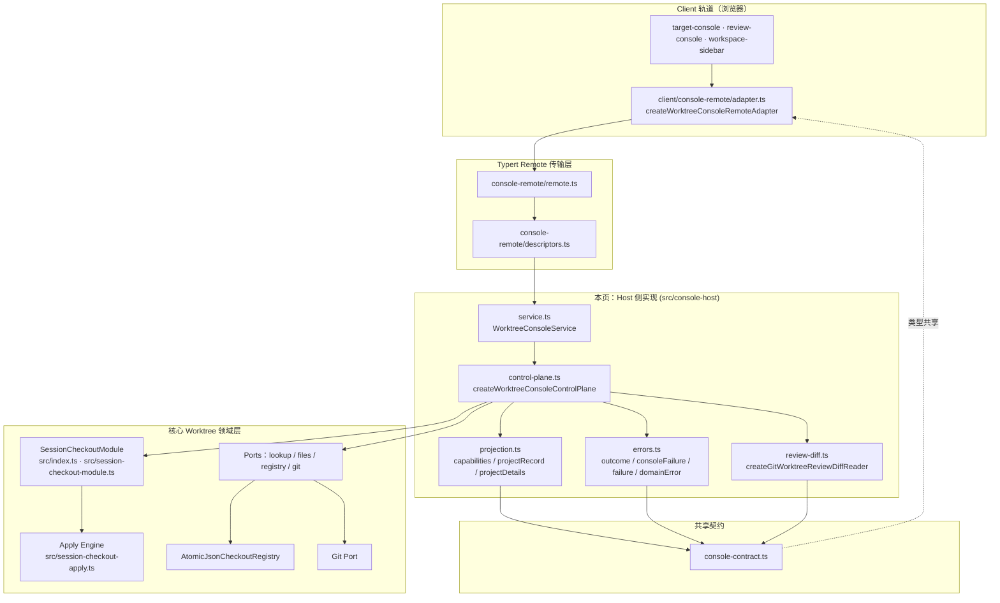
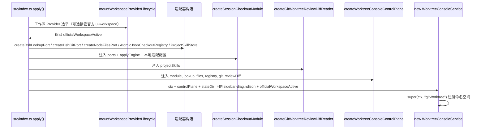
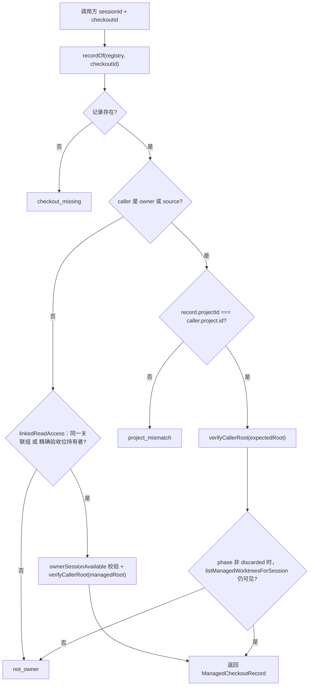
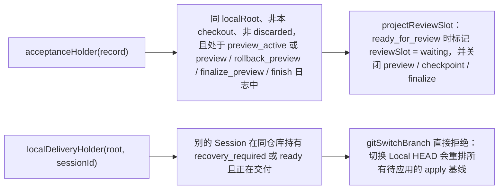
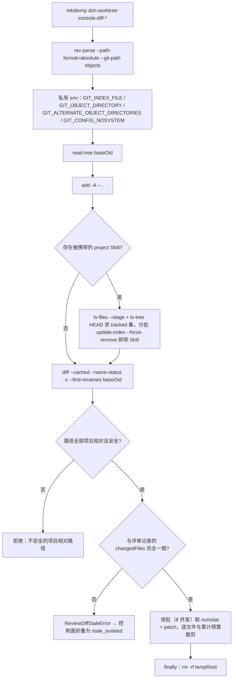
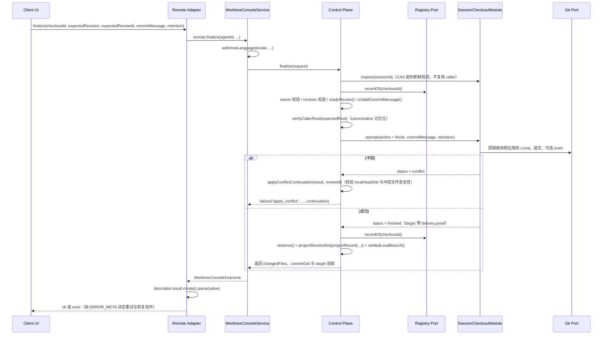

# Worktree Console 宿主服务（`src/console-host/`）

!!! info "Generated documentation"
    This page was written by CodeWiki from the source code at commit [`e50f4121`](https://github.com/wloops/dsh-git-worktree/commit/e50f4121be2569531679e4f64bfc288bc20f70a3) on 2026-11-06 with `doubao-seed-2.1-lite`. Check the code before relying on details.

本页文档化 `dsh-git-worktree` 插件中 **Worktree Console 的 Host 侧实现**——即运行在 Node 宿主进程里、面向人类控制台 UI 的那一套服务端代码。它把「与模型工具共享的会话检出领域层」（`SessionCheckoutModule`、Apply Engine、各类 Port）转换成一个**可被浏览器安全调用的命令面（command face）**：所有跨边界调用都必须先解析出确切的调用方 Session，并在执行时重新校验项目、归属者、工作目录、`revision` 与 review/preview 身份。

这一层由五个文件构成，职责彼此分明：

| 文件 | 角色 | 一句话概括 |
| --- | --- | --- |
| `src/console-host/control-plane.ts` | 授权与编排核心 | 把领域层的能力包装成一组返回 `WorktreeConsoleOutcome` 的方法，是所有身份校验的唯一执行者 |
| `src/console-host/projection.ts` | 投影层 | 把持久化的 `ManagedCheckoutRecord` 折叠成契约 DTO，并计算 16 个能力位 |
| `src/console-host/errors.ts` | 错误折叠 | 把领域异常折叠成 outcome，绝不让异常跨越 Host/Client 边界 |
| `src/console-host/review-diff.ts` | 只读取证 | 在不触碰真实索引的前提下，为一次已就绪的评审生成有预算上限的 diff |
| `src/console-host/service.ts` | RPC 服务面 | `TypertRemoteService` 子类，把控制面的每个方法暴露为 `@Remote` 端点并处理语言与诊断 |

契约本身的 DTO、状态机、错误码表与 `WorktreeConsoleAdapter` 接口在 [Worktree Console 共享契约](worktree_console_contract.md) 中详述，本页不重复；本页关注的是**这些契约如何被 Host 计算、校验与执行**。

---

## 1. 在系统中的位置

宿主服务是「协议」与「领域」之间的桥。它向上被 Typert Remote 传输层与 Client 适配器消费，向下依赖会话检出领域层与各类 Node 适配器。



相关页面：
- 上层总览：[Worktree Console 协议与宿主服务](../worktree_console_protocol_and_host_service.md)
- 契约层（DTO / 状态 / 能力位 / 错误码表）：[Worktree Console 共享契约](worktree_console_contract.md)
- 传输绑定（描述符 / Zod schema / `TypertRemoteMap`）：[Worktree Console Remote 绑定](worktree_console_remote.md)
- 被调用的领域层：[会话运行时入口](../core_worktree_domain_and_infrastructure/session_checkout_domain/session_checkout_runtime/session_checkout_runtime_entry.md)、[会话检出域契约](../core_worktree_domain_and_infrastructure/session_checkout_domain/session_checkout_domain_contracts.md)、[Apply 引擎](../core_worktree_domain_and_infrastructure/session_checkout_domain/session_checkout_apply_engine.md)
- Node 适配器（`lookup` / `files` / `registry` / `git` 的具体实现）：[src_adapters：会话检出（Session Checkout）的宿主适配层](../core_worktree_domain_and_infrastructure/src_adapters.md)
- 本地化（`withHostLanguage` / `hostMessage`）：[src_i18n 国际化与消息目录模块](../project_foundation_and_localization/src_i18n.md)

---

## 2. 装配：谁在什么时候把它们接起来

宿主服务不是自发现的。它在插件入口 `src/index.ts` 的 `apply()` 中被一次性组装（该文件末尾的 `new WorktreeConsoleService(...)`）：



三点值得注意的装配约定：

1. **同一批 Port 实例被领域层与控制面共享**。控制面拿到的 `registry`/`git`/`files`/`lookup` 与模块内部是同一对象，因此 `registry.read()` 与 `module.inspect()` 观察到的是同一份真相——这也是 `observeFromCaller` 能安全复用观测结果的前提（见 §4.3）。
2. **`reviewDiff` 是注入的接口而非内置实现**。控制面只依赖 `WorktreeReviewDiffReader` 这一行方法签名（`read(input)`），因此测试可替换为假实现，装配时则提供 `createGitWorktreeReviewDiffReader(projectSkills)`。
3. **诊断文件路径与 Provider 选举结果由入口传入**。`WorktreeConsoleService` 的构造参数 `diagFile`（默认 `<stateDir>/sidebar-diag.ndjson`）与 `officialWorkspaceActive` 都来自装配现场，服务本身不猜测宿主状态。`stateDir` 的推导规则（`$DSH_HOME/plugins/dsh-git-worktree`，未设置时为 `~/.dsh/...`）见 [会话运行时入口](../core_worktree_domain_and_infrastructure/session_checkout_domain/session_checkout_runtime/session_checkout_runtime_entry.md)。

---

## 3. 子模块划分

| 子模块文档 | 覆盖文件 | 核心关注点 |
| --- | --- | --- |
| [Worktree Console 控制面（`src/console-host/control-plane.ts`）](worktree_console_host/worktree_console_host_control_plane.md) | `control-plane.ts` | 授权链（`authorize` / `verifyCallerRoot` / `linkedReadAccess`）、观测与复用、验收位仲裁、创建族与 CAS 变更族的编排 |
| [Worktree Console 宿主侧投影与错误归一化（projection / errors）](worktree_console_host/worktree_console_host_projection_and_errors.md) | `projection.ts` + `errors.ts` | `ManagedCheckoutRecord → WorktreeConsoleTargetSummary/Details` 的投影规则、16 个能力位门控、异常到 outcome 的折叠 |
| [Worktree Console RPC 服务面（`src/console-host/service.ts`）](worktree_console_host/worktree_console_host_rpc_service.md) | `service.ts` | `@Remote` 端点集合、`withHostLanguage` 语言包裹、ndjson 诊断与滚动、拓扑 flavor 回填 |
| [Worktree Console 主机侧评审 Diff 读取器（worktree_console_host_review_diff）](worktree_console_host/worktree_console_host_review_diff.md) | `review-diff.ts` | 临时索引取证、Skill 排除、快照一致性（stale）判定、字节预算与并行批次 |

---

## 4. 控制面：授权与编排（概览）

`createWorktreeConsoleControlPlane(options)` 返回一个 `WorktreeConsoleControlPlane`，共 38 个方法，**每个方法的返回值都是 `WorktreeConsoleOutcome<T>`**——要么被 `outcome()` 包裹（异常自动折叠），要么显式返回 `failure()`。

详细拆解见 [Worktree Console 控制面（`src/console-host/control-plane.ts`）](worktree_console_host/worktree_console_host_control_plane.md)，这里给出骨架。

### 4.1 授权链

任何触及具体 `checkoutId` 的调用都要过这条链：



`verifyCallerRoot` 是这条链上最微妙的一环：Workspace 的 project 记录始终指向 **Local 检出**，而 owner Session 的**实时 cwd** 才是它不可变的 worktree 根。只拿 `project.root` 去比对，会把每一次健康的 owner 调用都判成 `project_mismatch`。因此该函数按以下顺序取证，并对每条路径做 `canonicalize` 记忆化（同一绝对路径最多一次 realpath syscall，一次调用最多问四次）：

- owner 且 live cwd 存在 → 与 `expectedRoot` 同根即通过；已抵达交付时也可与 `record.localRoot` 同根。live cwd 这条证据**只对 owner 生效**——它对 source Session 什么也证明不了，否则任何停在 Local 的同项目 source Session 都能拿到别人的 `managedRoot`；
- owner 已结算但 project 目录消失、且解析后的路径文本等于 `expectedRoot` → 通过；
- 否则要求 `canonical(project.root)` 等于 `expectedRoot`；已结算（delivery 抵达且 phase 为 `discarded`/`finalized`/`retained`）的 owner 改以 `record.localRoot` 作为授权边界——任务结束了，它的历史应当仍然可读。

### 4.2 三类调用方，三种期望根

`authorize` 中的这一行决定了整个权限模型的形状：

```typescript
const expectedRoot = record.ownerSessionId === sessionId ? record.managedRoot : record.localRoot
```

owner 只能在冻结目录内操作；source（Local）Session 只能在 Local 边界操作。此外，写操作**总是**在执行前重新 `inspect`（不接受请求里观察到的 caller），只有读端点会传入本次请求已观察到的 `observedCaller` 用于复用。

### 4.3 观测与「一次 inspect 用两次」

`observe(record, observedCaller)` 负责取得 `managedRoot` / 快照 / `dirty`。由于对话顶部的胶囊每几秒就轮询一次 `current`，而 `current` 内部先做 `module.inspect(sessionId)`、投影时又会对同一条记录再观测一遍，`observeFromCaller` 会安全地复用前者：仅当 caller 是 `isolated`、checkoutId 相同、双方 phase 均为 `ready`、ownership 为 `owner` 且 `caller.revision === record.revision` 时才复用。在 Windows 热检出上，被省掉的三次 `git` 子进程约占整次轮询成本的三分之一。

`list` 走的是另一条优化路径：优先调用 `module.observeManagedCheckouts`（一次锁内的批量观察），失败时逐条降级；且**单条身份验证失败不会拖垮整个面板**——该记录以「无观测」方式投影，后续操作的 CAS 校验仍会兜底拒绝。

### 4.4 验收位与本地分支切换

同一个 Local 检出在同一时刻只应有一个「正在交付」的 worktree。控制面用两个纯查找表达这条约束：



`linkedReadAccess` 则允许一种窄口径的跨会话读取：调用方正占用一个 isolated 检出，且被请求记录与其属于同一关联组（同 project、同 source、同 localRoot），或者调用方正是该记录**精确的验收位持有者**——后者还要在读取前后各校验一次持有关系，防止 holder 在投影过程中漂移。

### 4.5 方法分组

| 分组 | 控制面方法 | 关键约束 |
| --- | --- | --- |
| 拓扑与读取 | `sidebarTopology`、`current`、`list`、`inspect`、`reviewDiff` | 只读；`sidebarTopology` 按 owner 去重、迭代优先，并尊重 `sidebarBadgeClearedRevision` |
| 创建族 | `preflightCreate`、`createWithInitialCommit`、`create`、`initProject` | `withCreation` 以 session 与 canonical root 双键互斥；确认 token 有 300 秒 TTL 与 500 条上限 |
| 评审 → 交付 | `preflight`、`preview`、`checkpoint`、`resumeRevision`、`prepareReviewRegeneration`、`rollbackPreview`、`discard`、`finalize`、`finalizePreview` | 一律 `expectedRevision` / `expectedReviewId` CAS；`apply_conflict` 附带 `applyConflictContinuation` |
| 恢复族 | `previewRecoveryPreflight`、`preparePreviewRecoveryAnalysis`、`createPreviewRecoveryHandoff` | 以一次性 `recoveryProof` 的身份匹配为闸门；handoff 会新建 owner 并四重验证身份 |
| 保留与清理 | `setRetention`、`setPermanent`、`retryCleanup`、`beginNextIteration`、`returnToLocal`、`clearSidebarBadge` | 前三个由 `requireOwner` 收紧到 owner-only（它们作用于冻结目录本身） |
| Git 概览 | `gitOverview`、`gitGraph`、`gitCreateBranch`、`gitSwitchBranch`、`gitPruneMergedBranches`、`gitListTags`、`gitCreateTag`、`gitDeleteTag`、`gitPushTag` | 经 `projectRootFor` 始终绑定到项目 Local 仓库，与当前所在 worktree 无关 |
| 放弃快照 | `listAbandoned`、`restoreAbandoned` | `discarded` 记录没有活目标，故单列一族 |

其中 `returnToLocal` 是本地适配新增的一条释放路径：交付后记录进入 `retained`（默认保留 24 小时），会话仍被绑在 isolated 上，于是胶囊、侧栏与运行上下文继续按隔离态描述，用户看不到「我其实已经回到 master 了」。该方法**只放行已抵达交付且 phase 为 `discarded`/`finalized`/`retained` 的记录**，对已解绑的情况幂等地返回 Local 投影，而不是把 no-op 判成失败。

---

## 5. 投影层与错误折叠（概览）

`projection.ts` 的 `capabilities(record, callerSessionId, ownerSessionAvailable, linkedRead)` 是**唯一的能力位权威实现**：Client 从不自行推断按钮该不该出现。投影规则中有两处容易被忽略的细节：

- `projectRecord` 用 `sourceBranchFromRef(record.sessionBranch ?? record.sourceRef)`——**Session 自己的分支优先于 fork 点**，否则旧记录会被标上别人的分支名，正是 session branch 机制要终结的那个归属错误。
- `projectDetails` 的 `currentBranch` 由控制面传入 `settledLocalBranch`：已交付的 owner 站在 Local 边界上，此时必须报它**实际所在的分支**（合并后的 `master`），而不是冻结的任务分支；`null` 表示 Local 暂时不可观测，记录的标签仍是最佳答案。

`errors.ts` 提供四个函数：`domainError`（给 Error 挂上领域码与可选 continuation）、`consoleFailure`（已知的 `SESSION_CHECKOUT_ERROR_CODES` 原样折叠，其余降级为 `git_error`）、`failure`（直接构造失败 outcome，可带 `details` 与 `continuation`）、`outcome`（try/catch 包装器）。

详见 [Worktree Console 宿主侧投影与错误归一化（projection / errors）](worktree_console_host/worktree_console_host_projection_and_errors.md)。

---

## 6. RPC 服务面（概览）

`WorktreeConsoleService extends TypertRemoteService`，命名空间固定为 `gitWorktree`（与 `src/console-remote/descriptors.ts` 的 `SERVICE` 常量一致）。它的每个公开方法都带 `@Remote` 装饰器，形态高度统一：

```typescript
withHostLanguage(locale ?? languageFromSettings(agent.ctx ?? this.hostContext), () => this.controlPlane.<method>(...))
```

即：**语言由调用方指定或从宿主 settings 推导，然后在该 AsyncLocalStorage 作用域内执行控制面**，使所有 `hostMessage(...)` 生成的消息按调用方语言出码。Gateway 在业务代码运行前就已把 `agentId` 解析为 `Agent` 实例，因此服务方法签名直接收 `Agent`。

除转发之外它只做三件事：ndjson 诊断（带 8 MiB 滚动）、`sidebarTopology` 的 `workspaceClientFlavor` / `officialWorkspaceActive` 回填、`clientBootReport` 的客户端面包屑落盘。

**诊断是有上限的**：`current` 每 5 秒一条，一天就是一万多行（实测 30 天 12 MB），因此 `appendDiag` 在写入前调用 `rotateDiagIfNeeded`，超限即拆成 `.1` 备份只留最近一段；整个 sink 被 `try/catch` 包住——**记录诊断绝不能弄坏 RPC 面**。当顶部胶囊一直显示「不可用」时，那条 `{ kind: 'current', durationMs, code, message }` 记录就是唯一的现场证据。

**这个面是发布门禁的一部分**：`scripts/check-publish.mjs` 的第 4 步持有一份 `expectedRemoteMethods` 数组，逐字节比对 `./typert` 与 `./remote` 共享的那一份描述符列表（共 39 个方法，即控制面 38 个 + 本层独有的 `clientBootReport`），并校验每个描述符的 `namespace` / `service` 都是 `gitWorktree`、每个参数与结果的 codec 都是 Zod v4 strict。也就是说：**在本页给服务加一个方法而忘了在 `console-remote/descriptors.ts` 加对应描述符（或顺序不对），`pnpm run check:publish` 会直接失败**（该脚本由 `package.json` 的 `prepublishOnly` 链调用）。

详见 [Worktree Console RPC 服务面（`src/console-host/service.ts`）](worktree_console_host/worktree_console_host_rpc_service.md)；门禁全貌见 [构建、CI 与打包](../project_foundation_and_localization/build_ci_and_packaging.md)。

---

## 7. 评审 diff 读取器（概览）

`createGitWorktreeReviewDiffReader(projectSkills?)` 是整个 Host 侧唯一**直接 spawn git 并操作临时索引**的组件。它在系统临时目录里建一个私有 `GIT_INDEX_FILE`，用 `read-tree <baseOid>` + `add -A` 在不触碰工作区索引的情况下重建「冻结检出相对基线」的完整变更集：



三重预算硬约束：`REVIEW_DIFF_MAX_FILES = 200`、`REVIEW_DIFF_MAX_PATCH_BYTES = 100 KiB`（单文件补丁）、`REVIEW_DIFF_MAX_PAYLOAD_BYTES = 1 MiB`（整个响应）。超预算不报错而是折叠出 `truncated: true`，并在必要时用 `utf8Prefix` 按 UTF-8 字符边界截断补丁文本。之所以「按批并行」，是因为逐文件两次 spawn 在 200 个文件时会串行到 400 次进程启动，足以顶爆慢操作超时。

`ReviewDiffStaleError` 与 `projectPath()` / `parseNameStatus()` 的安全边界，与控制面 `reviewDiff()` 在读取前后各做一次 `module.preflight()` 是配套的：只有「diff 取到的一半内容仍然可信」这种情况，才允许把已丢弃的字节报告为 `stale_isolated`。

详见 [Worktree Console 主机侧评审 Diff 读取器（worktree_console_host_review_diff）](worktree_console_host/worktree_console_host_review_diff.md)。

---

## 8. 端到端数据流：一次 `finalize`



---

## 9. 设计要点速查

1. **异常不跨越边界**：控制面一律以 `WorktreeConsoleOutcome` 表达失败；`consoleFailure` 是唯一的折叠入口，第三方异常降级为 `git_error`（源码注明这是「本地泄漏上界」，一旦有远端面把错误序列化出机器就必须在此截断）。
2. **授权靠证据而非记录字段**：持久化的 `ownerSessionId` 不足以授权；每次调用都要过 `记录存在 → 归属关系 → 项目一致 → 工作目录（root）证据 → 可见性` 五道校验，其中 live cwd 证据只对 owner 生效。
3. **已交付状态必须读作 Local**：`verifyCallerRoot`、`settledLocalBranch`、`returnToLocal` 三处共享 `worktreeReachedDelivery` 这一条谓词（定义在 `src/console-contract.ts`），避免 Host 与 UI 对「交付完成」产生两套解释。
4. **能力位在 Host 计算**：16 个 `capabilities` 位由 `projection.ts` 唯一决定；`clearSidebarBadge` / `prepareReviewRegeneration` 等没有独立能力位，只受 CAS 与合法性约束。
5. **性能是被实测驱动的**：`observeFromCaller`（复用轮询观测）、`observeManagedCheckouts`（批量单锁）、diff 的 8 并发批次、`canonicalize` 记忆化，各自对应具体的 spawn 成本或超时上限。
6. **输入安全在边界上处理**：`safeRecoveryRequestId`、`safeConflictFile`、`isValidCommitMessage`、`projectPath`、OID 正则——远端可以伪造字符串，但不能伪造路径或越界文件。
7. **诊断是可牺牲的**：`appendDiag` 全包 `try/catch` 且有 8 MiB 滚动，绝不允许观测性代码影响 RPC 可用性。
8. **本地化贯穿消息**：每个 `@Remote` 方法都在 `withHostLanguage` 作用域内执行，因此 `message` 字段按调用方语言出码（详见 [src_i18n 国际化与消息目录模块](../project_foundation_and_localization/src_i18n.md)）。

---

## 10. 相关模块

- [Worktree Console 协议与宿主服务（总览）](../worktree_console_protocol_and_host_service.md)
- [Worktree Console 共享契约](worktree_console_contract.md) — 本页所有 DTO / 状态 / 错误码 / 能力位类型的定义处
- [Worktree Console Remote 绑定](worktree_console_remote.md) — 把本页 `@Remote` 方法映射为线上调用描述符
- [Worktree Console 控制面（`src/console-host/control-plane.ts`）](worktree_console_host/worktree_console_host_control_plane.md) — 授权与编排核心
- [Worktree Console 宿主侧投影与错误归一化（projection / errors）](worktree_console_host/worktree_console_host_projection_and_errors.md) — 投影与错误折叠
- [Worktree Console RPC 服务面（`src/console-host/service.ts`）](worktree_console_host/worktree_console_host_rpc_service.md) — Typert RPC 服务面
- [Worktree Console 主机侧评审 Diff 读取器（worktree_console_host_review_diff）](worktree_console_host/worktree_console_host_review_diff.md) — 评审 diff 取证
- [会话运行时入口](../core_worktree_domain_and_infrastructure/session_checkout_domain/session_checkout_runtime/session_checkout_runtime_entry.md) — `SessionCheckoutModule` 的实现
- [Apply 引擎](../core_worktree_domain_and_infrastructure/session_checkout_domain/session_checkout_apply_engine.md) — `operate` 背后的合并 / 应用 / 冲突语义
- [会话检出域契约](../core_worktree_domain_and_infrastructure/session_checkout_domain/session_checkout_domain_contracts.md) — `ports.ts` / `types.ts` 中的 `ManagedCheckoutRecord` 与各 Port 接口
- [src_adapters：会话检出（Session Checkout）的宿主适配层](../core_worktree_domain_and_infrastructure/src_adapters.md) — `lookup` / `files` / `registry` / `git` / `project-skills` 的 Node 实现
- [客户端控制台 Remote 适配器](../worktree_client_interface_layer/client_console_remote.md) — 消费本页服务面的 Client 侧
- [客户端目标控制台](../worktree_client_interface_layer/client_target_console.md) / [客户端评审控制台](../worktree_client_interface_layer/client_review_console.md) — 渲染 `capabilities` 与投影 DTO 的 UI
- [构建、CI 与打包](../project_foundation_and_localization/build_ci_and_packaging.md) — `./typert` / `./remote` / `./console-contract` 三个导出入口与 `pnpm run build` 流程（`"build": "node scripts/clean-lib.mjs && tsc && tsdown"`）

??? abstract "Documented components (10)"
    - [`WorktreeConsoleControlPlane`](https://github.com/wloops/dsh-git-worktree/blob/e50f4121be2569531679e4f64bfc288bc20f70a3/src%5Cconsole-host%5Ccontrol-plane.ts) — `src\console-host\control-plane.ts`
    - [`WorktreeConsoleControlPlaneOptions`](https://github.com/wloops/dsh-git-worktree/blob/e50f4121be2569531679e4f64bfc288bc20f70a3/src%5Cconsole-host%5Ccontrol-plane.ts) — `src\console-host\control-plane.ts`
    - [`consoleFailure`](https://github.com/wloops/dsh-git-worktree/blob/e50f4121be2569531679e4f64bfc288bc20f70a3/src%5Cconsole-host%5Cerrors.ts) — `src\console-host\errors.ts`
    - [`capabilities`](https://github.com/wloops/dsh-git-worktree/blob/e50f4121be2569531679e4f64bfc288bc20f70a3/src%5Cconsole-host%5Cprojection.ts) — `src\console-host\projection.ts`
    - [`ChangedEntry`](https://github.com/wloops/dsh-git-worktree/blob/e50f4121be2569531679e4f64bfc288bc20f70a3/src%5Cconsole-host%5Creview-diff.ts) — `src\console-host\review-diff.ts`
    - [`GitOutput`](https://github.com/wloops/dsh-git-worktree/blob/e50f4121be2569531679e4f64bfc288bc20f70a3/src%5Cconsole-host%5Creview-diff.ts) — `src\console-host\review-diff.ts`
    - [`ReviewDiffReadInput`](https://github.com/wloops/dsh-git-worktree/blob/e50f4121be2569531679e4f64bfc288bc20f70a3/src%5Cconsole-host%5Creview-diff.ts) — `src\console-host\review-diff.ts`
    - [`ReviewDiffStaleError`](https://github.com/wloops/dsh-git-worktree/blob/e50f4121be2569531679e4f64bfc288bc20f70a3/src%5Cconsole-host%5Creview-diff.ts) — `src\console-host\review-diff.ts`
    - [`WorktreeReviewDiffReader`](https://github.com/wloops/dsh-git-worktree/blob/e50f4121be2569531679e4f64bfc288bc20f70a3/src%5Cconsole-host%5Creview-diff.ts) — `src\console-host\review-diff.ts`
    - [`WorktreeConsoleService`](https://github.com/wloops/dsh-git-worktree/blob/e50f4121be2569531679e4f64bfc288bc20f70a3/src%5Cconsole-host%5Cservice.ts) — `src\console-host\service.ts`

