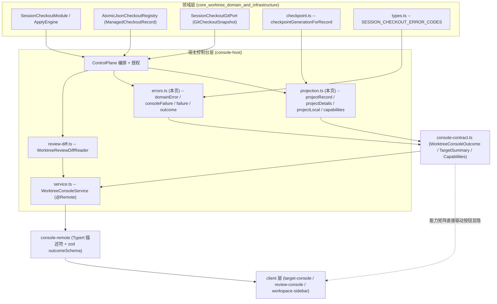
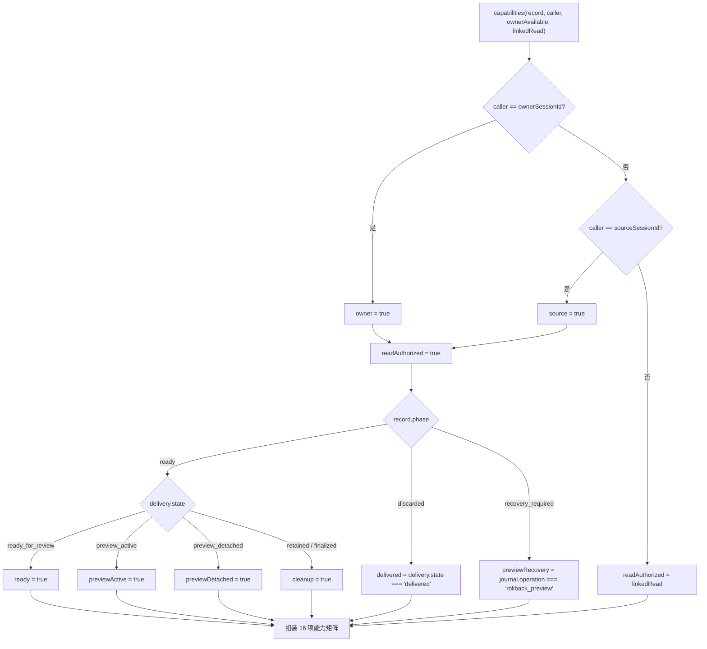
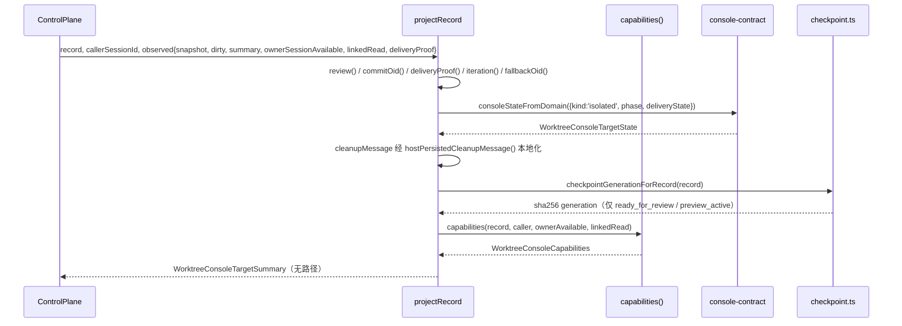
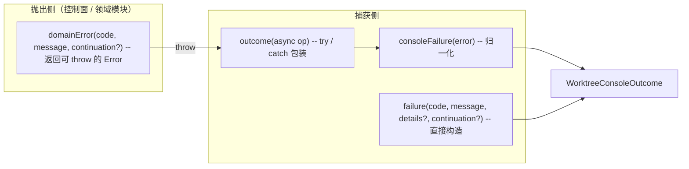
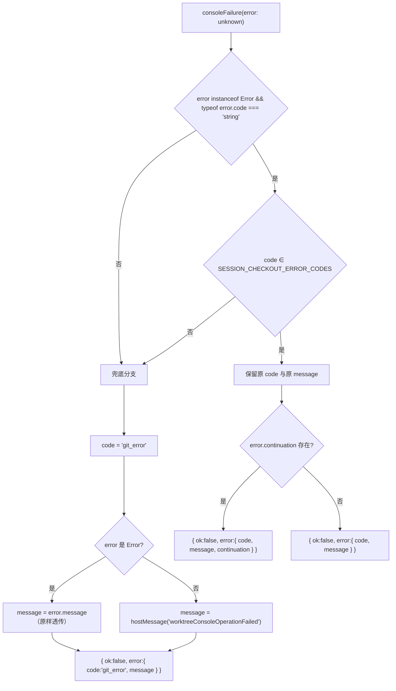
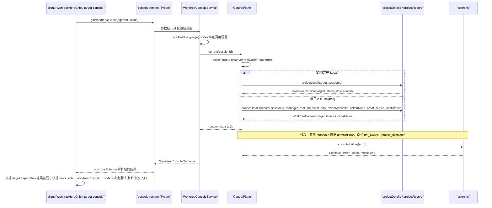
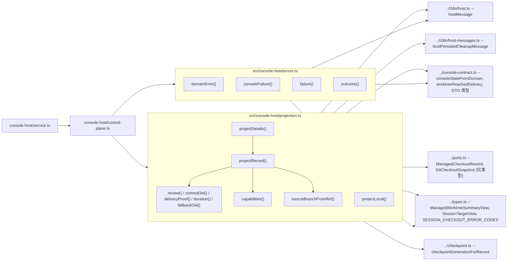

# Worktree Console 宿主侧投影与错误归一化（projection / errors）

!!! info "Generated documentation"
    This page was written by CodeWiki from the source code at commit [`e50f4121`](https://github.com/wloops/dsh-git-worktree/commit/e50f4121be2569531679e4f64bfc288bc20f70a3) on 2026-11-06 with `doubao-seed-2.1-lite`. Check the code before relying on details.

本模块由两个小而关键的宿主（Host）文件组成，它们共同定义了 Worktree Console 的**输出边界**：

- `src/console-host/projection.ts` — 把持久层的 `ManagedCheckoutRecord`（受管 Worktree 记录）与运行期观察值（Git 快照、dirty、保留期等）**投影**为跨进程共享的契约 DTO（`WorktreeConsoleTargetSummary` / `WorktreeConsoleTargetDetails`），并在此过程中计算**能力矩阵** `WorktreeConsoleCapabilities`（决定客户端该显示哪些按钮、该拒绝哪些操作）。
- `src/console-host/errors.ts` — 把领域层抛出的异常/哨兵错误**归一化**为统一的 `WorktreeConsoleOutcome<T>` 判别联合（`{ ok: true, value }` 或 `{ ok: false, error }`），保证整条 RPC 面上永远只有「成功值」或「结构化错误」两种返回，从不向客户端抛出原始异常。

一句话概括：**投影层负责「让记录变得可看」，错误层负责「让失败变得可用」。**

本页是 [Worktree Console 宿主服务（`src/console-host/`）](../worktree_console_host.md) 的子模块之一。控制面的编排与授权逻辑见 [Worktree Console 控制面（`src/console-host/control-plane.ts`）](worktree_console_host_control_plane.md)，RPC 服务外壳见 [Worktree Console RPC 服务面（`src/console-host/service.ts`）](worktree_console_host_rpc_service.md)。

---

## 1. 在系统中的位置

关键分层原则（与 [Worktree Console 共享契约（`src/console-contract.ts`）](../worktree_console_contract.md) 中的注释一致）：`console-contract.ts` 是 **JSON-only** 的共享契约，不含 Cordis / React / Remote / 文件系统实现；宿主侧的 `projection.ts` 与 `errors.ts` 是**唯一**把领域对象「翻译」成该契约的地方。因此：

- 领域记录（`ManagedCheckoutRecord`）**永远不会**直接跨进程传给客户端；
- 客户端**永远不会**自己推导状态或权限；
- 任何新增操作都要同时出现在 `capabilities()` 的键集合与契约的 `WorktreeConsoleCapabilities` 接口里，否则在类型上就编译不过（`WorktreeConsoleCapabilities` 的每个键都是必填 `boolean`，见 `src/console-contract.ts`）。

---

## 2. `projection.ts`：记录 → 契约视图

### 2.1 导出面

| 导出 | 签名（简化） | 职责 |
| --- | --- | --- |
| `capabilities` | `(record, callerSessionId, ownerSessionAvailable = true, linkedRead = false) => WorktreeConsoleCapabilities` | 纯函数式的能力门控：谁、在什么状态下、被允许做什么 |
| `sourceBranchFromRef` | `(sourceRef: string) => string \| null` | 仅把 `refs/heads/<name>` 归约为短分支名；其他 ref（如 detached HEAD）返回 `null` |
| `projectRecord` | `(record, callerSessionId, observed?) => WorktreeConsoleTargetSummary` | 无路径的列表行投影（面板行、顶部状态条、变更响应） |
| `projectDetails` | `(record, callerSessionId, managedRoot, snapshot?, dirty?, ownerSessionAvailable?, linkedRead?, observedDeliveryProof?, settledLocalBranch?) => WorktreeConsoleTargetDetails` | 在摘要之上追加受身份校验后才可见的路径与恢复凭据 |
| `projectLocal` | `(target: SessionTargetView, sessionId) => WorktreeConsoleTargetDetails` | Local 边界（未隔离）视图的独立投影 |

私有辅助函数（不导出，构成投影的「取值层」）：`review()`、`commitOid()`、`deliveryProof()`、`iteration()`、`fallbackOid()`。

### 2.2 私有取值辅助的语义

这些辅助函数共同处理一个现实问题：**`record.delivery` 是一个按 `state` 判别的联合**，不同分支携带不同字段，且历史（legacy）记录可能缺字段。

- `review(record)`：仅当 `delivery` 带 `review` 时产出 `WorktreeConsoleReviewSummary`。注意 `revision` 不是从 review 取的，而是取 **当前记录** 的 `record.revision`——这让客户端可以把一张验收卡与「它属于哪一次 revision」绑定，作为后续 CAS（compare-and-swap）校验的依据。`tests` / `changedFiles` 均做浅拷贝（`map(item => ({ ...item }))` / `[...]`），保证投影结果不与持久层对象共享可变引用。
- `commitOid(record)`：`'commitOid' in record.delivery` 才返回，否则 `null`（working / ready_for_review / preview_* 阶段还没有交付提交）。
- `deliveryProof(record, observed?)`：**观察值优先**。控制面在同一次校验中读到的实时 `proof` 会原样透出（仅拷贝 `changedFiles`）；否则退化为记录上持久化的 `proof`，并把 `commitInLocalHistory` 置为 `null`——因为「本轮提交是否仍在 Local 历史中」是一个必须实时回答的问题，投影层不允许伪造这个答案。
- `iteration(record)`：`review` 分支取 `review.iteration`，`working` / `delivered` 分支取 `delivery.iteration`。
- `fallbackOid(record)`：当无法观察 Git 时给出的 HEAD 猜测顺序为 `proof.localHeadAfter` → `commitOid` → `applyBaseOid` → `baseOid`，保证 `currentOid` 永远是一个字符串而不是 `undefined`。

### 2.3 能力矩阵 `capabilities()`

这是整个宿主侧**唯一的权限真值来源**。四个输入维度：

- `owner`：调用方就是 `record.ownerSessionId`（真正站在隔离工作目录里的会话）；
- `source`：调用方是 `record.sourceSessionId`（当初在 Local 创建该 Worktree 的会话）；
- `sourceReservation`：`source && !ownerSessionAvailable` —— owner 会话已消失，源会话可临时接管「放弃」这一收口动作；
- `linkedRead`：通过「验收位锚点」进行的只读跨记录观察（详见 [Worktree Console 控制面（`src/console-host/control-plane.ts`）](worktree_console_host_control_plane.md)）。

派生的状态谓词与最终矩阵：

| 能力键 | 表达式 | 说明 |
| --- | --- | --- |
| `create` | `false` | 隔离态永远不能再创建，只有 `projectLocal` 会给 `true` |
| `open` | `readAuthorized && active && (!linkedRead \|\| ownerSessionAvailable)` | linkedRead 只有在 owner 会话仍存活时才能「打开」 |
| `inspect` | `readAuthorized`（= `owner \|\| source \|\| linkedRead`） | 读权限最宽：历史可见性优先 |
| `discard` | `(owner \|\| sourceReservation) && active && !cleanup && !previewDetached` | 预览已脱离时禁止直接放弃，必须先走恢复流程 |
| `preflight` | `owner && ready` | |
| `preview` | `owner && ready` | |
| `checkpoint` | `owner && (ready \|\| previewActive)` | 保存「仅存在于受管 Worktree」的阶段 |
| `resumeRevision` | `owner && ready` | 作废未同步的验收并回到同一轮编辑 |
| `rollbackPreview` | `owner && (previewActive \|\| previewDetached \|\| previewRecovery)` | `previewRecovery` 指 `phase === 'recovery_required'` 且 `delivery.state === 'preview_active'` 且 `journal.operation === 'rollback_preview'` |
| `finalize` | `owner && ready` | 跳过 Local Preview 的直连提交路径 |
| `finalizePreview` | `owner && (previewActive \|\| previewDetached)` | |
| `setRetention` | `owner && delivery.state === 'retained'` | 保留期只属于已冻结且被保留的环境 |
| `setPermanent` | `owner && active` | |
| `retryCleanup` | `owner && cleanup`（`finalized` 或 `retained`） | |
| `beginNextIteration` | `owner && delivered`（`phase === 'discarded'` 且 `delivery.state === 'delivered'`） | |
| `returnToLocal` | `owner && worktreeReachedDelivery(phase, delivery.state)` | 只有真正交付过才允许解绑，否则会把评审/预览状态孤立；宿主侧保持幂等 |

其中 `ready` / `previewActive` / `previewDetached` 都额外要求 `record.phase === 'ready'`；`active` 的定义是 `record.phase !== 'discarded'`；`cleanup` 的判定刻意**只看 delivery.state**（不看 phase），因为清理进行中 phase 可能已经前移。

`capabilities()` 上保留了三段设计说明注释，它们是理解门控的关键：

1. 保留 / 常驻 / 清理动作直接作用于**冻结的目录本身**，因此一律门控在 owner 上，**绝不**开放给 Local 源会话；
2. 只有 owner 会话可被重新绑定，且必须已交付；
3. `returnToLocal` 幂等：已站在 Local 上的会话拿回的就是 Local 投影，而不是一个错误。

### 2.4 `projectRecord`：摘要行的组装顺序

投影要点：

- **状态**由契约里的纯函数 `consoleStateFromDomain` 计算，投影层不自己发明状态；交付优先于 phase、discard 优先于 retained/finalized 等规则都集中在 `src/console-contract.ts`，UI 与宿主因此不可能各说各话。
- **归属**：`sourceSessionId = record.sourceSessionId ?? record.ownerSessionId`，`targetSessionId = record.ownerSessionId`。历史记录缺少 `sourceSessionId` 时以 owner 兜底。
- **分支标注**：`sourceBranch = sourceBranchFromRef(record.sessionBranch ?? record.sourceRef)`。优先使用会话自有分支（`refs/heads/feat/sess-…`），因为 legacy 记录的 `sourceRef` 指的是 fork 点（可能属于另一个会话的分支），拿它给侧栏卡片打标签会重现「归属错认」问题。
- **条件字段**采用 `...(cond ? { x } : {})` 的展开写法：`retention/retainedAt/expiresAt` 只在 `retained`；`cleanupMessage/cleanupReason` 只在 `retained|finalized` 且确实存在；`permanent` 只在为 `true` 时出现；`checkpoints` 只在非空时出现；`reviewSlot: 'available'` 只在 `ready_for_review`；`previewRecovery` 只在 `preview_detached`。这让契约的可选字段真正「缺席即不存在」，zod 严格模式（`src/console-remote/schemas.ts`）才不会因多余 `undefined` 键报错。
- **linkedRead 抑制交付凭据**：`observed.linkedRead === true` 时 `deliveryProof` 直接不投影。跨记录只读不应看到别人的交付证据细节。
- **清理文案本地化**：`hostPersistedCleanupMessage(delivery.cleanupMessage, hostMessage, delivery.cleanupMessageKey)` —— 新记录带 key，直接按当前语言翻译；老记录只有中文原文，通过精确匹配 `persistedCleanupKeys` 的 zh 文案回填；**都不匹配则原样透传**（第三方拼接的说明不会被误翻译）。详见 [project_foundation_and_localization/src_i18n](../../project_foundation_and_localization/src_i18n.md)。
- **`checkpointGeneration`** 来自 [core_worktree_domain_and_infrastructure/worktree_core_operations](../../core_worktree_domain_and_infrastructure/worktree_core_operations.md) 的 `checkpointGenerationForRecord`，是 `checkpoint` 操作的 CAS 令牌；`reviewSlot` 的 `'waiting'` 一侧与 `reviewSlotHolder` 由控制面的 `projectReviewSlot` 包装器补齐（本页只负责 `'available'`）。

### 2.5 `projectDetails`：详情视图的三条额外规则

1. `managedRoot` / `sourceRoot = record.localRoot` / `sourceOid = record.baseOid` —— 只有经过身份校验（`authorize` / `linkedReadAccess`）的调用方才会拿到路径。
2. `currentBranch = settledLocalBranch ?? snapshot?.branch ?? sourceBranchFromRef(record.sessionBranch ?? '')`。三态含义在注释中写得很清楚：`undefined` 表示这不是「已交付的 owner 读取」，继续显示 Worktree 分支；`null` 表示已交付但此刻观察不到 Local，退回记录里的标签；字符串表示用户此刻真正站立的分支（合并后通常是 `master`）。这样会话顶部的分支胶囊不会在合并之后还喊 `feat/…`。
3. `recoveryContinuation` 仅在 **owner 本人、非 linkedRead、且记录上持久化了 continuation** 时输出，并按四种 `kind` 逐一映射为契约证明：
   - `worktree_apply_conflict` → `WorktreeApplyConflictRecoveryProof`（`revision` 取 `workingRevision`）
   - `worktree_review_regeneration` → `WorktreeReviewRegenerationProof`
   - `worktree_preview_recovery_analysis` → `WorktreePreviewRecoveryAnalysisProof`（带 `previewId` / `generation`）
   - 其余（`worktree_preview_recovery_handoff`）→ `WorktreePreviewRecoveryHandoffProof`（带 `sourceCheckoutId`，`revision` 取 `sourceRevision`）

   注意这里做的是**领域形状 → 契约形状的字段改名**（如 `workingRevision` → `revision`），不是简单的对象透传：持久层字段名与跨进程契约字段名解耦。

### 2.6 `projectLocal`：Local 侧的「零能力」基线

当调用方并未绑定隔离目标（或已经 `returnToLocal`），投影走完全不同的路径：`checkoutId = null`、`targetSessionId = null`、`iteration = 0`、`state = 'local'`、`phase = 'local'`，`managedRoot = null`、`sourceRoot = null`。能力矩阵只放开三项：

- `create: target.current.oid !== 'unversioned'`（未版本化的项目要走 `preflightCreate` / `createWithInitialCommit` 初始提交流程，见 [Worktree Console 控制面（`src/console-host/control-plane.ts`）](worktree_console_host_control_plane.md)）
- `open: true`、`inspect: true`

其余 13 项全部为 `false`（`WorktreeConsoleCapabilities` 共 16 个布尔键），因此客户端在 Local 上不会渲染任何验收类按钮。

---

## 3. `errors.ts`：异常 → 结构化 Outcome

四个函数构成宿主侧全部的错误处理，形成一条清晰的责任链：

### 3.1 `domainError`

`Object.assign(new Error(message), { code, ...continuation })`。它把「领域错误码」附加到一个标准 `Error` 上，使控制面可以用 `throw` 短路整条编排链，而不必在每一层手工返回 outcome。`continuation` 可选，目前仅用于 `apply_conflict` 的恢复凭据。

### 3.2 `consoleFailure` —— 唯一的归一化闸门

设计要点：

- **白名单判定而非 `instanceof` 自定义错误类**。识别依据是 `SESSION_CHECKOUT_ERROR_CODES`（`src/types.ts`，29 个字面量码）的运行时包含检查，因此领域层任意位置抛出的带码 `Error`（包括 `SessionCheckoutModule.operate()` 返回的 `status:'error'` 再被 `domainError` 重抛）都能被认出来，无需共享错误类。这与 [core_worktree_domain_and_infrastructure/session_checkout_domain/session_checkout_domain_contracts](../../core_worktree_domain_and_infrastructure/session_checkout_domain/session_checkout_domain_contracts.md) 中的 `SessionCheckoutFailure` 形成同一套码表。
- **未知错误降级为 `git_error`**：不发明新码，保证客户端拿到的 `code` 永远落在 `WORKTREE_CONSOLE_ERROR_CODES` 内（该常量在 `SESSION_CHECKOUT_ERROR_CODES` 之上追加 `transport_unavailable` / `malformed_response` / `timeout` 三个传输层码，由客户端适配器使用，宿主不产出）。
- **第三方 message 原样透传是刻意为之**。源码注释（含 `ponytail` 标记）说明：本地控制台 UI 需要看到真实的 git/OS 报错，这一行为由 `tests/host-i18n.test.ts` 的「passes through third-party error messages verbatim」用例锁定；同时明确这是**仅限本机的泄漏上限**，未来若把 `WorktreeConsoleError` 序列化出机器，必须在此处先做截断/替换。非 `Error` 抛出物（字符串、对象等）则统一回退到宿主 i18n 文案 `worktreeConsoleOperationFailed`，避免把 `undefined` 或 `[object Object]` 显示给用户。
- 返回类型是 `WorktreeConsoleOutcome<never>`，因此调用点可以自由赋给任意 `WorktreeConsoleOutcome<T>`。

### 3.3 `failure`

不经异常、直接构造失败分支，是控制面里「软拒绝」的表达方式：

- 参数校验不过 → `failure('invalid_input', hostMessage(...))`
- revision / reviewId 的 CAS 校验不过 → `failure('stale_target', ...)`
- 验收预检被阻 → `preflightFailure()` 把 `WorktreeApplyPreflightView.reason` 映射为错误码（`stale_isolated` / `stale_local` / `stale_target` / `project_acceptance_busy` / `not_owner` / `operation_not_allowed` / `checkout_mismatch` / `git_error`）后由 `failure` 返回
- 真实写入冲突 → `failure('apply_conflict', ..., undefined, applyConflictContinuation(...))`，把 `continuation` 放进错误体
- `reviewDiff` 读到过期内容 → `failure('stale_isolated', error.message)`（`ReviewDiffStaleError` 特判，见 [Worktree Console 主机侧评审 Diff 读取器（worktree_console_host_review_diff）](worktree_console_host_review_diff.md)）

`details` 参数（`Record<string, string | number | boolean | null>`）为结构化补充信息预留；`continuation` 目前只允许伴随 `apply_conflict`——`src/console-remote/schemas.ts` 的 `consoleErrorSchema` 用 `superRefine` 在传输边界上强制了这条不变量。

### 3.4 `outcome`

`outcome<T>(operation)` = `try { ok:true } catch { consoleFailure }`。它是控制面里绝大多数端点的顶层包装（`sidebarTopology`、`current`、`list`、`inspect`、`preview`、`checkpoint`、`discard`、`setRetention`、`retryCleanup`、`beginNextIteration`、`returnToLocal`、`clearSidebarBadge`、各 `git*`、`listAbandoned`、`restoreAbandoned` 等）。

`finalize` / `finalizePreview` / `reviewDiff` **不使用** `outcome`，而是显式 `try / catch`：因为它们需要在成功分支上携带 `commitOid`、`changedFiles` 等附加字段，并在失败分支上按状态区分 `failure(...)` 与 `consoleFailure(error)`——即「业务拒绝用精确码，意外异常用兜底码」。

---

## 4. 端到端数据流：一次 `current` 轮询

顶部胶囊每几秒轮询一次 `current`，这条链把本模块的两个文件都串了起来：

客户端消费侧的对应关系（详见 [worktree_client_interface_layer/client_target_console](../../worktree_client_interface_layer/client_target_console.md) 与 [worktree_client_interface_layer/client_review_console](../../worktree_client_interface_layer/client_review_console.md)）：

- `target.capabilities` → 按钮显隐的唯一依据；客户端不再自行判断状态。
- `target.review` → `reviewEvidenceFromTarget()` 构造验收卡证据。
- `target.checkpoints` / `target.checkpointGeneration` → checkpoint 请求携带的 CAS 令牌。
- `error.continuation` → `recovery-continuation.ts` 的持久化恢复请求。
- `error.code` → `worktreeConsoleErrorMeta(code)` 得到 `category` / `recovery` / `retryable`，决定「刷新即可」还是「必须打开恢复界面」。

---

## 5. 依赖关系

- `projection.ts` 对 `../ports.js`、`../types.js` 的 import 全部是 **type-only**（除 `checkpointGenerationForRecord`），即投影层不触碰持久化或 Git 实现；`errors.ts` 对 `../types.js` 只取运行时常量 `SESSION_CHECKOUT_ERROR_CODES`。
- 二者都依赖 [project_foundation_and_localization/src_i18n](../../project_foundation_and_localization/src_i18n.md)：语言由 `withHostLanguage` 通过 `AsyncLocalStorage` 在每次 RPC 调用上绑定，因此投影期间调用的 `hostMessage` / `hostPersistedCleanupMessage` 天然拿到正确 locale，不需要把 locale 一路透传进函数签名。

---

## 6. 不变量与约定清单

| # | 不变量 | 由谁保证 |
| --- | --- | --- |
| 1 | 每个 RPC 端点只返回 `WorktreeConsoleOutcome`，从不向传输层抛异常 | `outcome()` / 显式 `try-catch` + `consoleFailure()` |
| 2 | `error.code` 一定是 29 个领域码之一（宿主侧不会产出 3 个传输码） | `consoleFailure()` 白名单 + `git_error` 兜底 |
| 3 | 投影结果不与 `ManagedCheckoutRecord` 共享数组/对象引用 | `review()` / `deliveryProof()` / `checkpoints` 的逐层浅拷贝 |
| 4 | 能力矩阵的键集合 = `WorktreeConsoleCapabilities` 的字段集合 | 该接口全字段必填 `boolean`，漏一个即编译失败 |
| 5 | UI 状态词表与宿主一致 | 状态一律经 `consoleStateFromDomain()`，终态判定一律经 `worktreeReachedDelivery()` |
| 6 | `linkedRead` 读取不暴露 `deliveryProof` 与 `recoveryContinuation` | `projectRecord()` / `projectDetails()` 的条件展开 |
| 7 | 只有 owner 会话拿到路径字段（`managedRoot` / `sourceRoot`） | `projectDetails()` 只由已授权路径调用（`authorize` / `linkedReadAccess`） |
| 8 | `continuation` 只伴随 `apply_conflict` | `errors.ts` 生产 + `src/console-remote/schemas.ts` 的 `superRefine` 校验 |
| 9 | 第三方错误文本本机可见、不翻译 | `consoleFailure()` 兜底分支 + `tests/host-i18n.test.ts` 锁定 |

---

## 7. 扩展指引

**新增一个用户动作**（例如 `worktree_console` 上的新按钮）需要四处同步，顺序建议如下：

1. 在 `src/console-contract.ts` 的 `WorktreeConsoleCapabilities` 加字段——此时 `projection.ts` 的 `capabilities()` 会立即编译失败，强制你把门控规则写出来（这是设计上的护栏）。
2. 在 `capabilities()` 中用现有的 `owner` / `source` / `ready` / `previewActive` / `previewDetached` / `cleanup` / `delivered` / `active` 谓词组合出新条件，并在注释中说明「为什么是这个身份、为什么是这个状态」。
3. 在控制面（[Worktree Console 控制面（`src/console-host/control-plane.ts`）](worktree_console_host_control_plane.md)）实现端点：先 `authorize` → 再做 revision/reviewId 的 CAS 拒绝（用 `failure`）→ 调用领域模块 → 用 `outcome` 包装。
4. 在 `WorktreeConsoleService`（[Worktree Console RPC 服务面（`src/console-host/service.ts`）](worktree_console_host_rpc_service.md)）加 `@Remote` 方法，并在 `src/console-remote/*` 补 zod schema 与描述符（见 [Worktree Console Remote 协议层（`src/console-remote/`）](../worktree_console_remote.md)）。

**新增一个领域错误码**：只需在 `src/types.ts` 的 `SESSION_CHECKOUT_ERROR_CODES` 追加——`consoleFailure()` 白名单与 `WORKTREE_CONSOLE_ERROR_CODES` 都由该数组派生；同时必须在 `src/console-contract.ts` 的 `ERROR_META` 给出 `category` / `recovery` / `retryable`（`as const satisfies Record<WorktreeConsoleErrorCode, WorktreeConsoleErrorMeta>` 会强制这一项）。

**投影新字段时的两条纪律**：

- 可选字段一律用 `...(cond ? { x } : {})`，不要写成 `x: maybeUndefined`，否则远程严格模式 schema 会拒绝多余的 `undefined` 键；
- 涉及用户可读文案的，优先持久化 **i18n key**（如 `cleanupMessageKey`），投影时再翻译，保留 legacy 原文仅作为兜底匹配。

---

## 8. 构建与测试

- 类型与编译：`tsconfig.json` 采用 `strict` + `noUncheckedIndexedAccess`，`rootDir: "src"` / `outDir: "lib"`，`moduleResolution: "NodeNext"`（因此源码里的 `.js` 后缀 import 是 ESM 解析要求）。构建链为 `pnpm build`（`scripts/clean-lib.mjs` → `tsc` → `tsdown`），`pnpm typecheck` 单独跑 `tsc --noEmit`，见 [project_foundation_and_localization/build_ci_and_packaging](../../project_foundation_and_localization/build_ci_and_packaging.md)。
- 行为回归：`pnpm test`（`vitest run`）；`tests/host-i18n.test.ts` 直接导入 `consoleFailure` / `domainError`，验证「带码领域错误在两种语言下渲染、码不变」以及「第三方 message 原样透传」。`vitest.config.ts` 在 Windows 上关闭文件并行（`fileParallelism: process.platform !== 'win32'`）并把超时放宽到 60s，以适配重度 Git fixture 套件。

---

## 9. 相关文档

- 父模块：[Worktree Console 宿主服务（`src/console-host/`）](../worktree_console_host.md)
- 契约与 DTO 定义：[Worktree Console 共享契约（`src/console-contract.ts`）](../worktree_console_contract.md)
- 控制面编排与授权：[Worktree Console 控制面（`src/console-host/control-plane.ts`）](worktree_console_host_control_plane.md)
- RPC 服务外壳与诊断日志：[Worktree Console RPC 服务面（`src/console-host/service.ts`）](worktree_console_host_rpc_service.md)
- 评审 diff 读取器：[Worktree Console 主机侧评审 Diff 读取器（worktree_console_host_review_diff）](worktree_console_host_review_diff.md)
- 远程传输与 zod 边界：[Worktree Console Remote 协议层（`src/console-remote/`）](../worktree_console_remote.md)
- 领域记录与端口契约：[会话检出领域契约（session_checkout_domain_contracts）](../../core_worktree_domain_and_infrastructure/session_checkout_domain/session_checkout_domain_contracts.md)
- checkpoint 代际哈希：[Worktree 核心操作与纯函数工具层（worktree_core_operations）](../../core_worktree_domain_and_infrastructure/worktree_core_operations.md)
- 宿主文案与语言上下文：[src_i18n 国际化与消息目录模块](../../project_foundation_and_localization/src_i18n.md)
- 消费这些投影的界面：[client_target_console：会话目标控制台（浏览器端）](../../worktree_client_interface_layer/client_target_console.md)、[client_review_console：受管 Worktree 验收控制台（浏览器端）](../../worktree_client_interface_layer/client_review_console.md)、[工作区侧边栏（client_workspace_sidebar）](../../worktree_client_interface_layer/client_workspace_sidebar.md)

??? abstract "Documented components (2)"
    - [`consoleFailure`](https://github.com/wloops/dsh-git-worktree/blob/e50f4121be2569531679e4f64bfc288bc20f70a3/src%5Cconsole-host%5Cerrors.ts) — `src\console-host\errors.ts`
    - [`capabilities`](https://github.com/wloops/dsh-git-worktree/blob/e50f4121be2569531679e4f64bfc288bc20f70a3/src%5Cconsole-host%5Cprojection.ts) — `src\console-host\projection.ts`

