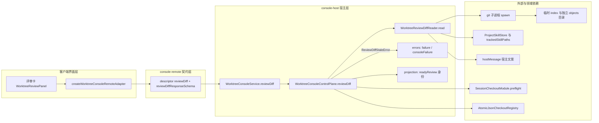
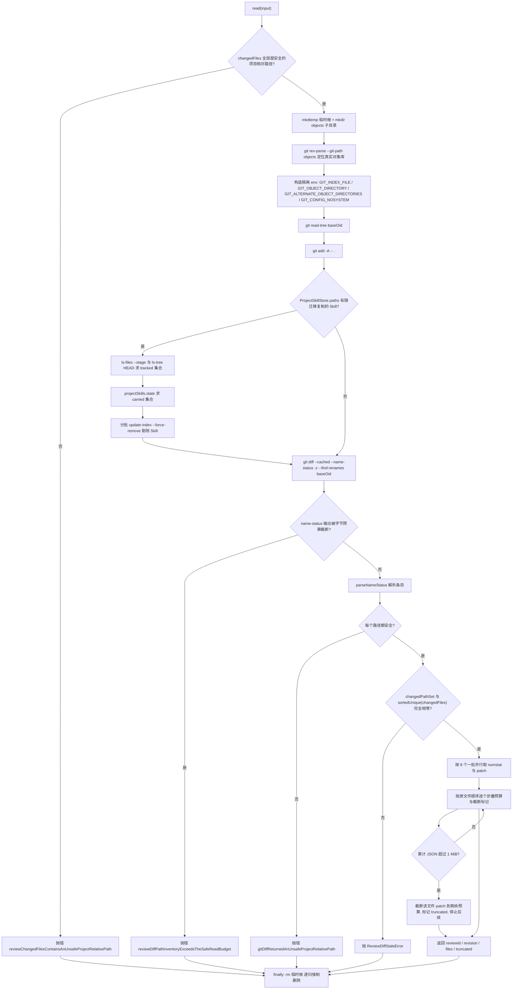
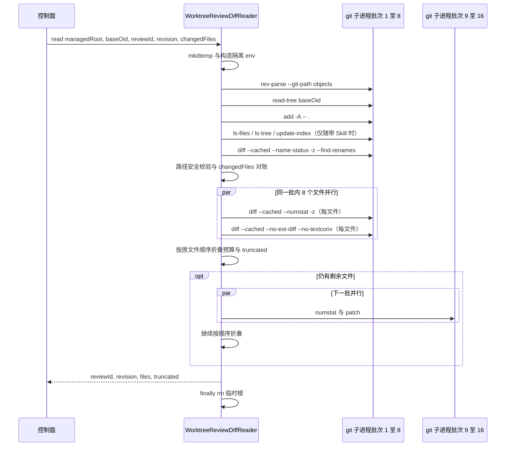
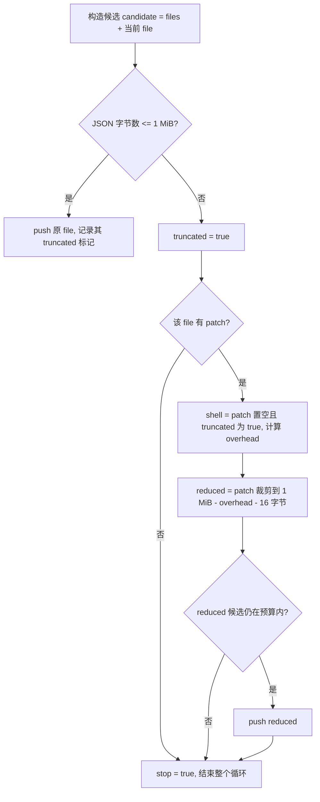
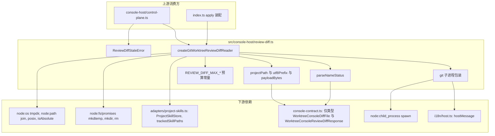
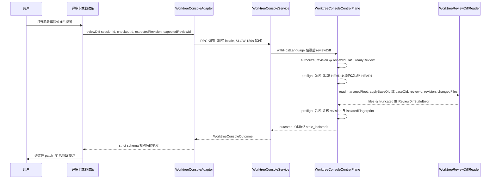

# Worktree Console 主机侧评审 Diff 读取器（worktree_console_host_review_diff）

!!! info "Generated documentation"
    This page was written by CodeWiki from the source code at commit [`bccd87a6`](https://github.com/wloops/dsh-git-worktree/commit/bccd87a6d5270c62ed752e21426f9b3062418333) on 2026-11-06 with `doubao-seed-2.1-lite`. Check the code before relying on details.

本模块是 Worktree Console 宿主侧（`src/console-host/`）中**唯一负责读取"验收快照差异"**的叶子组件，实现文件为 `src/console-host/review-diff.ts`。

它把"隔离 Worktree 相对 Apply 基线到底改了什么"这一事实，转换成可在 RPC 通道上安全传输的 `WorktreeConsoleReviewDiffResponse`（逐文件 patch + 状态 + 截断标记），并且**保证不触碰用户的真实索引、不写入仓库对象库、不泄漏超出预算的字节**。

- 面向的调用者：控制面的 `reviewDiff` 读端点（见 [Worktree Console 控制面（`src/console-host/control-plane.ts`）](worktree_console_host_control_plane.md)）
- 实现的契约类型：`WorktreeConsoleReviewDiffRequest` / `WorktreeConsoleReviewDiffResponse` / `WorktreeConsoleDiffFile`（见 [Worktree Console 共享契约（`src/console-contract.ts`）](../worktree_console_contract.md)）
- 被装配的位置：插件入口 `apply()` 中 `createGitWorktreeReviewDiffReader(projectSkills)`，随控制面一起注入 RPC 服务（见 [core_worktree_domain_and_infrastructure/session_checkout_domain/session_checkout_runtime/session_checkout_runtime_entry.md](../../core_worktree_domain_and_infrastructure/session_checkout_domain/session_checkout_runtime/session_checkout_runtime_entry.md)）

---

## 1. 组件一览

| 导出符号 | 形态 | 职责 |
| --- | --- | --- |
| `WorktreeReviewDiffReader` | interface | 唯一的对外抽象：`read(input): Promise<WorktreeConsoleReviewDiffResponse>`。控制面依赖该接口而非 git 实现，便于替换与测试。 |
| `createGitWorktreeReviewDiffReader(projectSkills?)` | factory | 返回基于真实 `git` 子进程的实现，是插件入口唯一使用的构造器。 |
| `ReviewDiffReadInput` | interface | 读取入参：`managedRoot` / `baseOid` / `reviewId` / `revision` / `changedFiles`。 |
| `ReviewDiffStaleError` | class extends Error | 哨兵异常：磁盘上的实际变更文件集合已与评审快照中的 `changedFiles` 不一致。控制面捕获后降级为 `stale_isolated` 错误码。 |
| `ChangedEntry` | interface（文件内） | `git diff --name-status` 解析结果：`path` / `previousPath?` / `status`。 |
| `GitOutput` | interface（文件内） | 子进程输出封装：`stdout: Buffer` + `truncated: boolean`（字节预算是否被截断）。 |
| `REVIEW_DIFF_MAX_FILES` = 200 | const | 单次响应最多展开的文件数。 |
| `REVIEW_DIFF_MAX_PATCH_BYTES` = 100 KiB | const | 单文件 patch 的字节预算。 |
| `REVIEW_DIFF_MAX_PAYLOAD_BYTES` = 1 MiB | const | 整个 JSON 响应的字节预算（RPC 载荷天花板）。 |

文件内私有辅助（不属于公共面，但决定行为语义）：`git()`、`projectPath()`、`utf8Prefix()`、`payloadBytes()`、`parseNameStatus()`、`sortedUnique()`、`changedPathSet()`。

---

## 2. 在宿主服务中的位置

评审 Diff 读取器处于"RPC 面 → 控制面 → git 取证"链路的最末端。授权、CAS 校验、双次 preflight 全部在控制面完成；读取器只负责**在已授权的 `managedRoot` 内做只读取证**。



对应的兄弟页面：RPC 服务面见 [Worktree Console RPC 服务面（`src/console-host/service.ts`）](worktree_console_host_rpc_service.md)，控制面读端点见 [Worktree Console 控制面（`src/console-host/control-plane.ts`）](worktree_console_host_control_plane.md)，错误与投影见 [Worktree Console 宿主侧投影与错误归一化（projection / errors）](worktree_console_host_projection_and_errors.md)。

### 2.1 调用侧提供的输入来自哪里

控制面 `reviewDiff` 在授权通过后才调用 `read()`：

```ts
const diff = await options.reviewDiff.read({
  managedRoot: observed.managedRoot!,                              // observe() 校验过身份的托管根目录
  baseOid: record.applyBaseOid ?? record.baseOid,                  // 上一次成功 apply 的快照，或会话基线
  reviewId: review.reviewId,                                       // record.delivery.review 身份
  revision: record.revision,                                       // CAS 版本号
  changedFiles: review.changedFiles,                               // 评审准备时冻结的文件清单
})
```

`changedFiles` 与 `isolatedFingerprint` 由 `markReadyForReview` 阶段写入 `ManagedWorktreeReviewRecord`（见 [会话检出领域契约（session_checkout_domain_contracts）](../../core_worktree_domain_and_infrastructure/session_checkout_domain/session_checkout_domain_contracts.md)），是"评审快照的指纹"。读取器把它当作**断言**而不是提示：任何偏差都会以 `ReviewDiffStaleError` 拒绝出图。

---

## 3. read() 完整流程



### 3.1 阶段一：隔离索引构造（只读取证的核心技巧）

读取器**从不使用 Worktree 的真实索引**，也**从不 `checkout` 或 `reset`**：

| 环境变量 | 取值 | 作用 |
| --- | --- | --- |
| `GIT_INDEX_FILE` | `<tempRoot>/index` | 临时索引文件，真实 `.git/index` 完全不被读写。 |
| `GIT_OBJECT_DIRECTORY` | `<tempRoot>/objects` | 空的临时对象库，`git add` 产生的 blob/tree 全部落在这里。 |
| `GIT_ALTERNATE_OBJECT_DIRECTORIES` | 真实仓库 objects 绝对路径（`rev-parse --path-format=absolute --git-path objects`） | 让临时对象库能读取仓库已有对象（`read-tree` 需要）。 |
| `GIT_CONFIG_NOSYSTEM` | `1` | 屏蔽系统级 gitconfig，避免外部配置改变 diff 行为。 |

配合的命令序列语义：

1. `read-tree <baseOid>` —— 临时索引初始化为基线 tree。
2. `add -A -- .` —— 把工作树（`managedRoot` 即项目根，`-- .` 把范围限制在项目根内）的全部内容暂存进**临时索引**。
3. `diff --cached <baseOid>` —— 得到"隔离快照相对 Apply 基线的完整变更"。

这条链路的产物是**交付载荷的真相**，而不是用户当前 staged 状态；它与 `session-checkout-apply` 引擎计算 apply/finish 时的口径一致。因为对象写进临时库，任何一次读取失败都不会在真实仓库留下悬空对象；`finally` 的 `rm(tempRoot, { recursive: true, force: true })` 是唯一清理动作。

> 副作用风险为零的代价：每次 `read()` 至少 3 次 spawn（`rev-parse` + `read-tree` + `add`），大仓库上 `add -A` 是最贵的一步。

### 3.2 阶段二：Skill 资源剔除

`ProjectSkillStore` 在创建 Worktree 时会把源会话的本地 Skill 文件**复制**进隔离环境（`.dsh/skills`、`.agents/skills`、`.claude/skills`）。这些文件不属于用户的任务改动，绝不能在评审 Diff 中出现，否则评审卡会把插件自身的复制品当成"AI 的改动"。

处理策略：

- `projectSkills.paths(managedRoot)` 无清单时（该项目未随带 Skill）整段跳过，零额外开销。
- 有清单时，用**真实 env**（不是临时索引 env）读 `ls-files --stage -z` 与 `ls-tree -r --name-only -z HEAD`，交给 `trackedSkillPaths()` 求出"仓库本来就跟踪的 Skill 路径"。
- `projectSkills.state(root, tracked)` 返回 `CarriedSkillState.paths`：随迁移复制 + 新出现的 Skill 资源，且排除已跟踪者。
- 若上述两个盘点命令的 stdout 被 4 MiB 预算截断，直接抛错而不是猜测——**清单不完整就不允许出 Diff**。
- 最后按路径分批（单批累计长度约 4000 字符）执行 `update-index --force-remove -- <batch>`，把 Skill 从**临时索引**中抹掉。分批是为了避免命令行长度上限（Windows `CreateProcess` 约 32 KiB）。

`--force-remove` 只作用于索引条目，不删磁盘文件，因此隔离环境里的 Skill 依然可运行。

### 3.3 阶段三：路径清单对账（stale 检测）

`ReviewDiffStaleError` 的判定是**严格集合相等**：

```ts
const actual = changedPathSet(entries)          // 重命名同时计入 previousPath 与 path
if (actual.length !== expected.length || actual.some((path, index) => path !== expected[index])) {
  throw new ReviewDiffStaleError(...)
}
```

- `expected = sortedUnique(input.changedFiles)`：评审准备时冻结、并去重排序的清单。
- `changedPathSet` 对 `renamed` 条目同时纳入新旧两个路径，与 `markReadyForReview` 的清单口径保持一致。
- 排序后逐位比较：任何新增、删除、改名都会失败。

该异常被控制面单独捕获并映射为稳定错误码 `stale_isolated`（文案"验收 changedFiles 不再匹配隔离快照"），客户端据此提示"刷新后重试"，而不是把可疑的 patch 画进评审卡。控制面在 `read()` 前后各做一次 `module.preflight`，形成**双重 CAS**：即使读取期间隔离 HEAD 前进，Diff 字节也会被丢弃（见 [Worktree Console 控制面（`src/console-host/control-plane.ts`）](worktree_console_host_control_plane.md)）。

### 3.4 阶段四：逐文件取证与并行批次

每个文件需要 2 次 spawn（`--numstat` 判二进制、`--no-ext-diff --no-textconv` 取 patch）。串行最坏 200 × 2 = 400 次进程创建；在 Windows 上这会顶爆客户端 180 秒的 SLOW 超时（见 [客户端控制台 Remote 适配层（client_console_remote）](../../worktree_client_interface_layer/client_console_remote.md)）。因此源码引入 `REVIEW_DIFF_BATCH_SIZE = 8` 并行取证：



**并行只发生在"取证"，不发生在"决策"**：`Promise.all` 的结果随后仍按 `sliced` 原顺序逐个折叠进 `files`，因此文件顺序、预算耗尽点、`truncated` 的最终值与串行实现完全一致——注释也明确了"语义不变"。

### 3.5 阶段五：输出条目的字段语义

每个 `WorktreeConsoleDiffFile` 由 `parseNameStatus` 条目 + `numstat` + `patch` 三方合成：

| 字段 | 来源 | 规则 |
| --- | --- | --- |
| `path` | `name-status` 的路径字段 | 必须过 `projectPath()`；重命名条目取新路径。 |
| `previousPath` | `R` / `C` 条目的前一路径 | 仅在重命名（含复制折叠）时出现；普通条目不带该键（由条件展开添加）。 |
| `status` | `name-status` 首字母 + `numstat` | `A`→`added`、`D`→`deleted`、`R`/`C`→`renamed`、其余→`modified`；`numstat` 输出以 `-\t-\t` 开头时**整体覆盖为** `binary`。 |
| `patch` | `diff --cached --no-ext-diff --no-textconv --find-renames` | 二进制文件**不取 patch**，直接为 `null`；文本文件为 git 原始输出（可能已按预算截断）。 |
| `truncated` | 该文件 patch 的 `GitOutput.truncated` | 单文件级"patch 不完整"标记。`--no-ext-diff` 与 `--no-textconv` 保证输出不受用户外部 diff 驱动和文本转换规则影响。 |

复制（`C`）折叠为重命名是有意为之：契约的 `WorktreeConsoleFileStatus` 没有 `copied` 位，现有消费方也不区分二者（源码 `ponytail` 注释记录了该决策）。

### 3.6 阶段六：多层预算与截断折叠

| 预算 | 常量/字面量 | 触发后果 |
| --- | --- | --- |
| 路径清单 | 4 MiB（`name-status`、`ls-files`、`ls-tree`） | 直接抛错，拒绝出图。 |
| 单文件 patch | `REVIEW_DIFF_MAX_PATCH_BYTES` = 100 KiB | 该文件 `truncated: true`，patch 被字节截断，整体响应 `truncated = true`。 |
| 文件数量 | `REVIEW_DIFF_MAX_FILES` = 200 | 只展开前 200 条，响应级 `truncated = true`（在取证前就已确定）。 |
| 整体载荷 | `REVIEW_DIFF_MAX_PAYLOAD_BYTES` = 1 MiB | 折叠该文件 patch 到剩余预算后停止，响应级 `truncated = true`。 |

载荷预算折叠算法（逐文件、按序）：



细节：
- `utf8Prefix()` 在截断时向前回退，跳过 UTF-8 续字节（`(bytes[end] & 0xc0) === 0x80`），保证不会被截成半字符——客户端拿到的 patch 永远是合法 UTF-8。
- 预留 16 字节余量吸收 JSON 转义（`\n` 变 `\\n` 等）带来的膨胀。
- 一旦超预算即 `stop = true`：不再对后续文件 spawn，节省进程开销；剩余文件既不出现在 `files` 也不计数，由 `truncated` 统一表达"不完整"。

### 3.7 返回值即 CAS 凭据

响应中回显 `reviewId` 与 `revision`，客户端据此确认拿到的 patch 属于它点击的那张评审卡（`WorktreeReviewIdentity`）。类型层面与 `src/console-remote/schemas.ts` 中 `diffFileSchema` 的 strict 校验一一对应（`status` 枚举仅 `added|modified|deleted|renamed|binary`，`patch` 可为 `null`），任何额外字段都会被 strict codec 拒绝成 `malformed_response`（见 [Worktree Console Remote 协议层（`src/console-remote/`）](../worktree_console_remote.md)）。

---

## 4. 安全边界清单

本模块是宿主侧少数直接 `spawn` 外部进程的地方，因此把"绝不把用户数据当参数"写进了每一层：

| 风险面 | 措施 |
| --- | --- |
| 路径穿越 | `projectPath()`：拒绝空串、NUL、反斜杠、绝对路径；要求 `posix.normalize` 后不变、且不是 `..` 或 `../` 前缀。入参 `changedFiles` 与 git 回吐的两批路径都过这道闸。 |
| 仓库外文件 | 所有 diff 与 add 都带 `-- .` pathspec，作用域锁定在 `managedRoot`（项目根），Worktree 内项目根之外的变更不会进入 Diff。 |
| 参数注入 | `spawn('git', [...])` 数组形式，无 shell 解释；用户路径只作为 `--` 之后的 pathspec 出现。 |
| 凭据弹窗挂死 | `GIT_TERMINAL_PROMPT=0`，需要认证的场景直接失败而非等待输入。 |
| 非 ASCII 路径 | `-c core.quotePath=false`，git 输出保持原始 UTF-8 而非八进制转义，`projectPath` 的判定因此有意义。 |
| Windows 长路径 | 仅 `win32` 追加 `-c core.longpaths=true`。 |
| 外部配置干扰 | `GIT_CONFIG_NOSYSTEM=1`。 |
| 内存爆量 | 每个 spawn 的 stdout 与 stderr 都有硬上限（stderr 固定 64 KiB），超限只置 `truncated` 标记，不无限缓冲。 |
| 子进程异常 | `child.once('error', reject)`；非零退出用 `hostMessage('gitFailed', ...)` 组装带命令名、退出码与 stderr 摘要的错误。 |
| 临时残留 | `try/finally` 中 `rm(tempRoot, { recursive: true, force: true })`。 |
| 真实仓库污染 | 索引与对象写入全部改道临时目录（见 3.1）。 |

---

## 5. 错误与文案映射

宿主文案由 `hostMessage` 产出，按调用语言（`AsyncLocalStorage` 中的 locale 快照）解析——详见 [project_foundation_and_localization/src_i18n.md](../../project_foundation_and_localization/src_i18n.md) 与 [Worktree Console 宿主侧投影与错误归一化（projection / errors）](worktree_console_host_projection_and_errors.md)。

| 触发条件 | 抛出 | 文案 key | 控制面映射后的错误码 |
| --- | --- | --- | --- |
| `changedFiles` 含不安全路径 | `Error` | `reviewChangedFilesContainsAnUnsafeProjectRelativePath` | `git_error` |
| Skill 清单盘点超预算 | `Error`（硬编码英文，仅诊断可见） | — | `git_error` |
| 路径清单超 4 MiB | `Error` | `reviewDiffPathInventoryExceedsTheSafeReadBudget` | `git_error` |
| git 回吐不安全路径 | `Error` | `gitDiffReturnedAnUnsafeProjectRelativePath` | `git_error` |
| 快照文件集合与磁盘不一致 | `ReviewDiffStaleError` | `reviewChangedFilesNoLongerMatchesTheIsolatedSnapshot` | `stale_isolated` |
| git 子进程非零退出 | `Error` | `gitFailed`（含命令、退出码、stderr） | `git_error` |

`ReviewDiffStaleError` 是本模块**唯一被控制面显式 `instanceof` 区分**的异常类型：它是"预期内的过期"，应引导用户刷新；其余异常走 `consoleFailure` 的通用 `git_error` 通道，并把原始 message 透传给本地控制台（该"逐字透传第三方信息"的策略及其泄漏上限记录在 `src/console-host/errors.ts`）。

---

## 6. 依赖关系



要点：
- 对 `../adapters/project-skills.js` 是**结构性依赖**（Skill 剔除），类型上仅依赖 `ProjectSkillStore` 的 `paths()` 与 `state()`（见 [core_worktree_domain_and_infrastructure/src_adapters.md](../../core_worktree_domain_and_infrastructure/src_adapters.md)）。
- 对 `../console-contract.js` 只有 `import type`：本模块不引入任何运行时依赖，符合契约层"JSON-only、无实现"的定位。
- 对 `../i18n/host.js` 只取 `hostMessage`，因此宿主文案与领域文案共享同一 locale 通道（见 [project_foundation_and_localization/src_i18n.md](../../project_foundation_and_localization/src_i18n.md)）。
- **不依赖** `ports.ts` / `SessionCheckoutModule` / `registry`：所有身份校验在调用前由控制面完成，读取器只吃纯字符串参数。这使它可被替换为内存实现（例如测试中注入伪造 reader），也是 [Worktree Console 宿主服务（`src/console-host/`）](../worktree_console_host.md) 中"读取器是唯一 git 取证出口"这一约束的基础。

---

## 7. 客户端如何消费本模块的产物



评审证据投影（`changedFiles`、验证项、建议 commit message）由 [client_review_console：受管 Worktree 验收控制台（浏览器端）](../../worktree_client_interface_layer/client_review_console.md) 的 `WorktreeReviewPanel` / `ReviewDetailsModal` 承担；本模块只补充"内容级"的 patch 字节，两者共享同一 `reviewId + revision` 身份。

---

## 8. 设计权衡与已知限制

- **copy 折叠为 renamed**：`git diff --find-renames` 同时会报告 `C` 状态，而契约中的 `WorktreeConsoleFileStatus` 没有 `copied`。源码以注释明确该折叠（现有消费方不区分二者）。若将来契约新增 `copied`，只需改 `parseNameStatus`。
- **`truncated` 不区分原因**：文件数截断、单文件 patch 截断、整体载荷截断三种情况都折叠到同一个布尔位（文件级 `file.truncated` 只区分"这个文件的 patch 不完整"）。客户端只能提示"Diff 不完整"，无法告知还剩多少文件。
- **超预算即停止**：不再尝试用"后续小文件"填空位，保证顺序前缀语义（`files` 永远是原顺序的连续前缀），代价是尾部内容一定丢失。
- **无进程级超时**：`git()` 只限制字节，不设 timeout（对比 `adapters/git-options.ts` 中带超时的 Git 端口，见 [core_worktree_domain_and_infrastructure/src_adapters.md](../../core_worktree_domain_and_infrastructure/src_adapters.md)）。挂死的 `git` 会一直占住请求，最终由客户端 180 秒 SLOW 超时在客户端侧断开（服务端工作继续跑完）。这是本模块当前最主要的运维风险点。
- **每次读取重建索引**：`add -A` 对巨型工作树是 O(文件数) 的哈希成本，且无跨请求缓存。评审卡的重复点击会带来可感知的延迟，控制面因此要求先通过 `preflight` 前置门（见 [Worktree Console 控制面（`src/console-host/control-plane.ts`）](worktree_console_host_control_plane.md)）。
- **仅 owner 可读**：Linked-read（同组只读访问）路径不经过本模块，控制面在调用前就用 `record.ownerSessionId !== sessionId` 直接返回 `not_owner`。
- **`node:child_process` 直连**：本模块绕过宿主的 `dsh-subprocess` 服务，以便自由注入 `GIT_INDEX_FILE` 等环境变量；代价是不受宿主统一沙箱与超时策略管辖。运行环境要求见 `package.json` 的 `engines.node`（`^22.19.0 || >=24.0.0`），构建与测试约定见 [project_foundation_and_localization/build_ci_and_packaging.md](../../project_foundation_and_localization/build_ci_and_packaging.md)。

---

## 9. 相关页面

- 上级模块：[Worktree Console 宿主服务（`src/console-host/`）](../worktree_console_host.md)
- 兄弟组件：[Worktree Console 控制面（`src/console-host/control-plane.ts`）](worktree_console_host_control_plane.md)、[Worktree Console 宿主侧投影与错误归一化（projection / errors）](worktree_console_host_projection_and_errors.md)、[Worktree Console RPC 服务面（`src/console-host/service.ts`）](worktree_console_host_rpc_service.md)
- 契约定义：[Worktree Console 共享契约（`src/console-contract.ts`）](../worktree_console_contract.md)
- RPC 描述符与 strict schema：[Worktree Console Remote 协议层（`src/console-remote/`）](../worktree_console_remote.md)
- 客户端消费侧：[客户端控制台 Remote 适配层（client_console_remote）](../../worktree_client_interface_layer/client_console_remote.md)、[client_review_console：受管 Worktree 验收控制台（浏览器端）](../../worktree_client_interface_layer/client_review_console.md)
- 领域侧快照与评审记录：[会话检出领域契约（session_checkout_domain_contracts）](../../core_worktree_domain_and_infrastructure/session_checkout_domain/session_checkout_domain_contracts.md)、[会话检出交付引擎（session_checkout_apply_engine）](../../core_worktree_domain_and_infrastructure/session_checkout_domain/session_checkout_apply_engine.md)
- Skill 复制与盘点：[core_worktree_domain_and_infrastructure/src_adapters.md](../../core_worktree_domain_and_infrastructure/src_adapters.md)
- 宿主文案与 locale：[project_foundation_and_localization/src_i18n.md](../../project_foundation_and_localization/src_i18n.md)

??? abstract "Documented components (5)"
    - [`ChangedEntry`](https://github.com/wloops/dsh-git-worktree/blob/bccd87a6d5270c62ed752e21426f9b3062418333/src%5Cconsole-host%5Creview-diff.ts) — `src\console-host\review-diff.ts`
    - [`GitOutput`](https://github.com/wloops/dsh-git-worktree/blob/bccd87a6d5270c62ed752e21426f9b3062418333/src%5Cconsole-host%5Creview-diff.ts) — `src\console-host\review-diff.ts`
    - [`ReviewDiffReadInput`](https://github.com/wloops/dsh-git-worktree/blob/bccd87a6d5270c62ed752e21426f9b3062418333/src%5Cconsole-host%5Creview-diff.ts) — `src\console-host\review-diff.ts`
    - [`ReviewDiffStaleError`](https://github.com/wloops/dsh-git-worktree/blob/bccd87a6d5270c62ed752e21426f9b3062418333/src%5Cconsole-host%5Creview-diff.ts) — `src\console-host\review-diff.ts`
    - [`WorktreeReviewDiffReader`](https://github.com/wloops/dsh-git-worktree/blob/bccd87a6d5270c62ed752e21426f9b3062418333/src%5Cconsole-host%5Creview-diff.ts) — `src\console-host\review-diff.ts`

