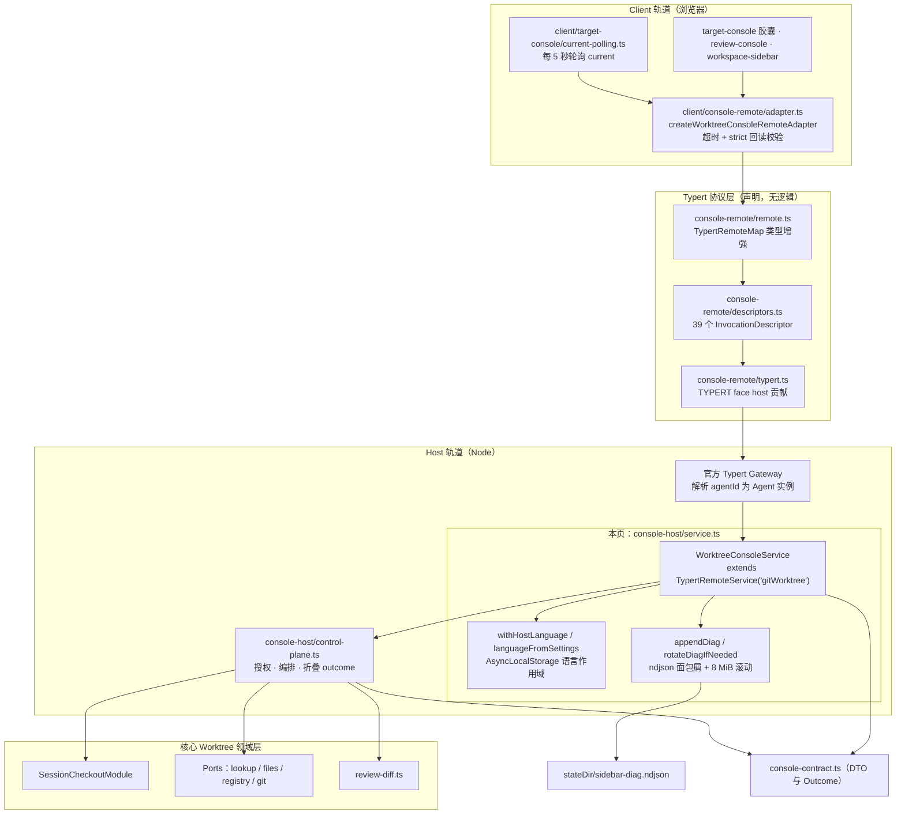
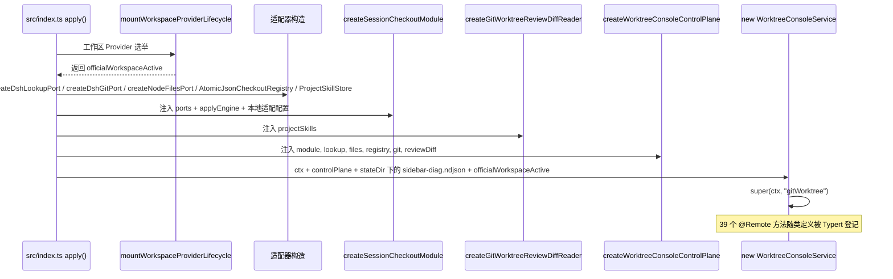
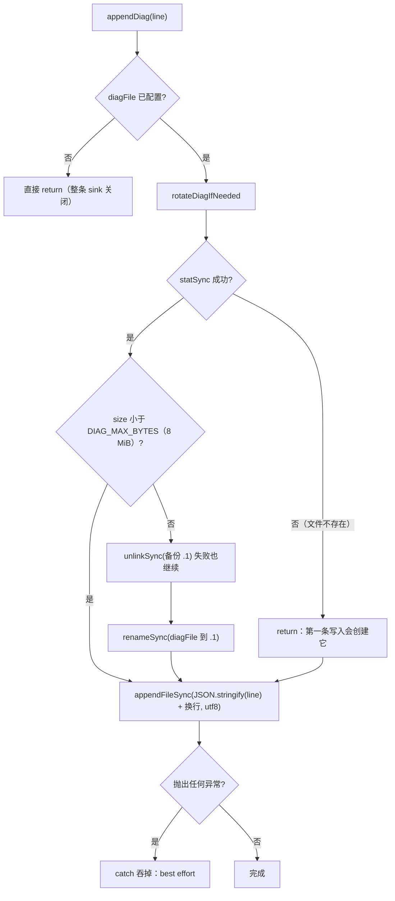
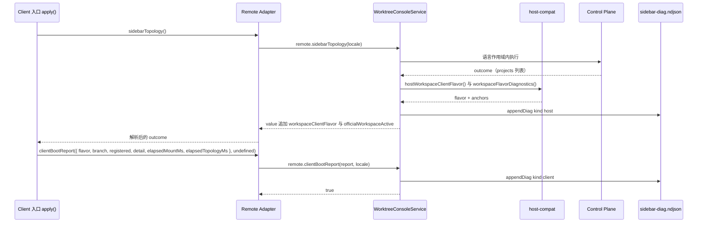
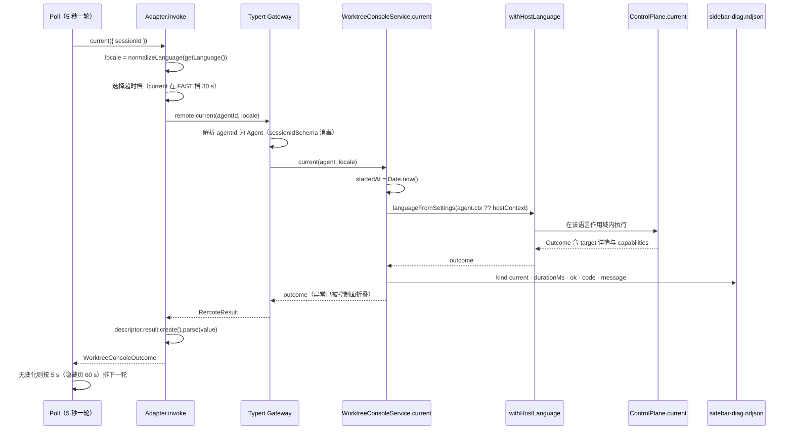
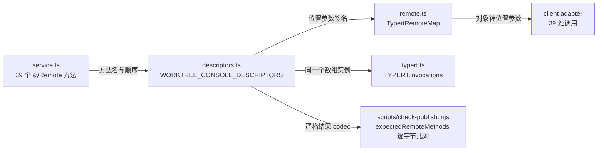

# Worktree Console RPC 服务面（`src/console-host/service.ts`）

!!! info "Generated documentation"
    This page was written by CodeWiki from the source code at commit [`f93ba818`](https://github.com/wloops/dsh-git-worktree/commit/f93ba8188971886c09b4c40e12c746a23853c229) on 2026-11-06 with `doubao-seed-2.1-lite`. Check the code before relying on details.

本页文档化 `dsh-git-worktree` 插件中 **Worktree Console 的传输暴露层**：单个类 `WorktreeConsoleService`。它是宿主进程里唯一被浏览器直接调到的对象——一个继承自 `TypertRemoteService` 的官方 Remote 服务，命名空间固定为 `gitWorktree`，把控制面（`WorktreeConsoleControlPlane`）的 38 个方法逐一映射成 `@Remote` 端点，并额外承担三类不属于业务逻辑的横切职责：**调用语言作用域**、**诊断面包屑**与**宿主代际/选举结果回填**。

它的定位可以用三句话概括：

1. **薄**：每个方法体的形态高度统一——`withHostLanguage(...)` 包裹一次 `this.controlPlane.<method>(...)` 转发，不做任何授权、状态判断或数据加工。业务规则的权威实现全部在控制面（见 [Worktree Console 控制面（`src/console-host/control-plane.ts`）](worktree_console_host_control_plane.md)）。
2. **可观测**：`sidebarTopology` / `clientBootReport` / `current` 三个端点带 ndjson 诊断落盘，是排查「顶部胶囊为什么一直显示不可用」「侧栏为什么挂不起来」的唯一现场证据。
3. **可协商**：`sidebarTopology` 的响应里由本层回填 `workspaceClientFlavor` 与 `officialWorkspaceActive` 两个字段，浏览器据此决定走 legacy / alpha / next / modern-rc5 / modern-rc1 哪一条侧栏装配分支（见 [客户端控制台 Remote 适配层（client_console_remote）](../../worktree_client_interface_layer/client_console_remote.md)）。

方法总数 **39**（控制面 38 个方法 + 本层独有的 `clientBootReport`），这个数字被发布门禁逐字节校验（`scripts/check-publish.mjs` 第 4 步的 `expectedRemoteMethods` 数组）。

契约 DTO / 状态机 / 错误码表在 [Worktree Console 共享契约](../worktree_console_contract.md) 中详述；Typert 描述符与 Zod strict schema 在 [Worktree Console Remote 绑定](../worktree_console_remote.md) 中详述；本页只讲**这些契约如何被暴露成 RPC、以及暴露时附带的语言与诊断语义**。

---

## 1. 在系统中的位置

`WorktreeConsoleService` 位于「传输层」与「授权编排层」的接缝上：向上它被官方 Typert Gateway 消费（Gateway 负责把线上的 `agentId` 解析成 `Agent` 服务对象），向下它只依赖一个 `WorktreeConsoleControlPlane` 接口。



相关页面：

- 上层总览：[Worktree Console 宿主服务](../worktree_console_host.md) · 协议与宿主总览：[Worktree Console 协议与宿主服务](../../worktree_console_protocol_and_host_service.md)
- 兄弟子模块：[控制面](worktree_console_host_control_plane.md)、[投影与错误折叠](worktree_console_host_projection_and_errors.md)、[评审 diff 读取器](worktree_console_host_review_diff.md)
- 传输绑定（描述符 / `descriptor()` 工厂 / `agentParameter`）：[Worktree Console Remote 绑定](../worktree_console_remote.md)
- 被转发的领域层：[会话运行时入口](../../core_worktree_domain_and_infrastructure/session_checkout_domain/session_checkout_runtime/session_checkout_runtime_entry.md)、[会话检出域契约](../../core_worktree_domain_and_infrastructure/session_checkout_domain/session_checkout_domain_contracts.md)、[Apply 引擎](../../core_worktree_domain_and_infrastructure/session_checkout_domain/session_checkout_apply_engine.md)
- Client 侧对端（超时档位与 strict 回读）：[客户端控制台 Remote 适配层（client_console_remote）](../../worktree_client_interface_layer/client_console_remote.md)
- 本地化基座（`withHostLanguage` / `Language`）：[src_i18n 国际化与消息目录模块](../../project_foundation_and_localization/src_i18n.md)

---

## 2. 构造与装配

```typescript
export class WorktreeConsoleService extends TypertRemoteService {
  constructor(
    private readonly hostContext: Context,
    private readonly controlPlane: WorktreeConsoleControlPlane,
    private readonly diagFile?: string,
    private readonly officialWorkspaceActive = true,
  ) {
    super(hostContext, 'gitWorktree')
  }
```

| 构造参数 | 来源 | 缺失时的行为 |
| --- | --- | --- |
| `hostContext` (`@deepseek-ai/cordis` 的 `Context`) | 插件 `apply(ctx)` 的 ctx | 必需；`super()` 用它注册服务与命名空间 `gitWorktree` |
| `controlPlane` | `createWorktreeConsoleControlPlane({ module, lookup, files, registry, git, reviewDiff })` | 必需；本层的全部业务转发目标 |
| `diagFile` | `join(stateDir, 'sidebar-diag.ndjson')` | `undefined` 时 `appendDiag` / `rotateDiagIfNeeded` **整条静默短路**，RPC 面照常工作 |
| `officialWorkspaceActive` | `mountWorkspaceProviderLifecycle(...)` 返回的选举结果 | 默认 `true`（保守：认为官方 Workspace 仍然存活），仅在 `sidebarTopology` 回填 |

命名空间字符串 `'gitWorktree'` 必须与 `src/console-remote/descriptors.ts` 中的 `const SERVICE = 'gitWorktree'` 保持一致，否则描述符的 `service`/`namespace` 字段与实际注册的 Remote 服务对不上，`check-publish.mjs` 会直接失败（它逐个断言 `descriptor.namespace === 'gitWorktree' && descriptor.service === 'gitWorktree'`）。

### 2.1 装配时序

服务不是自发现的，它在插件入口 `src/index.ts` 的 `apply()` 中以 `new WorktreeConsoleService(...)` 一次性构造（不保存引用——注册副作用由基类完成）：



装配细节里对本层最重要的是：**`diagFile` 与 `officialWorkspaceActive` 都由入口现场传入**，服务自身绝不猜测宿主路径或选举结果。`stateDir` 的推导规则（`$DSH_HOME/plugins/dsh-git-worktree`，未设置时 `~/.dsh/plugins/...`）见 [会话运行时入口](../../core_worktree_domain_and_infrastructure/session_checkout_domain/session_checkout_runtime/session_checkout_runtime_entry.md)；选举语义见 [工作区提供者生命周期与会话目标上下文](../../core_worktree_domain_and_infrastructure/session_checkout_domain/session_checkout_runtime/workspace_provider_lifecycle.md)。

---

## 3. 三个横切职责

### 3.1 语言作用域：`withHostLanguage`

除 `clientBootReport`（纯埋点、无消息）之外，每个方法都以下面这一行包裹转发：

```typescript
// 有 agent 的方法（37 个）
withHostLanguage(locale ?? languageFromSettings(agent.ctx ?? this.hostContext), () => this.controlPlane.<method>(...))

// 无 agent 的方法（sidebarTopology）
withHostLanguage(locale ?? languageFromSettings(this.hostContext), () => this.controlPlane.sidebarTopology())
```

这条表达式的优先级是：**显式 `locale` 参数 → 调用方 Agent 自身的 context settings → 宿主根 context settings → `normalizeLanguage` 兜底 `'zh'`**。

- 显式 `locale` 由 Client 适配器统一附加（`descriptor()` **总是**在参数表尾部追加 `json('locale', optionalLanguageSchema, 'string|undefined', true)`），因此 UI 切换语言不需要 Host 重启。
- 优先用 `agent.ctx` 而不是 `hostContext`，是为了让**按会话/作用域隔离的设置**不跨用户串味——`src/i18n/host.ts` 里同一个意图被封装成 `languageForInvocation`，本层内联展开以避免额外的动态查找。
- `withHostLanguage` 底层是 `AsyncLocalStorage`，所以语言快照在整条异步链（控制面 → 领域层 → `hostMessage(...)`）中保持**每调用一次一个不可变快照**，并发调用互不污染。控制面里所有 `hostMessage(...)` 生成的错误消息因此在**服务端**就按请求语言出码，Client 拿到的 `error.message` 已经是本地化文本。

> 注意：`locale ?? ...` 用的是空值合并而非逻辑或。`normalizeLanguage` 只识别 `en` 前缀、其余一律归一为 `'zh'`，因此本层传下去的值永远是 `'zh' | 'en'`（`Language`），不存在「空字符串被当成本地」的歧义。

### 3.2 诊断面包屑：`appendDiag` + `rotateDiagIfNeeded`

诊断是一个**只读侧信道**：三个端点（`sidebarTopology`、`current`、`clientBootReport`）把结构化的一行 JSON 追加到 `stateDir/sidebar-diag.ndjson`。它有三条硬约束。



1. **绝不弄坏 RPC 面**。`appendDiag` 整体包在 `try { ... } catch { /* best effort */ }` 中：磁盘只读、权限被收回、路径被别的进程删掉、`renameSync` 竞争失败，都只会让这条面包屑消失，不会让一次 `current` 变成失败。源码注释把这句话说得很直白——*an ndjson breadcrumb trail must never break the RPC surface*。
2. **必须有上限**。顶部胶囊每 5 秒轮询一次 `current`（`current-polling.ts` 中 `DELAY = 5_000`），一天就是一万多行；不设上限时该文件只增不减（源码注释记录实测 30 天 12 MB）。因此定义 `const DIAG_MAX_BYTES = 8 * 1024 * 1024`，超过即拆成 `${diagFile}.1` 备份并只保留最近一段。
3. **备份只留一份**。滚动前 `unlinkSync(backup)` 失败是正常路径（还没有旧备份），紧接着的 `renameSync` 才是真正生效的动作——所以磁盘占用被钉在「约 8 MiB 活动 + 约 8 MiB 备份」，而不是无限增长的轮转目录。

落盘的三类记录及其字段：

| `kind` | 触发端点 | 字段 | 现场用途 |
| --- | --- | --- | --- |
| `'host'` | `sidebarTopology` | `ts`、`ok`、`projects`（成功时的项目数）、`flavor`、`anchors` | 侧栏装配失败/挂错分支时，判断宿主代际探测结果与三个锚点（`process.argv[1]` / `process.cwd()` / `import.meta.url`）各自是否解析出版本 |
| `'client'` | `clientBootReport` | `ts` + 展开的 `WorktreeClientBootReport`（`flavor`、`branch`、`registered`、`detail`、`elapsedMountMs`、`elapsedTopologyMs`） | 浏览器只上报、不写本地文件——这条记录把「Web 端到底走了哪条分支、卡在哪一步」搬到 Host 侧唯一可回看的介质上 |
| `'current'` | `current` | `ts`、`durationMs`、`ok`、`agentId`、失败时附 `code` / `message` | 胶囊显示「不可用」时，`code`/`message` 决定是「会话未持验收位」还是「项目不匹配」还是 git 报错；`durationMs` 回答「到底慢在哪」 |

`projects`、`code`、`message` 这类「成功时不该出现」的字段直接赋 `undefined`——`JSON.stringify` 会自动丢掉值为 `undefined` 的键，因此不需要条件展开。这与控制面对待「缺省 vs 显式 undefined」时的谨慎写法是两种取向：诊断记录只是给人看的，不参与语义判定。

### 3.3 拓扑回填：`sidebarTopology` 的特例

`sidebarTopology` 是本层唯一「不只是转发」的读取端点，它在控制面返回之后再做三件事：

```typescript
const outcome = await withHostLanguage(locale ?? languageFromSettings(this.hostContext), () => this.controlPlane.sidebarTopology())
const flavor = hostWorkspaceClientFlavor()
this.appendDiag({ kind: 'host', ts: Date.now(), ok: outcome.ok, projects: ..., flavor, anchors: workspaceFlavorDiagnostics().anchors })
return outcome.ok
  ? { ok: true, value: { ...outcome.value, workspaceClientFlavor: flavor, officialWorkspaceActive: this.officialWorkspaceActive } }
  : outcome
```



三点值得强调：

- **`flavor` 不来自控制面，而来自 `src/host-compat.ts`**（`workspaceFlavorDiagnostics()` 按三个锚点解析宿主 `@deepseek-ai/dsh-agent` 版本，再映射成 `legacy | alpha | next | modern-rc5 | modern-rc1 | unsupported`）。把这段判断放在 Host 侧是刻意的：浏览器无法读取宿主包版本，而**未知代际绝不能挂载一个猜测出来的 Client Browser**。
- **失败时不回填**。`outcome.ok === false` 时原样返回失败，不带 `workspaceClientFlavor`。Client 侧 `topology.ok === false` 走 `topology-failed` 分支——只挂工具视图、不挂侧栏，因为「registry 读不出来」时用户恰恰需要控制台去修 registry，整条挂载失败反而帮倒忙。
- **`officialWorkspaceActive` 是选举结果的搬运**：它为 `true` 时 Client 必须走 decorate（装饰官方 Workspace 注册）而不是重新 `provide('uiWorkspace')`，否则 Web 启动会以 `service "uiWorkspace" has been registered` 崩溃。这个字段的权威来源见 [工作区提供者生命周期与会话目标上下文](../../core_worktree_domain_and_infrastructure/session_checkout_domain/session_checkout_runtime/workspace_provider_lifecycle.md)。

`clientBootReport(report)` 则是反向通道：无 `agent` 参数、返回 `boolean`（恒为 `true`，仅作回执），因此它的描述符结果是裸 `booleanSchema`，**没有被 `outcomeSchema` 包裹**——埋点不该有业务错误码。

---

## 4. 端点清单（39 个 `@Remote`）

`@Remote` 装饰器（来自 `@deepseek-ai/dsh-typert-protocol`）把方法登记为可调用端点；方法签名里的 `agent: Agent` 由 Gateway 依据描述符中的 `agentParameter`（`wire: 'agentId'`、`source: 'lookup'`、`lookup: 'agent'`）注入。业务代码**永远拿不到浏览器自报的身份**，只拿到解析后的调用方。

### 4.1 拓扑与埋点（无 `agent`）

| 端点 | 签名要点 | 转发目标 | 返回 |
| --- | --- | --- | --- |
| `sidebarTopology` | `(locale?)`，`withAgent = false` | `controlPlane.sidebarTopology()` | `WorktreeConsoleOutcome<WorktreeSidebarTopologyResponse>` + 本层回填两字段 |
| `clientBootReport` | `(report)`，`withAgent = false` | 无（仅 `appendDiag`） | `boolean` |

### 4.2 只读投影

| 端点 | 除 `agent`/`locale` 外的参数 | 转发目标 |
| --- | --- | --- |
| `current` | 无 | `controlPlane.current(agent.id)`（本层额外记 `durationMs`） |
| `list` | `needsAttention?`、`includeDelivered?` | `controlPlane.list({ sessionId, needsAttention, includeDelivered })` |
| `inspect` | `checkoutId` | `controlPlane.inspect(agent.id, checkoutId)` |
| `reviewDiff` | `checkoutId`、`expectedRevision`、`expectedReviewId` | `controlPlane.reviewDiff({ ... })` |
| `preflight` | 同上 | `controlPlane.preflight({ ... })` |
| `gitOverview` | 无 | `controlPlane.gitOverview(agent.id)` |
| `gitGraph` | `limit?` | `controlPlane.gitGraph(agent.id, limit)` |

### 4.3 创建族

| 端点 | 参数 | 转发目标 |
| --- | --- | --- |
| `preflightCreate` | 无 | `controlPlane.preflightCreate(agent.id)` |
| `createWithInitialCommit` | `confirmationToken` | `controlPlane.createWithInitialCommit(agent.id, confirmationToken)` |
| `create` | `branch?` | `controlPlane.create(agent.id, branch)` |
| `initProject` | 无 | `controlPlane.initProject(agent.id)` → `Outcome<boolean>` |

`confirmationToken` 是一次性预检凭据：本层不校验它，只保证它经 `requestIdSchema` 消毒后原样送达——校验与 TTL 属于控制面。

### 4.4 评审 → 交付变更族

| 端点 | 关键参数 | 说明 |
| --- | --- | --- |
| `preview` | `checkoutId`、`rev`、`reviewId` | 把评审快照应用到 Local 预览 |
| `checkpoint` | `rev`、`reviewId`、`expectedGeneration`、`requestId`、`commitMessage` | 冻结当前已评审快照为托管专属提交并继续编辑 |
| `prepareReviewRegeneration` | `rev`、`reviewId` | 落一条一次性的 Read Only 评审再生成请求 |
| `resumeRevision` | `rev`、`reviewId`、`conflictContinuation?` | 作废未同步的评审并恢复同一次迭代 |
| `rollbackPreview` | `rev`、`resumeRevision?`、`recoveryProof?` | 回滚预览 |
| `discard` | `rev`、`confirmDirty`（必填）、`rollbackPreview?` | 放弃检出 |
| `finalize` | `rev`、`reviewId`、`commitMessage`、`retention` | Ready 直提交路径（跳过 Local 预览） |
| `finalizePreview` | 上 + `recoveryProof?` | 从预览态交付 |

返回值一律是 `WorktreeConsoleOutcome<WorktreeConsoleMutationResponse>`（`target` 摘要 + 可选 `changedFiles` / `commitOid` / `checkpoint` / `recoveryContinuation`）。

**「缺省」与「显式 undefined」在这里被区别对待**：`retryCleanup`、`gitCreateTag`、`gitDeleteTag` 用 `...(x === undefined ? {} : { x })` 的条件展开**不写这个键**；而 `rollbackPreview`、`discard`、`resumeRevision`、`finalizePreview` 直接把可能为 `undefined` 的值写进请求对象。这不是风格不一致——前者控制面会据此区分「用户没有表态」与「用户明确表态为否」，条件展开保证语义不被 `undefined` 覆盖；后者的可选布尔位在控制面里本就被当作三值处理。

### 4.5 Preview 恢复族

| 端点 | 参数 | 用途 |
| --- | --- | --- |
| `previewRecoveryPreflight` | `checkoutId`、`rev`、`reviewId`、`previewId` | 严格只读的漂移评估 |
| `preparePreviewRecoveryAnalysis` | 上 + `recoveryProof` | 持久化精确的 Recovery 凭据，供 Client 提示 owner Agent 做只读分析 |
| `createPreviewRecoveryHandoff` | 上 + `recoveryProof` | 在最新 Local HEAD 上开一个全新受管 Worktree，同时保留全部旧的分离证据 |

`recoveryProof: WorktreePreviewRecoveryProof` 是**一次性身份凭据**：本层不做任何裁剪就把它交给控制面，由控制面按四重身份匹配放行。

### 4.6 保留、清理与侧栏

`setRetention`（`retention: Exclude<WorktreeRetentionMode, 'cleanup'>`）、`setPermanent`、`retryCleanup`（`discardPostDeliveryChanges?`）、`beginNextIteration`、`returnToLocal`、`clearSidebarBadge`。

其中 `setRetention` 的参数类型在**签名层面**就排除了 `'cleanup'`（`WorktreeRetentionMode = 'cleanup' | 'retain_24h' | 'retain_3d' | 'retain_manual'`），与协议层的 `retainedModeSchema` 对齐——浏览器不可能把「主动清理」伪装成一次保留期修改，清理必须走 `retryCleanup` 这条带独立 CAS 与阻塞原因报告的通道。

### 4.7 Git 概览族

`gitCreateBranch(name)`、`gitSwitchBranch(branch)`、`gitPruneMergedBranches(dryRun)`、`gitListTags`、`gitCreateTag(name, message?, target?, push?)`、`gitDeleteTag(name, remote?)`、`gitPushTag(name)` 七个（`gitOverview` 与 `gitGraph` 已在 §4.2 列出——它们既是只读投影也服务于 Git 面板，本层共 39 个端点不重复计数）。

Git 概览族全部经控制面的 `projectRootFor` 恒定绑定到项目 **Local 仓库**，与会话当前所在的 worktree 无关；本层对此没有任何特殊处理，只是把 `agent.id` 当作 `sessionId` 传下去。

### 4.8 放弃快照族

`listAbandoned`、`restoreAbandoned(checkoutId)`。`discarded` 记录已经没有活目标，无法通过常规 `checkoutId` 授权链访问，所以单列一族。

---

## 5. 与本层相关的错误语义

`WorktreeConsoleService` **不写任何 `try/catch` 来处理业务异常**——错误折叠发生在控制面内部（`outcome()` / `consoleFailure()`，见 [投影与错误折叠](worktree_console_host_projection_and_errors.md)）。因此跨 RPC 边界返回的永远是 `WorktreeConsoleOutcome`，而不是抛出的 `Error`。这带来三条直接后果：

1. **`transport` 层失败与业务失败是两套信封**。`RemoteResult<T>`（代理/codec 层）由 Client 适配器折叠成 `transport_unavailable` / `malformed_response` / `timeout`；`WorktreeConsoleOutcome`（业务层）的错误码由 Host 决定并原样透传。本层只可能产生后者。
2. **异常仍可能穿过 `withHostLanguage` 之外的缝隙**：本层自身若抛错（例如 `agent` 为 `null` 时读 `agent.ctx`），Typert 会把它变成 `RemoteResult` 的失败，Client 侧表现为 `transport_unavailable`，而**诊断里不会留下 `kind: 'current'` 记录**——因为 `appendDiag` 在转发之后才执行。排查时「一条 current 记录都没有」与「有一条 ok:false 的 current」是两种完全不同的现场。
3. **第三方消息原样外发是本层已知并被记录的取舍**：`consoleFailure` 源码注释明确指出 verbatim 转发是刻意为本地控制台 UI 保留可观测性（由 `tests/host-i18n.test.ts` 守着），一旦有远端面把这些错误序列化出机器就必须先在此截断。本层作为「离机器最近的一道出口」，正是那句话指向的位置。

---

## 6. 一次 `current` 轮询的端到端数据流

`current` 是这套 RPC 面里被调用得最频繁、也最容易被误判的端点，用它把全链走一遍：



性能语义在这里是**跨层协作**的：本层记录 `durationMs`，控制面用 `observeFromCaller` 复用 caller 已经付过的 `inspect`（省掉三次 git 子进程），Client 用 `current-polling.ts` 在文档隐藏时把间隔放宽到 `HIDDEN_DELAY = 60_000`。三者共同决定「顶部胶囊刷新手感」，而其中只有 `durationMs` 是可被事后测量的——这正是本层坚持记录它的原因。

---

## 7. 协议一致性约束

本层不是自由发挥的接口，它必须与三个地方**逐方法、逐参数顺序**对齐：



- **描述符数组只有一个实例**：`typert.ts` 的 `invocations` 与 `remote.ts` 默认导出的 `descriptors` 指向同一个 `Object.freeze` 数组，门禁断言两者引用相等。
- **参数顺序即协议**：Remote 代理按**位置**补齐参数序列，尾置 `locale` 即使没有值也必须显式传 `undefined`（否则 arity 校验失败）。本层每个方法形参的尾部都是 `locale?: Language`，正是这条约束的形状。
- **新增响应字段只能是可选或带默认值**：本层给 `sidebarTopology` 回填的 `workspaceClientFlavor` / `officialWorkspaceActive` 在 `WorktreeSidebarTopologyResponse` 中就声明为可选，协议层 schema 相应容忍缺省，旧 Host 的 payload 才不会把胶囊打成「不可用」。详见 [Worktree Console Remote 绑定](../worktree_console_remote.md) 的 strict 章节。
- **构建与发布**：`@Remote` 与 `TypertRemoteService` 来自 `@deepseek-ai/dsh-typert-protocol`，该包**必须**是 peerDependency（`scripts/check-publish.mjs` 第 1 步禁止插件自带副本，否则破坏宿主服务身份）；本层使用 `node:fs` 同步 API，运行环境由 `package.json` 的 `engines` 限定为 `^22.19.0 || >=24.0.0`。构建/发布流程见 [构建、CI 与打包](../../project_foundation_and_localization/build_ci_and_packaging.md)。

---

## 8. 运维视角：读诊断文件

`sidebar-diag.ndjson` 是 NDJSON，每行一条，可直接流式解析。几个常用姿势：

```bash
# 最近 50 次轮询的耗时分布（Windows 上用 Get-Content -Tail）
tail -n 500 <stateDir>/sidebar-diag.ndjson | jq -R 'fromjson | select(.kind=="current") | {ts, durationMs, ok, code}'

# 侧栏为什么挂错分支：看 Host 判定与 Client 上报是否一致
grep '"kind":"host"' <stateDir>/sidebar-diag.ndjson | jq .
grep '"kind":"client"' <stateDir>/sidebar-diag.ndjson | tail -n 5 | jq .

# 胶囊「不可用」的根因：唯一现场证据是失败时的 code 与 message
grep '"kind":"current"' <stateDir>/sidebar-diag.ndjson | jq -R 'fromjson | select(.ok==false) | {agentId, code, message}' | tail -n 20
```

判读要点：

| 现象 | 诊断里的特征 | 结论方向 |
| --- | --- | --- |
| 胶囊恒显「不可用」 | 大量 `kind:'current'` 且 `ok:false`，`code` 稳定 | 按 `code` 判断是验收位、项目不匹配还是 git 报错；不是传输问题 |
| 胶囊明显卡顿 | `durationMs` 与 `ok:true` 并存且数值大 | 领域层 git 子进程成本，配合控制面观测复用排查，而不是查 RPC 面 |
| 完全没有 `kind:'current'` 记录 | 只有 `host` / `client` 记录 | Client 根本没发出请求（代理未解析 / 页面隐藏 / 超时档位未回），或本层在 `appendDiag` 之前就抛错 |
| 侧栏没出现但工具视图在 | `kind:'host'` 的 `ok:false` 或 `flavor:'unsupported'`，随后一条 `kind:'client'` 的 `branch:'topology-failed'` / `'unsupported'` | 拓扑探测或宿主代际判定问题，见 `anchors` 三个锚点哪条没解析出版本 |
| 诊断文件突然只剩一段 | 存在 `sidebar-diag.ndjson.1` | 8 MiB 滚动生效，属正常行为 |

---

## 9. 设计要点速查

1. **薄是刻意的**：本层不含授权、状态判断与 DTO 加工。任何「在 service.ts 里加个 if」的冲动都应先问——那段规则是否也适用于模型工具面？若是，它属于领域层；若否（仅关乎 UI 授权），它属于控制面。
2. **语言在出口处绑定，而不是在消息生成处**：`withHostLanguage` 用 `AsyncLocalStorage` 为一次调用建立一个不可变 locale 快照，使下游任意深度的 `hostMessage(...)` 都自动跟随；本层因此不需要给每个方法准备「翻译版错误」。
3. **诊断只增不改语义**：所有 `appendDiag` 都在返回值之后或与之并列，从不参与业务判定；`diagFile` 未配置时整条 sink 关闭而功能不变。滚动上限的存在是把「一次有用的观测手段」和「一个磁盘炸弹」区分开的唯一办法。
4. **Host 侧决定 Client 该走哪条装配分支**：`workspaceClientFlavor` 与 `officialWorkspaceActive` 的回填，让浏览器不猜测宿主版本，也不重复实现选举结果。未知代际宁可不挂侧栏。
5. **身份来自 Gateway 解析，不来自请求体**：`agent: Agent` 形参 + `source: 'lookup'` 的组合，使「调用方是谁」在进入业务代码前就已被平台确定；`sidebarTopology` / `clientBootReport` 之所以可以不带 `agent`，正因为它们不触碰任何单条记录。
6. **39 这个数字是契约**：方法清单与顺序被发布门禁逐字节锁定。新增端点必须同时改 `service.ts`、`descriptors.ts`、`remote.ts`、`check-publish.mjs` 四处，缺一处 `pnpm run check:publish` 就红。

??? abstract "Documented components (1)"
    - [`WorktreeConsoleService`](https://github.com/wloops/dsh-git-worktree/blob/f93ba8188971886c09b4c40e12c746a23853c229/src%5Cconsole-host%5Cservice.ts) — `src\console-host\service.ts`

