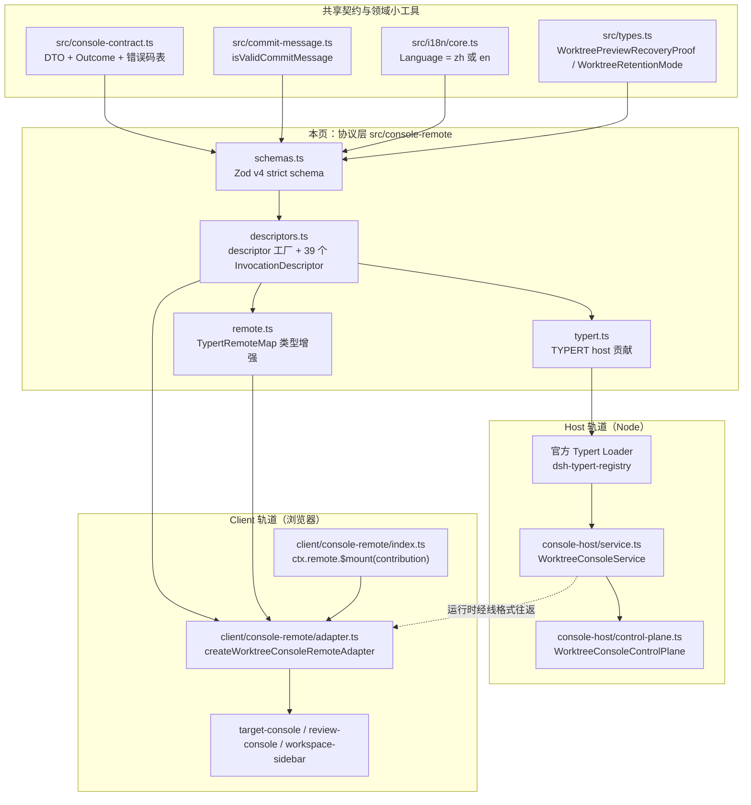
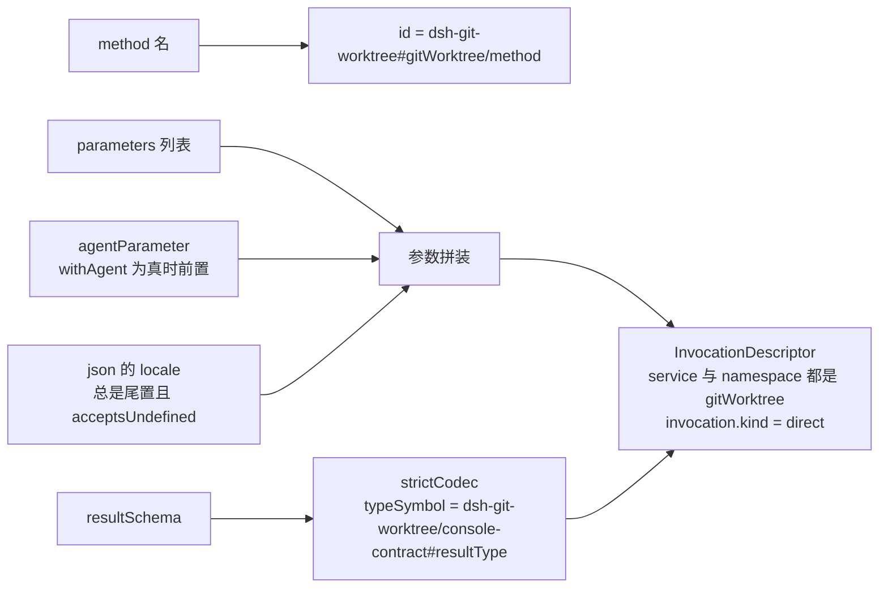
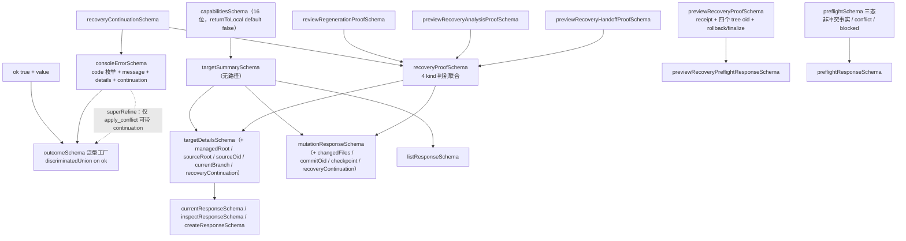
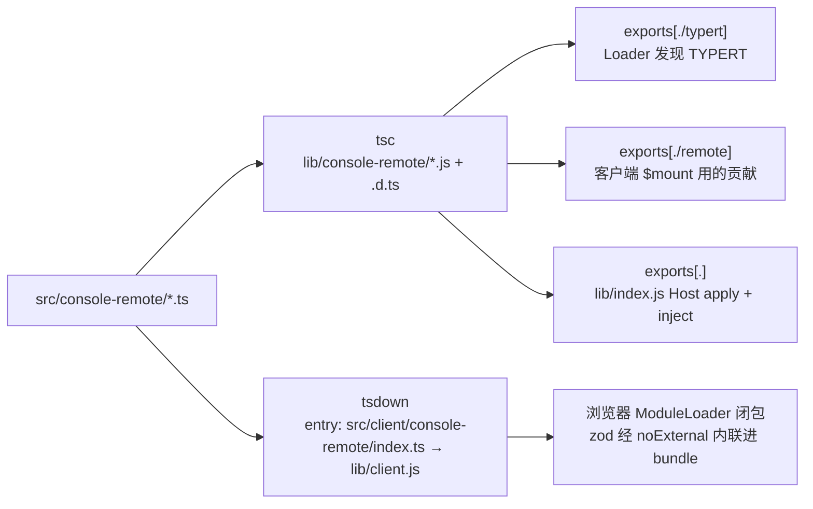
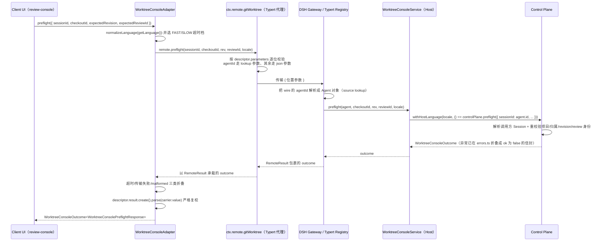
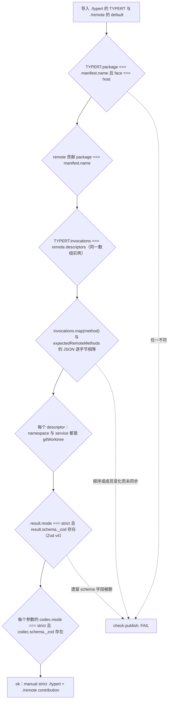

# Worktree Console Remote 协议层（`src/console-remote/`）

!!! info "Generated documentation"
    This page was written by CodeWiki from the source code at commit [`bccd87a6`](https://github.com/wloops/dsh-git-worktree/commit/bccd87a6d5270c62ed752e21426f9b3062418333) on 2026-11-06 with `doubao-seed-2.1-lite`. Check the code before relying on details.

本页文档化 `dsh-git-worktree` 插件的 **Remote 协议层**：把 [Worktree Console 共享契约](worktree_console_contract.md) 中定义的 DTO 与 `WorktreeConsoleOutcome` 翻译为**可上线传输的严格（strict）Zod schema + Typert 调用描述符**，并为其两端（Node 宿主与浏览器 Client）提供同一份、类型一致的调用面。

这一层不实现任何业务逻辑：它只做三件事——**声明方法身份、声明参数编解码、声明返回值的严格校验规则**。全部四个文件都是"声明式"的，且刻意保持**手写（manual）**而不使用代码生成器：

| 文件 | 角色 | 一句话概括 |
| --- | --- | --- |
| `src/console-remote/schemas.ts` | 线格式定义 | 用 Zod v4 `.strict()` 复刻契约里的每一个 DTO，并叠加身份安全性与载荷预算约束 |
| `src/console-remote/descriptors.ts` | 调用描述符 | `descriptor()` 工厂 + 39 个冻结的 `InvocationDescriptor`，组成 `WORKTREE_CONSOLE_REMOTE` 贡献 |
| `src/console-remote/remote.ts` | 类型面 | 通过 `declare module '@deepseek-ai/dsh-typert-protocol'` 增强 `TypertRemoteMap`，让 `ctx.remote.gitWorktree.*` 获得扁平位置参数的 TS 签名 |
| `src/console-remote/typert.ts` | Host 入口 | 官方 Typert Loader 通过 `package.json` 的 `./typert` 导出发现的 `TYPERT` 贡献（`face: 'host'`） |

---

## 1. 在系统中的位置

协议层是 Host 与 Client 两条**独立部署轨道**之间唯一的线上契约。任何一次跨边界调用都由这里描述的 descriptor 决定"参数怎么来、结果怎么验"。



关键约束：**descriptor 数组只有一个实例**。`typert.ts` 的 `invocations` 与 `remote.ts` 默认导出的 `WORKTREE_CONSOLE_REMOTE.descriptors` 指向 `WORKTREE_CONSOLE_DESCRIPTORS` 这同一个 `Object.freeze` 数组——发布门禁会直接断言两者的引用相等（见 §9）。

---

## 2. 三条设计主轴

### 2.1 strict：契约变更必须双向同步

`schemas.ts` 中每个对象都经由同一个助手构造：

```typescript
const strict = <T extends z.core.$ZodLooseShape>(shape: T) => z.object(shape).strict()
```

`.strict()` 意味着**未知键即拒绝**。配合 `descriptor()` 里 `mode: 'strict'` 的 codec，Host 与 Client 任一侧的 schema 落后一步都会在编解码层立刻暴露，而不会被静默吞掉。

由此推出一条硬性向前兼容规则（源码注释已把它固化为约定）：**新增响应字段只能是 `.optional()` 或带 `.default()`**。`capabilitiesSchema` 里的 `returnToLocal` 就是范例：

```typescript
// 新增能力必须容忍缺失：Client 与 Host 是两份独立部署的产物，宿主重启前跑
// 的是旧 Host，它根本不知道这个键。写成必填会让整条 `current` 的 payload
// 校验失败，胶囊直接塌成「不可用」……用 `default(false)` 而非 `optional()`：
// 输入可缺省，输出仍是确定的 boolean，契约类型因此不必跟着变宽。
returnToLocal: z.boolean().default(false),
```

`default(false)` 而非 `optional()` 的选择同时保住了两件事：旧 Host 的 payload 仍然解析通过，而契约类型 `WorktreeConsoleCapabilities.returnToLocal: boolean` 不必放宽成 `boolean | undefined`——Client 渲染代码因此不需要额外的判空分支。

### 2.2 身份安全（identity safety）：线格式层先挡一刀

协议层不信任任何来自线路的标识符，所有 id 类 schema 都带 `refine` 消毒：

| schema | 规则 | 挡住什么 |
| --- | --- | --- |
| `sessionIdSchema` | 1–200，禁 `\0 \r \n` | 注入换行的伪身份 |
| `checkoutIdSchema` | 1–200，禁 `..`、`\ / \0 \r \n` | 目录穿越（checkoutId 参与路径拼接） |
| `reviewIdSchema` / `requestIdSchema` / `previewIdSchema` | 长度上界 + 控制字符过滤 | 日志与 ID 污染 |
| `branchNameSchema` | 禁 `NUL \t ~ ^ : ? * [ ]`、不以 `-` 或 `/` 开头、不以 `/` 结尾、无 `..`、不以 `.lock` 结尾 | 非法 git ref 与以 `-` 开头的参数注入 |
| `commitMessageSchema` | `trim()` 后交给 `isValidCommitMessage` | 空消息与含 `\0` 的消息（正文经 stdin 送 Git） |
| `generationSchema` / `gitOidSchema` | 严格 40 或 64 位十六进制 | 伪造 generation / OID |
| `oidSchema` | `gitOidSchema` 与字面量 `'unversioned'`、`'unborn'` 的 union | 用魔法字符串冒充 OID |
| `safeConflictFile()` | 拒绝绝对路径/盘符、控制字符、`.` 与 `..` 段、空段 | 冲突清单里的路径逃逸 |

注意 `commitMessageSchema` **复用领域层同一个函数**（`isValidCommitMessage`，来自 `src/commit-message.ts`），而不是重新实现一份校验——协议层的校验永远不可能比领域层更宽松或更严格，杜绝漂移。

### 2.3 载荷预算（payload budget）：一次 RPC 不能压垮浏览器

所有集合都有上界：`reviewDiff` 的 `files.max(200)`、冲突文件 `max(500)`、`branches.max(2000)`、`tags.max(2000)`、`graph.commits.max(1000)`、`checkpoints.max(100)`、放弃快照 `max(200)`、可选分支清单 `max(1000)`。并且"无法确定"永远不用 0 冒充：

```typescript
/** `-1` = unknown (the untracked read overflowed); never rendered as a count. */
dirtyCount: z.number().int().min(-1),
// null = the remote could not be queried; never coerced to false.
pushed: booleanSchema.nullable(),
```

---

## 3. `descriptors.ts`：调用描述符的装配

### 3.1 `descriptor()` 工厂

`descriptor()` 是本模块唯一的装配入口，它把五个输入折叠成一个 `InvocationDescriptor`：



固定常量：

```typescript
const PACKAGE = 'dsh-git-worktree'
const SERVICE = 'gitWorktree'
const AGENT_WIRE_TYPE = '@deepseek-ai/dsh-session/types#SessionId'
```

### 3.2 `strictCodec()`：一份 schema 实例，两个消费口

```typescript
function strictCodec(typeSymbol: string, schema: TypertSchema): TypertCodec {
  // Keep the legacy `schema` field as an extra runtime property for older
  // client adapters; DSH 0.2 consumes the canonical lazy `create()` field.
  return { mode: 'strict', typeSymbol, create: () => schema, schema } as TypertCodec
}
```

这里有两个易被忽略的点：

1. **每个 descriptor 只持有一个 schema 实例**（DSH 0.2 通过 `create()` 惰性物化 strict schema）。因为 client 侧的 `descriptor.result.create().parse(...)` 与 Typert 生成的元数据用的是同一个对象，客户端校验规则与注册表元数据不可能不一致。
2. **`schema` 字段是刻意保留的遗留兼容口**：`scripts/check-publish.mjs` 第 4 步会显式断言 `descriptor.result.schema?._zod` 与每个参数 `parameter.codec.schema?._zod` 存在。也就是说，删掉这个遗留属性会直接把发布流程挡下来。

### 3.3 `agentParameter`：身份由 Gateway 解析，而非由浏览器声明

```typescript
const agentParameter: InvocationParameterDescriptor = {
  name: 'agent',
  wire: 'agentId',
  source: 'lookup',
  lookup: 'agent',
  codec: strictCodec(AGENT_WIRE_TYPE, sessionIdSchema),
}
```

`source: 'lookup'` + `lookup: 'agent'` 表示：线上传的是 `agentId` 字符串（仍经 `sessionIdSchema` 消毒），**Host 侧由 Gateway 把它解析成 `Agent` 服务对象后才进入业务代码**。这与 `src/console-host/service.ts` 中每个方法的 `agent: Agent` 形参严格对应（`WorktreeConsoleService` 类注释："the Gateway resolves `agentId` before business code runs"）。业务代码因此**永远拿不到浏览器自报的身份**，只拿到解析后的调用方——这正是共享契约里"权威规则"的落地点。

`sidebarTopology` 与 `clientBootReport` 使用 `withAgent = false`：前者是 Host 侧拓扑/版本探测（不依赖会话），后者是浏览器启动埋点。它们在 `TypertRemoteMap` 里的签名也相应没有 `agentId` 位置参数。

### 3.4 `json()` 与尾置 `locale`

```typescript
function json(name, schema, typeSymbol, acceptsUndefined = false): InvocationParameterDescriptor
```

`descriptor()` **总是**在最后追加 `json('locale', optionalLanguageSchema, 'string | undefined', true)`。这让每个 RPC 都能携带 UI 当前语言，Host 侧据此包裹 `withHostLanguage(...)`，使错误消息在**服务端**就按请求语言本地化（见 [国际化基座](../project_foundation_and_localization/src_i18n.md)）。

`acceptsUndefined: true` 是 Remote 代理按**位置**补齐参数序列的前提——Client 即使没有语言也必须显式传 `undefined`，否则 arity 校验失败。`src/client/console-remote/index.ts` 在上报启动埋点时就专门为此传了尾位 `undefined`。

---

## 4. 方法清单（39 个，冻结顺序即协议）

`WORKTREE_CONSOLE_DESCRIPTORS` 是一个 `Object.freeze` 的数组，其**元素顺序被发布门禁逐字节比对**（§9）。按用途分组如下：

| 分组 | 方法 | 关键参数（`agentId` 之外的位置参数） | 返回值 schema |
| --- | --- | --- | --- |
| 拓扑与埋点 | `sidebarTopology` | 无 agent | `outcomeSchema(sidebarTopologyResponseSchema)` |
| | `clientBootReport` | `report` | `booleanSchema` |
| 只读投影 | `current` | 无 | `currentResponseSchema` |
| | `list` | `needsAttention?`、`includeDelivered?` | `listResponseSchema` |
| | `inspect` | `checkoutId` | `inspectResponseSchema` |
| | `gitOverview` | 无 | `gitOverviewResponseSchema` |
| | `gitGraph` | `limit?` | `gitGraphResponseSchema` |
| 创建 | `preflightCreate` | 无 | `createPreflightResponseSchema` |
| | `createWithInitialCommit` | `confirmationToken`（必填） | `createResponseSchema` |
| | `create` | `branch?` | `createResponseSchema` |
| | `initProject` | 无 | `booleanSchema` |
| 评审取证 | `reviewDiff` | `checkoutId`、`expectedRevision`、`expectedReviewId` | `reviewDiffResponseSchema` |
| | `preflight` | 同上 | `preflightResponseSchema` |
| | `prepareReviewRegeneration` | 同上 | `mutationResponseSchema` |
| Preview 恢复 | `previewRecoveryPreflight` | `checkoutId`、`rev`、`reviewId`、`previewId` | `previewRecoveryPreflightResponseSchema` |
| | `preparePreviewRecoveryAnalysis` | 上 + `recoveryProof` | `mutationResponseSchema` |
| | `createPreviewRecoveryHandoff` | 上 + `recoveryProof` | `previewRecoveryHandoffResponseSchema` |
| 变更操作 | `preview` | `checkoutId`、`rev`、`reviewId` | `mutationResponseSchema` |
| | `checkpoint` | `rev`、`reviewId`、`expectedGeneration`、`requestId`、`commitMessage` | `mutationResponseSchema` |
| | `resumeRevision` | `rev`、`reviewId`、`conflictContinuation?` | `mutationResponseSchema` |
| | `rollbackPreview` | `rev`、`resumeRevision?`、`recoveryProof?` | `mutationResponseSchema` |
| | `discard` | `rev`、`confirmDirty`（必填）、`rollbackPreview?` | `mutationResponseSchema` |
| | `finalize` | `rev`、`reviewId`、`commitMessage`、`retention` | `mutationResponseSchema` |
| | `finalizePreview` | `rev`、`reviewId`、`commitMessage`、`retention`、`recoveryProof?` | `mutationResponseSchema` |
| 生命周期管理 | `setRetention` | `rev`、`retention`（`retainedModeSchema`，禁 `cleanup`） | `mutationResponseSchema` |
| | `setPermanent` | `rev`、`permanent` | `mutationResponseSchema` |
| | `retryCleanup` | `rev`、`discardPostDeliveryChanges?` | `mutationResponseSchema` |
| | `beginNextIteration` | `rev` | `mutationResponseSchema` |
| | `returnToLocal` | `checkoutId` | `currentResponseSchema`（结构等价于 `returnToLocalResponseSchema`） |
| | `clearSidebarBadge` | `checkoutId`、`rev` | `mutationResponseSchema` |
| 分支/标签 | `gitCreateBranch` / `gitSwitchBranch` | `name` / `branch`（`branchNameSchema`） | `gitMutationResponseSchema` |
| | `gitPruneMergedBranches` | `dryRun`（必填 boolean） | `gitPruneResponseSchema` |
| | `gitListTags` | 无 | `gitTagListResponseSchema` |
| | `gitCreateTag` | `name`、`message?`、`target?`、`push?` | `gitTagMutationResponseSchema` |
| | `gitDeleteTag` | `name`、`remote?` | `gitTagMutationResponseSchema` |
| | `gitPushTag` | `name` | `gitTagMutationResponseSchema` |
| 放弃快照 | `listAbandoned` | 无 | `abandonedListResponseSchema` |
| | `restoreAbandoned` | `checkoutId` | `restoreAbandonedResponseSchema` |

方法总数 **39**（与 `check-publish.mjs` 中 `expectedRemoteMethods` 的长度一致）。除两个布尔特例——`clientBootReport` 直接返回 `booleanSchema`（埋点回执，无需业务错误码）、`initProject` 返回 `outcomeSchema(booleanSchema)`——之外，所有方法的返回值都被 `outcomeSchema(...)` 包裹成判别联合。

**参数顺序必须与 `TypertRemoteMap` 的签名一致**——这是代理"按位置补参数"的直接后果，也是 §6.1 类型增强的价值所在：写错顺序会直接 `typecheck` 失败。

---

## 5. `schemas.ts`：契约的线格式镜像

### 5.1 组合结构



### 5.2 摘要与详情的分野

`targetSummarySchema` 是**不含路径**的行数据，用于列表与状态胶囊；`targetDetailsSchema` 通过 `.extend({ managedRoot, sourceRoot, sourceOid, currentBranch, recoveryContinuation })` 才附加文件系统边界。这个分层把"能看到某个工作树存在"和"能拿到它的绝对路径"区分成两种授权，由 Host 投影层决定给哪一层（详见 [Worktree Console 宿主服务](worktree_console_host.md)）。

### 5.3 错误信封的两道锁

```typescript
const consoleErrorSchema = strict({
  code: z.enum(WORKTREE_CONSOLE_ERROR_CODES),
  message: z.string(),
  details: z.record(...).optional(),
  continuation: recoveryContinuationSchema.optional(),
}).superRefine((value, ctx) => {
  if (value.continuation !== undefined && value.code !== 'apply_conflict') {
    ctx.addIssue({ code: 'custom', path: ['continuation'], message: 'only apply_conflict may carry a continuation' })
  }
})
```

- `code` 是 `z.enum(WORKTREE_CONSOLE_ERROR_CODES)`——直接引用契约导出的常量数组，新增错误码时协议层自动跟随，无需二处维护。
- `superRefine` 保证**恢复续体不能被任意错误携带**：只有 `apply_conflict` 可以带 `continuation`。这防止 Host 的一个 bug 把"可续做的恢复动作"附着在无关错误上，进而被 UI 当作可执行入口。

`WORKTREE_CONSOLE_ERROR_CODES` = 领域层 `SESSION_CHECKOUT_ERROR_CODES` + `transport_unavailable` / `malformed_response` / `timeout` 三个传输码。这三个码 Host 侧永不产生，只可能由 Client 适配器自己折叠出来（见 §8）。

### 5.4 schema ↔ 类型不可漂移

每个导出的响应 schema 都带显式类型标注，把 Zod 推断结果钉在契约类型上：

```typescript
export const currentResponseSchema: z.ZodType<WorktreeConsoleCurrentResponse> = strict({ target: targetDetailsSchema })
export const mutationResponseSchema: z.ZodType<WorktreeConsoleMutationResponse> = strict({ ... })
```

字段少写、多写或类型写错都会在 `pnpm run typecheck` 阶段失败，而不是等到运行时才炸。`targetSummarySchema` / `consoleErrorSchema` 等未标注的中间 schema 则依赖 `outcomeSchema` 处的 `as z.ZodType<WorktreeConsoleOutcome<T>>` 收口。

---

## 6. `remote.ts` 与 `typert.ts`：一次贡献，两个消费口

### 6.1 `remote.ts`：给浏览器的那半

```typescript
export type GitWorktreeRemote = TypertRemoteNamespace<'gitWorktree'>
export default WORKTREE_CONSOLE_REMOTE
export { WORKTREE_CONSOLE_DESCRIPTORS, WORKTREE_CONSOLE_REMOTE } from './descriptors.js'

declare module '@deepseek-ai/dsh-typert-protocol' {
  interface TypertRemoteMap {
    'gitWorktree/current': (agentId: string, locale?: Language) => Promise<RemoteResult<WorktreeConsoleOutcome<WorktreeConsoleCurrentResponse>>>
    // …其余 38 条
  }
  interface TypertRemoteNamespaceMap {
    gitWorktree: TypertRemoteNamespace<'gitWorktree'>
  }
}
```

要点：

- **签名是扁平位置参数，而非请求对象**。契约层里 `WorktreeConsoleAdapter` 收的是 `{ sessionId, checkoutId, expectedRevision, expectedReviewId }` 这类对象；`TypertRemoteMap` 里收的是 `(agentId, checkoutId, expectedRevision, expectedReviewId, locale?)`。这层"对象 ↔ 位置参数"的展开正是 `client/console-remote/adapter.ts` 的工作，也是为什么浏览器 bundle 需要 descriptor 表来反向校验结果。
- **返回值被 `RemoteResult<...>` 再包一层**：`RemoteResult` 是传输信封（代理/codec 层的失败），`WorktreeConsoleOutcome` 是业务信封（领域失败）。两者语义不同、来源不同，Client 适配器分别折叠成 `transport_unavailable` / `malformed_response` / `timeout` 与直接透传的 Host 错误码。
- `Language` 直接复用 `src/i18n/core.js` 的 `'zh' | 'en'`，与 `optionalLanguageSchema` 的 `z.enum(['zh', 'en'])` 一一对应。

### 6.2 `typert.ts`：给宿主 Loader 的那半

```typescript
/** Manual strict Host contribution discovered by the official Typert Loader through `./typert`. */
export const TYPERT: TypertContribution = Object.freeze({
  package: 'dsh-git-worktree',
  face: 'host',
  schemas: [],
  model: { services: [], events: [], objects: [] },
  invocations: WORKTREE_CONSOLE_DESCRIPTORS,
})
```

`schemas` 与 `model` 为空是**刻意的**：本包不使用 Typert 的模型 DSL（service/event/object），只贡献 direct invocation。这配合 `scripts/check-publish.mjs` 的一条禁令——**不得依赖 `@deepseek-ai/dsh-typert-generator`**：贡献必须是手写单源，避免"生成的元数据"与"手写的 schema"两票打架。

### 6.3 打包与发现路径



`package.json` 的导出映射把这两半固定下来：`./typert` → `./lib/console-remote/typert.js`，`./remote` → `./lib/console-remote/remote.js`，`./client` → `./lib/client.js`。`tsdown.config.ts` 中 `noExternal: ['zod', 'lucide-react']` 保证 **Zod 被内联进浏览器闭包 bundle**——`schemas.ts` 及其严格 codec 必须能在浏览器里真正跑起来，因为 Client 适配器会对响应做一次 `create().parse(...)`。`zod` 也因此是 `dependencies` 而不是 peer：它是两条轨道都要自带运行的实现，而 `@deepseek-ai/dsh-typert-protocol` / `dsh-typert-registry` 必须是 `peerDependencies`（`TypertRemoteMap` 的 module augmentation 只有在共用同一 Host 实例时才生效），这一点由 `check-publish.mjs` 第 1 步的主机单例清单强制。

---

## 7. 一次调用的完整往返

以 `preflight`（验收前的只读预检）为例：



**双向校验**是本层的核心机制：

1. 入向：`TypertRemoteMap` 的位置参数在代理处按 descriptor 的 codec 生成元数据；`agent` 参数由 Gateway 从 `agentId` 解析，浏览器无法伪造。
2. 出向：Host 返回的 payload 先由 `WorktreeConsoleService` 的返回类型约束，再由 Client 适配器用**同一个 schema 实例**（`descriptor.result.create()`）严格复校。任何一侧偷偷多塞/少给字段都会在 `parse` 处失败，并被折叠为 `malformed_response`，而不是让 UI 读到 `undefined` 后画出错误状态。

---

## 8. 与相邻层的关系（失败模式分工）

| 失败模式 | 产生位置 | 错误码 | 谁负责折叠 |
| --- | --- | --- | --- |
| 领域校验不通过（非归属、stale、冲突…） | `console-host/control-plane.ts` → `errors.ts::consoleFailure` | `SESSION_CHECKOUT_ERROR_CODES` 中的码 | Host（消息按 `locale` 在服务端本地化） |
| 参数不合法 | `console-remote/descriptors.ts` 的入向 codec | 传输层 `RemoteResult` 拒绝 | Typert 代理，适配器识别为 `malformed_response` |
| 响应不符合 strict schema | `client/console-remote/adapter.ts` 的出向 `parse` | `malformed_response` | Client |
| Web RPC 载体无超时 | Client 适配器 `Promise.race` | `timeout`（消息取 `transport-messages.ts` 的 `invokeTimeout`） | Client |
| 命名空间未挂载 / 代理异常 | Client 适配器 catch | `transport_unavailable` | Client |

其中"响应不符合 strict schema"这一格是本模块存在的意义所在：**它把一个静默的接口漂移变成一个可见的错误码**。相关实现细节见 [Client 侧控制台 Remote 适配器](../worktree_client_interface_layer/client_console_remote.md)，Host 侧的 `withHostLanguage` 与诊断落地见 [Worktree Console 宿主服务](worktree_console_host.md)，DTO 与状态机本身见 [Worktree Console 共享契约](worktree_console_contract.md)。

---

## 9. 发布门禁：协议层被机器守着

`scripts/check-publish.mjs`（由 `pnpm run check:publish` / `check:publish:release` 调用，CI 作业 `check` 在 `.github/workflows/ci.yml` 中执行 `typecheck` → `build` → `check:publish:release` → `test`）第 4 步专门校验本模块：



由此可得本模块的**隐式契约**（改动前务必逐条核对）：

1. **不得引入 `@deepseek-ai/dsh-typert-generator` 依赖**：贡献必须手写。
2. **`./typert` 与 `./remote` 必须共享同一个冻结数组**，两者都从 `descriptors.ts` 取值。
3. **方法名与顺序是协议的一部分**：新增/调整方法必须同步更新 `check-publish.mjs` 中的 `expectedRemoteMethods`，否则发布直接失败（这是刻意设的"要改协议就必须显式承认"的门槛）。
4. **`strictCodec` 必须同时携带 `create()`（DSH 0.2 规范口）与 `schema`（遗留断言口）**。

---

## 10. 扩展指南：新增一个 Remote 方法

按下面的顺序改，可以一步不落（任何一步遗漏都会在 `typecheck` 或 `check:publish` 处被抓住）：

1. 在 `src/console-contract.ts` 定义请求/响应 DTO，并把方法加入 `WorktreeConsoleAdapter`。
2. 在 `src/console-remote/schemas.ts` 为其参数与返回值补 strict schema；响应字段遵循 §2.1 的"新增必 optional / default"规则。
3. 在 `src/console-remote/descriptors.ts` 追加一行 `descriptor('method', [json(...)], outcomeSchema(xxxSchema), 'WorktreeConsoleOutcome<XxxResponse>', withAgent)`；决定是否需要 `agent` 位、是否需要 `acceptsUndefined`。
4. 在 `src/console-remote/remote.ts` 的 `TypertRemoteMap` 里补 `(agentId, ...args, locale?: Language) => Promise<RemoteResult<...>>`，**位置顺序必须与第 3 步参数数组一致**。
5. 在 `src/console-host/control-plane.ts` 实现方法（返回 `WorktreeConsoleOutcome`，异常走 `errors.ts`），并在 `src/console-host/service.ts` 暴露同名 `@Remote`。
6. 在 `src/client/console-remote/adapter.ts` 把对象参数展开为位置参数调用 `remote.<method>(...)`。
7. 在 `scripts/check-publish.mjs` 的 `expectedRemoteMethods` 中按顺序登记方法名。

---

## 11. 小结

`src/console-remote/` 是一个**零业务逻辑、高约束密度**的模块。它的价值不在实现，而在把四件事变成机器可验证的事实：

- **身份不可自证**：`agent` 参数走 `source: 'lookup'`，浏览器只递 id，Host 只认解析后的 Agent。
- **契约不可漂移**：strict Zod + 双向复校 + `z.ZodType<契约类型>` 标注，漂移立刻变成 `malformed_response` 或 `typecheck` 失败。
- **载荷不可失控**：身份消毒 + 集合上界 + "未知不等于 0"的表达约定。
- **部署不可错配**：`default(false)` 的能力位让新 Client 兼容旧 Host，发布门禁让 39 个方法的名单与顺序无法被悄悄改动。

延伸阅读：契约本体见 [Worktree Console 共享契约](worktree_console_contract.md)；Host 如何计算这些 outcome 见 [Worktree Console 宿主服务](worktree_console_host.md)；Client 如何消费这套类型面见 [Client 侧控制台 Remote 适配器](../worktree_client_interface_layer/client_console_remote.md)；被调用的领域状态机见 [Session Checkout 领域层](../core_worktree_domain_and_infrastructure/session_checkout_domain.md)；构建与发布链路见 [构建、CI 与打包](../project_foundation_and_localization/build_ci_and_packaging.md)。上层总览见 [Worktree Console 协议与宿主服务](../worktree_console_protocol_and_host_service.md)。

??? abstract "Documented components (5)"
    - [`descriptor`](https://github.com/wloops/dsh-git-worktree/blob/bccd87a6d5270c62ed752e21426f9b3062418333/src%5Cconsole-remote%5Cdescriptors.ts) — `src\console-remote\descriptors.ts`
    - [`TypertRemoteMap`](https://github.com/wloops/dsh-git-worktree/blob/bccd87a6d5270c62ed752e21426f9b3062418333/src%5Cconsole-remote%5Cremote.ts) — `src\console-remote\remote.ts`
    - [`TypertRemoteNamespaceMap`](https://github.com/wloops/dsh-git-worktree/blob/bccd87a6d5270c62ed752e21426f9b3062418333/src%5Cconsole-remote%5Cremote.ts) — `src\console-remote\remote.ts`
    - [`outcomeSchema`](https://github.com/wloops/dsh-git-worktree/blob/bccd87a6d5270c62ed752e21426f9b3062418333/src%5Cconsole-remote%5Cschemas.ts) — `src\console-remote\schemas.ts`
    - [`__file__`](https://github.com/wloops/dsh-git-worktree/blob/bccd87a6d5270c62ed752e21426f9b3062418333/src%5Cconsole-remote%5Ctypert.ts) — `src\console-remote\typert.ts`

