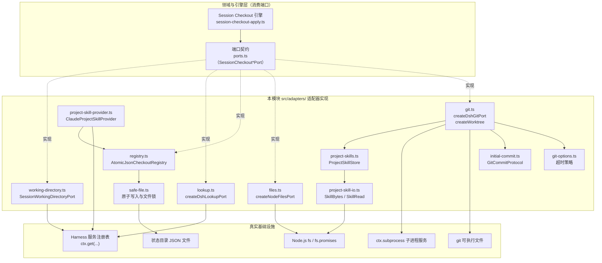
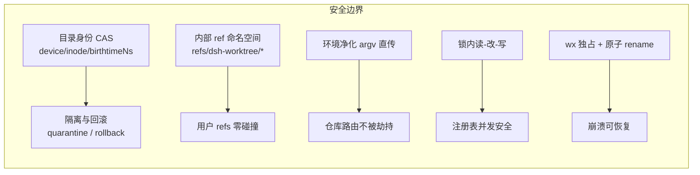

# 适配器基础设施实现（Adapter Infrastructure Implementations）

本模块是 [Backend_Host_Core_Runtime](backend-host-core-runtime.md) 下的**基础设施适配层**，负责把领域层与引擎层声明的端口（`SessionCheckoutGitPort`、`SessionCheckoutFilesPort`、`SessionCheckoutRegistryPort`、`SessionCheckoutLookupPort` 等）落实为真实宿主环境下的运行实现：Node.js 文件系统、`ctx.subprocess` 子进程、Harness 服务注册表（`workspaceRegistry` / `sessions` / `workingDirectory` / `skills`），以及崩溃安全的 JSON 状态持久化。

它位于 `src/adapters/` 目录，是整个托管 Worktree 能力的“地基”：向上不感知领域规则，只提供带强安全语义的原子操作；向下把 git、文件、进程与宿主服务的所有**硬化细节**（超时、加锁、身份校验、隔离、失败回滚）收拢在一处。

## 架构总览

### 四条适配链路

| 链路 | 文件 | 实现的端口 / 能力 | 底层依赖 |
| --- | --- | --- | --- |
| Git 执行 | `git.ts`、`git-options.ts`、`initial-commit.ts`、`worktree-creation.ts` | `SessionCheckoutGitPort`（检出、状态、分支/标签/图、合并、补丁、快照） | `ctx.subprocess` + `git` 命令 |
| 文件与注册表持久化 | `files.ts`、`registry.ts`、`safe-file.ts` | `SessionCheckoutFilesPort`、`SessionCheckoutRegistryPort` | Node fs、原子 rename、跨进程文件锁 |
| Project Skills | `project-skills.ts`、`project-skill-io.ts`、`project-skill-provider.ts` | Skill 快照/携带/校验、宿主 `skills` 提供者挂载 | fs 受约束读写、`skills` 服务 |
| Harness 查找与会话工作目录 | `lookup.ts`、`working-directory.ts` | `SessionCheckoutLookupPort`、`SessionWorkingDirectoryPort` | `workspaceRegistry`、`sessions`、`workingDirectory` |

---

## Git 执行适配

以 `createDshGitPort(ctx, options)`（`git.ts`）为核心。所有 git 命令都通过 `ctx.subprocess.spawn` 以 argv 直传方式执行（**绝不经过 shell**），并施加 Domi 生产适配的全套硬化：

- **环境净化**：剥离全部环境变量中的 `GIT_DIR` / `GIT_WORK_TREE` 等仓库路由覆盖（防止 ambient git 配置劫持仓库解析），只保留身份类变量；同时注入 `GIT_OPTIONAL_LOCKS=0`、`GIT_TERMINAL_PROMPT=0`、`LC_ALL=C`、`LANG=C`。
- **hooks 禁用**：`core.hooksPath` 指向调用方提供的空目录；`--no-optional-locks`、`--no-pager`；Windows 下追加 `core.longpaths=true`。
- **超时**：由 `git-options.ts` 的 `GitTimeoutOptions` 驱动——普通命令默认 120 秒、`worktree add` 默认 5 分钟、`worktree remove` 固定 5 分钟上限，硬顶 1 小时；volatile 值每次调用现读，让设置页的修改立即对下一条命令生效。
- **输出收集**：每流 1 MiB 上限；`status` 与 WIP 补丁放宽到 16 MiB（仓库规模决定输出大小，截断按“可重试的部分输出”处理而不是致命错误）。
- **内部 ref 命名空间**：插件工件（apply-base、安全快照等）落在 `refs/dsh-worktree/session-checkouts/<sha256-24>/...` 下，与用户 refs 永不对撞；废弃快照 ref 单独放在 `refs/dsh-worktree/abandoned/`，防止 discard 时被一并释放。
- **端口能力面**：仓库检查（`inspect`）、脏状态（`status`）、worktree 创建/移除/修剪/列举、分支与标签读写（含 push/delete，**永不 force**）、分支图（`graphLog`）、合并干跑（在临时 detached 探测 worktree 中试合并，零触碰 checkout）、WIP 二进制补丁捕获/应用、废弃快照提交与恢复等。

`initial-commit.ts` 提供 `GitCommitProtocol`（`prepare` + `beforeCommit()`），通过 `git commit-tree` 的指针协议流把首次提交的 compare-and-swap 完成：空仓库初始化时在 index.lock 与 HEAD/branch 锁保护下多次重算 fingerprint，确认为空仓库才发布提交；身份缺失时原样报错，不回滚任何字节。

`worktree-creation.ts` 的 `createWorktree(...)` 是**带证据的安全创建**：先登记（`worktree add --lock`）→ 固化创建证据（目录身份、gitDir 指纹）→ `read-tree` + `checkout-index` 发布索引与文件 → 解锁。失败时按两种安全等级回滚：未登记且目录未被占用则直接删空目录；已登记则依次做身份/元数据/字节三重校验（`verifyUnmodified` 逐字节哈希比对工作区文件），全部通过才允许 `worktree move` 到隔离目录再 `remove`——任何一项校验失败都保留残留目录，交由人工处置。

## 文件与注册表持久化适配

### `files.ts` — `createNodeFilesPort()`

实现 `SessionCheckoutFilesPort`，面向 CAS 式目录身份（device / inode / birthtimeNs）：

- `inspectDirectoryIdentity` / 身份相等比较：清理与隔离前核对目录对象未被替换。
- `quarantineDirectoryTree`：rename 到同父级隔离路径并回验身份，不一致则回滚且**绝不删除**身份不符的对象。
- `removeEmptyDirectoryTree`：递归只删空目录，遇到符号链接（junction）只 unlink 链接本身、绝不跟随目标。
- `removeDirectoryTree`：拒绝删除“非目录或符号链接”的残留；Windows 下 rm 带 6 次重试。
- `measureDirectoryBytes`：递归字节计量（跳过符号链接），用于清理前的空间核算。

### `registry.ts` — `AtomicJsonCheckoutRegistry`

把 v2 版托管注册表（`sessionBindings` + `managedCheckouts`）作为单个原子 JSON 文件持久化在插件状态目录：

- **读即校验**：`isRegistry` / `isManagedCheckout` / `isDelivery` / `isJournal` 等一组谓词逐字段校验；`sanitizeRegistry` **逐条丢弃**坏记录并保留其余（一条损坏不让全部 checkout 失联），降级只作用于内存视图、绝不回写磁盘。
- **v1 迁移**：`migrateLegacyRegistry` 保守迁移——非 `ready`/`discarded` 的旧相位统一降级为 `recovery_required`。
- **写即加锁**：`update(mutate)` 在文件锁内完成“读盘原样 → mutate → 写盘”，跨进程并发下后写者不会抹掉先写者的记录；`load()` 读的是未经分区降级的盘上事实。

### `safe-file.ts` — 崩溃安全原语

为注册表与其他 JSON 索引提供崩溃/关机容错（供 i18n 模块的 `hostMessage` 输出用户可见的恢复/告警信息）：

- **写**：唯一命名 `<file>.<pid>.<uuid>.tmp` → `writeFileSync` → 原子 `rename`（POSIX 语义 + Windows `EBUSY/EPERM/EACCES` 指数退避重试）；写前自动保留 `.bak` 备份。
- **读**：主文件 → 最新可解析 `.tmp` 残留（提升为主文件）→ `.bak` 回退，三级容错；全失败返回 `null` 交由上层重建。
- **锁**：`withFileLock` 用 `<target>.lock`（wx 创建，载荷含 pid / createdAt / token）实现跨进程互斥；持有者进程退出或超 30 秒视为陈旧锁可回收；同进程可重入复用持有的锁；释放时只删自己 token 的锁。

## Project Skills 携带与宿主集成适配

三套文件共同解决一个问题：**把项目级 Skill（`.dsh/skills`、`.agents/skills`、`.claude/skills`）随 Local 安全带到托管 Worktree，且不让 Worktree 反过来污染宿主**。

- `project-skills.ts` 的 `ProjectSkillStore`：以宿主私有 provenance（按 source root 哈希命名的 manifest JSON）管理快照（`SkillSnapshot`：文件字节、哈希、mode、空目录）、携带（`carry`：冲突预检 → `wx` 独占发布 manifest → 逐文件创建 → 回读校验 → `ready` 相位原子改名）、状态比对（`state`：`CarriedSkillState` 含指纹与 modified 标记）、可移除性断言（`assertRemovable`：有修改或新增资源时拒绝移除 Worktree）。读取全程有安全边界：`safePath` 限定三段式路径、无分隔符控制字符、单次快照 5000 文件 / 64 MiB 上限、读写循环中复核根身份。
- `project-skill-io.ts`：`readSkillFiles` / `createSkillFiles` / `createSkillDirectories` 是受约束的 IO 原语——每段路径 `lstat` 拒绝符号链接与特殊文件，`O_NOFOLLOW` 打开，创建用 `O_EXCL`，读循环中复核 size/inode/dev 防“读取中途被替换”。
- `project-skill-provider.ts` 的 `ClaudeProjectSkillProvider`：把托管 Worktree 内的 `.claude/skills` 作为额外来源挂载进宿主 `skills` 服务（`mountProjectSkillProvider` 通过 `ctx.inject(['skills'])` 注册）。`managedSkillRoot` 只信任**注册表中 phase=ready 的记录**，并双向校验 `.git` 指针与 `gitdir` 回指；每个 root 惰性创建 `FileSystemSkillProvider`（上限 32 个，LRU 淘汰），操作串行化队列保证 dispose 安全。

## Harness 查找与会话工作目录适配

- `lookup.ts` 的 `createDshLookupPort(ctx)`：把会话/项目映射到 Harness 的 `workspaceRegistry` 服务（动态 `ctx.get` 取，结构性校验通过才使用，缺失即降级为 `undefined`，由状态机当作恢复/孤儿事实而非报错）。它回答四类问题：侧边栏归属（`getSidebarMemberships`：workspace 路径 ∩ 会话 header cwd 双重匹配）、存活会话清单（`listLiveSessions`：分支竞争护栏）、会话→项目映射（`getSession`：workspace 丢失不可变 cwd 投影时，用该会话 header 中冻结的 cwd 做**仅一次**的恢复匹配）、当前授权目录（`getSessionCwd`：优先 `workingDirectory` 服务的实时 cwd，回退 header cwd——因为会话被 `workingDirectory.set` 移进 Worktree 后，冻结 header 仍是 Local 根）。
- `working-directory.ts` 的 `createSessionWorkingDirectoryPort(ctx)`：实现**把会话真正搬进 Worktree** 的机制（`enter` / `leave` / `current`），语义与官方实验性 worktree 包一致；宿主未挂载 `workingDirectory` 服务时整个端口降级为“指导模式”（不报告未设置的 cwd）。`leave` 仅在会话当前目录确实位于目标之内时才移回 fallback。

## 关键安全机制一览

## 与其他模块的关系

- **端口契约**：本模块实现的接口定义在 [Core_Workspace___Worktree_Domain_Layer](core-workspace-worktree-domain-layer.md)（`src/ports.ts`），消费方主要是 [Core_Session_Checkout_Engine](core-session-checkout-engine.md) 与会话检出引擎。
- **上层服务**：[Worktree_Console_Host_Service](worktree-console-host-service.md) 经控制面调用这些适配器背后的领域能力。
- **i18n**：所有用户可见消息经 `hostMessage(...)` 输出，见 [Shared_Cross-Tier_Contracts___Utilities](shared-cross-tier-contracts-utilities.md) 的宿主消息层。
- **API 契约**：适配器不直接对前端暴露；前端↔宿主的请求/响应类型见 [Shared_Worktree_Console_API_Contract](shared-worktree-console-api-contract.md)。
