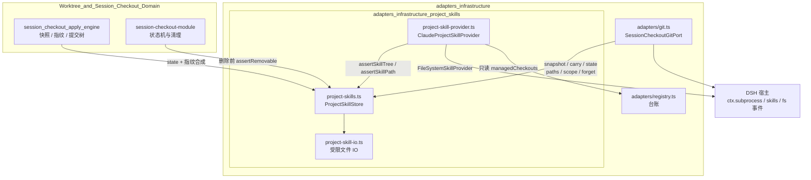
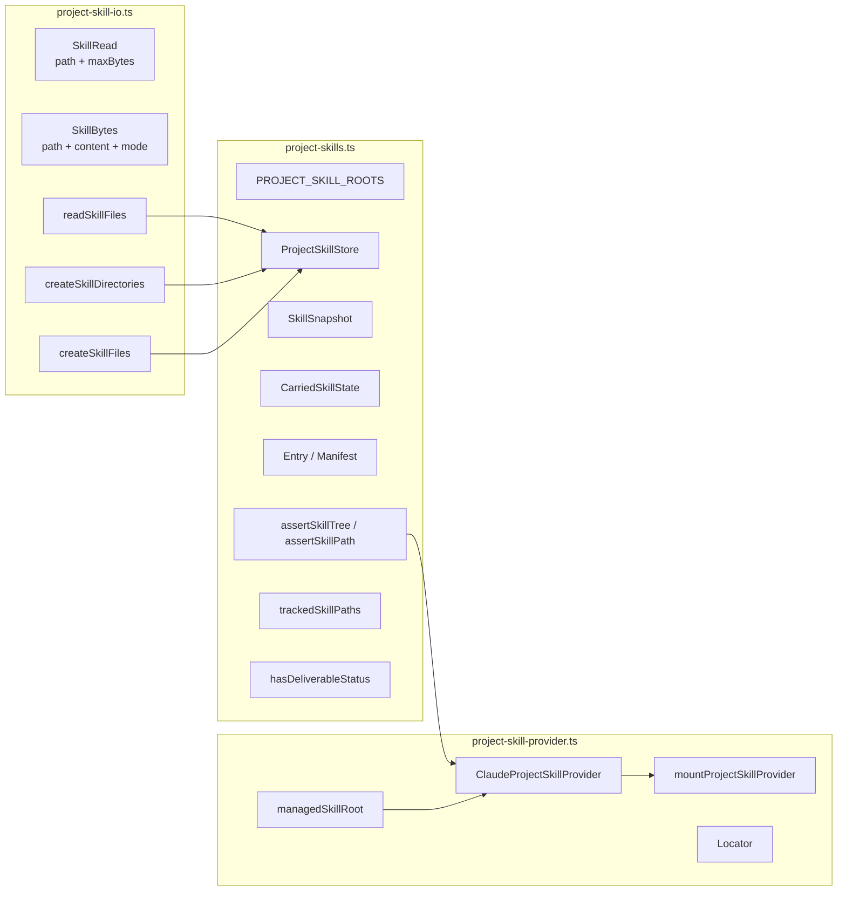
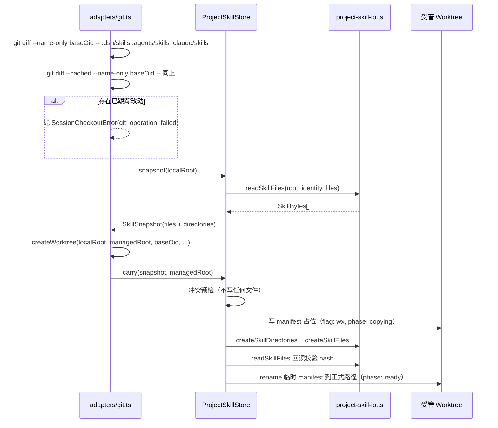
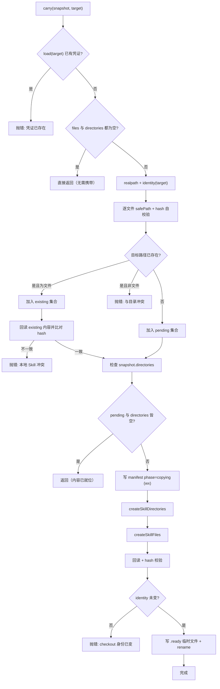
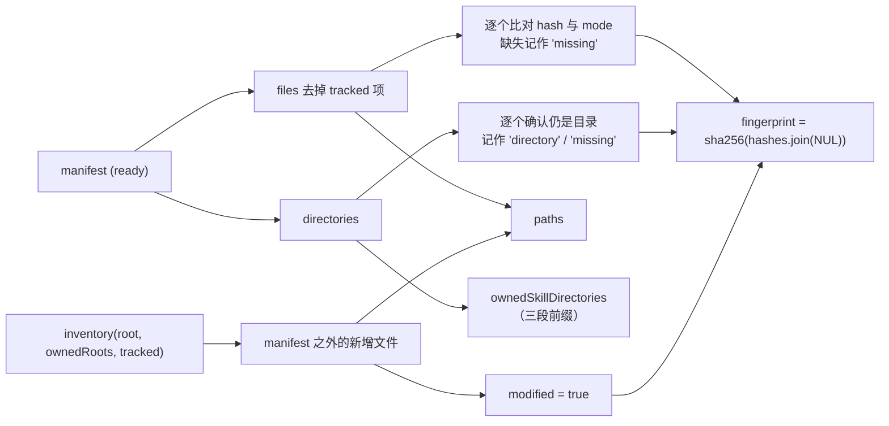
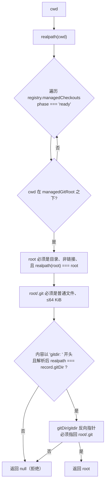
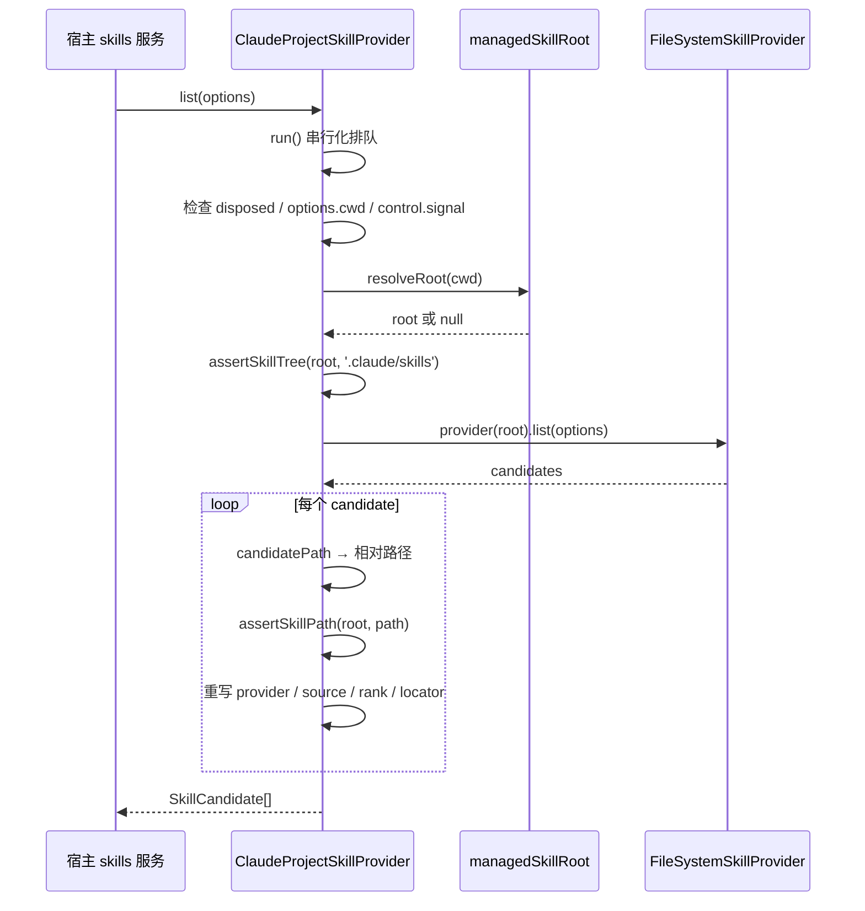
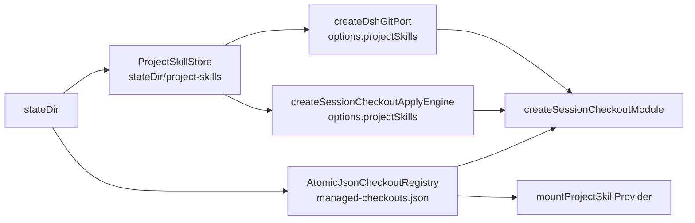

# Project Skills 适配器：跨 Worktree 携带与 Claude Skill 提供者

本页描述 `src/adapters/project-skill-io.ts`、`src/adapters/project-skills.ts` 与 `src/adapters/project-skill-provider.ts` 三个文件构成的适配器子模块。它的职责是让**项目级 Skill 目录**在「Local Checkout → 受管 Worktree」的跨越中不丢失、不被篡改、不被误判为交付物，并让 Worktree 内的 `.claude/skills` 作为额外 Skill 来源被宿主发现。

模块名虽为 "adapters"，但它同时承担两件事：

1. **受管 Worktree 的 Skill 携带（carry）与来源凭证（provenance）**——把 Local 仓库中 `.dsh/skills`、`.agents/skills`、`.claude/skills` 三棵子树快照化，写入新建的受管 Worktree，并在宿主私有目录里记录一份不可伪造的清单（manifest），供后续「脏判定」「可删除性判定」「指纹合成」使用。
2. **宿主 Skill 服务的一个额外 Provider**——`ClaudeProjectSkillProvider` 只从**宿主台账已验证**的受管 Worktree 根目录里读取 `.claude/skills`，绝不接受 Skill 文件自己声称的根路径。

> 相关上游/下游页面：Git 进程适配见 [adapters_infrastructure_git_process.md](adapters-infrastructure-git-process.md)，文件与持久化适配见 [adapters_infrastructure_filesystem_and_persistence.md](adapters-infrastructure-filesystem-and-persistence.md)，宿主服务适配见 [adapters_infrastructure_host_services.md](adapters-infrastructure-host-services.md)，端口定义见 [core_ports_and_types.md](core-ports-and-types.md)，应用引擎（消费本模块指纹与排除集）见 [session_checkout_apply_engine.md](session-checkout-apply-engine.md)。

---

## 1. 模块在分层中的位置



要点：`project-skills.ts` 是本子模块的门面（唯一被 `git.ts`、`session-checkout-apply.ts`、`index.ts` 引用的入口），`project-skill-io.ts` 是它的私有实现细节，`project-skill-provider.ts` 通过 `project-skills.ts` 的断言函数复用同一套路径安全规则。

---

## 2. 三文件的职责与导出



### 2.1 `project-skill-io.ts` — 受限文件读写原语

| 导出 | 作用 |
| --- | --- |
| `SkillRead` | 读请求：`path`（相对 root 的 POSIX 风格路径）+ `maxBytes` |
| `SkillBytes` | 读结果：`path` + `content: Buffer` + `mode`（0o777 掩码后的权限位） |
| `readSkillFiles(root, identity, files)` | 在**整批共享 64 MiB 预算**下顺序读取；每次读写前后校验 root 身份 |
| `createSkillDirectories(root, identity, directories)` | 逐级 `mkdir`（非递归）创建目录，拒绝跟随链接 |
| `createSkillFiles(root, identity, files)` | 以 `O_CREAT \| O_EXCL \| O_NOFOLLOW` 独占创建文件，写入后 `chmod` + `sync` |

内部两个守卫函数：

- `checkRoot(root, expected)`：`lstat` 结果必须是目录、非符号链接，且 `${dev}:${ino}:${birthtimeNs}` 与预期一致，否则抛 `Project Skills: checkout directory changed`。
- `checkPath(root, path, createParents?)`：路径必须落在 `.dsh` / `.agents` / `.claude` 之下且第二段为 `skills`；逐段 `lstat`，任一段是链接或特殊文件即拒绝；拒绝空段、`.`、`..`、反斜杠、冒号与控制字符。

> **设计边界（代码注释明示）**：这些检查服务于「可信本地创建」，不是对另一个进程在两次系统调用之间恶意替换祖先目录的原子隔离。文档与评审不应把它当作沙箱级保证。

### 2.2 `project-skills.ts` — 携带与凭证门面

| 导出 | 类型/签名 | 作用 |
| --- | --- | --- |
| `PROJECT_SKILL_ROOTS` | `readonly ['.dsh/skills', '.agents/skills', '.claude/skills']` | 三棵受管 Skill 子树 |
| `SkillSnapshot` | `{ directories?: string[]; files: Array<Entry & { content: Buffer }> }` | Local 侧快照 |
| `CarriedSkillState` | `{ paths: string[]; fingerprint: string; modified: boolean }` | Worktree 侧现状 |
| `ProjectSkillStore` | class | `snapshot` / `carry` / `scope` / `paths` / `state` / `assertRemovable` / `forget` |
| `assertSkillTree(root, skillRoot)` | 函数 | 遍历检查整棵 Skill 子树（≤10000 项、深度 ≤64） |
| `assertSkillPath(root, path)` | 函数 | 单路径安全 + 存在性断言 |
| `trackedSkillPaths(indexEntries, headPaths?)` | 函数 | 从 `ls-files --stage -z` 与 `ls-tree` 输出求「已跟踪路径集」 |
| `hasDeliverableStatus(output, auxiliary, directories?)` | 函数 | 从 `status --porcelain=v1 -z` 判断是否存在**真实交付物** |

`Entry` 与 `Manifest` 是本文件内部类型（未导出）：

```ts
interface Entry { path: string; hash: string; mode: number }
interface Manifest {
  version: 1
  root: string          // realpath(target)
  identity: string      // dev:ino:birthtimeNs
  phase: 'copying' | 'ready'
  files: Entry[]
  directories?: string[]
}
```

### 2.3 `project-skill-provider.ts` — Claude Skill 提供者

| 导出 | 作用 |
| --- | --- |
| `ClaudeProjectSkillProvider` | 实现 `SkillProvider`，`name = 'worktree-project-claude'`，只暴露 `.claude/skills` |
| `managedSkillRoot(registry)` | 由台账推导「cwd 属于哪个受管 Worktree 根」，并做双向 `.git` 指针校验 |
| `mountProjectSkillProvider(ctx, registry)` | 在 cordis `skills` 服务上注册 provider，并接 `fs/observed` 事件做失效通知 |
| `Locator` | 候选的 `{ root, candidate }` 定位信息，`get()` 时用于校验来源未漂移 |

`candidatePath()` 是一个兼容垫片：DSH 0.1 把路径放在 `candidate.path`，DSH 0.2 移入 `candidate.locator.path`，两者都被读取。

---

## 3. 携带流程：从 Local 快照到 Worktree 落地

`git.ts` 的 `createDetachedWorktree` 是唯一调用点。它先对 Local 的 Skill 子树做「已跟踪改动」门禁，再快照、创建 Worktree、携带。



关键顺序约束：

1. **冲突预检先于任何写入**。若 Worktree 中已存在同名文件且内容 hash 不同，或同名路径是目录，直接抛 `local Skill conflicts with checked-out content`；若内容完全一致则视为「已存在」而不再写入。整个过程不产生任何辅助文件（`tests/project-skills.test.ts` 覆盖该性质）。
2. **manifest 独占发布**。`writeFile(manifestPath, ..., { flag: 'wx' })` 让上一次不确定的尝试无法被覆盖；`ready` 阶段先写 `${manifestPath}.ready` 再 `rename`，因此磁盘上要么是完整 `ready` 清单，要么是 `copying` 中间态（后者会被 `load()` 判为不完整）。
3. **回读校验**。复制完成后按原 `content.length` 作为上限回读，逐文件比对 sha256；同时再次校验 root 身份未变。

`carry()` 的完整状态判定：



---

## 4. 现状读取：`state()` 与指纹合成

`state(root, tracked?)` 是「Worktree 里的 Skill 现在长什么样」的唯一权威读取，返回 `CarriedSkillState`。它同时被三处消费：

- `assertRemovable()`：删除 Worktree 前的安全门禁；
- `session-checkout-apply.ts::captureSnapshot()`：把携带状态折叠进 checkout 指纹；
- `git.ts::status()`：仅用 `scope()` 的路径集合（不合成指纹）。



要点：

- **`modified` 的三种来源**：清单内文件 hash 或 mode 变化、清单内目录消失、以及清单外出现新文件。
- **`ownedSkillDirectories`** 只取「段数 > 3」的路径前缀三段（即 `.dsh/skills/<name>` 形态），用于把整棵 Skill 目录作为辅助内容排除。
- **`tracked` 集合**（来自 `trackedSkillPaths`）用于区分「用户已经提交进仓库的 Skill」与「本插件携带进来的辅助 Skill」——前者必须保留在交付物视野内。

`assertRemovable(root, tracked)` 在 `state().modified === true` 时抛 `carried Skills were modified; retain this Worktree to preserve them`；即使未修改，也会再 `inventory(root)` 全量扫描，任何不在「已知集合」内的新 Skill 资源同样阻断删除（`new Skill resource must be preserved: ...`）。

---

## 5. 脏判定：`hasDeliverableStatus` 与排除集

Worktree 的 cwd 就是会话工作目录，宿主的运行期产物与携带进来的 Skill 都会出现在 `git status` 里。若把它们算作改动，「评审看到的」就不等于「交付出去的」，一次合法交付还会因为面板多写几行日志而被判成 stale。

`hasDeliverableStatus(output, auxiliary, directories)` 的规则：

| status 记录 | 判定 |
| --- | --- |
| 非 `?? ` 前缀（`M `、`A `、`R `、`D ` 等） | **一定是交付物**，立即返回 `true` |
| `?? ` 且路径 ∈ `auxiliary`（携带的 Skill 文件） | 忽略 |
| `?? ` 且路径落在 `directories` 某个前缀之下 | 忽略 |
| 其余 `?? ` | 交付物 |

`git.ts::status()` 把 `projectSkills.scope(root)` 的 `paths` 与 `directories` 传给它，因此 `dirty` 只反映真实待交付改动。宿主运行期产物（`.dsh-ops`、`desktop-runtime.json`、`.dsh-runtime.json`）的排除由 `deliveryExcludePathspecs()` 在 **pathspec 层**完成，属于 [core_worktree_domain.md](core-worktree-domain.md) 的职责，与本模块的「辅助路径集合」互补而非重复。

---

## 6. Claude Skill 提供者

### 6.1 根目录解析：`managedSkillRoot`

提供者不接受 cwd 自称的根，而是把 `cwd` 与台账里每条 `phase === 'ready'` 记录的 `managedGitRoot` 做包含关系判定，并通过三重校验确认该目录确实是那条记录的 Worktree：



「双向 `.git` 指针」是这段代码的核心：正向指针证明 Worktree 指向台账里的 `gitDir`，反向指针证明 `gitDir` 指回这个 Worktree。二者同时成立，才排除「被替换成另一个仓库的 Worktree」这类伪造。

### 6.2 `list()` / `get()` 流程



- **优先级**：`rank: 250`、`source: 'project-claude'`。测试 `keeps native project precedence ahead of Claude fallback` 断言排序为 `project-dsh` → `project-agents` → `project-claude`，即原生发现保持不变，本提供者只作补充。
- **cwd 隔离**：`get()` 会重新解析 root 并比对 `locator.root === root`；cwd 换了会话就返回 `undefined`。
- **串行化与释放**：所有操作经 `run()` 排在同一条 Promise 链上；`dispose()` 置 `disposed` 后先 `await this.operations` 再释放内部 provider，之后的 `list()` 返回空数组。
- **内部 provider 缓存**：按 root 缓存 `FileSystemSkillProvider`，上限 32 个，超出时按插入顺序淘汰最旧的一个并 `dispose()`。
- **失效通知**：`observeHostMutation(path)` 转发给所有内部 provider；`mountProjectSkillProvider` 在 `fs/observed` 事件里只在 `actor` 存在时调用，避免自身写入触发回环。

### 6.3 挂载

```ts
ctx.inject(['skills'], scoped => {
  let provider: ClaudeProjectSkillProvider
  scoped.skills.registerProvider(control => {
    provider = new ClaudeProjectSkillProvider(scoped, control, managedSkillRoot(registry))
    return provider
  })
  scoped.on('fs/observed', (target, _observation, actor) => {
    if (actor) provider.observeHostMutation(target.displayPath)
  })
  scoped.effect(function* () { yield () => provider.dispose() }, 'worktree project Skill compatibility')
})
```

`ctx.inject(['skills'], ...)` 使该能力成为**可选依赖**：宿主未挂载 `skills` 服务时整块不生效，插件其余功能照常运行。`index.ts` 在构造 `ProjectSkillStore` 之后立即调用 `mountProjectSkillProvider(ctx, registry)`，两者共享同一个台账实例。

---

## 7. 装配关系（`src/index.ts`）



- 存储目录固定为 `<stateDir>/project-skills`；`git.ts` 在未显式传入时回退为 `join(dirname(hooksPath), 'project-skills')`，与 `index.ts` 的取值一致。
- `ProjectSkillStore` 的实例是**同一对象**，被 git 端口与应用引擎共享——因为 manifest 是宿主私有事实，不应有两份来源。
- 清单文件名是 `sha256(realpath(root)) + '.json'`，因此目录被替换后（`realpath` 变了）旧凭证自然失效，`load()` 还会额外比对 `root` 与 `identity` 双重一致。

---

## 8. 安全常量与限额

| 常量 | 值 | 位置 | 含义 |
| --- | --- | --- | --- |
| `MAX_FILES` | 5000 | `project-skills.ts` | 单次快照/清单的文件数上限 |
| `MAX_BYTES` | 64 MiB | `project-skills.ts` | 单文件与快照总字节上限 |
| `readSkillFiles` 预算 | 64 MiB | `project-skill-io.ts` | 一批读取的共享剩余预算 |
| 树遍历上限 | 10000 项 / 深度 64 | `assertSkillTree`、`inventory` | 防目录爆炸与深链 |
| manifest 大小上限 | 2 MiB | `load()` | 防被替换成巨型文件 |
| `.git` 指针上限 | 65536 B | `managedSkillRoot` | 同上 |
| provider 缓存 | 32 个 root | `ClaudeProjectSkillProvider` | 防长会话内存增长 |

所有失败信息统一以 `Project Skills: ` 前缀抛普通 `Error`（`failure()`），而 Git 侧的失败走 `SessionCheckoutError('git_operation_failed', ...)`，两者在工具层分别呈现。

---

## 9. 测试覆盖

| 测试文件 | 覆盖点 |
| --- | --- |
| `tests/project-skills.test.ts` | 凭证跨重启持久化；编辑/删除被识别为 `modified` 并阻断删除；不覆盖、不排除已存在的冲突文件；`ready` 发布失败时保留已完成复制并让后续 `paths()` 抛「incomplete」；目录被替换后拒绝复用凭证 |
| `tests/project-skill-provider.test.ts` | 真实上游解析、`resourceBase`、cwd 隔离；原生优先级高于 Claude 回退；指向项目外的链接 Skill 根在发现前即被拒绝；`dispose()` 与进行中的 `list()` 串行化、之后拒绝查询 |

运行方式见 [build_deployment_configuration.md](build-deployment-configuration.md)：`pnpm test`（`vitest run`）。`vitest.config.ts` 在 Windows 上关闭 `fileParallelism`，因为重型 Git fixture 会争抢进程与文件句柄。

---

## 10. 修改本模块时的注意事项

1. **不要放宽 `safePath`**。它同时守护三件事：写入范围限于三棵 Skill 子树、拒绝路径穿越、拒绝 Windows 保留字符。放宽会让携带变成任意文件写。
2. **不要交换「冲突预检」与「写 manifest」的顺序**。一旦先写占位再发现冲突，`load()` 会把该 checkout 永久判为不完整（有测试锁定）。
3. **`phase: 'ready'` 是唯一可消费状态**。任何新增的中间阶段都必须在 `load()` 里显式拒绝，否则会读到半成品清单。
4. **指纹变更必须同步 `captureSnapshot`**。`session-checkout-apply.ts` 把 `carried.fingerprint` 二次 hash 进主指纹；若只改 `state()` 而不改调用方，CAS 会静默失配。
5. **`hasDeliverableStatus` 的默认分支必须是 `true`**。只有确认是辅助内容的 `??` 记录才可忽略；任何未知状态都应视为交付物，宁严不松。
6. **Provider 不得信任 Skill 文件内的路径**。root 只能来自 `managedSkillRoot` 的台账校验，`Locator` 只作二次一致性比对。
