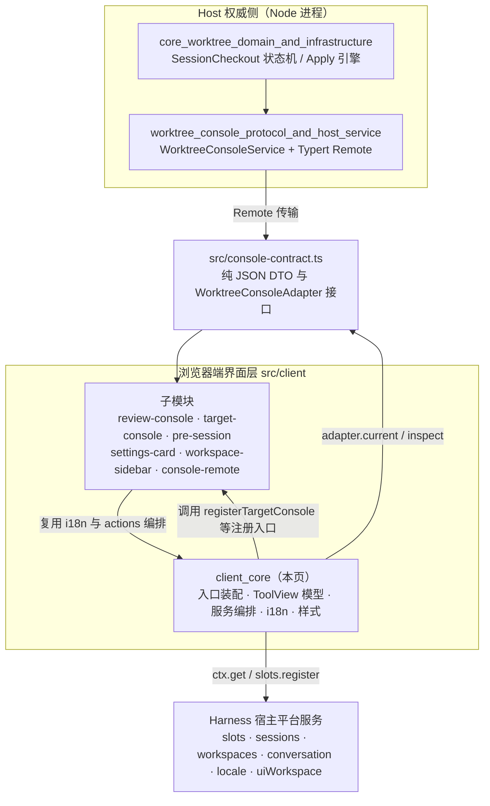
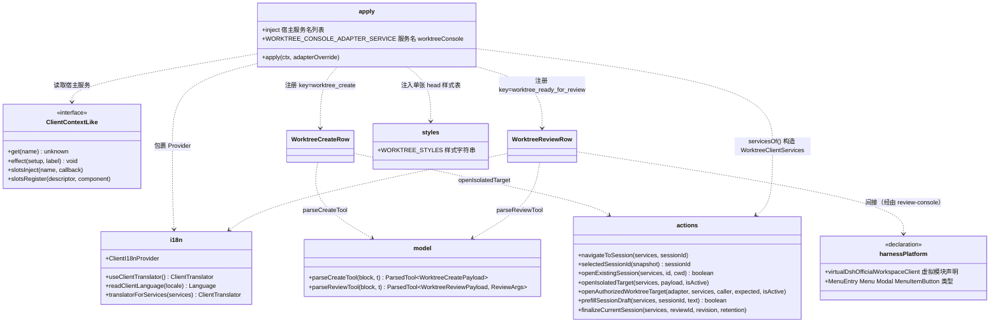
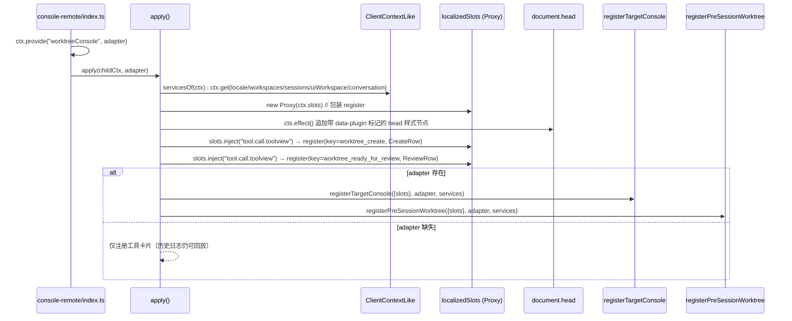
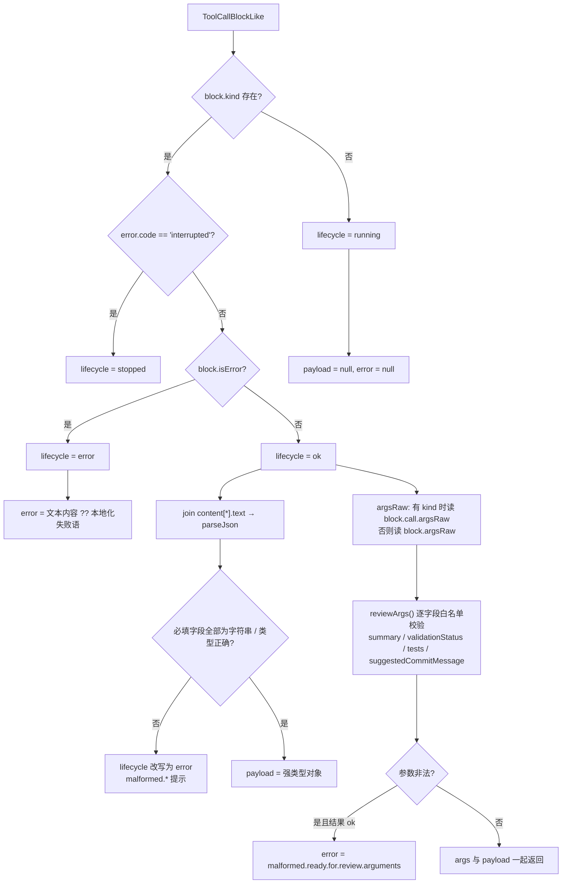
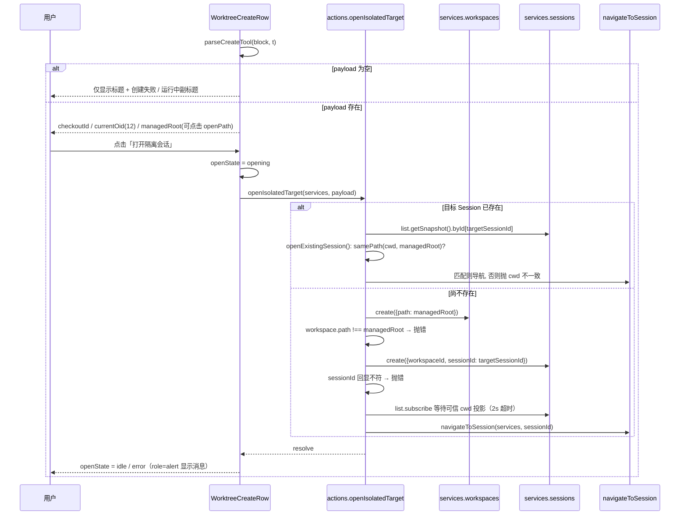
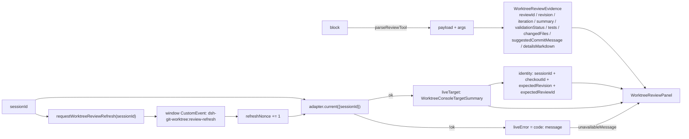
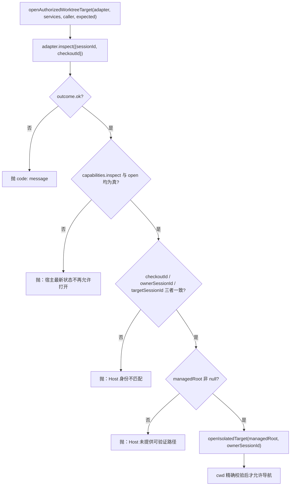
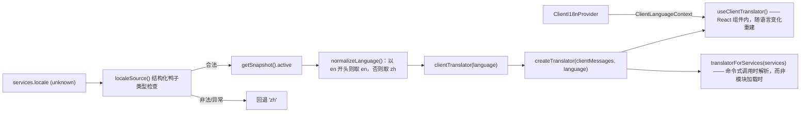

# client_core：Worktree 浏览器端入口与会话编排核心

`client_core` 是 Worktree 客户端界面层（`src/client/`）的**根模块**，负责四件事：

1. **插件入口装配**：`src/client/index.tsx` 从 Cordis Client Context 中取出宿主注入的公共服务（`slots` / `workspaces` / `sessions` / `conversation` / `locale`），构造 `WorktreeClientServices`，并把本插件的所有 React 注册包裹进本地化 Provider 与一份作用域样式表。
2. **回放稳定的 ToolView 模型**：`src/client/model.ts` 仅从「已记录的调用参数与结果切片」推导出数据，保证历史会话重新打开时卡片渲染结果与当时一致，不依赖任何实时状态。
3. **宿主运行时编排**：`src/client/actions.ts` 是浏览器侧对 Harness Workspace / Session 运行面（Runtime Face）的唯一封装层，负责注册受管目录、创建预分配 Session、校验 cwd、导航、以及用显式用户命令提交验收。
4. **本地化与样式基座**：`src/client/i18n.tsx` 与 `src/client/styles.ts` 为整个客户端界面层提供翻译器上下文与 CSS 变量/类名体系。

两个工具卡片 `WorktreeCreateRow.tsx`（目标交接）与 `WorktreeReviewRow.tsx`（待验收）是本模块面向用户的最终产物，也是所有子模块能力的汇聚点。

> 本模块只覆盖 `src/client/` 根目录下的文件。界面层的其余分区（控制台远端适配、验收控制台、目标控制台、会话前开关、设置卡片、工作区侧栏）分别见 [client_console_remote.md](client-console-remote.md)、[client_review_console.md](client-review-console.md)、[client_target_console.md](client-target-console.md)、[client_pre_session.md](client-pre-session.md)、[client_settings_card.md](client-settings-card.md)、[client_workspace_sidebar.md](client-workspace-sidebar.md)。

---

## 1. 在系统中的位置

本模块处于「Host 权威域」与「宿主 UI 平台」之间的最薄一层。它自身**不包含任何 Git / worktree 业务判定**：所有权限、状态机、CAS 校验都由 Host 侧完成，浏览器只消费规范化后的 DTO 并编排宿主导航。

**关键契约边界**

| 边界 | 提供者 | 消费者 | 说明 |
| --- | --- | --- | --- |
| `WorktreeConsoleAdapter` | [worktree_console_contract.md](worktree-console-contract.md) | `client_core` 及其子模块 | 归一化的读写接口，返回 `WorktreeConsoleOutcome<T>`；传输细节被完全封在 [client_console_remote.md](client-console-remote.md) 之后 |
| `ClientSessions` / `ClientWorkspaces` | Cordis `sessions` / `workspaces` 服务 | `actions.ts` | 宿主版本差异（`sessions.open` vs `uiWorkspace.openSession`、`retainedBy` 引用计数）全部在此适配 |
| `ToolCallViewPropsLike` | `@deepseek-ai/dsh-client-ui-tool` 的 `tool.call.toolview` 槽位 | 两个 Row 组件 | 只提供 `block` / `sessionId` / `callId`，不保证任何实时字段 |
| `MenuEntry`、`Menu`、`Modal` | `@deepseek-ai/dsh-client-ui-primitives` | 界面层各处 | 通过 `src/client/harness-platform.d.ts` 做环境类型声明 |

相关模块文档：[worktree_client_interface_layer.md](worktree-client-interface-layer.md)（界面层总览）、[core_worktree_domain_and_infrastructure.md](core-worktree-domain-and-infrastructure.md)（Host 领域与端口）、[worktree_console_protocol_and_host_service.md](worktree-console-protocol-and-host-service.md)（协议与宿主服务）。

---

## 2. 组件构成

| 文件 | 职责 | 对外暴露 |
| --- | --- | --- |
| `src/client/index.tsx` | 浏览器入口：服务解析、样式注册、槽位注册、下游模块装配 | `apply()`、`inject`、`WORKTREE_CONSOLE_ADAPTER_SERVICE` |
| `src/client/model.ts` | 纯函数式 ToolView 解析与结构校验 | `parseCreateTool()`、`parseReviewTool()`、`WorktreeCreatePayload`、`WorktreeReviewPayload`、`ReviewArgs` |
| `src/client/actions.ts` | 宿主 Workspace/Session 编排 + 受 cwd 校验的导航 | `openIsolatedTarget()`、`openAuthorizedWorktreeTarget()`、`finalizeCurrentSession()`、`selectedSessionId()`、`prefillSessionDraft()` 及各类服务接口 |
| `src/client/i18n.tsx` | React 语言上下文与命令式翻译器解析 | `ClientI18nProvider`、`useClientTranslator`、`useClientLanguage`、`translatorForServices` |
| `src/client/WorktreeCreateRow.tsx` | `worktree_create` 工具调用卡片 | `WorktreeCreateRow` |
| `src/client/WorktreeReviewRow.tsx` | `worktree_ready_for_review` 工具调用卡片 | `WorktreeReviewRow` |
| `src/client/styles.ts` | 单一作用域样式表（含 review-console 片段与侧栏装饰） | `WORKTREE_STYLES` |
| `src/client/harness-platform.d.ts` | 虚拟模块与宿主 UI 原语的环境声明 | `MenuEntry` 等类型 |

---

## 3. 启动与注册流程

`apply()` 被 [client_console_remote.md](client-console-remote.md) 中的包属 Remote 入口在正确的 Client 纤程（fiber）中调用，并**显式传入刚创建好的 adapter**——因为同一插件纤程内提供的服务无法在 provider effect 落定前通过 `ctx.get()` 读到。

三个设计要点：

- **本地化隔离**：`localizedSlots` 只包装 `register`，把每个被注册的组件都套进 `ClientI18nProvider`。这样每个 DSH Client 实例拥有独立语言上下文，而 `inject`、`descriptor` 等其余行为原样透传。
- **样式所有权**：客户端模块系统会「认领」任何不带 `data-plugin` 的 `<style>`（`claimStyles`），并在该模块失效时删除它（`removeOwnedStyles`）。因此入口必须给样式表打上 `data-plugin` / `data-plugin-css` / `data-dsh-git-worktree` 三重标记，确保这张表由本插件独占并随 effect 清理。
- **优雅降级**：没有 adapter 时仍然注册两张卡片，历史会话中的工具日志依然可回放，只是失去实时刷新与控制台入口。

---

## 4. ToolView 模型：回放稳定的数据推导

`model.ts` 的全部逻辑都是纯函数，输入只有一个 `ToolCallBlockLike`。生命周期判定优先于内容解析，保证「运行中」与「已中断」不会被误当作结果解析失败。

- `iteration` 缺失或非法时归一为 `0`，`changedFiles` 会做浅拷贝，避免卡片直接持有日志数组引用。
- `running` 阶段仍会尝试解析 `args`，因此模型可以在结果尚未落地时先展示用户自己填写的验收摘要。
- `textContent()` 在既无内容又存在 `block.error` 时合成 `Name: code`，使错误卡片至少可诊断。

---

## 5. `WorktreeCreateRow`：目标交接卡片

该卡片展示 Host 已经创建的隔离工作树，并把「打开隔离会话」这一动作完全交给 `actions.openIsolatedTarget()`。它自带 `mounted` ref 守卫，防止卸载后回写状态。

副标题与状态文案映射（`payload.cwdSelected` 为真表示该会话已在工作树内工作，无需再交接）：

| 条件 | 副标题 | 主要文案 |
| --- | --- | --- |
| `lifecycle === 'running'` | 正在创建唯一工作树 | 无按钮 |
| `payload.cwdSelected === true` | 当前会话已在工作树中活动 | 「本会话现在在 worktree 内工作」 |
| payload 存在且未选中 | 准备打开 | 「打开隔离会话」按钮 + 「当前本地会话的 cwd 不会被修改」 |
| payload 为 null 且非运行态 | 创建失败 | 错误提示块 |

`navigateToSession()` 的优先级是 `uiWorkspace.openSession` → `sessions.open` → 抛出「会话导航不可用」，体现 Harness 0.1.6 之后导航所有权转移到 UI Workspace。`samePath()` 会统一分隔符、去掉尾部分隔符，并在检测到盘符时做大小写不敏感比较，以适配 Windows 宿主。

---

## 6. `WorktreeReviewRow`：持久证据 + 实时权威

该卡片同时承载两份数据：日志里冻结的**验收证据**（`review`）与 Host 当前的**权威目标**（`liveTarget`）。前者保证可回放，后者决定按钮可用性与「快照已过期」判定。

要点说明：

- **刷新收敛**：`useEffect` 以 `payload.reviewId` / `payload.revision` / `sessionId` 为依赖，主动派发一次刷新事件；同时监听同名事件，收到匹配 `sessionId` 的信号后自增 `refreshNonce`，触发 `adapter.current()` 重新读取。这使 dock 上的状态、头部芯片与工具卡片共享同一份 Host 权威。
- **单调回退保护**：合并 `liveTarget` 时，若新旧 `checkoutId` 相同且本地已有的 `revision` 更大，则保留旧值，避免并发响应乱序把界面「倒退回旧版本」。
- **CAS 身份**：只有当 `liveTarget.review.reviewId` 与卡片 `reviewId` 相同时，`expectedRevision` 才取 Host 实时值，否则取冻结值——这正是 [client_review_console.md](client-review-console.md) 中 Finalize / 高级读取所需的精确条件。
- **`target_unselected` 静默**：`isLocalTargetUnselected()` 同时匹配错误码词边界与本地化文案，命中时整卡返回 `null`——「没有选中目标」不是用户需要反复看到的噪声。
- **`services` prop 保留**：当前注册方与历史 ToolView 兼容需要，实时读取只走可选的 `adapter`，因此日志证据在没有 adapter 时依然可完整回放。

---

## 7. `actions.ts` 中的其它编排能力

| 导出 | 用途 | 权威规则 |
| --- | --- | --- |
| `SnapshotStore<T>` | 与 React `useSyncExternalStore` 对齐的最小快照契约 | 宿主 `sessions.list` 侧栏、locale 源都实现它 |
| `selectedSessionId()` | 在「旧式 current 选择」与「新式 `retainedBy.mainView` 引用计数」之间解析唯一可见主会话 | 多个保留者或 `current` 与唯一保留者冲突时返回 `undefined`，宁可不操作也不误操 |
| `openAuthorizedWorktreeTarget()` | 从 Host 的**无路径授权**（`inspect`）出发打开工作树 | 必须 `capabilities.inspect && capabilities.open`；`checkoutId` / `ownerSessionId` / `targetSessionId` 三重一致；`managedRoot` 为 `null` 直接拒绝；最终复用 `openIsolatedTarget` 的 cwd 校验路径 |
| `prefillSessionDraft()` | 把恢复请求以可见草稿形式预填到 composer | 只调用 `conversation.input.for(ctx).setDraft()`，**永不**触发 command / send / followup |
| `finalizeCurrentSession()` | 把验收卡片上的确认转成显式用户命令 | 通过 `binding.session.command("/worktree finalize <reviewId> <revision> <retention>")`；要求 `result.value.matched === true`，否则视为 Host 未识别命令 |
| `PreSessionWorktreeServices` | 空白会话准备流所需的额外公共面（归档 / 删除临时本地会话、composer 阻塞块） | 见 [client_pre_session.md](client-pre-session.md) |
| `PreSessionInput` | 联合类型兼容宿主重命名前后的图片/附件 API | 仅用于手工草稿预填 |

---

## 8. 本地化基座

`i18n.tsx` 把宿主 LocaleFace 的 `getSnapshot()/subscribe()` 形态适配成 React 外部存储，并把语言解析与命令式调用统一起来。

词条目录与语言类型定义在 [`src/i18n/core.ts`](src-i18n.md) 与 `src/i18n/client-messages.ts`，本模块只负责「何时取到语言」，不持有文案。占位符为 `{name}` 形式，缺失参数时保留原样输出，便于定位漏传。

---

## 9. 样式体系与状态色映射

`WORKTREE_STYLES` 是一整张字符串样式表，由三部分拼接而成：侧栏装饰规则、通用 `.dsh-wt-*` 卡片规则、以及 `REVIEW_CONSOLE_STYLES`（来自 [client_review_console.md](client-review-console.md)），末尾再补上按钮/图标尺寸微调。类名前缀约定：

| 前缀 | 归属 | 备注 |
| --- | --- | --- |
| `.dsh-wt-card` / `.dsh-wt-head` / `.dsh-wt-grid` | 两张工具卡片共用 | `data-tool` + `data-state` 驱动状态色 |
| `.dsh-wt-review-*` / `.dsh-wt-checkpoint-*` | review-console | 通过模板字符串内联引入 |
| `.dsh-wt-pre-session-*` | pre-session | 复用 Harness PermissionSelect 触发器外观，但保留 switch 语义 |
| `.dsh-git-worktree-sidebar-icon` / `-badge` | workspace-sidebar | 见 [client_workspace_sidebar.md](client-workspace-sidebar.md) |

工作树状态到强调色的映射（`--dsh-wt-sidebar-accent`）：

| `data-worktree-state` | 语义 | 强调色来源 |
| --- | --- | --- |
| `working` | 进行中 | `--dsw-alias-state-business-primary` |
| `ready_for_review` | 待验收 | `--dsw-alias-state-warn-label` |
| `preview_active` | 本地预览中 | 业务主色与错误主色 68% 混合 |
| `preview_detached` / `recovery_required` | 预览分离 / 需恢复 | `--dsw-alias-state-error-primary` |
| `finalized` | 已定稿 | `--dsw-alias-state-success-primary` |
| `discarded` | 已放弃 | `--dsw-alias-label-tertiary` |

侧栏装饰的挂载点经过一次刻意迁移：「图标 + 胶囊」对不再放进官方行首的固定 16px leading 座位，而是挂进 `sidebar.workspaces.session.row.action`——官方行把这个座位渲染在行尾 `span.rowActions` 之内的 `span.rowQuickActions` 中（`rowActions` 的第一个子元素是溢出按钮，quick-actions 是第二个）。原因：leading 座位会在 Session 运行时被官方行替换成状态点，恰好在标记最该保持可见的时候消失；`sidebar.session.row.trailing` 座位虽然存在，却嵌在官方 hover 规则会隐藏的 `span.time` 内部，同样无法承载常驻标记。行尾 `rowActions` 是行的 flex 项，`order: -1` 把整个容器整体前置到 leading 座位与标题之前，行前缀无需重排即内联呈现。配套规则：

- 上游把 `.rowActions` 隐藏到 hover 才显示，一个被前置的隐藏盒子会留下空洞，因此容器持有标记时保持 `display: inline-flex`，内部图标与胶囊固定 `flex: 0 0 auto`。
- 行尾 span 内的溢出按钮保留自己的 hover 显隐：默认 `display: none`，行 hover 或其菜单 `aria-expanded="true"` 时才 `display: inline-flex`；官方行 hover 时隐藏 `.time` 与 pin 腾位，菜单始终可达。
- 选择器全部结构化：`:has()` 用后代匹配（`[role="treeitem"] > span:last-child:has(.dsh-git-worktree-sidebar-icon)`），因为我们的标记 span 嵌在 `rowQuickActions` 里比官方行尾的最后一个子 span 深了一层；配套的溢出按钮规则同样以该后代 `:has()` 判定首个子 button。不依赖任何带哈希的 CSS-module 类名，宿主样式重命名不会打断装饰。

窄屏（≤560px）下 `.dsh-wt-grid` 退化为单列。

---

## 10. 平台类型声明（`harness-platform.d.ts`）

该文件没有运行时代码，但定义了构建期才能解析的边界：

- `virtual:dsh-official-workspace-client`（以及 `-alpha` / `-next`）三个虚拟模块声明 `inject`、`apply(ctx)` 与被装饰的 `WorkspaceBrowser` 组件。注释明确指出：decorate 路径遮蔽了官方 `sidebar.workspaces` 注册，因此**必须渲染本包导出的这一版组件**，否则官方组件没有行装饰，会丢掉投影出的 Worktree 图标与徽标。
- `@deepseek-ai/dsh-client-ui-primitives` 声明 `MenuEntry`（联合普通项 / `separator` / `label`）、`Menu`、`Modal`、`MenuItemButton`、`IconTrashOutlineRegular`、`IconBranchOutlineRegular`。

这三个虚拟模块 id 由 [`tsdown.config.ts`](build-ci-and-packaging.md) 中的 `official-workspace-client-source` 插件在打包期物化为真实源码，并在 [`vitest.config.ts`](build-ci-and-packaging.md) 中被别名指向 `tests/*.mock.ts`；`@deepseek-ai/dsh-client-ui-primitives` 则在测试中被别名到 `tests/support/ui-primitives.tsx` 的窄实现（`Menu` / `Modal` / `MenuItemButton` / 两个图标）。

---

## 11. 构建产物与宿主注入

| 关注点 | 事实 | 来源 |
| --- | --- | --- |
| 客户端入口 | `entry: { client: 'src/client/console-remote/index.ts' }`，产物 `lib/client.js` | `tsdown.config.ts` |
| 模块格式 | `format: 'cjs'`、`platform: 'neutral'`、`target: 'es2022'`，`react` / `react/jsx-runtime` / `@deepseek-ai/cordis` / `dsh-client-store` / `dsh-client-ui-primitives` 保持 external | `tsdown.config.ts` |
| 浏览器装载 | 产物被包进 `window.__ModuleLoader__.load({ id: "dsh-git-worktree", factory })` 横幅，注册 id 即上文样式所有权所依据的 id | `tsdown.config.ts` |
| 宿主服务依赖 | `dsh.client.inject` 列出 session/workspace controller、connection、locale、ui-conversation、ui-tool、gateway、remote-access；`platform: "web"` | `package.json` |
| 入口自身注入 | `export const inject = ['slots','workspaces','sessions','conversation','connection','locale']` | `src/client/index.tsx` |
| 子路径导出 | `./client`、`./console-contract`、`./typert`、`./remote` | `package.json` |
| 类型检查 / 测试 | `pnpm typecheck`（`tsc --noEmit`）、`pnpm test`（`vitest run`，Windows 下关闭文件并行） | `package.json`、`vitest.config.ts` |

---

## 12. 设计约束与易踩坑点

- **浏览器不做业务判定**：卡片按钮的可用性来自 `target.capabilities`，任何「看起来应该允许」的推断都必须先经 `inspect`/`current` 取回权威状态。
- **路径必须逐字符验证**：`openIsolatedTarget` 会比较 `workspaces.create()` 回显的 `workspace.path`，并用 `waitForProjectedSessionPath()` 等待宿主投影出与 `managedRoot` 精确一致的 `cwd`（2 秒超时即失败）。宁可报错也不要静默把会话切到错误目录。
- **验收是用户动作**：`finalizeCurrentSession` 走 `session.command()` 并检查 `matched`，而不是程序化发送消息；`prefillSessionDraft` 更是只写草稿。
- **卸载安全**：所有异步回写前检查 `mounted.current` / `isActive()`，避免在 HMR 或会话切换后写入已卸载组件。
- **降级优先于失败**：拓扑读不出来时（最常见是 registry 损坏）入口只放弃侧栏、保留工具与控制台，因为用户恰恰需要它们去修复 registry——参见 [client_console_remote.md](client-console-remote.md) 的 `sidebarTopology` 分支处理。

---

## 13. 相关模块

- [worktree_client_interface_layer.md](worktree-client-interface-layer.md) —— 客户端界面层总览
- [client_console_remote.md](client-console-remote.md) —— adapter 的来源与传输封层（超时、strict codec）
- [client_review_console.md](client-review-console.md) —— `WorktreeReviewPanel`、preflight 缓存、恢复续跑
- [client_target_console.md](client-target-console.md) —— 头部状态动作、hero 芯片、分支图与标签管理
- [client_pre_session.md](client-pre-session.md) —— 空白会话「在 Worktree 中开始」开关
- [client_settings_card.md](client-settings-card.md) —— 插件页设置卡片与表单模型
- [client_workspace_sidebar.md](client-workspace-sidebar.md) —— 侧栏投影与官方 Browser 装饰
- [worktree_console_contract.md](worktree-console-contract.md) —— DTO、状态投影与错误元数据
- [session_checkout_domain.md](session-checkout-domain.md) —— Host 侧权威状态机与端口
