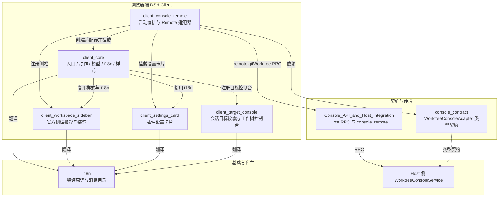

# Client_Presentation_and_Interaction 模块概览

`Client_Presentation_and_Interaction` 是 `dsh-git-worktree` 在 DSH Client（浏览器 / 渲染进程）中的表现与交互层。它负责把 Host 侧的工作树能力呈现为用户可操作的界面，包括插件启动编排、Remote 适配、工具调用行视图、会话目标胶囊与工作树控制台、官方 Workspace 侧栏投影，以及插件设置卡片。

该模块不承载权限、状态机或 Git 业务语义；这些规则由 Host 侧负责。客户端只做展示、转发与必要的交互门禁，所有远程调用都通过 `WorktreeConsoleAdapter` 或配置文档通道完成。

## 架构

整体上，模块以 `client_console_remote` 为唯一入口：它先挂载 Remote contribution，取得 `remote.gitWorktree` 代理，创建并 `provide` `worktreeConsole` 适配器，然后通过 `sidebarTopology()` 判定官方 Workspace Client 的代际与接管状态，选择侧栏的接管或装饰路径，并把工具视图挂到 UI Workspace 子 fiber。设置卡片独立通过 `configForms` 挂载；目标控制台、侧栏与设置卡片共享 `client_core` 提供的 i18n、样式与动作基座。

## 核心组件

| 文档 | 职责 |
| --- | --- |
| [client_console_remote](client-console-remote.md) | 浏览器端入口与传输层：挂载 Remote contribution，创建 `WorktreeConsoleAdapter`，按 `sidebarTopology` 结果选择侧栏装配分支，并挂载设置卡片与工具视图。 |
| [client_core](client-core.md) | 客户端基座：`apply` / `inject`、本地化插槽、样式注入、Harness 动作编排、ToolView 纯模型与 `WorktreeCreateRow`。 |
| [client_target_console](client-target-console.md) | 面向用户的主界面：会话目标胶囊、托管工作树面板、提交图与标签管理模态框，以及 `current` 轮询与分支概览缓存。 |
| [client_workspace_sidebar](client-workspace-sidebar.md) | 把受管 Worktree 投影到官方 Workspace 侧栏：纯函数投影、接管 / 装饰两种装配模式、变更门禁与终态徽章清除。 |
| [client_settings_card](client-settings-card.md) | 插件设置卡片：通过 `configForms` 编辑 `dsh-git-worktree` 命名空间配置，支持暂存、校验、保存与丢弃。 |

## 关键设计约束

- **统一适配器边界**：除设置卡片走 `configForms` 外，界面读写均经 `WorktreeConsoleAdapter`，客户端不直接发起 fetch 或拼接 Host 路径。
- **按 Host 拓扑分支装配**：`legacy`、`modern-rc5`、`modern-rc1`、`alpha`、`next` 等代际由 Host 上报；`officialWorkspaceActive` 决定接管还是装饰，避免重复 `provide('uiWorkspace')`。
- **失败即降级**：拓扑读取失败时只挂工具视图，设置卡片在服务缺失时静默不挂载，避免整个客户端启动被单点问题拖垮。
- **异步结果不写回失效上下文**：各交互组件使用 `mounted` ref、`generation` / `scope` 计数器与请求序号守卫，防止切换会话、卸载或连点导致迟到响应污染 UI。
- **展示与业务规则分离**：权限、状态机、清理语义与 Git 操作由 Host 侧负责；客户端依据 `capabilities` 决定按钮是否出现，并在必要时做显式用户确认。

## 相关文档

建议按以下顺序阅读核心组件文档：

1. [client_console_remote](client-console-remote.md)：先了解客户端入口、Remote 适配器与启动分支。
2. [client_core](client-core.md)：理解基座能力、动作编排与 ToolView 模型。
3. [client_target_console](client-target-console.md)：查看用户主界面与控制台交互。
4. [client_workspace_sidebar](client-workspace-sidebar.md)：理解官方侧栏投影与两种装配模式。
5. [client_settings_card](client-settings-card.md)：了解设置卡片的暂存式表单与配置写入。