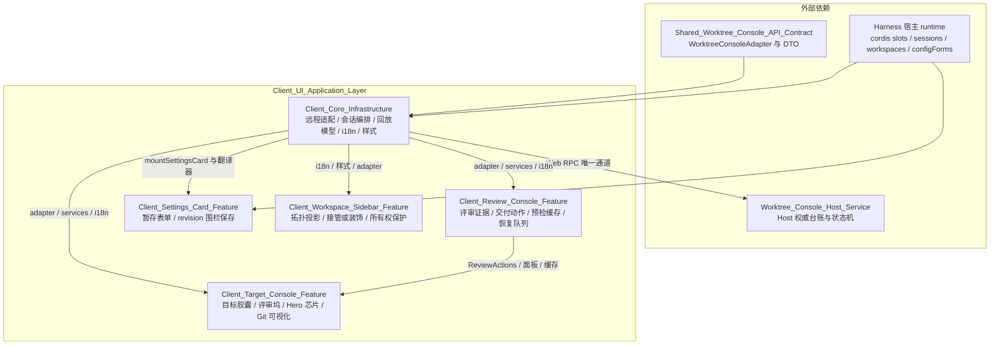

# Client_UI_Application_Layer（客户端 UI 应用层）

## 模块目的

`Client_UI_Application_Layer` 是 `dsh-git-worktree` 插件的浏览器端 UI 组装层。它把 Harness 宿主运行时、跨层 RPC 契约与 Host 端 `Worktree_Console_Host_Service` 适配为用户可直接交互的客户端表面，包括：目标状态胶囊、评审交付坞、工作区/会话侧栏、插件设置卡片，以及会话内的工具结果渲染行。

本层遵循 **“Host 权威、客户端投影”** 的原则：目标台账、拓扑、状态机与能力标志由 Host 返回，客户端只负责只读投影、用户动作编排、写前预检、CAS 身份校验、缓存与恢复队列，不实现 Git 或 worktree 领域规则。

## 内部架构

关键协作关系：

- `Client_Core_Infrastructure` 是其余四个特性模块的底座，负责创建类型严格的 `WorktreeConsoleAdapter`、收敛 Harness 服务面、提供回放稳定的工具结果解析、i18n 与样式注册。
- `Client_Review_Console_Feature` 专注评审证据展示与交付生命周期，其面板、动作与缓存被 `Client_Target_Console_Feature` 复用。
- `Client_Target_Console_Feature` 面向用户操作入口，把目标状态、分支管理、提交图、标签管理与评审坞装配到会话头部与输入框上方。
- `Client_Workspace_Sidebar_Feature` 通过接管或装饰两条路径，把 worktree 拓扑投影进官方工作区侧栏，并保护 owner Session 与 Worktree 的绑定不变量。
- `Client_Settings_Card_Feature` 是自包含的设置卡片，通过暂存表单与 revision 围栏向 Host 配置文档写入运行期设置。

## 核心组件文档

| 模块 | 主要职责 | 详细文档 |
| --- | --- | --- |
| `Client_Core_Infrastructure` | 客户端引导、远程适配器、会话/工作区编排、回放模型、i18n 与样式底座 | [Client_Core_Infrastructure](client-core-infrastructure.md) |
| `Client_Review_Console_Feature` | 评审证据卡片、预览/回滚/定稿动作、预检缓存、冲突与评审重生成恢复队列 | [Client_Review_Console_Feature](client-review-console-feature.md) |
| `Client_Target_Console_Feature` | 目标胶囊、评审状态坞、Hero 芯片、全量管理面板、提交图与标签管理 | [Client_Target_Console_Feature](client-target-console-feature.md) |
| `Client_Settings_Card_Feature` | Plugins 页面设置卡片、三层配置值解析、暂存编辑与原子保存 | [Client_Settings_Card_Feature](client-settings-card-feature.md) |
| `Client_Workspace_Sidebar_Feature` | 侧栏拓扑投影、Takeover/Decorate 双模式、徽章渲染与 owner Session 保护 | [Client_Workspace_Sidebar_Feature](client-workspace-sidebar-feature.md) |