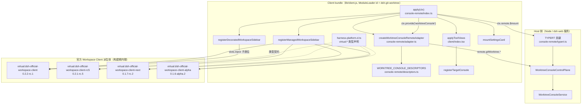
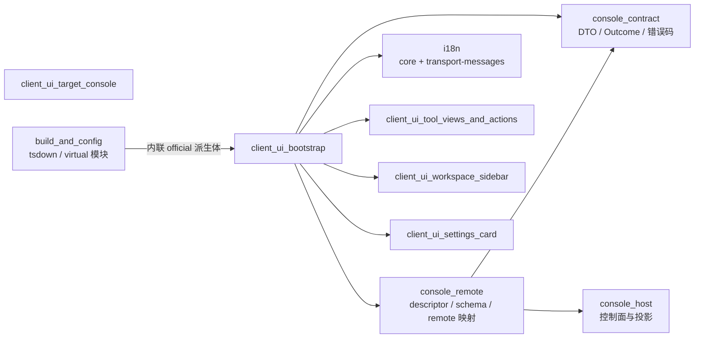
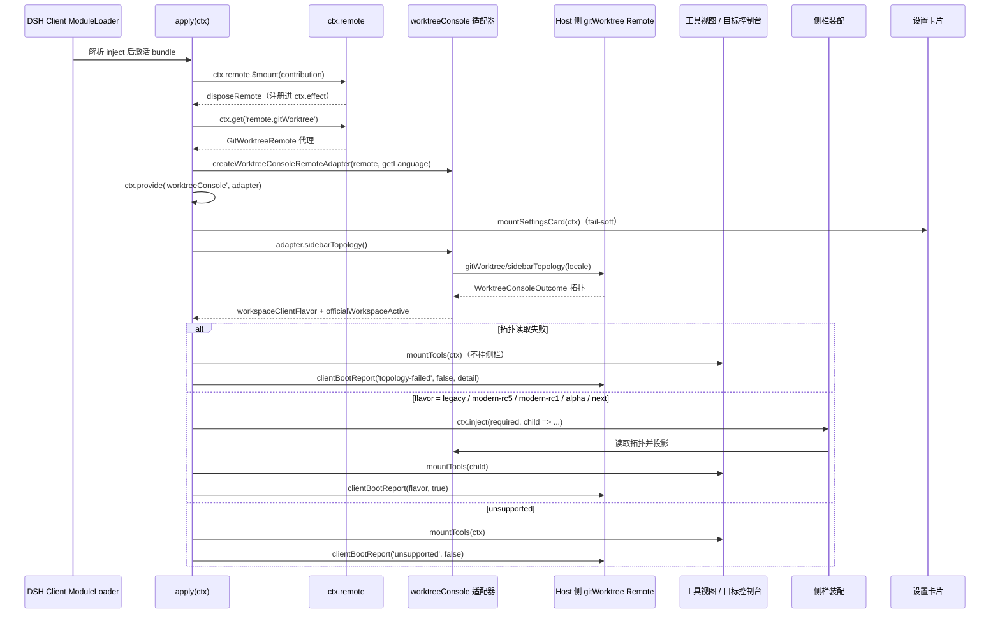
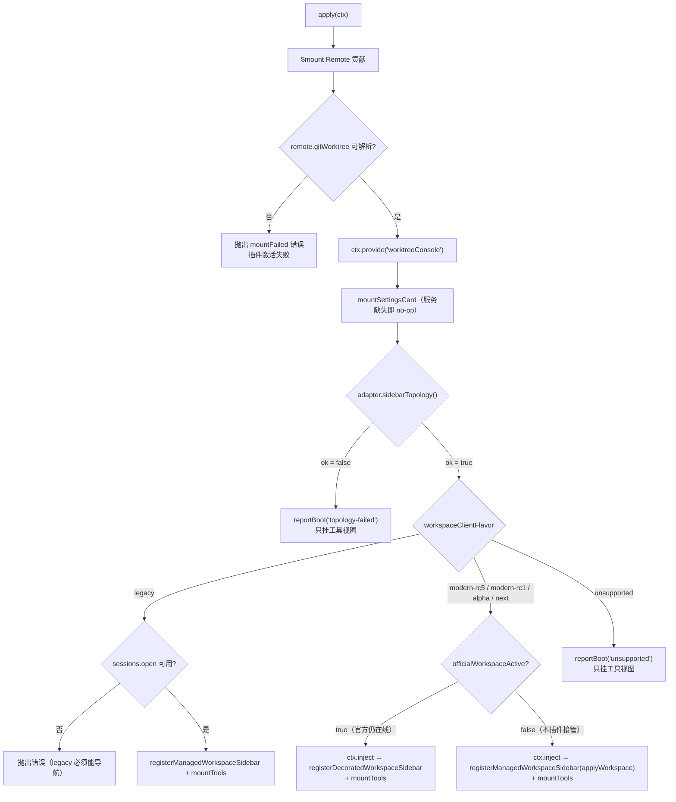
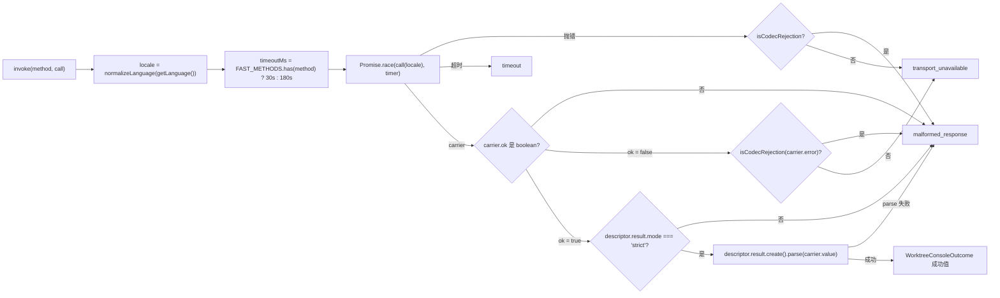
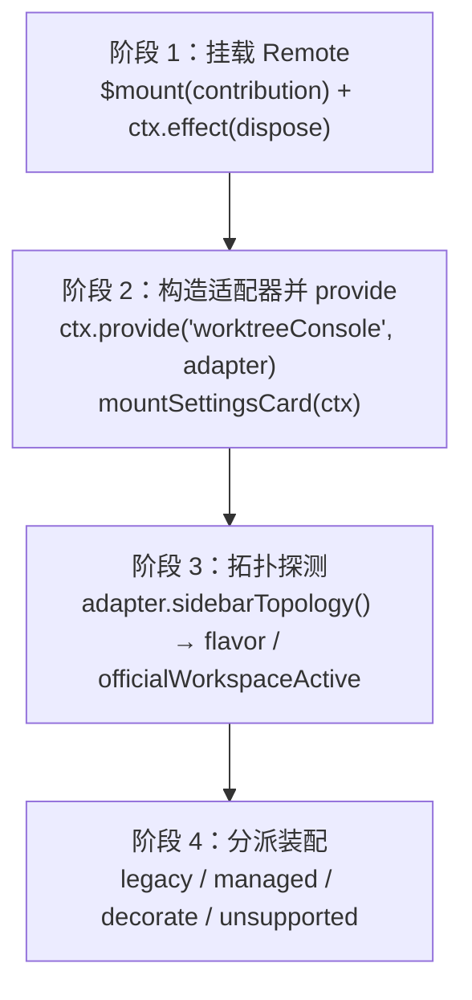

# client_ui_bootstrap：浏览器端启动与 Remote 适配引导

## 简介

`client_ui_bootstrap` 是 `dsh-git-worktree` 浏览器 bundle 的**启动引导层**。它负责在 DSH Web 前端完成三件在其余 UI 代码之前必须完成的事：

1. 把包内自有的 strict Remote contribution（`gitWorktree` 命名空间）挂载到当前 Client fiber 上，并解析出 `remote.gitWorktree` 代理；
2. 用 `createWorktreeConsoleRemoteAdapter` 把该代理包装成唯一的 `worktreeConsole` 服务（`WorktreeConsoleAdapter`），此后所有工具视图、目标胶囊、侧栏与设置卡片都只面向这一个适配器；
3. 读取 Host 侧 `sidebarTopology` 返回的「官方 Workspace Client 代际」与「接管选举结果」，据此选择**接管（managed）**还是**装饰（decorate）**路径装配侧栏，并把工具视图挂到正确的子 fiber 上。

它是整个客户端 UI 的**唯一入口点**：`tsdown` 的构建入口就是 `src/client/console-remote/index.ts`（见 [build_and_config](build-and-config.md)），因此该文件的 `apply`/`inject` 直接决定插件在浏览器里是否能起来。

本模块包含三个核心组件：

| 组件 | 文件 | 职责 |
| --- | --- | --- |
| `createWorktreeConsoleRemoteAdapter` | `src/client/console-remote/adapter.ts` | 把 Typert Remote 调用规范化为 `WorktreeConsoleOutcome`，含超时、strict codec 校验与错误分类 |
| `apply` / `inject` / `ConsoleClientContext` | `src/client/console-remote/index.ts` | Client 插件入口：挂载 Remote、提供 `worktreeConsole`、探测拓扑、按代际分派装配 |
| `MenuEntry` 及 `virtual:*` 声明 | `src/client/harness-platform.d.ts` | 为四代官方 Workspace Client 与 `dsh-client-ui-primitives` 提供编译期类型契约 |

> 其余 UI 能力（工具视图与动作、目标控制台、侧栏投影、设置卡片、i18n 与样式）由同级模块负责，本页只描述引导与装配关系。

---

## 架构与组件关系



### 依赖方向



引导层只依赖**契约与适配器**，不直接触达 Git、文件系统或 Host 服务；真正的 Host 语义在 [console_host](console-host.md) 与 [core_domain](core-domain.md) 中实现。

---

## 启动流程

### 总时序



### 装配分支判定



关键设计点：

- **先提供，后装配**：`ctx.provide('worktreeConsole', adapter)` 在拓扑探测之前完成，因此即使拓扑失败，控制台/工具视图仍能拿到适配器去修复 registry。
- **子 fiber 隔离**：会话相关视图（`tool.call.toolview`、header actions、hero chip）必须在 UI Workspace 提供者**之下**的子 fiber 中注册，否则可能在 `uiWorkspace`/`sessions` 尚未就绪时读到未定义服务。
- **失败即上报**：每个分支通过 `clientBootReport` 把 `branch`/`registered`/`detail`/`elapsedMountMs`/`elapsedTopologyMs` 回报给 Host，便于定位「UI 没出现」这类问题。
- **拓扑失败不等于启动失败**：`topology-failed` 分支刻意不抛错，避免一次 registry 损坏连带把修复入口一起藏起来。

---

## 核心组件详解

### 1. `createWorktreeConsoleRemoteAdapter`

签名：`createWorktreeConsoleRemoteAdapter(remote: GitWorktreeRemote, getLanguage: () => Language = () => 'zh'): WorktreeConsoleAdapter`

它把 `remote.gitWorktree` 的每个方法包装成契约里 `WorktreeConsoleAdapter` 的同名方法（`initializeProject` 对应 Remote 方法 `initProject`），返回统一的 `WorktreeConsoleOutcome<T>`（`{ ok: true, value }` 或 `{ ok: false, error }`），调用方永远不需要处理 `RemoteResult` 载体或抛异常。

#### 单次调用的处理流水线



各环节细节：

| 环节 | 行为 |
| --- | --- |
| 语言解析 | 每次调用都通过 `getLanguage()` 现取（入口传入 `readClientLanguage(ctx.get('locale'))`），并把 `locale` 作为**末位实参**传给 Remote —— Remote 代理按位置强制校验参数个数，即使 `undefined` 也必须传 |
| 超时分级 | `FAST_METHODS = { sidebarTopology, current, inspect, previewRecoveryPreflight, gitOverview, gitGraph, listAbandoned }` 使用 30s；其余（含 `list`、`preflight` 与全部变更方法）使用 180s，因为多记录全量重算可能逼近 30s |
| 超时语义 | Web RPC 载体本身无超时，服务端卡住会让 UI 永久 pending；适配器只让**客户端**失败，服务端工作继续，变更类调用可安全重试 |
| codec 拒绝识别 | `isCodecRejection` 检查错误消息是否包含 `rejected "` 或 `返回了不符合 strict contract`，用于把「载荷不合法」从「传输不可用」中区分出来 |
| strict 校验 | 通过 `WORKTREE_CONSOLE_DESCRIPTORS` 找到同 `method` 的 descriptor，要求 `result.mode === 'strict'`，再用 `create().parse` 校验载荷；缺失 descriptor 也按 `malformed_response` 处理 |
| 错误码 | 只新增三个传输层错误码：`transport_unavailable`、`malformed_response`、`timeout`（与 `SESSION_CHECKOUT_ERROR_CODES` 合并在 `WORKTREE_CONSOLE_ERROR_CODES`），其分类/重试语义由 `worktreeConsoleErrorMeta` 给出 |
| 文案 | 错误消息来自 `transportMessages`（`malformed`、`invokeTimeout`、`mountFailed`），按当前语言渲染，见 [i18n](i18n.md) |

`invoke` 内部另有一处细节：`resumeRevision` 在无冲突续作时显式传入 `undefined`，而不是省略参数，以维持 Remote 代理的定位实参契约。

### 2. `apply` / `inject` / `ConsoleClientContext`（`src/client/console-remote/index.ts`）

#### 服务声明（`inject`）

```ts
export const inject = [...new Set([
  ...officialWorkspaceInject.filter(service =>
    service !== 'remote.directoryPicker' && service !== 'remoteAccess' && service !== 'contextMenus'),
  'slots',
  'configForms',
])]
```

这里的「减法」是启动成功率的直接保障：

| 被排除的服务 | 排除原因 |
| --- | --- |
| `remote.directoryPicker` | 现代官方 Browser 的 picker 提供者**等待 `uiWorkspace`**；入口若声明它，就形成「入口等 picker、picker 等 uiWorkspace」的死锁。改为调用期经 `officialContextProxy` 惰性解析 |
| `remoteAccess` | 0.2.1 才有的服务；桌面 profile 通过 junction 指向最新构建产物，静态声明会让 0.2.0-rc.2 Host 的 web boot 永久 pending |
| `contextMenus` | 仅 0.2.2-rc.1+ 存在；由 `MODERN_RC1_INJECT` 在**独立子 fiber** 上追加，避免 0.2.1 Host 永久等待 |

`slots` 与 `configForms` 必须显式声明：cordis 只允许 fiber 读取自己声明过的服务名，未声明时 `ctx.get('slots')` 恒为 `undefined`，设置卡片会静默不挂载。

#### 入口 `apply` 的四个阶段



- **阶段 1**：`ctx.remote.$mount(contribution)` 把 `console-remote/typert.ts` 的 strict 贡献挂进当前 Client fiber，并通过 `ctx.effect` 注册 dispose；随后 `ctx.get('remote.gitWorktree')` 必须能解析出代理，否则抛出 `mountFailed` 文案的错误（让插件激活显式失败，而不是留下半可用状态）。
- **阶段 2**：`getLanguage` 闭包读取 `locale` 服务的快照，适配器与设置卡片在此阶段就绪；`mountSettingsCard` 对缺失的 `configForms`/`slots` fail-soft（见 [client_ui_settings_card](client-ui-settings-card.md)）。
- **阶段 3**：`adapter.sidebarTopology()` 一次调用同时拿到 `workspaceClientFlavor` 与 `officialWorkspaceActive`；这两个字段由 Host 侧生命周期决定（见 [core_domain_workspace_lifecycle](core-domain-workspace-lifecycle.md)），客户端只读不判。
- **阶段 4**：见下一节。

#### 装配策略

| flavor | 使用的 apply / inject | 官方仍在线（`officialWorkspaceActive`） | 结果 |
| --- | --- | --- | --- |
| `legacy` | 无（需 `sessions.open()`） | — | `registerManagedWorkspaceSidebar` + 工具视图；`sessions.open` 缺失则抛错 |
| `modern-rc5` | `applyRc5Workspace` / `inject` | true | 装饰：`registerDecoratedWorkspaceSidebar` |
| `modern-rc5` | 同上 | false | 接管：`registerManagedWorkspaceSidebar(..., applyRc5Workspace)` |
| `modern-rc1` | `applyOfficialWorkspace` / `MODERN_RC1_INJECT` | true | 装饰 |
| `modern-rc1` | 同上 | false | 接管 |
| `alpha` / `next` | `applyAlphaWorkspace` / `applyNextWorkspace` | true | 装饰 |
| `alpha` / `next` | 同上 | false | 接管 |
| `unsupported` | 无 | — | 只挂工具视图，`reportBoot('unsupported', false)` |

「装饰 vs 接管」的判据只有一条：**官方 `uiWorkspace` 提供者是否仍然活着**。若已接管（Host 侧禁用了官方条目），重放官方 `apply` 会再次 `provide('uiWorkspace')` 并崩溃；若官方仍活着，重放同样会冲突，所以只能通过 `slots` 的扩展缝装饰。两条路径的具体实现见 [client_ui_workspace_sidebar](client-ui-workspace-sidebar.md)。

#### 诊断与可观测性

- 全程使用 `[dsh-git-worktree]` 前缀的 `console.info` / `console.warn` / `console.error` 打印：remote 代理解析结果、拓扑结果、每个分支的 pending/registered 状态。
- `reportBoot(branch, registered, detail?)` 会以**尽力而为**的方式调用 `remote.clientBootReport({ flavor, branch, registered, detail?, elapsedMountMs, elapsedTopologyMs }, undefined)`；它被 `try/catch` 与 `then(onRejected)` 双层包裹，诊断链路自身永不阻断启动。
- `branch` 取值来自契约 `WorktreeClientBootReport['branch']`：`legacy | alpha | next | modern-rc5 | modern-rc1 | unsupported | topology-failed | boot-failed`；本次实现使用除 `boot-failed` 外的全部取值（`boot-failed` 由契约保留）。
- 计时口径：`elapsedMountMs` 是 `$mount` 耗时，`elapsedTopologyMs` 是首次拓扑探测耗时——这两个数字是排查「web boot 变慢」的第一手数据。

### 3. `harness-platform.d.ts`（编译期平台契约）

该声明文件让引导层在**不直接依赖**官方包实现的前提下完成类型检查，并让构建期的虚拟模块拥有确定签名：

| 声明目标 | 提供内容 |
| --- | --- |
| `virtual:dsh-official-workspace-client`（0.2.2-rc.1） | `inject`、`apply`、`WorkspaceBrowser` 组件 |
| `virtual:dsh-official-workspace-client-rc5`（0.2.1-rc.5） | `inject`、`apply`、`WorkspaceBrowser` 组件 |
| `virtual:dsh-official-workspace-client-alpha`（0.1.6-alpha.2） | `inject`、`apply` |
| `virtual:dsh-official-workspace-client-next`（0.1.7-rc.2） | `inject`、`apply` |
| `@deepseek-ai/dsh-client-ui-primitives` | `Menu`、`Modal`、`MenuItemButton`、`IconTrashOutlineRegular`、`IconBranchOutlineRegular` 以及 `MenuEntry` 联合类型 |

`MenuEntry` 是侧栏菜单项的统一形状（普通项 / `separator` / `label` 三种变体），侧栏与目标控制台的菜单注册都依赖它；`WorkspaceBrowser` 的导出声明了「装饰路径必须渲染派生体而非官方原体」这一约束（官方原体没有行装饰，会丢掉投影出来的 Worktree 图标/徽章）。

---

## 与其他模块的关系

| 关系 | 说明 |
| --- | --- |
| [console_contract](console-contract.md) | 提供 `WorktreeConsoleAdapter`、`WorktreeConsoleOutcome`、`WorktreeClientBootReport`、`WorktreeSidebarTopologyResponse` 与错误码表；引导层不定义任何 DTO |
| [console_remote](console-remote.md) | 提供 `WORKTREE_CONSOLE_DESCRIPTORS`（strict codec 来源）、`TypertRemoteMap` 的 `gitWorktree/*` 方法签名与 `TYPERT` 贡献；适配器完全由它们驱动 |
| [console_host](console-host.md) | 真正实现 `gitWorktree/*` 方法的一侧；引导层只通过代理调用 |
| [i18n](i18n.md) | `normalizeLanguage`、`createTranslator`、`transportMessages` 决定适配器错误文案的语言 |
| [client_ui_tool_views_and_actions](client-ui-tool-views-and-actions.md) | 提供 `apply`/`inject`（`slots`、`workspaces`、`sessions`、`conversation`、`connection`、`locale`）与 `WorktreeClientServices`；引导层以 `adapterOverride` 方式把适配器注入，规避「同 fiber 提供的服务在 effect settle 前不可见」的问题 |
| [client_ui_workspace_sidebar](client-ui-workspace-sidebar.md) | 提供 `registerManagedWorkspaceSidebar` / `registerDecoratedWorkspaceSidebar` 与 `ManagedWorktreeSessionDecoration`；引导层只做选择 |
| [client_ui_settings_card](client-ui-settings-card.md) | `mountSettingsCard` 在阶段 2 被调用 |
| [client_ui_target_console](client-ui-target-console.md) | 由工具视图层在子 fiber 内注册，继承引导层提供的适配器 |
| [core_domain_workspace_lifecycle](core-domain-workspace-lifecycle.md) | Host 侧的 `mountWorkspaceProviderLifecycle` 决定 `officialWorkspaceActive`，`host-compat` 决定 `workspaceClientFlavor` |
| [build_and_config](build-and-config.md) | `tsdown.config.ts` 把 `src/client/console-remote/index.ts` 作为入口，并把四代官方 Client 派生体作为虚拟模块内联 |

---

## 构建、打包与配置

- **入口与产物**：`tsdown.config.ts` 中 `entry: { client: 'src/client/console-remote/index.ts' }`、`outDir: 'lib'`、`format: 'cjs'`、`platform: 'neutral'`；`package.json` 的 `exports["./client"]` 指向 `lib/client.js`，类型指向 `lib/client/console-remote/index.d.ts`。
- **ModuleLoader 包装**：`outputOptions.banner` 输出 `window.__ModuleLoader__.load({ id: "dsh-git-worktree", factory: (require) => {`，`footer` 收尾并 `return module.exports`——因此本 bundle 的注册 id 与 `package.json` 中的插件名必须一致。
- **外部化边界**：`react`、`react/jsx-runtime`、`@deepseek-ai/cordis`、`@deepseek-ai/dsh-client-store`、`@deepseek-ai/dsh-client-ui-primitives` 保持 external；`zod`、`lucide-react` 内联（`noExternal`），保证 strict schema 在浏览器侧与 Host 侧是同一份实例语义。
- **虚拟模块插件**：`official-workspace-client-source` 插件把四个 `virtual:dsh-official-workspace-client*` 解析为 `scripts/workspace-sidebar-upstream*.mjs` 生成的派生源码。这些脚本**先做版本 + SHA-256 双门禁**，再做「精确且唯一」的文本替换（`replaceExactlyOnce`），上游字节一变就构建失败——这是 `pnpm run check:sidebar-version` 在 `prepublishOnly` 里被前置执行的原因。
- **Host 侧加载声明**：`package.json` 的 `dsh.client` 段声明 `platform: "web"` 与 `inject` 列表（session/workspace controller、connection、locale、ui-conversation、ui-tool、api-gateway、api-remote-access），保证本 bundle 在浏览器端被激活时依赖的宿主包已就位；`dsh.bundle.patch` 指向 `cordis.patch.yml`，后者只做一条 `insert` 条目注册（历史上用于条件禁用表达式的补丁已按文件注释移除，接管改由 Host 生命周期决定）。
- **测试替身**：`vitest.config.ts` 把四个 `virtual:*` 模块别名到 `tests/*.mock.ts`，把 `@deepseek-ai/dsh-client-ui-primitives` 别名到 `tests/support/ui-primitives.tsx`，使引导层的分支逻辑可在 jsdom 下按代际分别验证；CI（`.github/workflows/ci.yml`）依次执行 `typecheck`、`build`、`check:publish:release`、`test`。

---

## 失败模式与恢复

| 现象 | 触发点 | 客户端表现 | 处置 |
| --- | --- | --- | --- |
| 插件激活失败 | `remote.gitWorktree` 解析为 `undefined` | 抛出 `mountFailed` 错误，整个 bundle 不生效 | 检查 Remote 贡献是否被 Host 接受、`inject` 是否满足 |
| 侧栏缺失但工具可用 | `sidebarTopology()` 返回 `ok: false`（常见 registry 损坏） | `reportBoot('topology-failed')`，仅挂工具视图 | 用控制台/工具视图去修复 registry，而非阻断启动 |
| 侧栏未注册 | 子 fiber 的 `ctx.inject` 一直 pending | 工具视图已挂、侧栏不出现，`reportBoot(flavor, false, 'inject-pending'/'decorate-pending')` | 核对 Host 代际与 `inject` 名单是否匹配（尤其 `contextMenus`/`remoteAccess`） |
| 装饰路径抛错 | `registerDecoratedWorkspaceSidebar` 内 `slots` 不可用 | `reportBoot(flavor, false, message)` 后重新抛出 | 说明官方 Workspace 在线但 slot registry 不可用，属 Host 不兼容 |
| 调用超时 | 服务端 handler 卡住（锁队列、git 挂起） | `timeout` 错误 + `invokeTimeout` 文案，UI 退出 pending | 变更类调用可重试；`worktreeConsoleErrorMeta('timeout')` 标记 `retryable: true` |
| 载荷不合契约 | strict codec 校验失败或载体形状异常 | `malformed_response`，不重试（`retryable: false`） | 通常意味着 Host/Client 版本错配 |
| 传输不可用 | Remote 抛错且非 codec 拒绝 | `transport_unavailable`，可重试 | 检查连接与 `dsh web` 进程 |

`WORKTREE_REVIEW_REFRESH_EVENT`（`dsh-git-worktree:review-refresh`）是引导层之下各视图共享的刷新信号：侧栏装配在装饰路径中订阅它来刷新共享拓扑，工具视图与侧栏徽章在变更成功后派发它——引导层本身不派发该事件，但装配顺序决定了监听者是否存在。

---

## 相关页面

- 上层：[client_ui](client-ui.md)
- 同级：[client_ui_tool_views_and_actions](client-ui-tool-views-and-actions.md)、[client_ui_workspace_sidebar](client-ui-workspace-sidebar.md)、[client_ui_settings_card](client-ui-settings-card.md)、[client_ui_target_console](client-ui-target-console.md)、[client_ui_git_views](client-ui-git-views.md)、[client_ui_i18n_presentation](client-ui-i18n-presentation.md)
- 契约与传输：[console_contract](console-contract.md)、[console_remote](console-remote.md)、[console_host](console-host.md)
- 构建与配置：[build_and_config](build-and-config.md)
