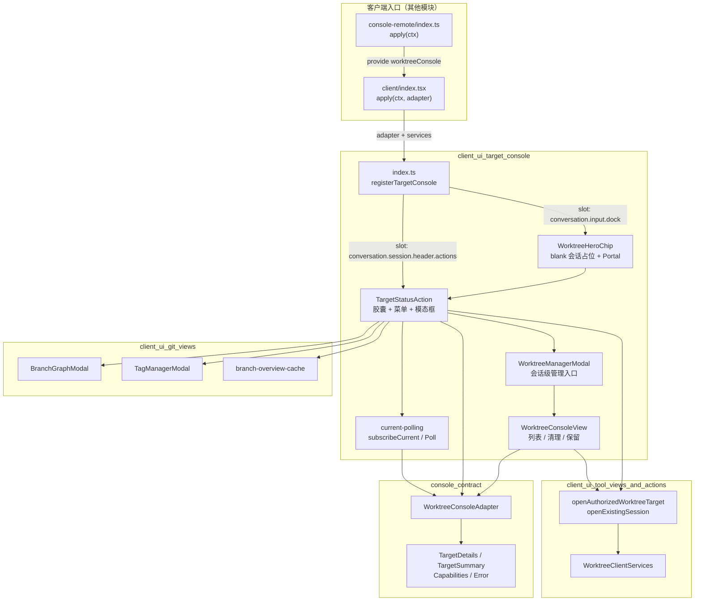
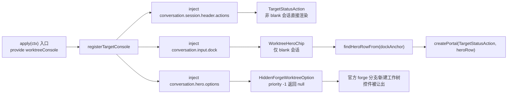
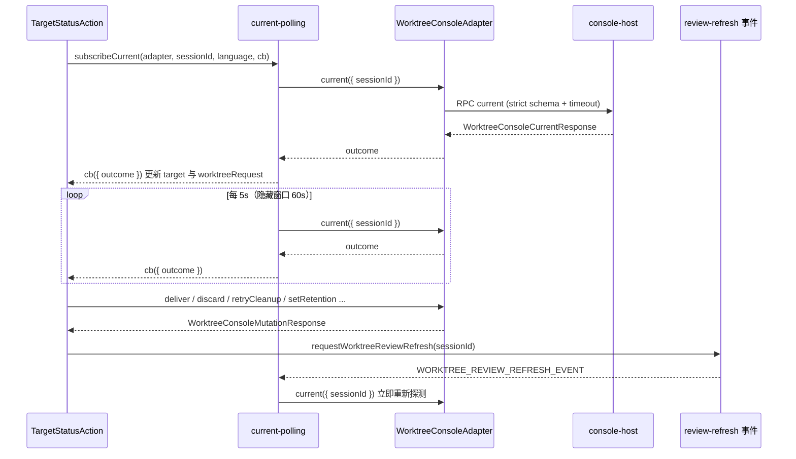
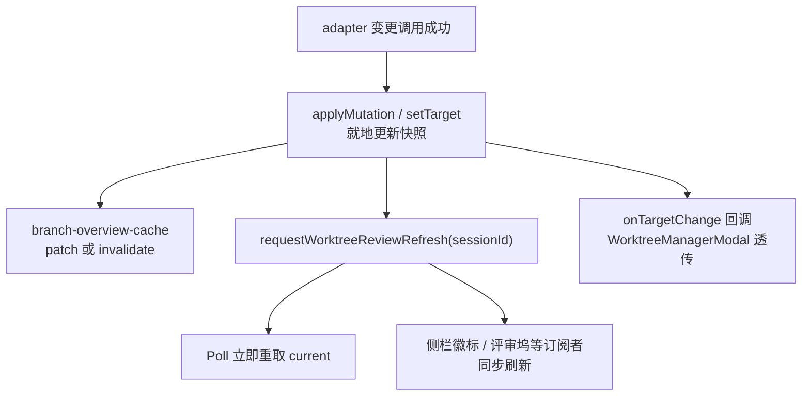
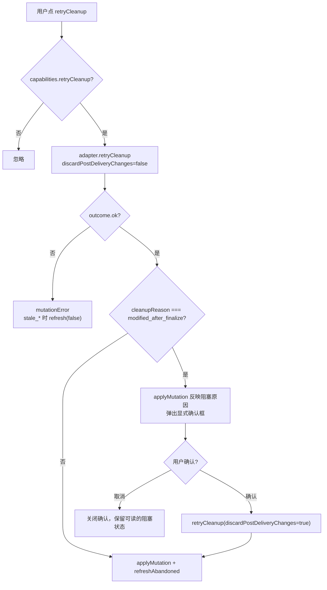
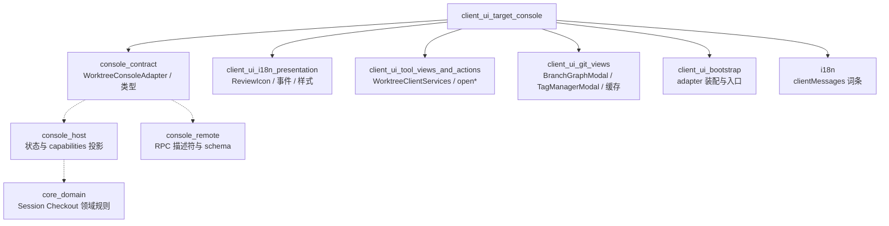

# client_ui_target_console —— 会话目标胶囊与工作树管理控制台

`client_ui_target_console` 是 `dsh-git-worktree` 插件的**浏览器侧目标控制台**：它在 DeepSeek Harness 会话界面上提供一个「Session Target 胶囊」（chip），并把所有与托管 Git 工作树相关的读取与变更操作（分支切换、交付、丢弃、清理重试、迭代推进、标签与提交图）收进一个下拉菜单和若干模态框。

本模块是 [client_ui](client-ui.md) 的子模块之一，与 `client_ui_bootstrap`（装配）、`client_ui_git_views`（提交图与标签）、`client_ui_workspace_sidebar`（侧栏装饰）并列，共同构成插件的浏览器界面。

它不直接与 Host 通信，也不解析 Git 输出——只面向 `WorktreeConsoleAdapter` 这一条严格的 RPC 契约缝（见 [console_contract](console-contract.md)），所有语义（谁能做什么、状态是什么）都由 Host 投影给出（见 [console_host](console-host.md)）。因此本模块的核心复杂度集中在三处：**槽位挂载与 DOM 提升**、**展示态轮询与缓存**、**能力（capabilities）驱动的动作编排**。

---

## 1. 职责边界

| 关注点 | 本模块负责 | 不负责（归属模块） |
| --- | --- | --- |
| 胶囊与菜单 UI | ✅ `TargetStatusAction` | — |
| 工作树列表 / 清理 / 保留策略 UI | ✅ `WorktreeConsoleView` | — |
| 槽位注册与官方控件让位 | ✅ `registerTargetConsole` | 客户端入口装配：[client_ui_bootstrap](client-ui-bootstrap.md) |
| `current` 轮询与订阅复用 | ✅ `current-polling.ts` | RPC 传输与超时：[console_remote](console-remote.md) |
| 分支概览缓存 | 仅消费 | 缓存实现：[client_ui_git_views](client-ui-git-views.md) |
| 提交图 / 标签管理 | 仅打开模态框 | 实现：[client_ui_git_views](client-ui-git-views.md) |
| 会话导航与工作区打开 | 仅调用 | 实现：[client_ui_tool_views_and_actions](client-ui-tool-views-and-actions.md) |
| 文案与样式 | 仅消费 | 实现：[client_ui_i18n_presentation](client-ui-i18n-presentation.md)、[i18n](i18n.md) |
| 状态判定与权限门控 | ❌ 只渲染 | Host 投影：[console_host](console-host.md)、领域规则：[core_domain](core-domain.md) |

设计原则一句话：**胶囊只显示 Host 说了什么，动作只发 Host 允许的动作**。本模块自身没有第二套状态机，`WorktreeConsoleTargetState` 与 `WorktreeConsoleCapabilities` 都是从 Host 读回的事实。

---

## 2. 架构总览



---

## 3. 组件清单

### 3.1 `index.ts` —— 槽位注册与官方控件让位

`registerTargetConsole(ctx, adapter, services)` 是本模块唯一的公开注册函数（`src/client/target-console/index.ts`），它向 Harness 的三个槽位各注入一个贡献：

| 槽位 | id | 优先级 / 顺序 | 组件 | 用途 |
| --- | --- | --- | --- | --- |
| `conversation.session.header.actions` | `worktree-target` | `order: 30` | `TargetStatusAction` | 非 blank 会话时，把胶囊放在会话头部动作区 |
| `conversation.input.dock` | `worktree-hero-chip` | `order: 20` | `WorktreeHeroChip` | blank 会话时，通过 Portal 把胶囊抬到 hero 工作区行 |
| `conversation.hero.options` | `forge-panel.worktree` | `priority: -1` | `HiddenForgeWorktreeOption`（渲染 `null`） | **遮蔽**官方 forge 面板的「分支按钮 + 新建工作树复选框」 |

第三项是一个刻意的「空占位」：同一 cell 只渲染 priority 最低的那一条注册，`-1` 低于官方默认的 `0`，于是官方那对控件被整个让出，功能收进本插件的胶囊菜单。之所以用 shadow 而不是停用官方插件，是因为变更请求、diff、review 都在同一个包里，停用会连带砍掉真正的功能。

> 注意：`TargetConsoleContextLike` 是本模块自持的最小上下文形状（只需 `slots.inject` / `slots.register`），它比 `ClientContextLike`（[client_ui_tool_views_and_actions](client-ui-tool-views-and-actions.md)）更窄，便于在测试中注入桩。入口会用一个 `Proxy` 把 `register` 包进 `ClientI18nProvider`，所以本模块内部可以无条件调用 `useClientTranslator()`。

### 3.2 `TargetStatusAction` —— 胶囊、菜单与动作编排

`TargetStatusActionProps = { sessionId, adapter, services }`。这是本模块最大、也是唯一承载全部用户动作的组件。

**展示层**

- 触发器是 `<button class="dsh-wtc-target-chip" data-target-state=...>`，主标签优先显示 `target.currentBranch`（git-graph 风格），只有在分支未知（loading / error / detached）时才退化为 `Worktree.state: <状态>`。
- `retained` 状态会额外显示到期日（按 `language` 选 `en-US` / `zh-CN`）。
- 探针失败时 `title` 与 `aria-label` 会带上真实的 `code: message`，避免用户只看到一句 "unavailable" 而无从判断。
- 样式按状态着色，由 `target-console.styles.ts` 中的 `[data-target-state="..."]` 规则驱动（见 [client_ui_i18n_presentation](client-ui-i18n-presentation.md)）。

**状态来源**

组件不自己拉数据，而是 `subscribeCurrent(adapter, sessionId, language, listener)`（见 3.6）。`sessionId` 变化时，一整套 `useState` 被重置，并且 `actionScope.current` 自增，使所有在飞的 Promise 回调失效——这是本模块防止「切换会话后旧响应写回新 UI」的统一手法（`mounted` ref + `scope` 比较）。

**菜单条目（`MenuEntry[]`）**

菜单是数据驱动的，条目按「概览 → 分支列表 → 分支操作 → 工作树操作 → 会话操作 → 管理」顺序拼装：

- 摘要行（分支、项目名、`source/current oid`、迭代号、到期日、错误）。
- 分支列表：超过 12 条（`MAX_BRANCH_ITEMS`）时出现过滤输入框，`Enter` 直接切到第一个非当前分支；当前分支与 `sessionBranch` 排在最前并加 `branch.session.badge` 徽标；`upstream` 以弱化文本显示。
- `create_branch`、`prune_branches`、`manage_tags`、`graph`。
- 仅 `state === 'local'` 时出现 `request_worktree`：写「下一条消息在新工作树里开始」的待办标记（**只写标记，不建树**——建树发生在 Host 侧该会话第一个 step 之前，因此勾了不发消息不会留下没人用的 checkout）。文案随状态改写：未排队 → 排队（写明基点）→ 失败原因；再点一次即撤回。
- `reveal`（`capabilities.open` + `managedRoot` 存在）、`source`（回到源会话）、`beginNextIteration`、`deliver`、`returnToLocal`、`manager`。
- `footer` 槽位是「收尾动作」：`retryCleanup` 优先，否则 `discard`（danger 样式）。

**`not_git_repository` 的特殊处理**

`failure.code === 'not_git_repository'` 时不进入错误态：胶囊显示中性的灰点与「不是 Git 仓库」标签，菜单里只剩 `initialize` 一行。理由是普通文件夹必然产生这个回答，把它和真正的探针失败混成一句 "unavailable" 会让本来正常的会话看起来坏掉了。初始化成功后立即 `requestWorktreeReviewRefresh` + `invalidateBranchOverview`，不等 5 秒轮询。

**模态框编排**

| 模态框 | 触发 | 关键行为 |
| --- | --- | --- |
| `WorktreeManagerModal` | `manager` | 内嵌 `WorktreeConsoleView`，`focusCheckoutId` 指向当前 checkout |
| 清理确认 `Modal` | `discard` | 若处于 `preview_active` 或 `capabilities.rollbackPreview`，文案说明「先安全回滚本地预览」 |
| 初始化仓库 `Modal` | `initialize` | 调 `adapter.initializeProject`（可选方法，缺失时禁用该行） |
| 交付 `Modal` | `deliver` | 输入 commit message，走 `adapter.deliver`（**不要求 reviewId**，`working` 态即可交付）；保留策略取 `DEFAULT_WORKTREE_RETENTION` |
| 新建分支 `Modal` | `create_branch` | 先用 `branchNameSchema` 本地校验，再 `gitCreateBranch` |
| 剪枝预览 `Modal` | `prune_branches` | 先 `gitPruneMergedBranches(sessionId, true)` 拿 dry-run 结果，确认后再以 `false` 执行 |
| `BranchGraphModal` / `TagManagerModal` | `graph` / `manage_tags` | 见 [client_ui_git_views](client-ui-git-views.md)；提交图可把某个 commit 传给标签管理器 |

**交付语义**：评审面板移除后，胶囊上的 `deliver` 是客户端**唯一**的交付入口。老的 `/worktree finish` 命令仍要求 `ready_for_review`，只留给脚本使用。

### 3.3 `WorktreeHeroChip` —— blank 会话的 Portal 座席

`WorktreeHeroChipProps = { session?, sessionId?, adapter, services }`。

Harness 的 hero workspace 行只在「空白会话」时存在，因此本组件挂载在 `conversation.input.dock`，再**把胶囊 Portal 到那一行里**，与 agent preset 选择器并排。

- **发现策略**：不轮询整个文档，而是从 dock 锚点（`data-dsh-part="worktree-hero-anchor"`，`display: contents`）出发，按结构定位——
  1. 从 outlet 起向上最多 4 层，检查 `previousElementSibling` 是否含 `heroWorkspaceRow`；
  2. 在 `composerStack` / `composerHero` 祖先内查询；
  3. 最后才退化为 `document.querySelector('[class*="heroWorkspaceRow"]')`。
- **变更驱动**：`MutationObserver` 观察锚点父节点（缺失时退化为 `document.body`）的 `childList + subtree`，命中即停。
- **有界兜底**：仍保留 500ms × 8 次（4 秒）的轮询，用于 hero 行被挂到另一个 portal root 的宿主实现。
- **优雅降级**：`react-dom` 通过 bundle 注入的 `require` **惰性解析**并缓存；解析失败则 `renderPortal === null`，组件返回 `null`——没有 `react-dom` 的 shell 会失去胶囊，而不是让整个插件 bundle 在加载期崩掉。
- 当 `session.blank === false` 或拿不到 `sessionId` 时直接返回 `null`（非 blank 会话由 header 槽位的胶囊负责）。

### 3.4 `WorktreeManagerModal` —— 会话级管理入口

`WorktreeManagerModalProps = { open, sessionId, adapter, services, focusCheckoutId?, onClose, onTargetChange? }`。

极薄的一层：把 `WorktreeConsoleView` 以 `embedded` 模式塞进一个 `Modal`（`dsh-wtc-manager-dialog` / `dsh-wtc-manager-content` 控制尺寸与滚动），标题与描述全部走 i18n。它的存在意义是让「同一个会话及其逻辑关联工作树」有一个可枚举的落点，而不是只靠胶囊里的摘要。

### 3.5 `WorktreeConsoleView` —— 列表、清理与保留策略

`WorktreeConsoleViewProps = { embedded?, sessionId, adapter, services, focusCheckoutId?, onTargetChange? }`。这是本模块中唯一做**并行读取**的组件。

**读取**：`refresh()` 用 `Promise.all` 并发取三路数据——

```text
adapter.current({ sessionId })
adapter.list({ sessionId, needsAttention?, includeDelivered? })
adapter.listAbandoned?.({ sessionId })   // 可选能力，缺失时解析为 null
```

前两路任一失败即整体置错（`errorText` 会把 `worktreeConsoleErrorMeta(code)` 的 category / recovery 翻成可读建议）；`listAbandoned` 失败只隐藏「可恢复快照」区块，不影响主面板。并发用两个令牌防竞态：`sessionGeneration`（会话切换）与 `request`（同一会话内的重入），另有独立的 `abandonedRequest` 用于轻量刷新。

**排序**：`focusCheckoutId` 命中的行优先，其次按 `ATTENTION_RANK` 升序，最后按 `iteration` 降序：

| 排名 | 状态 | 排名 | 状态 |
| --- | --- | --- | --- |
| 0 | `recovery_required` | 6 | `working` |
| 1 | `preview_detached` | 7 | `creating` |
| 2 | `cleanup_pending` | 8 | `delivered` |
| 3 | `ready_for_review` | 9 | `local` |
| 4 | `preview_active` | 10 | `discarded` |
| 5 | `retained` | | |

**变更动作**（全部先查 `pendingAction === null` 与对应 `capabilities.*`，成功后用 `applyMutation` 就地更新快照并回调 `onTargetChange`）：

| 动作 | 前置能力 | 说明 |
| --- | --- | --- |
| `discardTarget` | `discard` | `dirty` 时先弹内联确认；`preview_active` / `rollbackPreview` 时自动带 `rollbackPreview: true` |
| `retryCleanup` | `retryCleanup` | 若返回 `cleanupReason === 'modified_after_finalize'`，**不静默重试**，而是升级为一次显式确认（`discardPostDeliveryChanges: true`），并先 `applyMutation` 让 UI 反映 Host 已写入的阻塞原因 |
| `setPermanentFlag` | `setPermanent` | 常驻标记豁免自动清理 |
| `setRetentionMode` | `setRetention` | `retain_24h` / `retain_3d` / `retain_manual` 下拉 |
| `restoreAbandonedSnapshot` | 适配器暴露 `restoreAbandoned` | 成功后 `invalidateBranchOverview` + 轻量刷新 + 提示恢复到的分支 |
| `openListedTarget` | `open` + `inspect` | 委托 `openAuthorizedWorktreeTarget`，它会重新 `inspect` 校验身份与 `managedRoot` 再打开 |

**错误降级**：`mutationError` 对 `stale_target` / `stale_local` / `stale_isolated` 会追加一次 `refresh(false)`（保留错误提示的滚动），因为这三个码意味着本地快照已过期。

### 3.6 `current-polling.ts` —— 展示态轮询

`subscribeCurrent(adapter, sessionId, language, listener)` 把「每个会话一个 `current` 轮询」做成了**多订阅者共享**的单例：

- 注册表是 `WeakMap<WorktreeConsoleAdapter, Map<key, Poll>>`，`key = JSON.stringify([sessionId, language])`。适配器身份隔离不同的 Client 实例，语言参与 key 是因为 Host 返回的错误消息是按 locale 翻译的。
- 首个订阅者触发立即 `invalidate()`；后续订阅者直接收到 `last` 结果（不会重复发请求）。
- 周期 `DELAY = 5_000`；**文档隐藏时降为 `HIDDEN_DELAY = 60_000`**，因为一个隐藏窗口看不到胶囊，而一次 `current` 在 Host 侧要花 `git status` + 两次 `git rev-parse`。
- 两个失效来源：`WORKTREE_REVIEW_REFRESH_EVENT`（`detail.sessionId` 匹配时，见 [client_ui_i18n_presentation](client-ui-i18n-presentation.md)）与 `visibilitychange`（重新可见时立刻校正）。
- 每次 `invalidate()` 自增 `generation`；在飞请求只有在 generation 未变且仍有订阅者时才写回并广播，因此旧响应不会污染新会话。
- 引用计数归零时清定时器、摘监听器并 `release()` 从注册表删除；若请求仍在飞，则由请求收尾时再 `release()`。

> 该循环**仅用于显示**，注释中明确写着「Never used to authorize a mutation or Git cleanup」——所有变更仍走带 `expectedRevision` 的显式 RPC。

---

## 4. 挂载与提升路径



---

## 5. 数据流与刷新时序



一次变更之后的固定收尾动作是「本地补丁 + 全局失效 + 事件广播」：



---

## 6. 关键流程：清理被「交付后改动」阻塞



同样的「不静默重试」原则也体现在 `discard`：`dirty` 时先确认，`preview_active` 时文案改为「先安全回滚本地预览」。

---

## 7. 依赖关系



本模块**没有**对 `console_host` 或 `core_domain` 的编译期依赖：它只 import 契约类型。这让它可以在纯前端测试中用桩适配器驱动。

---

## 8. 与契约的边界：capabilities 决定可见性

菜单与行内按钮的可见性完全由 `WorktreeConsoleCapabilities` 决定，而这份布尔集合由 Host 的投影按「调用者是 owner / source / 被授权的关联会话」计算（`src/console-host/projection.ts`）。几个对 UI 有直接影响的结论：

- `open` / `inspect` 对 owner、source 与 `linkedRead` 均开放，但关联只读场景要求 owner 会话仍可用。
- `discard` 只给 owner，或「source 且 owner 会话已不可用」的预留场景。
- `setRetention` / `setPermanent` / `retryCleanup` 只给 owner——它们作用于已冻结的目录本身。
- `beginNextIteration` 要求 `phase === 'discarded'` 且 `delivery.state === 'delivered'`；`returnToLocal` 要求工作树已到达交付态。

因此本模块从不「猜」权限：`adapter.initializeProject`、`adapter.listAbandoned`、`adapter.restoreAbandoned` 三个**可选方法**的存在性检查，也一并写成了「方法缺失即隐藏/禁用」的降级路径。

错误码同样被分层处理：`WorktreeConsoleErrorCode = SessionCheckoutErrorCode | 'transport_unavailable' | 'malformed_response' | 'timeout'`。后三个来自 [console_remote](console-remote.md) 的客户端适配层（快方法 30s、慢方法 180s 超时，strict schema 解析失败即 `malformed_response`），前一组来自 Host 的 `consoleFailure`。

---

## 9. 展示状态一览

`WorktreeConsoleTargetState` 在 UI 中映射为以下标签（`STATE_LABELS`，键为 i18n 词条）：

| 状态 | 词条 | 含义 |
| --- | --- | --- |
| `local` | `local.state` | 会话仍站在本地 checkout |
| `creating` | `creating.2` | 工作树创建中 |
| `working` | `editing` | 托管工作树可编辑 |
| `ready_for_review` | `ready.for.review` | 已产出待评审快照 |
| `preview_active` | `reviewing.in.local` | 预览已应用到本地 |
| `preview_detached` | `preview.awaiting.recovery` | 预览与记录脱钩，待恢复 |
| `retained` | `retained` | 交付后按保留策略保留 |
| `cleanup_pending` | `cleanup.pending` | 清理未完成 |
| `recovery_required` | `recovery.required` | 需要显式恢复流程 |
| `delivered` | `delivered` | 已交付 |
| `discarded` | `discarded` | 已丢弃 |

胶囊另有三个**非 Host 状态**的展示态：`loading`、`error`（`unavailable`）与 `not_git_repository`，它们只影响文案与配色，不会进入任何 RPC 参数。

---

## 10. 国际化与样式

- 所有文案通过 `useClientTranslator()` 取得，`ClientTranslator` 的类型来自 `typeof clientMessages`，因此拼错的词条是编译期错误（见 [i18n](i18n.md)）。
- `useClientLanguage()` 除了选 locale，还决定日期格式（`en-US` / `zh-CN`）以及 `subscribeCurrent` 的缓存 key。
- 组件不 import 任何 CSS 文件：样式由入口以 `ctx.effect` 注入一个带 `data-plugin="dsh-git-worktree"` 的 `<style>`，内容为 `WORKTREE_STYLES + TARGET_CONSOLE_STYLES`。因此本模块只维护 `target-console.styles.ts` 里的 `dsh-wtc-*` 类名，不承担样式生命周期（详见 [client_ui_i18n_presentation](client-ui-i18n-presentation.md)）。

---

## 11. 构建、类型与测试

- 客户端产物由 `tsdown.config.ts` 打成 **CJS**，入口是 `src/client/console-remote/index.ts`，输出 `lib/client.js`，并以 `window.__ModuleLoader__.load({ id: 'dsh-git-worktree', ... })` 包裹；`react`、`@deepseek-ai/dsh-client-ui-primitives` 等被标记为 external（`tsdown.config.ts`）。
- `package.json` 的 `./client` 导出指向 `lib/client.js`，`dsh.client.inject` 声明了会话控制器、工作区控制器、locale、conversation、tool 等宿主服务；`dsh.bundle.patch` 指向 `cordis.patch.yml`。
- 类型检查与测试：`pnpm typecheck`（`tsc --noEmit`）与 `pnpm test`（`vitest run`，配置见 `vitest.config.ts`，使用 `jsdom` 环境，组件测试依赖 `@testing-library/react`）。CI 在 `.github/workflows/ci.yml` 的 `check` job 中执行。详见 [build_and_config](build-and-config.md)。

---

## 12. 扩展与维护要点

1. **新增一个用户动作**：先在 `console_contract` 里加方法与类型 → 在 `console_host` 投影里给出对应的 `capabilities` 布尔 → 再回到本模块加菜单条目。跳过中间一步会导致按钮对所有人可见，并在点击时被 Host 拒绝。
2. **新增一种状态**：需要同时更新 `STATE_LABELS`（本模块两个文件各有一份）、`ATTENTION_RANK`（`WorktreeConsoleView`）以及 `target-console.styles.ts` 的 `[data-target-state]` 配色。
3. **保持「变更后三件套」**：就地补丁 → 失效分支缓存 → `requestWorktreeReviewRefresh`。缺任一步都会让侧栏徽标、评审坞或胶囊停留在旧状态。
4. **不要为胶囊加挂载时预取**：`TargetStatusAction` 的注释明确说明不在 mount 时拉 `gitOverview`（每次 3 个 git 进程 × 每个会话），分支概览只在首次展开时取。
5. **竞态一律用 ref 令牌**：`mounted` + `actionScope`（胶囊）或 `sessionGeneration` + 请求令牌（列表）。这是本模块里唯一被反复复用的并发控制模式。
