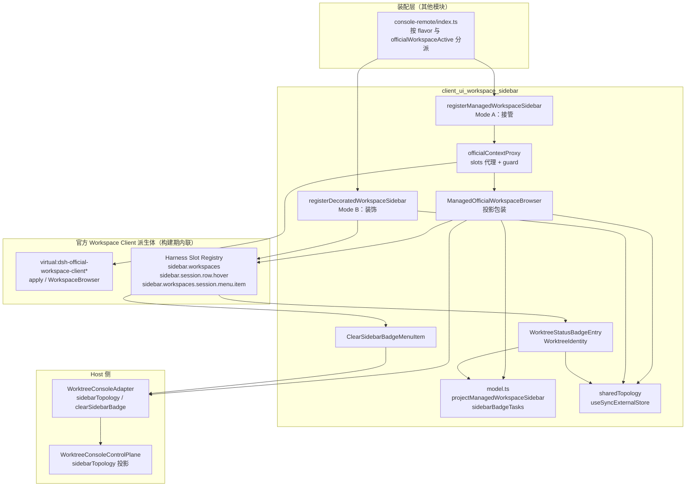
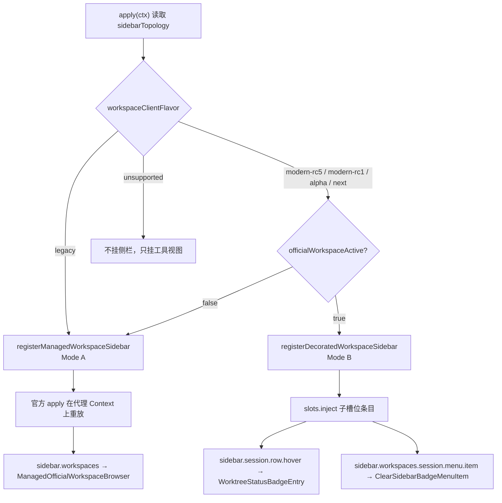
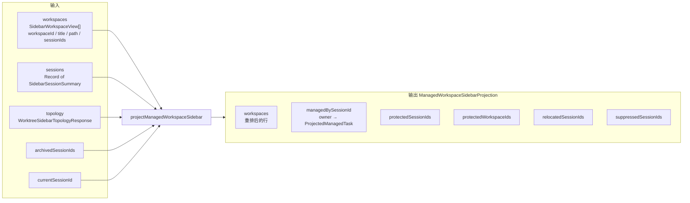
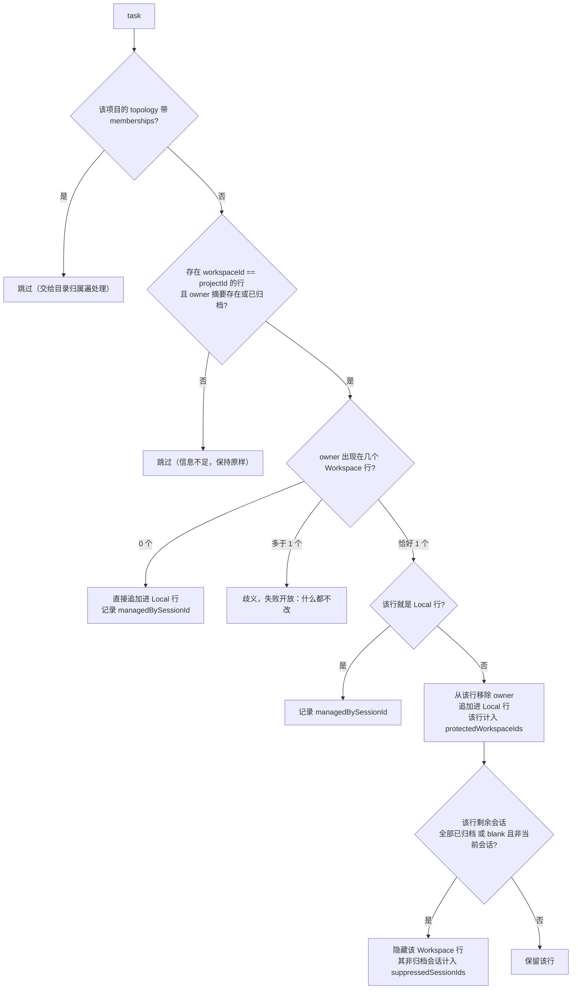
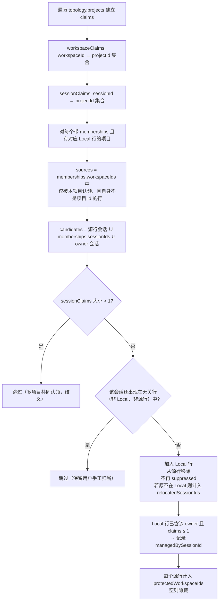
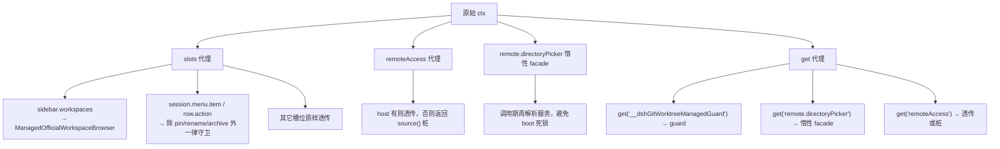
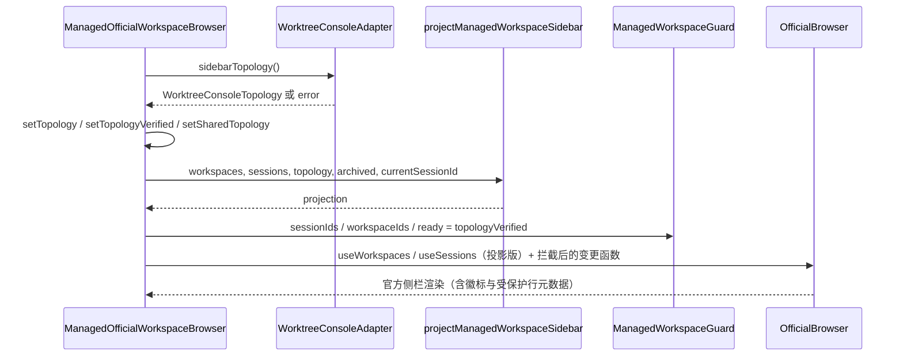
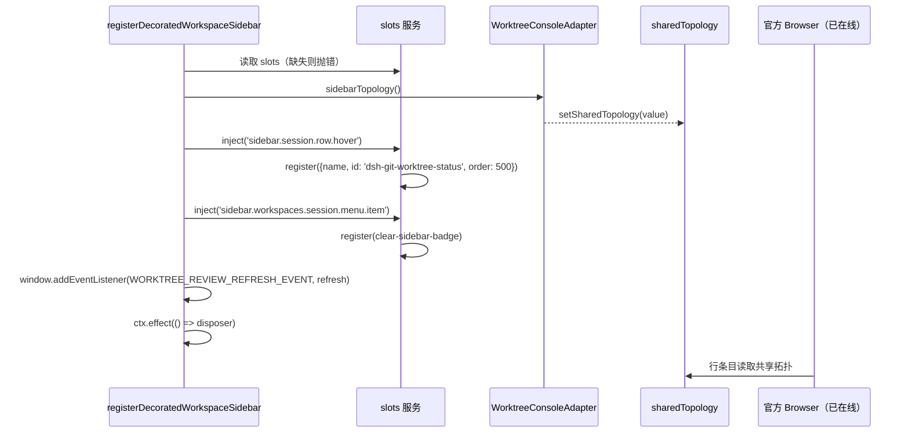
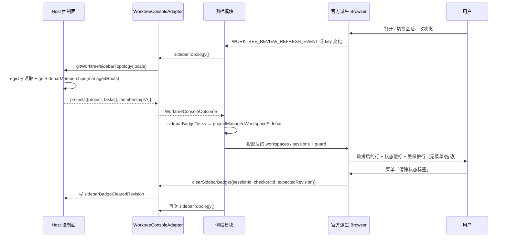

# client_ui_workspace_sidebar —— Workspace 侧栏投影与装饰

`client_ui_workspace_sidebar` 是 `dsh-git-worktree` 浏览器侧的**侧栏适配层**。它不实现自己的侧栏，而是把 DSH 官方的 Workspace 侧栏（`ui-workspace` 提供的 `sidebar.workspaces` 槽位）改造成「能正确表达受管 Worktree」的形态：

1. **重排归属**：把每个 Managed Checkout 的 owner Session 从它临时的 Workspace 行搬回它原本的 Local 项目行，让用户看到的仍是「一个项目 + 若干会话」，而不是每次开 Worktree 就多出一行陌生工作区。
2. **附加身份**：给受管 Session 行加上「状态徽标」（进行中 / 待验收 / 预览中 / 待恢复 / 需要恢复 / 已完成 / 已放弃）与分支图标，数据全部来自 Host 的 `sidebarTopology()`。
3. **封堵危险操作**：受管 owner Session 与受保护的 Workspace 上，官方菜单里的「分叉会话」「在工作区新建会话」「拖动重排」等一对一所有权之外的操作会被拦掉；「置顶 / 重命名 / 归档」这类不改变归属的官方动作则原样保留。
4. **提供终态清理入口**：在已放弃 / 已完成的 Session 行菜单里注入「清除状态标签」，通过 `clearSidebarBadge` 让 Host 下次不再投影该徽标。

本模块是 [client_ui](client-ui.md) 的子模块，与 [client_ui_bootstrap](client-ui-bootstrap.md)（装配与分派）、[client_ui_target_console](client-ui-target-console.md)（顶部胶囊）、[client_ui_i18n_presentation](client-ui-i18n-presentation.md)（翻译与样式）并列。它自身**不持有任何状态真相**：所有状态、归属证据与变更授权都来自 Host（见 [console_host](console-host.md)），本模块只做「投影 + 拦截 + 注入」。

## 核心组件

| 组件 | 文件 | 职责 |
| --- | --- | --- |
| `projectManagedWorkspaceSidebar` | `src/client/workspace-sidebar/model.ts` | 纯函数：把 `workspaces` + `sessions` + `topology` 折叠成一份受管投影 |
| `sidebarBadgeTasks` | `src/client/workspace-sidebar/model.ts` | 纯函数：把拓扑里的任务按 owner Session 去重，并附加本地化状态文案 |
| `ManagedWorkspaceSidebarProjection` / `ProjectedManagedTask` / `SidebarWorkspaceView` / `SidebarSessionSummary` | `src/client/workspace-sidebar/model.ts` | 投影的输入输出类型 |
| `ManagedOfficialWorkspaceBrowser` | `src/client/workspace-sidebar/index.tsx` | 包装官方 `WorkspaceBrowser`，只替换数据投影与不安全变更 |
| `ManagedWorktreeSessionDecoration` | `src/client/workspace-sidebar/index.tsx` | 注入 Session 摘要的瞬时展示元数据（`__dshGitWorktree`） |
| `registerManagedWorkspaceSidebar` | `src/client/workspace-sidebar/index.tsx` | **Mode A（接管）**：用代理 Context 重放官方 `apply`，只替换 Browser 组件 |
| `officialContextProxy` / `ManagedWorkspaceGuard` | `src/client/workspace-sidebar/index.tsx` | Context 代理：槽位守卫、目录选择器惰性解析、服务桩 |
| `registerDecoratedWorkspaceSidebar` | `src/client/workspace-sidebar/index.tsx` | **Mode B（装饰）**：官方 Browser 仍在线时，通过槽位扩展缝注入行徽标与菜单项 |
| `ClearSidebarBadgeMenuItem` / `registerClearSidebarBadgeEntry` | `src/client/workspace-sidebar/index.tsx` | 终态行菜单项：`clearSidebarBadge` 请求 |

## 架构总览

## 两种装配模式

同一份 bundle 必须在两种互斥的运行时形态下工作，判定完全由 Host 决定（`sidebarTopology()` 返回的 `officialWorkspaceActive`，其来源见 [core_domain_workspace_lifecycle](core-domain-workspace-lifecycle.md)）：

| 模式 | 触发条件 | 做法 | 为什么不能换一种做法 |
| --- | --- | --- | --- |
| **Mode A（接管 / managed）** | Host 侧禁用了官方 `ui-workspace` 条目（`officialWorkspaceActive === false`） | `registerManagedWorkspaceSidebar` 用代理 Context 重放官方 `apply`，把 `sidebar.workspaces` 的注册替换成自己的 Browser 包装 | 官方 `uiWorkspace` 提供者已不在线，必须由本插件重新 `provide`，否则整个侧栏缺失 |
| **Mode B（装饰 / decorate）** | 官方 `ui-workspace` 仍在线（`officialWorkspaceActive === true`） | `registerDecoratedWorkspaceSidebar` 只向官方已声明的子槽位注入条目 | 重放官方 `apply` 会二次 `provide('uiWorkspace')` 并冲突；直接 shadow `sidebar.workspaces` 也不行——一个槽位只允许一个声明者，且 `renderSlot` 只授权给声明条目，衍生 Browser 会在首次渲染子槽位时崩溃 |

分派代码在 `src/client/console-remote/index.ts`，细节见 [client_ui_bootstrap](client-ui-bootstrap.md)。

## 投影模型（`model.ts`）

### 输入与输出

`SidebarWorkspaceView` 只保留投影需要的四个字段（`workspaceId`、`title`、`path`、`sessionIds`），因此 `model.ts` 对官方 Workspace 的 Store 形状依赖极窄；`SidebarSessionSummary` 只关心 `displayTitle`、`blank`、`updatedAt` 等展示字段。

### 第一步：`sidebarBadgeTasks`

把 `topology.projects[].tasks[]` 摊平成「每个 owner Session 一条」：

- 跳过缺 `project` 标识 / 缺 `project.name` / `tasks` 非数组的项目，以及缺 `checkoutId`、`ownerSessionId`、`sourceSessionId` 的任务（脏数据 fail-soft）。
- 按 `ownerSessionId` 去重，保留 `iteration` 更大者；同 iteration 保留 `revision` 更大者。这与 Host 侧 `sidebarTopology` 的选取规则一致（`src/console-host/control-plane.ts`）。
- 附加 `projectId`、`projectName`、`stateLabel`（纯状态词，供行内 chip 使用）与 `label`（状态词 + `sourceBranch`，供 tooltip/aria 使用）。

状态词来自 `client-messages.ts`，与官方派生体内联的状态键一一对应：

| `WorktreeSidebarTaskState` | 文案 key | 中文 |
| --- | --- | --- |
| `working` | `in.progress` | 进行中 |
| `ready_for_review` | `ready.for.review` | 待验收 |
| `preview_active` | `previewing` | 预览中 |
| `preview_detached` | `awaiting.recovery` | 待恢复 |
| `recovery_required` | `recovery.required` | 需要恢复 |
| `finalized` | `completed` | 已完成 |
| `discarded` | `discarded` | 已放弃 |

### 第二步：按 owner 重排（无 `memberships` 的项目）

对每个任务：

三条刻意的保守规则：

- **歧义即放弃**：`memberships.length > 1` 时不搬动任何会话。宁可多显示一行，也不把用户看不明白的会话藏起来。
- **不推断空行**：隐藏 Workspace 只在「剩余会话全部归档，或全部是 `blank` 且不是当前选中会话」时发生；缺失摘要**不算**空。
- **Registry 归属优先于成员计数**：owner 的目的地由 Registry 的 `projectId` 证明，其它成员的冷/未知状态不得阻断这次搬动。

### 第三步：目录归属遍（带 `memberships` 的项目）

`topology.projects[].memberships` 由 Host 从 registry 根与不可变 Session header 解析（`SidebarDirectoryMembership`，见 `src/ports.ts` 与 `src/console-host/control-plane.ts`）。它能覆盖「Workspace 行已被清理/过滤掉」的历史会话，也承载普通历史会话——但**不会**为它们凭空造出 owner 徽标。

### 输出字段语义

| 字段 | 消费者 | 含义 |
| --- | --- | --- |
| `workspaces` | 官方 Browser 的 `useWorkspaces` | 重排后的行；已剔除 `hiddenWorkspaceIds` |
| `managedBySessionId` | Session 投影 | owner Session → 徽标数据 |
| `protectedSessionIds` | 变更拦截 + 菜单守卫 | **所有** owner Session（即使其项目走目录归属遍），禁止分叉/插队 |
| `protectedWorkspaceIds` | 变更拦截 + 行元数据 | 受管 owner 所在的临时 Workspace 与目录归属源行；打上 `__dshGitWorktreeProtected` |
| `relocatedSessionIds` | 插入位置拦截 | 由 Host 目录证据搬回 Local 的会话 |
| `suppressedSessionIds` | Session 列表过滤 | 只出现在已隐藏 Workspace 里的非归档会话 |

## Mode A：接管路径

### 装配：`registerManagedWorkspaceSidebar` + `officialContextProxy`

`registerManagedWorkspaceSidebar(ctx, adapter, applyWorkspace = applyOfficialWorkspace)` 的全部工作就是「在代理 Context 上重放官方 `apply`」。代理做了四件事：

关键设计点：

- **`ManagedWorkspaceGuard` 是服务级守卫**：`{ ready, sessionIds, workspaceIds, blockSession, blockWorkspace }`。`ready === false` 时**一律拦截**——拓扑未验证完成前不允许任何可能改变归属的动作。这个 guard 通过 `ctx.get('__dshGitWorktreeManagedGuard')` 暴露，官方派生体在构造时捕获到实例上（见 `scripts/workspace-sidebar-upstream.mjs` 的 `instance-local managed guard` 替换），因此菜单、快捷键等不走 Browser props 的入口也受同一守卫约束。
- **`OWNER_SAFE_SESSION_ACTIONS = {pin, rename, archive}`**：这些官方动作不新建 Session、也不改变 Workspace 归属，保留原生菜单/浮层/回调，否则用户会丢掉基础的会话管理能力。
- **目录选择器惰性解析**：现代 Host 的 `remote.directoryPicker` 提供者**等待 `uiWorkspace`**。若在装配期静态读取，会形成「入口等 picker、picker 等 uiWorkspace」的死锁，因此 `deferredRemoteDirectoryPicker` 返回一个 Proxy，每次属性访问才 `ctx.get('remote.directoryPicker')`，缺失时抛出可读错误。
- **`remoteAccess` 兼容**：0.2.2-rc.1 的官方 apply 以**属性**形式读 `ctx.remoteAccess.source(...)`（而不是 `ctx.get`），只答 `get` 形态会让官方行 hook 崩在缺服务上。代理对两种读法都返回「Host 有则透传，否则 `{ source: () => ({}) }` 桩」。

### `ManagedOfficialWorkspaceBrowser`

它接收官方 `WorkspaceBrowser` 组件与全部官方 props，只替换「数据」和「不安全的变更函数」，其余（声明树、locale、picker、store、目录流授权）保持官方原样。

具体行为：

| 行为 | 实现 |
| --- | --- |
| 拓扑拉取 | `useEffect` 内首次拉取；依赖 `[adapter, guard, sessionKey, workspaceKey]`，因此会话或工作区集合变化会重新拉取 |
| 事件驱动刷新 | 监听 `WORKTREE_REVIEW_REFRESH_EVENT`（`dsh-git-worktree:review-refresh`），卸载时移除监听并清空共享拓扑 |
| 拓扑验证标志 | `topologyVerified` 仅在 `outcome.ok` 时为 `true`；失败时拓扑退化为 `EMPTY_TOPOLOGY` 且 guard 保持 `ready = false`（不放开任何动作） |
| Workspace 投影 | 对 `protectedWorkspaceIds` 内的行打上 `__dshGitWorktreeProtected: true`，官方派生体据此隐藏菜单按钮、禁用拖动与「新建会话」 |
| Session 投影 | 从 `ids`/`byId` 删除 `suppressedSessionIds`；对 `managedBySessionId` 的会话附加 `__dshGitWorktree`（`ManagedWorktreeSessionDecoration`），**不改动 `displayTitle`**，徽标由官方派生体渲染在截断标题之前 |
| `startSession` | 受保护 Workspace 直接 return |
| `forkSession` | 受保护 Session 直接 return（官方菜单侧还有 guard 兜底） |
| `insertSessionBefore` | Workspace、Session 或 `beforeSessionId` 落在受保护/被搬动集合内时 return |
| 徽标菜单项 | `useEffect` 内通过 `registerSessionMenuEntry` 注册（挂载期注册，保证官方座位声明先存在；apply 期注册会污染两种模式下的声明账本） |

### 终态徽标清理：`ClearSidebarBadgeMenuItem`

`registerClearSidebarBadgeEntry` 注册一个 `sidebar.workspaces.session.menu.item` 条目（`id: 'clear-sidebar-badge'`、`order: 500`）：

1. 从共享拓扑里找到 `ownerSessionId === sessionId` 的任务；
2. 仅当 `state` 为 `discarded` 或 `finalized` 时渲染菜单项（文案 `clear.sidebar.badge` → 「清除状态标签」）；
3. 点击后调用 `adapter.clearSidebarBadge({ sessionId, checkoutId, expectedRevision: task.revision })`；
4. 成功则派发 `WORKTREE_REVIEW_REFRESH_EVENT` 触发全链路重读，失败仅 `console.warn`（诊断不得打断 UI）。

Host 侧对「已清除」的实现是**抑制投影**而非删除记录：`sidebarBadgeClearedRevision === revision` 且状态为终态时，该任务不再出现在 `sidebarTopology` 里（`src/console-host/control-plane.ts` 的 `sidebarTopology`）。因此下一次刷新时行会自动失去图标、徽标与该菜单项，无需额外重置路径。

## Mode B：装饰路径

要点：

- **只注入官方真实声明的座位**。`ROW_SEATS = ['sidebar.session.row.hover']`。代码注释明确记录了两次踩坑：`sidebar.session.row.trailing` 在 DSH 0.2.x **不存在**，注入它会永远等不到声明，回调永不执行；而 `sidebar.session.row.leading` 在会话运行时会被状态点替换、trailing action 座位 hover 前 `display:none`，两者都无法承载「始终可见」的标记。因此行内标记只落在 hover 卡（`sidebar.session.row.hover`），常驻信息交给顶部胶囊（见 [client_ui_target_console](client-ui-target-console.md)）。
- **不能 shadow `sidebar.workspaces`**：一个槽位只允许一个声明者，且 `renderSlot` 只授权给声明条目；衍生 Browser 会在首次渲染子槽位时崩溃。子座位条目经由**官方条目**的 `renderSlot` 渲染，授权天然完整。
- **共享拓扑 store**：Mode B 没有 Browser 包装来喂数据，因此 `index.tsx` 顶部维护一个模块级 `sharedTopology` + 监听器集合，通过 `useSyncExternalStore` 暴露给槽位条目（它们渲染在 Browser React 树之外，拿不到 props）。Mode A 与 Mode B 都写这个 store，读取方统一走 `useSharedTopology()`。
- **`ClientI18nProvider` 逐条目包裹**：槽位条目在官方树中渲染，拿不到本插件的 Provider，因此注册时显式包一层 `ClientI18nProvider locale={read('locale')}`。

### 行装饰渲染：`WorktreeStatusBadgeEntry` / `WorktreeIdentity`

`WorktreeIdentity` 复用上游同一套类名与 `data-worktree-state` 属性：

- `span.dsh-git-worktree-sidebar-icon`（内含 `IconBranchOutlineRegular`，`role="img"`，`aria-label`/`title` 为 `label`）
- 可选 `span.dsh-git-worktree-sidebar-badge`（chip，文本为 `stateLabel`）

没有匹配任务的 Session 行渲染 `null`。颜色不在这里定义，而由 `src/client/styles.ts` 中 `.dsh-git-worktree-sidebar-icon[data-worktree-state=…]` 规则提供，镜像上游同状态名的调色板（细节见 [client_ui_i18n_presentation](client-ui-i18n-presentation.md)）。

## 数据流

拓扑读取失败被刻意设计为**降级**：`EMPTY_TOPOLOGY` + `topologyVerified = false`，侧栏退回「纯官方形态」且所有受管动作被封（`guard.ready = false`）。这样即使 registry 损坏，用户仍能用工具视图与 Worktree 管理器修复，而不会看到一份半真半假的侧栏。

## 与其他模块的关系

| 关系 | 说明 |
| --- | --- |
| [client_ui_bootstrap](client-ui-bootstrap.md) | 唯一调用方。按 `workspaceClientFlavor` 与 `officialWorkspaceActive` 在 Mode A / Mode B 之间分派，并负责 `ctx.inject` 的依赖集合 |
| [console_contract](console-contract.md) | 提供 `WorktreeConsoleAdapter`（`sidebarTopology`、`clearSidebarBadge`）、`WorktreeSidebarTopologyResponse` / `WorktreeSidebarProject` / `WorktreeSidebarTask` / `WorktreeSidebarTaskState`、`WorktreeConsoleClearSidebarBadgeRequest` |
| [console_host](console-host.md) | `sidebarTopology` 的投影来源（任务去重、`memberships`、徽标抑制）与 `clearSidebarBadge` 的授权实现；`capabilities()` 决定菜单动作可见性 |
| [core_domain_workspace_lifecycle](core-domain-workspace-lifecycle.md) | Host 侧 `mountWorkspaceProviderLifecycle` 决定 `officialWorkspaceActive`，从而决定走接管还是装饰 |
| [client_ui_i18n_presentation](client-ui-i18n-presentation.md) | `ClientI18nProvider` / `useClientTranslator` / `defaultClientTranslator`、刷新事件常量 `WORKTREE_REVIEW_REFRESH_EVENT`、`.dsh-git-worktree-sidebar-*` 样式规则 |
| [client_ui_tool_views_and_actions](client-ui-tool-views-and-actions.md) | `selectedSessionId(sessionState)` 提供「当前选中会话」，用于判断空白 Workspace 能否隐藏 |
| [i18n](i18n.md) | `client-messages.ts` 提供状态词与 `clear.sidebar.badge` 文案 |
| [build_and_config](build-and-config.md) | `tsdown.config.ts` 把四代官方 Client 派生体作为虚拟模块内联；`check:sidebar-version` 与 `check-publish.mjs` 提供版本/哈希/产物门禁 |

## 构建、版本门禁与测试

- **派生体来源**：`scripts/workspace-sidebar-upstream*.mjs` 先校验官方包版本与 `client` 产物 SHA-256，再用「精确且唯一」的文本替换（`replaceExactlyOnce` / `once`）生成派生源码。本模块依赖的若干派生点正是它们注入的：`this.managedWorktreeGuard = ctx.get("__dshGitWorktreeManagedGuard")`、`forkSession` / 新建会话快捷键的 `blockSession` / `blockWorkspace` 守卫、`__dshGitWorktreeProtected` 行标记、`__dshGitWorktree` 会话元数据。上游字节一变，构建直接失败——这是「同一份代码适配 5 代 Host」的安全底线。
- **版本门禁脚本**：`pnpm run check:sidebar-version`（`scripts/check-workspace-sidebar-version.mjs`）校验 `@deepseek-ai/dsh-client-locale` 版本，并逐一读取 4 个官方 Workspace Client 源；它被 `prepublishOnly` 排在 `build` 之前。
- **bundle 装配**：`tsdown.config.ts` 中 `official-workspace-client-source` 插件把 `virtual:dsh-official-workspace-client*` 解析为上述派生模块；`react`、`@deepseek-ai/cordis`、`@deepseek-ai/dsh-client-ui-primitives`、`@deepseek-ai/dsh-client-store` 保持 external（`src/client/harness-platform.d.ts` 为这些虚拟模块提供编译期类型）。
- **发布完整性**：`scripts/check-publish.mjs` 明确断言 bundle 的入口 inject 不得包含 `remoteAccess`、`remote.directoryPicker`、`conversation`、`connection`，并要求产物中出现 `remote.directoryPicker` 的**惰性**解析——这两条正是本模块 `officialContextProxy` 的存在理由。
- **测试**：`vitest.config.ts` 把 4 个 `virtual:dsh-official-workspace-client*` 别名指向 `tests/*.mock.ts`，把 `@deepseek-ai/dsh-client-ui-primitives` 指向 `tests/support/ui-primitives.tsx`，因此本模块的投影与装配可以在 jsdom 下脱离真实官方包测试。CI（`.github/workflows/ci.yml`）依次执行 `typecheck` → `build` → `check:publish:release` → `test`。

## 设计约束与易错点

- **失败开放（fail open）优先于「猜对了」**：归属歧义、摘要缺失、claims 冲突一律保持官方原样，只隐藏「可证明为空」的行。隐藏用户会话比多显示一行代价高得多。
- **不要改动 `displayTitle`**：受管标记走 `__dshGitWorktree` 元数据，官方派生体把它渲染成固定图标/徽标前置在截断标题之前；改写标题会破坏官方搜索与重命名语义。
- **拓扑未验证 = 全部封锁**：`guard.ready` 只在 `sidebarTopology()` 成功后才为 `true`；不要为了「看起来更顺畅」把它提前置真。
- **两种模式共享同一份投影函数**：新增归属规则只改 `model.ts`，两侧行为自动一致；若在 `index.tsx` 里另写判断，两种模式必然漂移。
- **模块级 `sharedTopology` 是刻意的全局**：槽位条目在官方 React 树之外，无法通过 props 取数据；写入方必须成对调用 `setSharedTopology(undefined)` 做清理（Mode A 的 effect cleanup、Mode B 的 `ctx.effect` disposer 都已实现）。
