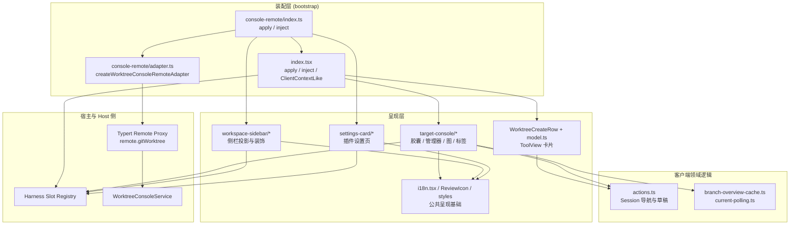
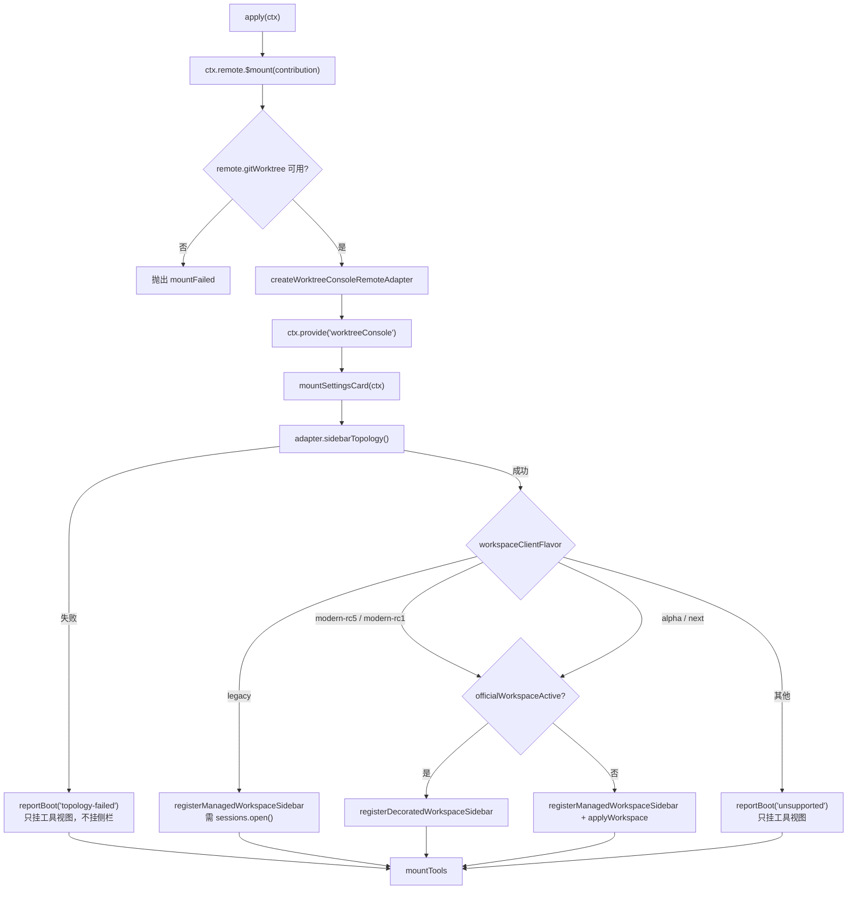
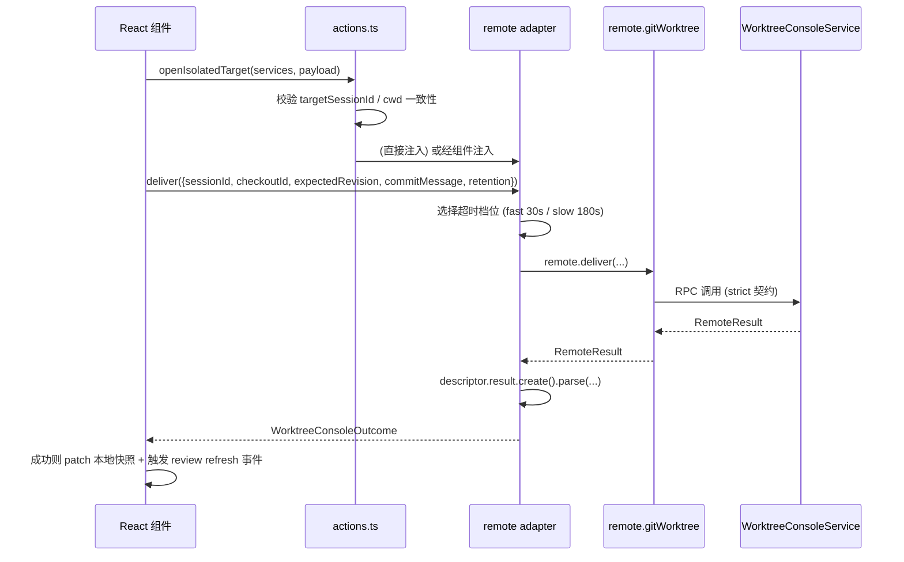
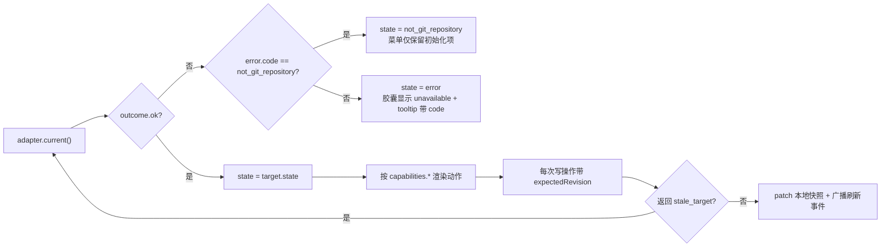
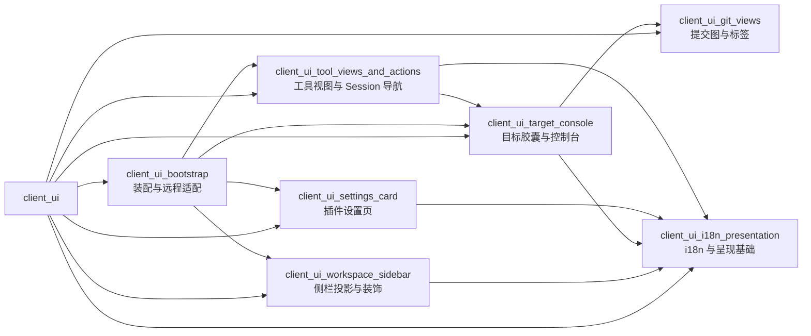

# client_ui — 浏览器端 UI 层

## 简介

`client_ui` 是 `dsh-git-worktree` 插件的**浏览器端（web platform）UI 模块**，源码位于 `src/client/`。它负责把 Host 侧的 Worktree 能力以 Harness 原生界面元素的形式呈现给用户：会话标题栏的「目标胶囊」、空白会话页的 hero chip、ToolView 卡片、Workspace 侧栏的状态装饰、以及插件设置页。

该模块自身**不持有任何业务真相**。所有状态判定、能力授权、变更执行都发生在 Host 侧（见 [console_host](console-host.md)），UI 只通过严格的 `WorktreeConsoleAdapter` 契约（见 [console_contract](console-contract.md)）读取投影结果并发出显式请求。因此本模块的核心设计原则可以概括为三条：

1. **Host 是唯一权威**：界面显示的状态来自 `current` / `list` / `sidebarTopology` 的返回值，不做本地推断；写操作永远经过 RPC 并在 Host 锁内二次校验。
2. **纯投影、无副作用**：除显式用户操作（点击按钮、提交菜单项）外，UI 不产生任何持久化副作用；连「下一次 turn 在新树里开始」也只是写一个请求标记。
3. **跨 Host 版本的容错装配**：同一份 bundle 需要在不改动代码的前提下适配 5 代官方 Workspace Client（`legacy`、`modern-rc5`、`modern-rc1`、`alpha`、`next`），并支持「接管（managed）」与「装饰（decorate）」两种模式。

### 打包与入口

Client bundle 由 `tsdown.config.ts` 单独构建，入口是 `src/client/console-remote/index.ts`：

- 输出格式为 CJS，但用 banner/footer 包成 `window.__ModuleLoader__.load({ id: 'dsh-git-worktree', factory })` 的模块加载器载荷（`tsdown.config.ts`）。
- `react`、`react/jsx-runtime`、`@deepseek-ai/cordis`、`@deepseek-ai/dsh-client-store`、`@deepseek-ai/dsh-client-ui-primitives` 为 external，由宿主提供；`zod`、`lucide-react` 内联进 bundle（`tsdown.config.ts`）。
- 四个官方 Workspace Client 版本通过虚拟模块（`virtual:dsh-official-workspace-client*`）在构建期从本地 `node_modules` 物化进产物，具体版本由 `package.json` 的 `devDependencies` 别名固定（`dsh-client-ui-workspace-alpha` / `-next` / `-rc5`）。
- `package.json` 的 `exports["./client"]` 指向 `lib/client.js`，`dsh.client.platform = "web"`，`dsh.client.inject` 声明了所需的宿主客户端包。

## 架构总览

### 三个装配入口

| 入口 | 文件 | 职责 |
| --- | --- | --- |
| 包级 Client 入口 | `src/client/console-remote/index.ts` | 挂载 Remote 贡献、创建 adapter、`provide('worktreeConsole')`、探测 Host 代数、装配侧栏与设置页 |
| 视图注册入口 | `src/client/index.tsx` | 注入 i18n Provider、注入样式表、注册 `tool.call.toolview` 与目标控制台 |
| 远程适配层 | `src/client/console-remote/adapter.ts` | 把 `WorktreeConsoleAdapter` 的每个方法映射到 Typert Remote 调用，并附加超时、编解码校验 |

启动流程如下：包级入口先 `ctx.remote.$mount(contribution)` 挂载 Remote 贡献，取出 `remote.gitWorktree` 代理，构造 adapter 并 `ctx.provide('worktreeConsole', adapter)`；随后调用一次 `adapter.sidebarTopology()` 来判定宿主属于哪一代 Workspace Client，再按代数选择「接管」或「装饰」路径。工具视图注册被放进**子 fiber**，因为 `uiConversation -> uiWorkspace` 的启动依赖顺序要求 Conversation 相关视图必须在 `uiWorkspace` 提供者之下挂载。

拓扑读取失败被刻意设计为**降级而非失败**：registry 损坏时侧栏无法装配，但工具视图与 Worktree 管理器恰恰是用户修复 registry 所需要的入口，所以此时仍然挂载工具视图（`src/client/console-remote/index.ts`）。每次启动分支的结果都通过 `remote.clientBootReport` 上报给 Host，便于诊断。

## 数据流

所有界面动作共享同一条链路：React 组件调用 `WorktreeConsoleAdapter` 方法 → 适配层包装超时与编解码 → Typert Remote 代理 → Host 侧 `WorktreeConsoleService`。返回值统一为 `WorktreeConsoleOutcome<T>`（`{ ok: true, value } | { ok: false, error }`），因此 UI 中不存在异常驱动的控制流，只有显式的 `ok` 分支。

适配层在链路上加了三道防线（`src/client/console-remote/adapter.ts`）：

- **超时**：Web RPC 载体本身没有超时，服务端 handler 卡住（绑定锁排队、git 挂起）会让调用方的 pending 状态永久冻结。因此快路径方法（`sidebarTopology`、`current`、`inspect`、`previewRecoveryPreflight`、`gitOverview`、`gitGraph`、`listAbandoned`）用 30s，其余（含 `list`、`preflight` 等全量重算方法）用 180s。超时返回 `code: 'timeout'`，服务端工作继续、可安全重试。
- **编解码校验**：只有 `result.mode === 'strict'` 的 descriptor 才被接受，返回体必须通过 `descriptor.result.create().parse(...)`。解析失败或 codec 拒绝统一归一为 `malformed_response`。
- **载体错误归一**：载体本身失败归一为 `transport_unavailable`，避免把内部异常泄露成 UI 崩溃。

## 状态模型与能力门控

UI 上每一处颜色、文案与按钮可见性都由 Host 投影出的两样东西共同决定：`WorktreeConsoleTargetSummary.state`（生命周期的单一枚举）和 `capabilities`（当前调用者被授权的动作集合）。

`state` 取值与界面表现（文案来自 `src/i18n/client-messages.ts`）：

| state | 含义 | 胶囊/徽标配色 |
| --- | --- | --- |
| `local` | 尚未进入隔离工作树，仍在 Local checkout | 中性灰 |
| `creating` | 工作树创建中 | 琥珀 |
| `working` | 隔离工作树内编辑中 | 蓝 |
| `ready_for_review` | 快照已冻结，等待验收 | 绿 |
| `preview_active` | Local 中预览中，尚未保存 | 蓝红混色 |
| `preview_detached` | 预览状态需要恢复 | 红 |
| `retained` | 已交付并保留环境 | 紫 |
| `cleanup_pending` | 已交付，环境清理未完成 | 琥珀 |
| `recovery_required` | 需要人工恢复 | 红 |
| `delivered` | 已交付完成 | 灰（降透明度） |
| `discarded` | 已放弃 | 灰（降透明度） |

配色规则集中在 `src/client/target-console/target-console.styles.ts` 与 `src/client/styles.ts` 的 `[data-target-state]` / `[data-worktree-state]` 选择器中，因此新增状态必须同时更新这两处。

`capabilities` 由 Host 侧 `capabilities()` 计算（见 [console_host](console-host.md)），客户端**只读不推断**。这带来一个重要后果：同一个组件在不同调用者视角下渲染出的菜单项数量不同——例如 owner Session 能看到 `discard`，而纯 `linkedRead` 的关联任务只能 `open` / `inspect`。非 Git 项目目录是个特例：Host 返回 `not_git_repository`，胶囊据此切换为中性灰并只提供「初始化 Git 仓库」一项，而不是显示一个看似损坏的「不可用」状态。

## 子模块

| 子模块 | 文档 | 概要 | 何时阅读 |
| --- | --- | --- | --- |
| 装配与远程适配 | [client_ui_bootstrap](client-ui-bootstrap.md) | 包级入口 `apply`/`inject`、跨 Host 代数探测、decorate/managed 双模式、超时与严格编解码适配层、`virtual:*` 类型声明 | 插件在浏览器里起不来、侧栏不出现、某代 Host 上 boot 卡住，或需要新增一个 RPC 方法时 |
| 工具视图与 Session 导航 | [client_ui_tool_views_and_actions](client-ui-tool-views-and-actions.md) | `worktree_create` ToolView 卡片、纯函数模型解析、Session 创建/导航/草稿预填、`WorktreeClientServices` 契约 | 修改「打开隔离会话」的行为、调整工具卡片展示、处理 cwd 一致性校验时 |
| 目标控制台 | [client_ui_target_console](client-ui-target-console.md) | 会话目标胶囊、下拉菜单、Worktree 管理器、hero chip 的 DOM 提升、`current` 轮询与能力门控 | 增删胶囊菜单项、修改交付/丢弃/清理流程、调整轮询频率或槽位挂载方式时 |
| Git 视图 | [client_ui_git_views](client-ui-git-views.md) | 提交图泳道几何计算与 SVG 渲染、标签管理模态框、分支概览的 TTL 缓存与乐观补丁 | 修改提交图外观、增加 Git 操作、排查分支列表陈旧或闪烁时 |
| Workspace 侧栏 | [client_ui_workspace_sidebar](client-ui-workspace-sidebar.md) | 官方 Browser 的投影包装、受管 Session 归属重排、行装饰与状态徽标、`ManagedWorkspaceGuard` 授权拦截 | 侧栏归属错乱、官方菜单出现不安全操作、徽标不显示时 |
| 插件设置页 | [client_ui_settings_card](client-ui-settings-card.md) | 暂存式表单模型 `SettingsFormModel`、Config 命名空间写入与 revision 栅栏、Plugins 页插槽挂载 | 增加配置字段、排查设置保存不生效或字段始终只读时 |
| 国际化与呈现基础 | [client_ui_i18n_presentation](client-ui-i18n-presentation.md) | Locale 订阅与翻译器、`ReviewIcon` 图标集、刷新事件总线、两份内联样式表 | 新增文案、调整图标或配色、处理跨组件刷新通知时 |

各子模块之间的主要依赖关系：装配层（`client_ui_bootstrap`）是唯一入口，它创建 adapter 并把它传给其余全部子模块；目标控制台（`client_ui_target_console`）在菜单中打开 Git 视图（`client_ui_git_views`）的模态框；工具视图（`client_ui_tool_views_and_actions`）与目标控制台共用 `WorktreeClientServices`；所有呈现层统一依赖 `client_ui_i18n_presentation` 的翻译器、图标与样式。

## 跨模块关系

- **`console_contract`**（[console_contract](console-contract.md)）：本模块消费 `WorktreeConsoleAdapter` 与全部请求/响应类型。契约是本模块唯一的 Host 接口面，UI 不 import 任何 Host 内部模块。
- **`console_remote`**（[console_remote](console-remote.md)）：本模块通过 `ctx.remote.$mount(contribution)` 挂载它，并通过 `remote.gitWorktree` 代理调用其方法。descriptor 的 strict 结果 schema 是适配层编解码校验的依据。
- **`console_host`**（[console_host](console-host.md)）：所有状态与授权判定的最终来源。`capabilities` 决定界面上哪些按钮出现（例如 `discard` 只对 owner 或 source 预留者开放，`setRetention` 只对 owner 且 `retained` 态开放）。
- **`core_domain`**（[core_domain](core-domain.md)）：UI 不直接依赖，但 `DEFAULT_WORKTREE_RETENTION` 等常量经由 `src/types.ts` 被目标控制台引用。
- **`i18n`**（[i18n](i18n.md)）：`client-messages.ts` 提供本模块全部文案，`core.ts` 提供 `Language` / `createTranslator` / `normalizeLanguage`，`transport-messages.ts` 供适配层报告超时与畸形响应。
- **`build_and_config`**（[build_and_config](build-and-config.md)）：`tsdown.config.ts` 定义 client bundle 的入口、外部依赖与虚拟模块物化；`package.json` 的 `exports["./client"]`、`dsh.client` 与 `dsh.bundle.patch` 决定插件如何被宿主加载。

## 一致的工程约束

本模块内部反复出现若干模式，理解它们可以快速读懂任意一个组件：

- **过期异步写入防护**：组件用 `mounted` ref、`actionScope` / `sessionGeneration` 计数器、`requestSeq` 序号来判断异步结果是否仍然有效，避免 Session 切换或组件卸载后旧响应覆盖新状态。
- **乐观补丁 + 后台校验**：分支切换等已被 RPC 确认的变更直接 patch 本地缓存（`patchBranchOverview`），不重取；需要新数据时才 `invalidateBranchOverview` + `ensureBranchOverview`。
- **能力门控渲染**：所有按钮的可见性与 `target.capabilities.*` 一一对应，避免「点了必然失败」的入口。
- **fail-soft 服务探测**：设置页、hero chip、portal 渲染器、directory picker 等可选依赖都用 `ctx.get()` 探测，缺失时静默降级而不是让整个 bundle 加载失败。
