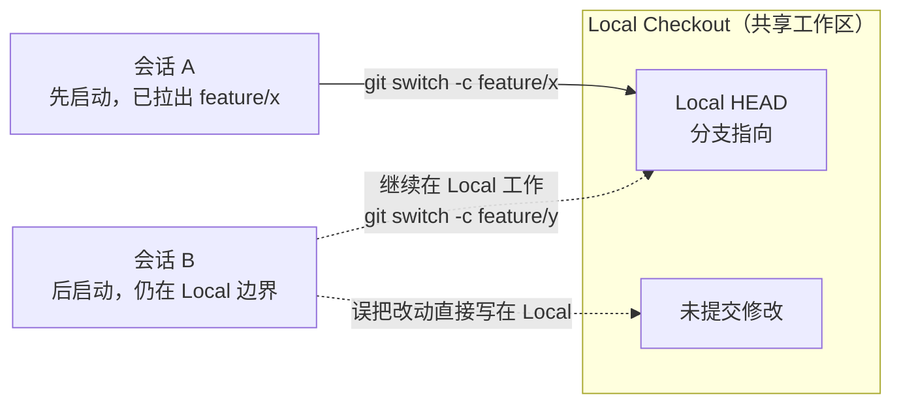
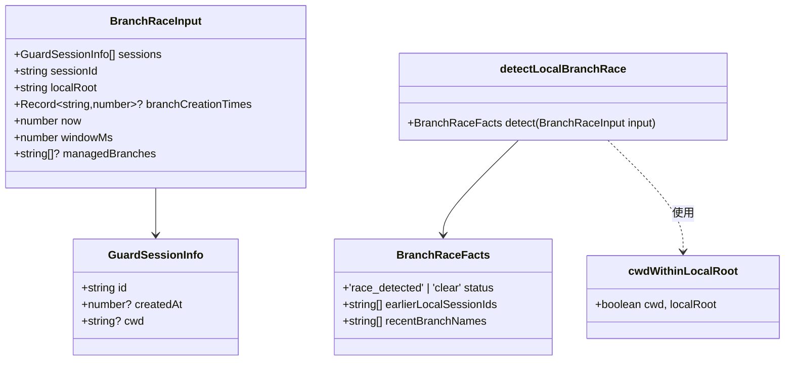
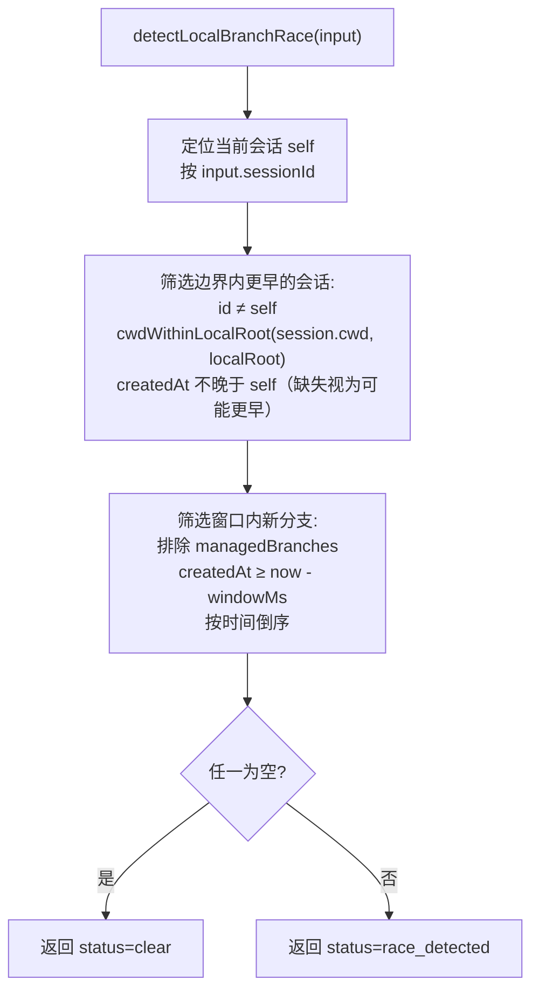
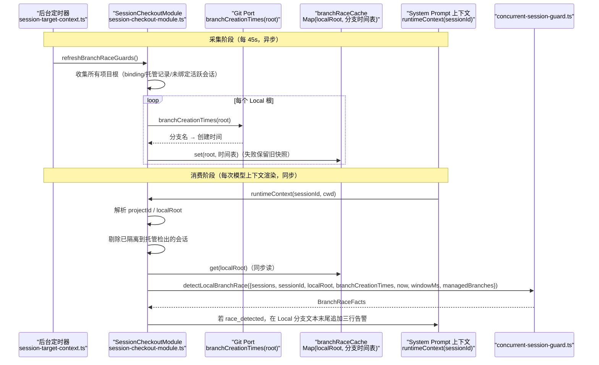
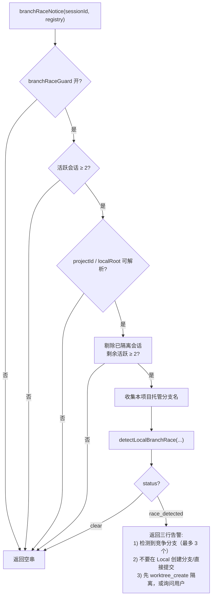
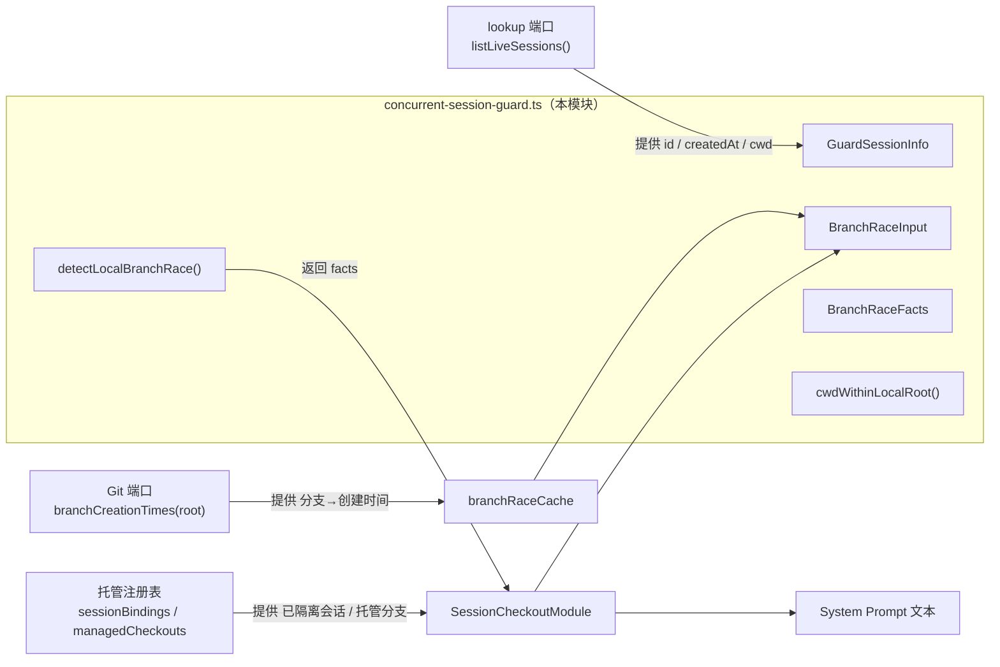

# 并发与会话分支竞争防护（Concurrency）

## 模块定位

`src/concurrent-session-guard.ts` 是一个**纯同步、无副作用**的判定模块：它解决「多个活跃会话共享同一个本地 Git 检出（Local Checkout）时，后启动的会话在不知情的情况下从同一 HEAD 拉出分支、并在 Local 上切换 HEAD，从而污染其他会话工作现场」的并发冲突问题。

模块本身不执行任何 Git 命令、不读文件系统、不写注册表，而是由上层 `SessionCheckoutModule`（见 [session_checkout.md](session_checkout.md)）在两条链路上使用它：

1. **异步数据收集链路**：后台定时刷新每个 Local 仓库的「分支创建时间」到内存缓存；
2. **同步消费链路**：`runtimeContext()` 在生成模型系统提示文本时，以纯同步方式读取缓存并调用本模块的 `detectLocalBranchRace()`，把「分支竞争告警」拼进会话的 Session Target 上下文。

这种「异步采集 + 同步判定」的拆分是有意为之：宿主的 system-prompt 契约要求 `context` 文本函数必须是同步的，不能在其中 `await` 任何 I/O。

---

## 核心概念

### 被检测的竞争场景

当会话 B 后启动并继续在 Local 边界直接 `git switch -c`、提交或修改文件时，它会：

- 与会话 A 基于同一 HEAD 分叉；
- 在 Local 索引/工作区留下未隔离的改动；
- 若会话 A 后续再切分支，Local HEAD 会在两个会话之间漂移。

防护的目标是：在 **Local 边界的会话** 的模型上下文中注入告警，引导它先调用 `worktree_create` 隔离自己的工作。

---

### 模块导出的三种类型与两个函数

| 类型 / 函数 | 作用 |
| --- | --- |
| `GuardSessionInfo` | 从宿主 sessions 存储读取的最小活跃会话投影：`id`、可选 `createdAt`（会话头中的毫秒时间戳）、可选 `cwd`。 |
| `BranchRaceInput` | 判定输入全集：活跃会话列表、当前会话 ID、Local 边界根目录、缓存中的分支创建时间表、当前时间、检测窗口毫秒数、托管分支名集合。 |
| `BranchRaceFacts` | 判定结果：`status` 为 `race_detected` 或 `clear`，附「边界内更早启动的会话」与「窗口内新建分支（按新→旧排序）」证据列表。 |
| `cwdWithinLocalRoot(cwd, localRoot)` | 路径包含判定：`cwd` 等于 `localRoot` 或在其下返回 `true`；`cwd` 缺失时返回 `true`（调用方已预先按工作区筛选，避免把信息不足的会话误排除）。 |
| `detectLocalBranchRace(input)` | 纯函数谓词：筛出共享 Local 边界、时间上不晚于自身的会话，再筛出窗口内的非托管新分支；二者都非空即判为竞争。 |

---

## 判定逻辑详解

关键设计取舍：

1. **路径包含判定做文本规范化**：Windows 下反斜杠转正斜杠、统一补尾斜杠、小写比较；非 Windows 仅正斜杠化 + 补尾斜杠。边界自身（相等）也算包含。
2. **时间顺序兜底**：若当前会话缺少 `createdAt`（旧宿主），模块把其他会话一律视为「可能更早」，让守卫继续有效，而不是因信息不足而静默。
3. **托管分支排除**：受管 Worktree 的会话分支活在独立检出中，不会在 Local 边界引发竞争，因此从「近期新分支」证据中剔除，避免误伤（例如刚 `worktree_create` 出来的分支）。
4. **窗口默认值**：由上层配置 `branchRaceWindowMs` 决定，默认 30 分钟，可在 `src/index.ts` 的 `Config` 中调整。

---

## 运行时数据流：异步缓存 + 同步消费

为什么要这样拆分：

- `runtimeContext()` 是 Cordis `systemPrompt.context()` 的同步文本函数，宿主契约禁止其中 `await`；
- 分支创建时间需要逐仓库 spawn `git reflog` 类命令，属于重 I/O，必须移出热路径；
- 缓存键按 `localRoot` 区分，缺失条目等价于「守卫静默」，不会因单个仓库探测失败而阻塞工作。

---

## 上层集成点

### 1. 后台刷新（`session-target-context.ts`）

`registerSessionTargetContext()` 通过 `ctx.effect()` 注册一个每 **45 秒**触发的 `setInterval`，调用 `module.refreshBranchRaceGuards()`，组件卸载时 `clearInterval`。

### 2. 模块内缓存与刷新（`session-checkout-module.ts`）

- `branchRaceCache: Map<string, Record<string, number> | undefined>`：键为 Local 根目录；
- `refreshBranchRaceGuards()`：
  - 开关：配置 `branchRaceGuard === false` 时直接返回；
  - 端口缺失：`git.branchCreationTimes` 不可用时直接返回；
  - 项目集合来源：所有 `sessionBindings`、所有 `managedCheckouts`，以及尚未绑定但活跃的会话所属项目（守卫要保护的正是这些会话）；
  - 失败语义：单个仓库探测失败时 `catch` 后保留旧快照，守卫在该根上保持静默而不是报错。

### 3. 告警文本生成（`branchRaceNotice()`）

告警仅在「会话仍处于 Local 边界」时由 `runtimeContext()` 追加（`binding.target.kind === 'local'` 且无 pending 托管记录的分支），隔离会话不会收到该告警。

### 4. 配置开关（`src/index.ts`）

| 配置项 | 默认 | 含义 |
| --- | --- | --- |
| `branchRaceGuard` | `true` | 总开关；关闭后 `refreshBranchRaceGuards` 与 `branchRaceNotice` 均直接短路。 |
| `branchRaceWindowMs` | `1800000`（30 分钟） | 判定「近期新分支」的时间窗，范围限制 60s ~ 24h。 |

两者都是 `volatile` 字段，可在设置页热修改而无需重载插件（值以 `liveConfigValue` 实时读取）。

---

## 依赖与边界

- 本模块**不依赖**任何宿主服务，只消费普通数据对象，因此可在测试中以 fake 端口直接驱动；
- 宿主适配（`src/adapters/lookup.ts` 的 `createDshLookupPort`）负责把 harness 的 `sessions` 存储投影成 `{ id, createdAt?, cwd? }[]`，投影失败（结构未知）时返回空数组，守卫随之静默；
- 与其他并发控制机制的关系：模块级 `withBindingLock` 互斥锁（见 [session_checkout.md](session_checkout.md) 中的 `inspectAvailable` / `withBindingLock`）负责**写操作串行化**，而本守卫负责**写之前的模型行为引导**，二者互补。

---

## 设计意图小结

| 约束 | 应对 |
| --- | --- |
| system-prompt 文本必须同步 | 重 I/O（reflog 探测）全部下沉到 45s 后台定时器，热路径只读内存 Map。 |
| 宿主信息不全（无 createdAt、无 cwd） | 判定全部按「保守不误伤」兜底：缺时间戳视为可能更早、缺 cwd 视为共享边界。 |
| 托管 Worktree 不是竞争源 | `managedBranches` 排除 + 已隔离会话剔除，避免对 `worktree_create` 刚产出的分支误报。 |
| 单个仓库探测失败 | 保留上一轮快照，守卫静默降级，不阻塞主流程。 |
| 模型行为引导而非强制拦截 | 守卫只在系统提示中追加告警文本，真正的隔离仍由模型调用 `worktree_create` 完成；强制串行由 `withBindingLock` 与各操作的 `expectedRevision` CAS 负责。 |
