# console_host_control_plane 控制平面

`console_host_control_plane` 是宿主侧「工作树控制台」的**唯一决策层**：它把面向客户端的 `WorktreeConsoleAdapter` 契约（`src/console-contract.ts`）实现为一组**带授权、带观察、带乐观并发校验**的用例，并把真正的 Git / 注册表 / 文件系统动作委托给核心域模块 `SessionCheckoutModule` 与四个端口（`registry` / `lookup` / `git` / `files`）。

它的核心文件只有 `src/console-host/control-plane.ts`，导出两个符号：

| 符号 | 类型 | 说明 |
| --- | --- | --- |
| `WorktreeConsoleControlPlane` | `interface` | 40+ 个用例方法的形状，与 `WorktreeConsoleAdapter` 基本一一对应（方法名/参数形状相同，但把「请求对象」收敛为「原语参数 + 请求对象」混合形式） |
| `WorktreeConsoleControlPlaneOptions` | `interface` | 依赖注入面：领域模块、四个端口、评审 diff 读取器、会话 ID 工厂，以及两个**由宿主注入**的「下一次 turn 建树请求」读写函数 |
| `createWorktreeConsoleControlPlane` | `function` | 工厂，返回闭包实现；所有状态（`creating` 互斥集合、路径规范化缓存）都封在闭包内 |

> 相邻页面：[console_host](console-host.md)（父模块总览）、[console_host_remote_face](console-host-remote-face.md)（把本平面包装成 `@Remote` 方法）、[console_host_projection](console-host-projection.md)（纯投影函数）、[console_host_review_diff](console-host-review-diff.md)（评审 diff 读取）。

---

## 1. 在系统中的位置

控制平面位于「传输层」与「核心域」之间，是唯一同时知道**调用者身份**与**持久化记录**的地方。

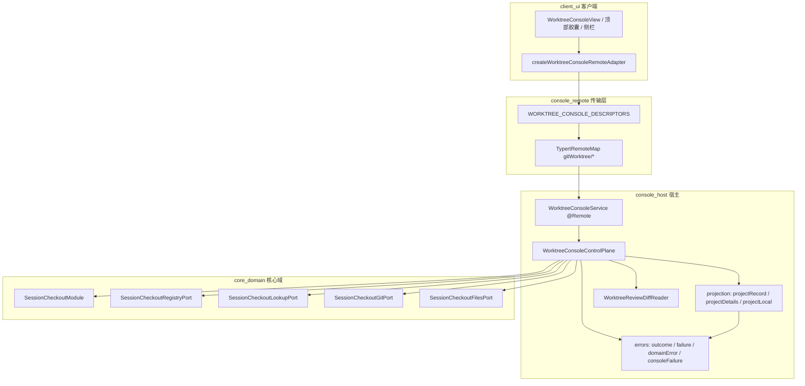

要点：

- 控制平面**不**直接实现 Git 语义，也不直接写注册表；`SessionCheckoutModule` 才是事务边界（`operate`、`manageManagedWorktreeForSession`、`resumeRevision` 等都在模块的跨进程锁内）。
- 控制平面**不**做 UI 形状决策；`state`、`capabilities`、`reviewSlot`、`deliveryProof` 全部由 [console_host_projection](console-host-projection.md) 计算，控制平面只负责「喂给它正确的观察结果」。
- 控制平面**不**翻译文案；所有用户可见文案来自 `hostMessage(...)`（见 [i18n](i18n.md)），因此错误信息天然随宿主语言变化。

---

## 2. 依赖面

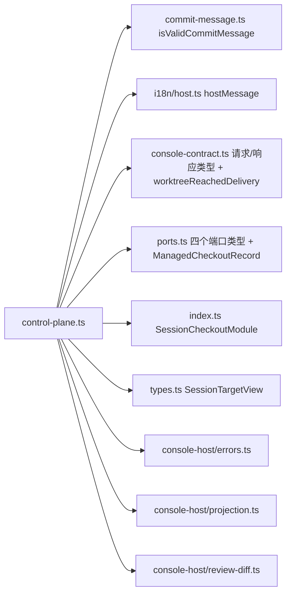

| 依赖 | 用途 | 关键点 |
| --- | --- | --- |
| `SessionCheckoutModule`（`src/index.ts`） | 所有真实变更与大部分读取 | 大量方法是**可选**的（`preflight?`、`observeManagedCheckout?`、`observeManagedCheckouts?`、`preflightPreviewRecovery?`），控制平面必须对缺失实现给出确定性的降级/报错 |
| `SessionCheckoutRegistryPort` | 读 `ManagedCheckoutRecord`（授权与投影的权威事实） | 只调用 `read()`；**从不**调用 `write()` / `update()`，写注册表一律走模块 |
| `SessionCheckoutLookupPort` | 会话/项目导航记录、`getSessionCwd`、`getSidebarMemberships` | 注释明确：**读记录不构成授权**，授权必须再经 `module.inspect` / `listManagedWorktreesForSession` |
| `SessionCheckoutGitPort` | `inspect` / `status` / 分支标签图表面 | 只对 **Local 项目根**（`project.root`）使用 Git 表面；受管树一律走模块 |
| `SessionCheckoutFilesPort` | `exists` / `canonicalize` | 用于路径身份校验；`canonicalize` 是 realpath 系统调用，控制平面内部做了记忆化 |
| `WorktreeReviewDiffReader` | `reviewDiff` 用例 | 读 diff 时会抛 `ReviewDiffStaleError`，控制平面把它转成 `stale_isolated` |
| `isValidCommitMessage` | 提交信息校验（`checkpoint` / `finalize` / `deliver` / `finalizePreview`） | 非空且不含 NUL |

---

## 3. 注入选项 `WorktreeConsoleControlPlaneOptions`

| 字段 | 必填 | 作用 |
| --- | --- | --- |
| `module` | 是 | 核心域模块，事务与状态机的唯一所有者 |
| `lookup` / `files` / `registry` / `git` | 是 | 四个端口（与 `SessionCheckoutDependencies` 同源，见 [core_domain_ports](core-domain-ports.md)） |
| `reviewDiff` | 是 | 评审 diff 读取器 |
| `createTargetSessionId` | 否 | 恢复交接时新建目标会话的 ID 工厂，默认 `randomUUID` |
| `setWorktreeRequest` | 是 | 写入/撤回「下一次 turn 在新树里开始」的待办请求 |
| `pendingWorktreeRequest` | 是 | 读取待办请求，随 `current` 一并回给顶部胶囊 |

后两项刻意**不**由控制平面自己读会话：

> 写 plugin record 需要活的 `Session` 对象，而 control-plane 只拿得到 `lookup` 的只读导航记录。

因此这两个函数由宿主（会话层）注入，控制平面保持对 `Session` 的零依赖。待办请求的数据形状见 [core_domain_ports](core-domain-ports.md) 中的 `WorktreeRequest`。

---

## 4. 用例清单

### 4.1 读取与投影

| 方法 | 参数 | 关键守卫 | 委托 |
| --- | --- | --- | --- |
| `sidebarTopology()` | — | 无（全局视图） | `registry.read()` + `lookup.getSidebarMemberships?` |
| `current(sessionId)` | 会话 | `callerTarget` → 隔离态时 `authorize` | `module.inspect` / `observeManagedCheckout` |
| `list(request)` | `sessionId`、`needsAttention?`、`includeDelivered?` | 隔离态用 `authorize` 锚定 source/localRoot | `module.listManagedWorktreesForSession` + `observeManagedCheckouts?` |
| `inspect(sessionId, checkoutId)` | 会话 + 树 | `linkedReadAccess` | 同上 |
| `reviewDiff(request)` | 含 `expectedRevision` / `expectedReviewId` | 见 §7.4 双次 preflight | `module.preflight` + `reviewDiff.read` |
| `preflight(request)` | 同上 | owner + 评审身份 | `module.preflight?` |
| `previewRecoveryPreflight(request)` | 追加 `expectedPreviewId` | `preview_detached` 三元组匹配 | `module.preflightPreviewRecovery?` |
| `listAbandoned(sessionId)` | 会话 | 无额外守卫 | `module.listAbandonedWorktreeSnapshots` |

### 4.2 状态机变更

| 方法 | 关键守卫 | 委托 |
| --- | --- | --- |
| `preview(request)` | owner + `ready_for_review` | `operate({ action: 'preview' })` |
| `checkpoint(request)` | owner + 合法 `commitMessage`/`requestId` | `operate({ action: 'checkpoint' })` |
| `resumeRevision(request)` | owner + 可选 `conflictContinuation` 严格校验 | `module.resumeRevision` |
| `prepareReviewRegeneration(request)` | owner + `ready_for_review` | `module.prepareReviewRegeneration` |
| `preparePreviewRecoveryAnalysis(request)` | owner + 恢复证明六元组匹配 | `module.preparePreviewRecoveryAnalysis` |
| `createPreviewRecoveryHandoff(request)` | 同上 + 交接后身份复核 | `module.createPreviewRecoveryHandoff` |
| `rollbackPreview(request)` | owner | `operate({ action: 'rollback_preview' })` |
| `discard(request)` | owner，或 owner 不可用时的 source 预留 | `operate({ action: 'discard' })` 或 `manageManagedWorktreeForSession` |
| `finalize(request)` | owner + `ready_for_review` + `expectedReviewId` | `operate({ action: 'finish' })` |
| `deliver(request)` | owner + **不校验** `expectedReviewId` | `operate({ action: 'finish' })` |
| `finalizePreview(request)` | owner + `preview_active` / `preview_detached` | `operate({ action: 'finalize_preview' })` |
| `setRetention` / `setPermanent` / `retryCleanup` | `requireOwner` | `manageManagedWorktreeForSession` |
| `clearSidebarBadge(request)` | 终态（`discarded` / `finalized`）才可清徽章 | `manageManagedWorktreeForSession` |
| `beginNextIteration(request)` | owner + `discarded`/`delivered` + cwd 身份匹配 | `module.beginNextIteration` |
| `returnToLocal(request)` | owner + 已交付 + 终态阶段 | `module.bind(sessionId, { kind: 'local' })` |
| `restoreAbandoned(request)` | `authorize` | `module.restoreAbandonedWorktreeSnapshot` |
| `initProject(sourceSessionId)` | 必须处于 Local 且项目根存在 | `git.initializeProject` |

### 4.3 Git 表面（永远作用于 Local 项目根）

`gitOverview`、`gitGraph`、`gitCreateBranch`、`gitSwitchBranch`、`gitPruneMergedBranches`、`gitListTags`、`gitCreateTag`、`gitDeleteTag`、`gitPushTag`。

全部先经 `projectRootFor(sessionId)` 解析到 **`project.root`（Local 检出）**，绝不解析到受管树——分支/标签是仓库级视图，不能随会话当前所在的工作树漂移。

---

## 5. 调用者解析：Local 与隔离态

控制平面的每个用例都从「调用者是谁、站在哪个目录」开始。

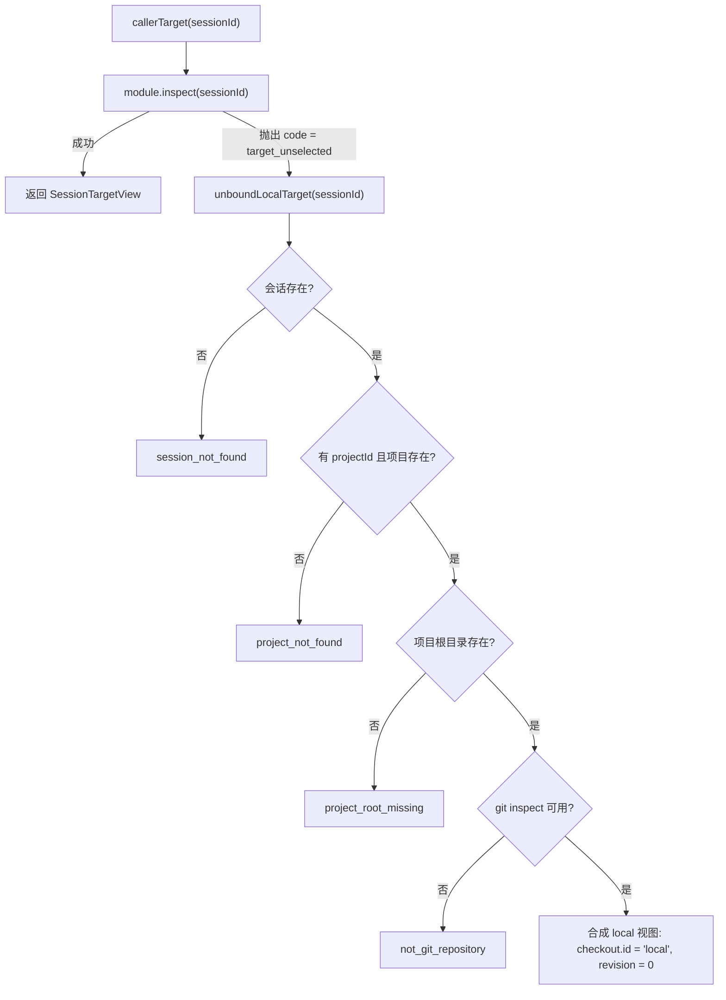

`unboundLocalTarget` 的合成视图是控制平面里唯一「凭空构造」的目标视图：它让**从未建过树**的会话也能获得一个可投影的 Local 目标（`projectLocal`），从而让顶部胶囊与创建入口在初次使用时正常工作。

---

## 6. 授权模型

### 6.1 三种身份

| 身份 | 判定 | 授权根（`expectedRoot`） |
| --- | --- | --- |
| owner | `record.ownerSessionId === sessionId` | `record.managedRoot` |
| source | `record.sourceSessionId === sessionId` | `record.localRoot` |
| linkedRead | 既不 owner 也不 source，但与某个锚点树属于同一「链接组」，或恰好持有验收位 | 由锚点推导，且只能读 |

`linkedRead` 存在的原因：同一 Local 检出下可以有多个迭代/多棵受管树，同组兄弟树需要互相可读（面板、diff），但**不可写**。

### 6.2 `authorize` 判定流程

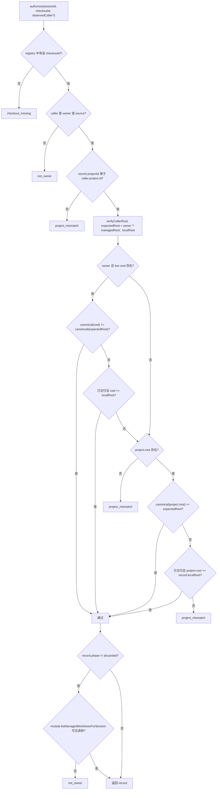

设计要点（来自实现注释）：

- **owner 的 live cwd 才是不可变工作树根**，而 `project.root` 永远是 Local 检出；只用 `project.root` 授权会把所有 owner 调用打成 `project_mismatch`。所以 owner 分支先看 `lookup.getSessionCwd()`。
- 这条 live-cwd 证据**只对 owner 生效**：source 会话本来就该待在 Local，若把它也套在 `expectedRoot` 上，任何同项目 source 会话都会被错误授予 owner 的 `managedRoot`。
- 路径规范化是 realpath 系统调用，一次校验最多问 4 个路径（live cwd、expectedRoot、`record.localRoot`、`project.root`），因此 `canonicalCache` 按路径记忆化，每个不同路径最多一次 IO。
- 已清理的树在记录里仍保留路径，`canonicalize` 会抛 ENOENT；实现专门保留了「settled owner」分支，否则顶部胶囊会永久显示「不可用」。

### 6.3 `linkedReadAccess`

1. 若调用者是 owner/source → 走 `authorize`，`linkedRead = false`。
2. 否则要求 `caller.checkout.kind === 'isolated'`，否则 `not_owner`。
3. 对调用者**自己**的树做 `authorize` 得到锚点，比较「同一链接组」：`projectId` 相同 + `sourceSessionId` 相同 + `localRoot` 相同。
4. 或者调用者恰好是验收位持有者（`ready` + `ready_for_review` + `acceptanceHolder` 指向请求的树）。
5. 通过后仍要 `ownerSessionAvailable`，并对**被读记录的真实 owner** 重新做 `verifyCallerRoot`。
6. 验收位路径在 `details()` 里再复核一次（`acceptanceAnchorCheckoutId`），若持有者已变则报 `not_owner`（文案：theAcceptanceSlotHolderHasChangedCheckAgain）。

### 6.4 写操作的额外收紧

- `requireOwner`：保留期、常驻标记、清理重试、侧栏徽章清除只能由 owner 触发——模块侧在 owner 缺席时会回退到 source，那会让 Local 会话清掉一棵它从未拥有的树。
- `discard` 例外：owner 不可用时允许 source 预留（与投影 `capabilities.discard` 的 `sourceReservation` 保持一致）；owner 存在时 source 调用被拒（theOwnerSessionHasTakenOverThisWorktreeOnly467）。
- `gitSwitchBranch` 双重拦截：本会话自己处于交付中（`recovery_required` 或 `ready` + 三种交付态）时拒绝；**其他**会话在同一 `localRoot` 上持有交付位时也拒绝（`localDeliveryHolder`），因为切换 Local 分支会移动所有待应用 diff 的基线。

---

## 7. 核心机制

### 7.1 观察（observe）与复用

`observe(record, observedCaller?)` 产出 `{ managedRoot, snapshot?, localSnapshot?, dirty? }`：

1. `phase === 'discarded'` → `{ managedRoot: null }`（不产生任何 IO）。
2. `observeFromCaller` 尝试复用本请求里已经付出的观察。
3. `module.observeManagedCheckout?`（一次锁内完成身份校验，并附带 `localSnapshot`）。
4. 兜底：`resolveManagedRoot` + `git.inspect` + `git.status`。

`observeFromCaller` 的复用条件非常保守（顶部胶囊每 5 秒轮询一次 `current`，重复的 `git status` + 两次 `git inspect` 曾占轮询成本约三分之一）：

- `caller.checkout.kind === 'isolated'` 且 `caller.checkout.id === record.checkoutId`
- 两侧 `phase === 'ready'`
- `caller.ownership === 'owner'`
- `caller.revision === record.revision`（否则会把旧分支/HEAD 与新评审/证明并排投影）

已交付终态**故意**不复用：`committedFollowupView` 会给出保守的 `dirty: true`，胶囊必须看到冻结环境的真实 Git 状态。

### 7.2 批量观察与降级

`list` 是唯一使用 `module.observeManagedCheckouts?` 的用例：

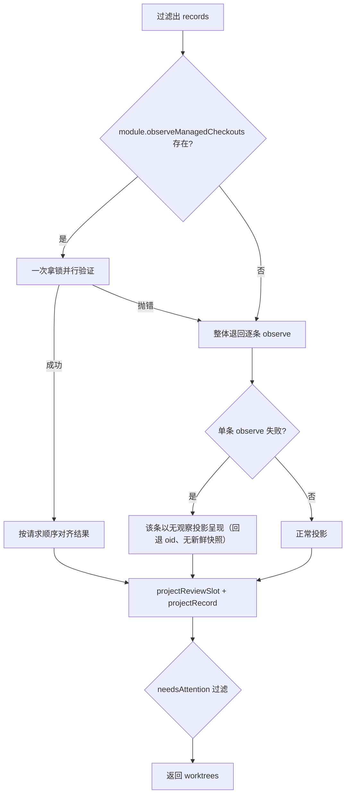

「身份无法验证的记录不应拖垮整个面板」：批量失败退回逐条，逐条失败退回无观察投影，真正的 CAS 校验仍会在后续写操作里兜底拒绝。

`needsAttention === true` 时只保留 `cleanup_pending`、`preview_detached`、`recovery_required` 三种状态——即「需要用户动手」的记录。

### 7.3 投影委托与验收位

控制平面自身只做三件投影相关的事：

1. 调用 `projectRecord` / `projectDetails` / `projectLocal`（见 [console_host_projection](console-host-projection.md)）。
2. `projectReviewSlot`：当记录为 `ready_for_review` 且同一 `localRoot` 上存在**验收位持有者**（另一棵正在 preview / rollback_preview / finalize_preview / finish 的树），把 `reviewSlot` 标为 `'waiting'`，附上 `reviewSlotOwnerSessionId` / `reviewSlotHolder`，并就地关闭 `preview`、`checkpoint`、`finalize` 能力。
3. `settledLocalBranch`：已交付且 owner 已离开冻结根的记录，胶囊必须显示 Local 当前分支（合并后的 `master`），而不是冻结的任务分支。返回值语义：`undefined` = 不是已交付 owner 读取（保留工作树分支）、`null` = Local 暂时不可观察（保留记录标签）、字符串 = Local 真实分支。

`deliveryProofFromTarget` 只从 `SessionTargetView.delivery.proof` 取证明，并复制 `changedFiles`，避免把模块内部对象暴露给传输层。

### 7.4 乐观并发与幂等

所有写操作都在两个层面做 CAS：

| 校验点 | 语义 | 失败码 |
| --- | --- | --- |
| `record.revision !== expectedRevision` | 记录被并发推进 | `stale_target` |
| `review.reviewId !== expectedReviewId` | 评审身份变化 | `stale_target` |
| `expectedGeneration`（`checkpoint`） | 检查点世代变化 | 由模块返回 |
| `expectedPreviewId` | 预览身份变化 | `stale_target` |
| `before/after preflight` | 读 diff 期间隔离内容变动 | `stale_isolated` |

**恢复续体（continuation）** 是控制平面自己签发的一次性证明，全部带校验与自签 `requestId`：

| 续体 | `requestId` 形态 | 校验 |
| --- | --- | --- |
| `worktree_apply_conflict` | `apply-conflict:<checkoutId>:<reviewId>:<revision>:<localHeadOid>` | `localHeadOid` 必须是 40/64 位十六进制；冲突文件 ≤ 500 且每个都通过 `safeConflictFile` |
| 冲突恢复请求（`resumeRevision`） | 重新签发 `conflict-recovery:<uuid>` | 客户端提交的续体必须逐字段匹配请求；恢复后还要核对注册表里持久化的 `requestId` 与 `workingRevision` |
| `worktree_review_regeneration` | `review-regeneration:<uuid>` | — |
| `worktree_preview_recovery_analysis` | `preview-recovery-analysis:<uuid>` | 恢复证明六元组必须与请求逐项相等 |
| `worktree_preview_recovery_handoff` | `preview-recovery-handoff:<uuid>` | 交接后复核 `ownerSessionId === targetSessionId`、续体 kind/requestId、`managedRoot` 一致 |

`safeRecoveryRequestId`：长度 1–500，且不含 `\0`、`\r`、`\n`。
`safeConflictFile`：长度 ≤ 1000、无控制字符、非绝对路径（含盘符）、路径段不含 `''` / `.` / `..`。

### 7.5 错误模型

控制平面从不抛裸错给调用者，统一出口是 `WorktreeConsoleOutcome<T>`：

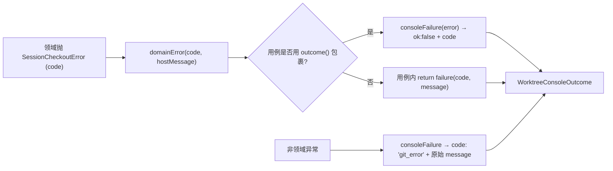

- `outcome()` 包裹的用例（绝大多数读操作与部分写操作）靠抛错 + 捕获实现分支。
- `reviewDiff`、`finalize`、`deliver`、`finalizePreview` 手写 `try/catch`，因为它们需要把 `failure(...)` 与 `consoleFailure(...)` 混合返回，并额外携带 `continuation`。
- `consoleFailure` 只把 `SESSION_CHECKOUT_ERROR_CODES` 里的 code 透传，其余一律归为 `git_error` 并保留原始 message（本地控制台可观测性优先）。

`preflightFailure` 把模块的阻塞原因映射到控制台错误码：

| 模块 `reason` | 控制台 code |
| --- | --- |
| `stale_isolated` / `stale_local` / `stale_target` | 同名 |
| `project_acceptance_busy` | `project_acceptance_busy` |
| `not_owner` | `not_owner` |
| `not_ready_for_review` | `operation_not_allowed` |
| `checkout_unavailable` | `checkout_mismatch` |
| 其他 | `git_error` |

### 7.6 创建互斥

`initProject` 走 `withCreation`：以 `session:<id>` 与 `root:<canonical root>`（Windows 下小写）双键占用 `creating` 集合，保证同一会话、或同一仓库根被两个会话同时初始化时只会有一个成功，其余得到 `operation_not_allowed`（initialRepositoryBusy）。两个键在 `finally` 中必然释放。

### 7.7 侧栏拓扑与徽章

`sidebarTopology` 是唯一跨会话聚合的用例：

1. 遍历全部 `managedCheckouts`，按 `projectId` 分桶。
2. 通过 `lookup.getSidebarMemberships?` 收集**所有迭代**的 `workspaceIds` / `sessionIds`（清理可能已移除某些成员，但目录身份要保留）。
3. 每个 owner 只保留「迭代号最大，其次 revision 最大」的那条任务。
4. `sidebarBadgeClearedRevision === record.revision` 且状态为终态（`discarded` / `finalized`）时，该任务不再投影：侧栏行保留目录成员身份，但失去图标/徽章/菜单项。

`sidebarTaskState` 的优先级（交付优先于阶段）：

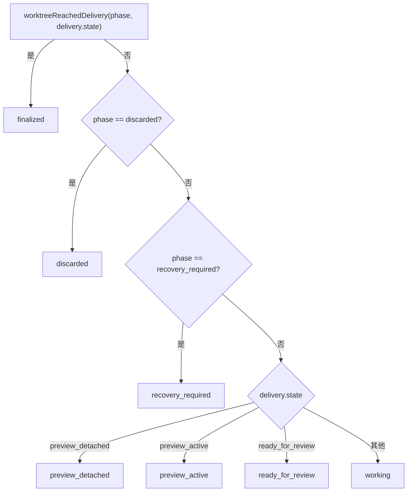

> 「已到 Local 后被清理」（`phase: discarded` + `delivery: delivered`）代表任务已完成，绝不能读成「放弃」。

### 7.8 下一 turn 建树请求

`setWorktreeRequest` / `current` 里的 `worktreeRequest` 都是**纯转发**：控制平面不建树、不解析 `from`。勾选后只写一条 session record，真正的 `git worktree add` 由宿主在 turn 的第 1 步兑现——「勾选立刻建树会为用户没打算发的消息付一次完整 checkout 的代价」。

### 7.9 `returnToLocal`

把一个**已交付**的隔离会话释放回 Local 边界。存在的原因：交付后记录进入 `retained`（默认 24 小时），会话仍绑定在 `isolated` 上，顶部胶囊/侧栏/运行上下文都还按隔离态描述，用户看不到「我其实已经在 master 上了」。

边界：

- 必须 `worktreeReachedDelivery`，且 `phase` ∈ {`discarded`, `finalized`, `retained`}；未交付时解绑会把未合并的工作留在冻结目录里。
- 记录本身不动：保留期倒计时、已交付徽章、回滚材料全部保留。
- 幂等：`sessionBindings[sessionId].target` 已不是该树时，直接返回当前 Local 投影而不是报错。

---

## 8. 典型流程

### 8.1 `current` 轮询（顶部胶囊，约每 5 秒）

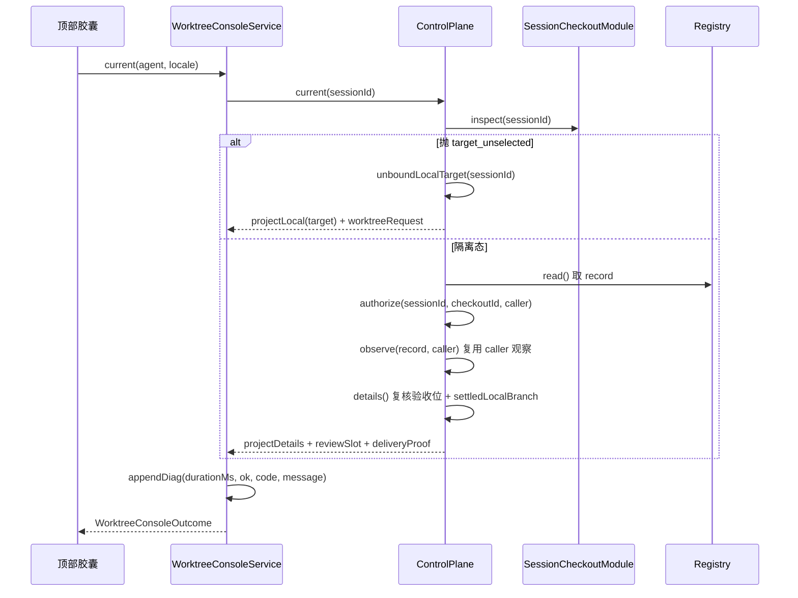

`WorktreeConsoleService` 会为每次 `current` 写一条 ndjson 诊断（含耗时、错误码），这是「胶囊一直显示不可用」时唯一的现场证据；诊断文件超限自动轮转为 `.1`。详见 [console_host_remote_face](console-host-remote-face.md)。

### 8.2 `finalize`（Ready → 提交到 Local）

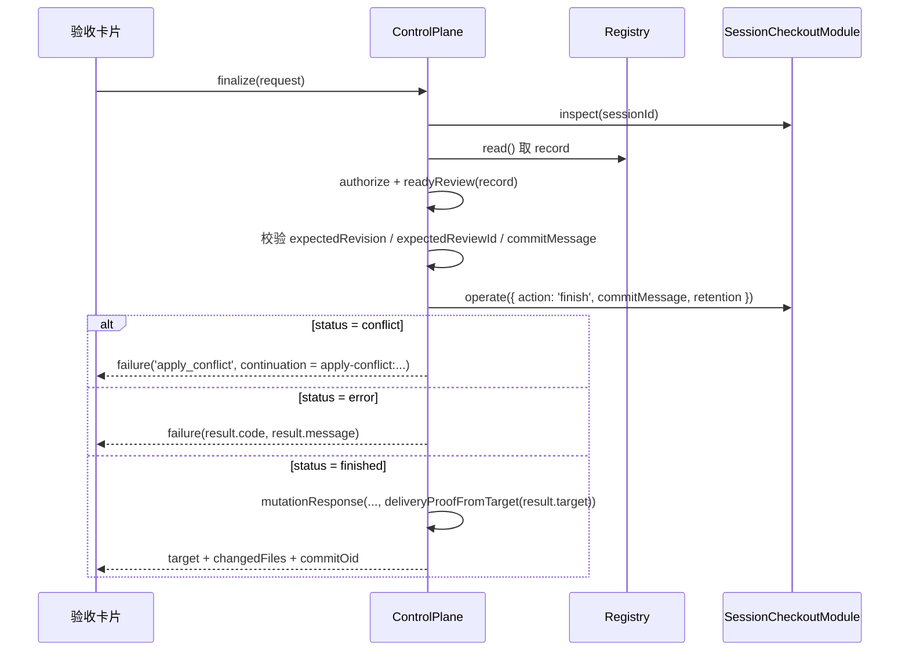

`deliver` 与 `finalize` 的差别只有一点：`deliver` **不传** `expectedReviewId`，因此会话停在 `working` 也能交付（自动交付路径）；代价是冲突续体里的 `reviewId` 可能为空串。

### 8.3 `reviewDiff` 的双次 preflight

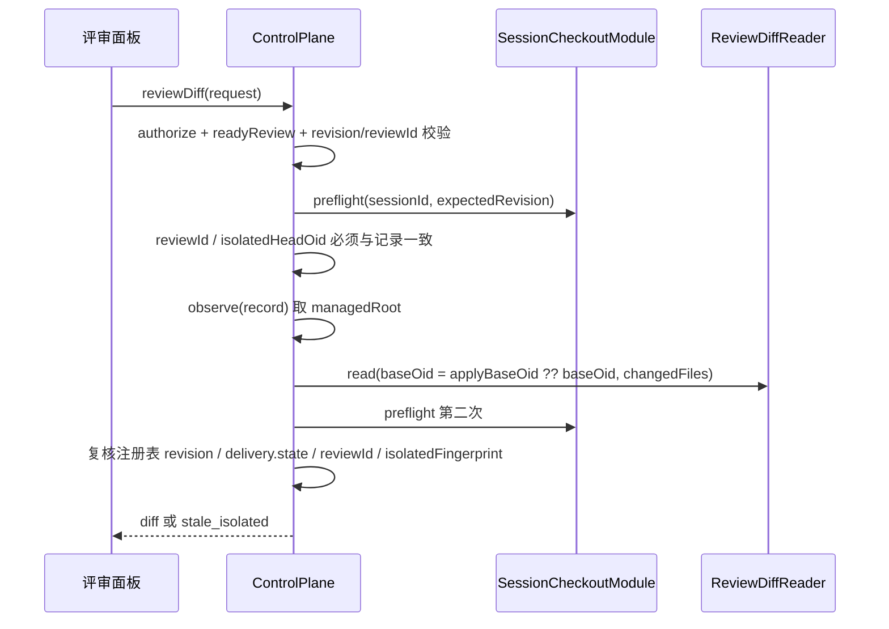

任何一环变化都返回 `stale_isolated`，并**丢弃**已读出的 diff 字节——评审内容不允许「读了一半又变了」。

---

## 9. 生命周期状态与能力

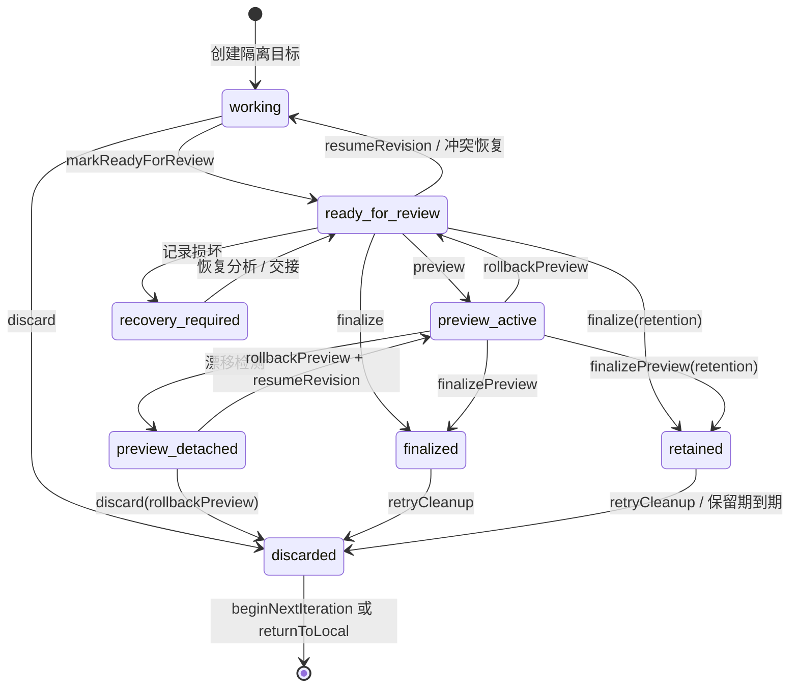

能力矩阵由 [console_host_projection](console-host-projection.md) 的 `capabilities()` 计算，控制平面通过 `projectReviewSlot` 在其之上做「验收位互斥」的二次收窄。两者的共同不变量：

- 读取类能力（`open` / `inspect`）授予 owner、source 与 `linkedRead`。
- 变更类能力几乎全部只授予 owner；`discard` 额外允许 owner 缺席时的 source。
- 保留期/常驻/清理只授予 owner（永远不给 Local source 会话）。
- `returnToLocal` 只在已交付时授予。

---

## 10. 不变量与安全边界

1. **授权只来自活体证据**：`lookup` 的记录只做导航，任何 checkout 操作都必须经 `module.inspect` 或 `listManagedWorktreesForSession` 再确认。
2. **写路径必经 owner 判定**：除 `discard` 的 owner 缺席分支，所有状态变更在到达模块前都会被 `requireOwner` 或显式 owner 比较拦截。
3. **路径身份跨平台一致**：`sameLocalRoot`（Windows 忽略大小写）、`withinRoot`（`resolve` + 反斜杠归一 + 去尾斜杠 + Windows 小写）用于所有「是否在根内 / 是否同根」的判断。
4. **控制平面不写注册表**：只 `read()`；所有 `update()` 都在模块的跨进程锁内。
5. **失败必须可归因**：所有错误都带 `SessionCheckoutErrorCode` 或降级为 `git_error`，且文案来自 `hostMessage`，客户端无需解析字符串即可分支。
6. **幂等优先**：`returnToLocal`、`clearSidebarBadge`（终态）、`restoreAbandoned` 等在设计上允许重复调用而不产生额外副作用。

---

## 11. 与其他模块的关系

| 主题 | 去这里看 |
| --- | --- |
| 宿主总览、服务挂载与诊断 | [console_host](console-host.md) |
| `@Remote` 方法面、语言注入、ndjson 诊断 | [console_host_remote_face](console-host-remote-face.md) |
| `state` / `capabilities` / 投影细节 | [console_host_projection](console-host-projection.md) |
| 评审 diff 读取与陈旧检测 | [console_host_review_diff](console-host-review-diff.md) |
| 契约类型、错误码、能力位 | [console_contract](console-contract.md) |
| 客户端适配器与 UI 消费方 | [client_ui](client-ui.md) |
| Typert 描述符与 schema 校验 | [console_remote](console-remote.md) |
| `SessionCheckoutModule` 与四个端口的完整签名 | [core_domain](core-domain.md) / [core_domain_ports](core-domain-ports.md) |
| 应用引擎（preview / finish / 冲突） | [session_checkout_apply_engine](session-checkout-apply-engine.md) |
| 宿主文案与语言切换 | [i18n](i18n.md) |
| 构建、类型检查与测试命令 | [build_and_config](build-and-config.md) |

---

## 12. 构建与验证

控制平面是宿主侧 TypeScript 源码，随包一起编译：

- `pnpm run build`（`node scripts/clean-lib.mjs && tsc && tsdown`）产出 `lib/`，`package.json` 的 `exports` 暴露 `.`、`./client`、`./typert`、`./remote`、`./console-contract`。
- `pnpm run typecheck`（`tsc --noEmit`）是控制平面契约一致性最快的反馈回路：任何 `WorktreeConsoleAdapter` 方法签名漂移都会在此暴露。
- `pnpm run test`（`vitest run`）覆盖控制平面行为；`tests/host-i18n.test.ts` 明确依赖 `consoleFailure` 保留第三方原文这一行为。
- `cordis.patch.yml` 决定插件以 `dsh-git-worktree` 条目插入宿主 profile，进而决定控制平面在运行时是否被挂载。
