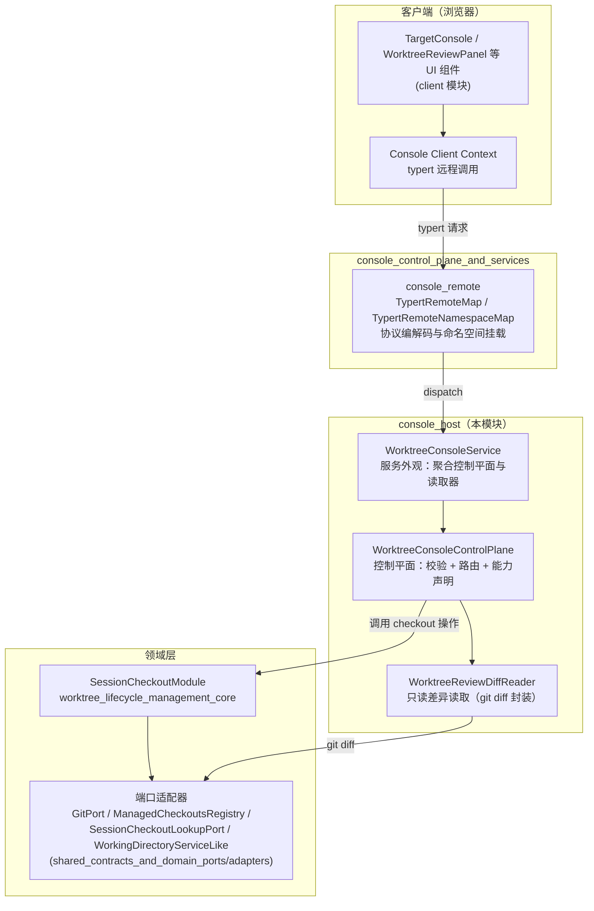
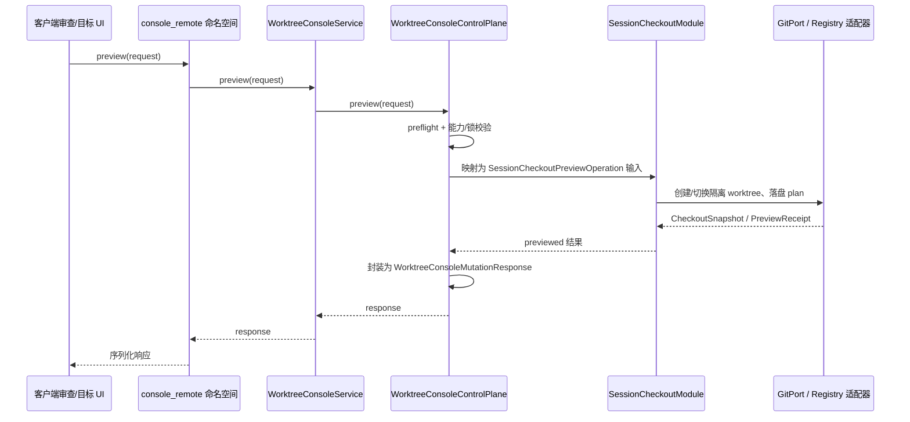
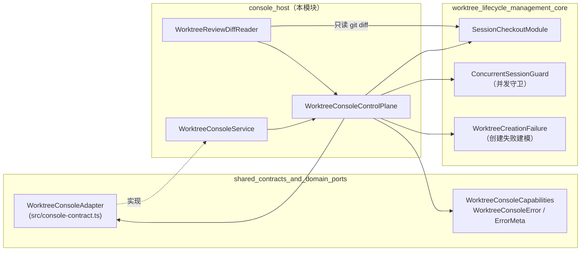
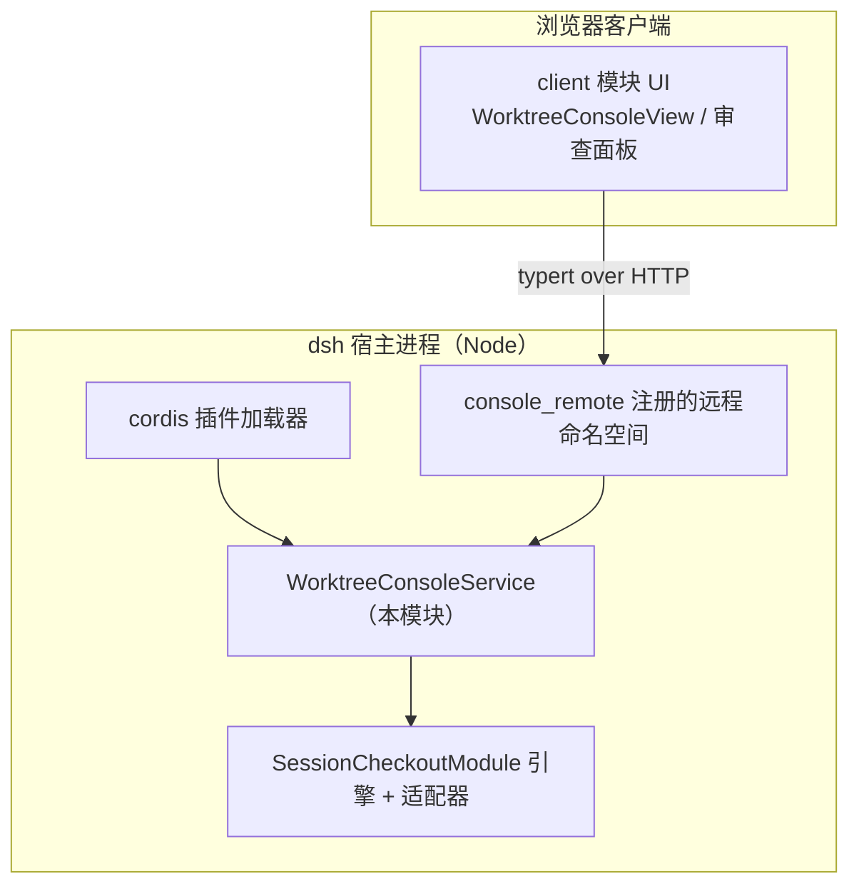

# Console 宿主机（console_host）模块

## 简介

`console_host` 是 dsh-git-worktree 插件在 **服务端（宿主机进程）** 一侧的控制台网关层。它位于 [shared_contracts_and_domain_ports](../shared_contracts_and_domain_ports.md) 定义的 `WorktreeConsoleAdapter` 端口契约与 [worktree_lifecycle_management_core](../worktree_lifecycle_management_core.md) 的 `SessionCheckoutModule` 引擎之间，负责：

- 把控制台 RPC 请求路由到对应的 worktree 生命周期操作；
- 在路由前完成预检查（preflight）、能力（capabilities）与输入校验；
- 为审查界面提供安全、只读的差异（diff）读取通道；
- 作为 [console_remote](console_remote.md) 在宿主机侧的服务实现方，被客户端 [client](../client.md) 通过 typert 协议远程调用。

简言之：**console_host 是"控制台语义"在服务端的最终落地处**——它不直接操作 git 或工作区，而是编排 `SessionCheckoutModule`、`ManagedCheckoutsRegistry`、`GitPort` 等领域端口，把一次控制台调用翻译成一次受控的 checkout 引擎操作。

## 模块在整体架构中的位置

> 说明：`console_remote` 只负责协议层（见 [console_remote](console_remote.md)），真正的业务编排由本模块的三个组件完成。

## 核心组件

### 1. `WorktreeConsoleControlPlane`（控制平面）

- 文件：`src/console-host/control-plane.ts`
- 选项类型：`WorktreeConsoleControlPlaneOptions`
- 职责：
  - 接收符合 [console-contract](../../shared_contracts_and_domain_ports/console-contract.md) 的请求体（如 `WorktreeConsoleCreateRequest`、`WorktreeConsoleCheckpointRequest`、`WorktreeConsolePreviewRequest`、`WorktreeConsoleFinalizeRequest`、`WorktreeConsoleDiscardRequest`、`WorktreeConsoleReturnToLocalRequest`、abandoned/restore/cleanup 系列、git tag/graph/overview/prune 系列等）。
  - 在调用领域引擎前做 **preflight**（见 `WorktreeConsolePreflightRequest/Response`），核对能力位 `WorktreeConsoleCapabilities`、目标 worktree 状态、锁与并发条件（与 [concurrency](../worktree_lifecycle_management_core/concurrency.md) 的 `ConcurrentSessionGuard` 协同）。
  - 把请求翻译为 [SessionCheckoutModule](../worktree_lifecycle_management_core/worktree_lifecycle_management_core_index.md) 的输入（如 `ListManagedWorktreesInput`、`ManageManagedWorktreeInput`、`MarkReadyForReviewInput`、`MergeBranchForSessionInput`、`PruneMergedBranchesInput`、`IsolatedTargetLaunch` 等）。
  - 将结果封装回 `WorktreeConsole*Response` / `WorktreeConsoleMutationResponse`，并把失败归一化为 `WorktreeConsoleError`（带 `WorktreeConsoleErrorMeta`），供远端统一处理。

### 2. `WorktreeConsoleService`（服务外观）

- 文件：`src/console-host/service.ts`
- 职责：
  - 作为 **单一对外门面（facade）**，把控制平面与差异读取器组合成一个可被 [console_remote](console_remote.md) 直接挂载的服务对象。
  - 持有控制平面所需的领域依赖引用（checkout 模块、注册表、git 端口），完成依赖注入组装。
  - 向上层（remote 命名空间）暴露与契约一一对应的方法集合，方法名与 `WorktreeConsoleAdapter` 接口对齐——也就是说，**service 是 `WorktreeConsoleAdapter` 在宿主机的默认实现**。

### 3. `WorktreeReviewDiffReader`（审查差异读取器）

- 文件：`src/console-host/review-diff.ts`
- 相关类型：`ReviewDiffReadInput`、`ReviewDiffStaleError`、`ChangedEntry`、`GitOutput`
- 职责：
  - 为客户端审查面板提供 **只读** 的 diff 读取：执行受控的 git diff，产出 `WorktreeConsoleReviewDiffResponse` 所需的 `WorktreeConsoleDiffFile[]`。
  - 通过 `ChangedEntry` / `GitOutput` 抽象 git 输出解析结果，避免 UI 直接面对原始 git 文本。
  - 使用 `ReviewDiffStaleError` 表达"目标 worktree 已在读取过程中发生变更（快照过期）"的情形，驱动客户端触发刷新或回到概览视图。

## 请求处理数据流

一次典型的"创建预览"控制台调用（`WorktreeConsolePreviewRequest`）的端到端路径：

失败分支：任何一步抛出的领域错误（快照过期、冲突、计划失效、并发竞争）都会在控制平面被归一化为 `WorktreeConsoleError`，并通过同一通道回传给客户端，由审查面板（见 [client](../client.md)）决定展示冲突恢复入口（`WorktreeApplyConflictContinuation`）或回退。

## 关键交互与依赖

- **契约**：控制平面与服务的输入输出形态全部由 [shared_contracts_and_domain_ports](../shared_contracts_and_domain_ports.md) 中的 `console-contract.ts` 定义；本模块不发明新的请求/响应类型，只做适配。
- **领域引擎**：所有有副作用的操作最终落到 [worktree_lifecycle_management_core](../worktree_lifecycle_management_core.md)，其中 [session_checkout](../worktree_lifecycle_management_core/session_checkout.md) 提供 `SessionCheckoutApplyEngine` 的 apply/checkpoint/preview/finish 等原语，控制平面负责把控制台语义映射到这些原语。
- **并发安全**：创建、切换、丢弃等写操作经由控制平面前置检查，与 [concurrency](../worktree_lifecycle_management_core/concurrency.md) 的 `BranchRaceInput/BranchRaceFacts` 配合，避免同一分支上的会话竞争。
- **失败建模**：worktree 创建失败的细节（`WorktreeCreationFailure`）会被控制平面翻译为面向用户的 `WorktreeConsoleError` 元信息。
- **协议层**：本模块不直接处理网络/序列化；`WorktreeConsoleService` 的实例由 [console_remote](console_remote.md) 的 `TypertRemoteMap` / `TypertRemoteNamespaceMap` 注册为远程命名空间。

## 运行时进程拓扑

## 小结

| 关注点 | 本模块承担 | 委托给 |
| --- | --- | --- |
| 请求契约校验、能力声明、错误归一化 | `WorktreeConsoleControlPlane` | `console-contract.ts` 中的类型与能力定义 |
| 对外门面组装、依赖注入 | `WorktreeConsoleService` | `SessionCheckoutModule` 等领域依赖 |
| 只读 diff 读取与快照过期检测 | `WorktreeReviewDiffReader` | `GitPort`、`CheckoutSnapshot` |
| 网络序列化、命名空间暴露 | — | [console_remote](console_remote.md) |
| worktree 实际生命周期操作 | — | [worktree_lifecycle_management_core](../worktree_lifecycle_management_core.md) |
