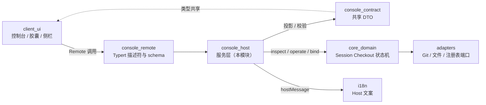
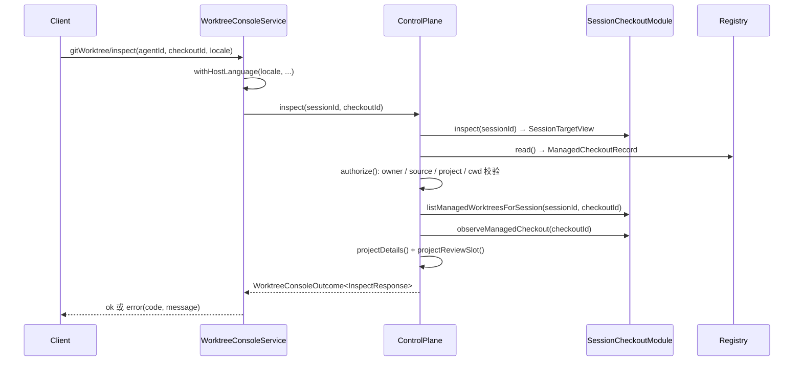
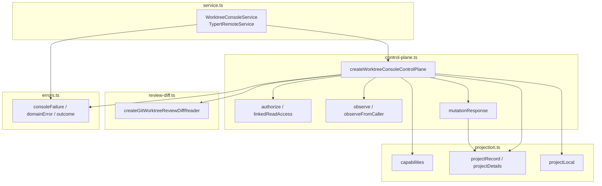

# console_host：Worktree 控制台的 Host 侧服务层

`console_host` 是 `dsh-git-worktree` 插件在 Host（Node 侧）暴露给前端的唯一入口层。它把
`core_domain` 中与宿主无关的 Session Checkout 状态机，包装成一组**带会话授权、可被 Typert
Remote 直接调用、返回可序列化 DTO** 的操作，并负责把领域记录投影成 UI 需要的视图。

一句话职责：**接收「某个 Session 想对某个 Worktree 做什么」，验证它是否有权这么做，调用领域模块，
再把结果投影成控制台契约（[console_contract.md](console-contract.md)）里的形状。**

## 模块定位

在整体架构中，`console_host` 位于三条链路交汇处：



关键设计取向：`console_host` **不实现任何 Git 或文件操作**。所有真实的副作用（`git worktree add`、
`git status`、注册表读写）都通过注入的端口交给 `core_domain` 与 `adapters`；本模块只做
**授权、编排、投影、错误归一**。

## 子模块构成

本模块按「远程面 / 控制平面 / 投影 / diff 读取」四层拆分，每层有独立文档：

| 文件 | 子模块文档 | 职责 |
| --- | --- | --- |
| `src/console-host/service.ts`、`src/console-host/errors.ts` | [console_host_remote_face](console-host-remote-face.md) | Typert Remote 服务门面：`@Remote` 方法面、语言上下文注入、诊断日志轮转，以及 `domainError` / `consoleFailure` / `failure` / `outcome` 的错误归一 |
| `src/console-host/control-plane.ts` | [console_host_control_plane](console-host-control-plane.md) | 全部业务编排：调用者授权、根路径校验、状态前置条件、验收位互斥、领域模块调用 |
| `src/console-host/projection.ts` | [console_host_projection](console-host-projection.md) | 纯函数投影：`ManagedCheckoutRecord` → 控制台 DTO，含 `capabilities` 能力矩阵推导 |
| `src/console-host/review-diff.ts` | [console_host_review_diff](console-host-review-diff.md) | 只读评审 diff 读取器：临时索引在隔离目录里复算改动，含大小预算与 `ReviewDiffStaleError` |

依赖方向是单向的：`service` → `control-plane` → `projection` / `review-diff`，四者共用 `errors`
的错误归一与 `console_contract` 的 DTO 定义。反过来 `projection` 与 `review-diff` 不依赖
`control-plane`，因此可以被单独测试，也不会在投影时意外触发授权或 Git 副作用。

## 请求生命周期

每一次控制台调用都走同一条骨架：**先证明身份，再证明状态，最后才产生副作用。**



三层校验的顺序固定，不可交换：

1. **身份**（`authorize` / `linkedReadAccess`）：调用者必须是该 checkout 的 owner 或 source Session，
   project 必须一致，且调用者的实际工作目录必须能证明落在预期根上。
2. **状态**（`readyReview` / `previewReview` / 各 action 的 phase 判断）：例如 `preview` 要求
   `phase === 'ready' && delivery.state === 'ready_for_review'`。
3. **CAS**（`expectedRevision` / `expectedReviewId` / `expectedGeneration`）：客户端带来的期望值必须
   与注册表当前值一致，否则返回 `stale_target`。

## 核心组件关系



## 对外能力分组

`WorktreeConsoleControlPlane` 暴露 37 个方法，`WorktreeConsoleService` 在其上再加一个
`clientBootReport`。它们全部返回 `WorktreeConsoleOutcome<T>`，即
`{ ok: true, value }` 或 `{ ok: false, error }` 的判别联合。

| 分组 | 代表方法 | 说明 |
| --- | --- | --- |
| 导航与投影 | `current`、`inspect`、`list`、`sidebarTopology` | 只读，不产生 Git 副作用；`current` 是顶部胶囊每 5 秒轮询的入口，`sidebarTopology` 额外回传 `workspaceClientFlavor` |
| 仓库初始化 | `initProject` | 把非 Git / 未提交的项目显式初始化成仓库，按 session 与规范化根路径双重去重防并发 |
| 评审 | `reviewDiff`、`preflight`、`prepareReviewRegeneration` | 只读或仅持久化一次性恢复请求；`reviewDiff` 用前后两次 preflight 夹住读取，检测隔离内容是否在读取期间变化 |
| 接受流程 | `preview`、`checkpoint`、`resumeRevision`、`rollbackPreview`、`finalize`、`deliver`、`finalizePreview` | 走 `module.operate(...)`，全部带 CAS |
| 生命周期管理 | `setRetention`、`setPermanent`、`retryCleanup`、`discard`、`beginNextIteration`、`returnToLocal`、`clearSidebarBadge`、`setWorktreeRequest` | 作用于冻结目录或会话绑定；`requireOwner` 拒绝 source Session 越权清理 |
| 恢复 | `previewRecoveryPreflight`、`preparePreviewRecoveryAnalysis`、`createPreviewRecoveryHandoff`、`listAbandoned`、`restoreAbandoned` | 处理 `preview_detached` 与放弃快照；handoff 会在创建后重新读取记录以校验新 owner 与 root |
| 仓库级 Git | `gitOverview`、`gitGraph`、`gitCreateBranch`、`gitSwitchBranch`、`gitPruneMergedBranches`、`gitListTags`、`gitCreateTag`、`gitDeleteTag`、`gitPushTag` | 作用于 **Local 根**而非托管 Worktree，与 Worktree 状态解耦（`projectRootFor` 解析） |

## 值得注意的若干设计决定

这些决定在代码里都有明确注释，是理解本模块行为的关键：

- **`capabilities` 而非布尔散列**：UI 不自己判断「这个按钮该不该亮」，而是读
  `target.capabilities`。能力推导集中在 [console_host_projection](console-host-projection.md)
  一个函数里，避免 Host 与 Client 两处规则漂移。
- **授权看「活的 cwd」而不是只 `project.root`**：托管 owner Session 运行期的 cwd 就是不可变
  worktree 根，而 `project.root` 永远指向 Local。只按 project root 授权会让每次 owner 调用都报
  `project_mismatch`。因此 `verifyCallerRoot` 优先用 `lookup.getSessionCwd()`，并且这段证据
  **只对 owner 生效**——source Session 恰好停在 Local 是它的正常状态，不能据此放行。
- **已交付记录的 Local 边界旁路**：交付后 owner 的 cwd 回到 Local，而冻结目录可能还在磁盘上
  （`retain_manual` 是默认保留策略）。`verifyCallerRoot` 与 `settledLocalBranch` 都专门处理
  `phase ∈ {discarded, finalized, retained}` 且已达成交付的情况，让「任务已结束、历史仍可读」成立。
- **`observeFromCaller` 复用观察结果**：`current` 先 `inspect` 再 `observe`，而两者都会跑
  `git status` + 两次 `git inspect`。在 Windows 上每次 spawn 约 30–50ms，重复即占掉每次轮询
  约三分之一的时间。因此当 caller 视图正好描述同一条 `ready` 记录且 revision 一致时直接复用。
- **受理槽位互斥**：同一 Local 根上只允许一个 Worktree 处于 preview/finalize 途中，
  `acceptanceHolder` 负责找出占用者，`projectReviewSlot` 把其余记录投影成
  `reviewSlot: 'waiting'` 并关掉 `preview`/`checkpoint`/`finalize` 能力。
- **`gitSwitchBranch` 的前置拦截**：切换 Local HEAD 会重算所有待应用的 apply 基线，因此当本
  Session 正在交付、或同仓库有别的 Session 占用交付时直接拒绝，而不是让后续 apply 静默错位。
- **错误不抛给传输层**：除少数刻意走 `failure(...)` 的路径外，方法体包在 `outcome(...)` 里，
  任何异常都会被 `consoleFailure` 归一成带稳定 `code` 的 `WorktreeConsoleError`。
- **诊断日志有上限**：`WorktreeConsoleService.appendDiag` 在写入前检查 8MB 上限并轮转为 `.1`，
  因为顶部胶囊每 5 秒一条 `current` 记录，30 天能积累 12MB。

## 与其它模块的边界

- 领域语义（phase 状态机、apply 引擎、CAS 语义、交付证明）由 [core_domain.md](core-domain.md) 定义，
  本模块**只消费**，不重新解释。唯一共享的状态判定函数是
  `console-contract.ts` 里的 `worktreeReachedDelivery` 与 `consoleStateFromDomain`。
- DTO 形状与能力字段定义在 [console_contract.md](console-contract.md)，Host 与 Client 共同引用。
- Remote 方法签名、参数描述符与结果 schema 在 [console_remote.md](console-remote.md)；
  本模块的 `WorktreeConsoleService` 方法顺序与 `TypertRemoteMap` 一一对应。
- 视图的最终呈现（卡片、胶囊、侧栏、弹窗）在 [client_ui.md](client-ui.md)。
- 所有面向用户的文案通过 [i18n.md](i18n.md) 的 `hostMessage` 取，本模块不硬编码字符串。
- 端口实现（`git`、`files`、`registry`、`lookup`）在 [adapters.md](adapters.md)。

## 装配方式

模块本身是纯工厂函数，由插件入口 `src/index.ts` 的 `apply()` 组装：

```ts
new WorktreeConsoleService(ctx, createWorktreeConsoleControlPlane({
  module,          // createSessionCheckoutModule(...)
  lookup, files, registry, git,
  reviewDiff: createGitWorktreeReviewDiffReader(projectSkills),
  setWorktreeRequest: (sessionId, from) => setWorktreeRequest(ctx, sessionId, from),
  pendingWorktreeRequest: (sessionId) => liveWorktreeRequest(ctx, sessionId),
}), join(stateDir, 'sidebar-diag.ndjson'), providerLifecycle.officialWorkspaceActive)
```

其中 `setWorktreeRequest` / `pendingWorktreeRequest` 由 Host 侧注入而非在控制平面内直接读 session：
写 plugin record 需要活的 Session 对象，而控制平面只拿得到 `lookup` 的只读导航记录。

`sidebarTopology` 会额外附上 `workspaceClientFlavor`（来自 `hostWorkspaceClientFlavor()`）与
`officialWorkspaceActive`，让客户端在未知的官方 Workspace 版本上不要挂载猜测的 UI；该行为与
`cordis.patch.yml` 中的 provider 选举一致，细节见 [core_domain.md](core-domain.md)。

## 构建与测试约束

- `pnpm run build` 先清空 `lib`，再 `tsc` 生成声明，最后 `tsdown` 打包（见 `package.json`）。
  `./typert`、`./remote`、`./console-contract`、`./client` 四个子路径导出分别对应远程面、
  客户端面与共享契约面，`console_host` 只出现在默认导出 `lib/index.js` 里。
- `vitest.config.ts` 在 Windows 上关闭 `fileParallelism`：重 Git fixture 套件并发时会争抢进程与
  文件句柄，可能超出超时并锁住临时目录。`console_host/review-diff.ts` 恰恰会在系统临时目录里
  创建 `dsh-worktree-console-diff-*` 索引目录，属于同一类资源竞争场景。
- CI（`.github/workflows/ci.yml`）在 Node 22 上依次跑 `typecheck` → `build` →
  `check:publish:release` → `test`，因此本模块的类型必须与 `console_contract` 严格一致。
