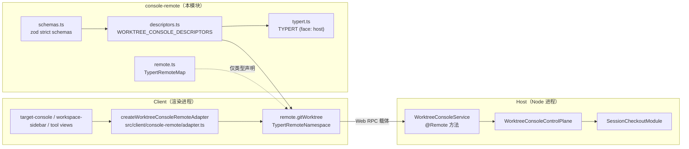
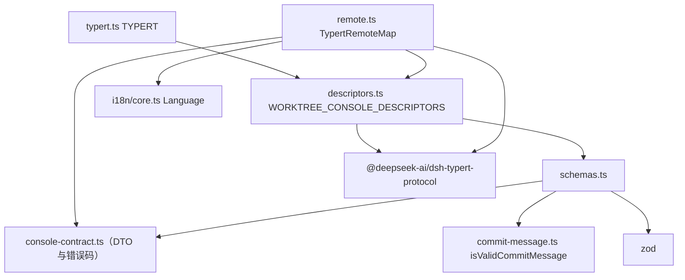
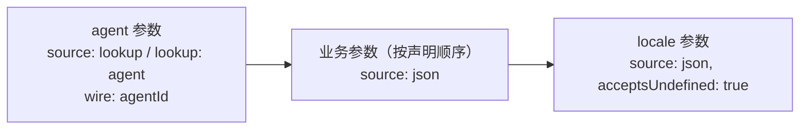
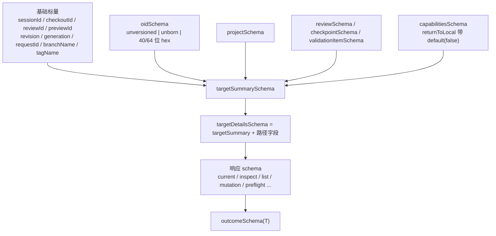
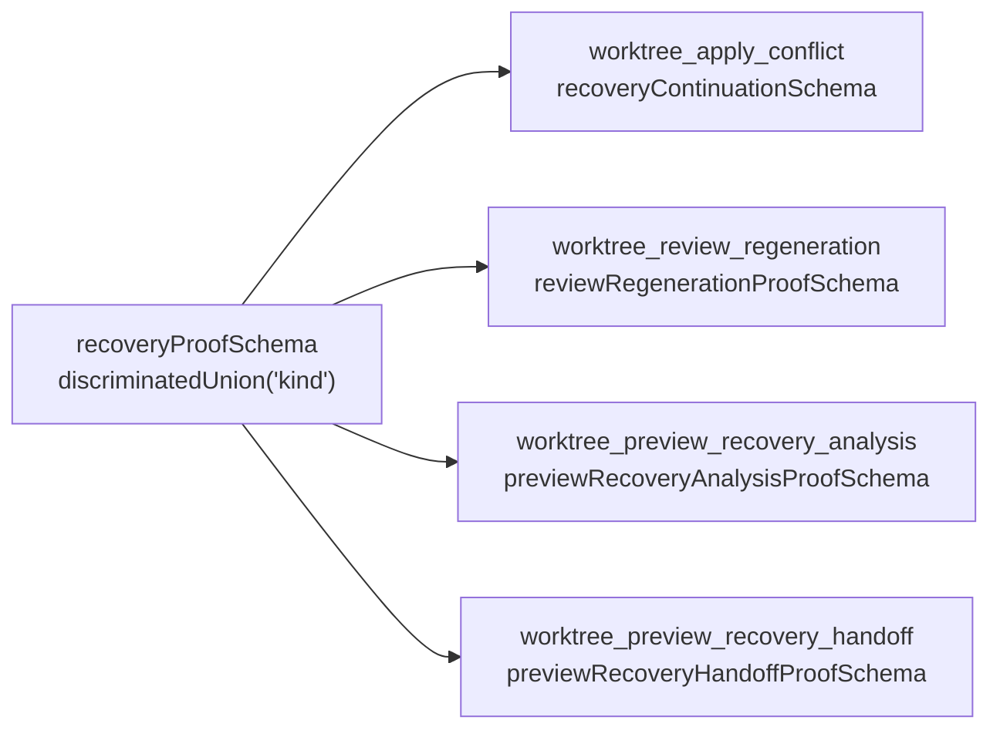
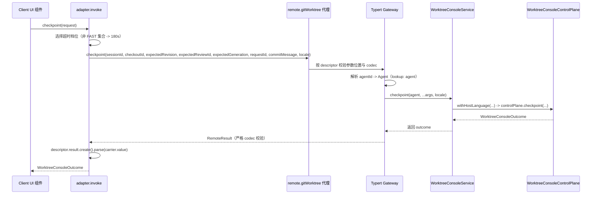

# console_remote —— Worktree Console 的严格 Remote 契约层

`console_remote`（源码目录 `src/console-remote/`）是 dsh-git-worktree 插件中**唯一的 RPC 契约声明层**。它把 Host 侧的 `WorktreeConsoleService`（`@Remote` 装饰的方法）与 Client 侧的 `remote.gitWorktree` 代理连接起来，并为每一次跨进程调用提供：

- **调用元数据（descriptor）**：方法名、参数顺序、参数来源（`lookup` / `json`）、编解码器；
- **运行时严格校验（schema）**：基于 `zod` 的 `strict()` 对象与安全字符白名单，防止越界路径、控制字符、超长字段进入协议；
- **类型面（remote map）**：通过 TypeScript 模块增强，把 `remote.gitWorktree.*` 变成强类型函数；
- **Host 贡献（Typert contribution）**：供官方 Typert Loader 通过 `./typert` 入口发现的 host face 贡献。

本模块不含任何 Cordis、React、Git 或文件系统实现，只描述"能调用什么、传什么、回什么"。

---

## 1. 在整体系统中的位置



关键点：

- **同一份 descriptor 被三方消费**：Client 适配器用它做响应校验与超时策略选择，Host 侧 Typert 注册用它生成调用元数据，TypeScript 通过 `remote.ts` 得到签名。
- **契约 DTO 定义在别处**：所有请求/响应/错误类型来自 [console_contract.md](console-contract.md)，本模块只引用其类型符号（`dsh-git-worktree/console-contract#<Type>`）。
- **Host 实现见** [console_host.md](console-host.md)；**Client 消费方见** [client_ui.md](client-ui.md)。

---

## 2. 文件构成与职责

| 文件 | 导出 | 职责 |
| --- | --- | --- |
| `src/console-remote/schemas.ts` | `outcomeSchema`、`sessionIdSchema`、`checkoutIdSchema`、`revisionSchema`、`currentResponseSchema`、`mutationResponseSchema`、`previewRecoveryProofSchema` 等 | 全部 zod 严格 schema，含安全校验与向后兼容默认值 |
| `src/console-remote/descriptors.ts` | `descriptor`（内部工厂）、`WORKTREE_CONSOLE_DESCRIPTORS`、`WORKTREE_CONSOLE_REMOTE` | 38 条 `InvocationDescriptor` 的冻结清单与包级贡献对象 |
| `src/console-remote/remote.ts` | `GitWorktreeRemote`、`TypertRemoteMap`、`TypertRemoteNamespaceMap` | 模块增强声明，把每个方法映射为 `(agentId, ...args, locale?) => Promise<RemoteResult<...>>` |
| `src/console-remote/typert.ts` | `TYPERT` | Host face 的 `TypertContribution`：`schemas: []`、空 model、`invocations` 指向 descriptor 清单 |

### 2.1 组件依赖图



注意：`typert.ts` **只**依赖 `descriptors.ts`，因此 Host 侧加载器可以在完全不触碰 DTO 运行时逻辑的情况下取得调用元数据；`remote.ts` 则同时依赖契约类型与 descriptor 清单，承担"类型 + 运行时贡献"的双重导出（默认导出即 `WORKTREE_CONSOLE_REMOTE`）。

---

## 3. 常量与命名约定

```ts
const PACKAGE = 'dsh-git-worktree'
const SERVICE = 'gitWorktree'
const AGENT_WIRE_TYPE = '@deepseek-ai/dsh-session/types#SessionId'
```

- **服务名固定为 `gitWorktree`**：`WorktreeConsoleService` 构造时以 `super(hostContext, 'gitWorktree')` 注册，客户端通过 `ctx.get('remote.gitWorktree')` 解析代理。任何改名都会同时破坏 Host 注册、Client 解析与 `remote.ts` 的 `TypertRemoteNamespaceMap`。
- **descriptor id 形如** `dsh-git-worktree#gitWorktree/<method>`，用于 Typert 元数据去重与错误定位。
- **结果类型符号** 统一写成 `dsh-git-worktree/console-contract#WorktreeConsoleOutcome<...>`，把"线上形状"锚定到 [console_contract.md](console-contract.md) 中的 DTO。

---

## 4. Descriptor 工厂：`descriptor()`

```ts
function descriptor(
  method: string,
  parameters: readonly InvocationParameterDescriptor[],
  resultSchema: { parse(value: unknown): unknown },
  resultType: string,
  withAgent = true,
): InvocationDescriptor
```

### 4.1 参数顺序是协议的一部分

`descriptor()` 生成参数列表的顺序严格为：

```
[agent?] → [...业务参数] → locale?
```



- **`agentParameter`**：`name: 'agent'`、`wire: 'agentId'`、`source: 'lookup'`、`lookup: 'agent'`，codec 类型符号为 `@deepseek-ai/dsh-session/types#SessionId`。Host 侧 Gateway 在业务代码执行前把 `agentId` 解析为 `Agent` 实例，因此 Host 方法签名首参是 `agent: Agent`，而 Client 侧传的是 `sessionId` 字符串。这是"每条 Host 操作都解析出确切调用会话"这一授权规则的传输层体现（详见 [console_host.md](console-host.md)）。
- **`locale`** 永远排在最后，且始终 `acceptsUndefined: true`：Remote 代理**按位置**校验实参个数，所以即使不需要本地化，Client 也必须把 `locale` 位占住并显式传 `undefined`（`adapter.ts` 与 `client/console-remote/index.ts` 的 boot report 调用都遵守这一点）。
- **`withAgent = false`** 仅用于两个无会话方法：`sidebarTopology` 与 `clientBootReport`。前者在 Client boot 阶段就要探测宿主形态，此时会话尚未确定；后者是纯诊断上报。

### 4.2 `json()` 参数构造器

```ts
function json(name, schema, typeSymbol, acceptsUndefined = false): InvocationParameterDescriptor
```

`wire` 与 `name` 相同，`source: 'json'`；`acceptsUndefined` 为真时附加 `acceptsUndefined: true`，用于所有可选业务参数（`needsAttention`、`includeDelivered`、`limit`、`commitMessage` 之外的 `message`/`target`/`push`、`conflictContinuation`、`recoveryProof` 等）。

### 4.3 `strictCodec()`：DSH 0.2 的 `create()` 惰性字段

```ts
function strictCodec(typeSymbol: string, schema: TypertSchema): TypertCodec {
  return { mode: 'strict', typeSymbol, create: () => schema, schema } as TypertCodec
}
```

代码注释说明了两个并存字段的来历：

- **DSH 0.2 通过 `create()` 物化严格 schema**：这是规范字段，惰性求值使 schema 实例在每个 descriptor 中保持单例——"客户端校验"与"生成的 Typert 元数据"因此一致。
- **`schema` 作为额外的运行时属性保留**，供较老的 Client 适配器直接读取。

`mode: 'strict'` 是被 `adapter.ts` 检查的：若某 descriptor 的结果 codec 不是 `strict`，适配器直接返回 `malformed_response` 而不做宽松放行。

---

## 5. 方法清单（38 条）

`WORKTREE_CONSOLE_DESCRIPTORS` 是一个 `Object.freeze` 的只读数组，按业务域分组如下。所有方法的结果 schema 都是 `outcomeSchema(<responseSchema>)`，即 `{ ok: true, value } | { ok: false, error }`；下表省略该包装。

| 域 | 方法 | 业务参数（除 `agent`/`locale`） |
| --- | --- | --- |
| 拓扑 / 诊断 | `sidebarTopology` | 无（`withAgent = false`） |
| | `clientBootReport` | `report`（`WorktreeClientBootReport`），返回裸 `boolean`（`withAgent = false`） |
| 目标读取 | `current` | 无 |
| | `initProject` | 无（返回 `WorktreeConsoleOutcome<boolean>`） |
| | `list` | `needsAttention?`、`includeDelivered?` |
| | `inspect` | `checkoutId` |
| | `reviewDiff` | `checkoutId`、`expectedRevision`、`expectedReviewId` |
| 评审与交付预检 | `preflight` | `checkoutId`、`expectedRevision`、`expectedReviewId` |
| | `previewRecoveryPreflight` | 同上 + `expectedPreviewId` |
| | `preparePreviewRecoveryAnalysis` | 同上 + `recoveryProof` |
| | `createPreviewRecoveryHandoff` | 同上 + `recoveryProof` |
| 迭代变更 | `preview` | `checkoutId`、`expectedRevision`、`expectedReviewId` |
| | `checkpoint` | 同上 + `expectedGeneration`、`requestId`、`commitMessage` |
| | `resumeRevision` | 同上 + `conflictContinuation?` |
| | `prepareReviewRegeneration` | 同上 |
| | `rollbackPreview` | `checkoutId`、`expectedRevision`、`resumeRevision?`、`recoveryProof?` |
| | `discard` | `checkoutId`、`expectedRevision`、`confirmDirty`、`rollbackPreview?` |
| 交付 | `finalize` | `checkoutId`、`expectedRevision`、`expectedReviewId`、`commitMessage`、`retention` |
| | `deliver` | `checkoutId`、`expectedRevision`、`commitMessage`、`retention` |
| | `finalizePreview` | 同 `finalize` + `recoveryProof?` |
| 保留策略与清理 | `setRetention` | `checkoutId`、`expectedRevision`、`retention`（排除 `cleanup`） |
| | `setPermanent` | `checkoutId`、`expectedRevision`、`permanent` |
| | `retryCleanup` | `checkoutId`、`expectedRevision`、`discardPostDeliveryChanges?` |
| | `beginNextIteration` | `checkoutId`、`expectedRevision` |
| | `returnToLocal` | `checkoutId` |
| | `clearSidebarBadge` | `checkoutId`、`expectedRevision` |
| 会话请求 | `setWorktreeRequest` | `from?: string \| null` |
| Git 浏览 | `gitOverview` | 无 |
| | `gitGraph` | `limit?` |
| Git 变更 | `gitCreateBranch` | `name` |
| | `gitSwitchBranch` | `branch` |
| | `gitPruneMergedBranches` | `dryRun` |
| | `gitListTags` | 无 |
| | `gitCreateTag` | `name`、`message?`、`target?`、`push?` |
| | `gitDeleteTag` | `name`、`remote?` |
| | `gitPushTag` | `name` |
| 放弃快照 | `listAbandoned` | 无 |
| | `restoreAbandoned` | `checkoutId` |

两点易错处：

1. **`initProject` 的方法名与适配器名不同**：descriptor 方法名是 `initProject`，客户端适配器暴露为 `initializeProject`，映射关系在 `src/client/console-remote/adapter.ts` 中维护；`console_contract.ts` 里它也是可选方法（`initializeProject?`），便于旧 Host 兼容。
2. **`capabilities` 中的 `create` / `open` 没有对应 descriptor**：建树走"下一次 turn 在新树里开始"的 `setWorktreeRequest` 与 `beginNextIteration`，打开目标走 `returnToLocal` / 会话重绑，能力位只是让 Client 决定按钮是否可点。

---

## 6. Schema 层：`schemas.ts`

### 6.1 组合关系



### 6.2 `outcomeSchema()` —— 唯一的结果包装器

```ts
export function outcomeSchema<T>(value: z.ZodType<T>): z.ZodType<WorktreeConsoleOutcome<T>> {
  return z.discriminatedUnion('ok', [
    strict({ ok: z.literal(true), value }),
    strict({ ok: z.literal(false), error: consoleErrorSchema }),
  ]) as z.ZodType<WorktreeConsoleOutcome<T>>
}
```

- 判别键是 `ok`，与 [console_contract.md](console-contract.md) 中的 `WorktreeConsoleOutcome<T>` 完全一致。
- `consoleErrorSchema` 用 `superRefine` 强制一条不变量：**只有 `apply_conflict` 可以携带 `continuation`**，其余错误码附带续作令牌会被判为畸形。这条规则防止 Client 把冲突恢复凭据当作普通错误的附属品误用。
- `error.code` 的枚举来自 `WORKTREE_CONSOLE_ERROR_CODES`（会话检出错误码 + `transport_unavailable` / `malformed_response` / `timeout` 三个传输层错误码）。

### 6.3 安全校验（防越界与注入）

| schema | 约束 | 目的 |
| --- | --- | --- |
| `sessionIdSchema` | `1..200`，禁 `\0\r\n` | 作为 registry 键与日志字段 |
| `checkoutIdSchema` | `1..200`，禁 `..`、`\`、`/`、控制字符 | 直接参与目录路径拼接 |
| `previewIdSchema` | 禁 `\`、`/`、控制字符 | 同上 |
| `branchNameSchema` | 禁 `\0\t\r\n\\ ~^:?*[]`、首字符非 `-`/`/`、结尾非 `/`、不含 `..`、不以 `.lock` 结尾 | 直接作为 `git` 参数，防止选项注入 |
| `tagNameSchema` | `1..255`，`^[^\s~^:?*[\\]+$` | 同上 |
| `generationSchema` | 恰好 64 位小写 hex | 检查点/恢复代际指纹 |
| `commitMessageSchema` | `trim()` + `isValidCommitMessage` | 复用核心域校验（见 [core_domain.md](core-domain.md)） |
| `safeConflictFile()` | 拒绝绝对路径、盘符、控制字符、`..`/`.`/空段 | 冲突文件列表与检查点文件列表 |

`changedFiles`、`conflictingFiles`、`checkpoints`、`files`、`tags`、`branches` 等数组都带 `.max(...)` 上限（如 `max(500)`、`max(200)`、`max(2000)`、`max(1000)`），使恶意或损坏的 Host 响应无法撑爆 Client 内存。

### 6.4 向后兼容：`default()` 而非 `optional()`

`capabilitiesSchema.returnToLocal` 使用 `z.boolean().default(false)`，`currentResponseSchema.worktreeRequest` 使用 `.nullable().default(null)`，`worktreeRequestResponseSchema` 中的 `failure` 同样 `default(null)`。源码注释给出了明确理由：

> Client 与 Host 是两份独立部署的产物；宿主重启前跑的是旧 Host，它根本不知道这个键。写成必填会让整条 `current` 的 payload 校验失败，胶囊直接塌成"不可用"。

因此约定是：**纯增量的能力位/字段一律容忍缺失**；输入可缺省，输出仍是确定的类型（`boolean` / `null`），契约类型不必变宽。这条规则对新增字段有强约束意义——任何"必填"的响应字段都会把旧 Host 变成不可用。

### 6.5 恢复证明的判别联合

`recoveryProofSchema` 是按 `kind` 区分的联合，与契约层的 `WorktreeRecoveryProof` 一一对应：



`previewRecoveryProofSchema` 另有一层结构：`rollback` / `finalize` 各自是"safely-allowed 或 blocked"的联合，blocked 分支携带 `code`（`stale_local`、`preview_modified`、`commit_isolation_conflict`、`operation_not_allowed`、`project_acceptance_busy`）与可选 `conflictingFiles`。这样 Host 的判定结果不需要额外往返就能表达"能不能安全回滚/收尾"。

---

## 7. `remote.ts`：类型面与默认导出

```ts
export type GitWorktreeRemote = TypertRemoteNamespace<'gitWorktree'>
export default WORKTREE_CONSOLE_REMOTE
export { WORKTREE_CONSOLE_DESCRIPTORS, WORKTREE_CONSOLE_REMOTE } from './descriptors.js'
```

`declare module '@deepseek-ai/dsh-typert-protocol'` 中声明了：

- **`TypertRemoteMap`**：`'gitWorktree/<method>': (agentId, ...业务参数, locale?) => Promise<RemoteResult<...>>`。每个方法的返回类型都精确到 `WorktreeConsoleOutcome<具体响应>`（`clientBootReport` 例外，直接返回 `RemoteResult<boolean>`）。
- **`TypertRemoteNamespaceMap`**：`gitWorktree: TypertRemoteNamespace<'gitWorktree'>`，让 `ctx.get('remote.gitWorktree')` 得到有键名的命名空间类型。

由于这是**纯类型声明**，它不会产生运行时代码；一旦 `descriptors.ts` 增删方法而这里未同步，`adapter.ts` 里对 `remote.<method>` 的调用会立即出现编译错误——这正是该文件的存在价值。

**默认导出即贡献对象**：`src/client/console-remote/index.ts` 中 `ctx.remote.$mount(contribution)` 挂载的就是它，因此 `./remote` 与 `./typert` 两个包入口必须导出同一份 descriptor 数组（见 `package.json` 的 `exports` 字段）。

---

## 8. `typert.ts`：Host face 贡献

```ts
export const TYPERT: TypertContribution = Object.freeze({
  package: 'dsh-git-worktree',
  face: 'host',
  schemas: [],
  model: { services: [], events: [], objects: [] },
  invocations: WORKTREE_CONSOLE_DESCRIPTORS,
})
```

- **手工维护的严格 Host 贡献**：注释写明它由官方 Typert Loader 通过 `./typert` 入口发现（`package.json` 中 `"./typert"` 映射到 `lib/console-remote/typert.js`）。
- **`schemas` / `model` 为空**：本插件不注册任何 Typert service、event 或 object，只注册 invocation。这使元数据体积极小，也避免与官方 model 命名空间冲突。
- **`invocations` 直接引用冻结数组**，保证 `typert.ts` 与 `descriptors.ts` 之间不可能出现两份不同的元数据。

---

## 9. 端到端调用流程

以一次变更类调用（例如 `checkpoint`）为例：



客户端侧三道兜底（实现位于 `src/client/console-remote/adapter.ts`，细节见 [client_ui.md](client-ui.md)）：

1. **超时**：FAST 集合（`sidebarTopology`、`current`、`inspect`、`previewRecoveryPreflight`、`gitOverview`、`gitGraph`、`listAbandoned`）30 秒，其余 180 秒；超时返回 `timeout`。Web RPC 载体本身无超时，若不在此处失败，UI 会永久停在 pending。
2. **载体异常**：抛错或 `carrier.ok === false` 时，先判断是否为 codec 拒绝（消息含 `rejected "` 或 `返回了不符合 strict contract`），是则 `malformed_response`，否则 `transport_unavailable`。
3. **载荷校验**：`descriptor.result.create().parse(...)` 失败即 `malformed_response`，绝不把未校验数据交给 UI。

这些错误码文案来自 `src/i18n/transport-messages.ts`（`malformed`、`invokeTimeout`、`mountFailed`、`workspaceGenerationUnknown`），本地化机制见 [i18n.md](i18n.md)。

---

## 10. 与构建 / 发布的关系

- **包入口**（`package.json`）：`./remote`、`./typert`、`./console-contract`、`./client` 四个导出分别对应本模块的 `remote.ts`、`typert.ts`、`console-contract.ts` 与 Client 入口。改动其中任一入口的导出名都会破坏已发布消费者。
- **依赖**：`zod@4.4.3` 是唯一运行时依赖；`@deepseek-ai/dsh-typert-protocol` 与 `@deepseek-ai/dsh-typert-registry` 为 peer 依赖（见 `package.json`）。Client bundle 由 `tsdown.config.ts` 构建，`noExternal: ['zod', 'lucide-react']` 意味着 **zod 会被打进 Client 产物**——因此 `schemas.ts` 的导入面（含 `commit-message.ts`）也会进入浏览器包，编写时不得引入 Node 内置模块。
- **验证**：`.github/workflows/ci.yml` 依次执行 `typecheck` → `build` → `check:publish:release` → `test`；`pnpm-workspace.yaml` 与 `screenshots.json` 属于仓库级配置，详见 [build_and_config.md](build-and-config.md)。

---

## 11. 修改本模块的检查清单

新增一个 Remote 方法时，以下位置必须**同时**更新，否则会出现"能编译但不能调用"或"调用成功但校验失败"：

1. `schemas.ts`：为请求参数与响应体各写 `strict()` schema，并保持可选字段用 `.optional()`/`.default()` 以兼容旧对端。
2. `descriptors.ts`：追加 `descriptor('<method>', [...], outcomeSchema(<response>), '<TypeName>')`，可选参数记得 `acceptsUndefined = true`。
3. `remote.ts`：在 `TypertRemoteMap` 中补签名（`agentId` 首参、`locale` 末参），无会话方法才省略 `agentId`。
4. `console_contract.ts`：补齐请求/响应 DTO 与 `WorktreeConsoleAdapter` 方法（见 [console_contract.md](console-contract.md)）。
5. `console-host/service.ts`：加 `@Remote` 方法并把 `agent.id` 传给 control plane（见 [console_host.md](console-host.md)）。
6. `client/console-remote/adapter.ts`：在返回对象中映射到 `remote.<method>`，并决定放入 FAST 还是 SLOW 超时档。
7. 若方法改变了侧栏/胶囊可见状态，同步 [client_ui.md](client-ui.md) 中的刷新逻辑。
