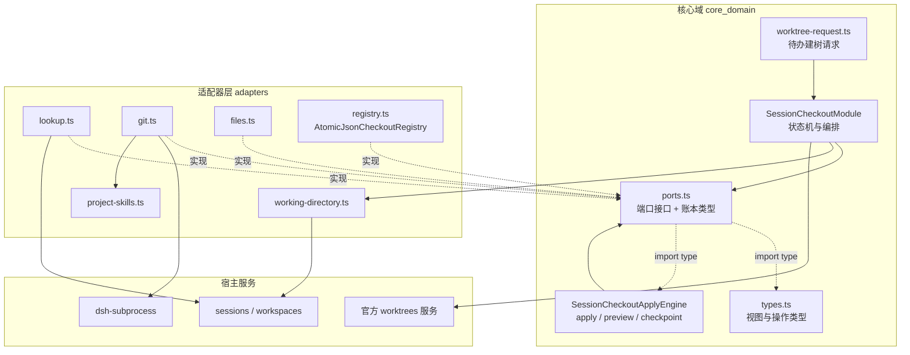
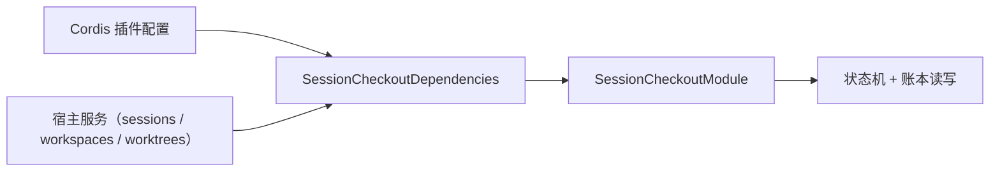
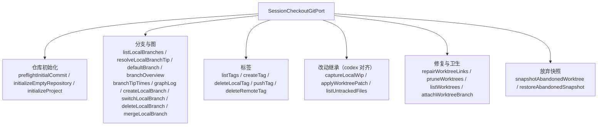
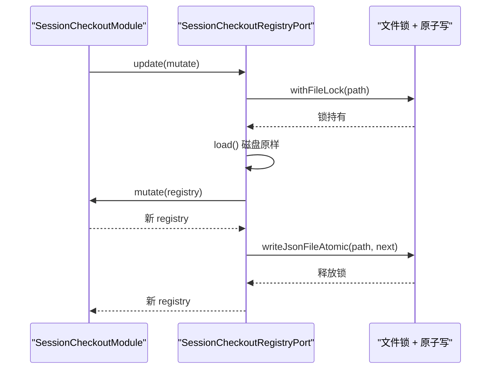
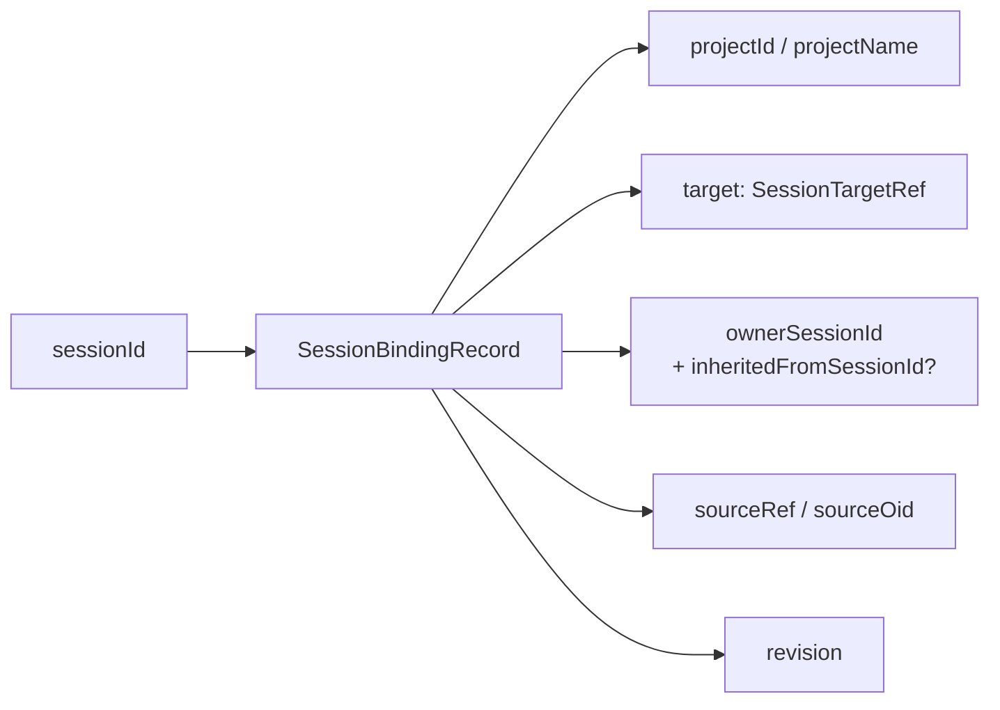
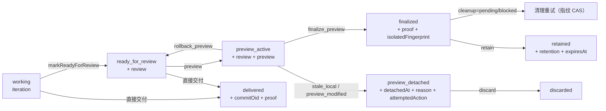
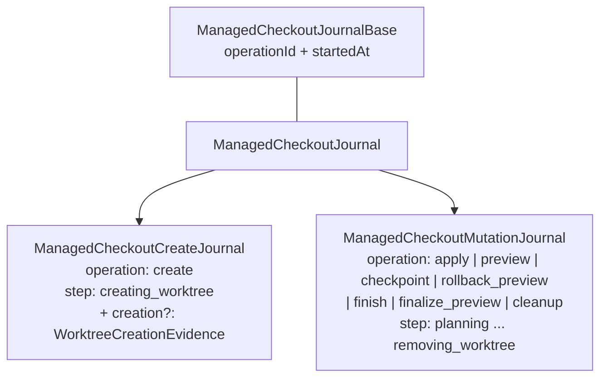
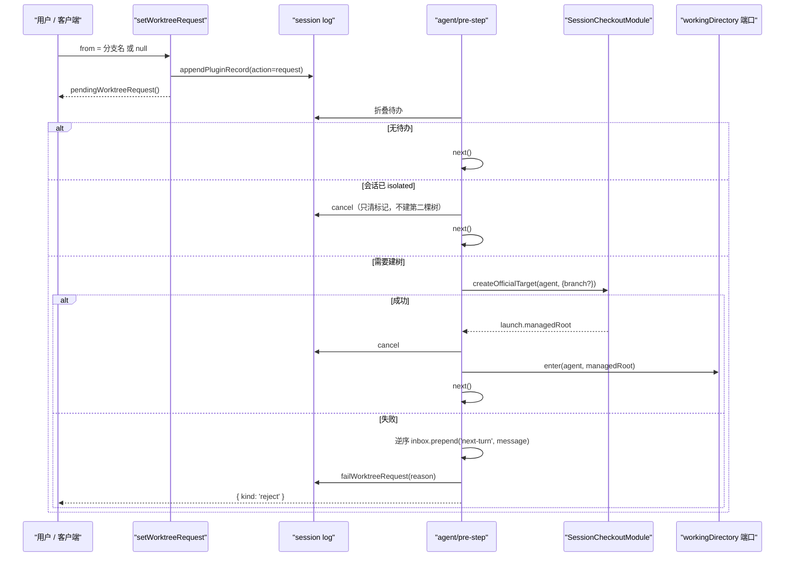

# core_domain_ports 端口契约与持久化数据模型

`core_domain_ports` 是 `core_domain` 模块的**边界层**：它用纯 TypeScript 接口声明「会话检出（session-checkout）领域需要宿主提供什么」，并定义该领域写进磁盘的**账本数据模型**。领域状态机与 Apply 引擎只依赖这些契约，不 import 任何适配器实现，因此可以在测试里用假实现（fake）驱动，也可以在不改动域逻辑的前提下替换宿主后端。

本页覆盖两个源文件：

| 文件 | 角色 |
| --- | --- |
| `src/ports.ts` | 端口接口（`SessionCheckoutLookupPort`、`SessionCheckoutGitPort`、`SessionCheckoutFilesPort`、`SessionCheckoutRegistryPort`、`OfficialWorktreesPort`）、依赖注入包 `SessionCheckoutDependencies`、以及 `ManagedCheckoutsRegistry` 等持久化记录类型 |
| `src/worktree-request.ts` | 「发首条消息时建树」的待办请求：以 plugin record 形式落在 session log 里的跨进程意图记录 |

---

## 1. 在系统中的位置

`ports.ts` 位于依赖图的中心：向上被领域编排与 Apply 引擎消费，向下由 `adapters` 目录的实现类满足。



关键事实：`ports.ts` 对 `types.ts` 与 `session-checkout-apply.ts` 只做 `import type`，编译后不产生运行时依赖；`tsconfig.json` 开启 `declaration: true` 与 `strict: true`，因此这些契约同时是发布包 `lib/*.d.ts` 的一部分，第三方端口实现可以按同一份签名对齐。

---

## 2. 依赖注入包：`SessionCheckoutDependencies`

域模块的构造函数只接受这一个聚合对象，所有外部能力都从这里进入：

| 字段 | 类型 | 说明 |
| --- | --- | --- |
| `lookup` | `SessionCheckoutLookupPort` | 会话 / 项目 / 侧栏查询（只读导航证据） |
| `git` | `SessionCheckoutGitPort` | 全部 Git 操作（子进程） |
| `files` | `SessionCheckoutFilesPort` | 文件系统与目录身份 |
| `registry` | `SessionCheckoutRegistryPort` | 托管 Worktree 账本持久化 |
| `applyEngine` | `SessionCheckoutApplyEngine` | 域内 Apply 引擎（见 [session_checkout_apply_engine](session-checkout-apply-engine.md)） |
| `managedCheckoutsRoot` | `string` | 默认托管 Worktree 根目录（状态目录） |
| `createCheckoutId()` | `() => string` | 由宿主注入的 ID 生成器 |
| `officialWorktrees?` | `() => OfficialWorktreesPort \| undefined` | 宿主 `worktrees` 服务，**惰性解析**：服务可能在本插件之后才挂载 |
| `autoPush?` | `boolean \| LiveValue<boolean \| undefined>` | Finish 成功后是否 push Local 分支，默认 `true` |
| `autoDeliver?` | `boolean \| LiveValue<boolean \| undefined>` | 模型自治交付开关，影响 Working 态引导文案 |
| `worktreesRoot?` | `string \| LiveValue<string \| undefined>` | 覆盖托管根目录，启用 `<worktreesRoot>/<project>/<topic>-<YYYYMMDD>` 命名 |
| `inheritLocalChanges?` | `boolean \| LiveValue<boolean \| undefined>` | 建树时继承 Local 未提交改动（codex 对齐），默认 `true` |
| `worktreeKeepCount?` | `number \| LiveValue<number \| undefined>` | keep-count LRU 上限，`0` 关闭，默认 `15`，`permanent` 记录豁免 |



### `LiveValue<T>`：挥发型配置

Cordis 的挥发配置字段以引用对象而非普通值传入。`LiveValue<T>` 只暴露一个 `get()`：

```ts
export interface LiveValue<T> { get(): T }
```

配套的 `liveConfigValue<T>(value: T | LiveValue<T>): T` 是唯一的解引用入口——通过检测 `get` 是否为函数来区分两种形态。所有读取配置的地方都必须经过它，否则热更新后读到的是创建时的快照。

---

## 3. 五大端口

### 3.1 `SessionCheckoutLookupPort`（会话与项目查询）

只回答「这个会话 / 项目是什么」，**不**承担授权判断之外的副作用。端口注释反复强调两类证据必须分开：

| 方法 | 必选 | 用途 |
| --- | --- | --- |
| `getSession(sessionId)` | 是 | 导航记录：`id` / `projectId` / `title`（`title` 仅用于生成可读目录名，**绝不用于身份判定**） |
| `getProject(projectId)` | 是 | 项目根：`root` 恒为 Local 检出 |
| `getSessionCwd?(sessionId)` | 否 | **授权证据**：托管 Owner 会话运行期间的 cwd 就是其不可变 Worktree 根；只用 `getProject().root` 授权会让每次 owner 调用都因 `project_mismatch` 被拒 |
| `getSidebarMemberships?(managedRoots)` | 否 | 侧栏成员关系（`managedRoot` / `workspaceIds` / `sessionIds`），只读导航，**从不用于授权** |
| `listLiveSessions?()` | 否 | 活会话列表（含 `createdAt` / `cwd`），用于并发建树竞态守卫；缺失时守卫静默而不是猜测 |
| `listProjects?()` | 否 | 宿主以 Workspace 承载的全部项目，供「收养」把 Local 根反解回项目 |

`SidebarDirectoryMembership` 的存在意义是把「界面看到什么」与「能不能操作」在类型层面就切开——侧栏成员关系可以来自缓存或投影，授权证据必须来自权威来源。

### 3.2 `SessionCheckoutGitPort`（Git 操作）

这是最大也最需要纪律的端口。它把每一次 Git 交互显式化为一个方法，避免域层拼命令行。

**核心（必选）方法**

| 方法 | 说明 |
| --- | --- |
| `inspect(root)` | 返回 `GitCheckoutSnapshot \| null`（`root`/`commonDir`/`gitDir`/`branch`/`headOid`/`headRef`） |
| `findContainingWorktreeRoot(root)` | 包含该目录的检出顶层；不要求 HEAD 存在 |
| `status(root)` | 脏标记 |
| `createDetachedWorktree(localRoot, managedRoot, baseOid, saveEvidence?)` | 建树，并通过回调把 `WorktreeCreationEvidence` 交给调用方持久化 |
| `removeWorktree(localRoot, managedRoot)` | 仅在宿主已校验检出身份与完整指纹（含未跟踪文件）后调用 |
| `retainApplyBase` / `releaseApplyBase` | 保留 / 释放 Apply 基点引用 |
| `retainInternalArtifact` / `readInternalArtifact` / `releaseInternalArtifacts` | 内部 ref 工件（只读读取，不改 refs 与对象库） |
| `isAncestor(root, ancestorOid, descendantOid)` | 只读祖先证明，只接受已校验的根与 OID |

**可选（本地适配）方法**——按能力分组，缺失即降级而非报错：



设计约定：

- **不猜测**：`defaultBranch?` 在 `origin/HEAD` 与 `init.defaultBranch` 都解析失败时返回 `null`，绝不硬编码 `main`。
- **软失败**：`pushBranch?`、`pushTag?`、`deleteRemoteTag?` 返回 `{ ok, message? }` 而不是抛错，调用方可以降级为提示。
- **CAS 语义**：`attachWorktreeBranch?(managedRoot, branchRef, headOid, expectedOldOid)` 中 `expectedOldOid === null` 表示「仅当 ref 不存在时创建」，否则只从那个精确的旧 OID 移动，保证并发会话不丢提交。
- **初始化前证据**：`InitialCommitPreflight` 用 `kind: 'ready' | 'empty' | 'files'` 加 `fingerprint` 描述初始化前状态；`initializeEmptyRepository?(root, fingerprint, assertAuthorized?)` 接收该指纹，让调用方能在真正写入前后做同一性比对，并在中途通过 `assertAuthorized` 复查授权。
- **远程事实**：`TagOverviewEntry.pushed` 为 `null` 表示「远程无法查询」，从而「未推送」不会被凭空发明出来。

`WorktreeListingEntry` 存在的原因写在端口注释里：官方工具会把 Worktree 嵌在含 `/` 的分支名目录下，任何目录扫描都无法安全重建这份列表，只有 Git 自己的管理列表是权威的——收养（adoption）依赖它。

### 3.3 `SessionCheckoutFilesPort`（文件系统与目录身份）

| 方法 | 用途 |
| --- | --- |
| `exists` / `canonicalize` | 存在性与真实路径（`realpath`） |
| `inspectDirectoryIdentity(path)` | 返回 `DirectoryIdentity`（`device` / `inode` / `birthtimeNs`） |
| `ensureDirectory` | 递归创建 |
| `removeEmptyDirectoryTree(path)` | 仅当整棵树不含文件时删除；树内链接只解除不跟随，用于收集 `git worktree add` 残留 |
| `quarantineDirectoryTree(path, expectedIdentity, quarantinePath)` | 身份匹配时原子移入隔离区 |
| `removeDirectoryTree(path)` | 删除完全拥有的非空目录；根不能是文件或符号链接 |
| `measureDirectoryBytes(path)` | 真实占用估算，不跟随符号链接 |
| `readTextFile?` / `copyFile?` / `isSymbolicLink?` | `.worktreeinclude` 支持；链接源会被跳过 |

`DirectoryIdentity` 是本端口的安全基石：所有破坏性操作（删除、隔离、清理重试）都要求「路径 + 身份」双条件，防止路径被替换（TOCTOU）后误删用户数据。

### 3.4 `SessionCheckoutRegistryPort`（账本持久化）

```ts
export interface SessionCheckoutRegistryPort {
  read(): ManagedCheckoutsRegistry
  write(registry: ManagedCheckoutsRegistry): void
  update(mutate: (registry: ManagedCheckoutsRegistry) => ManagedCheckoutsRegistry): ManagedCheckoutsRegistry
}
```

`update` 是**唯一允许的单记录更新入口**。`read()` 与 `write()` 之间隔着两次调用，任何在这条缝里发生的另一个进程写入都会被后写者抹掉；`update` 在跨进程文件锁内完成「读-改-写」，并把磁盘原样（包括未通过校验的记录）交给 `mutate` 再原样写回，避免这次写入悄悄丢掉被降级的记录。

实现见 `src/adapters/registry.ts` 的 `AtomicJsonCheckoutRegistry`：`write` 用 `withFileLock` + `writeJsonFileAtomic`；`load` 对损坏文件抛 `registry_corrupt` 而不是静默重建。详见 [adapters](adapters.md)。



### 3.5 `OfficialWorktreesPort`（宿主建树服务）

```ts
export interface OfficialWorktreesPort {
  create(
    agent: unknown,
    request?: { name?: string; from?: string },
    signal?: AbortSignal,
    onPhase?: (phase: 'prepare' | 'checkout') => void,
  ): Promise<{ path: string; branch: string; baseCommit: string; repositoryRoot: string }>
}
```

形状与上游 `worktrees` 服务一致：`create` 需要一个活的调用 Agent，因为它的最后一步就是设置该会话的工作目录。整个系统只保留一份 `git worktree add` 实现，本插件只记录结果；`onPhase` 让调用方能把 `prepare` / `checkout` 两阶段回报给界面。

### 3.6 端口 ↔ 适配器对照

| 端口 | 默认实现 | 备注 |
| --- | --- | --- |
| `SessionCheckoutLookupPort` | `src/adapters/lookup.ts`（`SessionStoreLike` / `WorkspaceRegistryLike` 等窄化宿主接口） | 见 [adapters](adapters.md) |
| `SessionCheckoutGitPort` | `src/adapters/git.ts`（`GitPortOptions`：`hooksPath`、`projectSkills`、超时选项） | 全部经 `dsh-subprocess` |
| `SessionCheckoutFilesPort` | `src/adapters/files.ts` 的 `createNodeFilesPort()` | Node `fs` 直连 |
| `SessionCheckoutRegistryPort` | `src/adapters/registry.ts` 的 `AtomicJsonCheckoutRegistry` | JSON + 文件锁 |
| `SessionCheckoutApplyEngine` | `src/session-checkout-apply.ts` 的 `DefaultSessionCheckoutApplyEngine` | 域内实现，非外部适配 |
| `OfficialWorktreesPort` | 宿主 `worktrees` 服务（惰性解析） | 缺失时走插件自有创建路径 |

### 3.7 一次建树 → 交付的端口调用数据流

下图把一次典型生命周期的端口调用串起来，说明「数据在哪些边界上流动、在哪里落盘」：

```mermaid
sequenceDiagram
  participant Tool as "工具层 worktree_create"
  participant Mod as "SessionCheckoutModule"
  participant Look as "LookupPort"
  participant Off as "OfficialWorktreesPort"
  participant Git as "GitPort"
  participant Files as "FilesPort"
  participant Reg as "RegistryPort"

  Tool->>Mod: createOfficialTarget(agent, {topic, branch})
  Mod->>Look: getSession / getProject / getSessionCwd
  Look-->>Mod: 会话、项目根、实时 cwd（授权证据）
  Mod->>Off: create(agent, {name, from})
  Off-->>Mod: path / branch / baseCommit / repositoryRoot
  Mod->>Git: inspect(managedRoot)
  Git-->>Mod: GitCheckoutSnapshot
  Mod->>Files: canonicalize + inspectDirectoryIdentity
  Files-->>Mod: DirectoryIdentity
  Mod->>Reg: update(写入 ManagedCheckoutRecord, phase=ready)
  Reg-->>Mod: 新账本

  Note over Mod,Reg: 后续 review / preview / finish 期间，每次变更都先写 journal 再更新 delivery
```

要点：建树走宿主服务（唯一一份 `git worktree add`），本插件只负责**记录 + 校验 + 落盘**；`FilesPort` 的目录身份在这里首次采集，后续所有破坏性操作都以它为锚点。


---

## 4. 账本数据模型

`ManagedCheckoutsRegistry` 是**唯一的持久化真源**（version 2）：

```ts
export interface ManagedCheckoutsRegistry {
  version: 2
  revision: number
  sessionBindings: Record<string, SessionBindingRecord>
  managedCheckouts: Record<string, ManagedCheckoutRecord>
}
```

### 4.1 `SessionBindingRecord`

会话 → 目标的绑定，带 `revision` 用于 CAS：



`inheritedFromSessionId` 记录绑定是「继承」而来的，`ownerSessionId` 才是真正持有托管 Worktree 的会话——所有授权判断都必须落到 owner 上，而不是持久化的调用者。

### 4.2 `ManagedCheckoutRecord`

一条记录描述一个托管 Worktree 的全生命周期：

| 字段组 | 字段 | 说明 |
| --- | --- | --- |
| 身份 | `checkoutId`、`predecessorCheckoutId?` | `predecessor` 指被安全复用不可变 cwd 路径的前一个已交付检出 |
| 归属 | `projectId`、`projectName`、`ownerSessionId`、`sourceSessionId?` | 历史记录可能缺 `sourceSessionId` |
| 路径 | `localRoot`、`managedRoot`、`managedGitRoot`、`gitCommonDir`、`gitDir` | `managedRoot` 同时是租约 cwd；`managedGitRoot` 可能比项目根更深 |
| 基线 | `baseOid`、`applyBaseOid?` | `applyBaseOid` 是最后一次成功 Apply 的快照，**不**改变用户可见的 Session Base |
| 上下文 | `previousReview?`、`checkpoints?`、`recoveryContinuation?` | 评审失效后仍保留的有界上下文 / 私有线性检查点 / 一次性恢复继续点 |
| 放弃 | `abandonedSnapshotOid?`、`abandonedSnapshotAt?`、`permanent?` | codex 对齐的放弃快照与常驻标记 |
| 界面 | `sidebarBadgeClearedRevision?` | 用户手动清除终态徽章时的 `revision`；此后任何 `revision` 变更让标记自然失效 |
| 分支 | `sourceRef`、`sessionBranch?`、`sessionTopic?` | `sessionBranch` 缺失的历史记录在交付时会新建成新分支，而不是复用 `sourceRef`（那只是会话碰巧分叉出来的 Local 分支）；`sessionTopic` 让后收养的记录推导出**同一个**分支名 |
| 状态 | `phase`、`delivery`、`journal`、`revision` | `phase` 取值见 `SessionCheckoutPhase`（`preparing` / `ready` / `applying`(已废弃) / `mutating` / `recovery_required` / `finalized` / `retained` / `discarded`） |

### 4.3 交付状态机 `ManagedCheckoutDelivery`



要点：

- `finalized` 与 `retained` 都携带 `isolatedFingerprint`，清理重试必须用它做指纹 CAS，避免清理到被替换的目录。
- `cleanupMessageKey` 是新记录**必定**持久化的 i18n key；`cleanupMessage` 只是历史兼容的自由文本（见 [i18n](i18n.md)）。
- `preview_detached` 同时记录 `reason` 与 `attemptedAction`，这样恢复界面能解释「哪一步被拒绝了」。
- `proof`（`ManagedDeliveryProof`）可选，仅为兼容历史 version-2 记录。

### 4.4 日志（journal）与恢复继续点

写操作前先落日志，是这套状态机能崩溃恢复的前提：



- `WorktreeCreationEvidence` 记录根 / 父目录 / commonDir / gitDir 的 `DirectoryIdentity`、`lockReason` 与元数据、索引指纹、隔离路径——它让「建树中途崩溃」的残留可以被**证明**是本插件创建的，从而安全隔离或清理。
- `ManagedCheckoutMutationJournal` 携带 `baseOid`、`planRevision`、`previewId`、`reviewId`、双端指纹、`commitOid`、检查点字段、`retention`、`recoveryGeneration`、`managedDirectoryIdentity`、`cleanupQuarantinePath` 等——每一步需要的前置事实都在里面，恢复时不需要再猜。
- `resumeRevision` 字段专门解决 `rollback_preview` 崩溃恢复必须保留「评审回到 working 还是 ready_for_review」的问题。

`ManagedRecoveryContinuation` 是四种一次性继续点的联合：

| kind | 含义 |
| --- | --- |
| `worktree_apply_conflict` | 显式恢复一次 Apply 冲突（`readyRevision` / `workingRevision` / 冲突文件） |
| `worktree_review_regeneration` | 重新生成评审 |
| `worktree_preview_recovery_analysis` | 分离态下只读分析 |
| `worktree_preview_recovery_handoff` | 在最新 Local HEAD 上新建托管树并保留旧分离证据 |

### 4.5 评审、检查点与预览回执

| 类型 | 用途 |
| --- | --- |
| `ManagedWorktreeReviewRecord` | 一次评审：`iteration`、`detailsMarkdown?`、`validationStatus`、`tests`、`changedFiles`、`suggestedCommitMessage`、双指纹与 `isolatedHeadOid` |
| `ManagedWorktreePreviousReviewRecord` | 评审失效后的有界上下文（路径有界），**永不**取代最终 diff 作为事实源 |
| `ManagedWorktreeCheckpointRecord` | 线性私有检查点：`sequence`、`requestId`（幂等键）、`requestedRevision`、`generation`、`commitOid` / `parentOid`、`summary`、`commitMessage`、`changedFiles` |
| `ManagedPreviewReceipt` | 预览回执：配置基线 vs 生效基线（`configuredBaseOid` / `effectiveBaseOid` / `baseStrategy`）、Local 前后指纹、工作树与索引 tree OID、隔离端快照 OID |
| `ManagedDeliveryProof` | 交付证明：`localBranch`、`localHeadBefore` / `localHeadAfter`、`changedFiles`、可选校验结论 |

`ManagedPreviewReceipt` 的字段组合是「可回滚」的全部依据：Local 侧同时记录**预览前**与**预览后**指纹，再加工作树 / 索引 tree OID，任何一方被第三方改动都能被检测出来并降级为 `preview_detached`。

---

## 5. 待办建树请求（`worktree-request.ts`）

官方 forge 面板把「勾选即建树」拆成两处：面板写一条 plugin record，客户端在 `agent/pre-step` 第 1 步把它变成真正的 worktree。本模块把同一件事收进 Host 侧，因为建树要走本插件的 `createOfficialTarget`（负责 `feat/sess-*` 命名、`.worktreeinclude`、本地未提交改动继承）。

请求落在 **session log**（plugin record）而不是内存：刷新页面、重启 Host 之后仍然有效——这正是「勾了但还没发消息」必须跨进程成立的部分。

### 5.1 记录形状

```ts
export const WORKTREE_REQUEST_RECORD = 'plugin:dsh-git-worktree/worktree-request'

export interface WorktreeRequest {
  readonly from: string | null   // null = 当前 HEAD
  readonly failure: string | null // null = 还没失败过
}

interface RequestRecord {
  readonly action: 'request' | 'cancel' | 'failed'
  readonly from?: string | null
  readonly reason?: string
}
```

`PluginRecordMap` 的模块增强把 `'plugin:dsh-git-worktree/worktree-request'` 映射到 `RequestRecord`，因此 `appendPluginRecord` / `pluginRecordOf` 在整条链路上都是类型安全的。

### 5.2 事件折叠语义

`pendingWorktreeRequest(session)` 顺序扫描 `session.snapshotEvents()`：

- `cancel` → 清空待办
- `failed` → **不撤销**请求，只把 `reason` 挂到当前待办上（用户修好原因后重发即会重试）
- `request` → 建立新的待办（`failure` 重置为 `null`）

失败不撤销是关键设计：`agent/pre-step` 之后没有第二次机会跟用户说话，原因必须落进 session log，胶囊下一次轮询 `current` 时才读得到；只写 console 等于用户永远看不见。

### 5.3 兑现流程



实现要点（`mountWorktreeRequest`）：

- **不限定 `step === 1`**：turn 正在跑时排队的消息会作为 steering 进入当前 turn 的后续 step（`inbox.claim` 对其他 target 把它放进 `next-step`）。只认第 1 步会永远等不到它，请求一直挂着、消息照常在旧目录里跑。
- **「读不出目标」不算过期**：只有能读出 `checkout.kind === 'isolated'` 才取消；`inspect` 抛错（如 `target_unselected`）时继续建树，失败由 `catch` 兜住。
- **消息必须有归途**：`inbox.claim()` 已把这批消息移出队列，失败时按 `[...messages].reverse()` 逐个 `prepend('next-turn')` 还回去，否则用户的消息会凭空消失。
- **降级**：宿主没有 `workingDirectory` 服务时，`enter` 返回 `undefined`，此时只告警——树已建好，不能因为无法切换目录而回滚。

### 5.4 对外读写入口

| 函数 | 说明 |
| --- | --- |
| `requestWorktree(session, from)` | 记下「下一次 turn 在新树里开始」 |
| `cancelWorktreeRequest(session)` | 撤回待办 |
| `failWorktreeRequest(session, reason)` | 记下失败原因，请求保留 |
| `setWorktreeRequest(ctx, sessionId, from)` | Host 侧写入口：`null` = 当前 HEAD，`undefined` = 撤回；会话不在存储里时抛错 |
| `liveWorktreeRequest(ctx, sessionId)` | 供 `current` 回给胶囊；会话不活时返回 `null` |
| `mountWorktreeRequest(ctx, module)` | 在 `agent/pre-step` 里把待办变成真实 Worktree |

`worktree-request.ts` 依赖 `createSessionWorkingDirectoryPort(ctx)`（见 `src/adapters/working-directory.ts`，`SessionWorkingDirectoryPort` 的 `current` / `enter` / `leave`）。

---

## 6. 设计约束与扩展指引

**必须遵守的契约**

1. **域不 import 适配器**：`ports.ts` 只 `import type`；任何新增能力都以可选方法的形式加到端口上，由 `adapters` 实现。
2. **导航证据 ≠ 授权证据**：`getSidebarMemberships`、`getSession().title`、持久化的 `ownerSessionId` 都不能用来授权；授权要么来自实时 `getSessionCwd`，要么由调用方作用域（`...ForSession` API）保证。
3. **单记录更新走 `update`**：跨进程并发下 `read` + `write` 会丢记录。
4. **破坏性操作要「路径 + 身份」**：`DirectoryIdentity` 必须与目标目录重新校验后才可删除、隔离或清理。
5. **可选方法缺失即降级**：禁用对应特性（年龄过滤、push、标签、快照恢复…）并如实告知，绝不臆测（`defaultBranch` 不猜 `main`，`TagOverviewEntry.pushed` 不猜「未推送」）。
6. **先日志后写盘**：任何触碰 Local 的变更都要在最终 CAS 之前持久化 journal，恢复逻辑只读 journal 与回执。

**新增端口方法的检查清单**

- 是否是「本地适配」能力？若是，声明为可选 `method?`，并在缺失时明确降级行为。
- 是否需要授权证据？若需要，参数必须由调用方传入已校验的根与 OID，端口本身不再回查。
- 是否可能失败但不应中断流程？返回 `{ ok, message? }` 而不是抛错。
- 是否写入账本？走 `registry.update`，并在 journal 里记录足够恢复的前置事实。

**构建与测试相关**：`ports.ts` 全部为类型与一个纯函数（`liveConfigValue`），在 `tsc` 下产出 `.d.ts`，运行时零开销；`vitest` 用假端口即可覆盖状态机（见 [build_and_config](build-and-config.md)）。

---

## 7. 相关页面

- 父模块与整体架构：[core_domain](core-domain.md)
- 领域原语（`canonicalJson`、提交信息校验、交付排除路径）：[core_domain_primitives](core-domain-primitives.md)
- 公开 API 与视图类型（`SessionCheckoutModule`、`SessionCheckoutOperation`）：[core_domain_public_api](core-domain-public-api.md)
- Apply / Preview / 检查点引擎：[core_domain_session_checkout](core-domain-session-checkout.md)
- 工作区生命周期与官方 Worktree 注册：[core_domain_workspace_lifecycle](core-domain-workspace-lifecycle.md)
- 端口的具体实现（git / files / registry / lookup / working-directory）：[adapters](adapters.md)
- 宿主侧控制面如何消费账本：[console_host](console-host.md)
- 客户端契约中的对应字段：[console_contract](console-contract.md)
