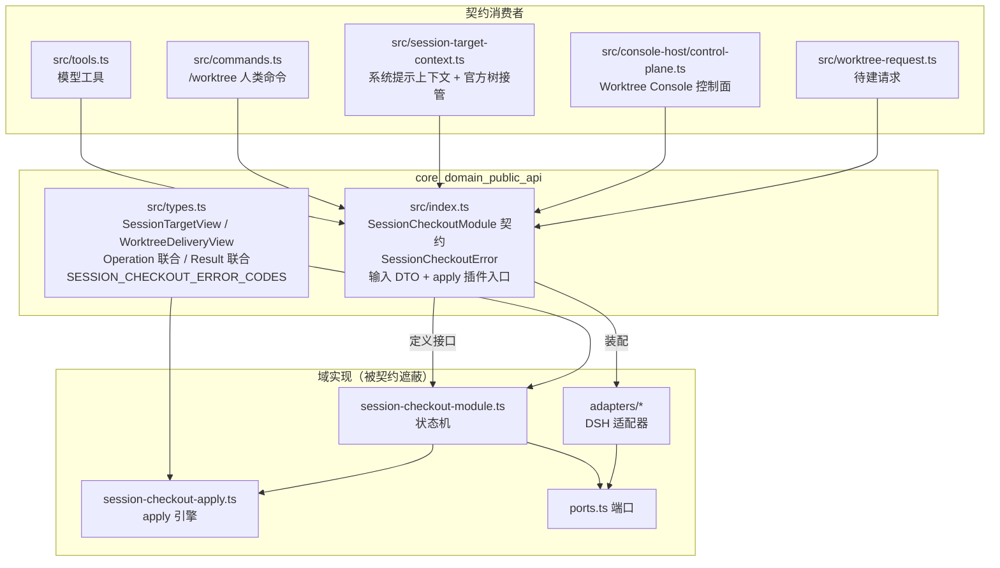
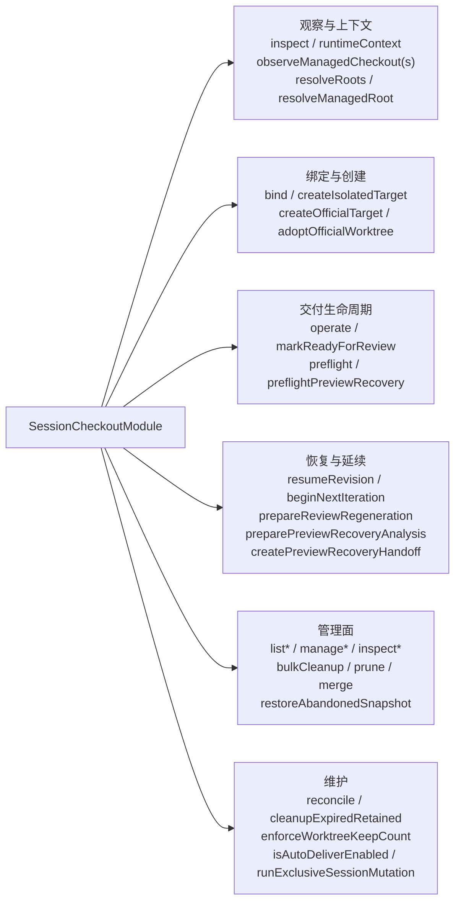
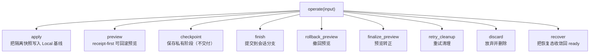
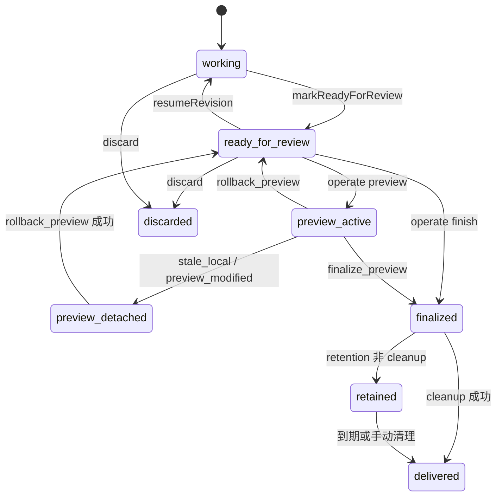
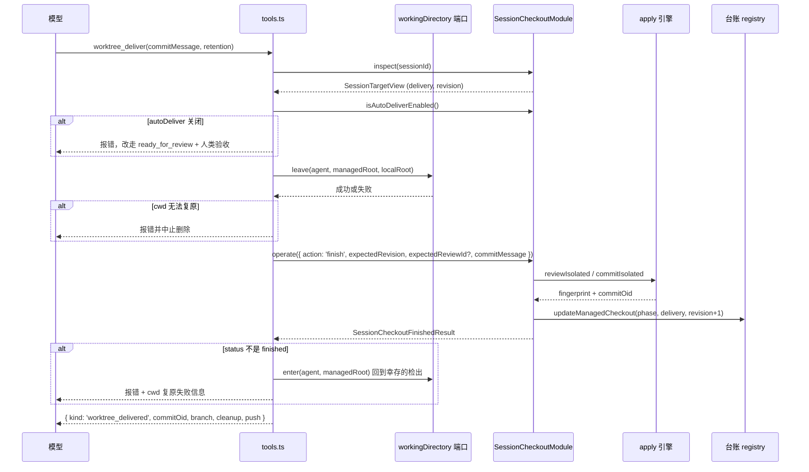
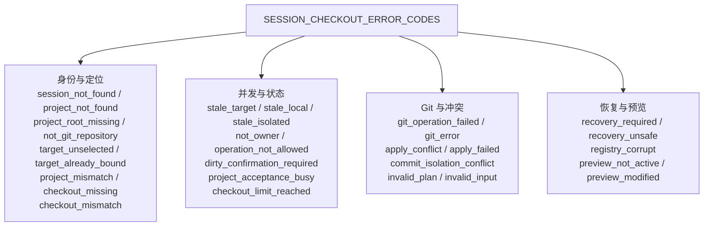

# core_domain_public_api — 会话检出领域的公共 API 面

`core_domain_public_api` 是 `core_domain` 对外暴露的唯一契约层：它由 `src/index.ts`（`SessionCheckoutModule` 接口、错误类型、输入 DTO、插件入口 `apply`）与 `src/types.ts`（`SessionTargetView`、`WorktreeDeliveryView`、操作/结果联合、`SESSION_CHECKOUT_ERROR_CODES`）组成。宿主侧的模型工具、`/worktree` 命令、系统提示上下文与 Worktree Console 控制面，全部只依赖这一层，而不直接触达状态机内部。

本页描述的是**调用契约**：谁可以调用什么、参数与返回值形状、错误语义、以及 `revision`/`reviewId` 这类 CAS 令牌如何保证并发安全。状态机与交付引擎的内部实现分别见 [core_domain_session_checkout](core-domain-session-checkout.md) 与 [session_checkout_apply_engine](session-checkout-apply-engine.md)。

---

## 1. 模块定位与设计原则

公共 API 是「Domi 移植的 host-agnostic 会话检出域」与「DSH 插件世界」之间的接缝。`src/index.ts` 的文件注释明确了职责划分：领域（状态机、apply 引擎、ports）保持宿主无关，`index.ts` 只做三件事——导出领域错误类型与模块契约、装配 DSH 适配器并挂载状态机、注册安全的模型工具/人类命令/运行时上下文。

由此派生出四条贯穿整个契约的规则：

| 规则 | 契约体现 |
| --- | --- |
| **不抛错的可预期失败** | 前置条件违例抛 `SessionCheckoutError`（带稳定 `code`）；`operate()` 的业务失败返回 `{ status: 'error' }` / `{ status: 'conflict' }`，不抛异常 |
| **乐观并发（CAS）** | 几乎所有写方法都要求 `expectedRevision`；Finish/Preview 还要求 `expectedReviewId`，Checkpoint 要求 `expectedGeneration` |
| **调用方作用域** | `*ForSession(sessionId, ...)` 系列在域内重新解析调用方项目并校验 `ownerSessionId`/`sourceSessionId`，绝不把持久化的 owner id 当授权 |
| **只读即只读** | `preflight`、`preflightPreviewRecovery`、`inspectManagedWorktreeCleanup`、`listManagedWorktrees` 承诺不写 Local、Worktree、台账、Review 状态或 Git ref |



---

## 2. 契约的两半：`index.ts` 与 `types.ts`

### 2.1 `src/index.ts` 承载什么

- `SessionCheckoutError`：唯一被抛出的领域错误，构造参数是 `SESSION_CHECKOUT_ERROR_CODES` 中的一个稳定码与面向用户的文案（工具层原样透出）。
- `SessionCheckoutModule`：唯一业务接口（下一节逐组说明）。
- 输入 DTO：`ListManagedWorktreesInput`、`ManageManagedWorktreeInput`、`PruneMergedBranchesInput`、`MergeBranchForSessionInput`、`MarkReadyForReviewInput`。
- 出参结构：`IsolatedTargetLaunch`、`SessionCheckoutReconcileSummary`。
- 配置面：`LocalAdaptationConfig`（`autoDeliver`、`autoPush`、`worktreesRoot`、`inheritLocalChanges`、`worktreeKeepCount`、`autoPruneMergedBranches`、`enableWorkspaceProvider`），既接受普通值也接受 `LiveValue<T>`，由 `liveConfigValue()` 每次读取时解引用，从而支持设置页热改而不重挂载。
- 插件入口：`inject` 命名导出（`tools`/`commands`/`subprocess`/`loader`）、`Config` schemastery schema、`apply(ctx, config)`。
- `export * from './console-contract.js'`：包根同时再导出 Console DTO，见 [console_contract](console-contract.md)。

### 2.2 `src/types.ts` 承载什么

纯类型模块（除 `DEFAULT_WORKTREE_RETENTION`、`CONFLICT_DETAIL_*` 与错误码数组外无运行时代码），是 Host 与 Client 共享的词汇表：

- 身份与阶段：`SessionTargetRef`、`SessionCheckoutKind`、`SessionCheckoutPhase`。
- 视图：`SessionTargetView` 及其子视图、`WorktreeDeliveryView`、`WorktreeReviewView`、`WorktreeCheckpointView`、`WorktreeDeliveryProofView`、`ManagedWorktreeSummaryView`、`WorktreeApplyPreflightView`、`WorktreePreviewRecoveryPreflightView`、`WorktreePreviewRecoveryProof`。
- 操作与结果：`SessionCheckoutOperation` 九种动作、`SessionCheckoutOperationResult` 十种结果。
- 错误：`SESSION_CHECKOUT_ERROR_CODES`（29 个码）与 `SessionCheckoutErrorCode`、`SessionCheckoutFailure`。

---

## 3. `SessionCheckoutModule` 契约分组

接口成员按用途分为六组。所有标注 `?` 的成员是可选能力：宿主或旧装配可能不提供，调用方必须做能力检测。



### 3.1 观察与上下文

| 成员 | 语义 |
| --- | --- |
| `inspect(sessionId)` | 权威目标视图。会做 Git/身份校验，必要时把记录持久化为 `recovery_required` |
| `runtimeContext(sessionId, cwd?)` | **同步**快照，只读台账、零 I/O，用于可重放的模型运行时上下文；`cwd` 决定是否仍需宣告绝对路径规则 |
| `observeManagedCheckout?(checkoutId)` | 一次加锁得到 `managedRoot`、隔离侧 `snapshot`、同一校验轮次的 `localSnapshot` 与 `dirty` |
| `observeManagedCheckouts?(checkoutIds)` | 批量版本，结果与入参顺序对齐，单条失败整体抛错 |
| `resolveManagedRoot(checkoutId)` | 身份校验后的规范根路径（Workspace 注册用） |
| `resolveRoots(checkoutId)` | 只读台账、**不做 Git I/O** 的双边界 `{ managedRoot, localRoot }`（cwd 复原用） |

`runtimeContext` 的返回值是分场景的固定文案：Local 无待办、Preview 进行中、Preview 需恢复、handoff 待接受、本会话持有隔离检出（此时才要求绝对路径写入）、已交付已清理、已交付但保留中、以及常规隔离检出。工具层与提示层共享同一份措辞，避免「提示说在树里、实际 cwd 在 Local」的自相矛盾。

### 3.2 绑定与创建

- `bind(sessionId, choice)`：`{ kind: 'local' | 'isolated' }`。已交付（`finalized`/`retained`/`discarded`+`delivered`）的隔离绑定可以释放回 Local；未交付的隔离绑定拒绝，避免未合并工作被困在冻结目录里。
- `createIsolatedTarget(sourceSessionId, targetSessionId, options?)`：为**另一个**会话预留独立 owner 与检出；当 `targetSessionId === sourceSessionId` 时是同构于 Claude Code `EnterWorktree` 的 in-place 升级。
- `createOfficialTarget(agent, options?)`：`worktree_create` 的唯一创建路径——Git 操作交给宿主的 `worktrees` 服务（全机只有一份 `git worktree add`），插件只负责记账、交付、评审与清理；服务缺失时抛 `operation_not_allowed`。
- `adoptOfficialWorktree(sessionId, cwd)`：当会话 cwd 落进 `.agents/worktrees/` 下的树（官方 `create_worktree`、forge 面板所建）时补记台账，保证列表/交付/评审覆盖宿主能产出的每一棵树。

创建结果统一为 `IsolatedTargetLaunch`：

```ts
interface IsolatedTargetLaunch {
  targetSessionId: string
  managedRoot: string
  target: SessionTargetView
}
```

### 3.3 交付生命周期

`operate(input)` 是状态机的唯一写入入口，输入为 `SessionCheckoutOperation` 联合：



配套的只读入口：

- `preflight(sessionId, expectedRevision)` → `WorktreeApplyPreflightView`：`ready` / `local_advanced` / `already_in_local` / `conflict` / `blocked`，包含 `baseStrategy`、`effectiveBaseOid`、`localHeadOid`、`isolatedHeadOid`、逐文件冲突详情与 `blocker`。
- `preflightPreviewRecovery(...)` → `WorktreePreviewRecoveryPreflightView`：对 `preview_detached` 给出 `WorktreePreviewRecoveryProof`（含 `receiptFingerprint`、`localFingerprint`、树 OID 与 `rollback`/`finalize` 的可行性判定）。**该 proof 只是待复核上下文，不是持有型权限**：真正的 mutation 会在 Host 锁内重算并比对。
- `markReadyForReview(sessionId, input)`：写入一次人类可审的 Review 快照（`summary`、`validationStatus`、`tests`、`suggestedCommitMessage`、可选 `detailsMarkdown`）。

`operate` 的结果联合决定调用方如何续接：

| 结果 | 含义 | 调用方动作 |
| --- | --- | --- |
| `applied` / `previewed` / `checkpointed` / `preview_rolled_back` | 成功推进 | 刷新视图 |
| `finished` | 提交完成（`commitOid` 可为 `null` 表示无 delta），并带 `cleanup: 'discarded' \| 'pending' \| 'retained'` 与可选 `push` | 读取 `branch` 供后续合并 |
| `preview_detached` | 预览因 `stale_local` / `preview_modified` 脱钩，证据保留 | 走恢复流程 |
| `conflict` | 内容/脏工作区/未跟踪冲突，带 `reason`、`conflictingFiles`、`conflictDetails`、`resolveHint` | 就地解决或重新同步 |
| `discarded` / `recovered` | 终态或恢复成功 | 刷新视图 |
| `error` | 带稳定 `code`、`message` 与可选 `target` | 按码分支处理 |

### 3.4 恢复与延续

- `resumeRevision(sessionId, expectedRevision, expectedReviewId, recovery?)`：作废未同步的 Review 并回到 `working`，不触碰 Local。
- `beginNextIteration(sessionId, expectedRevision)`：已交付并清理的 owner 会话，按上一轮会话分支 tip 重建不可变 cwd，开始下一轮。
- `prepareReviewRegeneration(...)` / `preparePreviewRecoveryAnalysis(...)`：持久化 Host 权威的一次性（one-shot）只读再生成/分析请求，返回 `Managed*Continuation`。
- `createPreviewRecoveryHandoff(...)`：在最新 Local HEAD 上新建受管 Worktree，同时完整保留旧 detached 证据，返回 `IsolatedTargetLaunch & { continuation }`。

### 3.5 管理面

- `listManagedWorktrees(input?)` / `listManagedWorktreesForSession(sessionId, input?)`：`ManagedWorktreeSummaryView[]`，路径无关投影，按 `updatedAt` 倒序；后者按调用方项目与 owner/source 关系过滤。
- `inspectManagedWorktreeCleanup(input?)` / `bulkCleanupManagedWorktrees(candidates)`：主控侧的只读清理检查与批量清理。检查结论（`eligibility: 'safe' | 'retained' | 'blocked'` + `reason`）**不是授权**，批量执行会逐条重校验 revision。
- `manageManagedWorktreeForSession(sessionId, input)` / `manageManagedWorktree(input)`：动作集为 `cleanup_retained`、`retry_cleanup`、`set_retention`、`set_permanent`、`clear_sidebar_badge`、`discard`；`discardPostDeliveryChanges` 用于越过 `modified_after_finalize` 阻塞（需显式确认）。
- `pruneMergedBranchesForSession` / `autoPruneStaleMergedBranches`：`git branch -d` 语义的安全剪枝，主干与当前分支永不进入候选，活跃会话分支被跳过。
- `mergeBranchForSession(sessionId, input)`：`forward`（worktree → Local）或 `reverse`（Local HEAD → worktree，冲突留在 worktree），`dryRun` 在临时 detached worktree 中试合。
- `listAbandonedWorktreeSnapshots` / `restoreAbandonedWorktreeSnapshot`：带脏内容放弃前的安全快照，可恢复为 Local 分支。

### 3.6 维护与元能力

- `reconcile()` → `SessionCheckoutReconcileSummary`：启动收敛，返回 `recoveryRequiredCheckoutIds`、`orphanedCheckoutIds`、`dirtyOrphanedCheckoutIds`、`staleRootCheckoutIds`、`retainedCheckoutCount`。
- `cleanupExpiredRetained(now?)`、`enforceWorktreeKeepCount()`：保留期到期清理与 keep-count LRU 逐出（`permanent` 豁免、进行中会话豁免）。
- `isAutoDeliverEnabled()`：`autoDeliver` 的实时取值，工具层据此拒绝模型自行交付。
- `runExclusiveSessionMutation(sessionId, operation)`：让其它模块（如 Console 的 tag/graph 操作）与 bind/apply/discard/cleanup 共用同一把排他锁。

---

## 4. 视图与状态模型

`SessionTargetView` 是所有界面与工具的共同语言：

```ts
interface SessionTargetView {
  project: SessionTargetProjectView        // { id, name }
  checkout: SessionTargetCheckoutView      // { id, kind, label, phase }
  source: SessionTargetSourceView          // { ref, oid } 创建时记录的源
  current: SessionTargetCurrentView        // { branch: string | null, oid }（null = detached）
  ownership: 'owner' | 'inherited'
  dirty: boolean
  revision: number                         // CAS 令牌
  delivery?: WorktreeDeliveryView          // 仅隔离检出
  checkpoints?: WorktreeCheckpointView[]
  checkpointGeneration?: string
  reviewSlot?: 'available' | 'waiting'
  reviewSlotOwnerSessionId?: string
}
```

交付状态机（`WorktreeDeliveryView`）：



`checkout.phase`（`SessionCheckoutPhase`）是另一条正交轴：`preparing`、`ready`、`mutating`、`recovery_required`、`finalized`、`retained`、`discarded`，其中 `applying` 仅为 v1 兼容而保留。

---

## 5. 输入 DTO 一览

| DTO | 字段 | 约束要点 |
| --- | --- | --- |
| `ListManagedWorktreesInput` | `projectId?`、`needsAttention?`、`checkoutId?`、`includeDiagnostics?` | 只读；`includeDiagnostics` 才附带 `cleanup`/`canCleanup` 与体积估算 |
| `ManageManagedWorktreeInput` | `checkoutId`、`expectedRevision`、`action`、`retention?`、`permanent?`、`confirmDirty?`、`rollbackPreview?`、`discardPostDeliveryChanges?` | `retention` 不接受 `'cleanup'`（该值语义由 `action: 'cleanup_retained'` 表达） |
| `PruneMergedBranchesInput` | `dryRun?`、`olderThanDays?` | 省略 `olderThanDays` 即无年龄过滤（手工调用保持旧行为） |
| `MergeBranchForSessionInput` | `sourceBranch`、`dryRun?`、`direction?: 'forward' \| 'reverse'` | 来源必须是本会话某个受管 Worktree 的当前分支 |
| `MarkReadyForReviewInput` | `detailsMarkdown?`、`summary`、`validationStatus`、`validationSummary?`、`tests[]`、`suggestedCommitMessage` | `validationStatus` 为 `passed`/`failed`/`partial`/`not_run` |

`LocalAdaptationConfig` 不是方法参数，而是插件装配时的配置面；它经 `apply()` 归一后注入 `SessionCheckoutDependencies`，字段语义见 [core_domain_ports](core-domain-ports.md)。

---

## 6. 典型调用流

### 6.1 模型交付：`worktree_deliver`



### 6.2 人类验收：`/worktree finalize`

`commands.ts` 的 `finalize` 动词先 `inspect` 校验 `delivery.state === 'ready_for_review'`，再用 `expectedReviewId` + `expectedRevision` 双重比对拒绝过期卡片，随后 `leave` → `operate({ action: 'finish' })`，失败时 `enter` 把会话送回幸存检出，并在文本中附带 `enterNote`。`discard`/`remove`/`next`/`continue` 走同一套 leave/enter 保护。

### 6.3 Console 侧调用

`WorktreeConsoleService` 通过 `WorktreeConsoleControlPlaneOptions.module` 持有本契约，把每个 Remote 请求翻译成一次 `inspect`/`operate`/`manage*`/`preflight*` 调用，并把 `SessionCheckoutError.code` 映射为 `WorktreeConsoleError`。细节见 [console_host](console-host.md) 与 [console_contract](console-contract.md)。

---

## 7. 错误契约

`SessionCheckoutError` 由状态机与适配器抛出，`code` 取值来自 `SESSION_CHECKOUT_ERROR_CODES`，按语义分为四类：



调用方的处理约定：

- `stale_target`：重新 `inspect` 取新 `revision` 后重试（`operate` 的 `error` 结果会顺带返回最新 `target`，省一次往返）。
- `not_owner` / `project_mismatch`：不要重试，说明调用方用错了会话作用域。
- `project_acceptance_busy`：同项目已有验收占用者，`preflight` 的 `blocker` 字段给出该占用者的路径无关身份。
- `dirty_confirmation_required`：必须带 `confirmDirty: true` 再调用。
- `recovery_required` / `recovery_unsafe`：交给 `recover` 或人工 `discard`，不要自动清理。

---

## 8. 装配与配置

`apply(ctx, config)` 的装配顺序决定了契约何时可用：

1. `mountWorkspaceProviderLifecycle`：Workspace provider 选举（`enableWorkspaceProvider` 显式开启才接管），见 [core_domain_workspace_lifecycle](core-domain-workspace-lifecycle.md)。
2. 解析状态目录：`config.stateDir` → 否则 `$DSH_HOME/plugins/dsh-git-worktree`（`DSH_HOME` 未设时 `~/.dsh`）。
3. 构造适配器：`createDshLookupPort`、`createDshGitPort`（含 `hooksPath`、`ProjectSkillStore`、`gitTimeoutMs`、`worktreeAddTimeoutMs`）、`createNodeFilesPort`、`AtomicJsonCheckoutRegistry`，详见 [adapters](adapters.md)。
4. `createSessionCheckoutModule({...})` 得到本契约实例；`worktreesRoot` 被包成 `{ get() }` 以保持 volatile 热更新。
5. 挂载 `WorktreeConsoleService`、`registerTools`、`registerWorktreeCommand`、`registerSessionTargetContext`、`registerOfficialWorktreeAdoption`、`mountWorktreeRequest`。
6. 在 `ready` 事件上跑 `reconcile()` + `enforceWorktreeKeepCount()`；`setInterval` 每 15 分钟做保留期维护；`autoPruneMergedBranches` 开启时首次 60 秒后、之后每 24 小时扫一次 7 天以上的已合并分支。所有定时器 `unref()` 并在 `ctx.effect` 清理函数中释放。

包发布形态（`package.json` 的 `exports`）决定了契约的可达路径：`.`（`lib/index.js`，本模块）、`./client`、`./typert`、`./remote`、`./console-contract`、`./cordis.patch.yml`。`cordis.patch.yml` 只做一件事：`insert` 名为 `dsh-git-worktree` 的 bundle 条目，历史上用于承载「条件禁用 ui-workspace」表达式，现已在注释中明确废弃并改由 Host 侧生命周期接管——这也是 `enableWorkspaceProvider` 只在显式 `true` 时才接管的原因。

构建与校验（`.github/workflows/ci.yml`）依次执行 `pnpm install --frozen-lockfile`、`typecheck`、`build`、`check:publish:release`、`test`；`tsconfig.json` 开启 `strict`、`noUncheckedIndexedAccess`、`declaration`，输出到 `lib/`，因此本契约的所有导出都必须可声明（不能出现推断私有类型）。测试入口为 `vitest.config.ts`，`tests/**/*.test.{ts,tsx}`，Windows 上关闭文件并行以避免 Git fixture 争抢句柄。

---

## 9. 与其它模块的关系

| 关系 | 说明 | 文档 |
| --- | --- | --- |
| 上游依赖 | 端口定义（`SessionCheckoutDependencies`、`LiveValue`、`ManagedCheckoutRecord`、registry 端口）全部来自 `ports.ts` | [core_domain_ports](core-domain-ports.md) |
| 下游实现 | 契约的唯一实现是 `createSessionCheckoutModule`；状态机与 `operate` 分支细节 | [core_domain_session_checkout](core-domain-session-checkout.md) |
| 原语 | `canonicalJson`、`isValidCommitMessage`、`deliveryExcludePathspecs`、`WorktreeCreationFailure` 等被契约实现复用 | [core_domain_primitives](core-domain-primitives.md) |
| 宿主适配 | Git/文件/台账/查找端口的具体实现 | [adapters](adapters.md) |
| 传输契约 | 契约视图被投影为 Console DTO | [console_contract](console-contract.md)、[console_host](console-host.md) |
| 界面 | 侧栏、目标控制台、设置卡片消费投影后的视图 | [client_ui](client-ui.md) |
| 文案 | 所有 `message` 经 i18n 字典生成，`code` 保持稳定 | [i18n](i18n.md) |
| 构建配置 | 导出路径、类型产物、CI 门禁 | [build_and_config](build-and-config.md) |
| 上级概览 | `core_domain` 的分层与子模块划分 | [core_domain](core-domain.md) |

---

## 10. 扩展契约时的检查清单

1. **新增方法**：优先放进 `SessionCheckoutModule` 并标注是否只读、是否需要 `expectedRevision`；若宿主可能不支持，声明为可选成员并让调用方做能力检测。
2. **新增视图字段**：在 `types.ts` 中以可选字段追加，保持旧记录可解析（历史 `proof`、`detailsMarkdown`、`cleanupReason` 都遵循此规则）；不要移除既有字段。
3. **新增错误码**：追加到 `SESSION_CHECKOUT_ERROR_CODES` 数组末尾（它是 `as const` 元组，顺序即类型来源），并同步 Console 的错误映射。
4. **新增输入字段**：确认 volatile 配置需不需要 `LiveValue` 包装；若涉及跨进程持久化，必须走 `registry.update()` 的单锁读-改-写。
5. **不要绕过作用域**：任何按会话暴露的新能力都应提供 `*ForSession` 形式，并在域内重新解析项目与所有权。
