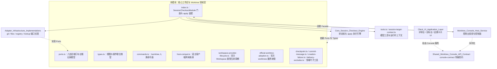
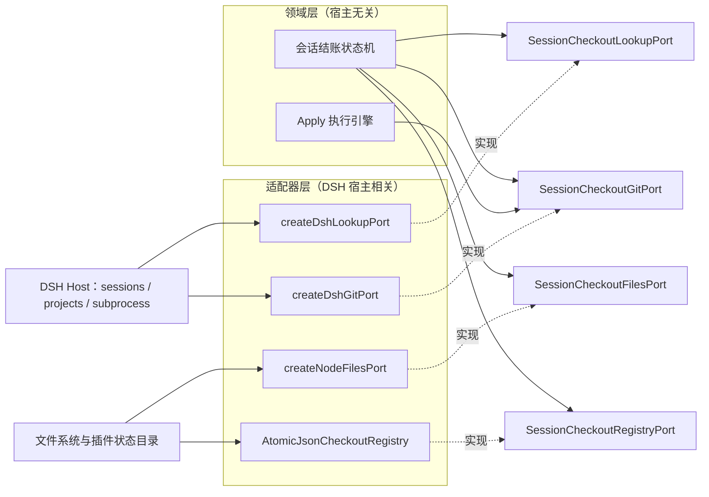
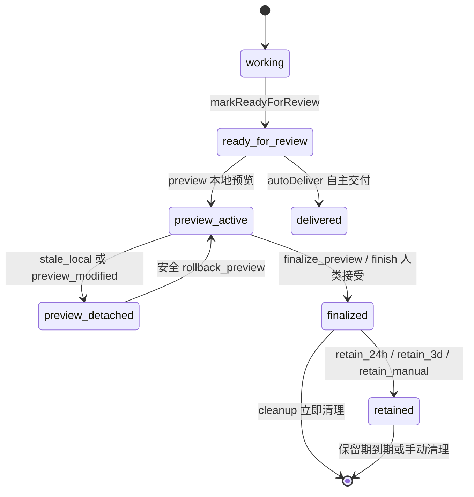
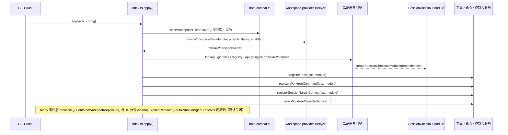

# 核心工作区与 Worktree 领域层

## 模块定位

本模块是 `dsh-git-worktree` 插件的**宿主无关领域层与插件装配面**。它源自 Domi 的
`session-checkout` 领域并被移植到 DSH（DeepSeek Harness）环境：定义会话结账（session
checkout）状态机所依赖的全部端口接口、持久化台账记录模型、对外视图与操作类型，以及插件
对外暴露的门面接口 `SessionCheckoutModule`。

本模块**只定义契约与装配**，不包含具体实现：

- Git 子进程、文件、注册表存储等端口实现 → 见 [Adapter_Infrastructure_Implementations](adapter-infrastructure-implementations.md)；
- 会话结账状态机与 apply 执行引擎（`DefaultSessionCheckoutApplyEngine`、`enterCheckout` 等） → 见 [Core_Session_Checkout_Engine](core-session-checkout-engine.md)；
- 面向客户端的控制台主机服务（投影、控制面、评审 diff 读取） → 见 [Worktree_Console_Host_Service](worktree-console-host-service.md)。

调用方向上，本模块处于三者的交汇处：引擎与适配器实现它定义的端口，工具层、人类命令与
控制台服务消费它定义的 `SessionCheckoutModule` 门面。

## 在系统中的位置

上层关系：插件整体（含本模块）的入口与兄弟模块划分见
[Backend_Host_Core_Runtime](backend-host-core-runtime.md)；客户端界面如何驱动这些
主机能力见 [Client_UI_Application_Layer](client-ui-application-layer.md)；跨层传输与
i18n 基础设施见 [Shared_Cross-Tier_Contracts___Utilities](shared-cross-tier-contracts-utilities.md)；
构建与打包配置见 [Build,_CI___Project_Configuration](build-ci-project-configuration.md)。

## 架构总览

### 六边形依赖方向

领域逻辑（状态机、apply 引擎）**只依赖本模块 `ports.ts` 中的端口接口**，不直接触碰
Node 子进程或文件系统。因此状态机可以用 fake 端口完整测试，DSH 特有的适配器
（subprocess-backed git、插件自有 JSON 台账、session/workspace 查询）全部躲在端口背后。

### 持久化台账模型

唯一的持久化形态是版本 2 的 `ManagedCheckoutsRegistry`（`registry.ts` 的
`AtomicJsonCheckoutRegistry` 负责原子读写）：

- `sessionBindings`：会话 → 目标引用（`unselected` / `local` / `isolated + checkoutId`），带 `revision` 乐观并发号；
- `managedCheckouts`：每棵受管 Worktree 一条 `ManagedCheckoutRecord`，含双方根目录（`localRoot` / `managedRoot` / `managedGitRoot` / `gitCommonDir` / `gitDir`）、创建基准 `baseOid`、线性 `checkpoints`、`journal`（崩溃恢复用的进行中操作记录）、完整的 `delivery` 交付状态与自己的 `revision`。

所有单条记录更新必须走 `SessionCheckoutRegistryPort.update(mutate)`——它在同一把跨进程锁里
完成读-改-写，避免「read 与 write 之间被另一进程写入抹掉」。每个对外操作都携带
`expectedRevision`，过期即报 `stale_target`。

### 交付状态机

`ManagedCheckoutDelivery`（持久层）与 `WorktreeDeliveryView`（对外视图）是同一条状态
机的两种投影：

要点：模型工具的动作止步于 `ready_for_review`；`finish` / `finalize_preview` 这类
破坏性动词只由人类（`/worktree finalize`、客户端接受卡片）发起。`preview_detached` 是
一种「证据冻结」态：本地预览被弄脏或本地 HEAD 已前进时，预览快照不丢弃，而是等待
`WorktreePreviewRecoveryProof` 驱动的安全 rollback / finalize。

### 挂载与启动序列

`index.ts` 的 `apply()` 是插件挂载的总装线。`cordis.patch.yml` 中声明了插件条目
（`insert: dsh-git-worktree`），Host 加载后调用 `apply(ctx, config)`：

## 核心概念速览

| 概念 | 定义位置 | 含义 |
| --- | --- | --- |
| `SessionTargetView` | types.ts | 一次会话当前目标的对外投影：项目、checkout、来源引用、当前 HEAD、dirty 标志与 delivery 状态 |
| `SessionCheckoutModule` | index.ts | 插件对业务调用方的完整门面：inspect / bind / operate / 列表 / 清理 / 合并 / 维护 |
| `SessionCheckoutOperation` | types.ts | 九种带 `expectedRevision` 的操作联合：apply / finish / preview / checkpoint / rollback_preview / finalize_preview / retry_cleanup / discard / recover |
| `ManagedCheckoutRecord` | ports.ts | 台账中一棵受管 Worktree 的完整持久记录（目录身份、基准、checkpoints、journal、delivery） |
| `checkpointGenerationForRecord` | checkpoint.ts | 对 active review + checkpoint 链计算 SHA-256 CAS 生成号，客户端凭它确认「评审卡片未过期」 |
| `OfficialWorktreesPort` | ports.ts | 宿主自带 `worktrees` 服务的窄接口；插件不自己实现 `git worktree add`，只登记结果 |
| `WorkspaceClientFlavor` | host-compat.ts | 宿主客户端代际：legacy / alpha / next / modern-rc5 / modern-rc1 / unsupported |
| `SessionCheckoutError` | index.ts | 稳定领域失败类型，`code` 取自 30 个 `SESSION_CHECKOUT_ERROR_CODES` |

## 配置面

插件 Config（`index.ts` 中用 schemastery 声明，`package.json` 的 `dsh.bundle.patch` 指向
`cordis.patch.yml`）：

- `stateDir`：插件状态目录（台账、disabled-hooks、sidebar 诊断）；缺省为 `$DSH_HOME/plugins/dsh-git-worktree`（`DSH_HOME` 未设时回退 `~/.dsh`）。
- **volatile 字段**（设置页可改、不重挂载，以 `LiveValue` 实时到达）：`gitTimeoutMs`、`worktreeAddTimeoutMs`、`autoDeliver`、`autoPush`、`worktreesRoot`、`inheritLocalChanges`、`worktreeKeepCount`、`autoPruneMergedBranches`。
- `enableWorkspaceProvider`：非 volatile，显式 `true` 才接管官方 Workspace UI（legacy 宿主）；modern 0.2.x 宿主上接管是结构性必需，该标志仅为建议性。

构建、类型检查与发布脚本见 [Build,_CI___Project_Configuration](build-ci-project-configuration.md)
（`package.json` scripts：`build` / `typecheck` / `test` / `check:sidebar-version` / `check:publish`）。

## 错误模型

所有领域失败统一为 `SessionCheckoutError(code, message)`，`code` 取自
`SESSION_CHECKOUT_ERROR_CODES`（types.ts），例如 `stale_target`、`not_owner`、
`apply_conflict`、`preview_modified`、`recovery_unsafe`、`project_acceptance_busy`。
工具层与 `/worktree` 命令把 `message` 原样呈现给模型或人类，`code` 则供客户端做结构化
分支（如评审卡片过期、冲突解决指引）。

## 核心组件详解

由于本模块全部为单文件的契约、装配与工具型组件（无可再拆分的多文件子域），各文件
的组件级说明直接收录于本页。

### 领域端口与台账记录模型（`ports.ts`）

六边形架构的「孔」所在：领域逻辑只依赖这些接口，适配器实现见
[Adapter_Infrastructure_Implementations](adapter-infrastructure-implementations.md)。

**四类端口**：

| 端口 | 职责 | 关键设计 |
| --- | --- | --- |
| `SessionCheckoutLookupPort` | 只读导航：会话、项目、实时 cwd、活跃会话列表、项目列表 | 永不用于授权；`getSessionCwd` 独立于 `getSession`，因为受管 owner 的 cwd 就是其不可变 Worktree 根，只用项目根授权会让所有 owner 调用误报 `project_mismatch` |
| `SessionCheckoutGitPort` | Git 权威操作：快照、状态、建/删 worktree、内部 ref 保留、合并、分支/标签、图日志、放弃快照 | 多数方法可选；`removeWorktree` 必须在宿主验证 checkout 身份与完整指纹后调用；`pushBranch` 永不强推 |
| `SessionCheckoutFilesPort` | 文件身份与目录树操作：canonicalize、`DirectoryIdentity`（device/inode/birthtimeNs）、空目录清理、隔离区迁移 | `removeEmptyDirectoryTree` 只删整树无文件者；链接不跟随，防误删 |
| `SessionCheckoutRegistryPort` | 台账读写 | `read()`/`write()` 之间有跨进程写入窗口；单条更新必须走 `update(mutate)`（同一锁内读-改-写） |

**台账记录模型**：

- `ManagedCheckoutRecord`：一棵受管 Worktree 的完整持久记录——双方根目录与 Git 元信息（`localRoot`、`managedRoot`、`managedGitRoot`、`gitCommonDir`、`gitDir`）、创建基准 `baseOid`、`sessionBranch`/`sessionTopic`、线性 `checkpoints`、`previousReview`、崩溃恢复用 `journal`、`recoveryContinuation`、codex 对齐的 `abandonedSnapshotOid` 与 `permanent` 标记，以及 `revision` 乐观并发号。
- `ManagedCheckoutDelivery`：八态交付联合（working → ready_for_review → preview_active / preview_detached → finalized / retained / delivered），每态携带评审、预览收据或交付证明。
- `ManagedPreviewReceipt`：本地预览的完整收据——配置/有效基准、双方 HEAD 与指纹、工作树与索引树 OID、变更文件清单。`preview_detached` 态靠它做 CAS 安全回滚。
- `ManagedRecoveryContinuation` 联合：四类宿主权威的一次性恢复上下文（apply 冲突、评审重生成、预览恢复分析、预览恢复移交），均带 `requestId` 幂等键。
- `OfficialWorktreesPort`：宿主自带 worktrees 服务的窄接口；`create` 需要活的调用 Agent，因为最后一步要把该 Session 的工作目录切进新树。
- `LiveValue<T>` / `liveConfigValue()`：volatile 配置字段的实时引用包装，让设置页编辑无需重挂载即生效。

### 视图与操作类型面（`types.ts`）

对外投影（不含持久化细节）与操作联合：

- `SessionTargetView`：会话当前目标的完整投影——`project` / `checkout`（kind + phase）/ `source` / `current`（branch 可为 null = 分离头）/ `dirty` / `revision` / `delivery` / `checkpoints` / `checkpointGeneration` / `reviewSlot`（项目级预览槽位占用）。
- `WorktreeDeliveryView`：交付状态机的对外只读投影，字段为持久层的路径安全子集。
- `SessionCheckoutOperation`：九种操作的可辨识联合（`apply` / `finish` / `preview` / `checkpoint` / `rollback_preview` / `finalize_preview` / `retry_cleanup` / `discard` / `recover`），全部携带 `sessionId` + `expectedRevision`；`finish`/`finalize_preview` 可绑定 `expectedReviewId`，`checkpoint` 还要求 `expectedGeneration` + `requestId`。
- `SessionCheckoutOperationResult`：十种结果联合（applied / previewed / checkpointed / preview_rolled_back / preview_detached / finished / conflict / discarded / recovered / error）。`finished` 结果带 `commitOid`（null = 空转未建空提交）、`branch`、`cleanup` 与最佳努力的 `push` 结果。
- `WorktreePreviewRecoveryProof`：宿主签发的只读恢复上下文——完整收据指纹 + 本地三方（HEAD 树 / 索引树 / 工作树）OID + 已评估的 `rollback` 与 `finalize` 动作（safe/blocked）。任何真实变更都要在宿主锁下重算并比对它。
- 管理面视图：`ManagedWorktreeSummaryView`（路径安全投影）、`ManagedWorktreeCleanupView`（只读清理可行性结论，非授权）、`BulkCleanupManagedWorktreesResult`、`PruneMergedBranchesView`、`MergeBranchForSessionView`、`AbandonedWorktreeSnapshotView`。
- 常量：`DEFAULT_WORKTREE_RETENTION = 'retain_manual'`（交付后环境常驻可查，后台绝不偷删）、`CONFLICT_DETAIL_FILE_LIMIT = 6` / `CONFLICT_DETAIL_DIFF_LIMIT = 4096`（冲突详情防撑爆模型上下文）、30 个 `SESSION_CHECKOUT_ERROR_CODES`。

### 插件门面与装配（`index.ts`）

- `SessionCheckoutModule`：业务调用方的完整门面（约 30 个方法），分五组——
  - **目标观察**：`inspect`、`runtimeContext`、`preflight`、`preflightPreviewRecovery`、`observeManagedCheckout(s)`；
  - **绑定与建树**：`bind`、`createIsolatedTarget`、`createOfficialTarget`（宿主唯一建树路径）、`beginNextIteration`、`resumeRevision`；
  - **交付与恢复**：`markReadyForReview`、`operate`、`prepareReviewRegeneration`、`preparePreviewRecoveryAnalysis`、`createPreviewRecoveryHandoff`；
  - **列表与维护**：`listManagedWorktrees(ForSession)`、`pruneMergedBranchesForSession`、`autoPruneStaleMergedBranches`、`mergeBranchForSession`、`listAbandonedWorktreeSnapshots` / `restoreAbandonedWorktreeSnapshot`、`manageManagedWorktree(ForSession)`、`bulkCleanupManagedWorktrees`、`inspectManagedWorktreeCleanup`、`cleanupExpiredRetained`、`enforceWorktreeKeepCount`、`reconcile`；
  - **根解析**：`resolveManagedRoot`、`resolveRoots`（cwd 恢复用，无 Git I/O）。
- `SessionCheckoutError`：稳定领域失败类型，`code` 与 `message` 供工具层原样呈现。
- `SessionCheckoutReconcileSummary`：启动对账结论——需要恢复 / 孤儿 / 脏孤儿 / 本地根失效 / 保留计数。
- 输入类型：`MarkReadyForReviewInput`、`ManageManagedWorktreeInput`、`ListManagedWorktreesInput`、`PruneMergedBranchesInput`、`MergeBranchForSessionInput`、`IsolatedTargetLaunch`、`LocalAdaptationConfig`。
- `apply(ctx, config)` 总装：校验 Git 超时 → 挂载 Workspace 接管生命周期 → 建状态目录 → 装配 lookup/git/files/registry/applyEngine/officialWorktrees → 建 `SessionCheckoutModule` → 挂控制台服务、模型工具、`/worktree` 命令、Session Target 上下文 → 注册启动与周期维护定时器（全部 `unref`，随 `ctx.effect` 清理）。

### 人类命令面（`commands.ts`）

`registerWorktreeCommand(ctx, module)` 注册 `/worktree`；`finishedText` 负责把 `finished` 结果格式化为人类可读文本（变更文件数、提交号简写、清理方式、自动 push 结局）。动词表：

| 动词 | 作用 | 关键约束 |
| --- | --- | --- |
| `status` | 打印当前目标阶段、dirty、分支/oid、交付态 | 默认动词 |
| `list` | 列出本会话可见的受管 Worktree | 按 checkoutId 过滤 |
| `continue` | 无效化未同步评审，同迭代继续 | 仅 `ready_for_review` 可用 |
| `next` | 已交付 owner 的不可变 cwd 重开为下一迭代，并把 Session 移回新树 | 失败时回退 cwd 并告警 |
| `finalize [reviewId revision] [retention]` | 人类接受交付（finish） | 带 reviewId+revision 可防评审卡片过期；先 `leaveCheckout`，失败立即中止（否则 Session cwd 指向已删目录） |
| `finish <message>` | 带显式提交信息完成交付 | 同样先出树再操作，失败把 Session 放回 checkout |
| `discard` | 放弃当前目标 | 带 `confirmDirty`；preview 态自动 `rollbackPreview` |
| `remove <checkoutId>` | 按 id 清理某棵受管 Worktree | 必须先出树 |

设计要点：破坏性动词（finalize/finish/discard/remove）一律用户发起，模型工具止步于
Ready for Review；`enterCheckout` 失败不阻塞命令，但把失败信息拼进输出，避免用户以为
Session 已身处 Worktree。

### 宿主兼容与 Workspace 接管（`host-compat.ts`、`workspace-provider-lifecycle.ts`）

- `workspaceClientFlavorForAgentVersion(version)` → `WorkspaceClientFlavor`（`legacy` / `alpha` / `next` / `modern-rc5` / `modern-rc1` / `unsupported`）；modern 代际按 patch 号分两档（0.2.2-rc.1 引入 `contextMenus` 服务与 Session 节点 `cwd` 字段，0.2.1 无）。
- `workspaceFlavorDiagnostics(anchors)` / `hostWorkspaceClientFlavor()`：按「宿主入口脚本 → cwd → 插件自身」锚点顺序探测已解析的 agent 包版本；链接安装下插件 node_modules 会遮蔽宿主树，所以前两个锚点优先，每个探测都记录为 `WorkspaceFlavorAnchorDiagnostic`。
- `mountWorkspaceProviderLifecycle(ctx, flavor, options)`：用 Loader 操作（`entry.update({ disabled: true })` / `disabled: null` + `init`/`refresh`）在 Host 侧**一次性选举唯一 `uiWorkspace` 提供者**，取代旧的客户端条件表达式（同一表达式在 apply 期与 renderer 审计期求值相反，曾导致 0.2.x web boot 崩溃，见 `cordis.patch.yml` 注释）。返回 `WorkspaceProviderLifecycleResult.officialWorkspaceActive`；每个 Loader 操作带 10 秒封顶，绝不阻塞插件激活，后续 Loader 事件自动重试选举。

### 官方 Worktree 纳管（`official-worktree-adoption.ts`）

- 布局契约：只认 `<repositoryRoot>/.agents/worktrees/<branch>` 前缀——`git worktree list` 会列出用户手工 add 的一切，纳管它们等于凭空接管用户目录。
- `adoptOfficialWorktrees(deps)`：启动反查。归属只能来自「谁正站在这棵树里」（宿主实时 cwd）；多会话同树则跳过而不猜；已在台账或已绑定 isolated 的跳过。纳管记录直接置 `phase: 'ready'`、`delivery.working/iteration:1`。
- `registerOfficialWorktree(deps, registration)`：`worktree_create` 的唯一建树路径登记——宿主 `worktrees.create` 做真正 Git 操作，插件把结果（`OfficialWorktreeRegistration`：owner/项目/路径/分支/基准提交）记入台账并建立 session 绑定。

### 领域叶子工具

| 文件 | 组件 | 职责 |
| --- | --- | --- |
| `checkpoint.ts` | `canonicalJson`、`checkpointGenerationForRecord` | 键序稳定的规范化 JSON + SHA-256 CAS 生成号；仅在 `ready_for_review` / `preview_active` 态派生，绑定 checkoutId、revision、reviewId、双方指纹与 checkpoint 计数 |
| `commit-message.ts` | `isValidCommitMessage` | 提交信息校验：非空白字符串且不含 `\0`（提交体经 stdin 送给 Git） |
| `creation-failure.ts` | `WorktreeCreationFailure` | 创建失败异常，携带 `rolledBack` 标记——失败不等于「空路径安全」 |
| `delivery-excludes.ts` | `HOST_RUNTIME_ARTIFACTS`、`deliveryExcludePathspecs` | 把 `.dsh-ops`、`desktop-runtime.json`、`.dsh-runtime.json` 等宿主运行期产物转成 git pathspec 排除项（目录整树 + `**` 嵌套变体），保证「评审看到的 == 交付出去的」，且面板日志续写真不会把合法交付判成 stale |

## 相关页面

- 父模块总览：[Backend_Host_Core_Runtime](backend-host-core-runtime.md)
- 端口实现：[Adapter_Infrastructure_Implementations](adapter-infrastructure-implementations.md)
- 执行引擎：[Core_Session_Checkout_Engine](core-session-checkout-engine.md)
- 控制台服务：[Worktree_Console_Host_Service](worktree-console-host-service.md)
- 传输契约：[Shared_Worktree_Console_API_Contract](shared-worktree-console-api-contract.md)
