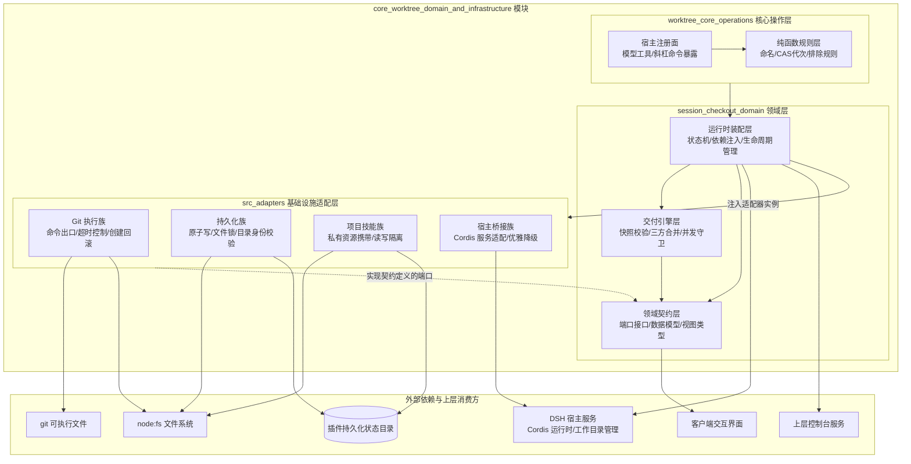

# 核心 Worktree 领域与基础设施模块
## 模块定位与核心用途
本模块是 dsh-git-worktree 插件的核心组成，承担「宿主无关业务逻辑」与「真实 DeepSeek Harness（DSH）运行环境」之间的桥梁作用，核心价值包括：
1.  **隔离工作区全生命周期管理**：为会话级隔离 Worktree 提供与宿主环境解耦的可靠业务能力，覆盖会话绑定、隔离工作区创建、评审交付、本地预览、回滚、检查点保存、崩溃恢复、过期资源清理的完整流程。
2.  **稳定跨层契约体系**：通过统一的端口接口、持久化数据模型、对外视图与操作类型定义，严格分离领域逻辑与外部基础设施，从结构上消除层间耦合与循环依赖。
3.  **安全强化的基础设施适配**：将领域端口落地为生产级适配器实现，内置多重安全保障：Git 命令直传不经 Shell、原子文件写入、跨进程文件锁、崩溃恢复机制、目录身份校验、Worktree 误删防护。
4.  **可独立测试的纯规则层**：收敛无副作用的业务规则逻辑（如 Worktree 命名、检查点 CAS 代次生成、交付排除规则、提交信息校验、创建失败安全语义），可完全脱离宿主环境完成单元测试。

## 模块架构
模块严格遵循单向依赖原则，通过契约层解耦领域逻辑与基础设施实现，整体架构与依赖关系如下图所示：

架构设计遵循单向依赖规则：领域层仅依赖自身定义的契约，适配器层实现契约接口但不反向依赖领域逻辑，核心操作层基于领域运行时能力向上暴露用户交互入口，所有层间交互均通过稳定契约完成，保障领域逻辑可独立测试、基础设施实现可按需替换。

## 核心组件文档索引
本模块由三个内聚的核心子组件构成，各组件的详细设计与实现说明可参考对应文档：
1.  **[会话检出领域模块](session-checkout-domain.md)**
    作为宿主无关的核心领域层，定义统一的端口与类型契约，实现 Git 字节级安全写操作、检查点并发守卫、会话检出状态机与运行时装配，是整个模块的业务逻辑核心。
2.  **[宿主适配层](src-adapters.md)**
    作为模块的基础设施边界，将领域契约定义的端口逐一落地为可在真实 DSH 宿主上运行的适配器实现，涵盖 Git 命令安全出口、崩溃安全持久化、随会话携带的项目技能资源、Cordis 服务桥接与降级逻辑，内置多重安全强化机制。
3.  **[核心操作与纯函数工具层](worktree-core-operations.md)**
    作为模块最薄的独立层，收敛可无副作用单测的纯规则逻辑（如 Worktree 命名、检查点代次生成、交付排除规则、创建失败安全语义），并将领域能力注册为模型可见工具与用户可调用的 `/worktree` 斜杠命令，严格遵守「删除操作前必须迁移会话工作目录」的安全契约。