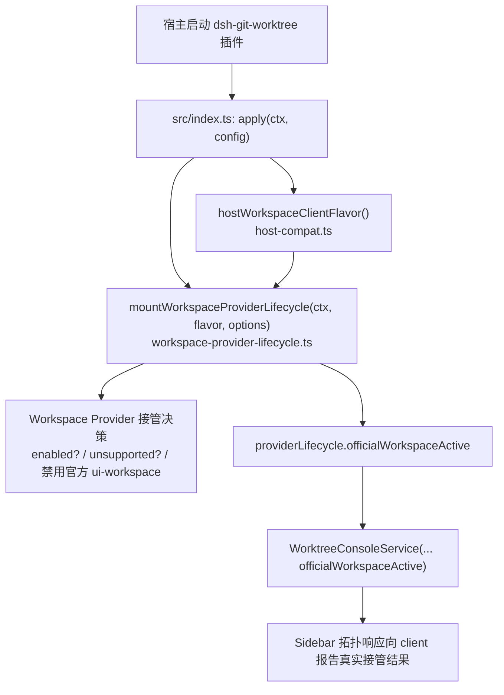
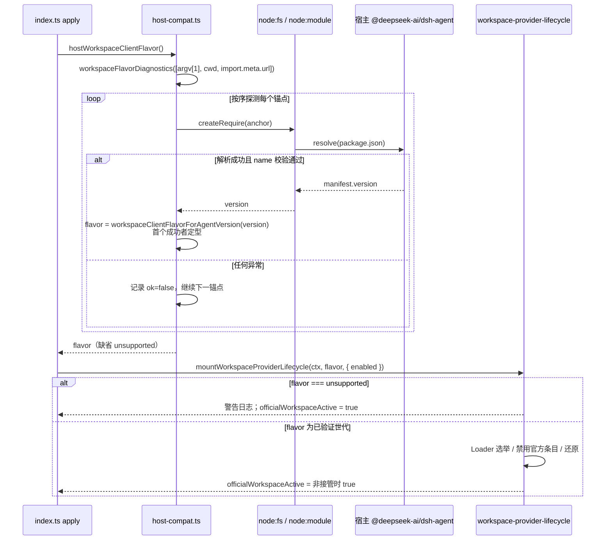
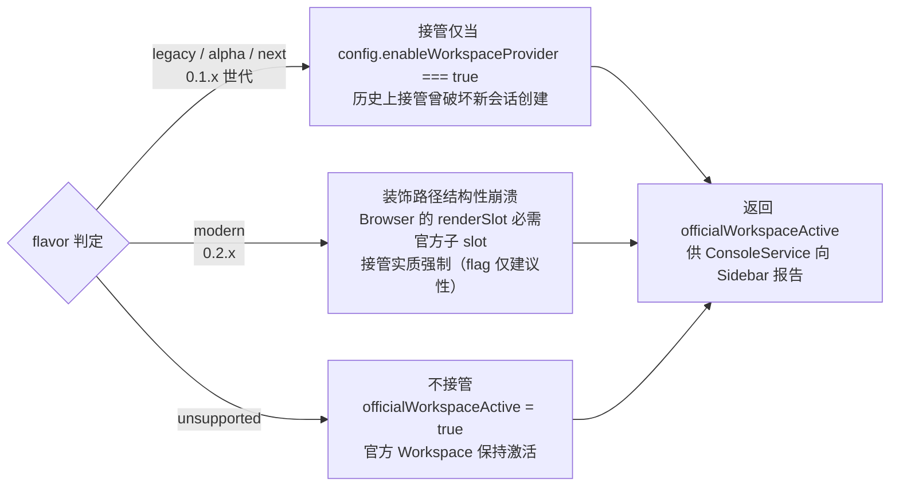
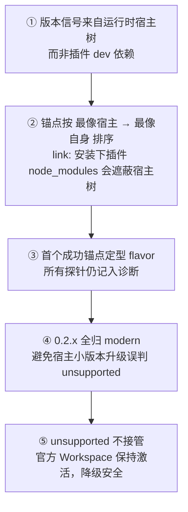

# 宿主版本兼容（host_compat）

## 简介

`host_compat` 是 worktree 生命周期管理核心中最小但最关键的宿主感知模块。插件 `dsh-git-worktree` 以**同一构建产物**运行在多个世代的 DSH 宿主（Host）上，这些宿主对 Workspace UI 的注册机制、slot 语义、Loader 行为各不相同。本模块的职责只有一件：**探测当前运行时到底是哪一个宿主世代（flavor）**，并把该结论交给下游决策点（如 Workspace Provider 接管生命周期）决定采取哪种适配策略。

它不直接执行任何 Git 操作或 Worktree 接管动作——那些属于 [workspace_provider_lifecycle](workspace_provider_lifecycle.md) 的职责。本模块是纯"版本信号探测 + 归类"层：

1. 从运行时锚点（entry 脚本、`cwd`、插件自身 URL）解析**宿主侧**的 `@deepseek-ai/dsh-agent` 真实版本；
2. 把版本映射为五种 `WorkspaceClientFlavor` 之一（`legacy` / `alpha` / `next` / `modern` / `unsupported`）；
3. 同时输出每个锚点的探测诊断，便于排障时定位"为什么判定为 unsupported"。

---

## 核心数据模型

### `WorkspaceClientFlavor` —— 宿主世代枚举

| Flavor | 判定版本 | 语义 |
|---|---|---|
| `legacy` | 精确等于 `0.1.2-rc.1` | 最早一代宿主；Workspace 接管为**可选**（曾破坏新会话创建） |
| `alpha` | 精确等于 `0.1.6-alpha.2` | 0.1.x 的 alpha 分支 |
| `next` | 精确等于 `0.1.7-rc.2` | 0.1.x 的 RC 分支 |
| `modern` | 精确等于 `0.2.0-rc.2`，或任何 `0.2.x`（`isModernGeneration` 正则 `^0\.2\.`） | 当前验证过的世代；接管为**强制**（装饰路径在 0.2.x 结构上必然崩溃） |
| `unsupported` | 其余所有版本（含 0.1.x 中三个钉版之外的版本、0.3+） | 未做源码验证，接管功能禁用，官方 Workspace 保持激活 |

设计要点（源码注释中的关键决策）：

- **0.2.1-rc.5 是钉版现代发布**：插件 dev 依赖钉住 `@deepseek-ai/dsh-client-ui-workspace@0.2.1-rc.5`（见 `package.json`）。rc.5 是上游对 rc.4 的纯版本号重发——官方 Workspace Client 与 rc.4 逐字节相同（232824 字节，SHA-256 一致）。所有 modern 分支消费的 seam（slots、sessions、workspaces、locale、remote、layout、shortcuts、`sidebar.workspaces` 及其子 slots）均对照该版本验证过。
- **因此非钉版 0.2.x 不归为 unsupported**：任何 `0.2.` 前缀版本都解析到同一已验证世代，避免宿主每次小版本升级就被误判。
- **0.1.x 分裂为三个 flavor、0.3+ 一律 unsupported**：这些世代未做源码验证。

### `WorkspaceFlavorAnchorDiagnostic` —— 单锚点探测结果

```ts
interface WorkspaceFlavorAnchorDiagnostic {
  kind: 'entry' | 'cwd' | 'plugin' | 'extra'  // 锚点种类
  anchor: string                               // 锚点路径/URL
  ok: boolean                                  // 是否在此锚点下解析到 dsh-agent
  version?: string                             // 解析到的版本号（成功时）
}
```

### `WorkspaceFlavorDiagnostics` —— 完整诊断报告

```ts
interface WorkspaceFlavorDiagnostics {
  flavor: WorkspaceClientFlavor        // 第一个成功锚点得出的世代（缺省 unsupported）
  anchors: WorkspaceFlavorAnchorDiagnostic[]  // 全部锚点的探测记录（含失败项）
}
```

---

## 探测机制详解

### 锚点顺序：为什么"最像宿主"的先探测

`workspaceFlavorDiagnostics()` 的默认锚点序列为：

```ts
[process.argv[1], process.cwd(), import.meta.url]
//      entry              cwd              plugin
```

对应 `kind` 依次为 `entry` / `cwd` / `plugin`（数组越界时为 `extra`）。

源码注释给出的关键推理：

> 宿主解析的 agent 包是**版本信号本身**，而非插件构建期的 dev 依赖。在 `link:` 安装下，插件自己的 `node_modules` 会**遮蔽（shadow）宿主树**——所以运行中的 entry 脚本和它的 `cwd` 优先，插件路径只是最后手段。

**第一个成功解析宿主 agent 树的锚点胜出（flavor 据此定型），但每个探针都会被记录到 `anchors` 中。**

### 版本解析：`agentVersionFromAnchor()`

对每个锚点：

1. 用 `createRequire()` 从锚点构造一个 require 作用域（`file:` 协议与 URL 两种形态都兼容）；
2. 在该作用域下 `require.resolve('@deepseek-ai/dsh-agent/package.json')` 并 `readFileSync` 读取；
3. 校验 `manifest.name === '@deepseek-ai/dsh-agent'`（防止解析到同名假包），通过则返回 `manifest.version`；
4. 任何异常（锚点下根本看不到宿主 agent 树）被静默吞掉——**"这个锚点看不到，试下一个"**。

### 对外 API

| 函数 | 签名 | 用途 |
|---|---|---|
| `workspaceClientFlavorForAgentVersion(version)` | `string \| undefined → WorkspaceClientFlavor` | 纯函数：版本 → flavor（便于测试） |
| `agentVersionFromAnchor(anchor)` | `string \| undefined → string \| undefined` | 单锚点版本探测（内部） |
| `workspaceFlavorDiagnostics(anchors?)` | `ReadonlyArray<string\|undefined> → WorkspaceFlavorDiagnostics` | 默认锚点 `[argv[1], cwd, import.meta.url]` |
| `hostWorkspaceClientFlavor()` | `() → WorkspaceClientFlavor` | 便捷封装：只取诊断结果的 flavor |

---

## 架构与数据流

### 模块在宿主启动链路中的位置



### 版本探测时序



---

## Flavor 驱动的下游适配策略

本模块输出的 flavor 在 [workspace_provider_lifecycle](workspace_provider_lifecycle.md) 中被直接消费，形成下表的适配矩阵：



> 更完整的 Loader 选举、`adopted`/`overridden` 所有权簿记、10 秒操作天花板与还原语义，请参阅 [workspace_provider_lifecycle](workspace_provider_lifecycle.md)。本模块只提供"判定依据"，不参与这些机制。

---

## 与构建配置的关系

`package.json` 中的 `peerDependencies` 与 `devDependencies` 共同印证了 flavor 表：

- `peerDependencies` 声明 `@deepseek-ai/dsh-agent` 兼容范围为 `^0.1.2-rc.1 || ^0.2.0-rc.1 || ^0.2.1-rc.1`；
- devDependencies 钉住 `@deepseek-ai/dsh-agent@0.2.1-rc.5`（modern 世代的验证基准）；
- 额外以别名形式引入两个历史版本的 ui-workspace：
  - `@deepseek-ai/dsh-client-ui-workspace-alpha` = `npm:@deepseek-ai/dsh-client-ui-workspace@0.1.6-alpha.2`
  - `@deepseek-ai/dsh-client-ui-workspace-next` = `npm:@deepseek-ai/dsh-client-ui-workspace@0.1.7-rc.2`

这些别名正是 `vitest.config.ts` 中 `virtual:dsh-official-workspace-client-{,-alpha,-next}` mock 别名的来源——测试可在同一进程内模拟三种已验证世代的宿主客户端。

另外，`cordis.patch.yml`（宿主 bundle patch）已完全移除旧的 client 侧条件禁用表达式，改由本模块判定的 flavor 经 host 侧 Loader 操作驱动接管——历史崩溃（2026-10-17，`uiWorkspace` 无人提供导致 web boot 崩溃）的根因正是同一表达式在 host apply 与 renderer 审计两个时刻求值结果相反。

---

## 设计要点总结



---

## 参考链接

- 父模块：[worktree_lifecycle_management_core](../worktree_lifecycle_management_core.md)
- 直接消费方：[workspace_provider_lifecycle](workspace_provider_lifecycle.md)（Workspace Provider 接管生命周期）
- 插件入口与 Config：[worktree_lifecycle_management_core_index](worktree_lifecycle_management_core_index.md)（`apply()` 与 `enableWorkspaceProvider` 配置项）
- 构建与版本钉版：[build_and_configuration](../build_and_configuration.md)（`package.json` peer/dev 依赖、`vitest.config.ts` mock 别名、`cordis.patch.yml`）
- Sidebar 拓扑如何消费 `officialWorkspaceActive`：[console_host](../console_control_plane_and_services/console_host.md)
