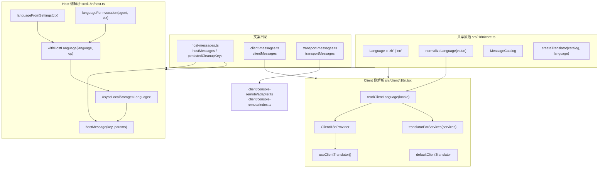
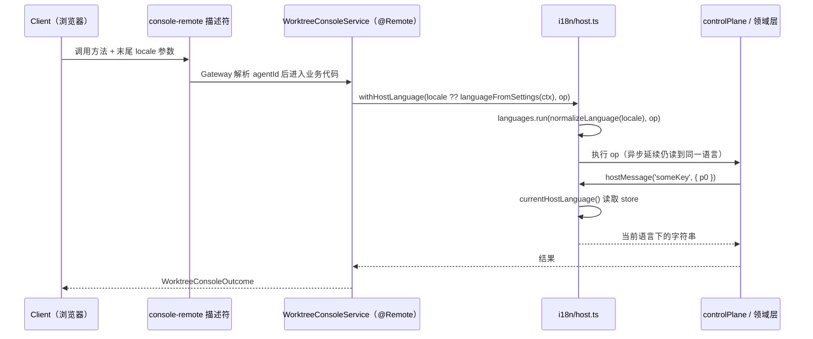
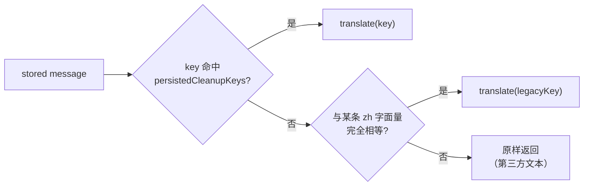
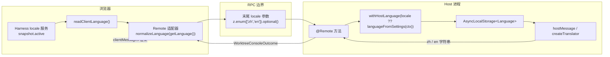

# i18n：多语言文案目录与本地化解析层

`src/i18n/` 是 `dsh-git-worktree` 插件的**文案与语言解析层**。它只做三件事：

1. 定义**双语（`zh` / `en`）文案目录**：Host 侧（工具描述、命令输出、错误文案）、Client 侧（控制台、验收卡、侧栏标签）、传输层（Remote 调用失败提示）；
2. 提供**共享的翻译原语**：语言归一化、类型安全的 key + 占位符推导、模板插值；
3. 决定**某一次调用应当使用哪种语言**：Host 侧按调用（invocation）从 `AsyncLocalStorage` 取快照，Client 侧从 Harness `locale` 服务读取并订阅变化。

本模块**不渲染任何 UI、不发起任何 RPC、不读写文件**。它被所有其它模块单向依赖（Host 与 Client 两侧共用同一份 `core.ts`），因此自身必须保持「零宿主依赖」。

> 本页同时承担 `docs/i18n.md` 的发布职责：`package.json` 的 `files` 白名单显式包含 `docs/i18n.md`，它会随 npm 包一起分发。

---

## 1. 设计目标与不变量

| 目标 | 落地方式 |
| --- | --- |
| 一份原语同时服务 Node 与浏览器 | `core.ts` 只依赖 TypeScript 类型系统与 `String.prototype.replace`，不 import 任何 browser / Host 专有模块 |
| key 与占位符编译期可校验 | 目录用 `as const satisfies MessageCatalog` 声明，`Translator<C>` 用模板字面量类型从 `zh`/`en` 文本中**推导出占位符名**，漏传/多传参数直接类型报错 |
| 语言是**调用级**而非模块级状态 | Host 侧 `AsyncLocalStorage<Language>`，每次 `withHostLanguage()` 建立独立快照；Client 侧 `useSyncExternalStore` 订阅 locale 服务 |
| 用户数据永不翻译 | 插值参数（路径、分支名、用户标题、第三方报错）作为 `{p0}` / `{count}` 等值注入，只替换模板骨架 |
| 第三方文本原样透传 | 只翻译「自己拥有的句子」；未登记的字符串一律原样返回（见第 5 节） |
| 双语契约可被测试守护 | 每条目录项都必须 `zh`/`en` 双非空、占位符集合完全一致、`en` 不含 CJK 字符（见第 11 节） |

---

## 2. 架构总览



三条关键依赖方向：

- `core.ts` ← 所有人（**唯一**被两侧共用的文件）；
- `host.ts` 依赖 `node:async_hooks`，因此**只能**在 Host（Node）侧引入；
- `client/i18n.tsx` 依赖 React，因此**只能**在浏览器 bundle 中引入，Host 侧代码禁止引用。

---

## 3. 文件与职责

| 文件 | 主要导出 | 职责 | 运行环境 |
| --- | --- | --- | --- |
| `src/i18n/core.ts` | `Language`、`normalizeLanguage`、`MessageCatalog`、`Translator`、`createTranslator` | 语言类型、归一化、类型安全翻译器工厂 | 通用 |
| `src/i18n/host-messages.ts` | `hostMessages`、`hostRegistrationMessage`、`persistedCleanupKeys`、`PersistedCleanupKey`、`hostPersistedCleanupMessage` | Host 侧全部文案（工具描述、`/worktree` 命令、领域错误、清理诊断），以及**持久化文案的本地化投影** | 通用（纯数据 + 纯函数） |
| `src/i18n/host.ts` | `currentHostLanguage`、`withHostLanguage`、`languageFromSettings`、`languageForInvocation`、`hostMessage` | 调用级语言快照与 Host 翻译器 | Node（`node:async_hooks`） |
| `src/i18n/client-messages.ts` | `clientMessages` | Client 侧全部文案（目标胶囊、验收卡、分支/标签/提交图、设置卡、恢复流程提示） | 通用（纯数据） |
| `src/i18n/transport-messages.ts` | `transportMessages` | Remote 调用层自身的 4 条提示（契约不匹配、挂载失败、Workspace 形态未知、调用超时） | 通用（纯数据） |

规模上，`host-messages.ts` 与 `client-messages.ts` 各含**数百条**条目，是本仓库最大的两份「数据文件」；`transport-messages.ts` 刻意保持极小（4 条），因为它描述的是传输层自身而不是业务。

---

## 4. 共享原语：`core.ts`

### 4.1 语言归一化

```ts
export type Language = 'zh' | 'en'
export function normalizeLanguage(value: unknown): Language {
  return typeof value === 'string' && /^en(?:-|$)/i.test(value) ? 'en' : 'zh'
}
```

规则是**白名单 + 默认中文**：

| 输入 | 输出 | 说明 |
| --- | --- | --- |
| `'en'`、`'EN'`、`'en-US'` | `'en'` | 仅 `en` 及其地区变体被识别为英文 |
| `'zh'`、`'zh-CN'`、`'fr'`、`'ja-JP'`、`undefined`、`null`、对象 | `'zh'` | 其它一律回落到中文（插件默认语言） |

这也是 Client 侧测试断言的行为（`tests/client-i18n.test.tsx`：`localeFace('fr')` → `'zh'`）。归一化只接受字符串，因此**不会**从 `{ language: 'en' }` 这类「猜出来的字段」读取语言。

### 4.2 目录与占位符推导

```ts
export type MessageCatalog = Record<string, { readonly zh: string; readonly en: string }>
type Placeholders<S extends string> =
  S extends `${string}{${infer P}}${infer Rest}` ? P | Placeholders<Rest> : never
type MessageArgs<S extends string> = [Placeholders<S>] extends [never]
  ? [params?: Record<string, string | number>]
  : [params: Record<Placeholders<S>, string | number>]
```

- `Placeholders` 递归拆解模板，收集所有 `{name}`；
- 无占位符的 key，第二参数**可选**；有占位符的 key，第二参数**必填**，且键集合被精确约束；
- `MessageArgs` 对 `zh` 与 `en` 的**并集**求占位符，因此只要一侧多写了一个占位符，调用点就会类型报错——这与测试里的「两侧占位符集合必须相同」互为双保险。

### 4.3 翻译器工厂

```ts
export function createTranslator<const C extends MessageCatalog>(catalog: C, language: Language): Translator<C> {
  return ((key: keyof C & string, params?: Record<string, string | number>) => {
    const template = catalog[key]![language]
    return template.replace(/\{([^{}]+)\}/g, (match, name: string) =>
      params && Object.prototype.hasOwnProperty.call(params, name) ? String(params[name]) : match)
  }) as Translator<C>
}
```

行为细节：

- **单次非递归替换**：`replace` 只扫描一遍，插值值里再出现 `{x}` 不会被二次展开（防止用户输入被当成模板）；
- **缺失参数保留原文**：`hasOwnProperty` 检查失败时返回 `match`，即保留 `{p0}` 字面量，而不是渲染 `undefined`；
- **只替换自有属性**：`Object.prototype.hasOwnProperty` 避免 `toString` 之类的原型链键被当成参数；
- **key 由类型系统保证存在**：`catalog[key]!` 的非空断言只在类型层；运行期传入未登记 key 会在取模板时抛错（调用点均为字面量，编译期已拦截）；
- `createTranslator` 是**纯函数**，同一 `(catalog, language)` 可反复调用；Client 侧因此在 `useMemo` 中缓存，Host 侧则每次调用新建（成本仅一次闭包分配）。

---

## 5. Host 侧：调用级语言快照与持久化文案

### 5.1 `AsyncLocalStorage` 快照



- `const languages = new AsyncLocalStorage<Language>()`：**每次调用一份不可变快照**，跨 `await` 延续有效，但不会泄漏到并发的另一次调用；
- `currentHostLanguage()`：无 store 时回落到 `'zh'`（未包裹的路径、测试直调、模块初始化阶段都不会炸）；
- `withHostLanguage(language, operation)`：`languages.run(normalizeLanguage(language), operation)`，是 Host 侧唯一的「设置语言」入口。`WorktreeConsoleService` 的每个 `@Remote` 方法都以它包裹业务调用，locale 来自 RPC 尾部参数（见 [console_remote](console-remote.md) 与 [console_host 的远程面](console-host-remote-face.md)）；
- `hostMessage` 是一个**绑定到当前上下文的翻译器**：它不缓存语言，而是在每次调用时 `createTranslator(hostMessages, currentHostLanguage())`，因此同一模块级的 `hostMessage` 在不同 invocation 下产出不同语言。

### 5.2 语言来源：设置 vs. 调用者

```ts
export function languageFromSettings(ctx: unknown): Language {
  const context = ctx as { get?: (name: string) => unknown } | undefined
  try {
    const settings = context?.get?.('settings') as { get?: (namespace: string) => unknown } | undefined
    const locale = settings?.get?.('locale') as { preference?: unknown } | undefined
    return normalizeLanguage(locale?.preference)
  } catch { return 'zh' }
}

export function languageForInvocation(agent: unknown, fallbackContext: unknown): Language {
  const context = (agent as { ctx?: unknown } | undefined)?.ctx ?? fallbackContext
  return languageFromSettings(context)
}
```

- 只读 **DSH `settings` 服务下 `locale` 命名空间的 `preference`**，即「context 拥有的公共设置接缝」；注释明确要求**绝不**把浏览器偏好写入持久化状态；
- 组合期或拆除期服务缺失会抛错，因此整段 `try/catch` 回落到 `'zh'`；
- `languageForInvocation` 优先使用 **Agent 自己的 `ctx`**，避免 scoped settings 在多个用户/会话之间串味；只有拿不到时才退回插件级 `ctx`。工具（`src/tools.ts`）与命令（`src/commands.ts`）都用它取语言。

### 5.3 注册元数据：必须双语

```ts
export function hostRegistrationMessage(key: keyof typeof hostMessages): string {
  return hostMessages[key].zh + ' / ' + hostMessages[key].en
}
```

工具名/描述、`/worktree` 命令的 usage 等**注册元数据在会话之间共享**（一次注册，被所有 Session 复用），无法按调用语言切换。因此这些文案不做本地化，而是直接给出「中文 / English」双语拼接，保证任何语言的用户都能读懂；同时该函数的输出与调用语言**无关**（测试显式断言 zh / en 环境下结果相同）。

### 5.4 持久化文案的本地化投影

清理恢复的判定文案会写进注册表（例如 `cleanupNewChanges`），历史记录里存的是一段**固定文本**。为了在不破坏既有数据判别的前提下支持多语言：

```ts
export const persistedCleanupKeys = [
  "cleanupIdentityChanged","cleanupResidue","cleanupIncompleteDelivery","cleanupIncompleteReceipt",
  "cleanupMissingBeforeQuarantine","cleanupQuarantineIdentity","cleanupNewChanges",
  "cleanupMissingBeforeRemoval","cleanupQuarantineBusy","cleanupDirectoryBusy",
] as const
export type PersistedCleanupKey = typeof persistedCleanupKeys[number]
```



`hostPersistedCleanupMessage(message, translate, key?)` 的三段式解析：

1. **新记录**同时存下 `key`，读取时按当前语言翻译（`named` 分支）；
2. **历史记录**只有文本，用 `persistedCleanupKeys` 的中文字面量做**精确反查**兜底（`legacy` 分支）——只有这 10 条白名单会进入反查；
3. 其余一律**原样返回**。测试明确断言 `prefix: ${stored}` 这种「包含但不等于」的字符串**不会**被翻译，因此第三方错误文本不可能被误改写。

这条设计的关键是「有限白名单」：它既保住了历史数据的判别语义，又不引入任何通用文本解析（不做前缀匹配、不做子串替换）。该函数的唯一调用方是 Host 侧投影层（见 [console_host 的投影层](console-host-projection.md)）。

---

## 6. 文案目录的命名与组织约定

三份目录都用 `as const satisfies MessageCatalog` 声明：`as const` 保留字面量 key 与文本类型（供 `Translator<C>` 推导），`satisfies` 保证形状符合 `{ zh, en }`。

| 目录 | key 风格 | 典型条目 |
| --- | --- | --- |
| `hostMessages` | 早期为**英文句子的规范化形式**（`theSessionIsNotAssociatedWithAProject`、`the.worktree.identity.returned.by.host.inspection.does`），新增条目偏向 camelCase（`initialCommitFailed`）；同一句子重复出现时追加数字后缀（`...CannotPerform162`、`...From281`、`onlyTheOwnerIsolatedSessionCanSaveACheckpoint447`） | 领域错误、工具描述、`/worktree` 输出、清理诊断 |
| `clientMessages` | 语义点分命名（`detail.title`、`tag.create.confirm`、`settings.autoDeliver.hint`），重复键追加数字（`files.2`、`creating.2`、`symbol.3`） | 胶囊状态、验收卡、分支/标签/提交图、设置卡、恢复流程 |
| `transportMessages` | 少量 camelCase（`malformed`、`mountFailed`、`workspaceGenerationUnknown`、`invokeTimeout`） | 传输层自身失败 |

占位符约定：

- **位置式 `{p0}`、`{p1}`…**：Host 侧领域错误与工具文案统一使用，含义由调用点决定，便于在句子中自由调整语序；
- **语义式命名**：Client 侧与少数 Host 文案使用可读名（`{count}`、`{iteration}`、`{project}`、`{branch}`、`{target}`、`{reviewId}`、`{revision}`、`{value}`；传输层用 `{method}`、`{seconds}`；`error.detail` 用 `{message}`/`{category}`/`{recovery}`）。

注意 `clientMessages` 中存在**纯符号/碎片条目**（`symbol` → `•••`、`symbol.2` → `（`、`symbol.4` → `✓`、`iteration` → `第` / `Iteration `）。这是为了让中英文语序差异（前缀/后缀、量词）通过拼接解决，而不是写死在组件里。

---

## 7. Client 侧：locale 订阅与调用时解析

`src/client/i18n.tsx` 把 `core.ts` 接到 Harness 的 `locale` 服务上：

```ts
export interface ClientLocaleSource {
  getSnapshot(): { active?: unknown }
  subscribe(listener: () => void): () => void
}
export function readClientLanguage(locale: unknown): Language {
  try { return normalizeLanguage(localeSource(locale)?.getSnapshot().active) } catch { return 'zh' }
}
```

- 只认 **`getSnapshot().active`**（DSH `LocaleFace` 已把 preference 与浏览器回退解析到 `active`），不接受 `{ language: 'en' }` 这类猜测字段；形状不符或 `getSnapshot` 抛错都回落 `'zh'`；
- `ClientI18nProvider` 用 `useSyncExternalStore(subscribe, getSnapshot, getSnapshot)` 订阅 locale 变化；`language` prop 可显式覆盖（用于测试与强制语言）；
- 切换语言**不会重置组件本地 state**（测试用计数器验证：从 0 切到 1 再切语言，计数保持不变）；
- 每个 Provider 实例持有**自己的**语言，两个并存的 Client 实例互不影响；
- `useClientTranslator()` 以 `useMemo` 按语言缓存翻译器；
- `defaultClientTranslator` 是 `'zh'` 的实例，作为纯模型函数的默认参数（如 `src/client/model.ts`、`src/client/workspace-sidebar/model.ts`、`src/client/target-console/TargetStatusAction.tsx`），保证「不传翻译器」时的渲染仍然是确定、可重放的；
- **命令式服务**（`src/client/actions.ts` 等）用 `translatorForServices(services)`，在**每次调用时**读取语言，而不是模块加载时固化——测试断言：同一 `services` 在 locale 切换后，同一个 `finalizeCurrentSession()` 分别抛出 `No Session is currently selected.` 与 `当前没有选中的 Session。`。

装配侧（`src/client/index.tsx`）用 Proxy 包裹 `ctx.slots.register`，把每个注册的组件包进 `ClientI18nProvider`，因此**只有本插件注册的 Slot** 获得本地化上下文，不污染宿主其它组件。

---

## 8. 传输层文案：`transportMessages`

`transportMessages` 只被 Client 侧 Remote 适配器使用：

| key | 使用点 | 说明 |
| --- | --- | --- |
| `malformed` | `src/client/console-remote/adapter.ts` | payload 不满足 strict contract（含 codec 拒收） |
| `invokeTimeout` | 同上 | 30s / 180s 两档客户端超时；提示「服务端操作可能仍在进行」 |
| `mountFailed` | `src/client/console-remote/index.ts` | `remote.gitWorktree` 代理未解析，挂载失败 |
| `workspaceGenerationUnknown` | 装配诊断 | 无法识别当前安装的官方 Workspace Client 形态（对应 `src/host-compat.ts` 中 `workspaceClientFlavorForAgentVersion` 的 `unsupported` 分支） |

一个值得注意的耦合：适配器用 `isCodecRejection()` 判断「是 codec 拒收还是传输失败」，其判定条件之一是错误文本里出现中文片段 `返回了不符合 strict contract`（即 `malformed` 的 `zh` 文案）。也就是说，**`transportMessages.malformed.zh` 的这段措辞事实上是协议 token**，改动它会改变错误归类。修改该文案时必须同步检查 `src/client/console-remote/adapter.ts`。

适配器在每次 `invoke` 开头 `normalizeLanguage(getLanguage())`，并把 locale 作为**最后一个位置参数**传给 Remote 代理——这与 `src/console-remote/descriptors.ts` 中每个描述符末尾追加的 `json('locale', optionalLanguageSchema, ...)` 参数一一对应，`optionalLanguageSchema` 为 `z.enum(['zh','en']).optional()`（见 [console_remote](console-remote.md)）。即语言在**跨进程边界上是显式参数**，不依赖任何隐式全局状态。

---

## 9. 端到端语言流



要点：**Host 产出的错误文案已经是目标语言**（`consoleFailure` 把 `error.message` 原样放进 `WorktreeConsoleOutcome.error.message`，见 [console_host](console-host.md)），Client 只需显示；反过来 Client 自己的兜底文案（`malformed` / `invokeTimeout`）由 `clientMessages` / `transportMessages` 在本地生成。

---

## 10. 边界：什么**不**被翻译

1. **插值数据**：路径、分支名、用户标题、提交信息、第三方报错。测试用 `用户路径 C:\项目\English {name} / 分支` 断言其原样出现在两种语言的结果里。
2. **第三方错误文本**：`consoleFailure()` 对非 `SessionCheckoutError` 的错误**原样透传** `error.message`，只在完全没有 message 时回落到 `hostMessage('worktreeConsoleOperationFailed')`。`src/console-host/errors.ts` 的注释记录了该选择（本地控制台可观测性优先），并标明「若将来出现远程面，需要在此清洗」。
3. **历史持久化文本**：只有 `persistedCleanupKeys` 白名单内的 10 条会被投影，其余原样保留（第 5.4 节）。
4. **注册元数据**：不做本地化，改为双语并列（第 5.3 节）。

---

## 11. 测试与验证

| 测试文件 | 覆盖的不变量 |
| --- | --- |
| `tests/host-i18n.test.ts` | 每条 `hostMessages` 双非空、`zh`/`en` 占位符集合相同、`en` 不含 CJK；`withHostLanguage` 下 `consoleFailure` 输出目标语言但**错误码不变**；插值数据不被翻译；历史清理文案的精确反查与「包含但不等于」不误译；`hostRegistrationMessage` 与语言无关；第三方 message 原样透传 |
| `tests/client-i18n.test.tsx` | `readClientLanguage` 只认 `snapshot.active` 且异常回落 `'zh'`；Provider 订阅/切换/退订且不重置本地 state；两个 Provider 互不共享语言；`clientMessages` 全量占位符一致；ToolView 与解析器使用当前翻译器；命令式动作在每次调用时读语言；入口注册确实注入真实 locale 面；侧栏投影只翻译插件标签、保留项目名与路径 |

`vitest.config.ts` 以 `include: ['tests/**/*.test.{ts,tsx}']` 收集用例，`tests/client-i18n.test.tsx` 用 `// @vitest-environment jsdom` 单独切到浏览器环境；`package.json` 的 `test` 脚本即 `vitest run`。

---

## 12. 与其它模块的关系

| 关系 | 说明 |
| --- | --- |
| [console_host](console-host.md) / [远程面](console-host-remote-face.md) | 每个 `@Remote` 方法用 `withHostLanguage(...)` 包裹，locale 是显式尾参；错误经 `consoleFailure` 变成已本地化文案 |
| [console_host 的投影层](console-host-projection.md) | 用 `hostMessage` 生成本地化标签，用 `hostPersistedCleanupMessage` 投影持久化清理文案 |
| [core_domain](core-domain.md) | 领域层只抛稳定错误码 + 已本地化 `message`（`SessionCheckoutError`），本身不 import 本模块的目录数据 |
| [adapters](adapters.md) | 注册表损坏、锁回收、清理失败等诊断文案取自 `hostMessages` |
| [console_remote](console-remote.md) | 描述符末尾统一追加 `locale` 参数，schema 层用 `optionalLanguageSchema` 校验 |
| [client_ui](client-ui.md) | 全部界面文案经 `useClientTranslator()` / `translatorForServices()` 获取；`defaultClientTranslator` 作为纯模型的默认值 |
| [build_and_config](build-and-config.md) | `tsdown` 把 Client 侧 `client-messages` 内联进浏览器 bundle；`files` 白名单把本页随包发布 |

---

## 13. 扩展指南（新增一条文案）

1. 在**正确的目录**里加条目：Host 领域/工具/命令 → `host-messages.ts`；界面 → `client-messages.ts`；传输层自身 → `transport-messages.ts`。不要跨层复用（Host 文案进入 Client bundle 会带进不必要的体积）。
2. **同时**写 `zh` 与 `en`，占位符集合必须完全一致（位置式 `{p0}` 或语义名皆可，但两侧同名）。
3. 若该文案会被**持久化**并用于判别，把它加入 `persistedCleanupKeys` 白名单，并在读取处调用 `hostPersistedCleanupMessage(...)`，而不是直接 `hostMessage(...)`。
4. 若是**注册元数据**（工具名、描述、命令 usage），用 `hostRegistrationMessage(...)` 生成双语串。
5. 运行 `pnpm test`：占位符一致性与「`en` 无 CJK」的断言会立即拦截不完整的条目。
