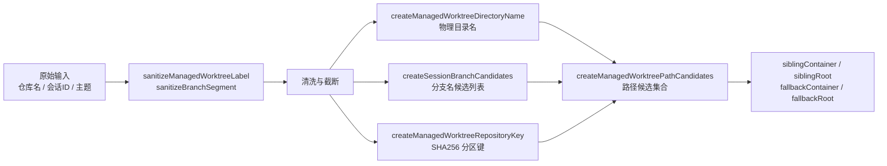
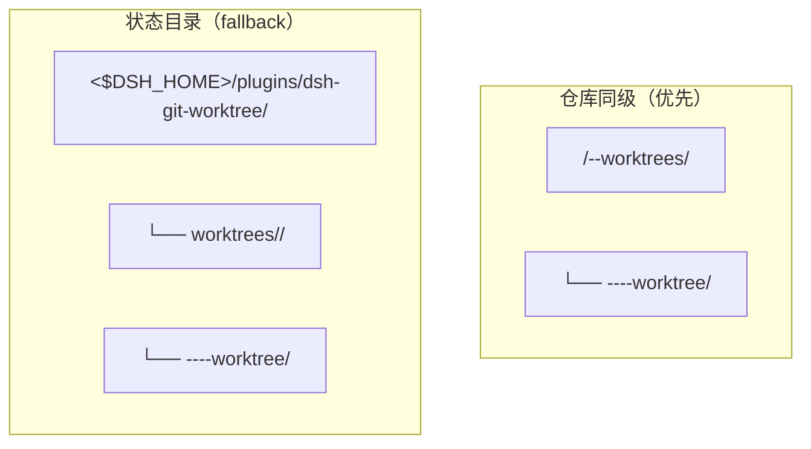
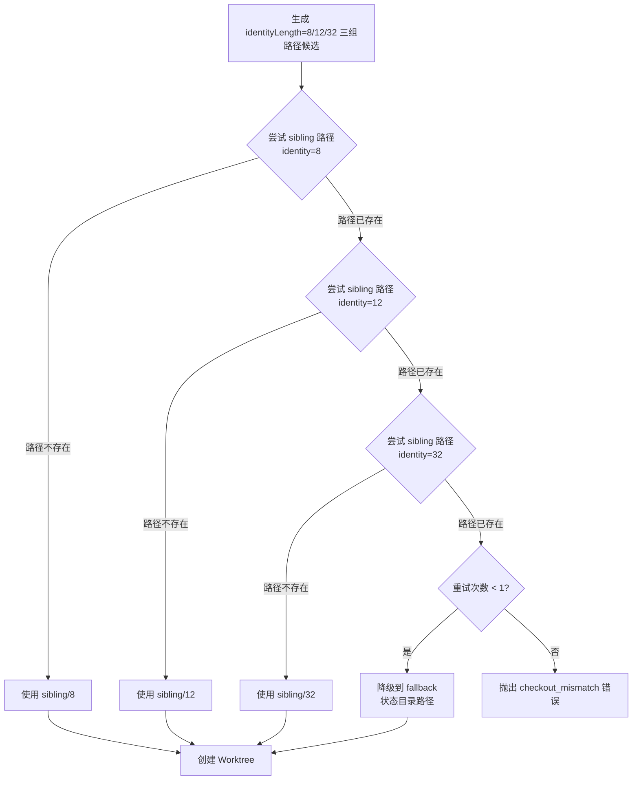
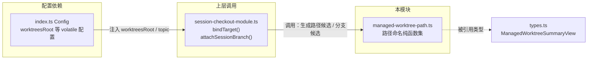

# Managed Worktree 路径命名模块

## 简介

`managed-worktree-path.ts` 是托管 Worktree 生命周期管理核心中的一个**纯函数命名与路径规划模块**。它负责把「仓库名、会话 ID、会话主题」等人类可读或机器生成的输入，转换为跨平台安全、冲突可避免、人类可识别的：

- **物理目录名**（Worktree 在磁盘上的存放路径）
- **会话分支名候选**（Git 分支命名）
- **仓库分区键**（区分同名仓库的稳定哈希）
- **路径候选集合**（同路径冲突时按身份长度递增的备选方案）

该模块**不触碰文件系统**，所有路径都是同步计算结果；由调用方（[`session-checkout-module`](session_checkout.md)）负责探测路径是否已存在、按候选顺序逐个尝试创建。

---

## 核心职责总览



---

## 导出函数与类型

### 1. `sanitizeManagedWorktreeLabel(rawName)`

把仓库 basename 转换为单个安全路径段。

**清洗规则：**
- 去除 Windows 非法字符（`< > : " / \ | ? *` 及控制字符）→ 替换为 `-`
- 空白 → `-`
- 连续多个 `-` 压缩为单个 `-`
- 去除首尾的 `.`、空白、`-`
- 按 Unicode 码点截断至 40 字符
- 若清洗后为空字符串 → 返回 `"repository"`
- 若命中 Windows 保留名（`CON/PRN/AUX/NUL/COM1-9/LPT1-9`）→ 前缀加 `_`

### 2. `createManagedWorktreeRepositoryKey(canonicalGitRoot)`

对规范化 Git 根路径计算 SHA256，取前 12 位十六进制字符作为分区键。用于**区分共享同一 basename 的不同仓库**，是 fallback 路径中的最后一段容器名。

### 3. `sanitizeBranchSegment(raw)`

把任意会话标识或主题压成安全的 Git 分支路径片段（保留 `-`/`_`/`.`）。与目录标签不同，它更严格地遵循 Git ref 命名规则（不允许空格、不允许斜杠以外的路径字符）。

### 4. `createSessionBranchCandidates({ sessionId, topic?, limit? })`

生成会话分支名候选列表，格式为 `feat/sess-<会话>[--主题]`。重名时自动追加 `-2`、`-3`… 直到 `limit`（默认 5）。每个候选都会经过 Git 禁止段字符过滤（如 `..`、`.lock` 结尾、`@{` 等）。

**典型输出示例：**
```
feat/sess-abc123--my-topic
feat/sess-abc123--my-topic-2
feat/sess-abc123--my-topic-3
```

### 5. `createManagedWorktreeDirectoryName({ repositoryName, checkoutId, identityLength? })`

生成物理 basename，格式为 `<repositoryLabel>--<identity>--worktree`。其中 `identity` 从 `checkoutId` 提取纯字母数字字符，默认取前 8 位。

### 6. `createTopicManagedWorktreeDirectoryName({ topic, dateStamp, checkoutId, identityLength? })`

**本地适配**命名：当配置了 `worktreesRoot` 且传入了 `topic` 时使用。格式为 `<topicLabel>-<YYYYMMDD>`，当 `identityLength > 8` 时追加 `-<identity>` 以解决同日同主题冲突。

### 7. `createTopicDateStamp(now?)`

返回 `YYYYMMDD` 格式的本地日期字符串，用于主题命名中的日期戳。

### 8. `createManagedWorktreePathCandidates(input)`

**核心函数**：一次性生成一对路径候选（sibling + fallback），不触碰文件系统。

**输入参数：**
| 参数 | 说明 |
|---|---|
| `localGitRoot` | 本地仓库规范根路径 |
| `managedCheckoutsRoot` | 插件状态目录 |
| `repositoryKey` | 由 `createManagedWorktreeRepositoryKey` 生成 |
| `checkoutId` | 唯一 checkout 标识 |
| `identityLength?` | 身份长度（8 / 12 / 32），用于冲突递增 |
| `topic?` | 本地适配：代理提供的人类可读主题 |
| `dateStamp?` | 本地适配：`YYYYMMDD` 日期戳 |
| `worktreesRoot?` | 本地适配：所有受管 Worktree 的自定义根目录 |

**输出类型 `ManagedWorktreePathCandidates`：**
| 字段 | 说明 |
|---|---|
| `siblingContainer` | 仓库同级容器目录 |
| `siblingRoot` | 仓库同级 Worktree 完整路径 |
| `fallbackContainer` | 状态目录下的 fallback 容器 |
| `fallbackRoot` | 状态目录下的 Worktree 完整路径 |

---

## 路径布局策略

### 默认布局（无 `worktreesRoot`）



- **sibling 优先**：Worktree 放在仓库同级目录下的 `<repoLabel>--worktrees/` 容器中，这样 Local 仓库不会把受管 Worktree 识别为未跟踪文件。
- **fallback 兜底**：当 sibling 路径受污染（如外部进程占用、权限不足）时，回退到插件状态目录下，以 `repositoryKey`（SHA256 前 12 位）分区。

### 本地适配布局（有 `worktreesRoot`）


- 所有受管 Worktree 统一收纳到 `worktreesRoot` 下，与仓库完全隔离。
- 有主题时使用人类可读的 `<topic>-<YYYYMMDD>` 命名。
- 无主题时按 `repositoryKey`（哈希）分区。

---

## 冲突解决流程

调用方（`bindTarget`）按以下策略逐个尝试路径候选：



**关键设计：**
- **绝不复用已有路径**：如果 sibling 路径被占用，不删不改，而是**扩展身份长度**（8 → 12 → 32）生成新路径。
- **sibling 降级机制**：当 sibling 容器无法受信任（被外部进程占用、非空非本插件目录）时，自动重试一次并降级到 fallback 路径。

---

## 与其他模块的关系



- **上游调用方**：[`session_checkout`](session_checkout.md) 中的 `bindTarget()` 与 `attachSessionBranch()`。
- **配置来源**：[`worktree_lifecycle_management_core_index`](worktree_lifecycle_management_core_index.md) 中定义的 `worktreesRoot` volatile 配置项。
- **被引用类型**：`ManagedWorktreePathCandidates` 作为内部接口，不直接导出到外层模块。

---

## 设计原则总结

| 原则 | 实现方式 |
|---|---|
| **跨平台安全** | 清洗 Windows 非法字符、保留名、控制字符 |
| **人类可读** | 优先使用仓库名、主题、日期戳；身份段只用于冲突兜底 |
| **确定性冲突解决** | 同一输入永远生成相同路径候选集 |
| **零文件系统副作用** | 纯函数计算，不触碰磁盘；探测由调用方完成 |
| **降级容错** | sibling 受污染时自动 fallback 到状态目录 |
| **本地适配可插拔** | `worktreesRoot` 与 `topic` 可选，不影响默认布局 |
