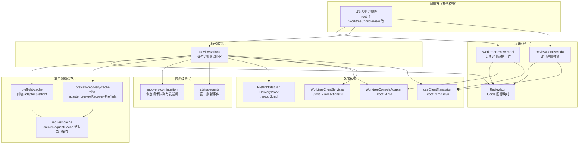
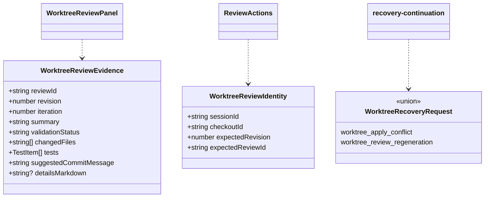
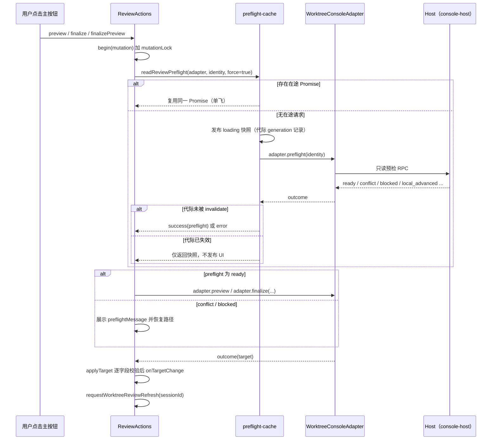
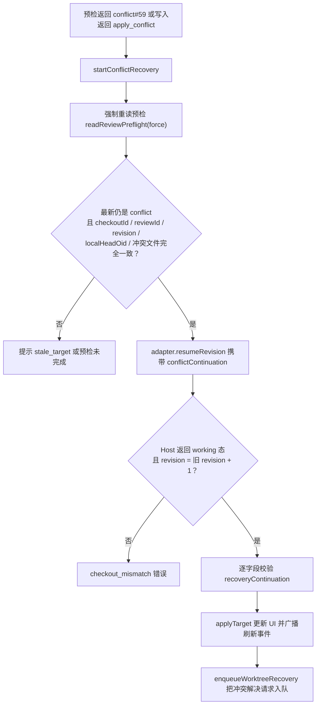
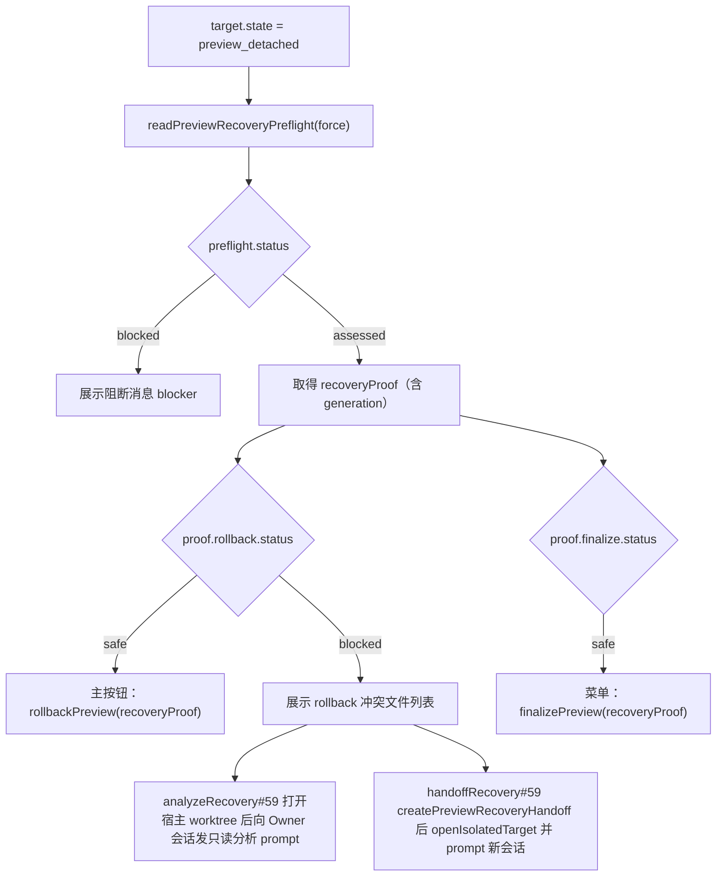
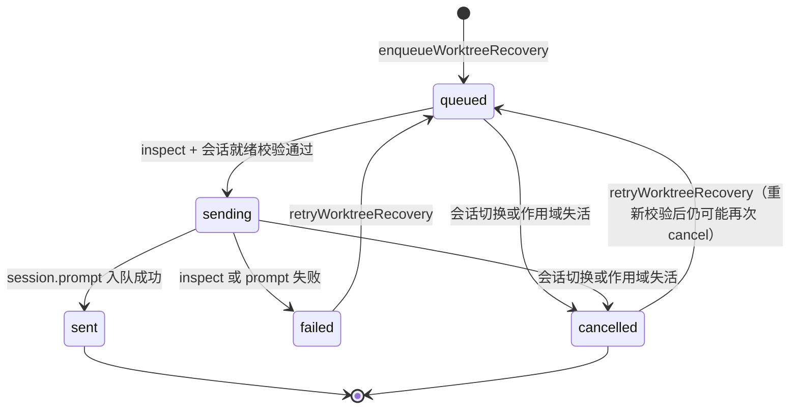

# 评审控制台（review-console）

## 简介

本模块位于 `src/client/review-console/`，是工作树（worktree）客户端 UI 中的「评审面」交互层。它把一次迭代评审（review）的**只读证据展示**、**交付动作编排**、**同步预检（preflight）读缓存**与**恢复续接（recovery continuation）队列**组织成一组 React 组件与纯客户端状态工具。

模块的核心设计原则：

- **Host 权威**：所有写操作都通过 `WorktreeConsoleAdapter`（见 [console-contract](root-4.md)）发往 Host，客户端绝不本地推断 Git 状态；
- **写入前强制重读**：任何 `preview / finalize / finalizePreview / rollbackPreview` 之前，都必须以 `force=true` 重新拉取只读预检，防止基于过期快照写入；
- **逐字段身份校验（CAS）**：Host 返回的 `target` 与 `recoveryContinuation` 会与请求身份逐项比对，任何不一致都以 `checkout_mismatch` 终止；
- **失活守卫**：所有异步链路通过 `isActive()` 与 `mutationLock` 判定，组件卸载或会话切换后不再发布旧状态。

父模块：[root_3](root-3.md)；兄弟模块：[设置卡片](root-3-settings-card.md)、[目标控制台](root-3-target-console.md)。

## 架构总览

## 核心组件清单

| 文件 | 导出 | 职责 |
| --- | --- | --- |
| `WorktreeReviewPanel.tsx` | `WorktreeReviewPanel`、`WorktreeReviewEvidence`、`WorktreeReviewIdentity`、`WorktreeReviewPanelProps`、`reviewIsStale` | 渲染评审摘要卡片：迭代号、摘要、自动化校验状态、变更文件数、保存阶段数；可展开校验命令列表；判定评审证据是否已过期 |
| `index.ts` | `reviewEvidenceFromTarget`、`reviewIdentityFromTarget` 及上述类型再导出 | 模块门面：把 Host 的 `WorktreeConsoleTargetSummary` 投影为卡片证据，并构造写操作所需的精确 CAS 身份 |
| `ReviewActions.tsx` | `ReviewActions` | 动作编排核心：按 `target.state` 渲染主按钮与「更多」菜单，编排全部交付/恢复 RPC，管理表单、确认弹窗、错误与状态文案 |
| `ReviewDetailsModal.tsx` | `ReviewDetailsModal`、`validationIcon`、`validationText` | 评审详情弹窗：冲突文件、变更文件、校验测试列表（超过 5 项折叠）、版本元信息；内置焦点陷阱 |
| `ReviewIcon.tsx` | `ReviewIcon`、`ReviewIconName` | 统一图标映射（lucide-react），尺寸 18、`aria-hidden` |
| `request-cache.ts` | `createRequestCache`、`RequestCache`、`Entry`、`RequestSnapshot` | 泛型身份键读缓存：按 adapter 分桶的 WeakMap、单飞（single-flight）、代际（generation）防过期发布、`useSyncExternalStore` 订阅 |
| `preflight-cache.ts` | `readReviewPreflight`、`invalidateReviewPreflight`、`useReviewPreflight`、`PreflightSnapshot` | 对 `adapter.preflight` 的封装；键为 `sessionId\0checkoutId\0expectedRevision\0expectedReviewId` |
| `preview-recovery-cache.ts` | `readPreviewRecoveryPreflight`、`invalidatePreviewRecoveryPreflight`、`usePreviewRecoveryPreflight`、`PreviewRecoverySnapshot` | 对 `adapter.previewRecoveryPreflight` 的封装；键额外包含 `expectedPreviewId`，仅用于 `preview_detached` 恢复评估 |
| `recovery-continuation.ts` | `enqueueWorktreeRecovery`、`restoreWorktreeRecovery`、`retryWorktreeRecovery`、`useWorktreeRecoverySnapshot`、`cancelWorktreeRecovery`、`detachWorktreeRecoveryRuntime`、`clearWorktreeRecovery` 及全部请求类型 | 恢复请求的持久化队列：等到宿主会话就绪后通过 `session.prompt` 把冲突解决 / 只读重生成请求入队给 Agent |
| `status-events.ts` | `requestWorktreeReviewRefresh`、`WORKTREE_REVIEW_REFRESH_EVENT` | 通过 `window` CustomEvent 通知所有已挂载的评审面重新读取 Host 权威 target |

## 关键类型与身份模型

- `WorktreeReviewIdentity` 是所有写 RPC（`preview / checkpoint / finalize / finalizePreview / rollbackPreview / discard / resumeRevision`）的 CAS 身份，由 `reviewIdentityFromTarget(sessionId, target)` 从 Host 快照构造；`target.review` 缺失时返回 `null`。
- `WorktreeReviewEvidence` 在 `WorktreeConsoleReviewSummary` 之上附加可选的 `detailsMarkdown`，由 `reviewEvidenceFromTarget(target, detailsMarkdown?)` 投影。
- `reviewIsStale(target, identity, review)`：`target.state === 'working'` 一律视为过期；其余评审态要求 `target.review.reviewId` 与 `target.revision` 均与身份一致，否则卡片显示「评审已过期，请刷新」。

## 目标状态与动作矩阵

`ReviewActions` 依据 `target.state` 与 `target.capabilities.*` 逐按钮门禁：

| `target.state` | 主按钮 | 更多菜单动作 | 说明 |
| --- | --- | --- | --- |
| `ready_for_review` | 预览变更 `preview`（要求预检 `safeReadyPreflight`） | 保存阶段并继续（`checkpoint`）、继续编辑（`resumeRevision`）、跳过预览直接保存（`finalize`） | 预检为 `conflict` 时主按钮让位，由 `PreflightStatus` 引导恢复 |
| `preview_active` | 确认并保存（`finalize_preview`） | 回滚并继续编辑（`rollbackPreview(resumeRevision=true)`）、回滚预览、保存阶段 | 已落本地可逆预览 |
| `preview_detached` | 回滚安全 → 回滚恢复；否则「重新检查」 | 安全 finalize → 保存；只读分析；交接给新 worktree | 交付恢复态，非 Git 语义 |
| `recovery_required` | 同上（带 `rollbackPreview` 能力时） | 同上 | 等待恢复动作 |
| `cleanup_pending` | 重试环境清理（`retryCleanup`） | — | 提交已完成、清理未竟 |
| `retained` / `delivered` | 终态文案 + `DeliveryProof` | — | 显示 `commitOid` 与保留期 |

所有按钮在 `disabled || submitting !== null || !live`（缺 adapter/identity/target）时统一禁用；终态不渲染动作区。

## 关键流程

### 1. 写入前强制预检

要点：`request-cache` 的 `invalidate` 只递增 `generation`，使迟到的响应不会回写过期 UI；`read` 默认复用上次成功/错误快照，仅 `force=true`（写入前）绕过。

### 2. 冲突恢复（apply_conflict）

运行时冲突（写入时才暴露的 `apply_conflict`）由 `runtimeConflict` 状态暂存，经 `recoverRuntimeConflict` 拼装成预检形状后走同一条恢复链。

### 3. 分离预览恢复（preview_detached）

`analyzeRecovery` 与 `handoffRecovery` 都会在发送 prompt **前后**各做一次 `adapter.inspect` 二次校验（目标状态、`recoveryContinuation.requestId`、cwd 路径），任一不符即抛 `checkout_mismatch`。

### 4. 恢复续接队列状态机

发送机（`attempt`）的每一跳都会重新验证：`isActive()` → 当前会话仍是 Owner 会话 → `adapter.inspect` 结果与请求逐字段匹配（`targetMatchesRequest`）→ 宿主会话 `openState === 'open'`、未运行、未移除且 cwd 等于 `managedRoot`。未就绪时进入 `waitForSession` 轮询退避（250ms 起步、最多 5s），一旦就绪发送则重置回 250ms。浏览器持久化仅为上下文（`localStorage` 键 `dsh-git-worktree:recovery:v1:{sessionId}`），Host 身份校验始终是权威。

## 错误与陈旧处理

`finishError(nextError)` 是统一的错误收口：

| 错误码 | 行为 |
| --- | --- |
| `apply_conflict`（且 `continuation.kind === 'worktree_apply_conflict'`） | 置 `runtimeConflict`，引导「请 Agent 解决冲突」 |
| `stale_target` | 提示「状态在写入前已变更」并回调 `onStale`，由外层刷新 |
| `stale_isolated` / `stale_local` | 提示同样文案，并强制 `refreshPreflight()` 重建预检 |
| 其他 | 渲染 `error.category.*` / `error.recovery.*` 本地化的告警条 |

`stale_target / stale_isolated / stale_local` 三类陈旧错误不在告警条中重复展示（已由消息文案覆盖）。目标 `revision` 变化时自动清空当前消息/错误/运行时冲突；`reviewSlot` 从 `waiting` 变为 `available` 时主动 `invalidateReviewPreflight` 并重读。

## 集成方式

1. 父容器（目标控制台视图）从 Host 取得 `WorktreeConsoleTargetSummary`，用 `reviewEvidenceFromTarget` / `reviewIdentityFromTarget` 构造证据与身份；
2. 并排挂载 `WorktreeReviewPanel`（只读卡片）与 `ReviewActions`（动作区），传入 `adapter`、`services`（`WorktreeClientServices`，见 [actions.ts](root-2.md)）；
3. `ReviewActions.onTargetChange(nextTarget)` 把新快照回写给父容器，`onStale(error)` 触发外层刷新；可选 `focusReview()` 供「查看评审」菜单打开 `ReviewDetailsModal`；
4. `proofVariant="compact"` 用于停靠（dock）上下文，以单行 `DeliveryProof` 替代完整卡片；`renderStatus` 由外层接管提交中状态展示；
5. 提交类弹窗（`checkpoint / commit / discard`）使用 `isValidCommitMessage`（见 [commit-message](root-4.md)）校验非空提交信息，checkpoint 的幂等键为 `checkpoint:{checkpointGeneration}`。

## 与其他模块的关系

- **[root_2](root-2.md)**：`WorktreeClientServices`（会话/工作区服务、`openIsolatedTarget`、`prefillSessionDraft`）、`PreflightStatus`、`DeliveryProof`、`useClientTranslator` 均来自该模块；
- **[root_4](root-4.md)**：`WorktreeConsoleAdapter` 接口、`WorktreeConsoleTargetSummary`/`WorktreeConsoleReviewSummary` 等契约类型（`src/console-contract.ts`）、`isValidCommitMessage`（`src/commit-message.ts`）；
- **[root_7](root-7.md)**：视图层类型 `WorktreeApplyPreflightView`、`WorktreePreviewRecoveryProof`、`WorktreeRetentionMode`（`src/types.ts`）；
- **[root_5](root-5.md)**：adapter 背后的 Host 实现（`console-host/service.ts`），本模块只通过契约与其通信；
- **本仓库其他评审面**：所有挂载的评审面通过 `requestWorktreeReviewRefresh` 广播协同刷新，参见 [目标控制台](root-3-target-console.md) 中监听该事件的轮询体系。
