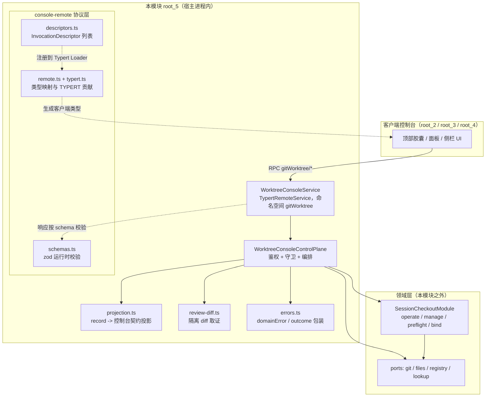
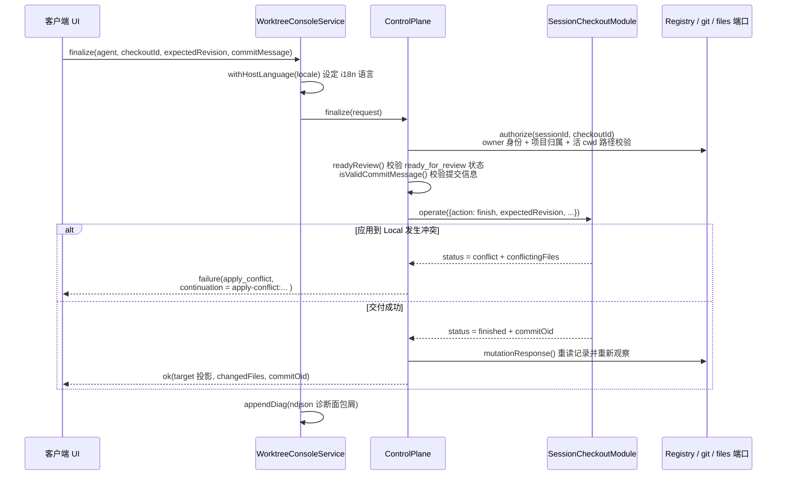
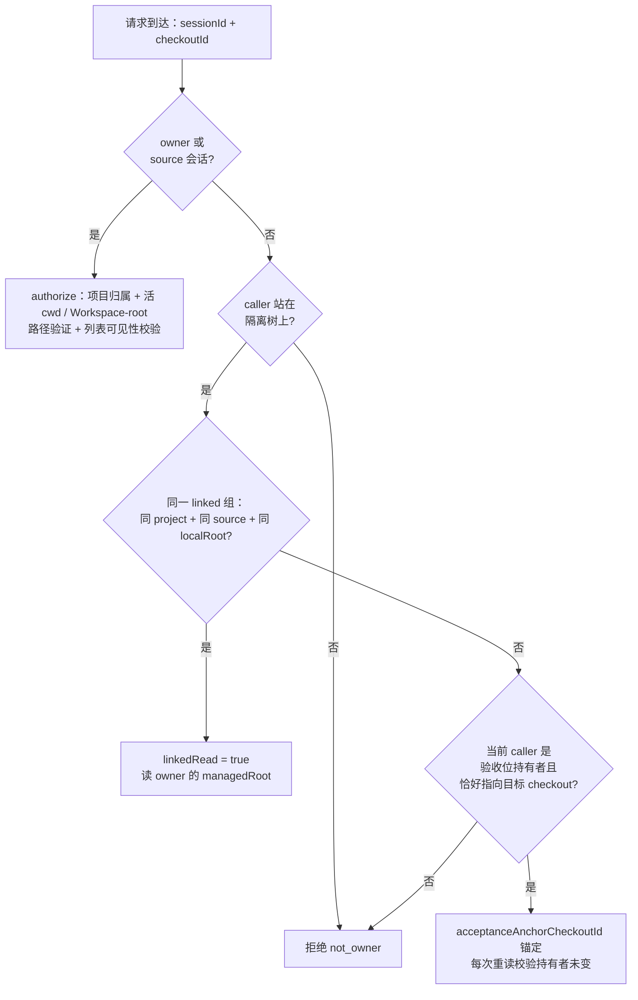
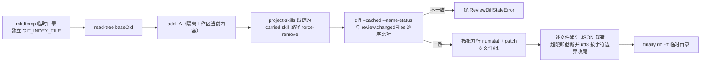

# Worktree Console 宿主与远程协议层（root_5）

## 模块定位

本模块是 git-worktree 插件的**宿主控制台（console host）与 RPC 远程协议层**。它把下层的会话检出领域模块（`SessionCheckoutModule`，见 [root_6](root-6.md)）包装为对客户端控制台 UI 暴露的 RPC 服务命名空间 `gitWorktree`，并承担以下职责：

- **多级调用鉴权**：owner 会话、source 会话、关联只读（linked read）、验收位持有者（acceptance holder）四档身份的校验与路径归属验证。
- **状态守卫与变更编排**：preview / checkpoint / finalize / discard / rollback / 迭代交接等动作的前置校验、乐观锁（expectedRevision / expectedReviewId）比对，以及冲突续传（continuation）的装配与回显。
- **契约投影**：把注册表中的领域记录 `ManagedCheckoutRecord` 投影为客户端消费的 `WorktreeConsoleTargetSummary / WorktreeConsoleTargetDetails`，并计算每个状态下的能力位（capabilities）。
- **评审 diff 取证**：在隔离 worktree 里用临时索引做沙箱化 diff 读取，带文件数 / 补丁字节 / 总载荷三重截断预算与陈旧性校验。
- **远程协议**：Typert Remote 调用描述符、zod 运行时校验 schema、以及对 `TypertRemoteMap` 的 TypeScript 模块增强（类型化的客户端映射）。
- **辅助设施**：RPC 诊断日志（ndjson 面包屑）、宿主运行期产物的 git pathspec 排除、Workspace 客户端代际探测。

## 架构总览

## 典型变更调用流程

以 `finalize`（验收并交付到 Local）为例，展示一次 RPC 请求从客户端到领域层再回到投影响应的完整路径：

关键设计要点：

- **读取路径复用观察结果**：`current` 每 5 秒轮询一次，control-plane 会把 `module.inspect` 已经付过的 git spawn 结果直接喂给后续投影（`observeFromCaller`），避免重复的 `git status` / `git inspect` 开销。
- **已交付终止态按 Local 边界授权**：owner 会话交付后 cwd 回到 Local，授权边界从 `managedRoot` 切换到 `localRoot` / 活 cwd，并由 `worktreeReachedDelivery` 这一共享谓词保证与 UI 投影口径一致。
- **续传对象（continuation）只随 `apply_conflict` 错误下发**：客户端凭 `recoveryProof` 再次进入 `resumeRevision` / `rollbackPreview` 时，control-plane 会逐项核对 proof 中的 sessionId / checkoutId / revision / reviewId / previewId，防止过期或伪造的恢复请求落地。

## 子模块一：console-host 宿主业务层（src/console-host/）

该目录是本模块的业务核心，共 5 个文件，组成"远程接入 → 鉴权编排 → 投影 → 取证"的纵向链路。

### 1.1 `WorktreeConsoleControlPlane`（control-plane.ts）

控制台的全部业务动作编排点，由 `createWorktreeConsoleControlPlane(options)` 工厂函数构造。

**依赖注入（`WorktreeConsoleControlPlaneOptions`）**

| 依赖 | 来源 | 用途 |
| --- | --- | --- |
| `module: SessionCheckoutModule` | [root_6](root-6.md) | 执行 `inspect / operate / manageManagedWorktreeForSession / preflight / bind / beginNextIteration` 等领域动作 |
| `lookup` | [root](root.md) 的 `lookup.ts` | 只读导航：`getSession / getProject / getSessionCwd / getSidebarMemberships` |
| `files` | `SessionCheckoutFilesPort` | `exists / canonicalize` 路径归属验证 |
| `registry` | `SessionCheckoutRegistryPort` | 原子读取 `managedCheckouts` 与 `sessionBindings` |
| `git` | `SessionCheckoutGitPort` | `inspect / status / branchOverview / graphLog / tag*` 等 git 端口 |
| `reviewDiff` | `WorktreeReviewDiffReader` | 隔离 diff 取证（见 1.4） |
| `setWorktreeRequest / pendingWorktreeRequest` | Host 侧注入回调 | 「下一次 turn 在新树里开始」的待办读写；真正建树由 [root_7](root-7.md) 的 `worktree-request.ts` 在 turn 第一步兑现 |
| `createTargetSessionId` | 可选，默认 `randomUUID` | 预览恢复交接（handoff）时生成新隔离会话 id |

**鉴权层级**（`authorize` / `linkedReadAccess`）

- `verifyCallerRoot` 用 `canonicalize`（带 memoize，避免一次请求对同一路径重复 realpath）做跨平台（Windows 大小写不敏感）路径归属判定；已交付终止态（`discarded / finalized / retained`）按 Local 边界放行已返回 Local 的 owner。
- `requireOwner` 把 `setRetention / setPermanent / retryCleanup / beginNextIteration / returnToLocal` 等"动冻结目录本身"的动作严格限定为 owner 会话。
- `safeConflictFile / safeRecoveryRequestId` 对冲突续传对象与 requestId 做白名单校验（长度、控制字符、绝对路径、`..` 段）。

**动作矩阵**（返回 `WorktreeConsoleOutcome<T>`）

| 分组 | 方法 | 守卫要点 |
| --- | --- | --- |
| 读取 | `sidebarTopology / current / list / inspect / gitOverview / gitGraph / gitListTags / listAbandoned` | 侧栏按 owner 迭代取最新任务；终端徽章被用户清除后不再投影 |
| Git 面 | `gitCreateBranch / gitSwitchBranch / gitPruneMergedBranches / gitCreateTag / gitDeleteTag / gitPushTag` | 全部解析到**项目 Local 根**而非当前隔离根；`gitSwitchBranch` 在本会话或他人同 Local 正处于交付期时拒绝 |
| 评审 | `reviewDiff / preflight / previewRecoveryPreflight` | 三重 CAS：`expectedRevision` + `expectedReviewId` + `module.preflight` 前后两次比对，中途隔离树变动即判 `stale_isolated` 并丢弃 diff 字节 |
| 变更 | `preview / checkpoint / resumeRevision / prepareReviewRegeneration / rollbackPreview / discard / finalize / finalizePreview` | 一律 `owner` + ready 状态 + 签名/请求合法性校验；conflict 结果装配 `WorktreeApplyConflictContinuation` |
| 生命周期 | `setRetention / setPermanent / retryCleanup / clearSidebarBadge / beginNextIteration / returnToLocal / initProject` | `withCreation` 对同一会话/同一项目根加防重入锁；`initProject` 用 `git.initializeProject` 在干净 Local 上初始化仓库 |
| 待办 | `setWorktreeRequest` | 只写 session record，不立即建树 |

### 1.2 `projection.ts`：领域记录 → 控制台契约投影

把注册表中的 `ManagedCheckoutRecord` 投影成客户端渲染用的 `WorktreeConsoleTargetSummary` / `WorktreeConsoleTargetDetails`。

- **`capabilities(record, callerSessionId, ownerSessionAvailable, linkedRead)`**：纯函数，按 phase × delivery.state × 调用者身份推导每个能力位（`preview / finalize / rollbackPreview / returnToLocal / ...`）。linked 只读会话只能 `open / inspect`；source 会话仅在 owner 不可用时才允许 `discard`。
- **`projectRecord`**：补齐 review 摘要、delivery proof（linkedRead 时不下发）、checkpoints 列表、`checkpointGeneration`、retained 保留期、清理消息、`reviewSlot`（同一 localRoot 上有他人正挂验收位时置 `waiting` 并冻结 `preview/checkpoint/finalize` 能力）。
- **`projectDetails`**：在 summary 之上加 `managedRoot / sourceRoot / currentBranch`；已交付 owner 回显时 `currentBranch` 取其真实所在的 Local 分支而非冻结任务分支（`settledLocalBranch`）。
- **`projectLocal`**：未绑定隔离树时的 Local 投影，能力位全部关闭（仅 `create / open / inspect`）。

### 1.3 `errors.ts`：领域错误与 Outcome 包装

- **`domainError(code, message, continuation?)`**：抛出带 `code` 的领域 Error；`outcome()` 捕获后转成 RPC 错误。
- **`consoleFailure(error)`**：错误→`WorktreeConsoleOutcome<never>` 的转换器。code 必须落在 `SESSION_CHECKOUT_ERROR_CODES` 白名单内，否则降级为 `git_error`，防止第三方原始消息在未来远程传输中泄漏。
- **`failure / outcome`**：构造显式失败 / 把异步操作包成 `{ ok, value | error }`。

### 1.4 `review-diff.ts`：隔离 diff 取证器（`createGitWorktreeReviewDiffReader`）

在**不改写隔离工作区**的前提下生成评审补丁：

预算常量：`REVIEW_DIFF_MAX_FILES = 200`、单文件补丁 `REVIEW_DIFF_MAX_PATCH_BYTES = 100KB`、总 JSON 载荷 `REVIEW_DIFF_MAX_PAYLOAD_BYTES = 1MB`。所有路径经 `projectPath` 白名单校验（禁止绝对路径、反斜杠、`..`）。

### 1.5 `WorktreeConsoleService`（service.ts）

继承 `TypertRemoteService`，命名空间 `gitWorktree`，是 RPC 接入面。每个 `@Remote` 方法做三件事：

1. `withHostLanguage(locale ?? languageFromSettings(agent.ctx))` 设定本次调用的 i18n 语言（消息翻译全部在宿主侧完成）。
2. 把 `Agent` 对象的 `agent.id` 映射为 `sessionId`，组装 control-plane 请求体。
3. 可选地 `appendDiag` 写 ndjson 诊断日志（按 8MB 滚动为 `.1` 备份）；`current` 额外记录 `durationMs`，`sidebarTopology` 附带 `workspaceClientFlavor` 与锚点诊断。

## 子模块二：console-remote 远程协议层（src/console-remote/）

本层不含任何运行时业务逻辑，只做"契约的可传输化"：zod schema、调用描述符、TypeScript 类型增强。

### 2.1 `schemas.ts`：zod 运行时校验

- **基础标量**：`sessionIdSchema / checkoutIdSchema / reviewIdSchema / previewIdSchema / requestIdSchema`（禁控制字符、`..`、分隔符）、`revisionSchema`（非负整数）、`oidSchema`（40/64 位 hex 或 `unversioned / unborn`）、`generationSchema`（64 hex）、`branchNameSchema`（禁 git 分支危险字符、不以 `-`/`/` 开头、非 `.lock` 结尾）、`commitMessageSchema`（走 `isValidCommitMessage`）、`retentionSchema = cleanup | retain_24h | retain_3d | retain_manual`。
- **组合校验**：`targetSummarySchema` / `targetDetailsSchema`（strict object）、`recoveryContinuationSchema` 与 `previewRecoveryProofSchema` 等四类续传 proof 的判别联合、`preflightSchema`（ready / local_advanced / already_in_local / conflict / blocked 五态联合）。
- **`outcomeSchema(value)`**：按 `ok` 字段判别的 `WorktreeConsoleOutcome<T>` 联合；`consoleErrorSchema` 用 superRefine 强制"只有 `apply_conflict` 错误可以携带 continuation"。
- **向后兼容设计**：新增的能力位（如 `returnToLocal`）与 `worktreeRequest` 一律用 `.default(false)` / `.default(null)`——旧 Host 不认识这些键时整条响应仍能通过校验，避免胶囊塌成"不可用"。

### 2.2 `descriptors.ts`：RPC 调用描述符

`descriptor(method, parameters, resultSchema, resultType, withAgent)` 工厂统一生成 `InvocationDescriptor`：

- 所有带会话的方法自动在参数头部注入 `agent` 参数（`wire: 'agentId'`，`source: 'lookup'`，由 Gateway 在业务代码运行前解析），并在尾部追加可选 `locale` 参数。
- `WORKTREE_CONSOLE_DESCRIPTORS` 冻结数组覆盖全部 38 个方法（读取 / 变更 / Git 面 / 待办 / 客户端启动上报）。
- `strictCodec` 保留 legacy `schema` 运行时字段以兼容旧客户端适配器，同时提供 DSH 0.2 的 `create()` 惰性 schema。
- `WORKTREE_CONSOLE_REMOTE`：`{ package: 'dsh-git-worktree', descriptors }` 的贡献对象，供 Typert Loader 发现。

### 2.3 `remote.ts` + `typert.ts`：类型映射与 Loader 贡献

- `TypertRemoteMap` / `TypertRemoteNamespaceMap` 是通过 TypeScript `declare module` 增强的全局接口：客户端 `remote.gitWorktree.current(...)` 等调用获得与服务端签名一致的静态类型。
- `TYPERT`（typert.ts）：`{ package, face: 'host', invocations: WORKTREE_CONSOLE_DESCRIPTORS }`，即官方 Typert Loader 通过 `./typert` 入口发现的手工 host 贡献（`schemas / model` 留空，因为全部描述符已静态给出）。

## 内置小型工具组件

以下三个文件体量小、职责独立，直接在本页说明：

### `WorktreeCreationFailure`（src/creation-failure.ts）

`Error` 子类，携带只读标记 `rolledBack: boolean`。语义注释明确：**创建失败不等于可以推断"看起来是空的路径就是安全的"**——清理与重试逻辑不得借这个异常放宽对目录安全的判断，必须重新走完整的身份核验。

### `deliveryExcludePathspecs`（src/delivery-excludes.ts）

返回一组 git pathspec 排除项，把宿主自己写进会话 cwd 的运行期产物（`HOST_RUNTIME_ARTIFACTS`：`.dsh-ops`、`desktop-runtime.json`、`.dsh-runtime.json`）从评审变更集、交付提交与清理指纹中排除。每个输入路径展开为 4 条变体：

| 变体 | 覆盖场景 |
| --- | --- |
| `:(exclude)<path>` | 仓库根处的文件/目录本身 |
| `:(exclude)<path>/**` | 该目录整棵子树 |
| `:(exclude,glob)**/<path>` | 任意嵌套层级下的同名路径 |
| `:(exclude,glob)**/<path>/**` | 嵌套层级下的整棵子树 |

规则刻意只覆盖插件确知的宿主产物；业务目录（`build/`、`dist/`）仍由用户自己的 `.gitignore` 决定。这样保证「评审看到的变更集 == 实际交付出去的变更集」，不会因为面板又写了几行日志就把一次合法交付误判为 stale。

### `host-compat.ts`（src/host-compat.ts）

`workspaceClientFlavorForAgentVersion(version)` 把运行的 `@deepseek-ai/dsh-agent` 版本映射为 Workspace 客户端代际枚举 `WorkspaceClientFlavor`：`legacy`（0.1.2-rc.1）、`alpha`（0.1.6-alpha.2）、`next`（0.1.7-rc.2）、`modern-rc5`（0.2.0-rc.2）、`modern-rc1`（0.2.x patch ≥ 2）、`unsupported`。

`workspaceFlavorDiagnostics(anchors)` 依次探测三个锚点——入口脚本 `process.argv[1]`、工作目录 `process.cwd()`、插件自身 `import.meta.url`——通过 `createRequire` + `require.resolve` 解析真实运行的 agent 包的 `package.json`。第一个命中的锚点决定 flavor，每次探测都以 `WorkspaceFlavorAnchorDiagnostic`（kind: entry / cwd / plugin / extra）记录到结果里。由于 `link:` 安装下插件自己的 `node_modules` 会遮蔽宿主树，锚点按"最像宿主"的顺序排列。该 flavor 会通过 `sidebarTopology` 响应带回客户端，并由 `WorktreeConsoleService.appendDiag` 写进诊断日志。

## 与其他模块的关系

- **契约类型**：本模块所有进出消息的类型（`WorktreeConsoleOutcome`、`WorktreeConsoleMutationResponse`、`WorktreeConsoleTargetDetails` 等）定义在 [root_4](root-4.md) 的 `src/console-contract.ts`，projection 与 control-plane 都是该契约的服务端实现。
- **领域委派**：真正的 git 操作通过 `SessionCheckoutModule`（[root_6](root-6.md) 的 `src/index.ts`）与 `ports.ts` 的端口接口完成；应用引擎细节见 [src_session-checkout-apply.ts](src-session-checkout-apply-ts.md)，视图类型见 [root_7](root-7.md)。
- **客户端消费方**：RPC 的发起侧是 [root_2](root-2.md) 的 `console_remote` 适配器与 `client_core`，面板与胶囊组件分布在 [root_3](root-3.md) 与 [root_4](root-4.md)。
- **i18n**：所有面向用户的消息经 `hostMessage` / `withHostLanguage` 产出，见 [root_6](root-6.md) 的 `src/i18n/`。
