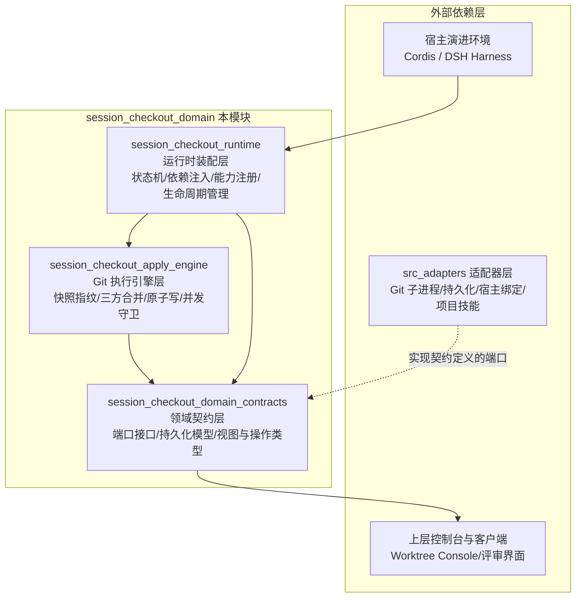

# 会话检出领域模块（session_checkout_domain）

## 模块定位与用途
本模块是 dsh-git-worktree 插件的核心领域层，位于底层基础设施适配器与上层宿主演进环境、客户端界面之间，为会话隔离工作区（Worktree）的全生命周期管理提供与宿主环境解耦的可靠业务能力。核心价值包括：
1.  **全生命周期管理**：覆盖会话绑定、隔离工作区创建、评审交付、本地预览、回滚、检查点保存、过期清理与崩溃恢复的完整流程
2.  **稳定跨层契约**：通过契约层统一端口接口、持久化数据模型、对外视图与操作结果类型，从结构上消除适配器与领域逻辑的耦合、避免循环依赖
3.  **高可靠写入保障**：通过 CAS 快照指纹校验、临时索引预演、原子锁换写、分步 journal 持久化等机制，保障任何写入崩溃点都可被精确定位与恢复
4.  **并发安全守卫**：通过纯函数式分支竞争检测，避免多会话并发操作本地仓库时的 HEAD 抢占冲突，保障多会话协作安全。

## 模块架构
本模块采用三层分离的架构设计，严格遵循单向依赖原则，各层职责清晰、边界明确，整体依赖关系如下图所示：

架构设计说明：
- 契约层为整个模块的基础类型出口，不依赖任何具体实现，所有下游组件仅依赖该层定义的接口与类型
- 交付引擎层实现 Git 操作的字节级正确性，仅通过契约层定义的端口完成文件与 Git 访问，不感知上层状态机的业务流转逻辑
- 运行时装配层持有交付引擎实例，向下通过依赖注入接入适配器实现，向上对接宿主环境完成能力注册与生命周期管理，不允许被适配器反向依赖
- 适配器层通过实现契约层定义的端口接入领域能力，所有具体实现细节（如子进程 Git、文件锁、持久化存储）对领域层透明，保障领域逻辑可被独立测试与替换。

## 核心组件文档索引
模块包含三个内聚的核心子组件，详细实现说明可参考对应文档：
1.  [会话检出领域契约](session-checkout-domain-contracts.md)
    作为领域层的基础类型表面，定义全部端口接口、受管检出注册表持久化模型、对外视图投影与操作结果判别联合，是所有领域逻辑与适配器实现的共同依赖。
2.  [会话检出交付引擎](session-checkout-apply-engine.md)
    负责 Git 字节级安全写操作执行，实现快照 CAS 指纹校验、临时索引预演、原子锁换写落地、并发分支竞争守卫，提供规划、应用、预览、回滚、检查点等全系列 Git 操作能力。
3.  [会话检出运行时模块](session-checkout-runtime.md)
    作为领域层与宿主环境的装配集成出口，完成全链路依赖注入、会话检出状态机管理、对外能力（工具/命令/RPC 服务）注册、工作区提供者生命周期管理与后台维护任务调度。