# Session Checkout 集成核心（session_checkout_integration_core）

本页描述 `session_checkout_engine` 的**集成核心层**：它把纯逻辑的 Apply 引擎（`src/session-checkout-apply.ts`）与 DSH 宿主真正接起来，负责「会话 ↔ 项目 ↔ 受管 Worktree」三者的绑定关系、台账（registry）持久化、乐观并发（revision CAS）与全局互斥、崩溃收敛（reconcile）、交付/清理生命周期，以及向模型注入**动态会话目标上下文**、在会话走进官方 Worktree 时自动登记。

本模块只包含两个源文件，但职责密度很高：

| 文件 | 核心导出 | 职责 |
| --- | --- | --- |
| `src/session-checkout-module.ts` | `createSessionCheckoutModule()`、内部 `ResolvedSessionProject` | 会话目标状态机与台账门面（约 30 个方法挂在 `SessionCheckoutModule` 接口上） |
| `src/session-target-context.ts` | `registerSessionTargetContext()`、`registerOfficialWorktreeAdoption()`、`ContextAgent` | 把状态机接到宿主的 `systemPrompt` 与 `session/event` 事件流上 |

> 本模块的复杂度集中在单个文件，无法再切分出有意义的子模块（子模块委派已被拒绝）。因此本页直接覆盖全部代码内容。

---

## 1. 定位：它在整个系统中处于哪一层

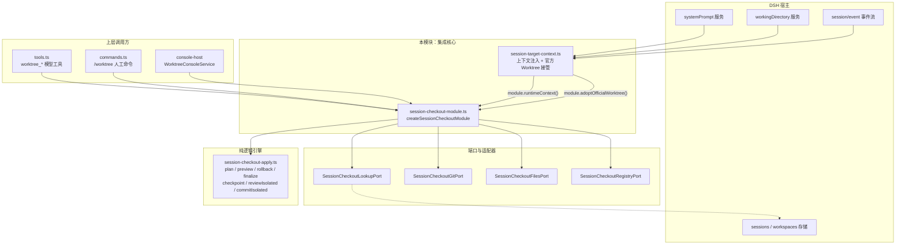

三条边界的划分是本模块最重要的设计约束：

- **Local 边界**（`record.localRoot`）：用户本地仓库，**交付流程永不写入**。只有旧的 apply/preview/finalize 遗留路径才会碰它，而 `refuseLegacyLocalWrite()` 在记录已有 `sessionBranch` 时直接拒绝这些操作。
- **受管边界**（`record.managedRoot` / `record.managedGitRoot`）：受管 Worktree，是会话的权威 cwd，也是唯一允许写任务代码的地方。
- **台账边界**（`ManagedCheckoutsRegistry`）：唯一的事实来源，`version: 2`，含 `revision`、`sessionBindings`、`managedCheckouts`。

---

## 2. 依赖注入与组装

`createSessionCheckoutModule(dependencies: SessionCheckoutDependencies)` 是唯一的入口，所有宿主能力以端口形式注入，因此状态机完全可测试。

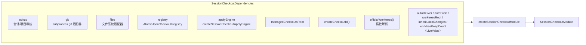

组装发生在插件入口 `src/index.ts` 的 `apply()` 中：`stateDir` 作为 `managedCheckoutsRoot`，`randomUUID` 作为 `createCheckoutId`，`officialWorktrees` 惰性读取宿主的 `worktrees` 服务（未挂载时返回 `undefined`，属正常降级）。可变的 Cordis 配置字段以 `LiveValue` 形式传入，每次使用时通过 `liveConfigValue()` 读取当前值，因此设置页改动无需重新挂载插件。

详细端口与适配器契约见 [core_ports_and_types](core-ports-and-types.md) 与 [adapters_infrastructure](adapters-infrastructure.md)；引擎侧见 [session_checkout_apply_engine](session-checkout-apply-engine.md)。

---

## 3. `src/session-checkout-module.ts`：状态机与台账门面

### 3.1 `ResolvedSessionProject` 与会话/项目解析

```typescript
interface ResolvedSessionProject {
  session: SessionCheckoutSessionRecord
  project: SessionCheckoutProjectRecord
}
```

这是内部私有接口，仅由 `resolveSessionProject(sessionId)` 产出。它把「会话 → 项目 → 项目根存在」三级校验串起来，是几乎所有创建类路径的前置条件：

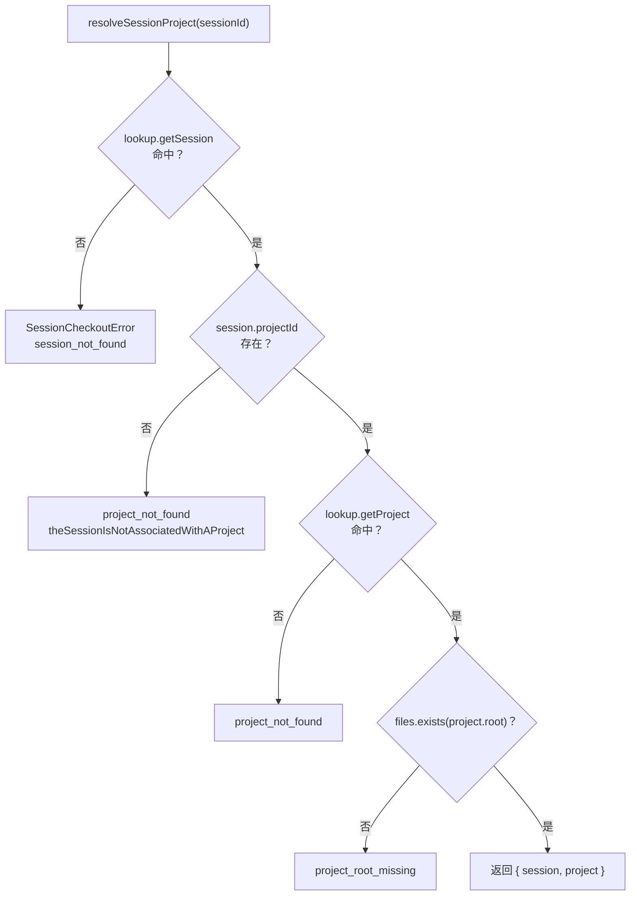

与之并列的是 `requireSession(sessionId)`（只校验会话）和 `resolveBinding(sessionId)`（读取已持久化的 `SessionBindingRecord`，并在 `session.projectId` 与绑定不一致时做一次「已交付 Worktree 的空壳 workspace」宽容判定，否则抛 `project_mismatch`）。

### 3.2 绑定生命周期

| 方法 | 触发方 | 说明 |
| --- | --- | --- |
| `bind(sessionId, choice)` | 客户端选择 Local / Isolated | 落到 `bindTarget()`；本地选择只写绑定，隔离选择走完整创建链 |
| `createOfficialTarget(agent, options)` | `worktree_create` 工具 | 通过宿主 `worktrees.create` 建树，再由 `registerOfficialWorktree()` 登记进台账；已站在本树内则复用而非重建 |
| `adoptOfficialWorktree(sessionId, cwd)` | `working-directory/change` 事件 | 把官方工具/forge 面板建的树接进台账（`adoptWorktreeForSession()`） |
| `beginNextIteration(sessionId, rev)` | 已交付会话开新一轮 | 复用被清理掉的不可变 cwd 路径，以**上一轮会话分支 tip** 为起点重建 |
| `repairStaleWorktreeLinks()` | 绑定/创建前 | 仓库移动后用 `git worktree repair` 重连断链，并搬迁台账记录 |

`bindTarget()` 的分支判定是理解整个绑定语义的关键：

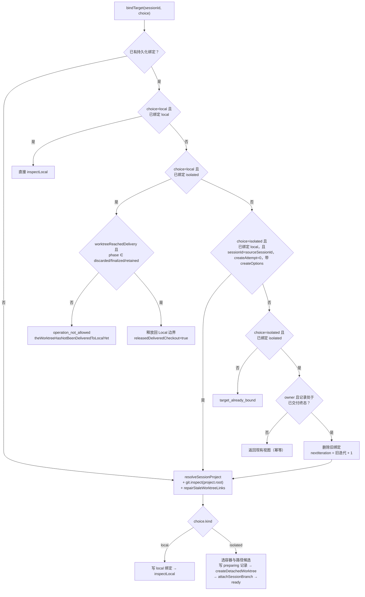

创建路径的**身份与路径安全**设计值得单独说明：

- 容器选择优先「仓库同级容器」（`siblingContainer`），避免 Local 把受管树当成 untracked 文件；若外层已是另一个 Worktree（`findContainingWorktreeRoot(dirname(localGitRoot))` 结果不等于本地根），则降级到 `fallbackContainer`。
- 同名但内容未知的容器**不是我们的**：仅当它是空目录时才回收重建，非空则整体拒绝（`checkout_mismatch`）。
- 路径候选按「磁盘不存在 **且** 台账未被占用」双重过滤——只判磁盘会漏掉「记录还在、目录已被删」的幽灵路径。
- 创建失败分三档：`finishFailedCreation()` 依据 `WorktreeCreationFailure.rolledBack` 决定「清账 + 抛错」还是「标记 `recovery_required`」；有 `.git` 文件的残余视为**部分成功**，直接进入恢复态；无 `.git` 的空残余目录可安全删除，随后重试一次（`createAttempt < 1`）。

### 3.3 检查与投影（inspect）

`inspect()` 对外暴露为 `inspectAvailable()`，是所有读路径的统一入口：

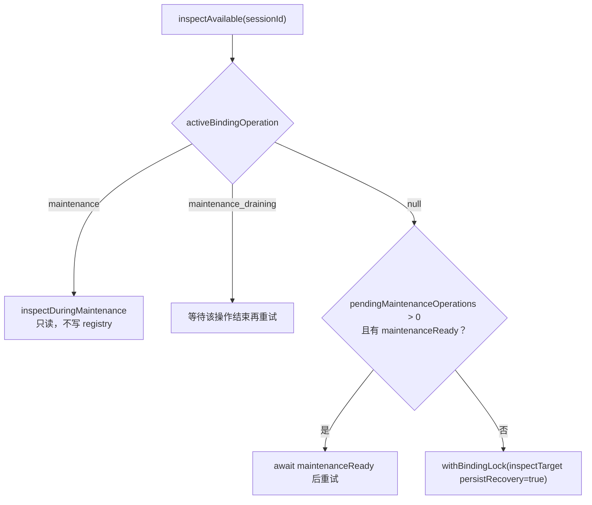

- `inspectLocal(binding)`：读 Local 的 `git status` 与 `git inspect`，产出 `kind: 'local'` 视图；无快照时以 `UNVERSIONED_OID`/`WORKING_TREE` 表示未版本化。
- `inspectIsolated(binding, persistRecovery)`：核心校验器。先做 `recovery_required` 且 `journal === null` 的**自动复原**（`validateManagedCheckoutDetailed(..., false)` 通过则回 `ready`），再走完整验证；`invalid` 才持久化恢复态，`unavailable`（Git 超时等瞬时故障）只降级本次读取，不污染记录。
- `committedFollowupView()`：已 `finalized`/`retained`/`delivered` 的记录即使环境异常也只影响 cleanup，不降级会话；它还通过 `git.isAncestor()` 计算 `commitInLocalHistory`。
- `projectDelivery()` / `projectCheckpoint()` / `projectPreviousReview()`：把持久化记录投影成只读视图类型，**逐 state 手写**，避免把内部字段（如 `isolatedFingerprint`）泄漏到客户端契约。

`validateManagedCheckoutDetailed()` 是整个模块最重的身份校验，返回三态 `valid | invalid | unavailable`，并行执行四次 `canonicalize` 与两次 `inspect`，再逐项比对：

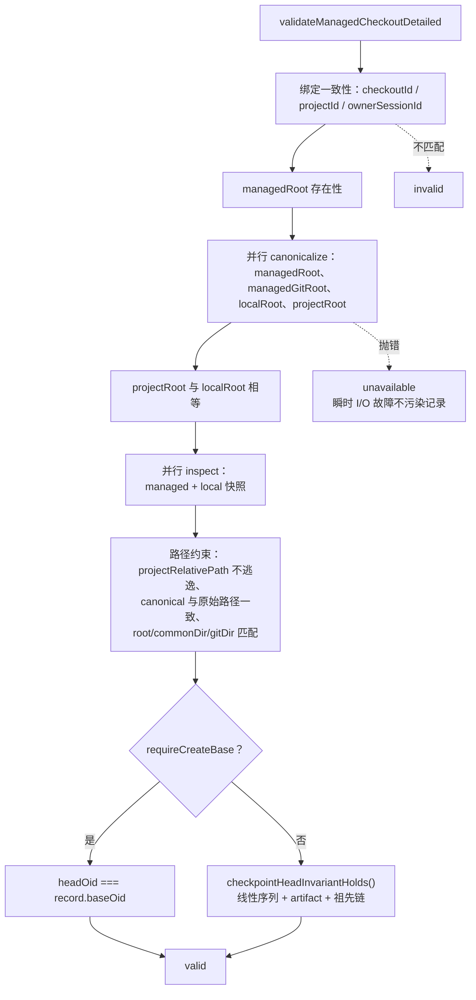

`checkpointHeadInvariantHolds()` 的优化点：先做 O(n) 结构校验（序号连续、ID 唯一），再用 `Promise.all` 并行取证（原为循环内 3n+1 次串行 `spawn`），最后按原短路顺序判定。

### 3.4 运行时上下文（`runtimeContext`）

这是纯**同步**函数：只读 registry，不做任何 Git/FS I/O，因此可以在每次 `systemPrompt` 求值时安全调用（保证重放稳定）。它按「绑定类型 → 记录状态 → cwd 位置」生成不同的指令块：

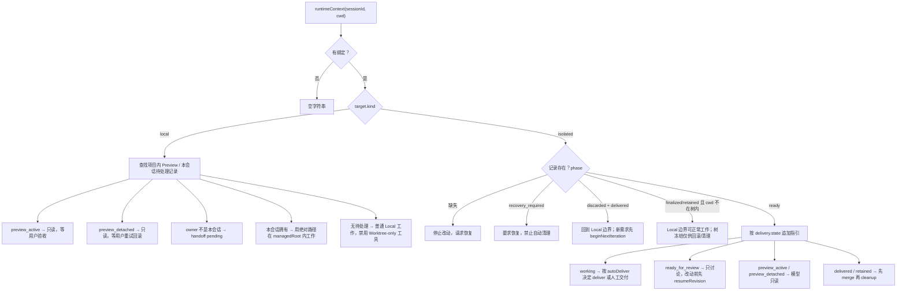

两个易错的细节：

- 判断「会话是否在树内」用 **包含关系**（`pathIsWithin`）而非相等——会话经常会 `cd` 进子目录。
- `delivered` 且已清理时必须明确说「Local 边界恢复可用」，否则模型会以为受写保护钩子阻断，把会话锁死。

### 3.5 操作分发（`operate`）

`operate(input)` 在 `withBindingLock` 内先 `resolveBinding()`，再按 `input.action` 分发到九个 `operate*` 处理器；`SessionCheckoutError` 统一转成 `{ status: 'error', code, message }` 结果（非领域错误继续抛出）。

| action | 处理器 | 关键守卫 |
| --- | --- | --- |
| `apply` | `operateApply` | `refuseLegacyLocalWrite`；fingerprint 与 review 不符则退回 `working` + `stale_isolated` |
| `preview` | `operatePreview` | 同上；写入前 `retainPreviewArtifacts()` 落 receipt，再进 `artifacts_retained` |
| `rollback_preview` | `operateRollbackPreview` | 支持 `preview_detached` 重试（需 `recoveryProof` 通过 `recoveryProofMatches`） |
| `finalize_preview` | `operateFinalizePreview` | `isValidCommitMessage`；`beforeCommit` 落 journal 后才提交 |
| `finish` | `operateFinish` | **只提交会话分支**，Local 全程不读写；`commitIsolated`/`reviewIsolated` 缺失则拒绝 |
| `checkpoint` | `operateCheckpoint` | `requestId` 幂等重放、`expectedGeneration` 校验、项目验收槽位互斥 |
| `discard` | `operateDiscard` | `confirmDirty` + 放弃前快照（`snapshotAbandonedWorktree`），快照失败即中止 |
| `recover` | `operateRecover` | 终态记录拒绝复活；有 journal 时先 `reconcile()` 收敛 |
| `retry_cleanup` | `operateRetryCleanup` | 仅 `finalized`/`retained`；带 `allowLegacyResidue` |

`operateFinish` 的交付语义是本地适配的重点：`ensureSessionBranch()` 先保证 Worktree 挂在自己的会话分支上（历史记录在此补建），随后只在**该分支**上提交；`autoPush` 开启时推的是**会话分支**（Worktree 的 HEAD）而非 Local 当前分支，失败只降级为 `push: { status: 'failed' }` 备注。

### 3.6 并发模型

模块内部有两层并发控制：

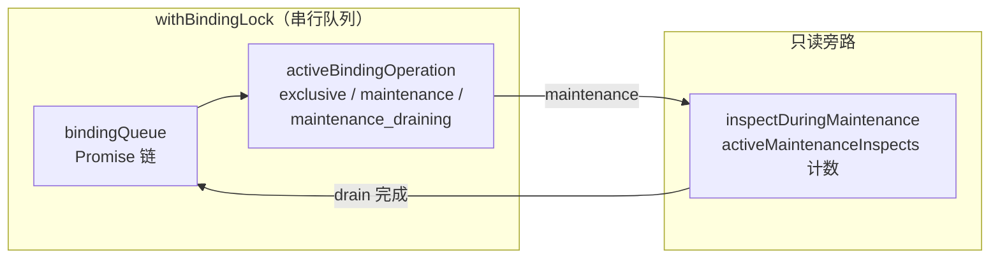

- **exclusive**：所有 mutation（bind/operate/markReadyForReview/merge/cleanup…）独占执行。
- **maintenance**（`allowConcurrentInspect: true`）：`reconcile`、`cleanupExpiredRetained`、`enforceWorktreeKeepCount`、`preflightPreviewRecovery` 使用它；期间 `inspect` 走**只读旁路**，且 `persistRecovery = false`，避免一个历史 Worktree 因 Windows 文件占用阻塞所有会话。
- **draining**：maintenance 结束时先关闭新旁路，等已启动的 inspect 结束，再交还队列。

另有两处超时/重试保护：

- `withCleanupTimeout(checkoutId, op)`：单个 checkout 的清理 120s 上限；**同一 checkout 的在跑清理复用同一 Promise**（`cleanupInFlight`），否则每次超时新起一个 `cleanupFinalized` 会在 registry 上交错丢更新。
- `retryTransientCleanup()`：对 `EBUSY`/`EPERM`/`EACCES`/`ENOTEMPTY` 按 100/300/800ms 退避重试。

### 3.7 崩溃收敛与清理

`reconcile()` 是启动与恢复的唯一收敛器，按 `journal` 的**可重放 receipt** 决定前进或回退：

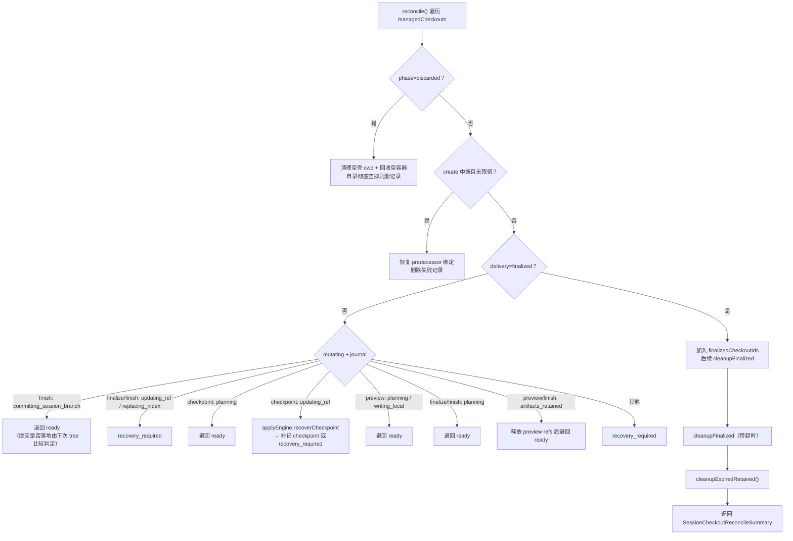

`cleanupFinalized()` 是删除链的安全核心，其阻塞原因被结构化为 `WorktreeCleanupReason`：

| reason | 含义 | 是否自动重试 |
| --- | --- | --- |
| `directory_busy` | 目录被占用 | 是（`retryableCleanupBlock`） |
| `quarantine_busy` | 隔离区仍有残留 | 是 |
| `identity_changed` | 目录身份对不上（已换成别的东西） | 否，需人工判断 |
| `modified_after_finalize` | 交付后又有改动 | 否，需人工确认 |
| `detached_residue` | 旧版遗留的残余 | 仅 `allowLegacyResidue` 时继续 |

删除流程：`inspectReview` 指纹 CAS → `inspectDirectoryIdentity` → `beginRemoval` 写 journal receipt → `git.removeWorktree` → 仍有残余则 `quarantineDirectoryTree`（改名到 `.dsh-wt-cleanup--<id8>--<opId>`）→ 复核隔离区身份 → `removeDirectoryTree`。任何一步失败都按**归因**写回不同 `cleanupReason`，避免「永远清不掉的记录长期占配额」。

### 3.8 查询、管理与分支工具

只读与管理类方法刻意不占用全局 mutation lock（或只在自己的 `withBindingLock` 内短持有），避免慢速目录诊断阻塞用户操作：

- `listManagedWorktrees` / `listManagedWorktreesForSession`：默认**保守且不扫盘**（`dirty = true`），只有 `includeDiagnostics` 才做 Git/磁盘取证。
- `inspectManagedWorktreeCleanup` / `inspectCleanupForRecord`：产出 `safe | retained | blocked` 的只读清理资格判定。
- `bulkCleanupManagedWorktrees`：按 `expectedRevision` CAS 逐条清理，revision 变化即保留并回报原因。
- `manageManagedWorktreeForSession`：在 `manageManagedWorktree` 之外额外做**调用方授权**（owner/source 会话 + 项目一致），绝不把持久化的 owner id 当授权凭据。
- `pruneMergedBranchesInRepo`：只做「完全已合并」的安全删除（`git branch -d` 语义），当前分支与主干永不入候选；**会话分支（`record.sessionBranch`）即使已合并也跳过**——删掉它会让该会话下一次交付写到不存在的地方。
- `mergeBranchForSession`：`sourceBranch` 必须是本会话某个受管 worktree 的当前分支或会话分支；Local 自身分支不可作为来源；非 `dryRun` 时受项目验收槽位互斥约束。
- `attachSessionBranch` / `ensureSessionBranch`：候选名逐个尝试（`feat/sess-<session>--<topic>`、`-2`、`-3`…），同名分支仅在「正指向当前 HEAD」或「可快进」时复用，绝不覆盖别人的提交。

---

## 4. `src/session-target-context.ts`：宿主上下文接线

该文件把状态机的两个输出接到 Cordis 宿主上，代码量小但决定了模型能否「知道自己站在哪」。

### 4.1 `registerSessionTargetContext`

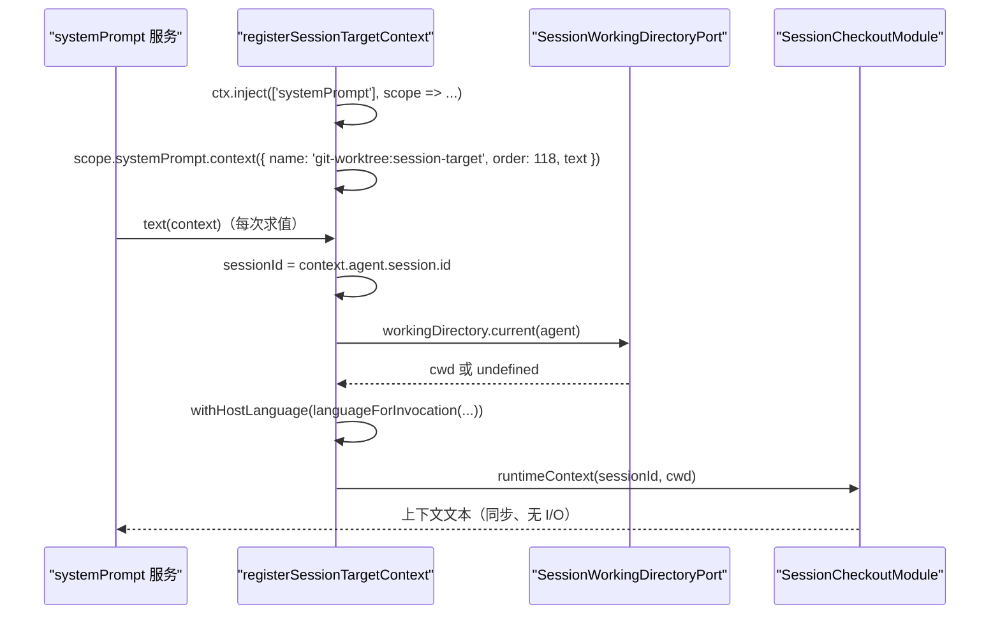

设计要点：

- **不执行任何 Git/文件系统 I/O**，只做 registry 快照，保证上下文可重放稳定。
- `order: 118` 与命名空间 `git-worktree:session-target` 保证注入位置稳定。
- 语言通过 `withHostLanguage(languageForInvocation(context.agent, scope), ...)` 绑定到 `AsyncLocalStorage`，因此同一进程内的并发会话不会串语言。
- `ContextAgent` 是**窄化接口**：`{ session?: { id?: unknown } }`，只取 `session.id`，避免依赖宿主 Agent 的完整类型。
- `workingDirectory` 端口缺失时 `current()` 返回 `undefined`，`runtimeContext` 会退化为「宣布绝对路径规则」，即优雅降级而非报错。

### 4.2 `registerOfficialWorktreeAdoption`

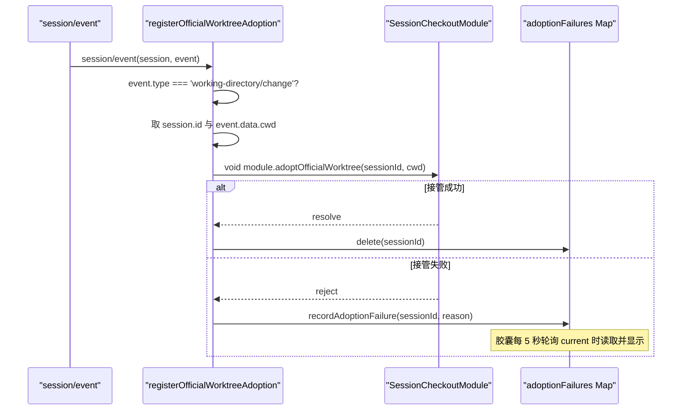

为什么用 `working-directory/change`：官方 `worktrees.create` 的最后一步就是 `workingDirectory.set`，因此该事件是「树已建好且成为某会话落脚点」的唯一信号，比轮询 `git worktree list` 更及时，也不需要为每个项目起子进程。

事件 feed 不等待监听者，所以必须 `void ... .catch(...)` 接住 rejection，否则会成为 unhandled rejection。失败原因存在**内存 Map**（`adoptionFailures`）中，仅进程内有效：重启后树已在盘上，重进一次就会重新触发登记。

---

## 5. 交付状态机总览

`phase`（`SessionCheckoutPhase`）与 `delivery.state`（`ManagedCheckoutDelivery`）是两套正交的状态维度：前者描述「检查点本身是否可安全操作」，后者描述「这一轮交付走到哪」。

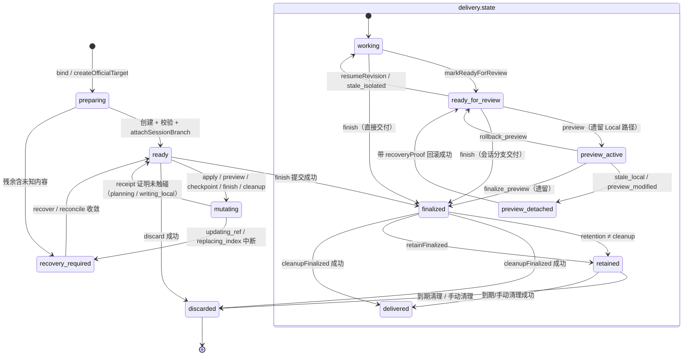

> 图中 `preview_*` 与 `apply` 属于**遗留的「写进 Local」路径**；当前交付语义是「只在会话分支内提交，Local 完全不动」，由 `refuseLegacyLocalWrite()` 在有 `sessionBranch` 时一律拒绝。因此 `preview_*` 只在历史记录上出现。

---

## 6. 与其他模块的关系

| 关注点 | 去哪里看 |
| --- | --- |
| Apply 引擎内部（plan/preview/rollback/finalize/checkpoint 的 Git 细节） | [session_checkout_apply_engine](session-checkout-apply-engine.md) |
| 引擎整体分层与入口 | [session_checkout_engine](session-checkout-engine.md) |
| 集成层总览（本模块的父级） | [session_checkout_engine_integration](session-checkout-engine-integration.md) |
| 模型工具 `worktree_*` 的注册与参数校验 | [session_checkout_tools](session-checkout-tools.md) |
| 端口接口定义（`SessionCheckoutDependencies`、`ManagedCheckoutRecord` 等） | [core_ports_and_types](core-ports-and-types.md) |
| git / files / registry / lookup 适配器实现 | [adapters_infrastructure](adapters-infrastructure.md) |
| Worktree 创建、路径命名、会话分支候选、官方登记 | [core_worktree_domain](core-worktree-domain.md) |
| 领域总览 | [Worktree_and_Session_Checkout_Domain](worktree-and-session-checkout-domain.md) |
| `SessionCheckoutModule` 公共类型与 `SessionCheckoutError` | [public_api](public-api.md) |
| 控制面/RPC 如何消费本模块的视图 | [console_host](console-host.md)、[console_contract](console-contract.md) |
| 客户端如何展示胶囊/验收卡 | [client_core](client-core.md)、[client_target_console](client-target-console.md) |
| 多语言消息（`hostMessage`、`withHostLanguage`） | [i18n](i18n.md) |
| 构建/类型检查配置（`strict`、`noUncheckedIndexedAccess`） | [build_deployment_configuration](build-deployment-configuration.md) |

---

## 7. 扩展与维护提示

1. **新增一个 `operate` 动作**：需同时更新 `SessionCheckoutOperation` 联合类型（`src/types.ts`）、`operateTarget()` 的分发分支（含 `const exhaustive: never` 兜底）、以及 `reconcile()` 中对应的 journal 中断分支——否则崩溃后会落入「其他 → `recovery_required`」。
2. **任何写 registry 的单记录更新必须走 `registry.update()`**：`read()` + `write()` 之间隔着两次调用，跨进程写入会被后写者抹掉。
3. **revision 是乐观锁**：所有 mutation 都要比对 `input.expectedRevision`，不匹配返回 `stale_target` 而不是重试。
4. **不要给 `runtimeContext` 加 I/O**：它在每次 system prompt 求值时同步调用。
5. **`cleanupReason` 的归因决定是否自动重试**：`identity_changed` / `modified_after_finalize` 必须人工介入，误写成 `directory_busy` 会让记录永远占配额。
6. **新增清理阻塞原因**：需同时更新 `WorktreeCleanupReason`、`cleanupReasonForMessage()`（兼容旧记录的关键词兜底）、`retryableCleanupBlock()`、`inspectCleanupForRecord()` 的映射，以及 `src/i18n/host-messages.ts` 的消息键。
7. **类型严格度**：`tsconfig.json` 启用了 `strict` + `noUncheckedIndexedAccess`，因此代码中大量 `record.checkpoints!` / `[index]!` 断言是有意为之，重构时不要盲目移除。
